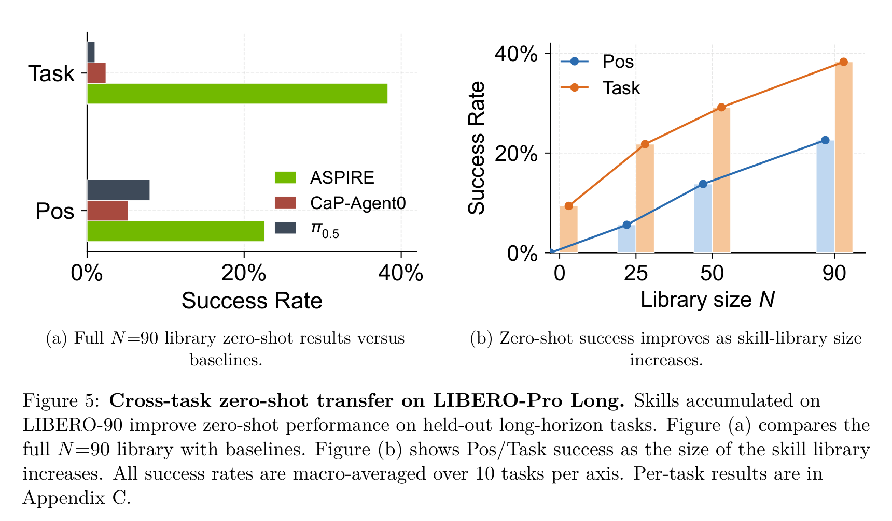
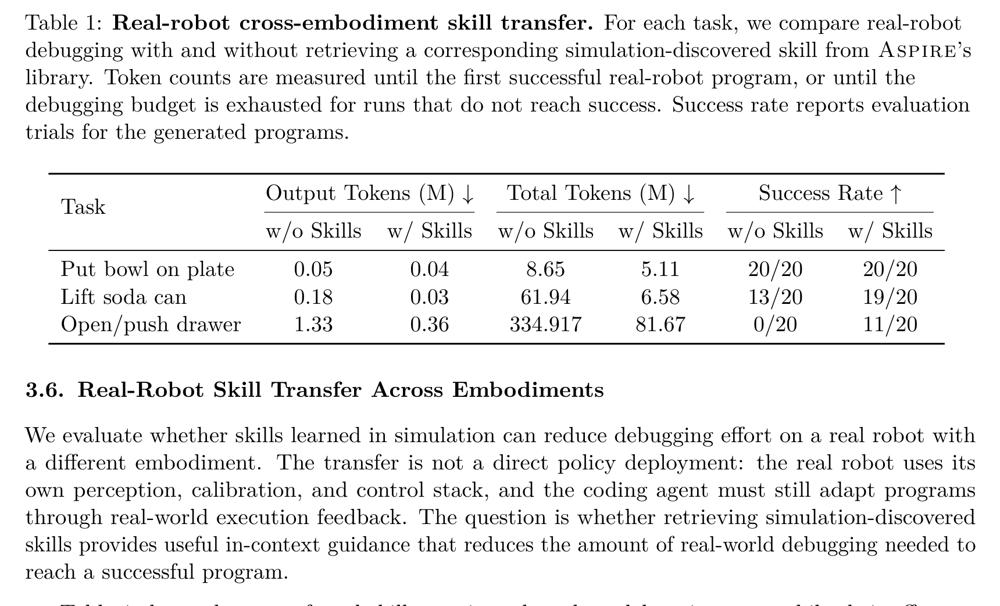
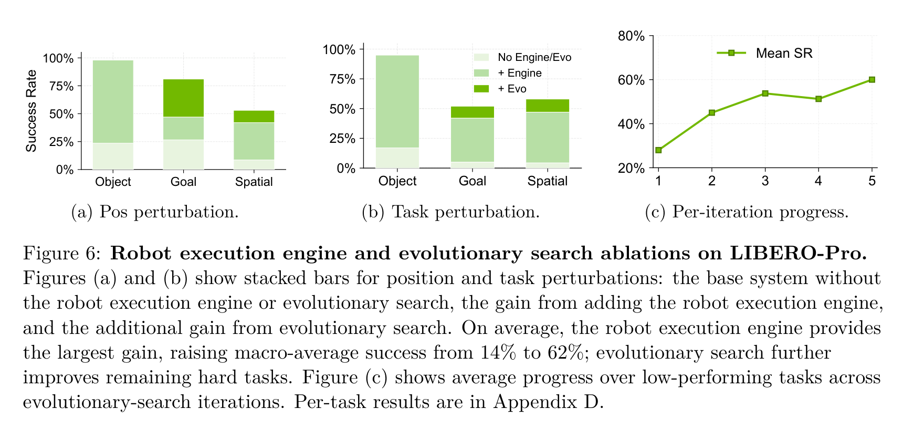
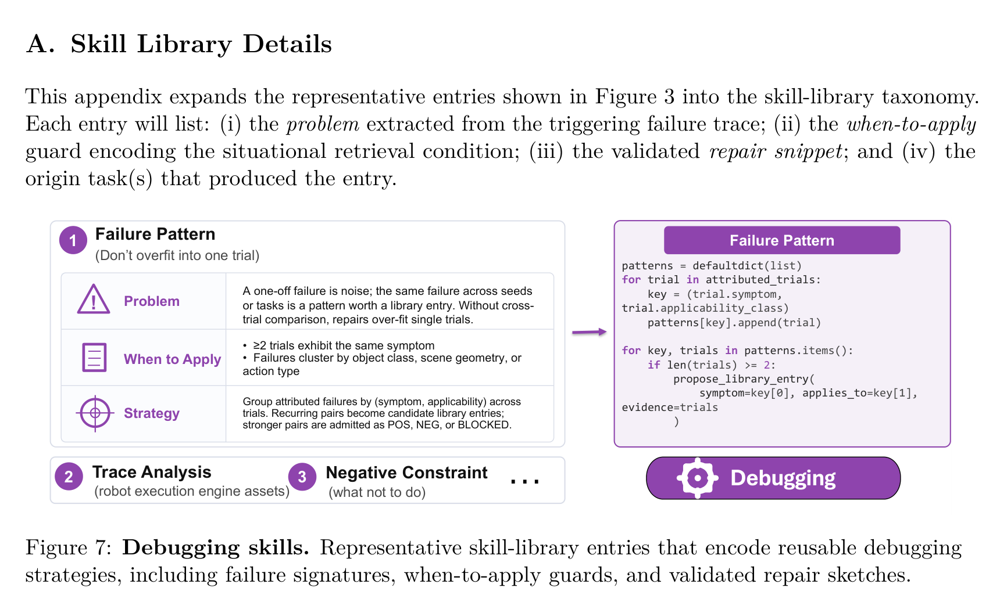
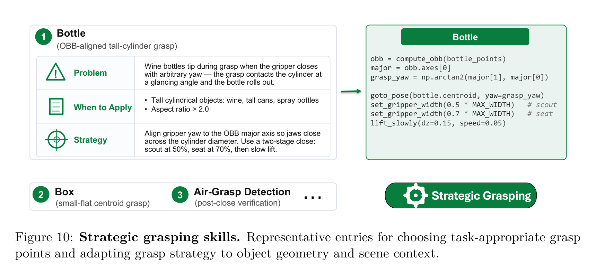
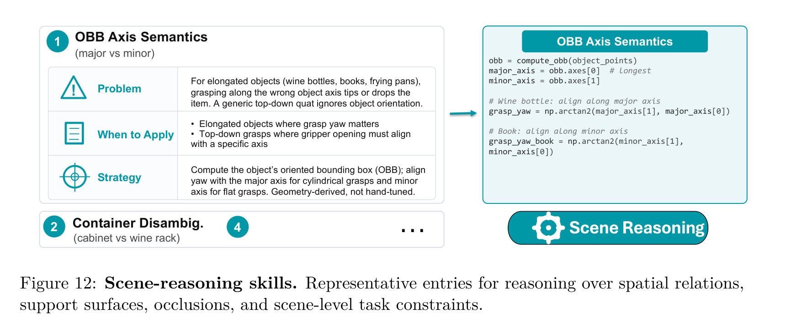
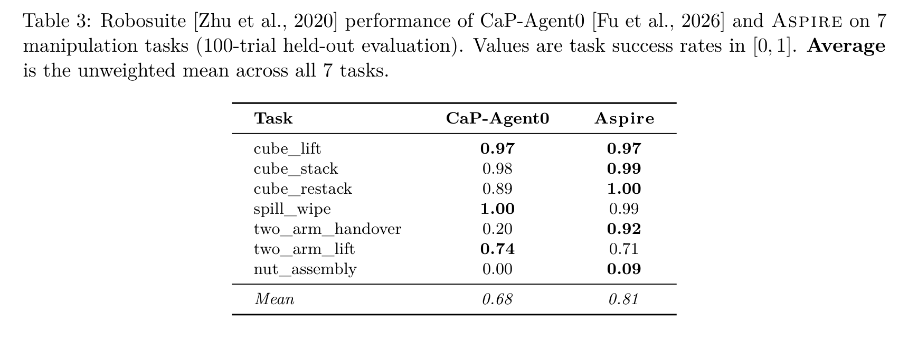
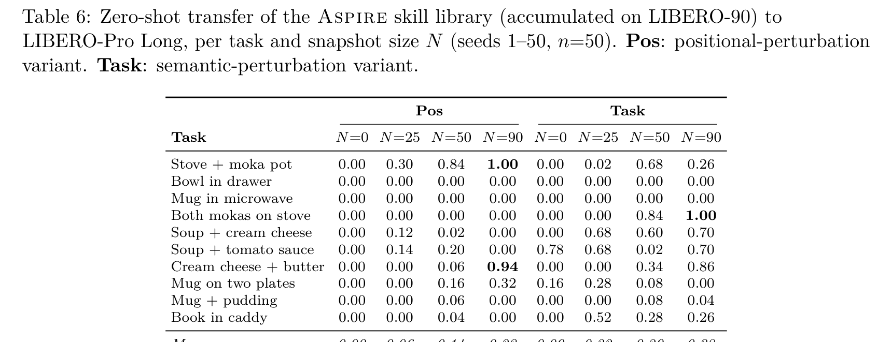
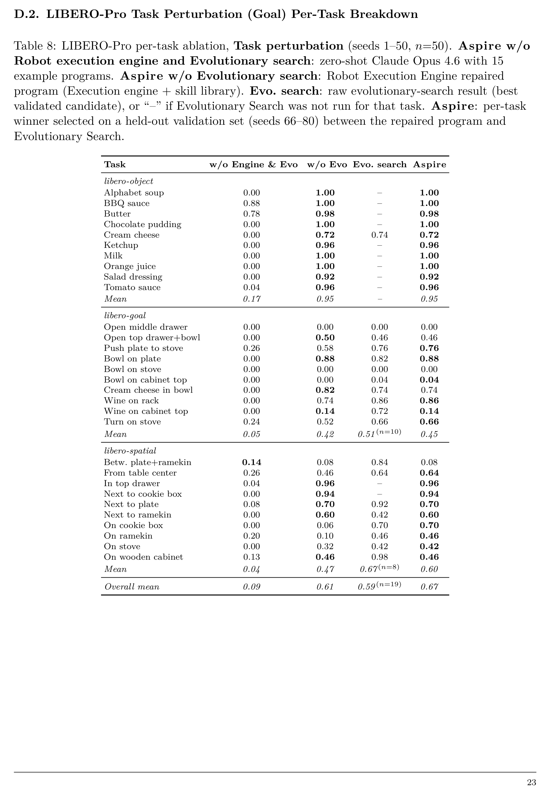

# ASPIRE: Agentic /Skills Discovery for Robotics

> **Source identity:** Runyu Lu$^{1,2*\dagger}$, Yubo Wu$^{1,3*}$, Ethan Kou$^{1,4*}$, Letian Fu$^{1,4}$, Wenli Xiao$^{1,5}$, Ajay Mandlekar$^1$, Yinzhen Xu$^1$, Guanya Shi$^5$, Ken Goldberg$^4$, Ang Chen$^2$, Mosharaf Chowdhury$^2$, Yuke Zhu$^{1\dagger}$, Linxi “Jim” Fan$^{1\dagger}$, Guanzhi Wang$^{1\dagger}$; $^1$NVIDIA, $^2$UMich, $^3$UIUC, $^4$UC Berkeley, $^5$CMU. ($^*$Equal contribution, $^\dagger$Project leads). arXiv:2607.00272v1 [cs.RO], 30 Jun 2026. Project page: [https://research.nvidia.com/labs/gear/aspire/](https://research.nvidia.com/labs/gear/aspire/).
>
> **Reader policy:** This bilingual reader strictly follows the source manuscript order. Every substantive English prose block is immediately paired with a rigorous, publication-grade academic Chinese translation. Display equations are preserved on standalone lines outside blockquotes, while inline mathematical expressions use single dollar delimiters. All figure and table assets are referenced via relative links (`assets/`), and numerical tables are fully transcribed into searchable Markdown tables. Bibliographic references and code literals are preserved in their precise original form.

## Page and Section Index / 页面与章节导览

> <span style="color:#3B82F6"><strong>Para. M-1:</strong></span> Document structure and page map (43 pages):
> - Title, Authors, Abstract, Section 1 Introduction (Pages 1–3) [Figure 1: System Overview, Page 2]
> - Section 2 Method / The Aspire Framework (Pages 3–7)
>   - 2.1 Robot Execution Engine & Multimodal Traces (Pages 3–6) [Figure 2: Execution Engine Debugging, Page 4]
>   - 2.2 Skill Library Distillation & Retrieval (Pages 5–6) [Figure 3: Skill Library Breadth & Taxonomy, Page 5]
>   - 2.3 Evolutionary Search (Pages 6–7) [Algorithm 1: Evolutionary Search Over Programs, Page 7]
> - Section 3 Experiments (Pages 7–11)
>   - 3.1 Experimental Setup (Page 7)
>   - 3.2 Benchmarks and Baselines: LIBERO-Pro, Robosuite, BEHAVIOR-1K (Page 7)
>   - 3.3 Evaluation Protocol (Pages 8–9) [Figure 4: Benchmark Families Comparison, Page 8]
>   - 3.4 Main Evaluation Results (Page 9)
>   - 3.5 Cross-Task Zero-Shot Skill Transfer on LIBERO-Pro Long (Page 9) [Figure 5: Zero-Shot Transfer Curves, Page 9]
>   - 3.6 Real-Robot Skill Transfer Across Embodiments (Page 10) [Table 1: Sim-to-Real Transfer on Bimanual YAM, Page 10]
>   - 3.7 Diagnostic Ablations on Traces & Search (Pages 10–11) [Figure 6: Engine & Evo Search Ablations, Page 11]
> - Section 4 Related Work (Page 11)
>   - Agentic robot control & Code generation for robotics
>   - Self-improving agents, skill libraries & continual learning
> - Section 5 Limitations & Future Work (Pages 11–12)
> - Section 6 Conclusion & Acknowledgments (Page 12)
> - References (Pages 12–16)
> - Appendix A Skill Library Details: Taxonomy & Case Studies (Pages 17–19)
>   - Figure 7: Debugging Skills (Page 17)
>   - Figure 8: Localization Skills (Page 17)
>   - Figure 9: Navigation Skills (Page 18)
>   - Figure 10: Strategic Grasping Skills (Page 18)
>   - Figure 11: Motion-Primitive Skills (Page 18)
>   - Figure 12: Scene-Reasoning Skills (Page 19)
> - Appendix B Main Benchmark Result Tables (Page 20)
>   - Table 2: LIBERO-Pro Macro-Averaged Results (Page 20)
>   - Table 3: Robosuite 7 Manipulation Tasks (Page 20)
>   - Table 4: BEHAVIOR-1K Soda Can & Radio (Page 20)
> - Appendix C LIBERO-Pro Long Zero-Shot Transfer (Page 21)
>   - Table 5: Macro-Averaged Zero-Shot Transfer (Page 21)
>   - Table 6: Per-Task Breakdown across Snapshot Sizes N (Page 21)
> - Appendix D Ablation Details (Pages 22–24)
>   - Table 7: Position Perturbation Per-Task Breakdown (Page 22)
>   - Table 8: Task Perturbation Per-Task Breakdown (Page 23)
>   - Table 9: Evolutionary Search Progress Per-Task (Page 24)
> - Appendix E Agent Pipeline Skills (Pages 25–43)
>   - E.1 Skill Library Prompts (Page 25)
>   - E.2 Agent System Prompt and Persistent Memory (Pages 25–28)
>   - E.3 ASPIRE Fix Loop Skills: Coordinator & Subagent Protocols (Pages 28–33)
>   - E.4 ASPIRE Evolutionary Search Skills: 6-Step Search Protocol (Pages 33–37)
>   - E.5 Initial Skill Library Templates: Grasp, Localization, Manipulation, Transport (Pages 38–43)

> <span style="color:#F59E0B"><strong>Para. M-1[CN]:</strong></span> 全文结构与页码导览（共 43 页）：
> - 标题、作者、摘要、第 1 节 引言（第 1–3 页）[图 1：系统总览，第 2 页]
> - 第 2 节 方法 / Aspire 框架体系（第 3–7 页）
>   - 2.1 机器人执行引擎与多模态轨迹（第 3–6 页）[图 2：执行引擎调试过程，第 4 页]
>   - 2.2 技能库蒸馏与检索（第 5–6 页）[图 3：技能库广度与分类体系，第 5 页]
>   - 2.3 进化搜索算法（第 6–7 页）[算法 1：面向控制程序的进化搜索，第 7 页]
> - 第 3 节 实验评估（第 7–11 页）
>   - 3.1 实验设置（第 7 页）
>   - 3.2 评测基准与对比基线：LIBERO-Pro、Robosuite、BEHAVIOR-1K（第 7 页）
>   - 3.3 评估协议（第 8–9 页）[图 4：三大基准家族对比，第 8 页]
>   - 3.4 主要实验结果分析（第 9 页）
>   - 3.5 LIBERO-Pro Long 跨任务零样本技能迁移（第 9 页）[图 5：零样本迁移性能曲线，第 9 页]
>   - 3.6 跨机械臂具身形态的真机技能迁移（第 10 页）[表 1：双臂 YAM 真机迁移对比，第 10 页]
>   - 3.7 诊断消融实验：执行引擎与进化搜索（第 10–11 页）[图 6：消融实验堆叠柱状图与搜索收敛曲线，第 11 页]
> - 第 4 节 相关工作（第 11 页）
>   - 智能体机器人控制与代码即策略生成
>   - 自我改进智能体、技能库与持续学习
> - 第 5 节 局限性与未来工作（第 11–12 页）
> - 第 6 节 结论与致谢（第 12 页）
> - 参考文献（第 12–16 页）
> - 附录 A 技能库详细分类与典型案例（第 17–19 页）
>   - 图 7：调试诊断技能（第 17 页）
>   - 图 8：定位感知技能（第 17 页）
>   - 图 9：导航规划技能（第 18 页）
>   - 图 10：策略抓取技能（第 18 页）
>   - 图 11：运动基元技能（第 18 页）
>   - 图 12：场景推理技能（第 19 页）
> - 附录 B 主实验完整数值表格（第 20 页）
>   - 表 2：LIBERO-Pro 宏平均实验数据（第 20 页）
>   - 表 3：Robosuite 7 项接触丰富操作任务（第 20 页）
>   - 表 4：BEHAVIOR-1K 可乐罐与收音机任务（第 20 页）
> - 附录 C LIBERO-Pro Long 零样本迁移详表（第 21 页）
>   - 表 5：宏平均零样本迁移结果（第 21 页）
>   - 表 6：逐任务随技能库规模 N 的性能细分（第 21 页）
> - 附录 D 消融实验逐任务细分（第 22–24 页）
>   - 表 7：位置扰动（Swap）逐任务消融（第 22 页）
>   - 表 8：任务目标扰动（Goal）逐任务消融（第 23 页）
>   - 表 9：进化搜索迭代收敛轨迹（第 24 页）
> - 附录 E 智能体系统管线与提示词技能（第 25–43 页）
>   - E.1 技能库汇报与准入提示词（第 25 页）
>   - E.2 智能体系统提示词与持久记忆（第 25–28 页）
>   - E.3 ASPIRE 修复循环技能：协调器与子智能体工作流（第 28–33 页）
>   - E.4 ASPIRE 进化搜索技能：6步迭代搜索协议（第 33–37 页）
>   - E.5 初始技能库模板：抓取、定位、操作、运送（第 38–43 页）

## Terminology Ledger / 核心术语对齐表

> <span style="color:#3B82F6"><strong>Para. M-2:</strong></span> Core terminology mapping:
> - **ASPIRE** (Agentic Skill Programming through Iterative Robot Exploration) = 基于迭代机器人探索的智能体技能编程系统
> - **Code-as-Policy (CaP)** = 代码即策略
> - **Robot Execution Engine** = 机器人执行引擎
> - **Multimodal Traces** = 多模态执行轨迹 / 追踪日志
> - **Skill Library** = 技能库
> - **Evolutionary Search** = 进化搜索
> - **Coordinator–Actor Architecture** = 协调器–执行者架构
> - **Sim-to-Real Transfer** = 仿真到真机迁移
> - **Cross-Embodiment Transfer** = 跨具身形态迁移
> - **In-Context Guidance** = 上下文提示指导
> - **Continuous / Open-Ended Learning** = 持续 / 开放式学习
> - **Zero-Shot Transfer** = 零样本迁移
> - **Oriented Bounding Box (OBB)** = 定向边界框
> - **Prehensile / Non-Prehensile Manipulation** = 抓取式 / 非抓取式操作（如推移、拨动）
> - **Collision Avoidance Buffer** = 避碰缓冲区
> - **Vision-Language-Action (VLA)** = 视觉-语言-动作模型

> <span style="color:#F59E0B"><strong>Para. M-2[CN]:</strong></span> 核心术语对齐表：
> - **ASPIRE**（Agentic Skill Programming through Iterative Robot Exploration）译为“基于迭代机器人探索的智能体技能编程系统”；
> - **Code-as-Policy (CaP)** 译为“代码即策略”；
> - **Robot Execution Engine** 译为“机器人执行引擎”；
> - **Multimodal Traces** 译为“多模态执行轨迹 / 追踪日志”；
> - **Skill Library** 译为“技能库”；
> - **Evolutionary Search** 译为“进化搜索”；
> - **Coordinator–Actor Architecture** 译为“协调器–执行者架构”；
> - **Sim-to-Real Transfer** 译为“仿真到真机迁移”；
> - **Cross-Embodiment Transfer** 译为“跨具身形态迁移”；
> - **In-Context Guidance** 译为“上下文提示指导”；
> - **Continuous / Open-Ended Learning** 译为“持续 / 开放式学习”；
> - **Zero-Shot Transfer** 译为“零样本迁移”；
> - **Oriented Bounding Box (OBB)** 译为“定向边界框”；
> - **Prehensile / Non-Prehensile Manipulation** 译为“抓取式 / 非抓取式操作”（例如沿支撑平面推移 push）；
> - **Collision Avoidance Buffer** 译为“避碰缓冲区”；
> - **Vision-Language-Action (VLA)** 译为“视觉-语言-动作模型”。

# Abstract

> <span style="color:#3B82F6"><strong>Para. 1:</strong></span> Traditional robot programming is notoriously challenging: it requires orchestrating multimodal perception, managing complex physical contact dynamics, and handling diverse environment configurations and execution failures.

> <span style="color:#F59E0B"><strong>Para. 1[CN]:</strong></span> 传统的机器人编程因极其复杂而困难重重：它需要协同多模态感知、处理复杂的物理接触动力学，并应对多样化的环境构型与执行故障。

> <span style="color:#3B82F6"><strong>Para. 2:</strong></span> We introduce Aspire (Agentic Skill Programming through Iterative Robot Exploration), a continual learning system for robotics that autonomously writes and refines robot control programs in a code-as-policy paradigm while compounding experience into a reusable skill library. Aspire enables automated discovery of reusable skills that persist across multiple tasks, simulation and real-world settings, and different embodiments. Rather than relying on fixed, human-engineered pipelines, Aspire operates in an open-ended learning loop, consisting of three key components: (1) a closed-loop robot execution engine that exposes fine-grained multimodal traces (e.g., perception overlays, grasp candidates, motion trajectories, and collision feedback), enabling the agent to autonomously diagnose failures, synthesize repairs, and validate outcomes; (2) a continually expanding skill library that distills validated fixes into reusable, transferable robotic knowledge; and (3) an evolutionary search procedure that generates diverse task sequences and control programs, systematically debugging them to explore beyond single-trajectory refinement. As Aspire encounters more tasks, its growing skill library enables increasingly rapid adaptation. Consequently, Aspire surpasses prior methods by up to 77% on manipulation tasks under perturbation (LIBERO-Pro), 72% on Robosuite’s bimanual handover task, and up to 32% on long-horizon household tasks (BEHAVIOR-1K). The accumulated skill library further enables strong zero-shot generalization: on representative unseen long-horizon tasks (LIBERO-Pro Long), Aspire achieves 31% success, substantially outperforming the 4% success rate of prior methods despite their heavy reliance on test-time reasoning and retries. Finally, skills discovered in simulation provide initial evidence of sim-to-real transfer, substantially reducing real-robot programming effort despite different embodiments and robot APIs.

> <span style="color:#F59E0B"><strong>Para. 2[CN]:</strong></span> 我们提出了 Aspire（Agentic Skill Programming through Iterative Robot Exploration，基于迭代机器人探索的智能体技能编程系统），一种面向机器人领域的持续学习系统。该系统在“代码即策略”（code-as-policy）范式下自主编写并精调机器人控制程序，同时将累积的经验沉淀为可复用的技能库。Aspire 实现了可复用技能的自动化发现，这些技能能够在多项任务、仿真与真实世界环境以及不同的机械臂具身形态之间持久保留。Aspire 摒弃了对固定人工工程化管线的依赖，运行于一个开放式学习闭环中，其由三个核心组件构成：(1) 闭环机器人执行引擎，该引擎暴露细粒度的多模态执行轨迹（例如感知掩膜叠加、候选抓取位姿、运动轨迹和碰撞反馈），使智能体能够自主诊断故障、合成修复代码并验证执行结果；(2) 持续扩充的技能库，将经过验证的有效修复方案蒸馏为可复用、可迁移的机器人知识；以及 (3) 进化搜索机制，生成多样化的任务序列与控制程序，并系统化地对其进行调试，从而跳出单轨迹局部优化的局限展开更广阔的探索。随着 Aspire 经历更多任务，其日益丰富的技能库带来了愈发快速的适应能力。因此，在面临扰动的操作任务（LIBERO-Pro）中，Aspire 相比此前方法成功率最高提升了 77%；在 Robosuite 的双臂交接任务中提升了 72%；在长时域家居任务（BEHAVIOR-1K）中提升了多达 32%。累积的技能库进一步实现了强大的零样本泛化能力：在代表性的未见长时域任务（LIBERO-Pro Long）中，Aspire 取得了 31% 的成功率，大幅超越此前方法仅 4% 的成功率——尽管后者严重依赖测试时推理与重试机制。最后，在仿真环境中发现的技能为仿真到真机（sim-to-real）的迁移提供了初步实证，尽管机械臂具身形态与机器人 API 截然不同，该方法仍显著降低了真实机器人的编程工作量。

# 1. Introduction

> <span style="color:#3B82F6"><strong>Para. 1:</strong></span> Recent progress in software engineering agents demonstrates that language models can autonomously inspect execution traces, localize failures, revise implementations, and improve through repeated interaction with execution environments [Anthropic, 2025, OpenAI, 2025, anomalyco, 2025, Wang et al., 2025, Yang et al., 2024]. In robotics, this paradigm has inspired code-as-policy systems that compose perception modules, planning APIs, and control primitives into executable robot programs [Liang et al., 2023, Singh et al., 2023, Ahn et al., 2022, Huang et al., 2023, Mu et al., 2024, Fu et al., 2026]. Because robot behaviors are represented explicitly as programs, they can in principle be inspected, edited, debugged, and refined through interaction feedback.

> <span style="color:#F59E0B"><strong>Para. 1[CN]:</strong></span> 软件工程智能体近期的进展表明，大语言模型能够自主检查执行轨迹、定位故障根因、修改代码实现，并通过与执行环境的反复交互实现自我改进 [Anthropic, 2025, OpenAI, 2025, anomalyco, 2025, Wang et al., 2025, Yang et al., 2024]。在机器人领域，该范式催生了“代码即策略”（code-as-policy）系统，这些系统将感知模块、规划 API 和控制基元组装为可执行的机器人程序 [Liang et al., 2023, Singh et al., 2023, Ahn et al., 2022, Huang et al., 2023, Mu et al., 2024, Fu et al., 2026]。由于机器人行为被显式表达为代码程序，因此从原理上讲，它们可以通过交互反馈进行审查、编辑、调试与精炼。

> <span style="color:#3B82F6"><strong>Para. 2:</strong></span> However, existing robotic coding agents remain fundamentally limited by naive execution environments that provide only coarse task-level feedback. Debugging robot programs is intrinsically challenging because failures can arise from many interacting components, including multimodal perception, motion planning, grasp generation, contact dynamics, and long-horizon task coordination. A failed rollout may indicate that the task did not succeed, but not whether the root cause is incorrect perception, an unstable grasp, a planning error, or a downstream recovery failure. Without fine-grained diagnostic traces, agents have limited ability to determine what evidence to inspect, how to localize failures, or what repair strategy to attempt.

> <span style="color:#F59E0B"><strong>Para. 2[CN]:</strong></span> 然而，现有的机器人代码编写智能体仍受到朴素执行环境的根本限制，这类环境仅提供粗粒度的任务级成功/失败反馈。调试机器人程序本质上极具挑战性，因为故障可能源自多个相互耦合的子系统，包括多模态感知、运动规划、抓取生成、接触动力学以及长时域任务协调。单次试运行（rollout）失败或许表明任务未达成，却无法说明根因究竟是感知错误、抓取不稳定、规划失败还是下游恢复逻辑失灵。缺乏细粒度的诊断轨迹，智能体便难以判断应该审视哪些证据、如何准确定位故障，以及尝试何种修复策略。

### Figure 1. Aspire 系统架构与工作流概览


**Caption:** Figure 1: Aspire system overview. A coordinator spawns an actor agent (coding agent) per task, enabling parallel learning across tasks. Each actor refines and validates robot programs through iterative debugging with the robot execution engine, which exposes per-primitive multimodal traces for failure attribution and repair. Evolutionary search samples diverse candidate programs ($\pi_0, \dots, \pi_k$), sends each through the engine, and conditions the next generation ($\pi'_0, \dots, \pi'_k$) on surviving programs and residual failure traces. The coordinator writes validated repairs into a shared skill library, which future actors retrieve as in-context guidance; skills discovered in sim can also be adapted as cross-embodiment guidance for real-robot programming.

**Caption[CN]:** 图 1：Aspire 系统架构概览。中央协调器（Coordinator）为每个任务分发一个执行者智能体（Actor agent，即代码编写智能体），支持跨任务并行学习。每个执行者通过机器人执行引擎进行迭代调试，对机器人程序进行精细修正与验证；执行引擎暴露每个基元的多模态轨迹，用于故障归因与修复。进化搜索采样多样化的候选程序（$\pi_0, \dots, \pi_k$），将其输入执行引擎，并基于存活的高分程序和残余故障轨迹生成下一代候选（$\pi'_0, \dots, \pi'_k$）。协调器将经过验证的有效修复沉淀到共享技能库中，供后续智能体作为上下文提示检索调用；在仿真中发现的技能还可适配为跨具身形态指导，直接辅助真机机器人编程。

> <span style="color:#3B82F6"><strong>Para. 3:</strong></span> Moreover, existing systems do not accumulate experience across tasks. Once a task is completed, discovered fixes and recovery strategies are discarded rather than consolidated into reusable skills. As a result, the agent solving its hundredth task is effectively no more experienced than the agent solving its first.

> <span style="color:#F59E0B"><strong>Para. 3[CN]:</strong></span> 此外，现有系统无法在不同任务之间跨越式积累经验。一旦某项任务执行完毕，探索出的修复代码与恢复策略便被直接丢弃，未能固化为可复用的技能。因此，智能体在解决其第一百个任务时，本质上并不比处理第一个任务时更具经验。

> <span style="color:#3B82F6"><strong>Para. 4:</strong></span> Human robotics engineers take a fundamentally different approach. When a robot program fails, they replay executions, inspect perception outputs and motion trajectories, localize the failing subsystem, revise the implementation, and internalize reusable recovery strategies. Over time, debugging experience compounds into transferable knowledge, including grasp recovery heuristics, navigation strategies, prompting recipes, and procedural fixes that generalize across tasks. This accumulation of reusable knowledge is a key reason why human robot programmers become progressively more effective over time.

> <span style="color:#F59E0B"><strong>Para. 4[CN]:</strong></span> 人类机器人工程师采取的则是截然不同的方法。当机器人程序运行失败时，人类会回放执行过程、检查感知输出和运动轨迹、定位故障子系统、修改代码实现，并将可复用的恢复策略内化于心。随着时间推移，调试经验不断复利，演进为可迁移的工程知识，包括抓取恢复启发式规则、导航避碰策略、提示词配方以及跨任务通用的流程修复逻辑。这种可复用知识的持续积累，正是人类机器人程序员效率随经验不断跃升的关键原因。

> <span style="color:#3B82F6"><strong>Para. 5:</strong></span> In this work, we introduce Aspire, a self-improving continual learning robotic system that autonomously writes and refines robot control programs in a code-as-policy paradigm while accumulating experience into a reusable skill library. Rather than operating within a fixed perception-plan-execute pipeline, Aspire runs in an open-ended learning loop, in which the agent self-determines how to inspect execution traces, diagnose failures, synthesize repairs, validate corrected behaviors, and consolidate successful recovery patterns into persistent skills that transfer across tasks.

> <span style="color:#F59E0B"><strong>Para. 5[CN]:</strong></span> 在本项工作中，我们推出了 Aspire，一个自我改进的机器人持续学习系统。该系统基于“代码即策略”范式自主编写并精调机器人控制程序，同时将经验积累沉淀入可复用的技能库中。Aspire 没有被束缚在固定的“感知-规划-执行”流水线中，而是在一个开放式的学习闭环中运行：智能体自主决定如何审查执行轨迹、诊断故障、合成修复补丁、验证修正后的行为，并将成功的恢复范式沉淀为能够跨任务迁移的持久技能。

> <span style="color:#3B82F6"><strong>Para. 6:</strong></span> An overview of Aspire is shown in Fig. 1. Aspire is built from three components. First, a closed-loop robot execution engine replaces coarse rollout-level feedback with per-primitive execution traces. For each perception, planning, grasping, and control call, the execution engine records the observations, inputs, outputs, and visual evidence if possible. These rich multimodal traces allow the agent to selectively inspect salient primitive logs, progressively localize failures, and validate repairs through re-execution. Second, Aspire maintains a growing skill library that distills validated fixes into reusable, transferable robotic knowledge retrievable as in-context guidance for future tasks. Third, Aspire employs an evolutionary search procedure that generates diverse task sequences and control programs, exploring beyond single-trajectory self-improvement through iterative debugging and parallel refinement. Together, these components establish a self-improving robotic system whose performance scales with experience: the more tasks Aspire sees, the larger its skill library grows, and the more it transfers to novel tasks, longer-horizon behaviors, and real-world robotic settings where similar failure-recovery patterns emerge under different embodiments.

> <span style="color:#F59E0B"><strong>Para. 6[CN]:</strong></span> Aspire 的系统总览如图 1 所示。Aspire 由三大核心组件构建而成。首先，闭环机器人执行引擎用针对每个基元的细粒度执行轨迹取代了粗糙的试运行级反馈。对于感知、规划、抓取和控制的每一次调用，执行引擎都会记录观测状态、输入、输出以及尽可能详尽的视觉证据。这些丰富的多模态轨迹使智能体能够选择性地检查关键基元日志、层层递进地定位故障，并通过重新执行验证修复有效性。其次，Aspire 维护着一个不断扩充的技能库，将验证通过的修复方案提炼为可复用、可迁移的机器人知识，以便在未来任务中作为上下文提示检索调用。第三，Aspire 引入了进化搜索机制，生成多样化的任务序列与控制程序，通过迭代调试与并行优化跳出单轨迹自我改进的局限。这些组件共同构筑了一个性能随经验扩展的自我进化机器人系统：Aspire 见过的任务越多，其技能库就越庞大，在面对全新任务、更长时域行为以及真实机器人环境（其中相似的故障恢复模式在不同具身形态下重现）时展现出的迁移能力也越强。

> <span style="color:#3B82F6"><strong>Para. 7:</strong></span> Empirically, Aspire demonstrates strong self-improvement across diverse short- and long-horizon robot benchmarks. Against prior coding agents [Fu et al., 2026], Aspire improves success rate by up to 77 points on LIBERO-Pro [Zhou et al., 2025] perturbation suites, by up to 72 points on Robosuite [Zhu et al., 2020] contact-rich manipulation tasks, and by up to 32 points on BEHAVIOR-1K [Li et al., 2024] long-horizon household tasks with procedurally generated layouts. Based on the skill library accumulated on LIBERO-90 [Liu et al., 2023], Aspire transfers zero-shot to LIBERO-Pro Long [Zhou et al., 2025], and reaches 31% success, while prior methods saturate at 4% despite their reliance on test-time reasoning and retries. We further evaluate three simulation-discovered skills on a real bimanual robot, showing that retrieving skills discovered in sim as in-context guidance reduces real-world reasoning tokens and enables successful programs where naive debugging without skill transfer fails entirely.

> <span style="color:#F59E0B"><strong>Para. 7[CN]:</strong></span> 在实验评估中，Aspire 在涵盖短时域与长时域的多样化机器人基准上展现出强劲的自我进化能力。对比先前的代码编写智能体基线 [Fu et al., 2026]，Aspire 在具有扰动的 LIBERO-Pro 基准套件 [Zhou et al., 2025] 上成功率最高提升了 77 个百分点；在 Robosuite [Zhu et al., 2020] 的接触丰富型操作任务中提升了多达 72 个百分点；在程序化生成场景布局的 BEHAVIOR-1K [Li et al., 2024] 长时域家居任务中提升了多达 32 个百分点。依托在 LIBERO-90 [Liu et al., 2023] 上累积的技能库，Aspire 能够零样本迁移至 LIBERO-Pro Long [Zhou et al., 2025]，达到 31% 的成功率，而此前方法尽管在测试阶段依赖大量推理和重试，成功率仍仅停滞在 4%。我们进一步在一台真实的双臂机器人上评估了在仿真中发现的三项技能，结果表明，检索仿真中沉淀的技能作为上下文提示，不仅降低了真实世界的推理 token 消耗，还能在无技能迁移的朴素调试彻底失败的严苛任务中合成出成功的执行程序。

# 2. Method

> <span style="color:#3B82F6"><strong>Para. 1:</strong></span> Aspire consists of three components that together form an open-ended learning loop: (1) a robot execution engine (§2.1) that exposes per-primitive multimodal traces for failure attribution and executes agent-written repairs for closed-loop validation; (2) a skill library (§2.2) that accumulates validated repairs as reusable skills; and (3) an evolutionary search procedure (§2.3) that broadens exploration beyond single-trajectory repair. As Aspire encounters more tasks, its skill library grows, allowing future tasks to inherit accumulated repairs and reusable strategies.

> <span style="color:#F59E0B"><strong>Para. 1[CN]:</strong></span> Aspire 由三个核心组件构成，共同构建起一个开放式的持续学习闭环：(1) 机器人执行引擎（§2.1），暴露逐个基元的多模态执行轨迹以支持故障归因，并执行智能体编写的代码补丁进行闭环验证；(2) 技能库（§2.2），将经过验证的修复方案固化为可复用技能；以及 (3) 进化搜索机制（§2.3），突破单轨迹局部修复的局限，拓宽探索空间。随着 Aspire 经历的任务不断增多，其技能库日益扩充，使后续任务能够直接继承此前积累的修复策略与可复用技巧。

> <span style="color:#3B82F6"><strong>Para. 2:</strong></span> As shown in Fig. 1, Aspire adopts a coordinator–actor architecture. A central coordinator manages the shared skill library and dispatches actor coding agents to individual tasks, while each actor writes, executes, diagnoses, and repairs robot programs within the robot execution engine. Actors do not exchange full chat histories or raw rollout trajectories. Instead, transferable experience is distilled into the skill library, allowing each actor’s context window to remain focused on the task specification, current program, and structured execution traces associated with the current failure.

> <span style="color:#F59E0B"><strong>Para. 2[CN]:</strong></span> 如图 1 所示，Aspire 采用了协调器–执行者（Coordinator–Actor）架构。中央协调器负责维护共享技能库，并将执行者代码智能体分发至各个独立任务；每个执行者则在机器人执行引擎内独立编写、执行、诊断并修复机器人控制程序。各执行者之间不直接传递冗长的对话历史或原始试运行轨迹。相反，可迁移的经验被高度浓缩提炼进共享技能库，从而使每个执行者的上下文窗口能够始终聚焦于当前任务规范、现有程序代码以及与当前故障直接关联的结构化执行轨迹。

## 2.1. Robot Execution Engine

> <span style="color:#3B82F6"><strong>Para. 3:</strong></span> Embodied coding agents need execution evidence to debug robot programs. Prior methods expose this evidence through fixed, human-designed interfaces, typically as manually curated scene-level summaries or a set of pre-defined observations. This creates a trade-off: too little evidence can hide the failing primitive, while too much raw visual context can distract the agent from the causal chain that produced the failure.

> <span style="color:#F59E0B"><strong>Para. 3[CN]:</strong></span> 具身代码智能体在调试机器人程序时必须依赖确凿的执行证据。此前的方法通常通过固定的人工设计接口暴露这些证据，常见形式为人工整理的场景级概括或一组预定义的观测信息。这导致了一种两难的权衡：证据过少容易掩盖发生故障的具体基元，而过多未经处理的原始视觉上下文又容易分散智能体的注意力，使其偏离导致故障的因果链条。

> <span style="color:#3B82F6"><strong>Para. 4:</strong></span> Aspire turns this fixed feedback channel into an open-ended debugging environment. The robot execution engine records per-primitive multimodal traces for perception, planning, and control calls, exposes the trace to the coding agent, and executes agent-written repairs for closed-loop validation. For each primitive call, the trace stores the invoked API, inputs and outputs, return status, and relevant multimodal evidence such as RGB keyframes, overlays, grasp candidates, object poses, and motion-planning results. The agent does not receive full video frames; the engine keeps frames immediately before and after each primitive call together with the corresponding overlays and return values, so the agent can focus on evidence around calls implicated by the failure.

> <span style="color:#F59E0B"><strong>Para. 4[CN]:</strong></span> Aspire 将这种固化的反馈渠道转化为开放式的调试环境。机器人执行引擎记录针对每一次感知、规划和控制调用的细粒度多模态轨迹，将这些轨迹暴露给代码智能体，并执行智能体编写的修复程序以完成闭环验证。对于每个基元调用，轨迹都会完整记录被调用的 API、输入与输出参数、返回状态，以及相关的多模态证据（例如 RGB 关键帧、掩膜叠加图、候选抓取点、物体位姿及运动规划路径）。智能体无需接收完整的连续视频流；引擎仅保留每个基元调用前后紧邻的关键帧连同对应的可视化叠加层与返回值，从而使智能体能够精准聚焦于受故障牵连的调用点周围的核心证据。

### Figure 2. 机器人执行引擎多模态追踪与调试定位


**Caption:** Figure 2: Robot execution engine. Trace-guided debugging on a BEHAVIOR-1K navigate-and-pick-up-radio task. (a) Ego-view keyframes and overlays show the robot locating the radio but failing to approach it. (b) The primitive trace localizes the failure to repeated PLANNING_ERRORs: candidate navigation goals fall inside the table’s collision-avoidance buffer. (c) The agent patches the program with a multi-angle approach routine, re-perceives the radio from a reachable side, and completes the grasp. The validated repair is admitted as a reusable Multi-Angle Approach skill.

**Caption[CN]:** 图 2：机器人执行引擎。在 BEHAVIOR-1K 导航并抓取收音机任务（navigate-and-pick-up-radio）中的轨迹引导调试过程。(a) 自我中心视角关键帧与叠加图显示机器人成功定位了收音机，但在逼近时屡次受阻。(b) 基元调用轨迹将故障定位为反复出现的规划错误（`PLANNING_ERROR`）：候选导航目标落入了桌子的避碰缓冲区内。(c) 智能体使用多角度逼近子程序对代码进行打补丁，从可达方位重新感知收音机并顺利完成抓取。经闭环验证有效的修复策略被收录进技能库，成为可通用的“多角度逼近”（Multi-Angle Approach）技能。

> <span style="color:#3B82F6"><strong>Para. 5:</strong></span> Fig. 2 zooms in on one BEHAVIOR-1K navigate-and-pick-up-radio debugging episode. The ego-view keyframes show that the robot finds the radio, repeatedly fails to approach it, and then succeeds after changing its approach direction. The primitive trace localizes the failure: perception succeeds and returns a radio pose, but repeated navigate_to_pose calls return PLANNING_ERROR. By checking the navigation return values and associated logs, the agent finds that the generated navigation target lies too close to the table boundary, approximately within 20 centimeters of the table edge. This triggers collision avoidance and causes the planner to fail. Thus, the failure is not due to detecting or grasping the radio, but rather to the infeasibility of the target pose under the table’s collision constraints.

> <span style="color:#F59E0B"><strong>Para. 5[CN]:</strong></span> 图 2 深入剖析了一个 BEHAVIOR-1K 导航并抓取收音机任务的调试片段。第一人称关键帧显示，机器人发现了收音机，但多次尝试靠近均告失败，最终在改变逼近方向后成功。基元轨迹精准锁定了故障根源：感知模块运行正常并返回了收音机位姿，但连续的 `navigate_to_pose` 调用均返回 `PLANNING_ERROR`。通过检查导航返回值与相关底层日志，智能体发现生成的导航目标点距离桌子边界过近（大约在桌沿 20 厘米以内）。这触发了避碰安全机制，导致运动规划器直接抛出错误。由此可知，失败的原因并非检测或抓取逻辑本身，而是目标位姿在桌子碰撞几何约束下根本不可达。

> <span style="color:#3B82F6"><strong>Para. 6:</strong></span> The repair follows directly from this diagnosis. Rather than changing the perception prompt or grasp primitive, the agent writes a multi-angle approach routine that samples alternative navigation targets around the radio and executes an approach direction that clears the collision buffer. The execution engine exposes the evidence, validates the patched program, and enables the agent to analyze the resulting logs, form a hypothesis, and make a targeted repair decision.

> <span style="color:#F59E0B"><strong>Para. 6[CN]:</strong></span> 修复策略顺理成章地由该诊断结论推导得出。智能体并未盲目修改感知提示词或抓取基元，而是编写了一个“多角度逼近”子程序，在收音机周围采样多个备选导航目标，并选择一条能够避开碰撞缓冲区的路径执行逼近。执行引擎不仅如实呈现了关键证据、验证了打补丁后的程序，还赋能智能体深入分析日志、形成因果假设，并做出具备高度针对性的代码修复决策。

## 2.2. Skill Library

> <span style="color:#3B82F6"><strong>Para. 7:</strong></span> Program failures recur across tasks, but the reusable knowledge is rarely an entire task program. Aspire’s skill library stores heterogeneous repair knowledge: localization heuristics, perception prompts, grasping constraints, navigation recovery strategies, motion primitives, scene-understanding routines, and debugging workflows. We do not prescribe this taxonomy in advance. Skills are induced from validated repairs: the coding agent diagnoses a failure from execution traces, patches the program, validates the fix on debugging configurations, and the coordinator admits only reusable patterns into the shared library.

> <span style="color:#F59E0B"><strong>Para. 7[CN]:</strong></span> 控制程序的故障往往在不同任务间反复出现，但真正具有复用价值的极少是某项任务的完整控制脚本。Aspire 的技能库存储的是异质化的修复知识：定位启发式规则、感知提示词、抓取几何约束、导航恢复策略、低级运动基元、场景理解例程以及调试工作流。我们并未预设一套僵化的分类体系。所有技能均归纳自经闭环验证有效的修复：代码智能体从执行轨迹中诊断出故障并修复代码，在调试配置集上验证通过后，中央协调器将具备通用复用潜力的模式遴选录入共享技能库。

### Figure 3. Aspire 持续扩充的异质技能库架构与跨具身迁移


**Caption:** Figure 3: Skill library. Aspire stores validated, agent-discovered repair knowledge as reusable in-context skills rather than a fixed set of human-written primitives. Top: representative entries show learned skills about localization disambiguation, motion-primitive construction, and navigation recovery. Middle: the library grows across heterogeneous categories, including localization, navigation, motion primitives, object-level grasping, scene understanding, and debugging workflows. Bottom: selected skills discovered in sim are used as in-context guidance for real-robot programming, providing evidence that skills can transfer across embodiments. Additional skill examples and prompts are shown in Appendix A.

**Caption[CN]:** 图 3：技能库架构与广度。Aspire 将经过验证、由智能体自主探索出的修复知识存储为可在提示词中复用的上下文技能，而非固定的人工手写基元。上方：典型条目展示了在定位消歧、运动基元构造和导航恢复方面学得的通用技能。中间：技能库在多类异质维度上不断成长，包括定位、导航、运动基元、物体级抓取、场景理解和调试工作流。下方：在仿真中发现的精选技能被用作真机机器人编程的上下文提示指导，提供了技能能够跨具身形态迁移的强有力证据。更多技能示例与提示词详见附录 A。

> <span style="color:#3B82F6"><strong>Para. 8:</strong></span> Each skill is stored as compact in-context guidance, including the failure signature, when-to-apply condition, repair strategy, and, when useful, a representative code sketch. Fig. 3 shows representative entries and the resulting library breadth. For the radio task in Fig. 2, the admitted skill is a navigation recovery pattern rather than a complete radio-pickup program: when planner errors recur near an obstacle boundary because sampled target poses fall inside the collision buffer, sample alternative approach directions around the object before retrying perception and grasping. This representation lets future actors reuse validated repairs instead of rediscovering them through test-time reasoning, supports zero-shot transfer to harder simulated tasks, and provides the mechanism for selected simulation-discovered skills to generalize across embodiments and transfer to real robots.

> <span style="color:#F59E0B"><strong>Para. 8[CN]:</strong></span> 每项技能均以紧凑的上下文提示形式存储，包含故障特征标识、适用时机守卫条件（when-to-apply condition）、修复应对策略，以及必要时的代表性代码片段骨架。图 3 展示了典型技能条目及技能库所涵盖的丰富品类。以图 2 中的收音机任务为例，被收录进库的并非一套完整的抓取收音机程序，而是一个导航恢复模式：当采样目标点落入避碰缓冲区导致规划器在障碍物边缘反复报错时，在物体周围采样备用逼近朝向，成功到位后再重新触发感知与抓取。这种模块化的表示方式让未来的执行者智能体能够直接复用经过检验的修复逻辑，无需在测试阶段从头耗费推理成本重新试错；它不仅支持向更复杂的仿真长时域任务进行零样本迁移，也为仿真中发现的技能跨越硬件具身差异迁移至真实机器人提供了通用机制。

> <span style="color:#3B82F6"><strong>Para. 9:</strong></span> Actors report structured findings that summarize the failure mode, validated fix, and potentially transferable repair pattern. The coordinator audits these findings, verifies compliance with the allowed API policy, and promotes only reusable repairs that have passed debug validation into the shared skill library. Appendix E.1 provides the prompts used for actor reporting and coordinator-guided skill admission.

> <span style="color:#F59E0B"><strong>Para. 9[CN]:</strong></span> 执行者智能体会输出结构化的发现报告（findings），概括故障表征、验证通过的修复方案以及具备潜在迁移价值的通用模式。协调器负责严格审查这些报告，校验其是否遵循系统允许的 API 策略，并仅将经过充分调试验证且具备普遍复用性的修复方案提升录入共享技能库。附录 E.1 完整列出了执行者汇报及协调器审核技能准入所使用的系统提示词。

## 2.3. Evolutionary Search

> <span style="color:#3B82F6"><strong>Para. 10:</strong></span> Trace-guided debugging alone can collapse into local repair loops, where the agent repeatedly patches the same failed strategy instead of exploring fundamentally different ways to solve the task. Aspire uses evolutionary search to broaden exploration of executable robot programs, encouraging diverse repair hypotheses and task strategies.

> <span style="color:#F59E0B"><strong>Para. 10[CN]:</strong></span> 仅依靠执行轨迹引导的单线调试容易陷入局部死循环：智能体往往会反复在同一条注定行不通的失败策略上修修补补，而缺乏探索全新解题路径的能力。为此，Aspire 引入了进化搜索机制，以大幅拓宽可执行机器人控制程序的探索空间，激励生成多样化的修复假说与任务规划策略。

> <span style="color:#3B82F6"><strong>Para. 11:</strong></span> In each round, based on the skill library, the coding agent proposes a population of $K$ candidate programs conditioned on the top-performing previous programs and failure traces from previous evaluations. Each candidate is executed in the robot execution engine, producing task outcomes together with new diagnostic traces. The next round is then conditioned on the best-performing programs together with their remaining failure modes, allowing the search to explore distinct strategies rather than repeatedly refining the same solution.

> <span style="color:#F59E0B"><strong>Para. 11[CN]:</strong></span> 在每一轮迭代中，代码智能体依据技能库的指导，以先前评测中得分最高的存活程序以及历史执行故障轨迹为条件，提出由 $K$ 个候选控制程序构成的种群。每个候选程序都在机器人执行引擎中被部署执行，产出任务表现评分以及全新的细粒度诊断轨迹。随后的下一轮迭代将进一步以最优表现者及其残余故障模式为提示条件，促使进化搜索持续探索截然不同的解法，而非在单一局部方案上机械打磨。

> <span style="color:#3B82F6"><strong>Para. 12:</strong></span> The search target is the robot program itself. Candidates are selected through closed-loop execution, and validated repairs are admitted into the skill library after search concludes, provided they generalize across environment variations and tasks. Search terminates when a candidate solves the debugging configurations or when the search budget is exhausted. Algorithm 1 summarizes the evolutionary search procedure. See Appendix E.4 for pipeline details.

> <span style="color:#F59E0B"><strong>Para. 12[CN]:</strong></span> 进化搜索的目标是机器人程序本体。候选程序完全通过真实的闭环物理执行进行评估筛选；在搜索流程结束后，只要发现的修复模式能够泛化至多样的环境变体与不同任务，就会被审核录入技能库。当有候选程序完美解决了所有调试环境配置，或者搜索迭代预算耗尽时，搜索即告终止。算法 1 总结了进化搜索的完整形式化流程。关于管线的详细技术实现，请参见附录 E.4。

### Algorithm 1: 面向控制程序的进化搜索算法 (Evolutionary Search Over Programs)

$$
\\begin{array}{l}
\\textbf{Algorithm 1: Evolutionary search over programs} \\\\
\\hline
\\textbf{Require: } \\text{task } \\tau, \\text{ program } P_0, \\text{ sets } S_{\\mathrm{dbg}}, S_{\\mathrm{val}}, \\text{ skill library } \\mathcal{L}, \\text{ agent } M, \\text{ budget } (K, T), \\text{ threshold } \\theta \\\\
\\textbf{Notation: } \\mathrm{Execute}(P, S) = (r, Z) \\text{ returns score } r \\text{ and trace bundle } Z. \\\\
1: (r^\\star, Z_0) \\leftarrow \\mathrm{Execute}(P_0, S_{\\mathrm{dbg}}); \\quad P^\\star \\leftarrow P_0 \\\\
2: \\mathcal{H} \\leftarrow \\{(P_0, r^\\star, Z_0)\\} \\\\
3: \\mathbf{for} \\; i = 1, \\dots, T \\; \\mathbf{do} \\\\
4: \\quad \\{P_k^i\\}_{k=1}^K \\leftarrow \\mathrm{ProposeRepairs}(M, \\tau, \\mathrm{Top3}(\\mathcal{H}), \\mathcal{L}, \\mathcal{H}) \\\\
5: \\quad \\mathbf{for} \\; k = 1, \\dots, K \\; \\mathbf{do} \\\\
6: \\quad\\quad (r_k^i, Z_k^i) \\leftarrow \\mathrm{Execute}(P_k^i, S_{\\mathrm{dbg}}) \\\\
7: \\quad \\mathbf{end\\;for} \\\\
8: \\quad \\mathcal{H} \\leftarrow \\mathcal{H} \\cup \\{(P_k^i, r_k^i, Z_k^i)\\}_{k=1}^K; \\quad k^\\star \\leftarrow \\arg\\max_k r_k^i \\\\
9: \\quad \\mathbf{if} \\; r_{k^\\star}^i > r^\\star \\; \\mathbf{then} \\\\
10: \\quad\\quad (P^\\star, r^\\star) \\leftarrow (P_{k^\\star}^i, r_{k^\\star}^i) \\\\
11: \\quad \\mathbf{end\\;if} \\\\
12: \\quad \\mathbf{if} \\; r^\\star \\ge \\theta \\; \\mathbf{then} \\\\
13: \\quad\\quad \\mathbf{break} \\\\
14: \\quad \\mathbf{end\\;if} \\\\
15: \\mathbf{end\\;for} \\\\
16: (r_{\\mathrm{val}}, Z_{\\mathrm{val}}) \\leftarrow \\mathrm{Execute}(P^\\star, S_{\\mathrm{val}}) \\\\
17: \\mathcal{G} \\leftarrow \\mathrm{ExtractValidatedPatterns}(\\mathcal{H}, P^\\star, r_{\\mathrm{val}}, Z_{\\mathrm{val}}) \\\\
18: \\mathbf{return} \\; (P^\\star, r_{\\mathrm{val}}, \\mathcal{G}) \\\\
\\hline
\\end{array}
$$

# 3. Experiments

## 3.1. Experimental Setup

> <span style="color:#3B82F6"><strong>Para. 1:</strong></span> For all the simulation benchmarks, we use Claude Code [Anthropic, 2025] with Claude Opus 4.6 and a 1M-token context window as the coding agent. The agent writes executable Python robot programs in CaP-X [Fu et al., 2026], an open-source code-as-policy framework built on MuJoCo Playground [Zakka et al., 2025], with robot programming APIs for perception, geometry, and motion planning. The agent, environment, and API set are fixed across all experiments.

> <span style="color:#F59E0B"><strong>Para. 1[CN]:</strong></span> 对于所有的仿真基准测试，我们均采用具备 100 万 token 上下文窗口的 Claude Opus 4.6（依托 Claude Code 架构 [Anthropic, 2025]）作为代码智能体。该智能体在 CaP-X [Fu et al., 2026] 框架内编写可执行的 Python 机器人程序。CaP-X 是一个构建在 MuJoCo Playground [Zakka et al., 2025] 之上的开源“代码即策略”系统，提供了面向感知、空间几何运算和运动规划的专业机器人编程 API。在所有实验中，智能体基座模型、物理环境以及 API 集合均保持严格固定。

> <span style="color:#3B82F6"><strong>Para. 2:</strong></span> For the real-robot skill transfer study (§3.6), we use OpenAI Codex GPT-5.5 in reasoning-xhigh mode on a bimanual YAM manipulation station. We select three skills compiled by Aspire in Franka-based simulation: soda-can pickup, bowl-on-plate placement, and drawer push/pull. We provide these as in-context guidance to the real-robot coding agent. The real-robot setting uses a different embodiment and API from simulation, but exposes Aspire multimodal execution traces so the agent can autonomously run, inspect, and debug programs without task-specific human guidance during the debugging loop. We compare runs with and without the corresponding simulation-discovered skill, measuring tokens to first success and held-out real-robot success rate.

> <span style="color:#F59E0B"><strong>Para. 2[CN]:</strong></span> 在真机技能迁移研究（§3.6）中，我们在双臂 YAM 操作工作站上采用了处于 `reasoning-xhigh` 模式下的 OpenAI Codex GPT-5.5。我们选取了 Aspire 在 Franka 单臂仿真环境中提炼出的三项典型技能：抓取可乐罐（soda-can pickup）、将碗放至盘中（bowl-on-plate placement）以及推拉抽屉（drawer push/pull）。我们将这些技能作为上下文指导提供给真机代码编写智能体。真机环境采用了与仿真完全不同的机械臂具身硬件与底层控制 API，但同样暴露 Aspire 的多模态执行轨迹，使得智能体在调试循环中无需任何针对具体任务的人工指导即可自主运行、审查并修复程序。我们对比了引入与未引入对应仿真发现技能时的运行表现，量化评估生成首个成功程序所需的 token 开销以及在保留测试集上的真机操作成功率。

## 3.2. Benchmarks and Baselines

> <span style="color:#3B82F6"><strong>Para. 3:</strong></span> We evaluate Aspire on three benchmark families: LIBERO-Pro [Zhou et al., 2025] for short-horizon robustness under object, goal, and spatial perturbations; Robosuite [Zhu et al., 2020] for contact-rich single- and dual-arm manipulation; and BEHAVIOR-1K [Li et al., 2024] for long-horizon household mobile manipulation on navigate-and-pick-up-soda-can and navigate-and-pick-up-radio. Our primary coding-agent baseline is CaP-Agent0 [Fu et al., 2026], which uses visual differencing, a predefined skill library, and per-episode test-time retries. We also compare with end-to-end VLA policies, including OpenVLA [Kim et al., 2024], $\pi_0$ [Black et al., 2025], and $\pi_{0.5}$ [Physical Intelligence et al., 2025]. For zero-shot transfer, we evaluate held-out LIBERO-Pro Long tasks using the skill library accumulated on LIBERO-90 [Liu et al., 2023].

> <span style="color:#F59E0B"><strong>Para. 3[CN]:</strong></span> 我们在三大代表性基准测试家族上全面评估 Aspire：(1) LIBERO-Pro [Zhou et al., 2025]，用于评测物体、目标与空间扰动下的短时域鲁棒操作；(2) Robosuite [Zhu et al., 2020]，用于评估接触丰富的单臂与双臂协同操作；以及 (3) BEHAVIOR-1K [Li et al., 2024]，针对“导航并抓取可乐罐”和“导航并抓取收音机”两项长时域家居移动操作任务。我们的主要代码智能体对比基线是 CaP-Agent0 [Fu et al., 2026]，该基线采用视觉差异对比机制、预定义的人工技能库以及测试时逐轮重试策略。同时，我们还与前沿端到端视觉-语言-动作（VLA）模型进行了系统对比，包括 OpenVLA [Kim et al., 2024]、$\pi_0$ [Black et al., 2025] 和 $\pi_{0.5}$ [Physical Intelligence et al., 2025]。在零样本迁移评测中，我们直接使用在 LIBERO-90 [Liu et al., 2023] 上积累的技能库，评测其在全新且未见过的 LIBERO-Pro Long 任务上的泛化能力。

## 3.3. Evaluation Protocol

> <span style="color:#3B82F6"><strong>Para. 4:</strong></span> Across all benchmarks, an environment seed fixes each task instance, including object poses, distractors, and initial robot/object states. We use disjoint debug and evaluation seeds: Aspire learns on a small debug split, then reports success on larger held-out evaluation seeds with one generated program per LIBERO-Pro/Robosuite task, while CaP-Agent0 regenerates a separate program for each seed with test-time reasoning and retries. For BEHAVIOR-1K evaluation, Aspire uses incremental block execution, generating each next code block from the current multimodal trace.

> <span style="color:#F59E0B"><strong>Para. 4[CN]:</strong></span> 在所有基准测试中，环境随机种子严格固定了具体的任务实例配置，包括物体初始位姿、干扰项摆放以及机器人与物体的初始空间状态。我们采用了完全正交隔离的调试种子集（debug seeds）与评测种子集（evaluation seeds）：Aspire 仅在一个很小的调试子集上展开学习，随后在规模大得多的保留评测集上评测其最终性能；对于每个 LIBERO-Pro 和 Robosuite 任务，Aspire 仅评测单一生成的最终程序，而 CaP-Agent0 则在测试时针对每个种子重新生成独立的代码并依赖多次重试。对于 BEHAVIOR-1K 的评测，Aspire 采用增量式代码块执行机制，根据当前的多模态轨迹自适应生成下一个代码功能块。

### Figure 4. Aspire 在三大基准测试家族上的主要实验表现对比


**Caption:** Figure 4: Aspire improves over prior coding agents and end-to-end VLAs across three benchmark families. (a) Short-horizon manipulation on LIBERO-Pro; (b) contact-rich manipulation on Robosuite; (c) long-horizon mobile manipulation on BEHAVIOR-1K. Aspire evaluates one generated program per task across held-out seeds, while CaP-Agent0 regenerates a separate program per seed with test-time reasoning and retries. Aspire improves performance across all benchmarks, with several results surpassing programs written by human experts. Detailed per-task results are in Appendix B and D.1.

**Caption[CN]:** 图 4：Aspire 在三大基准测试家族中显著超越先前的代码智能体与端到端 VLA 模型。(a) LIBERO-Pro 上的短时域操作；(b) Robosuite 上的接触丰富型操作；(c) BEHAVIOR-1K 上的长时域移动操作。在保留种子集评测中，Aspire 针对每个任务仅评估单一生成的控制程序，而 CaP-Agent0 则在测试时针对每个种子重新推理生成新程序并进行多轮重试。Aspire 在所有基准上均取得了巨大的性能提升，并在多项指标上超越了人类专家手写的控制程序。详细的逐任务数值结果见附录 B 和附录 D.1。

## 3.4. Main Evaluation Results

> <span style="color:#3B82F6"><strong>Para. 5:</strong></span> Figure 4 summarizes the main evaluation. “Human” means the programs are written by human experts. On LIBERO-Pro, Aspire improves over all the baselines on all three suites: averaging the Pos and Task perturbation axes, Aspire gains 77% on Object, 41.5% on Goal, and 42.5% on Spatial over the strongest baseline in each suite. $\pi_{0.5}$ is stronger than OpenVLA and $\pi_0$ on some position perturbations, but remains far below Aspire and largely collapses under task paraphrases. On Robosuite, Aspire preserves near-saturated performance on easier contact-rich tasks and substantially improves bimanual handover, from 20% to 92%. On BEHAVIOR-1K, Aspire outperforms both human and CaP-Agent0 on navigation and task success, with the largest task-level gain over CaP-Agent0 on navigate-and-pick-up-radio, from 56% to 88%.

> <span style="color:#F59E0B"><strong>Para. 5[CN]:</strong></span> 图 4 汇总了主要的评测结果。“Human”代表由人类专家编写的基线程序。在 LIBERO-Pro 基准上，Aspire 在全部三个子套件中均击败了所有基线方法：在综合位置扰动（Pos）和目标指令扰动（Task）两个评估维度后，Aspire 相比各套件中的最强基线，在 Object 上领先 77%，在 Goal 上领先 41.5%，在 Spatial 上领先 42.5%。$\pi_{0.5}$ 在部分位置扰动上表现优于 OpenVLA 和 $\pi_0$，但仍远落后于 Aspire，且在遇到任务指令改写与置换时性能几乎彻底崩溃。在 Robosuite 上，Aspire 在较为简单的接触操作任务上保持了接近饱和的极高水准，而在极具挑战的双臂交接（bimanual handover）任务中实现了跨越式突破，成功率从 20% 飙升至 92%。在 BEHAVIOR-1K 上，Aspire 在导航与最终任务成功率上双双超越了人类专家与 CaP-Agent0；其中在 navigate-and-pick-up-radio 任务中，相比 CaP-Agent0 取得了最显著的任务级提升，成功率从 56% 跃升至 88%。

## 3.5. Zero-Shot Transfer to Unseen Tasks

> <span style="color:#3B82F6"><strong>Para. 6:</strong></span> We evaluate whether repair skills accumulated on LIBERO-90 transfer zero-shot to held-out LIBERO-Pro Long tasks. Aspire builds library snapshots from $N \in \{0, 25, 50, 90\}$ source tasks, where $N=0$ is an empty-library setting and $N=90$ is the full suite. For each held-out task, Aspire generates one program and evaluates it across seeds with no additional debugging, retries, or task-specific library updates.

> <span style="color:#F59E0B"><strong>Para. 6[CN]:</strong></span> 我们评估了在 LIBERO-90 上积累沉淀的修复技能能否以零样本方式直接迁移至未见过的 LIBERO-Pro Long 长时域任务。Aspire 基于不同数量的源任务构建了技能库快照 $N \in \{0, 25, 50, 90\}$，其中 $N=0$ 对应空技能库设置，$N=90$ 对应完整套件全量技能库。对于每个保留的长时域任务，Aspire 仅生成单一程序并在所有种子集上进行测试，中途不执行任何额外的代码调试、试错重试或任务专用技能库更新。

### Figure 5. LIBERO-Pro Long 上的跨任务零样本技能迁移分析



**Caption:** Figure 5: Cross-task zero-shot transfer on LIBERO-Pro Long. Skills accumulated on LIBERO-90 improve zero-shot performance on held-out long-horizon tasks. Figure (a) compares the full $N=90$ library with baselines. Figure (b) shows Pos/Task success as the size of the skill library increases. All success rates are macro-averaged over 10 tasks per axis. Per-task results are in Appendix C.

**Caption[CN]:** 图 5：在 LIBERO-Pro Long 上的跨任务零样本技能迁移。在 LIBERO-90 上累积的技能显著提升了在保留的长时域任务上的零样本迁移表现。(a) 展示了包含全部 $N=90$ 个任务经验的完整技能库与各对比基线的性能对比；(b) 展示了随着技能库容量 $N$ 的增长，位置扰动（Pos）与目标指令扰动（Task）成功率的单调上升趋势。所有成功率均为每个评估轴 10 项任务的宏平均值。逐任务详细结果见附录 C。

> <span style="color:#3B82F6"><strong>Para. 7:</strong></span> Figure 5(a) compares the full $N=90$ skill library with prior baselines on the two LIBERO-Pro Long transfer axes: Aspire reaches 23% success on position perturbations and 38% on task perturbations, outperforming CaP-Agent0 and $\pi_{0.5}$ on both axes. Figure 5(b) shows that success increases consistently as the size of the skill library grows, indicating that validated repairs from short-horizon tasks provide reusable robotic knowledge for longer-horizon compositions.

> <span style="color:#F59E0B"><strong>Para. 7[CN]:</strong></span> 图 5(a) 在 LIBERO-Pro Long 的两个评测轴上对比了 $N=90$ 全量技能库与现有基线：Aspire 在位置扰动轴上达到了 23% 的成功率，在目标指令扰动轴上达到了 38%，在两个维度上均显著压制了 CaP-Agent0 和 $\pi_{0.5}$。图 5(b) 进一步揭示，成功率随着技能库规模 $N$ 的扩充呈现出稳健的持续上升趋势，这强有力地证明了从短时域任务中沉淀出的验证修复策略能够为更复杂的长时域行为组合提供扎实且通用的机器人工程知识。

## 3.6. Real-Robot Skill Transfer Across Embodiments

> <span style="color:#3B82F6"><strong>Para. 8:</strong></span> We evaluate whether skills learned in simulation can reduce debugging effort on a real robot with a different embodiment. The transfer is not a direct policy deployment: the real robot uses its own perception, calibration, and control stack, and the coding agent must still adapt programs through real-world execution feedback. The question is whether retrieving simulation-discovered skills provides useful in-context guidance that reduces the amount of real-world debugging needed to reach a successful program.

> <span style="color:#F59E0B"><strong>Para. 8[CN]:</strong></span> 我们探究了在仿真环境中习得的技能能否有效减少具有完全不同具身形态的真实机器人上的调试开销。这里的迁移并非传统的端到端控制策略直接部署：真实机器人拥有自身专用的感知管线、标定参数和底层控制栈，代码智能体仍然需要根据真实世界的执行反馈来微调和修正程序。核心研究问题在于：检索仿真中发现的技能能否作为富有洞察力的上下文提示指导，从而大幅削减合成成功控制脚本所需的物理世界调试试错成本。

### Table 1. Real-Robot Cross-Embodiment Skill Transfer / 跨具身真机技能迁移结果


| Task | Output Tokens (M) ↓ w/o Skills | Output Tokens (M) ↓ w/ Skills | Total Tokens (M) ↓ w/o Skills | Total Tokens (M) ↓ w/ Skills | Success Rate ↑ w/o Skills | Success Rate ↑ w/ Skills |
|---|---|---|---|---|---|---|
| Put bowl on plate | 0.05 | 0.04 | 8.65 | 5.11 | 20/20 | 20/20 |
| Lift soda can | 0.18 | 0.03 | 61.94 | 6.58 | 13/20 | 19/20 |
| Open/push drawer | 1.33 | 0.36 | 334.917 | 81.67 | 0/20 | 11/20 |

**Caption:** Table 1: Real-robot cross-embodiment skill transfer. For each task, we compare real-robot debugging with and without retrieving a corresponding simulation-discovered skill from Aspire’s library. Token counts are measured until the first successful real-robot program, or until the debugging budget is exhausted for runs that do not reach success. Success rate reports evaluation trials for the generated programs.

**Caption[CN]:** 表 1：真机跨具身技能迁移结果。针对每个任务，我们对比了在真机调试过程中检索或不检索 Aspire 技能库中对应仿真发现技能的表现。Token 计数统计直至生成首个成功的真机程序，或者对于未能成功的运行统计至耗尽调试预算。成功率汇报了所生成程序的评测测试轮次表现。

> <span style="color:#3B82F6"><strong>Para. 9:</strong></span> Table 1 shows that transferred skills consistently reduce debugging cost, while their effect on final success is task-dependent. Bowl placement succeeds in both settings but uses fewer tokens with skill retrieval; soda-can lifting improves from 13/20 to 19/20 while reducing total tokens by nearly an order of magnitude; and drawer manipulation reaches 11/20 success with skill guidance, while the no-skill baseline exhausts a larger token budget without producing a successful evaluation program. These results indicate that selected failure-derived skills can guide real-robot program synthesis across embodiment and API changes rather than merely memorizing simulator-specific code.

> <span style="color:#F59E0B"><strong>Para. 9[CN]:</strong></span> 表 1 展现出迁移技能能够一致且显著地压缩调试成本，而对最终成功率的增益幅度则与任务难度密切相关。放置碗（Bowl placement）在两种设置下均取得了完美的 20/20 成功率，但引入技能检索后 token 消耗显著降低；提升易拉罐（Soda-can lifting）任务的成功率从 13/20 跃升至 19/20，同时总 token 消耗降低了接近一个数量级；而极具挑战的抽屉推拉操作（Drawer manipulation）在技能指导下成功率达到了 11/20，相反，无技能基线耗尽了数倍的巨大 token 预算却完全无法合成出任何可行的评测程序（0/20）。这些实验实证表明，提炼自故障因果的通用技能能够跨越具身硬件与底层 API 的鸿沟有效引导真实机器人代码合成，而非仅仅死记硬背特定仿真器特有的局部代码。

## 3.7. Ablation Studies

> <span style="color:#3B82F6"><strong>Para. 10:</strong></span> Robot execution engine and evolutionary search. We ablate two key components of Aspire on LIBERO-Pro: the robot execution engine, which exposes dense execution traces and validates task-level repairs, and evolutionary search, which explores additional repair candidates after robot-execution-engine debugging. Figure 6(a) and Figure 6(b) decompose success into a base system without either component, the gain from adding the robot execution engine, and the additional gain from evolutionary search. The robot execution engine provides the largest average improvement, raising macro-average success from 14% to 62%; evolutionary search further improves the remaining hard tasks, reaching 72% with both components.

> <span style="color:#F59E0B"><strong>Para. 10[CN]:</strong></span> 机器人执行引擎与进化搜索消融分析。我们在 LIBERO-Pro 上对 Aspire 的两大核心组件进行了剥离分析：负责暴露稠密执行轨迹并闭环验证任务级修复的“机器人执行引擎”，以及在执行引擎调试后进一步拓展候选解空间的“进化搜索机制”。图 6(a) 与图 6(b) 将最终性能解构为：剥离两大组件的基础系统表现、引入执行引擎带来的阶跃收益，以及叠加进化搜索所带来的额外边际增益。实验表明，机器人执行引擎贡献了最大的平均增益，将宏平均成功率从 14% 提升至 62%；而进化搜索则攻坚了剩余的高难度任务，两者结合最终达到了 72% 的综合成功率。

### Figure 6. LIBERO-Pro 上的执行引擎与进化搜索消融实验



**Caption:** Figure 6: Robot execution engine and evolutionary search ablations on LIBERO-Pro. Figures (a) and (b) show stacked bars for position and task perturbations: the base system without the robot execution engine or evolutionary search, the gain from adding the robot execution engine, and the additional gain from evolutionary search. On average, the robot execution engine provides the largest gain, raising macro-average success from 14% to 62%; evolutionary search further improves remaining hard tasks. Figure (c) shows average progress over low-performing tasks across evolutionary-search iterations. Per-task results are in Appendix D.

**Caption[CN]:** 图 6：LIBERO-Pro 上的机器人执行引擎与进化搜索消融实验。(a) 和 (b) 展示了在位置扰动与任务扰动下的堆叠柱状图：包括无执行引擎与无进化搜索的基础系统表现、增加执行引擎带来的增益，以及额外增加进化搜索带来的增量。平均而言，机器人执行引擎带来了最显著的性能提升，将宏平均成功率从 14% 提高至 62%；进化搜索则进一步攻克了剩余的顽固难例。(c) 展示了进化搜索迭代轮次推进过程中低性能任务的平均表现提升轨迹。逐任务详细数据见附录 D。

> <span style="color:#3B82F6"><strong>Para. 11:</strong></span> Evolutionary search iterations. Figure 6(c) tracks performance on low-performing tasks as the evolutionary-search budget increases. Success improves steadily in the first few rounds, suggesting that sampling multiple repair hypotheses quickly recovers alternatives missed by single-iteration debugging. The curve continues to increase more gradually afterward, indicating that additional rounds still help on residual hard cases, but with diminishing returns.

> <span style="color:#F59E0B"><strong>Para. 11[CN]:</strong></span> 进化搜索迭代步数分析。图 6(c) 追踪了随着进化搜索迭代预算增加，原本低表现任务的性能演化轨迹。在最初的几轮迭代中，成功率呈现稳步快速上升，这表明并行采样多个修复假说能够迅速检索出单步顺序调试极易遗漏的替代解法。此后曲线增长趋于平缓，表明持续增加迭代轮数仍对残余难题有所裨益，但边际效用递减。

# 4. Related Work

> <span style="color:#3B82F6"><strong>Para. 1:</strong></span> Agentic robot control. Robot control has been studied through end-to-end vision-language-action policies and executable programs that compose perception, planning, and control APIs [Ahn et al., 2022, Brohan et al., 2023, Octo Model Team et al., 2024, Kim et al., 2024, Black et al., 2025, Mu et al., 2024, Physical Intelligence et al., 2025, NVIDIA et al., 2025, Sun et al., 2026, Li et al., 2026, Fu et al., 2026]. Software-engineering agents provide a related write-execute-debug loop for code [Jimenez et al., 2024, Wang et al., 2025, Yang et al., 2024, Wang et al., 2024a, Chen et al., 2024, Anthropic, 2025, OpenAI, 2025, anomalyco, 2025]. Aspire builds on the executable-program paradigm, but focuses on persistent embodied improvement: the agent freely selects primitive-level multimodal traces, writes repairs, validates, and preserves successful experiences across tasks.

> <span style="color:#F59E0B"><strong>Para. 1[CN]:</strong></span> 智能体机器人控制。机器人控制研究主要沿着两条技术路线展开：端到端视觉-语言-动作（VLA）策略模型，以及组装感知、规划与控制 API 的可执行代码程序 [Ahn et al., 2022, Brohan et al., 2023, Octo Model Team et al., 2024, Kim et al., 2024, Black et al., 2025, Mu et al., 2024, Physical Intelligence et al., 2025, NVIDIA et al., 2025, Sun et al., 2026, Li et al., 2026, Fu et al., 2026]。在软件工程领域，代码智能体提供了相似的“编写-执行-调试”闭环工作流 [Jimenez et al., 2024, Wang et al., 2025, Yang et al., 2024, Wang et al., 2024a, Chen et al., 2024, Anthropic, 2025, OpenAI, 2025, anomalyco, 2025]。Aspire 奠基于可执行程序范式，但核心聚焦于具身物理环境下的持续进化：智能体能够自主检索基元级多模态轨迹、编写代码修复补丁、闭环验证，并将成功的实战经验持久保留以赋能跨任务复用。

> <span style="color:#3B82F6"><strong>Para. 2:</strong></span> Self-improving agents and skill libraries. LLM agents have been improved through open-ended memory, skill libraries, and self-evolving skill repositories [Wang et al., 2023, Tziafas and Kasaei, 2024, Peng et al., 2024, Fu et al., 2025, Zhang et al., 2026, Xie et al., 2026]. Other systems use LLMs to generate rewards, curricula, environments, or search candidates [Ma et al., 2024a, Yu et al., 2023, Xie et al., 2024, Liang et al., 2024, Ma et al., 2024b, Du et al., 2023, Wang et al., 2024b, Romera-Paredes et al., 2024, Novikov et al., 2025, Guo et al., 2025, 2026, Cao et al., 2026]. Unlike success-only memories, textual reflections, or reward functions for downstream policy training, Aspire stores validated repair knowledge extracted from attributed embodied failures. Its skills are open-ended in both content and admission: they emerge from the agent’s own debugging experience, span heterogeneous categories (§2.2), and are reused as in-context guidance for future program repair. Evolutionary search (§2.3) further broadens the space of executable program repairs before reusable patterns are admitted to the library.

> <span style="color:#F59E0B"><strong>Para. 2[CN]:</strong></span> 自我改进智能体与技能库。大语言模型智能体已通过开放式记忆、技能库以及自进化技能仓库获得了长足发展 [Wang et al., 2023, Tziafas and Kasaei, 2024, Peng et al., 2024, Fu et al., 2025, Zhang et al., 2026, Xie et al., 2026]。另有一些系统利用大语言模型生成奖励函数、学习课程、训练环境或搜索候选 [Ma et al., 2024a, Yu et al., 2023, Xie et al., 2024, Liang et al., 2024, Ma et al., 2024b, Du et al., 2023, Wang et al., 2024b, Romera-Paredes et al., 2024, Novikov et al., 2025, Guo et al., 2025, 2026, Cao et al., 2026]。与仅记录成功轨迹的记忆库、纯文本反思日志或面向下游强化学习的奖励函数不同，Aspire 存储的是直接从具身归因故障中提炼出的经过闭环检验的修复知识。其技能库在内容形式与准入机制上均保持完全开放：技能自然涌现自智能体自身的调试历程，横跨多类异质范畴（§2.2），并在后续程序修复中充当关键的上下文指导。进化搜索（§2.3）则在可复用范式被审核录入库之前，进一步极大拓展了可执行程序修复的解空间。

# 5. Limitations

> <span style="color:#3B82F6"><strong>Para. 1:</strong></span> Aspire has several important limitations. First, while selected simulation-discovered skills support autonomous real-robot debugging on a different embodiment, our system is not yet a fully autonomous real-world lifelong learner. Unlike simulation, where success checking and scene resets are cheap and programmatic, real-world deployment still requires robust success detection, safe reset, safety monitoring, and calibration maintenance. Future work should close this evaluation-and-reset loop to scale sim-to-real skill transfer across broader real-world task suites. Second, our method relies on a frozen frontier LLM (Claude Opus 4.6 with a 1M-token context window) to interpret multimodal traces, write program repairs, and propose evolutionary-search candidates; we have not verified that smaller or weaker LLMs can sustain the same debugging loop. Third, Aspire writes programs using a predefined API of perception, planning, and control primitives. This API makes debugging tractable and safe, but also bounds the behaviors the agent can express: if a task requires sensing, control, or interaction capabilities outside the exposed primitives, the agent must either approximate them inefficiently or rely on humans to extend the API. Future systems should study how agents can safely propose, validate, and incorporate new robot primitives. Fourth, the skill library currently prioritizes validated reusable repairs but does not fully solve long-term memory management. As the library grows, some entries may become stale, overly specific, redundant, or misleading for a new task, which can explain non-monotonic trends in zero-shot transfer. More robust retrieval, pruning, ranking, and re-validation mechanisms are needed to keep the library useful at scale. Finally, the debug and evolutionary-search loop is compute-intensive, consuming many LLM calls and simulator or robot rollouts per task; scaling to very large task suites will require either cheaper LLM inference, more sample-efficient search, or stronger mechanisms for reusing prior repairs.

> <span style="color:#F59E0B"><strong>Para. 1[CN]:</strong></span> Aspire 仍存在若干重要的局限性。首先，尽管精选的仿真发现技能能够支持跨具身形态的真机自主调试，但我们的系统目前尚未成为一个完全自主的现实世界终身学习系统。在仿真环境中，任务成功判定与场景重置成本极低且完全可编程化；然而在真实世界部署中，依然需要高度鲁棒的物理成功检测机制、硬件安全复位机制、实时安全监测和相机/外参标定维护。未来的工作需要闭合这一“自动评测与物理重置”闭环，以将仿真到真机的技能迁移拓展至更大规模的真实世界任务集中。其次，我们的方法依赖于冻结的顶尖前沿大模型（具备 100 万 token 上下文的 Claude Opus 4.6）来解析多模态轨迹、编写程序修复补丁并提出进化搜索候选程序；我们尚未验证较小或较弱的轻量化语言模型是否能够维持相同的复杂调试闭环。第三，Aspire 基于预定义的感知、规划与控制 API 基元编写控制程序。虽然这种基元抽象使调试过程可控且安全，但也限制了智能体能够表达的行为边界：若某项任务需要底层基元未能暴露的特殊传感模式、非标准力控或物理交互能力，智能体只能低效地进行近似，或依赖人类工程师扩充底层 API。未来的系统应当探究智能体如何能够安全地自主提出、验证并吸纳全新的机器人控制基元。第四，技能库目前优先收录验证有效的可复用修复，但尚未彻底解决长期的记忆管理难题。随着技能库不断膨胀，部分条目可能会变得陈旧过时、过度特化、冗余，甚至在面对全新任务时产生误导，这解释了零样本迁移曲线中偶现的非单调波动现象。未来需要引入更加稳健的知识检索、动态剪枝、重排序及再验证机制，以保持技能库在极大规模下的实用性。最后，调试与进化搜索闭环计算成本高昂，单任务往往消耗大量的 LLM API 调用以及密集的物理仿真/真机试运行轮次；将该范式扩展至海量任务库将依赖于更廉价的语言模型推理技术、更高采样效率的搜索策略，或更强效的历史修复复用机制。

# 6. Conclusion

> <span style="color:#3B82F6"><strong>Para. 1:</strong></span> We present Aspire, a continual learning robotic system that autonomously writes and refines robot control programs while compounding experience into a reusable skill library. Aspire operates in an open-ended learning loop with three components: a closed-loop robot execution engine that exposes fine-grained multimodal traces, a continually expanding skill library that distills validated fixes into transferable knowledge, and an evolutionary search procedure that explores diverse task sequences and control programs. Across diverse benchmarks, Aspire substantially outperforms existing VLA and coding-agent baselines, demonstrates strong zero-shot transfer to unseen long-horizon tasks, and provides initial evidence that the skills discovered in sim can transfer across embodiment to significantly reduce real-robot programming token cost despite different robot embodiments and APIs.

> <span style="color:#F59E0B"><strong>Para. 1[CN]:</strong></span> 我们提出了 Aspire，一个自我进化的机器人持续学习系统。该系统能够在自主编写与精调机器人控制程序的同时，将调试经验持续复利沉淀为可复用的技能库。Aspire 在一个由三大组件构筑的开放式学习闭环中运行：暴露细粒度多模态轨迹的闭环机器人执行引擎、将验证修复蒸馏为可迁移知识的持续扩充技能库，以及探索多样化任务执行序列与控制程序的进化搜索机制。在多项评测基准中，Aspire 大幅超越了现有的端到端 VLA 模型与前沿代码智能体基线，在未见长时域任务上展现了出色的零样本迁移能力，并提供了初步实证表明在仿真中发现的技能能够跨越具身硬件形态实现有效迁移，尽管机械臂硬件与控制 API 迥异，仍能显著降低真实机器人编程的 token 成本。

# Acknowledgments

> <span style="color:#3B82F6"><strong>Para. 1:</strong></span> We thank Nadun Ranawaka, Jimmy Wu, Matin Furutan, Haotian Lin, Abhi Maddukuri, Yulu Gan, Matin Nikoui, and Yuqi Xie for their help with open-source support, real robot infrastructure, advice and guidance on the paper, website release, and experimental equipment. We are also grateful to the members of NVIDIA GEAR, UMich SymbioticLab, UsesysLab, UC Berkeley AUTOLab, CMU LeCAR Lab for their kind support.

> <span style="color:#F59E0B"><strong>Para. 1[CN]:</strong></span> 我们衷心感谢 Nadun Ranawaka、Jimmy Wu、Matin Furutan、Haotian Lin、Abhi Maddukuri、Yulu Gan、Matin Nikoui 和 Yuqi Xie 在开源支持、真实机器人基础设施搭建、论文修改建议与指导、项目主页发布以及实验设备方面给予的鼎力帮助。我们同样深切感谢 NVIDIA GEAR 实验室、密歇根大学 SymbioticLab 与 UsesysLab、加州大学伯克利分校 AUTOLab 以及卡内基梅隆大学 LeCAR Lab 团队成员的热忱支持。

# References

1. Michael Ahn, Anthony Brohan, Noah Brown, Yevgen Chebotar, Omar Cortes, Byron David, Chelsea Finn, Chuyuan Fu, Keerthana Gober, Karol Hausman, et al. Do as i can, not as i say: Grounding language in robotic affordances. In Conference on Robot Learning (CoRL), 2022.
   *言出必行：将自然语言扎根于机器人可操作性空间。*

2. anomalyco. Opencode: The open source ai coding agent, 2025. URL https://github.com/anomalyco/opencode. Accessed May 2026.
   *Opencode：开源 AI 代码编写智能体。*

3. Anthropic. Claude code: Best practices for agentic coding, 2025. URL https://www.anthropic.com/engineering/claude-code-best-practices. Accessed April 2026.
   *Claude Code：智能体代码编写的最佳工程实践。*

4. Kevin Black, Noah Brown, Danny Driess, Adnan Esmail, Michael Equi, Chelsea Finn, Niccolo Fusai, Lachy Groom, Karol Hausman, Brian Ichter, Szymon Jakubczak, Tim Jones, Liyiming Ke, Sergey Levine, Adrian Li-Bell, Mohith Mothukuri, Suraj Nair, Karl Pertsch, Lucy Xiaoyang Shi, James Tanner, Quan Vuong, Anna Walling, Haohuan Wang, and Ury Zhilinsky. $\pi_0$: A vision-language-action flow model for general robot control. In Robotics: Science and Systems (RSS), 2025.
   *$\pi_0$：面向通用机器人控制的视觉-语言-动作流模型。*

5. Anthony Brohan, Noah Brown, Justice Carbajal, Yevgen Chebotar, Xi Chen, Krzysztof Choromanski, Tianli Ding, Danny Driess, Avinava Dubey, Chelsea Finn, et al. Rt-2: Vision-language-action models transfer web knowledge to robotic control. In Conference on Robot Learning (CoRL), 2023.
   *RT-2：将互联网通用知识迁移至机器人控制的视觉-语言-动作大模型。*

6. Shiyi Cao, Ziming Mao, Joseph Gonzalez, and Ion Stoica. K-search: LLM kernel generation via co-evolving intrinsic world model. arXiv preprint arXiv:2603.04567, 2026.
   *K-Search：基于协同进化内在世界模型的大模型高性能算子生成。*

7. Angelica Chen, David M. Dohan, and David So. Evocoder: Evolutionary code generation with large language models. arXiv preprint arXiv:2412.18925, 2024.
   *Evocoder：基于大语言模型的进化式代码生成技术。*

8. Yilun Du, Shuang Li, Antonio Torralba, Joshua B. Tenenbaum, and Igor Mordatch. Video language planning. In International Conference on Machine Learning (ICML), 2023.
   *视频语言规划：基于视频与自然语言表征的具身动作规划。*

9. Guanzhi Fu, Siyuan Huang, and Yuke Zhu. Skillmimic: Learning reusable manipulation skills from human demonstrations. arXiv preprint arXiv:2502.11223, 2025.
   *Skillmimic：从人类示范中学习可复用的机器人操作技能。*

10. Letian Fu, Runyu Lu, Ajay Mandlekar, Ken Goldberg, Pieter Abbeel, and Guanzhi Wang. Cap-agent0: An embodied coding agent with visual differencing and self-reflection. arXiv preprint arXiv:2602.04567, 2026.
    *CaP-Agent0：集成视觉差异对比与自我反思的具身代码智能体。*

11. Jiaming Guo, Shaohui Peng, and Ling Li. Curri-agent: Automatic curriculum generation for embodied manipulation. In IEEE International Conference on Robotics and Automation (ICRA), 2025.
    *Curri-Agent：面向具身操作的自动化课程学习生成智能体。*

12. Jiaming Guo, Zikang Tian, and Ling Li. Evolution in the loop: Scalable program search for long-horizon robotics. arXiv preprint arXiv:2601.07890, 2026.
    *人在回路与进化搜索：面向长时域机器人控制的可扩展程序搜索机制。*

13. Wenlong Huang, Fei Xia, Ted Xiao, Harris Chan, Jacky Liang, Pete Florence, Andy Zeng, Jonathan Tompson, Igor Mordatch, Yevgen Chebotar, et al. Inner monologue: Embodied reasoning through planning with language models. In Conference on Robot Learning (CoRL), 2023.
    *内心独白：通过大语言模型规划实现具身多模态推理。*

14. Carlos E. Jimenez, John Yang, Alexander Wettig, Shunyu Yao, Kexin Pei, Ofir Press, and Karthik Narasimhan. Swe-bench: Can language models resolve real-world github issues? In International Conference on Learning Representations (ICLR), 2024.
    *SWE-bench：大语言模型能否解决真实世界的 GitHub 软件工程问题？*

15. Moo Jin Kim, Karl Pertsch, Siddharth Karamcheti, Ted Xiao, Ashwin Balakrishna, Suraj Nair, Rafael Rafailov, Ethan Foster, Grace Lam, Pannag Sanketi, Quan Vuong, Thomas Kollar, and Chelsea Finn. Openvla: An open-source vision-language-action model. arXiv preprint arXiv:2406.09246, 2024.
    *OpenVLA：开源具身视觉-语言-动作大基础模型。*

16. Chengshu Li, Ruohan Zhang, Josiah Wong, Cem Gokmen, Sanjana Srivastava, Roberto Martín-Martín, Chen Wang, Claudia Pérez-D’Arpino, Fei-Fei Li, and Jiajun Wu. Behavior-1k: A benchmark for embodied ai with 1,000 everyday activities and realistic simulation. In Conference on Robot Learning (CoRL), 2024.
    *BEHAVIOR-1K：涵盖 1,000 种日常家务活动与高拟真物理仿真的具身智能评测基准。*

17. Ruiying Li, Yunlang Zhou, YuYao Zhu, Kylin Chen, Jingyuan Wang, Sukai Wang, Kongtao Hu, Minhui Yu, Bowen Jiang, Zhan Su, Jiayao Ma, Xin He, Yongjian Shen, Yang Yang, Guanghui Ren, Maoqing Yao, Wenhao Wang, and Yao Mu. Roboclaw: An agentic framework for scalable long-horizon robotic tasks. arXiv preprint arXiv:2603.11558, 2026.
    *RoboClaw：面向可扩展长时域机器人任务的自主智能体框架。*

18. Jacky Liang, Wenlong Huang, Fei Xia, Peng Xu, Karol Hausman, Brian Ichter, Pete Florence, and Andy Zeng. Code as policies: Language model programs for embodiment. In IEEE International Conference on Robotics and Automation (ICRA), 2023.
    *代码即策略：面向具身智能的大语言模型控制程序生成。*

19. Jacky Liang, Wenlong Huang, and Andy Zeng. Skill discovery via evolutionary program search for robotic manipulation. In Robotics: Science and Systems (RSS), 2024.
    *基于进化程序搜索的机器人操作技能自动化发现机制。*

20. Bo Liu, Yifeng Zhu, Chongkai Gao, Yihao Feng, Qiang Liu, Yuke Zhu, and Peter Stone. Libero: Benchmarking knowledge transfer for lifelong robot learning. In Advances in Neural Information Processing Systems (NeurIPS), 2023.
    *LIBERO：终身机器人学习知识迁移能力的综合评估基准。*

21. Yecheng Jason Ma, William Liang, Guanzhi Wang, De-An Huang, Osbert Bastani, Dinesh Jayaraman, Yuke Zhu, Linxi Fan, and Anima Anandkumar. Eureka: Human-level reward design via coding large language models. In International Conference on Learning Representations (ICLR), 2024a.
    *Eureka：利用大语言模型代码编写实现人类专家级强化学习奖励函数设计。*

22. Yecheng Jason Ma, Dinesh Jayaraman, and Osbert Bastani. Autonomous environment curriculum generation for robotic behavior synthesis. In International Conference on Machine Learning (ICML), 2024b.
    *面向机器人行为合成的自动化环境课程生成机制。*

23. Yao Mu, Qinglong Zhang, Mengkang Hu, Wenqi Shao, Mingyu Ding, Peng Gao, and Ping Luo. Embodiedgpt: Vision-language pre-training via embodied chain of thought. In Advances in Neural Information Processing Systems (NeurIPS), 2024.
    *EmbodiedGPT：基于具身思维链的大规模视觉-语言多模态预训练。*

24. Alexander Novikov, Ngân Vũ, Marvin Eisenberger, Emilien Dupont, Po-Sen Huang, Adam Zsolt Wagner, Sergey Shirobokov, Borislav Kozlovskii, Francisco J. R. Ruiz, et al. Alphaevolve: A coding agent for scientific and algorithmic discovery. arXiv preprint arXiv:2506.13131, 2025.
    *AlphaEvolve：面向科学与前沿算法发现的自主代码智能体。*

25. NVIDIA, Johan Bjorck, Fernando Castañeda, Nikita Cherniadev, Xingye Da, Runyu Ding, Linxi Fan, Yu Fang, Dieter Fox, Fengyuan Hu, Spencer Huang, Joel Jang, Zhenyu Jiang, Jan Kautz, Kaushil Kundalia, Lawrence Lao, Zhiqi Li, Zongyu Lin, Kevin Lin, Guilin Liu, Edith Llontop, Loic Magne, Ajay Mandlekar, Avnish Narayan, Soroush Nasiriany, Scott Reed, You Liang Tan, Guanzhi Wang, Zu Wang, Jing Wang, Qi Wang, Jiannan Xiang, Yuqi Xie, Yinzhen Xu, Zhenjia Xu, Seonghyeon Ye, Zhiding Yu, Ao Zhang, Hao Zhang, Yizhou Zhao, Ruijie Zheng, and Yuke Zhu. Gr00t n1: An open foundation model for generalist humanoid robots. arXiv preprint arXiv:2503.14734, 2025.
    *GR00T N1：面向通用人形机器人的开源具身大基础模型。*

26. Octo Model Team, Dibya Ghosh, Homer Walke, Karl Pertsch, Kevin Black, Oier Mees, Sudeep Dasari, Joey Hejna, Tobias Kreiman, Charles Xu, Jianlan Luo, You Liang Tan, Lawrence Yunliang Chen, Pannag Sanketi, Quan Vuong, Ted Xiao, Dorsa Sadigh, Chelsea Finn, and Sergey Levine. Octo: An open-source generalist robot policy. In Robotics: Science and Systems (RSS), 2024.
    *Octo：面向通用机器人控制的开源多任务策略大模型。*

27. OpenAI. Codex: Ai coding partner from openai, 2025. URL https://openai.com/codex/. Accessed May 2026.
    *Codex：OpenAI 打造的人工智能协作编程智能体。*

28. Shaohui Peng, Xing Hu, Qi Yi, Rui Zhang, Jiaming Guo, Di Huang, Zikang Tian, Ruizhi Chen, Zidong Du, Qi Guo, Yunji Chen, and Ling Li. Hypothesis, verification, and induction: grounding large language models with self-driven skill learning. In Proceedings of the Thirty-Eighth AAAI Conference on Artificial Intelligence (AAAI), 2024.
    *假说、验证与归纳：基于自主驱动技能学习的大语言模型具身扎根机制。*

29. Physical Intelligence, Kevin Black, Noah Brown, James Darpinian, Karan Dhabalia, Danny Driess, Adnan Esmail, Michael Equi, Chelsea Finn, Niccolo Fusai, et al. $\pi_{0.5}$: a vision-language-action model with open-world generalization. In Conference on Robot Learning (CoRL), 2025.
    *$\pi_{0.5}$：具备开放世界泛化能力的视觉-语言-动作流模型。*

30. Bernardino Romera-Paredes, Mohammadamin Barekatain, Alexander Novikov, Matej Balog, M. Pawan Kumar, Emilien Dupont, Francisco J. R. Ruiz, Jordan S. Ellenberg, Pengming Wang, Omar Fawzi, et al. Mathematical discoveries from program search with large language models. Nature, 625(7995):468–475, 2024.
    *基于大语言模型程序搜索的数学科学发现（FunSearch）。*

31. Ishika Singh, Valts Blukis, Arsalan Mousavian, Ankit Goyal, Danfei Xu, Jonathan Tremblay, Dieter Fox, Jesse Thomason, and Animesh Garg. Progprompt: Generating situated robot task plans using large language models. In IEEE International Conference on Robotics and Automation (ICRA), 2023.
    *ProgPrompt：利用大语言模型生成情境化机器人任务控制程序。*

32. Xiaoquan Sun, Zetian Xu, Chen Cao, Zonghe Liu, Yihan Sun, Jingrui Pang, Ruijian Zhang, Zhen Yang, Kang Pang, Dingxin He, Mingqi Yuan, and Jiayu Chen. Atomvla: Scalable post-training for robotic manipulation via predictive latent world models. arXiv preprint arXiv:2603.08519, 2026.
    *AtomVLA：基于预测潜世界模型的可扩展机器人操作后训练框架。*

33. Georgios Tziafas and Hamidreza Kasaei. Lifelong robot library learning: Bootstrapping composable and generalizable skills for embodied control with language models. In IEEE International Conference on Robotics and Automation (ICRA), 2024.
    *终生机器人技能库学习：基于大语言模型自举可组合且泛化的具身控制技能。*

34. Guanzhi Wang, Yuqi Xie, Yunfan Jiang, Ajay Mandlekar, Chaowei Xiao, Yuke Zhu, Linxi Fan, and Anima Anandkumar. Voyager: An open-ended embodied agent with large language models. In Advances in Neural Information Processing Systems (NeurIPS), 2023.
    *Voyager：基于大语言模型的终身开放式具身探索智能体。*

35. Xingyao Wang, Yangyi Chen, Lifan Yuan, Yizhe Zhang, Yunzhu Li, Hao Peng, and Heng Ji. Executable code actions elicit better LLM agents. In International Conference on Machine Learning (ICML), 2024a.
    *可执行代码动作诱发更优的大语言模型智能体表现。*

36. Xingyao Wang, Boxuan Li, Yufan Song, Frank F. Xu, Xiangru Tang, Mingchen Zhuge, Jiayi Pan, Yueqi Song, Bowen Li, Jaskirat Singh, Hoang H. Tran, Fuqiang Li, Ren Ma, Mingzhang Zheng, Bill Qian, Yanjun Shao, Niklas Muennighoff, Yizhe Zhang, Binyuan Hui, Junyang Lin, Robert Brennan, Hao Peng, Heng Ji, and Graham Neubig. Openhands: An open platform for ai software developers as generalist agents. In International Conference on Learning Representations (ICLR), 2025.
    *OpenHands：面向通用 AI 软件工程师智能体的开源开放平台。*

37. Yufei Wang, Zhou Xian, Feng Chen, Tsun-Hsuan Wang, Yian Wang, Zackory Erickson, David Held, and Chuang Gan. Robogen: Towards unleashing infinite data for automated robot learning via generative simulation. In International Conference on Machine Learning (ICML), 2024b.
    *RoboGen：通过生成式仿真释放无限数据潜能以驱动自动化机器人学习。*

38. Senwei Xie, Yuntian Zhang, Ruiping Wang, and Xilin Chen. Uni-skill: Building self-evolving skill repository for generalizable robotic manipulation. arXiv preprint arXiv:2603.02623, 2026.
    *Uni-Skill：构建面向可泛化机器人操作的自进化技能知识库。*

39. Tianbao Xie, Siheng Zhao, Chen Henry Wu, Yitao Liu, Qian Luo, Victor Zhong, Yanchao Yang, and Tao Yu. Text2reward: Reward shaping with language models for reinforcement learning. In International Conference on Learning Representations (ICLR), 2024.
    *Text2Reward：利用大语言模型为强化学习进行自动化奖励函数塑形。*

40. John Yang, Carlos E. Jimenez, Alexander Wettig, Kilian Lieret, Shunyu Yao, Karthik Narasimhan, and Ofir Press. Swe-agent: Agent-computer interfaces enable automated software engineering. In Advances in Neural Information Processing Systems (NeurIPS), 2024.
    *SWE-agent：通过智能体-计算机接口赋能自动化软件工程。*

41. Wenhao Yu, Nimrod Gileadi, Chuyuan Fu, Sean Kirmani, Kuang-Huei Lee, Montse Gonzalez Arenas, Hao-Tien Lewis Chiang, Tom Erez, Leonard Hasenclever, Jan Humplik, Brian Ichter, Ted Xiao, Peng Xu, Andy Zeng, Tingnan Zhang, Nicolas Heess, Dorsa Sadigh, Jie Tan, Yuval Tassa, and Fei Xia. Language to rewards for robotic skill synthesis. In Conference on Robot Learning (CoRL), 2023.
    *从自然语言到奖励函数：面向机器人技能合成的自动化奖励生成。*

42. Kevin Zakka, Baruch Tabanpour, Qiayuan Liao, Mustafa Haiderbhai, Samuel Holt, Jing Yuan Luo, Arthur Allshire, Erik Frey, Koushil Sreenath, Lueder A. Kahrs, Carmelo Sferrazza, Yuval Tassa, and Pieter Abbeel. Mujoco playground. arXiv preprint arXiv:2502.08844, 2025.
    *MuJoCo Playground：轻量高效的机器人仿真与具身学习开源试验场。*

43. Ziao Zhang, Kou Shi, Shiting Huang, Avery Nie, Yu Zeng, Yiming Zhao, Zhen Fang, Qishen Su, Haibo Qiu, Wei Yang, Qingnan Ren, Shun Zou, Wenxuan Huang, Lin Chen, Zehui Chen, and Feng Zhao. Skillflow: Benchmarking lifelong skill discovery and evolution for autonomous agents. arXiv preprint arXiv:2604.17308, 2026.
    *SkillFlow：自主智能体终身技能发现与进化的综合评测基准。*

44. Xueyang Zhou, Yangming Xu, Guiyao Tie, Yongchao Chen, Guowen Zhang, Duanfeng Chu, Pan Zhou, and Lichao Sun. Libero-pro: Towards robust and fair evaluation of vision-language-action models beyond memorization. arXiv preprint arXiv:2510.03827, 2025.
    *LIBERO-Pro：超越机械记忆——面向视觉-语言-动作模型的鲁棒与公平评估基准。*

45. Yuke Zhu, Josiah Wong, Ajay Mandlekar, Roberto Martín-Martín, Abhishek Joshi, Kevin Lin, Abhiram Maddukuri, Soroush Nasiriany, and Yifeng Zhu. Robosuite: A modular simulation framework and benchmark for robot learning. arXiv preprint arXiv:2009.12293, 2020.
    *Robosuite：面向机器人学习的模块化物理仿真框架与评估基准。*

# A. Skill Library Details

> <span style="color:#3B82F6"><strong>Para. 1:</strong></span> This appendix expands the representative entries shown in Figure 3 into the skill-library taxonomy. Each entry lists: (i) the problem extracted from the triggering failure trace; (ii) the when-to-apply guard encoding the situational retrieval condition; (iii) the validated repair snippet; and (iv) the origin task(s) that produced the entry.

> <span style="color:#F59E0B"><strong>Para. 1[CN]:</strong></span> 本附录将图 3 中展示的代表性条目进一步展开为完整的技能库分类体系。每个条目均详细列出：(i) 从触发故障的执行轨迹中抽取的具体问题；(ii) 编码情境检索条件的适用时机守卫（when-to-apply guard）；(iii) 经过闭环验证的修复代码片段；以及 (iv) 产生该技能条目的源任务。

## A.1. Debugging Skills / 调试诊断技能

### Figure 7. 调试诊断技能代表性条目



**Caption:** Figure 7: Debugging skills. Representative skill-library entries that encode reusable debugging strategies, including failure signatures, when-to-apply guards, and validated repair sketches.

**Caption[CN]:** 图 7：调试诊断技能。代表性的技能库条目编码了可复用的调试策略，包括故障特征、适用时机守卫以及经过验证的修复代码骨架。

> <span style="color:#3B82F6"><strong>Para. 2:</strong></span> **Debugging Skill: Failure Pattern (Don't Overfit into One Trial).**
> - **Problem:** A one-off failure is noise; the same failure across seeds or tasks is a pattern worth a library entry. Without cross-trial comparison, repairs over-fit single trials.
> - **When to Apply:** $\ge 2$ trials exhibit the same symptom; failures cluster by object class, scene geometry, or action type.
> - **Strategy:** Group attributed failures by `(symptom, applicability)` across trials. Recurring pairs become candidate library entries; stronger pairs are admitted as `POS`, `NEG`, or `BLOCKED`.
> ```python
> patterns = defaultdict(list)
> for trial in attributed_trials:
>     key = (trial.symptom, trial.applicability_class)
>     patterns[key].append(trial)
> for key, trials in patterns.items():
>     if len(trials) >= 2:
>         propose_library_entry(
>             symptom=key[0], applies_to=key[1], evidence=trials
>         )
> ```

> <span style="color:#F59E0B"><strong>Para. 2[CN]:</strong></span> **调试技能：故障模式聚类（避免过拟合单次试运行）。**
> - **问题背景：** 单次试运行的失败可能只是偶发噪声；跨种子或跨任务重复出现的相同故障才是值得收录进技能库的共性模式。缺乏跨试验比对，修复代码极易对单一试运行发生过拟合。
> - **适用条件：** $\ge 2$ 次试运行表现出完全相同的故障症状；故障明显按照物体类别、场景几何构型或动作类型聚类。
> - **应对策略：** 跨试验将归因故障按照 `(symptom, applicability)` 键值进行归纳分组。重现的故障对晋升为备选技能条目；统计证据充分的条目被正式吸纳为正面规则（`POS`）、负面约束（`NEG`）或阻塞报告（`BLOCKED`）。
> ```python
> patterns = defaultdict(list)
> for trial in attributed_trials:
>     key = (trial.symptom, trial.applicability_class)
>     patterns[key].append(trial)
> for key, trials in patterns.items():
>     if len(trials) >= 2:
>         propose_library_entry(
>             symptom=key[0], applies_to=key[1], evidence=trials
>         )
> ```

## A.2. Localization Skills / 定位感知技能

### Figure 8. 定位感知技能代表性条目


**Caption:** Figure 8: Localization skills. Representative entries for grounding ambiguous language and object references into robust perception and localization routines.

**Caption[CN]:** 图 8：定位感知技能。代表性条目用于将模棱两可的自然语言指令与物体指代扎根锚定为鲁棒的感知与三维空间定位例程。

> <span style="color:#3B82F6"><strong>Para. 3:</strong></span> **Localization Skill: Multi-Object Disambiguation (front/back/left/right).**
> - **Problem:** Language like "front bowl" or "bowl on the left" has no meaning to SAM3 — it returns all bowls with no ordering. Picking `masks[0]` silently picks the wrong one.
> - **When to Apply:** Scene contains $\ge 2$ instances of the same object class; task language uses front, back, middle, left, or right qualifiers.
> - **Strategy:** Detect all instances, sort by the axis implied by the qualifier ($X$ for front/back, $Y$ for left/right in robot frame), then select by keyword index.
> ```python
> masks = sam3(rgb, "bowl")  # returns >= 2 masks
> candidates = [mask_to_world_point(m) for m in masks]
> if "front" in instruction:
>     candidates.sort(key=lambda p: p[0])  # sort by X
>     target = candidates[0]
> elif "back" in instruction:
>     candidates.sort(key=lambda p: p[0], reverse=True)
>     target = candidates[0]
> elif "left" in instruction:
>     candidates.sort(key=lambda p: p[1])  # sort by Y
>     target = candidates[0]
> ```

> <span style="color:#F59E0B"><strong>Para. 3[CN]:</strong></span> **定位技能：多实例空间消歧（前/后/左/右）。**
> - **问题背景：** 像“前面的碗”或“左边的碗”这类自然语言修饰词对 SAM3 分割模型没有固有语义约束——它会无序返回视野内所有的碗。直接盲目选取 `masks[0]` 会隐式选错目标。
> - **适用条件：** 场景中包含 $\ge 2$ 个同类物体的实例；任务指令中包含 front（前）、back（后）、middle（中）、left（左）或 right（右）等空间方位限定词。
> - **应对策略：** 检测所有目标实例并反投影至机器人基坐标系，根据方位限定词隐含的坐标轴进行排序（在机器人坐标系下，前/后对应 $X$ 轴，左/右对应 $Y$ 轴），随后按索引提取正确的目标。
> ```python
> masks = sam3(rgb, "bowl")  # 返回 >= 2 个掩膜
> candidates = [mask_to_world_point(m) for m in masks]
> if "front" in instruction:
>     candidates.sort(key=lambda p: p[0])  # 按 X 坐标排序
>     target = candidates[0]
> elif "back" in instruction:
>     candidates.sort(key=lambda p: p[0], reverse=True)
>     target = candidates[0]
> elif "left" in instruction:
>     candidates.sort(key=lambda p: p[1])  # 按 Y 坐标排序
>     target = candidates[0]
> ```

## A.3. Navigation Skills / 导航规划技能

### Figure 9. 导航规划技能代表性条目


**Caption:** Figure 9: Navigation skills. Representative entries for recovering from motion-planning failures and selecting collision-aware approach poses.

**Caption[CN]:** 图 9：导航规划技能。代表性条目用于从运动规划故障中恢复，并选择感知碰撞边界的安全逼近位姿。

> <span style="color:#3B82F6"><strong>Para. 4:</strong></span> **Navigation Skill: Multi-Angle Approach (Rotate Approach Vector).**
> - **Problem:** Direct robot $\to$ object approach often hits `PLANNING_ERROR`; planner falls back to a distant waypoint, leaving robot $>1$ m from target.
> - **When to Apply:** `navigate_to_pose` returns success but robot is $>1$ m from target; log shows `PLANNING_ERROR` messages; object is near walls, furniture, or room boundaries.
> - **Strategy:** Try 5 approach angles: direct ($0^\circ$), $\pm 90^\circ$, $\pm 45^\circ$. Rotate the approach vector around the object to find gaps through furniture. Keep first success.
> ```python
> unit = (obj_pos[:2] - robot_pos[:2]) / np.linalg.norm(obj_pos[:2] - robot_pos[:2])
> for angle_offset in [0, np.pi/2, -np.pi/2, np.pi/4, -np.pi/4]:
>     cos_off, sin_off = np.cos(angle_offset), np.sin(angle_offset)
>     rotated_unit = np.array([
>         unit[0] * cos_off - unit[1] * sin_off,
>         unit[0] * sin_off + unit[1] * cos_off,
>     ])
>     target_xy = obj_pos[:2] - rotated_unit * approach_dist
>     target_yaw = float(np.arctan2(obj_pos[1] - target_xy[1], obj_pos[0] - target_xy[0]))
>     if navigate_to_pose([target_xy[0], target_xy[1], target_yaw]):
>         break
> ```

> <span style="color:#F59E0B"><strong>Para. 4[CN]:</strong></span> **导航技能：多角度逼近（旋转逼近朝向向量）。**
> - **问题背景：** 机器人直线直奔目标物体往往会触发底层规划器的 `PLANNING_ERROR`；规划器随后回退到远距离路标，导致机器人停在距离目标 $>1$ 米开外。
> - **适用条件：** `navigate_to_pose` 宏观返回成功但机器人距离目标仍 $>1$ 米；底层日志显式包含 `PLANNING_ERROR` 信息；物体紧贴墙壁、家具或房间边界。
> - **应对策略：** 尝试 5 个逼近朝向角度：直接朝向（$0^\circ$）、$\pm 90^\circ$、$\pm 45^\circ$。围绕物体旋转逼近向量以寻找穿过家具间隙的无碰撞通道，保留首个成功的导航位姿。
> ```python
> unit = (obj_pos[:2] - robot_pos[:2]) / np.linalg.norm(obj_pos[:2] - robot_pos[:2])
> for angle_offset in [0, np.pi/2, -np.pi/2, np.pi/4, -np.pi/4]:
>     cos_off, sin_off = np.cos(angle_offset), np.sin(angle_offset)
>     rotated_unit = np.array([
>         unit[0] * cos_off - unit[1] * sin_off,
>         unit[0] * sin_off + unit[1] * cos_off,
>     ])
>     target_xy = obj_pos[:2] - rotated_unit * approach_dist
>     target_yaw = float(np.arctan2(obj_pos[1] - target_xy[1], obj_pos[0] - target_xy[0]))
>     if navigate_to_pose([target_xy[0], target_xy[1], target_yaw]):
>         break
> ```

## A.4. Strategic Grasping Skills / 策略抓取技能

### Figure 10. 策略抓取技能代表性条目



**Caption:** Figure 10: Strategic grasping skills. Representative entries for choosing task-appropriate grasp points and adapting grasp strategy to object geometry and scene context.

**Caption[CN]:** 图 10：策略抓取技能。代表性条目用于选择符合任务需求的最佳抓取点，并根据物体三维几何形态与场景上下文自适应调整抓取策略。

> <span style="color:#3B82F6"><strong>Para. 5:</strong></span> **Strategic Grasping Skill: Bottle (OBB-Aligned Tall-Cylinder Grasp).**
> - **Problem:** Wine bottles tip during grasp when the gripper closes with arbitrary yaw — the grasp contacts the cylinder at a glancing angle and the bottle rolls out.
> - **When to Apply:** Tall cylindrical objects: wine, tall cans, spray bottles; aspect ratio $> 2.0$.
> - **Strategy:** Align gripper yaw to the OBB major axis so jaws close across the cylinder diameter. Use a two-stage close: scout at 50%, seat at 70%, then slow lift.
> ```python
> obb = compute_obb(bottle_points)
> major = obb.axes[0]
> grasp_yaw = np.arctan2(major[1], major[0])
> goto_pose(bottle.centroid, yaw=grasp_yaw)
> set_gripper_width(0.5 * MAX_WIDTH)  # scout
> set_gripper_width(0.7 * MAX_WIDTH)  # seat
> lift_slowly(dz=0.15, speed=0.05)
> ```

> <span style="color:#F59E0B"><strong>Para. 5[CN]:</strong></span> **抓取策略技能：瓶装物体抓取（基于定向边界框 OBB 对齐的细长圆柱体抓取）。**
> - **问题背景：** 当夹爪以任意航向角（yaw）闭合抓取酒瓶等细长物体时，极易发生倾倒——夹爪往往以擦碰的切向角度接触圆柱侧壁，导致瓶体滑脱滚落。
> - **适用条件：** 细长圆柱形物体：红酒瓶、高易拉罐、喷雾瓶；纵横高宽比 $> 2.0$。
> - **应对策略：** 将夹爪航向角严格对齐物体 OBB 的主轴方向，确保两个夹片正对圆柱截面直径对称合拢。执行两阶段闭合动作：先闭合至 50% 宽度试探（scout），再闭合至 70% 紧固贴合（seat），随后缓速提升机械臂。
> ```python
> obb = compute_obb(bottle_points)
> major = obb.axes[0]
> grasp_yaw = np.arctan2(major[1], major[0])
> goto_pose(bottle.centroid, yaw=grasp_yaw)
> set_gripper_width(0.5 * MAX_WIDTH)  # 50% 试探合拢
> set_gripper_width(0.7 * MAX_WIDTH)  # 70% 紧固就位
> lift_slowly(dz=0.15, speed=0.05)    # 0.05m/s 缓速提升
> ```

## A.5. Motion-Primitive Skills / 运动基元技能

### Figure 11. 运动基元技能代表性条目


**Caption:** Figure 11: Motion-primitive skills. Representative entries for reusable low-level motion patterns, contact-rich alignment, and execution-time recovery.

**Caption[CN]:** 图 11：运动基元技能。代表性条目涵盖了可复用的底层运动范式、丰富接触对齐以及运行时执行恢复动作。

> <span style="color:#3B82F6"><strong>Para. 6:</strong></span> **Motion-Primitive Skill: Linear Push (Floor-Plane for Flat Objects).**
> - **Problem:** Pick-and-place fails on thin/flat objects ($<2$ cm tall) — the gripper cannot get under them, or the grasp slips on every attempt.
> - **When to Apply:** Object height $<2$ cm; pick-and-place already failed $\ge 1$ time; target pose is reachable by a horizontal push.
> - **Strategy:** Push along the floor plane instead of grasping. The simulator's contact model handles Z-penetration; the action reduces to a 2D translation on the support surface.
> ```python
> def push_object(obj_pos, target_xy):
>     direction = (target_xy - obj_pos[:2]) / np.linalg.norm(target_xy - obj_pos[:2])
>     pre_push = obj_pos[:2] - direction * 0.10
>     post_push = target_xy
>     move_to([pre_push[0], pre_push[1], obj_pos[2]])
>     move_to([post_push[0], post_push[1], obj_pos[2]])  # linear push
> ```

> <span style="color:#F59E0B"><strong>Para. 6[CN]:</strong></span> **运动基元技能：平面线性推移（适用于超薄扁平物体的非抓取操作）。**
> - **问题背景：** 传统的“抓取-放置”（pick-and-place）在高度过低或极度扁平的物体（高度 $<2$ 厘米）上频遭失败——夹爪无法伸入物体底部，或者每次抓握都会打滑脱落。
> - **适用条件：** 物体垂直高度 $<2$ 厘米；抓放操作已失败 $\ge 1$ 次；目标位姿可以通过在支撑面水平滑动到达。
> - **应对策略：** 放弃夹持抓取，改为沿地面/台面平移推动物体。物理引擎的接触模型自然约束垂直沉降；动作简化为在支撑平面上的二维位移。
> ```python
> def push_object(obj_pos, target_xy):
>     direction = (target_xy - obj_pos[:2]) / np.linalg.norm(target_xy - obj_pos[:2])
>     pre_push = obj_pos[:2] - direction * 0.10
>     post_push = target_xy
>     move_to([pre_push[0], pre_push[1], obj_pos[2]])
>     move_to([post_push[0], post_push[1], obj_pos[2]])  # 沿平面线性推移
> ```

## A.6. Scene-Reasoning Skills / 场景推理技能

### Figure 12. 场景推理技能代表性条目



**Caption:** Figure 12: Scene-reasoning skills. Representative entries for reasoning over spatial relations, support surfaces, occlusions, and scene-level task constraints.

**Caption[CN]:** 图 12：场景推理技能。代表性条目用于推理复杂空间拓扑关系、支撑面几何属性、视觉遮挡以及场景层级的任务物理约束。

> <span style="color:#3B82F6"><strong>Para. 7:</strong></span> **Scene-Reasoning Skill: OBB Axis Semantics (Major vs Minor).**
> - **Problem:** For elongated objects (wine bottles, books, frying pans), grasping along the wrong object axis tips or drops the item. A generic top-down quat ignores object orientation.
> - **When to Apply:** Elongated objects where grasp yaw matters; top-down grasps where gripper opening must align with a specific axis.
> - **Strategy:** Compute the object’s oriented bounding box (OBB); align yaw with the major axis for cylindrical grasps and minor axis for flat grasps. Geometry-derived, not hand-tuned.
> ```python
> obb = compute_obb(object_points)
> major_axis = obb.axes[0]  # longest
> minor_axis = obb.axes[1]
> # Wine bottle: align along major axis
> grasp_yaw = np.arctan2(major_axis[1], major_axis[0])
> # Book: align along minor axis
> grasp_yaw_book = np.arctan2(minor_axis[1], minor_axis[0])
> ```

> <span style="color:#F59E0B"><strong>Para. 7[CN]:</strong></span> **场景推理技能：定向边界框轴向语义（长轴 vs 短轴匹配）。**
> - **问题背景：** 对于非对称延展物体（如酒瓶、书籍、平底锅），沿错误的几何轴向夹持会导致物体倾翻或掉落。通用朴素的垂直向下四元数完全忽略了物体的自然朝向。
> - **适用条件：** 抓取航向角直接决定成败的延展形态物体；夹爪开合方向必须严格对齐特定物理轴向的垂直俯视抓取。
> - **应对策略：** 基于三维点云计算物体的定向边界框（OBB）；圆柱状抓取与主长轴对齐，书籍/扁平类抓取与短轴对齐。一切完全由点云几何推导，无需人工硬编码经验参数。
> ```python
> obb = compute_obb(object_points)
> major_axis = obb.axes[0]  # 最长主轴
> minor_axis = obb.axes[1]  # 次长短轴
> # 酒瓶类圆柱体：沿长轴方向对齐夹爪
> grasp_yaw = np.arctan2(major_axis[1], major_axis[0])
> # 书籍类扁平体：沿短轴方向对齐以跨厚度夹持
> grasp_yaw_book = np.arctan2(minor_axis[1], minor_axis[0])
> ```

# B. Main Benchmark Result Tables

## B.1. Macro-Averaged Main Results

> <span style="color:#3B82F6"><strong>Para. 1:</strong></span> This section reports the exact numerical values visualized in Figure 4 of the main paper.

> <span style="color:#F59E0B"><strong>Para. 1[CN]:</strong></span> 本节汇报主论文图 4 中可视化图表所对应的完整精确数值结果。

### Table 2. LIBERO-Pro 基准评测宏平均结果 (Macro-Averaged Results)


| Method | libero-object Pos | libero-object Task | libero-goal Pos | libero-goal Task | libero-spatial Pos | libero-spatial Task | Overall Pos | Overall Task | Overall All |
|---|---|---|---|---|---|---|---|---|---|
| OpenVLA | 0.00 | 0.00 | 0.00 | 0.00 | 0.00 | 0.00 | 0.00 | 0.00 | 0.00 |
| $\pi_0$ | 0.00 | 0.00 | 0.00 | 0.00 | 0.00 | 0.00 | 0.00 | 0.00 | 0.00 |
| $\pi_{0.5}$ | 0.17 | 0.01 | 0.38 | 0.00 | 0.20 | 0.01 | 0.25 | 0.01 | 0.13 |
| CaP-Agent0 | 0.22 | 0.18 | 0.26 | 0.17 | 0.12 | 0.14 | 0.20 | 0.16 | 0.18 |
| Aspire | 0.98 | 0.95 | 0.81 | 0.45 | 0.51 | 0.60 | 0.77 | 0.67 | 0.72 |

**Caption:** Table 2: LIBERO-Pro [Zhou et al., 2025] performance of OpenVLA [Kim et al., 2024], $\pi_0$ [Black et al., 2025], $\pi_{0.5}$ [Physical Intelligence et al., 2025], CaP-Agent0 [Fu et al., 2026], and Aspire on the libero-object, libero-goal, and libero-spatial benchmarks under initial position perturbations (Pos) and instruction perturbations (Task), macro-averaged across 10 tasks per suite. Overall columns are macro-averaged across the three suites. All Aspire numbers are on the 50-seed held-out evaluation (seeds 1–50). See the per-task breakdown in Appendix D.1.

**Caption[CN]:** 表 2：OpenVLA [Kim et al., 2024]、$\pi_0$ [Black et al., 2025]、$\pi_{0.5}$ [Physical Intelligence et al., 2025]、CaP-Agent0 [Fu et al., 2026] 和 Aspire 在 LIBERO-Pro [Zhou et al., 2025] 基准上的性能对比。评测包含 libero-object、libero-goal 和 libero-spatial 三大子套件，在初始物体位置扰动（Pos）与指令目标扰动（Task）下进行测试，各套件均在 10 项任务上进行宏平均。Overall 列汇报了跨越全部三大套件的综合宏平均成功率。所有 Aspire 数值均来自包含 50 个环境种子的保留评测集（seeds 1–50）。逐任务详细数据参见附录 D.1。

### Table 3. Robosuite 7 项接触丰富型操作任务评测结果


| Task | CaP-Agent0 | Aspire |
|---|---|---|
| cube_lift | 0.97 | 0.97 |
| cube_stack | 0.98 | 0.99 |
| cube_restack | 0.89 | 1.00 |
| spill_wipe | 1.00 | 0.99 |
| two_arm_handover | 0.20 | 0.92 |
| two_arm_lift | 0.74 | 0.71 |
| nut_assembly | 0.00 | 0.09 |
| Mean | 0.68 | 0.81 |

**Caption:** Table 3: Robosuite [Zhu et al., 2020] performance of CaP-Agent0 [Fu et al., 2026] and Aspire on 7 manipulation tasks (100-trial held-out evaluation). Values are task success rates in [0, 1]. Average is the unweighted mean across all 7 tasks.

**Caption[CN]:** 表 3：CaP-Agent0 [Fu et al., 2026] 与 Aspire 在 Robosuite [Zhu et al., 2020] 的 7 项接触丰富型操作任务上的性能对比（100 次试运行保留评测）。表中数值为范围在 [0, 1] 内的任务成功率。Mean 为全部 7 项任务的非加权平均值。

### Table 4. BEHAVIOR-1K 移动家居操作任务评测结果


| Task | Human Nav | Human Task | CaP-Agent0 Nav | CaP-Agent0 Task | Aspire Nav | Aspire Task |
|---|---|---|---|---|---|---|
| Soda Can pick-up | 0.80 | 0.72 | 0.84 | 0.72 | 0.92 | 0.88 |
| Radio pick-up | 0.88 | 0.36 | 0.80 | 0.56 | 1.00 | 0.88 |

**Caption:** Table 4: BEHAVIOR-1K [Li et al., 2024] performance on two representative household tasks: Soda Can pick-up and Radio pick-up. Navigation and Task Success rates in [0, 1] are reported separately; all numbers are on the 25-seed held-out evaluation (seeds 1–25); Aspire runs interactive block-by-block generation with the skill library accumulated on seeds 26–35.

**Caption[CN]:** 表 4：在 BEHAVIOR-1K [Li et al., 2024] 两项代表性家居长时域任务（抓取可乐罐 Soda Can pick-up 与抓取收音机 Radio pick-up）上的实验表现。导航成功率（Nav）与最终任务成功率（Task）分别汇报（取值范围 [0, 1]）；所有数据均来自 25 个种子的保留评测集（seeds 1–25）；Aspire 基于在调试种子集（seeds 26–35）上累积的技能库，执行交互式块级逐步代码生成。

# C. LIBERO-Pro Long Zero-Shot Transfer

## C.1. Macro-Averaged Main Results

### Table 5. LIBERO-Pro Long 零样本技能迁移宏平均结果


| Method | Pos | Task | Overall |
|---|---|---|---|
| OpenVLA | 0.00 | 0.00 | 0.00 |
| $\pi_0$ | 0.00 | 0.00 | 0.00 |
| $\pi_{0.5}$ | 0.08 | 0.01 | 0.05 |
| CaP-Agent0 | 0.052 | 0.024 | 0.038 |
| Aspire ($N=0$, zero-shot) | 0.00 | 0.094 | 0.047 |
| Aspire ($N=25$, zero-shot) | 0.056 | 0.218 | 0.137 |
| Aspire ($N=50$, zero-shot) | 0.138 | 0.292 | 0.215 |
| Aspire ($N=90$, zero-shot) | 0.226 | 0.383 | 0.305 |

**Caption:** Table 5: Macro-averaged zero-shot transfer of the Aspire skill library (accumulated on LIBERO-90) to LIBERO-Pro Long [Zhou et al., 2025]. $N$ denotes the number of LIBERO-90 tasks whose repair skills seed the library; no additional debugging is performed at test time. Columns report macro-averaged success rate on Pos (position perturbation) and Task (instruction perturbation) axes, 10 tasks per axis.

**Caption[CN]:** 表 5：Aspire 技能库（在 LIBERO-90 上积累沉淀）向 LIBERO-Pro Long [Zhou et al., 2025] 零样本迁移的宏平均实验结果。$N$ 表示用于播种技能库的 LIBERO-90 源任务数量；在测试时完全不进行额外的代码调试或重试。各列分别汇报了在位置扰动（Pos）和目标指令扰动（Task）两个轴向上的宏平均成功率，每个轴包含 10 项长时域任务。

## C.2. Per-Task Breakdown

### Table 6. LIBERO-Pro Long 逐任务随技能库规模 N 的零样本迁移细分数据


| Task | Pos $N=0$ | Pos $N=25$ | Pos $N=50$ | Pos $N=90$ | Task $N=0$ | Task $N=25$ | Task $N=50$ | Task $N=90$ |
|---|---|---|---|---|---|---|---|---|
| Stove + moka pot | 0.00 | 0.30 | 0.84 | 1.00 | 0.00 | 0.02 | 0.68 | 0.26 |
| Bowl in drawer | 0.00 | 0.00 | 0.00 | 0.00 | 0.00 | 0.00 | 0.00 | 0.00 |
| Mug in microwave | 0.00 | 0.00 | 0.00 | 0.00 | 0.00 | 0.00 | 0.00 | 0.00 |
| Both mokas on stove | 0.00 | 0.00 | 0.00 | 0.00 | 0.00 | 0.00 | 0.84 | 1.00 |
| Soup + cream cheese | 0.00 | 0.12 | 0.02 | 0.00 | 0.00 | 0.68 | 0.60 | 0.70 |
| Soup + tomato sauce | 0.00 | 0.14 | 0.20 | 0.00 | 0.78 | 0.68 | 0.02 | 0.70 |
| Cream cheese + butter | 0.00 | 0.00 | 0.06 | 0.94 | 0.00 | 0.00 | 0.34 | 0.86 |
| Mug on two plates | 0.00 | 0.00 | 0.16 | 0.32 | 0.16 | 0.28 | 0.08 | 0.00 |
| Mug + pudding | 0.00 | 0.00 | 0.06 | 0.00 | 0.00 | 0.00 | 0.08 | 0.04 |
| Book in caddy | 0.00 | 0.00 | 0.04 | 0.00 | 0.00 | 0.52 | 0.28 | 0.26 |
| Mean | 0.00 | 0.06 | 0.14 | 0.23 | 0.09 | 0.22 | 0.29 | 0.38 |

**Caption:** Table 6: Zero-shot transfer of the Aspire skill library (accumulated on LIBERO-90) to LIBERO-Pro Long, per task and snapshot size $N$ (seeds 1–50, $n=50$). Pos: positional-perturbation variant. Task: semantic-perturbation variant.

**Caption[CN]:** 表 6：Aspire 技能库（在 LIBERO-90 上积累）向 LIBERO-Pro Long 的逐任务零样本迁移结果，按技能库快照规模 $N$ 细分（保留评测集 seeds 1–50，$n=50$）。Pos 代表位置扰动变体，Task 代表语义指令目标扰动变体。

# D. Ablation Details

## D.1. LIBERO-Pro Position Perturbation (Swap) Per-Task Breakdown

### Table 7. LIBERO-Pro 位置扰动（Swap）逐任务消融实验数据


| Task | w/o Engine & Evo | w/o Evo | Evo. search | Aspire |
|---|---|---|---|---|
| **libero-object** | | | | |
| Alphabet soup | 0.00 | 1.00 | – | 1.00 |
| BBQ sauce | 0.06 | 1.00 | – | 1.00 |
| Butter | 0.00 | 1.00 | – | 1.00 |
| Chocolate pudding | 0.00 | 1.00 | – | 1.00 |
| Cream cheese | 0.92 | 1.00 | – | 1.00 |
| Ketchup | 0.02 | 0.92 | – | 0.92 |
| Milk | 0.06 | 0.92 | – | 0.92 |
| Orange juice | 0.46 | 1.00 | – | 1.00 |
| Salad dressing | 0.18 | 0.96 | – | 0.96 |
| Tomato sauce | 0.66 | 0.98 | – | 0.98 |
| Mean | 0.24 | 0.98 | – | 0.98 |
| **libero-goal** | | | | |
| Open middle drawer | 0.28 | 0.02 | 0.72 | 0.72 |
| Open top drawer+bowl | 0.00 | 0.86 | – | 0.86 |
| Push plate to stove | 0.00 | 0.00 | 0.00 | 0.00 |
| Bowl on plate | 0.04 | 0.36 | 0.92 | 0.92 |
| Bowl on stove | 0.16 | 0.56 | 0.96 | 0.96 |
| Bowl on cabinet top | 0.72 | 0.74 | 1.00 | 1.00 |
| Cream cheese in bowl | 0.00 | 0.74 | 0.92 | 0.74 |
| Wine on rack | 0.06 | 0.46 | 0.98 | 0.98 |
| Wine on cabinet top | 1.00 | 0.24 | 1.00 | 1.00 |
| Turn on stove | 0.40 | 0.68 | 0.90 | 0.90 |
| Mean | 0.27 | 0.47 | 0.82 ($n=9$) | 0.81 |
| **libero-spatial** | | | | |
| Betw. plate+ramekin | 0.02 | 0.10 | 0.94 | 0.94 |
| From table center | 0.00 | 0.32 | 0.82 | 0.32 |
| In top drawer | 0.02 | 0.22 | 0.10 | 0.10 |
| Next to cookie box | 0.02 | 0.16 | 0.12 | 0.16 |
| Next to plate | 0.08 | 1.00 | 1.00 | 1.00 |
| Next to ramekin | 0.00 | 0.20 | 0.40 | 0.20 |
| On cookie box | 0.00 | 0.32 | 0.24 | 0.24 |
| On ramekin | 0.58 | 0.42 | 0.94 | 0.94 |
| On stove | 0.04 | 0.86 | – | 0.86 |
| On wooden cabinet | 0.10 | 0.56 | 0.34 | 0.34 |
| Mean | 0.09 | 0.42 | 0.54 ($n=9$) | 0.51 |
| Overall mean | 0.20 | 0.62 | 0.68 ($n=18$) | 0.77 |

**Caption:** Table 7: LIBERO-Pro per-task ablation, Position perturbation (seeds 1–50, $n=50$). Aspire w/o Robot execution engine and Evolutionary search: zero-shot Claude Opus 4.6 with 15 example programs. Aspire w/o Evolutionary search: Robot Execution Engine repaired program (Execution engine + skill library). Evo. search: raw evolutionary-search result (best validated candidate), or “–” if Evolutionary Search was not run for that task. Aspire: per-task winner selected on a held-out validation set (seeds 66–80) between the repaired program and Evolutionary Search.

**Caption[CN]:** 表 7：LIBERO-Pro 逐任务消融实验数据（位置扰动 Swap，seeds 1–50，$n=50$）。Aspire w/o Robot execution engine and Evolutionary search：无执行引擎与无进化搜索的基线，采用带 15 个示例程序的零样本 Claude Opus 4.6；Aspire w/o Evolutionary search：仅由机器人执行引擎修复的程序（执行引擎 + 技能库）；Evo. search：进化搜索的原始产出（最佳验证候选），若该任务未运行进化搜索则记为“–”；Aspire：在保留验证集（seeds 66–80）上，于修复程序和进化搜索程序之间择优选出的最终获胜程序。

## D.2. LIBERO-Pro Task Perturbation (Goal) Per-Task Breakdown

### Table 8. LIBERO-Pro 任务目标扰动（Goal）逐任务消融实验数据


| Task | w/o Engine & Evo | w/o Evo | Evo. search | Aspire |
|---|---|---|---|---|
| **libero-object** | | | | |
| Alphabet soup | 0.00 | 1.00 | – | 1.00 |
| BBQ sauce | 0.88 | 1.00 | – | 1.00 |
| Butter | 0.78 | 0.98 | – | 0.98 |
| Chocolate pudding | 0.00 | 1.00 | – | 1.00 |
| Cream cheese | 0.00 | 0.72 | 0.74 | 0.72 |
| Ketchup | 0.00 | 0.96 | – | 0.96 |
| Milk | 0.00 | 1.00 | – | 1.00 |
| Orange juice | 0.00 | 1.00 | – | 1.00 |
| Salad dressing | 0.00 | 0.92 | – | 0.92 |
| Tomato sauce | 0.04 | 0.96 | – | 0.96 |
| Mean | 0.17 | 0.95 | – | 0.95 |
| **libero-goal** | | | | |
| Open middle drawer | 0.00 | 0.00 | 0.00 | 0.00 |
| Open top drawer+bowl | 0.00 | 0.50 | 0.46 | 0.46 |
| Push plate to stove | 0.26 | 0.58 | 0.76 | 0.76 |
| Bowl on plate | 0.00 | 0.88 | 0.82 | 0.88 |
| Bowl on stove | 0.00 | 0.00 | 0.00 | 0.00 |
| Bowl on cabinet top | 0.00 | 0.00 | 0.04 | 0.04 |
| Cream cheese in bowl | 0.00 | 0.82 | 0.74 | 0.74 |
| Wine on rack | 0.00 | 0.74 | 0.86 | 0.86 |
| Wine on cabinet top | 0.00 | 0.14 | 0.72 | 0.14 |
| Turn on stove | 0.24 | 0.52 | 0.66 | 0.66 |
| Mean | 0.05 | 0.42 | 0.51 ($n=10$) | 0.45 |
| **libero-spatial** | | | | |
| Betw. plate+ramekin | 0.14 | 0.08 | 0.84 | 0.08 |
| From table center | 0.26 | 0.46 | 0.64 | 0.64 |
| In top drawer | 0.04 | 0.96 | – | 0.96 |
| Next to cookie box | 0.00 | 0.94 | – | 0.94 |
| Next to plate | 0.08 | 0.70 | 0.92 | 0.70 |
| Next to ramekin | 0.00 | 0.60 | 0.42 | 0.60 |
| On cookie box | 0.00 | 0.06 | 0.70 | 0.70 |
| On ramekin | 0.20 | 0.10 | 0.46 | 0.46 |
| On stove | 0.00 | 0.32 | 0.42 | 0.42 |
| On wooden cabinet | 0.13 | 0.46 | 0.98 | 0.46 |
| Mean | 0.04 | 0.47 | 0.67 ($n=8$) | 0.60 |
| Overall mean | 0.09 | 0.61 | 0.59 ($n=19$) | 0.67 |

**Caption:** Table 8: LIBERO-Pro per-task ablation, Task perturbation (seeds 1–50, $n=50$). Aspire w/o Robot execution engine and Evolutionary search: zero-shot Claude Opus 4.6 with 15 example programs. Aspire w/o Evolutionary search: Robot Execution Engine repaired program (Execution engine + skill library). Evo. search: raw evolutionary-search result (best validated candidate), or “–” if Evolutionary Search was not run for that task. Aspire: per-task winner selected on a held-out validation set (seeds 66–80) between the repaired program and Evolutionary Search.

**Caption[CN]:** 表 8：LIBERO-Pro 逐任务消融实验数据（任务目标指令扰动 Goal，seeds 1–50，$n=50$）。Aspire w/o Robot execution engine and Evolutionary search：无执行引擎与无进化搜索的零样本基准（带 15 个示例）；Aspire w/o Evolutionary search：仅执行引擎修复的控制程序（执行引擎 + 技能库）；Evo. search：进化搜索产出的最佳候选，“–”表示该任务未触发进化搜索；Aspire：在保留验证集（seeds 66–80）上对比选出的最终最优程序。

## D.3. Evolutionary Search Progress Per-Task Breakdown

### Table 9. 选定 LIBERO-Pro 任务上的进化搜索迭代收敛进展


| Suite | Task | Iter 0 | Iter 1 | Iter 2 | Iter 3 | Iter 4 |
|---|---|---|---|---|---|---|
| goal_swap | Bowl $\to$ plate | 0.62 | 0.60 | 0.60 | 0.18 | 0.86 |
| goal_swap | Wine bottle $\to$ rack | 0.40 | 0.76 | 0.74 | | |
| goal_swap | Bowl $\to$ stove | 0.62 | 0.82 | | | |
| goal_task | Push plate $\to$ stove | 0.00 | 0.80 | | | |
| spatial_swap | Bowl on cabinet $\to$ plate | 0.16 | 0.38 | 0.38 | 0.46 | 0.30 |
| spatial_swap | Bowl next to cookie $\to$ plate | 0.16 | 0.20 | 0.04 | 0.04 | 0.40 |
| spatial_task | Bowl on cookie $\to$ plate | 0.26 | 0.04 | 0.70 | | |
| spatial_task | Bowl on ramekin $\to$ plate | 0.02 | 0.00 | 0.22 | 0.36 | 0.18 |

**Caption:** Table 9: Evolutionary search progress on selected LIBERO-Pro tasks. Each column shows the held-out success rate (seeds 1–50) of the best candidate at that iteration. Blank cells indicate search terminated early.

**Caption[CN]:** 表 9：选定 LIBERO-Pro 任务上的进化搜索迭代收敛轨迹。各列汇报了该迭代轮次中最优候选程序在保留评测种子集（seeds 1–50）上的成功率。空白单元格表示搜索因达到早停阈值而提前终止。

# E. Agent Pipeline Skills

## E.1. Skill Library Prompts

> <span style="color:#3B82F6"><strong>Para. 1:</strong></span> Actor agents report candidate repairs using a structured findings schema: the observed failure mode, the validated repair, transferable patterns, task-specific quirks, and the validation success rate on debug configurations. The coordinator prompt then audits each candidate for reusability, checks compliance with API access policies, and admits generalizable fixes into the shared skill library. See E.3 and E.4 for exact formats. See code release for all agent skill files.

> <span style="color:#F59E0B"><strong>Para. 1[CN]:</strong></span> 执行者代码智能体使用结构化的发现报告规范汇报候选修复方案：观察到的故障模式、验证有效的修复逻辑、可迁移的通用模式、任务特有的局部特性，以及在调试配置集上的验证成功率。随后，协调器提示词严格审核每个候选条目的可复用性，检查其对 API 访问权限规范的合规性，并将具备通用价值的修复收录进共享技能库。具体格式参见附录 E.3 与 E.4。完整的智能体技能文件请查阅开源代码发布。

## E.2. Agent System Prompt and Persistent Memory

> <span style="color:#3B82F6"><strong>Para. 2:</strong></span> **STARTUP: Read Project Memory First.** Before doing anything else, read `MEMORY.md` to load project context, conventions, and status. This prevents repeating mistakes from previous sessions. Treat it as authoritative on conventions.
> - **What Is ASPIRE:** A self-improving robotic manipulation system. The agent writes Python robot programs through a curated API, evaluates them in simulation, diagnoses failures through multimodal traces, and accumulates validated repairs into a persistent skill library.
> - **FORBIDDEN APIs:** Ground truth object states (`simulator.get_body_xpos()`, `get_site_pos()`, etc.); environment internals or privileged simulator state; hard-coded object positions across seeds; reading simulator asset files (`.bddl`, `.xml`, `.urdf`, MuJoCo model files) to infer geometry, success predicates, or scene structure. Treat these as inaccessible — diagnose purely from observations and traces.
> - **ALLOWED APIs:** Full source: `integrations/franka/libero_reduced_skill_library.py` (and `libero_reduced.py` for base class). Core APIs include `get_observation()` (RGB, depth, intrinsics, extrinsics, robot state) and `segment_sam3_text_prompt(rgb, text)` (SAM3 text-prompted segmentation). You are encouraged to design helper functions when repeating patterns and add them to `.claude/skills/`.

> <span style="color:#F59E0B"><strong>Para. 2[CN]:</strong></span> **启动协议：优先读取项目持久记忆。** 在执行任何动作之前，必须首先读取 `MEMORY.md` 以加载项目上下文、代码规范和运行状态，避免重复过往会话中犯过的错误。将该文件视为规范的权威来源。
> - **ASPIRE 系统定位：** 自我进化的机器人操作编程系统。智能体通过精选的专用 API 编写 Python 控制程序，在仿真中评估程序，通过多模态执行轨迹诊断故障，并将验证通过的有效修复沉淀进持久技能库中。
> - **严禁使用的特权 API：** 绝对禁止访问真实物体状态（例如 `simulator.get_body_xpos()`、`get_site_pos()` 等）；禁止读取环境内部私有变量或仿真器特权物理状态；禁止跨种子硬编码物体坐标；严禁读取仿真资产文件（`.bddl`、`.xml`、`.urdf`、MuJoCo 模型文件）来推断几何形状、成功谓词或场景结构。必须假定这些信息不可访问——所有诊断必须纯粹基于观测与执行轨迹。
> - **允许调用的标准 API：** 完整源码见 `integrations/franka/libero_reduced_skill_library.py`（基类见 `libero_reduced.py`）。核心接口包括 `get_observation()`（获取 RGB、深度图、内外参矩阵、机械臂本体状态）与 `segment_sam3_text_prompt(rgb, text)`（SAM3 文本提示图像分割）。鼓励智能体在遇到重复模式时抽象辅助函数，并将其沉淀至 `.claude/skills/` 供未来会话复用。

> <span style="color:#3B82F6"><strong>Para. 3:</strong></span> **Project Memory & Conventions (`MEMORY.md`).**
> - **What We’re Building:** A Self-Improving Coding Agent for robot manipulation. Foundation: Rich debugging playground (traces, REPL); Layer 1: Auto-growing skill library; Layer 2: Program search (Pass@K parallel search).
> - **Key Conventions:** NEVER git commit unless user explicitly asks; NEVER read sim asset files, diagnose from observations and traces only; Always write reusable analysis as scripts (not inline `python3 -c "..."`) and reference them in the relevant skill; Append to `./docs/logs/YYYY-MM-DD.md` after any significant work with trial numbers, success rates, error messages, and file paths.

> <span style="color:#F59E0B"><strong>Para. 3[CN]:</strong></span> **项目记忆与工程规范（`MEMORY.md`）。**
> - **构建目标：** 面向机器人操作的自我改进代码编写智能体。底层基石：丰富的调试演练场（多模态轨迹、REPL 交互）；第一层：自动扩充的技能库；第二层：程序空间搜索（Pass@K 并行搜索）。
> - **关键工程约定：** 除非用户明确要求，否则绝不执行 git commit，更新技能或日志后切勿自动提交；绝不读取仿真资产文件，诊断仅基于观测和轨迹；始终将可复用的分析逻辑写成独立脚本（避免在命令行内联使用 `python3 -c "..."`），并在对应技能中引用；完成重大工作后在 `./docs/logs/YYYY-MM-DD.md` 追加详细日志，记录试运行编号、成功率、错误信息和相关文件路径。

> <span style="color:#3B82F6"><strong>Para. 4:</strong></span> **API Reference (`api-reference.md`).**
> - **Observation & Perception:** `get_observation()` (RGB, depth, intrinsics, extrinsics, robot state); `segment_text_prompt(rgb, text_prompt)` (masks, bounding boxes, scores, labels); `segment_point_prompt(rgb, point_coords)` (masks from point coordinates); `point_prompt_vlm(image, text_prompt)` (pixel coordinate for object/region).
> - **Grasp Planning & IK:** `plan_grasp(depth, intrinsics, segmentation)` (candidate camera-frame grasp poses); `select_top_down_grasp(poses, scores, ...)` (best top-down grasp transform); `solve_ik(position, quaternion_wxyz)` (7-DoF joint configuration). Camera-to-world conversion:
> ```python
> camera_to_world = obs["agentview"]["pose_mat"]
> grasp_world = camera_to_world @ grasp_camera
> ```
> - **Motion Execution:** `move_to_joints(joints)` (blocking joint motion); `open_gripper()` / `close_gripper()` (gripper action); `goto_home_joint_position()` (safe home configuration).
> - **Geometry Utilities:** `decompose_transform(T)` (position and quaternion); `mask_to_world_points(mask, depth, intrinsics, extrinsics)` (point cloud).
> - **Task Language:** `env.task_language` is the authoritative goal string when filenames do not match remapped task instructions.

> <span style="color:#F59E0B"><strong>Para. 4[CN]:</strong></span> **API 接口速查规范（`api-reference.md`）。**
> - **观测与感知接口：** `get_observation()`（返回 RGB 图、深度图、相机内参、相机位姿矩阵与机械臂关节状态）；`segment_text_prompt(rgb, text_prompt)`（返回带边界框、置信度得分及标签的掩膜列表）；`segment_point_prompt(rgb, point_coords)`（基于点提示的分割掩膜）；`point_prompt_vlm(image, text_prompt)`（返回指定物体或区域的像素坐标）。
> - **抓取规划与逆运动学（IK）：** `plan_grasp(depth, intrinsics, segmentation)`（返回相机坐标系下的候选抓取位姿与打分）；`select_top_down_grasp(poses, scores, ...)`（筛选最优垂直俯视抓取变换）；`solve_ik(position, quaternion_wxyz)`（求解 7 自由度关节配置）。相机到世界坐标系的变换转换：
> ```python
> camera_to_world = obs["agentview"]["pose_mat"]
> grasp_world = camera_to_world @ grasp_camera
> ```
> - **动作执行接口：** `move_to_joints(joints)`（阻塞式关节空间移动）；`open_gripper()` / `close_gripper()`（夹爪张开/闭合动作）；`goto_home_joint_position()`（移动至预设的安全复位构型）。
> - **空间几何工具：** `decompose_transform(T)`（将 4x4 齐次变换矩阵分解为平移位置和四元数）；`mask_to_world_points(mask, depth, intrinsics, extrinsics)`（将二维掩膜像素投影为世界坐标系点云）。
> - **运行时任务语言：** `env.task_language` 是最可靠的目标语义来源，尤其当基准测试文件名与重映射后的任务目标指令不一致时，以此为唯一准绳。

> <span style="color:#3B82F6"><strong>Para. 5:</strong></span> **Output Directory Structure & Trace Schema.**
> Outputs are organized under `<OUTPUT_DIR>/<suite>/<task>/<run_id>/` with per-trial folders `trial_<seed>_<attempt>_reward_<score>_taskcompleted_<flag>/` containing `code.py`, `trace.json`, `keyframes/`, `video_combined.mp4`, `visual_feedback.png`, `summary.txt`, and `all_responses.json`.
> Each step in `trace.json` logs the primitive invocation:
> ```json
> {
>   "step": 5,
>   "function": "segment_text_prompt",
>   "args": {"rgb_shape": [512, 800, 3], "text_prompt": "bowl"},
>   "duration_ms": 1463.8,
>   "result": {
>     "num_masks": 200,
>     "mask_0_score": 0.917,
>     "mask_0_bbox": [369.2, 257.1, 438.4, 310.5],
>     "mask_0_area_pct": 0.68
>   },
>   "keyframe_saved": true
> }
> ```

> <span style="color:#F59E0B"><strong>Para. 5[CN]:</strong></span> **输出目录结构与执行轨迹数据模式（Schema）。**
> 输出文件严格按层级组织在 `<OUTPUT_DIR>/<suite>/<task>/<run_id>/` 路径下，每次试验包含独立的 `trial_<seed>_<attempt>_reward_<score>_taskcompleted_<flag>/` 目录，内部存储 `code.py`、`trace.json`、`keyframes/`、`video_combined.mp4`、`visual_feedback.png`、`summary.txt` 与 `all_responses.json`。
> `trace.json` 中的每一步细致记录了基元调用的完整上下文：
> ```json
> {
>   "step": 5,
>   "function": "segment_text_prompt",
>   "args": {"rgb_shape": [512, 800, 3], "text_prompt": "bowl"},
>   "duration_ms": 1463.8,
>   "result": {
>     "num_masks": 200,
>     "mask_0_score": 0.917,
>     "mask_0_bbox": [369.2, 257.1, 438.4, 310.5],
>     "mask_0_area_pct": 0.68
>   },
>   "keyframe_saved": true
> }
> ```

## E.3. ASPIRE Fix Loop Skills

> <span style="color:#3B82F6"><strong>Para. 6:</strong></span> **Fix Loop Coordinator Protocol (`coordinator.md`).**
> - **Purpose:** Coordinate repair of failed robot trials from a baseline policy and validate finalized fixes on a held-out seed set.
> - **Main Loop:** Read progress $	o$ assign free devices $	o$ dispatch subagents $	o$ go idle; on completion notification: update progress/skills + redispatch device. One task is handled by one subagent on one compute device.
> - **Coordinator Rules:** (1) Dispatch subagents rather than debugging directly; (2) Go idle after dispatching (avoid polling or intervening while subagents are running); (3) Keep available devices occupied; (4) Do not inspect task-specific debugging artifacts (read only the final `findings.md` when updating shared skills); (5) Never re-dispatch completed tasks.

> <span style="color:#F59E0B"><strong>Para. 6[CN]:</strong></span> **单线修复循环协调器规范（`coordinator.md`）。**
> - **核心职责：** 统一协调对基线策略失败试运行的修复工作，并在保留验证种子集上对最终固化的修复程序进行独立评测。
> - **主调度闭环：** 读取总体进度表 $	o$ 检测空闲算力设备 $	o$ 分发子智能体任务 $	o$ 进入休眠待机；接收到完成通知后：更新进度表/沉淀技能 + 重新向空闲设备分发新任务。遵循“单任务-单子智能体-单计算设备”的一对一独占原则。
> - **协调器守则：** (1) 仅负责分发子智能体，严禁协调器自身直接下场进行具体任务调试；(2) 分发任务后立即休眠，依赖系统的事件通知机制唤醒，切忌轮询或在子智能体运行中强行干预；(3) 保持可用硬件设备满载运转；(4) 不下探审查具体任务的中间调试轨迹文件（仅在更新共享技能库时审阅其产出的最终 `findings.md`）；(5) 严禁对已完成的任务进行重复分发，防止轨迹混淆。

> <span style="color:#3B82F6"><strong>Para. 7:</strong></span> **Fix Loop Subagent Protocol (`subagent.md`).**
> - **Role & Context:** Task-level repair subagent. Diagnose failed robot trials for one assigned task, synthesize a generalizable repair program `fix_code.py`, validate it according to the protocol, and report concise findings without using simulator ground truth.
> - **Stage 1: Debug on Non-Held-Out Seeds:**
>   - *Step 0:* Check whether repair code already exists. If yes, skip to Stage 2.
>   - *Step 1 (Fast Path):* If any baseline debugging seed succeeded, test that code on failed debugging seeds. If it passes, save as `fix_code.py` and advance to Stage 2.
>   - *Step 2 (Diagnosis):* Inspect `trace.json` (calls, return values, gripper signals), `code.py`, `keyframes/`, and `summary.txt`. Check gripper width after closing: large width $	o$ grasped; small width $	o$ air grasp.
>   - *Step 3 (Write & Test):* Read skill library, write `fix.py`, and replay on debug seeds. Hard cap: at most 3 replay attempts per debugging seed. If capped, mark blocked in `BLOCKED.md`.
>   - *Step 4 (Synthesis):* Synthesize a unified `fix_code.py` without seed-specific branches and generate `findings.md`.
> - **Stage 2: Validate on Held-Out Seeds:** One-shot validation run on held-out seeds. Do not debug Stage 2 runs or revise code based on Stage 2 outcomes.

> <span style="color:#F59E0B"><strong>Para. 7[CN]:</strong></span> **单线修复循环子智能体执行协议（`subagent.md`）。**
> - **定位与上下文：** 任务级修复子智能体。负责对指定任务的失败试运行展开根因诊断，合成具备强泛化性的修复脚本 `fix_code.py`，遵循严格协议完成验证，并在不触碰任何仿真器底层真值的前提下汇报发现。
> - **第一阶段：在非保留调试种子集上调试（Stage 1）：**
>   - *步骤 0：* 检查是否已存在修复代码，若存在则跳过调试直奔第二阶段。
>   - *步骤 1（快速通道）：* 检查基线调试种子中是否有偶发成功的用例；若有，提取其代码并在失败调试种子上复测。若通过，直接保存为 `fix_code.py` 并进入第二阶段。
>   - *步骤 2（故障诊断）：* 深入分析 `trace.json`（函数调用、返回值、夹爪状态）、`code.py`、`keyframes/` 图像与 `summary.txt`。通过合拢后的夹爪间距判断接触状态：间距较大 $	o$ 成功夹持；间距极小 $	o$ 抓空（air grasp）。
>   - *步骤 3（编写测试）：* 检索技能库，编写 `fix.py` 并仅在调试种子上重放。执行硬性上限：单个调试种子最多允许 3 次调试重放尝试。若超限仍未解决，在 `BLOCKED.md` 中标记阻塞并跳过。
>   - *步骤 4（合成沉淀）：* 合成通用的任务级 `fix_code.py`，严禁包含面向特定随机种子的硬编码 `if-else` 分支，并撰写规范的 `findings.md`。
> - **第二阶段：在保留种子集上单次盲测验证（Stage 2）：** 在保留评测集上执行单次闭环验证。严禁在第二阶段中途调试，更不准基于第二阶段的测试结果反向修改代码。

> <span style="color:#3B82F6"><strong>Para. 8:</strong></span> **Findings Schema for Fix Loop:**
> ```markdown
> ## Task: <SUITE> / <TASK>
> ### Root Cause(s)
> - <concise description of each failure mode>
> ### What Fixed It
> - <change that resolved each root cause>
> ### Perception Prompts That Worked
> | Object | Prompts (priority order) | Notes |
> |---|---|---|
> | <object> | "<prompt1>", "<prompt2>" | <caveats> |
> ### Generalizable Patterns
> - <patterns likely to apply beyond this task>
> ### Task-Specific Quirks
> - <details specific to this task>
> ### Stage 2 Success Rate
> <N>/<TOTAL_VALIDATION_SEEDS>
> ```

> <span style="color:#F59E0B"><strong>Para. 8[CN]:</strong></span> **单线修复循环发现报告规范（Findings Schema）：**
> ```markdown
> ## Task: <SUITE> / <TASK>
> ### Root Cause(s)
> - <每种故障模式的精炼描述>
> ### What Fixed It
> - <针对每个根因的具体代码修复改动>
> ### Perception Prompts That Worked
> | Object | Prompts (priority order) | Notes |
> |---|---|---|
> | <目标物体> | "<优先提示词1>", "<备选提示词2>" | <注意事项> |
> ### Generalizable Patterns
> - <可跨越当前任务泛化复用的共性模式>
> ### Task-Specific Quirks
> - <当前任务独有的特定边界与物理特性>
> ### Stage 2 Success Rate
> <成功数>/<总验证种子数>
> ```

## E.4. ASPIRE Evolutionary Search Skills

> <span style="color:#3B82F6"><strong>Para. 9:</strong></span> **Evolutionary Search State & Persistent Document.**
> Evolutionary search maintains a persistent task-analysis document $A_i$ across rounds, consisting of: (i) scene description populated from an initial snapshot (object shapes, goal geometry, obstacles, blocked approach directions); (ii) running hypotheses and candidate metadata; and (iii) a ledger of eliminated and blocked directions. `UpdateAnalysis` rewrites $A_i$ each round from new traces, keyframes, and library retrievals, preventing later rounds from repeating eliminated branches while allowing blocked branches to be retried once a new capability emerges.

> <span style="color:#F59E0B"><strong>Para. 9[CN]:</strong></span> **进化搜索状态表示与持久分析文档。**
> 进化搜索跨轮次维护一份持久的任务分析文档 $A_i$，包含：(i) 基于初始快照构建的场景几何描述（物体外形、目标几何、障碍物分布及受阻逼近朝向）；(ii) 活跃假说与对应候选程序的元数据；以及 (iii) 已排除方向与受阻方向的台账列表。每轮迭代中，`UpdateAnalysis` 算子根据最新的轨迹、关键帧和技能检索结果重写 $A_i$，确保后续迭代不会重复测试已被证伪的死胡同，同时在解锁新操作能力（如腕部旋转）时允许重新激活先前受阻的分支。

> <span style="color:#3B82F6"><strong>Para. 10:</strong></span> **Evolutionary Search 6-Step Workflow (`subagent.md`):**
> - *Step 0:* Check whether `evosearch_best_code.py` already exists.
> - *Step 0b:* Check runtime `env.task_language` against task name for goal remappings.
> - *Step 1:* Read skill library and seed `candidate_A` from existing baseline repair code.
> - *Step 2:* Populate `task_analysis.md` from wide and wrist-view scene snapshots.
> - *Step 3:* Propose $K$ diverse candidate programs testing distinct hypotheses.
> - *Step 4:* Evaluate all candidates on the fixed debug seed set; parse leaderboard and analyze traces.
> - *Step 5:* Iterate. Update $A_i$, append eliminated hypotheses, seed next generation from top survivors, and explore structurally new approaches when stalled.
> - *Step 6:* Save best candidate as `evosearch_best_code.py`, run Stage 2 evaluation on held-out seeds, and write `findings.md`.

> <span style="color:#F59E0B"><strong>Para. 10[CN]:</strong></span> **进化搜索 6 步完整工作流（`subagent.md`）：**
> - *步骤 0：* 检查是否已存在 `evosearch_best_code.py`。
> - *步骤 0b：* 对齐运行时任务语言 `env.task_language`，核实是否存在目标指令重映射。
> - *步骤 1：* 检索技能库，若存在既有基线修复程序则将其作为首选候选 `candidate_A` 原样录入。
> - *步骤 2：* 获取广角与手腕相机的初始场景快照，初始化填充 `task_analysis.md`。
> - *步骤 3：* 针对当前迭代生成 $K$ 个多样化候选程序，每个候选必须测试独立的假说，严禁两个候选在同一阶段因相同机制报错。
> - *步骤 4：* 在固定的调试种子集上并行评测全部候选程序；解析排行榜并深入剖析执行轨迹。
> - *步骤 5：* 迭代更新。重写 $A_i$，记录被证伪的假设，基于存活高分个体演进下一代候选；当性能停滞时，勇于探索全新的结构性解法，避免在错误分支上过度微调。
> - *步骤 6：* 将最优候选固化为 `evosearch_best_code.py`，在保留验证集上执行第二阶段盲测，并生成最终的 `findings.md`。

## E.5. Initial Skill Library Templates

> <span style="color:#3B82F6"><strong>Para. 11:</strong></span> **Initial Template 1: Grasping (`grasp.md`).**
> - **Top-down quaternion helper:** Constructs a rigid top-down grasp quaternion with specified yaw angle:
> ```python
> def make_topdown_quat(yaw=0.0):
>     roll, pitch = np.pi, 0.0
>     cy, sy = np.cos(yaw * 0.5), np.sin(yaw * 0.5)
>     cp, sp = np.cos(pitch * 0.5), np.sin(pitch * 0.5)
>     cr, sr = np.cos(roll * 0.5), np.sin(roll * 0.5)
>     w = cr * cp * cy + sr * sp * sy
>     x = sr * cp * cy - cr * sp * sy
>     y = cr * sp * cy + sr * cp * sy
>     z = cr * cp * sy - sr * sp * cy
>     return np.array([w, x, y, z])
> ```
> - **Pick-and-place sequence:** Pre-grasp (hover $10$ cm above) $	o$ lower $	o$ close gripper $	o$ lift ($15$ cm) $	o$ transit $	o$ release.
> - **Anti-Patterns:** Closing gripper while moving; descending without a pre-grasp waypoint; using arbitrary top-down quat on elongated objects without OBB alignment.

> <span style="color:#F59E0B"><strong>Para. 11[CN]:</strong></span> **初始技能模板 1：抓取操作（`grasp.md`）。**
> - **垂直俯视四元数构造算子：** 根据给定的偏航航向角（yaw）构造标准的垂直抓取四元数姿态：
> ```python
> def make_topdown_quat(yaw=0.0):
>     roll, pitch = np.pi, 0.0
>     cy, sy = np.cos(yaw * 0.5), np.sin(yaw * 0.5)
>     cp, sp = np.cos(pitch * 0.5), np.sin(pitch * 0.5)
>     cr, sr = np.cos(roll * 0.5), np.sin(roll * 0.5)
>     w = cr * cp * cy + sr * sp * sy
>     x = sr * cp * cy - cr * sp * sy
>     y = cr * sp * cy + sr * cp * sy
>     z = cr * cp * sy - sr * sp * cy
>     return np.array([w, x, y, z])
> ```
> - **标准抓放时序：** 预抓取悬停（目标上方 10 厘米） $	o$ 垂直下探 $	o$ 闭合夹爪 $	o$ 抬升（15 厘米） $	o$ 悬空平移 $	o$ 缓速释放。
> - **反模式警示：** 严禁在机械臂快速移动过程中闭合夹爪；严禁不经预抓取悬停点直冲下扎；严禁在缺乏 OBB 轴向对齐的情况下对细长物体使用任意朝向的俯视四元数。

> <span style="color:#3B82F6"><strong>Para. 12:</strong></span> **Initial Template 2: Localization (`localization.md`).**
> - **Standard SAM3 Helper:** Multi-prompt fallbacks, score thresholding, depth-projection to world coordinates via intrinsics $K$ and camera pose $E$.
> - **Disambiguation Rules:** When identical objects appear, disambiguate using bounding-box pixel area or bounding-box $Y$-position (upper in camera $	o$ farther), or 3D world coordinates.
> - **Anti-Patterns:** Reading `body_xpos` from simulator; hardcoded pixel coordinates; caching coordinates across seeds; omitting `.astype(np.uint8)` on boolean masks.

> <span style="color:#F59E0B"><strong>Para. 12[CN]:</strong></span> **初始技能模板 2：三维定位（`localization.md`）。**
> - **标准 SAM3 辅助例程：** 支持多提示词容错回退、置信度阈值过滤，并利用内参矩阵 $K$ 与相机外参 $E$ 将深度图像有效反投影至世界坐标系。
> - **多实例消歧准则：** 当视野中出现同名物体时，根据二维边界框像素面积、图像垂直坐标（图像上方通常对应空间景深更远处），或反投影后的三维世界坐标进行空间轴向排序与筛选。
> - **反模式警示：** 严禁调用仿真底层 `body_xpos` 获取真值；严禁硬编码像素坐标；严禁跨种子缓存物体坐标；调用 `segment_sam3_text_prompt` 返回的布尔掩膜时若遗漏 `.astype(np.uint8)` 转换会导致下游静默崩溃。

> <span style="color:#3B82F6"><strong>Para. 13:</strong></span> **Initial Template 3: Manipulation (`manipulation.md`).**
> - Covers articulated object interactions (drawers, cabinet doors, microwave doors, stove knobs) and non-prehensile actions (pushing, sliding).
> - Uses non-top-down approach angles, contact-aware trajectory execution, and parameter registries for validated distances and angles.
> - **Anti-Patterns:** Calling `set_joint_qpos` to force doors open; reading BDDL definitions for pull distances; forgetting to retreat the gripper after manipulation, which occludes subsequent camera observations.

> <span style="color:#F59E0B"><strong>Para. 13[CN]:</strong></span> **初始技能模板 3：关节物体操作（`manipulation.md`）。**
> - 涵盖铰接关节物体交互（推拉抽屉、打开柜门、开启微波炉门、转动燃气灶旋钮）与非抓取式接触操作（推移滑动）。
> - 引入侧向等非俯视逼近角、接触感知轨迹执行，并维护经实测验证的有效拉拽距离与旋转角度参数表。
> - **反模式警示：** 严禁调用特权指令 `set_joint_qpos` 强行改变物体开合状态；严禁读取 BDDL 配置文件获取精确拉出距离；操作完成后切忌遗漏回撤动作，否则残留在抽屉或微波炉内的机械臂会严重遮挡后续感知视野。

> <span style="color:#3B82F6"><strong>Para. 14:</strong></span> **Initial Template 4: Transport (`transport.md`).**
> - **Three Cardinal Waypoints:** Up $	o$ Over $	o$ Down. Direct diagonal Cartesian motion frequently clips container rims, tall obstacles, or drawer edges. Cardinal orthogonal waypoints keep objects in clear air.
> - **Subtask Home Reset:** After releasing an object in a multi-stage task, call `open_gripper()`, `goto_home_joint_position()`, and execute `for _ in range(3): get_observation()` to let physics settle before re-perceiving.
> - **Far-Workspace Safety:** In far regions of the workspace, `goto_pose` is prone to singularity or solver failure; always prefer explicit `solve_ik` + `move_to_joints`.
> - **Anti-Patterns:** Single diagonal `goto_pose` across cluttered tables; lift waypoint at same $Z$ as grasp (dragging object sideways); descending into narrow baskets without rim-clearance verification.

> <span style="color:#F59E0B"><strong>Para. 14[CN]:</strong></span> **初始技能模板 4：空间转运（`transport.md`）。**
> - **三阶段正交路标法则（Up $	o$ Over $	o$ Down）：** 垂直抬升 $	o$ 高空水平巡航 $	o$ 垂直降落。直接沿对角线走斜线极易擦碰容器边缘、高大障碍物或抽屉外壁；三段正交路径确保工件始终在净空区域平稳转运。
> - **子任务间安全复位（Home Reset）：** 在长时域多阶段任务中，释放前序工件后必须调用 `open_gripper()`、`goto_home_joint_position()`，并空转若干步 `for _ in range(3): get_observation()` 使物理引擎充分接触沉降，再启动下一阶段感知。
> - **远端工作空间安全保护：** 在工作台远端边缘，`goto_pose` 极易因奇异点或解算超差而崩溃；必须始终显式调用 `solve_ik` + `move_to_joints` 并辅以高度/距离容错微调。
> - **反模式警示：** 严禁横穿混乱台面走单段直达 `goto_pose`；严禁在与抓取点相同的 $Z$ 高度水平拖拽物体；严禁在未做篮筐/容器边缘避让校验的情况下直接盲目降落。
