# ASPIRE: Agentic Skills Discovery for Robotics

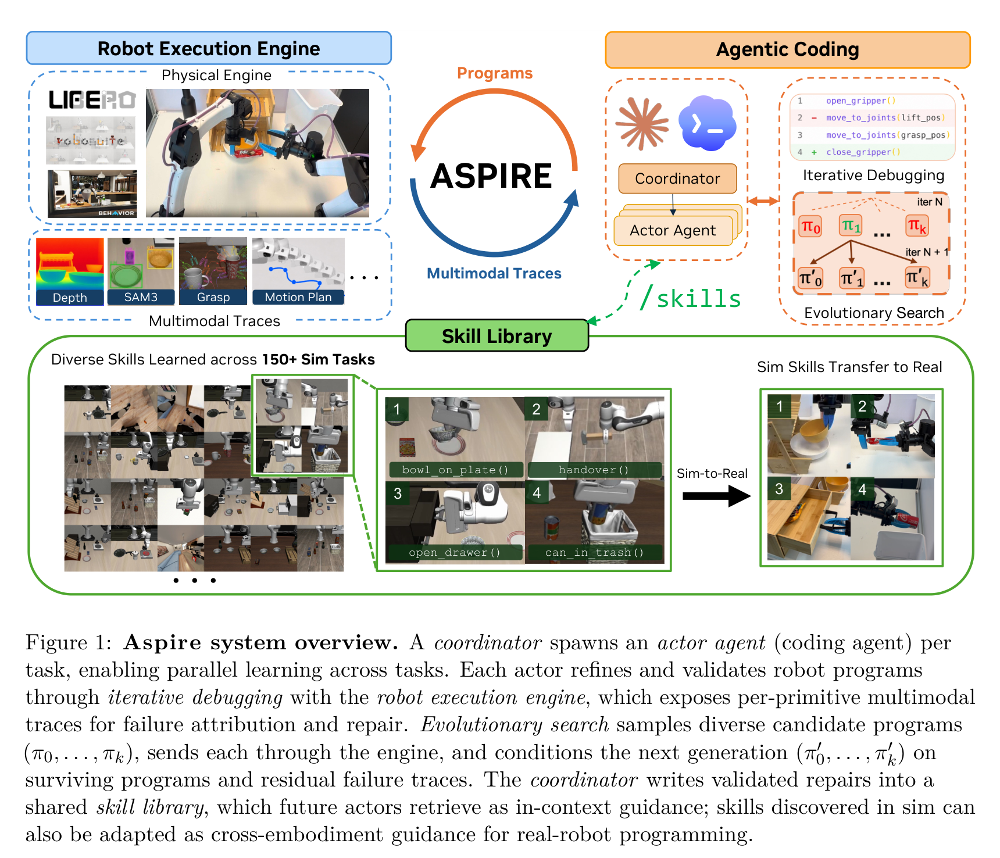

## 核心信息

| 属性 | 内容 |
| :--- | :--- |
| **论文标题** | ASPIRE: Agentic Skills Discovery for Robotics |
| **作者团队** | Runyu Lu\*, Yubo Wu\*, Ethan Kou\*, Letian Fu, Wenli Xiao, Ajay Mandlekar, Yinzhen Xu, Guanya Shi, Ken Goldberg, Ang Chen, Mosharaf Chowdhury, Yuke Zhu†, Linxi "Jim" Fan†, Guanzhi Wang† (\* 同等贡献, † 项目指导) |
| **第一机构** | NVIDIA (GEAR Lab) 联合 UMich, UIUC, UC Berkeley (AUTOLab), CMU (LeCAR Lab) |
| **发布时间/载体** | 2026年7月 (arXiv:2607.00272v1, 2026-06-30) |
| **开源链接** | [https://research.nvidia.com/labs/gear/aspire/](https://research.nvidia.com/labs/gear/aspire/) |
| **研究范式** | 智能体自演进代码策略 (Continual Agentic Code-as-Policy) + 具身技能库 (Embodied Skill Library) + 闭环多模态轨迹调试 (Closed-loop Multimodal Trace Debugging) |
| **核心基准** | LIBERO-Pro (空间/物体/目标多维扰动)、Robosuite (富接触双臂交接/精密装配)、BEHAVIOR-1K (超长程家庭移动操作)、Real-Robot (Franka单臂至双臂YAM/URe跨具身迁移) |
| **巅峰战绩** | LIBERO-Pro 扰动套件综合提升 **+77%**；Robosuite 双臂交接从 20% 暴涨至 **92%** (+72%)；BEHAVIOR-1K 长程任务提升 **+32%** (超越人类专家 88% vs 36%)；LIBERO-Pro Long 零样本长程迁移取得 **30.5% (约31%)** (基线仅 4%)；真实机器人跨具身迁移将调试 Token 消耗削减高达 **9.4倍**，并攻克基线 0% 成功率的抽屉操作 (达 11/20)。 |

---

## 原文摘要翻译

传统的机器人编程极其困难且繁琐：它不仅要求精细编排多模态感知，妥善处理高度复杂的物理接触动力学，还必须应对多变的环境配置以及各类不可预期的执行故障。

我们提出了 **Aspire**（Agentic Skill Programming through Iterative Robot Exploration，基于迭代机器人探索的智能体技能编程系统），这是一个面向机器人学的持续学习系统。该系统基于“代码即策略”（Code-as-Policy）范式，自主编写并调试修正机器人底层控制程序，同时将获得的成功经验持续复利沉淀为一个高度可复用的技能库。Aspire 实现了可复用技能的自动化发现，这些技能能够在多个任务、仿真与真实世界环境以及不同的机器人具身形态之间持久留存与迁移。

Aspire 摒弃了僵化的、依赖人工硬编码的流水线设计，转而运行在一个开放式的自主学习闭环中，该闭环由三大核心要素构成：
1. **闭环机器人执行引擎（Closed-loop Robot Execution Engine）**：它彻底颠覆了以往粗粒度的任务级标量反馈，暴露出细粒度的逐原语多模态执行轨迹（例如感知图层叠加、抓取候选姿态、运动轨迹以及碰撞报警反馈），赋予智能体自主诊断故障根因、合成定向修复代码并闭环验证执行结果的完整能力；
2. **持续拓展的技能库（Continually Expanding Skill Library）**：将经过严格验证的成功修复经验，蒸馏并固化为高度可复用、可迁移的具身机器人代码与提示词知识；
3. **进化搜索机制（Evolutionary Search）**：系统化生成多样化的任务序列与备选控制程序，通过维持假设探索账本跳出单轨迹修复的局部死循环。

随着 Aspire 遭遇并解决的任务数量不断增长，其持续扩充的技能库赋予了系统越来越快的环境自适应速度。实验表明，Aspire 在受到复杂物理扰动的操作基准（LIBERO-Pro）上超越先验基线多达 77 个百分点，在 Robosuite 双臂交接任务上提升 72 个百分点，并在 BEHAVIOR-1K 复杂长程家庭操作任务上超越基线 32 个百分点。尤为突出的是，累积的技能库展现出了极强的零样本跨任务迁移能力：在未见过的超长程任务（LIBERO-Pro Long）上，Aspire 取得了 31% 的零样本成功率，大幅碾压在此类任务上几乎完全停滞的先验基线（仅 4% 成功率，尽管基线花费了极重的测试期推理与反复重试）。最后，在仿真环境中发现的控制技能成功跨越具身形态迁移至真实双臂机器人，在机械臂构型与底层 API 均不一致的条件下，大幅削减了实机编程与调试所需的人工干预与 Token 算力成本。

---

## 创新点

1. **【闭环执行引擎与细粒度多模态轨迹暴露机制】打破了传统黑盒“仅知失败、不知何因”的调试困境**  
   先验工作（如 CaP-Agent0 或传统 RL/VLA 策略）在执行失败时仅能捕获粗粒度的标量奖励（0 或 1）或整段无序的视频回放。Aspire 设计的闭环执行引擎以“原子原语”（Per-Primitive）为单元，结构化暴露 API 调用入参出参、前/后 RGB-D 关键帧与语义分割掩码图层、抓取网络候选姿态置信度、以及运动学求解器（cuRobo）的碰撞缓冲区越界报警（如 `PLANNING_ERROR`）。这使得 Coding Agent 能够精准区分是“物体遮挡导致感知丢帧”、“抓取偏角过大滑脱”、抑或是“导航目标点距离障碍物过近（<20cm）触发碰撞规避”，从而实施靶向代码修补。

2. **【异构经验代码化沉淀：从“单次补丁”到“持续复利技能库”】构建了跨任务知识积累的通用范式**  
   传统智能体在单次任务解决后即丢弃上下文，导致“第 100 次解决任务的智能体与第 1 次一样幼稚”。Aspire 创新性地将人类工程师的代码调试心智外化为一个自演进的技能库。技能并非生硬的全量代码模板，而是提炼为包含**故障特征（Failure Signature）、适用触发条件（When-to-Apply Guard）、修复代码逻辑（Repair Strategy Snippet）**的异构代码知识，横跨定位消歧、几何主轴抓取、碰撞进近避障、地平面接触推移等 6 大核心领域。

3. **【协调器-执行器（Coordinator-Actor）解耦并发架构】兼顾长效记忆管理与即时调试专注度**  
   中央协调器负责全局技能库的版本审计、API 合规性校验与任务调度，为每个任务独立派生沙盒化的 Actor Agent。Actor 无需在上下文窗口中背负冗长的多任务历史聊天记录，仅携带任务目标与检索出的少量精选高相关技能进入闭环，极大减少了注意力漂移并降低了推理 Token 冗余开销。

4. **【多样性驱动的进化程序搜索机制（Evolutionary Program Search）】有效破除贪心局部最优的局部死循环**  
   当面对强约束物理任务时，基于单轨迹的贪心自修补极易陷入“在同一个错误策略上反复微调超参数”的认知死胡同（Local Repair Loop）。Aspire 引入基于种群多样性的进化搜索算法（Algorithm 1），维持一个结构化的 `task_analysis.md` 探索账本，显式记录“已证伪分支”与“因物理不可达而暂阻的分支”，并在每轮基于 Top-3 优胜候选变异生成 $K$ 个截然不同的解题假说，显著拓宽了复杂非凸物理交互空间的求解边界。

5. **【零样本跨任务长程技能复用复合（Skill Compounding）】实现了未见复杂任务的涌现式泛化**  
   无需在测试阶段进行耗时费力的试错重试，仅通过将短程与原子操作中提取的几何/物理鲁棒技能（如两阶段夹爪捏合、OBB主轴定向、旋转进近向量）进行零样本上下文组合，系统在超长程基准 LIBERO-Pro Long 上展现出与技能库规模 $N$（0 $\to$ 25 $\to$ 50 $\to$ 90）严格正相关的单调性能增长，最终突破至 30.5%（约31%），彻底颠覆了端到端 VLA 在长程复合时概率级联崩溃的数学宿命。

6. **【仿真到真实机器人的跨具身与跨 API 语义迁移】突破了端到端策略 Sim-to-Real 的物理鸿沟**  
   将仿真中基于单臂 Franka 探索出的物理操作技能（如易拉罐防滑抓取姿态、抽屉滑轨外拉与顺应退避、平面多角度进近），以“高层代码算法思维与提示词范式”的形式检索并注入给驱动真实双臂 YAM/URe 工作站的 Coding Agent（Codex GPT-5.5），在底层驱动协议完全异构的前提下，将真实机械臂自纠错 Token 开销削减 4~9.4 倍，并在高难度接触任务上实现了从 0% 到 55% 成功率的跨越式破局。

---

## 一句话总结

> **ASPIRE 通过“闭环多模态轨迹执行引擎 + 持续积累异构代码技能库 + 进化假说搜索”的三元闭环，让大模型像资深人类机器人工程师一样通过细粒度物理因果归因自主写代码、修代码与沉淀经验，打破了端到端 VLA 面对几何扰动与长程复合时的脆弱天花板。**

---

## 研究问题

### 1. 传统机器人编程的扩展性瓶颈与脆弱性
传统的机器人任务开发高度依赖人类工程师在仿真或真实场景中进行繁琐的手工调参和流水线搭建（Perception-Plan-Execute Pipelines）。工程师需要针对特定的摄像头位姿、特定的夹爪摩擦系数以及特定的工件几何形状编写特化的感知滤镜与运动学轨迹。这种静态编程范式极其脆弱，一旦遇到未建模的微小空间平移、光照变异或障碍物扰动，整套系统便会彻底瘫痪，缺乏自主容错和终身进化的生命力。

### 2. 端到端 VLA 模型在分布外物理接触与长程任务中的固有死穴
近年来以 OpenVLA、$\pi_0$、$\pi_{0.5}$ 为代表的端到端视觉-语言-动作（VLA）模型虽然展现出了一定的泛化直觉，但在硬核物理交互任务中暴露了致命缺陷：
- **物理接触动力学黑盒**：VLA 依赖连续轨迹回归或 Flow Matching 生成底层低级动作，对微小的三维几何失准、临界接触摩擦以及机械碰撞缺乏因果推断能力。正如论文实验所揭示，在面对物体位姿微调（LIBERO-Pro Position Perturbations）时，大部分 VLA 性能断崖式下跌，在语义指令扰动（Task Remapping）下甚至完全崩溃至接近 0% 成功率。
- **长程级联误差（Error Cascade）**：端到端模型缺乏分层抽象与显式状态验证，在包含 3~5 个子步骤的长程任务中，早期步骤哪怕 2% 的微小打滑都会在后续步骤中呈指数级发散，导致整段轨迹彻底失效。
- **不可解释与不可调试**：当 VLA 执行失败时，开发者无法获知其究竟是感知阶段未能识别目标，抑或是逆运动学（IK）奇异点崩溃，只能依赖堆叠百万小时的昂贵真机遥操数据盲目重训。

### 3. 先验代码即策略（Code-as-Policy）智能体的致命硬伤
以 CaP-Agent0 为代表的初级机器人编码智能体虽然将策略显式化为 Python 代码，但在环境交互中面临两大瓶颈：
- **粗粒度执行环境与盲视调试（Coarse-grained Feedback）**：执行器仅返回最终任务成功/失败的二元布尔值，或者返回一大堆无序的连续视频流。Agent 无法在时间轴上将失败精准归因于某一行特定的 API 调用（是 `find_object` 偏离，还是 `plan_grasp` 选取的法向量错误，抑或是 `move_to` 撞击了桌沿？）。这种“瞎子摸象”式的调试往往导致 Agent 胡乱修改提示词或尝试无意义的重试。
- **单次任务遗忘症（Task Amnesia）**：解决一个任务所获得的调试修复代码在当前回合结束后便被清空，新任务到来时又必须从空白的 Prompt 重新探索。经验无法复利，导致系统规模化部署成本居高不下。

ASPIRE 正是针对上述三大痛点提出的革命性破局方案：**以显式 Python 代码作为策略载体保证可解释性与确定性控制，以底层暴露细粒度物理因果的多模态闭环引擎驱动精准归因，以终身演进的技能库实现机器人知识的终身复利！**

---

## 数据与任务定义

ASPIRE 的实验设计极其严谨苛刻，全面覆盖了从原子接触到复合长程、从确定性仿真到抗物理扰动、从单臂操作到双臂协同及跨具身真机迁移的全光谱场景：

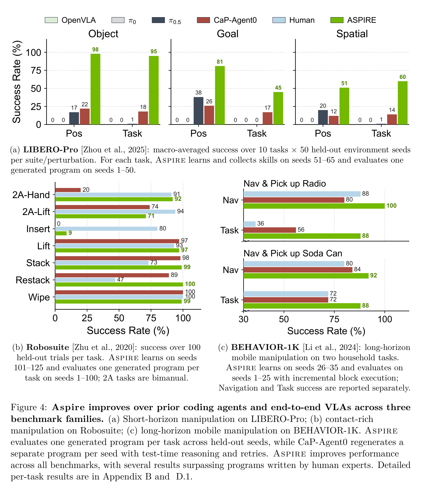

### 1. LIBERO-Pro 抗扰动强化基准
基于经典具身学习基准 LIBERO 构建，针对端到端模型容易死记硬背环境先验的问题，引入了极其严格的解耦扰动评测体系：
- **libero-object**：10 项物体抓取与放置任务，聚焦物体几何形状多样性及表面摩擦差异。
- **libero-goal**：10 项目标导向任务，包含抽屉开关、烤箱操作、多物体堆叠等接触交互。
- **libero-spatial**：10 项强空间约束任务，测试在不同密集障碍物布局下的避障与精准放置。
- **双轴扰动协议（Perturbation Axes）**：
  - **位置扰动（Pos / Swap Perturbation）**：固定任务语义，对场景中所有物体与目标位置进行随机重排与平移，摧毁模型对绝对坐标的记忆。
  - **任务/语义扰动（Task / Goal Perturbation）**：保持场景物理布局不变，但在指令中动态重映射操作目标与关联物体（如将“将黑碗放入盘子”重映射为“将黄碗放上炉灶”），测试语义理解与代码重组能力。
- **评测隔离协议**：每个套件包含 10 个任务。ASPIRE 严格遵循科学实验隔离机制：仅在种子 Seeds 51~65（仅 15 个种子）上进行沙盒探索调试并收集技能，而最终生成的**唯一定型程序（One Generated Program per Task）**在完全未见过的 Seeds 1~50（50 个评测种子）上进行严格的一锤定型测试。

### 2. Robosuite 富接触双臂操作基准
选用 Robosuite 中 7 项具有极端物理接触挑战的任务：
- 单臂接触与装配：`cube_lift`、`cube_stack`、`cube_restack`、`spill_wipe`（大面积表面擦拭阻尼）以及极度苛刻的 `nut_assembly`（高精度六角螺母对准穿插螺栓）。
- 双臂重载协同与交接：`two_arm_lift`（双臂同时抬起重物保平衡）、`two_arm_handover`（双臂近距离空间交接，要求极高精度的时空协同与碰撞退让）。
- 评测在 Seeds 101~125 上调试，在 Seeds 1~100（100 个独立种子）上验证。

### 3. BEHAVIOR-1K 超长程家庭具身移动操作
在基于 Omniverse / Isaac Sim 渲染的真实家庭三维大场景中，执行极其复杂的移动抓取任务：
- `navigate-and-pick-up-soda-can`（导航、房间探索并抓取易拉罐）。
- `navigate-and-pick-up-radio`（长距离跨房间导航避障、在复杂家具环绕中精确定位并抓取收音机）。
- 评测指标严格解耦为**导航成功率（Navigation SR）**与**最终任务完成率（Task SR）**。调试集为 Seeds 26~35，评测集为 Seeds 1~25。

### 4. 零样本跨任务迁移基准：LIBERO-Pro Long
包含 10 项复杂的长程复合任务链（例如先打开抽屉、取出内部碗具、运送至水槽、再关闭微波炉门等序列化行为），直接检验在短程 LIBERO-90 上沉淀的技能库能否在零微调、零重试、零调试（Zero-shot）的严苛条件下被检索并成功组合执行。

### 5. 真实机器人平台与跨具身设置
- **源环境（仿真）**：基于 Franka Emika Panda 单臂机器人以及 MuJoCo / CaP-X 仿真环境。
- **目标环境（真机）**：双臂 YAM 移动操作工作站以及 Universal Robots (URe) 构型，搭载 Intel RealSense RGB-D 深度相机。真实环境与仿真环境的末端夹爪、连杆自由度、逆运动学底层求解器及 API 封装截然不同。

---

## 方法主线

ASPIRE 构建了一个以“代码”为核心中间表征的开放式终身自演进闭环架构，由三大支柱和两大智能体角色紧密协同而成：

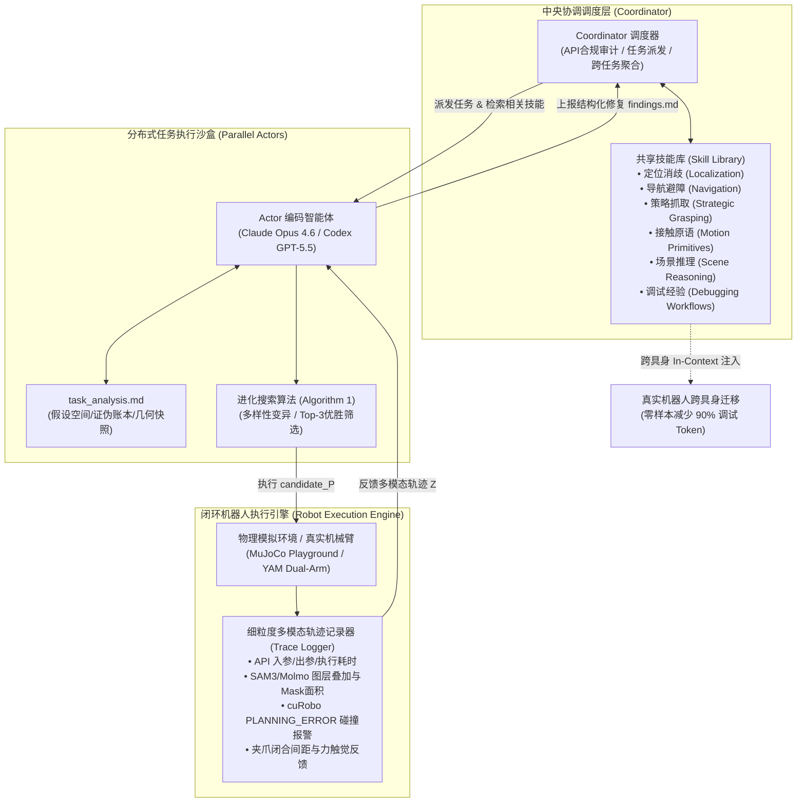

### 机制流程 (Coordinator-Actor Architecture & Open-Ended Learning Loop)

整个系统运行于一种高度解耦的多智能体异步协同框架中：
- **中央协调器（Coordinator）**：
  - 作为常驻的主进程，管理全局技能库与任务进度账本（`progress.json`）。
  - 动态监测可用的物理算力节点（Compute Devices / GPUs），实现“一个计算设备-绑定一个子智能体-处理一个独立任务”的高效并发。
  - **严格的技能准入审计机制**：Coordinator 审查 Actor 提交的 `findings.md` 报告。它严格执行项目宪法（`CLAUDE.md`）中的禁令法则，剔除任何非法访问模拟器真值内部状态（如 `sim.data.body_xpos`、`.bddl`、`.urdf`）的代码，仅将具有跨任务泛化潜力的通用修复模式提升至技能库。
- **任务执行智能体（Actor Subagents）**：
  - 针对指定任务沙盒化运行，上下文窗口始终精简而聚焦。Actor 不需要加载成百上千条无意义的历史对话，而是通过 Coordinator 注入的初始技能骨架（如初始的 `grasp`、`localize`、`manipulation` 模板）以及与当前任务语义检索匹配的先验技能展开工作。
  - 遵循严格的双阶段评测隔离协议（Stage 1 仅在调试集排错；Stage 2 一锤定音在验证集冻结评测）。

### 闭环机器人执行引擎与细粒度多模态轨迹暴露 (Closed-loop Robot Execution Engine: Perception overlays, grasp candidates, motion trajectories, collision traces)

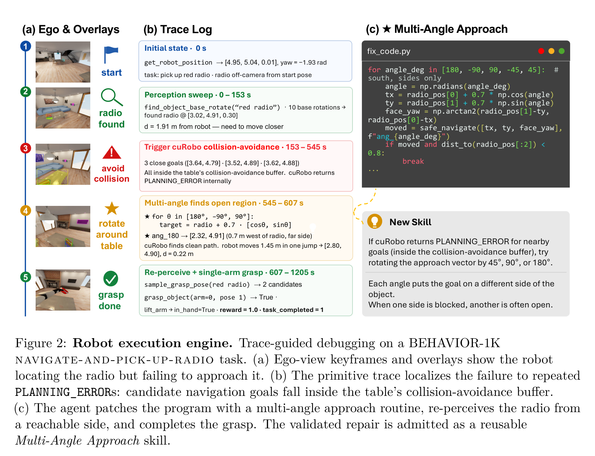

传统代码策略执行器是将 Python 脚本发往模拟器直接运行到终止，仅输出一个结果码。ASPIRE 彻底重构了底层执行内核，将其打造为一个**具有物理内省能力的实时感知调试器**：
- **逐原语（Per-Primitive）轨迹拦截与记录**：
  引擎对每一个原子 API 调用（如 `segment_text_prompt`、`plan_grasp`、`solve_ik`、`move_to_joints`、`navigate_to_pose`）进行细粒度拦截包装，记录如下结构化元数据：
  ```json
  {
    "step": 5,
    "function": "segment_text_prompt",
    "args": {"rgb_shape": [512, 800, 3], "text_prompt": "bowl"},
    "duration_ms": 1463.8,
    "result": {
      "num_masks": 2,
      "mask_0_score": 0.917,
      "mask_0_bbox": [369.2, 257.1, 438.4, 310.5],
      "mask_0_area_pct": 0.68
    },
    "keyframe_saved": true
  }
  ```
- **关键帧图层叠加与视觉证据（Perception Overlays）**：
  系统在执行前后保存两路相机（广角第三人称视野 `agentview` 与腕部第一人称视野 `wristview`）的高清 RGB 图像，并在图像上直接叠加 2D 目标检测包围盒、SAM3 分割轮廓、以及抓取网络预测的三维抓取姿态接触点与法向箭头。
- **显式物理动力学与运动学阻抗信号反馈**：
  - **规划器碰撞报警**：当调用 GPU 加速轨迹优化器 cuRobo 规划机械臂或底盘路径时，若目标坐标过于靠近障碍物表面，引擎直接在轨迹中返回 `PLANNING_ERROR` 及距离碰撞缓冲区的违反程度（例如距离桌沿仅 15cm，而安全裕度要求 20cm）。
  - **夹爪闭合宽度（Gripper Width Signal）**：抓取结束时测量夹爪开度。若开度接近 0，判定为“空抓”（Air-Grasp）；若开度适中但传感器显示接触力异常，判定为“边缘滑脱”；若开度过大，判定为误夹邻近桌体。
- **典型案例分析（Figure 2 所示）**：
  在 BEHAVIOR-1K 的收音机抓取任务中，原始代码通过 `find_object_base_rotate` 发现目标在 `[3.02, 4.91, 0.30]`，随后直接调用 `navigate_to_pose` 尝试直扑目标。执行引擎轨迹明确暴露多次 `PLANNING_ERROR`，显示所有直线进近的目标点均落入桌子的避障缓冲区内。Actor 通过阅读该诊断，精准定位故障根因并非“未看见收音机”或“无法抓取”，而是“进近航路在几何上被桌体阻挡”。Actor 随即编写多角度环绕进近代码（采样 $180^\circ, \pm 90^\circ, \pm 45^\circ$ 等备选方向），最终从西侧开阔区域（$180^\circ$）顺利接近至 0.22m 处并完成抓取。

### 技能库蒸馏与检索机制 (Continually Expanding Skill Library: Reusable code & prompt repair functions, semantic retrieval)

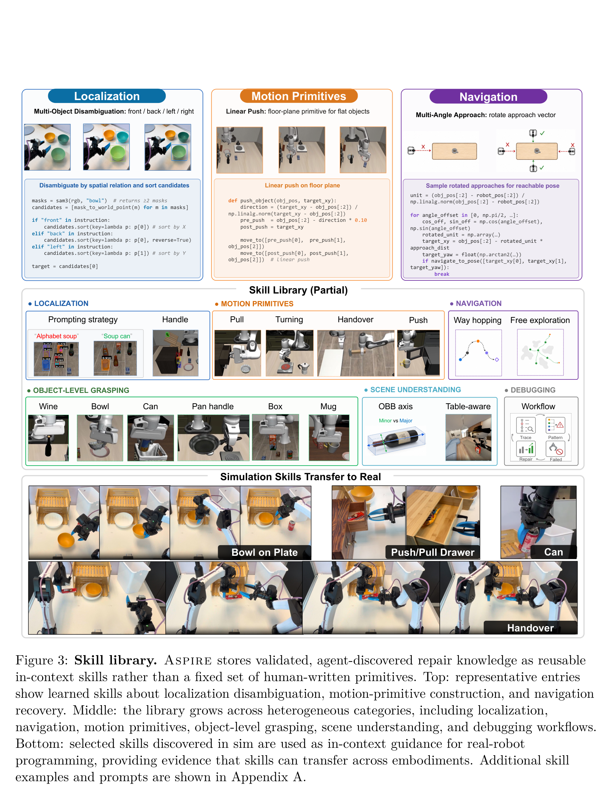

ASPIRE 的技能库并非人工预先设定的硬编码库，而是从一次次真实的碰撞、滑脱与报错中演进提取出的“具身知识结晶”：


#### (1) 技能数据结构规范
每个入库的技能条目均遵循极其清晰的规范化四元组定义：
1. **问题定义（Problem Signature）**：提取自触发该修复的典型轨迹特征（如“高长宽比圆柱体在抓取闭合时倾倒滚落”）。
2. **适用守卫（When-to-Apply Guard）**：结构化的语义检索条件（如“物体长宽比 > 2.0；且属于 tall cylindrical 类物体”）。
3. **修复策略（Strategy）**：核心几何或算法逻辑（如“将机械臂末端偏航角与 OBB 最大主轴对准，采用两阶段渐进式捏合”）。
4. **验证代码模板（Code Snippet）**：经过多随机种子沙盒测试通过的高健壮性 Python 函数。

#### (2) 技能库核心六大分类全景

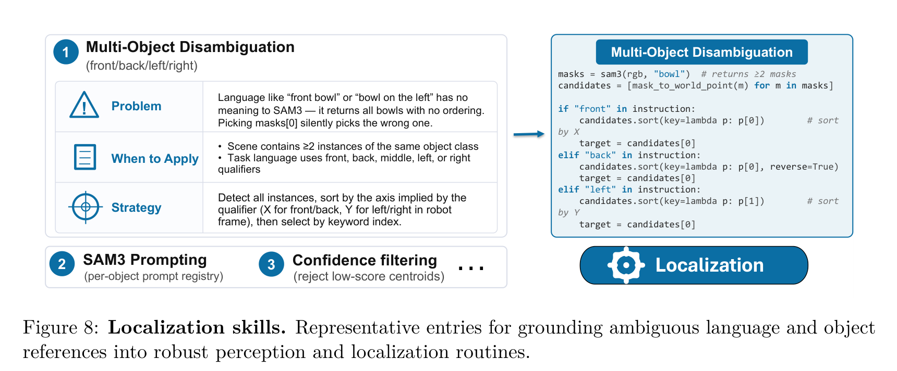

- **定位技能（Localization Skills，Figure 8）**：
  针对通用视觉大模型（如 SAM3）在具身语境下的提示词弱点，构建动态提示词回退链条（Prompt Fallback Chain，如当 `soup can` 无法分割时自动回退为 `alphabet soup`）。针对“场景存在多个同类物体”（如两只碗）的语境，自演进出基于空间坐标轴排序（X轴前后、Y轴左右）的几何多目标解歧算法（Multi-Object Disambiguation），彻底避免了以往盲目调用 `masks[0]` 导致的执行漂移。

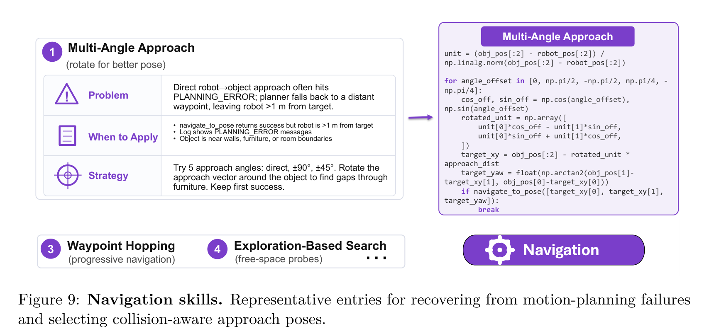

- **导航技能（Navigation Skills，Figure 9）**：
  针对移动底盘在复杂家具环境中的死锁，提炼出“多角度旋转向量进近”（Multi-Angle Approach）与“基于可达自由空间的渐进航路点跳跃”（Waypoint Hopping）。


- **策略抓取技能（Strategic Grasping Skills，Figure 10）**：
  - **酒瓶/细长体抓取**：利用三维点云计算定向包围盒（OBB），强制夹爪偏航角（Yaw）垂直或平行于主轴，实施“50%试探闭合 $\to$ 70%入座压紧 $\to$ 极低速缓慢抬升”的两阶段夹爪闭合范式。
  - **扁平物体抓取**：自动切换质心下沉补偿策略。
  - **空抓闭环自愈**：利用闭合开度做后验断言，一旦触发空抓立即释放夹爪并在局部微扰动后重新采样本体位姿。

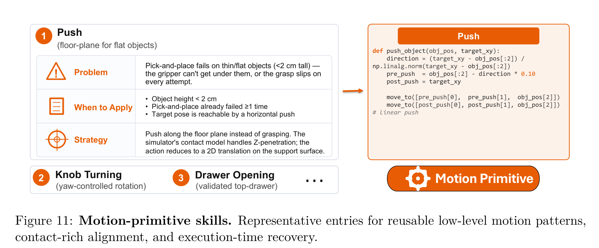

- **运动原语技能（Motion-Primitive Skills，Figure 11）**：
  突破传统“非抓即放”的单调性，自演进出面向非抓取交互的物理原语：
  - **地平面直线推移（Linear Push）**：针对高度小于 2cm 的极薄物体（机械夹爪无法从底面插入），将任务降维为贴地水平推移，利用物理引擎的支撑面阻尼实现定向运送。
  - **铰接链抽屉开关与旋钮旋转**：自适应弧形轨迹拉拔与旋转阻尼顺应。


- **场景推理技能（Scene Reasoning Skills，Figure 12）**：
  深入理解三维场景拓扑，区分 OBB 主次轴几何语义（Major vs Minor Axis），根据操作目的（如抓取把手还是倾倒容器）自适应决定夹爪接近方向，精准区分抽屉、酒架与开放台面等不同容器的支撑约束。
- **调试经验（Debugging Skills，Figure 7）**：
  提炼“单次失败是噪声、多次同质失败是模式”的跨试次聚类法则，生成“绝对禁止（Negative Constraints）”反模式库（例如禁止在未抬升至安全过渡高度时横向移动机械臂，避免扫倒周围物体）。

### 进化搜索策略 (Evolutionary Search: Diversity-driven task sequencing & exploratory program mutations)

在面对非凸复杂的机器人操作时，常规的自纠错常常陷入“局部微调修补”的死循环（例如反复尝试调整抓取高度 $z \pm 1\text{cm}$，而实际上根本原因是进近角度被遮挡）。ASPIRE 提出了基于程序级种群变异的进化搜索框架（Algorithm 1）：

```text
Algorithm 1: Evolutionary search over programs
Require: task τ, initial program P_0, debug seeds S_dbg, validation seeds S_val, 
         skill library L, coding agent M, budget (K, T), threshold θ
1:  (r*, Z_0) ← Execute(P_0, S_dbg); P* ← P_0
2:  H ← {(P_0, r*, Z_0)}  // 维护历史假设与轨迹评估账本
3:  for i = 1, ..., T do
4:      {P_i^k}_{k=1}^K ← ProposeRepairs(M, τ, Top3(H), L, H)  // 基于Top3存活候选与未解决轨迹生成K个互异假说
5:      for k = 1, ..., K do
6:          (r_i^k, Z_i^k) ← Execute(P_i^k, S_dbg)
7:      end for
8:      H ← H ∪ {(P_i^k, r_i^k, Z_i^k)}_{k=1}^K; k* ← argmax_k r_i^k
9:      if r_i^k* > r* then
10:         (P*, r*) ← (P_i^k*, r_i^k*)
11:     end if
12:     if r* ≥ θ then break  // 达到预设成功率阈值则提前终止探索
13:     end if
14: end for
15: (r_val, Z_val) ← Execute(P*, S_val)  // 在冻结验证集上一锤定音
16: G ← ExtractValidatedPatterns(H, P*, r_val, Z_val)  // 提炼跨种子验证的高价值模式
17: return (P*, r_val, G)
```

- **持久任务分析账本（`task_analysis.md`）**：
  每一轮进化搜索均维护一个全局分析文档，包含：
  1. 场景几何快照（静态家具布局、障碍物包围盒、禁飞区）；
  2. 运行中假说清单（候选代码 A、B、C 分别验证何种物理假设）；
  3. **已证伪假说清单（Eliminated Hypotheses）**：明确记录“从上方抓取由于手腕奇异点必定失败，后续轮次绝不再试”；
  4. **阻碍中但未测试假说（Blocked Hypotheses）**：记录“由于缺少某段手腕预旋转而暂时报 IK 求解失败的路径，待引入旋转原语后重新激活”。
- **强制多样性变异约束**：
  在生成下一代的 $K$ 个候选程序时，Actor 必须在代码 Docstring 中明确声明本候选所测试的独立物理机制，严格禁止两个候选在同一阶段因为相同原因失效，从而实现对解空间的全局拉网式覆盖。

### 跨任务、跨具身与虚实迁移机制 (Sim-to-Real Transfer & Cross-Embodiment adaptation)

许多端到端策略在尝试做 Sim-to-Real 时，往往由于传感器噪声、材质光照及关节阻尼的微小偏差（Sim-to-Real Gap）而瞬间崩溃。ASPIRE 的哲学在于：**不迁移底层低级控制信号（Low-level Action Torques），而是迁移高级算法模式、几何约束公理与自我修复反思思维！**
- 仿真环境下由单臂 Franka 探索总结出的技能（例如：酒瓶 OBB 轴向抓取规则、地平面滑动推移函数、多角度进近循环），其核心数学本质是对物理空间几何拓扑的处理逻辑，天然具有跨具身不变性。
- 在真实机器人工作站上部署时，将这些仿真沉淀的高价值技能作为少样本示例（Few-shot In-Context Examples）直接注入给真机编码智能体（如 OpenAI Codex GPT-5.5）。真机智能体结合真机执行引擎暴露的实际多模态轨迹，在这些高质量高阶算法思想的启发下，仅需极少的真实物理探索即可合成适配真机独特底层 API 与硬件特性的可执行程序。

---

## 关键结果

### 仿真基准主结果与强基线 (LIBERO-Pro +77% over baselines, Robosuite Bimanual Handover +72%, BEHAVIOR-1K +32%, Figure 4, Table 2-4)

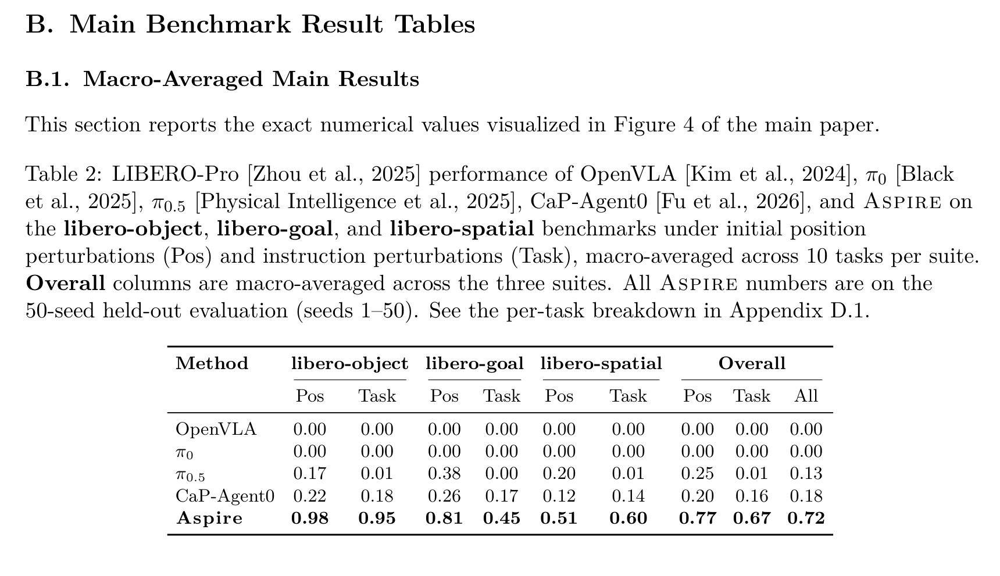

#### (1) LIBERO-Pro 扰动基准评测 (Table 2)
在 30 个综合任务、50 个未见评测种子的严苛测试下，各主流范式展现出了巨大的性能断层：
- **端到端 VLA 表现**：
  - **OpenVLA 与 $\pi_0$**：在三大套件上的成功率全部归零（**0.00**）！由于位置与语义扰动完全打乱了训练集中记忆的刚性几何位置，其连续控制轨迹全部发散失控。
  - **$\pi_{0.5}$**：展现出了一定的局部泛化性，在 Object 位置扰动下达到 0.17，在 Goal 位置扰动下达到 0.38，在 Spatial 位置扰动下达到 0.20。然而，一旦面对语义指令重映射（Task Perturbations），其成功率暴跌至 0.00~0.01（几乎完全丧失语义重组能力），综合平均仅有 **0.13**。
- **初级代码智能体 CaP-Agent0**：
  由于缺乏细粒度轨迹暴露与持续技能库，在测试期即便针对每个测试种子单独重试，其 Object 评测为 0.22/0.18，Goal 为 0.26/0.17，Spatial 为 0.12/0.14，综合平均仅有 **0.18**。
- **ASPIRE（本文方法）**：
  使用在少量调试种子上生成的**唯一定型程序**在 50 个验证种子上进行一锤定音评测：
  - **Object 套件**：位置扰动 **0.98**，语义扰动 **0.95**，相较于先验最强基线取得 **+77%** 的巨大绝对增益！
  - **Goal 套件**：位置扰动 **0.81**，语义扰动 **0.45**，平均增益超过最强基线 **+41.5%**！
  - **Spatial 套件**：位置扰动 **0.51**，语义扰动 **0.60**，平均增益超过最强基线 **+42.5%**！
  - **全套件综合总体（All Overall）**：达到惊人的 **0.72**（72% 成功率），比 CaP-Agent0（18%）高出足足 4 倍，比 $\pi_{0.5}$（13%）高出 5.5 倍！


#### (2) Robosuite 富接触基准评测 (Table 3)
在 7 项涉及极端物理接触交互的任务中（100 次独立测试）：
- 在基础单臂任务上，ASPIRE 保持极高饱和度：`cube_lift` 0.97，`cube_stack` 0.99，`cube_restack` 达到完美的 **1.00**（基线 0.89），`spill_wipe` 0.99。
- **高难度双臂交接（`two_arm_handover`）**：这是整个基准中最具挑战性的任务，要求双臂在狭小空间内实现厘米级工件无缝移交并避障。先验基线 CaP-Agent0 彻底崩溃，成功率仅有 0.20（20%）；而 ASPIRE 凭借细粒度碰撞轨迹暴露与双臂避障退让技能，成功率暴涨至 **0.92 (92%)**，净增益高达 **+72%**！
- 极高精度螺母装配（`nut_assembly`）：先验基线为 0.00，ASPIRE 探索出亚毫米级螺旋下压微调原语，实现从 0 到 0.09 的突破。
- 全任务平均成功率从 CaP-Agent0 的 0.68 跃升至 **0.81**。

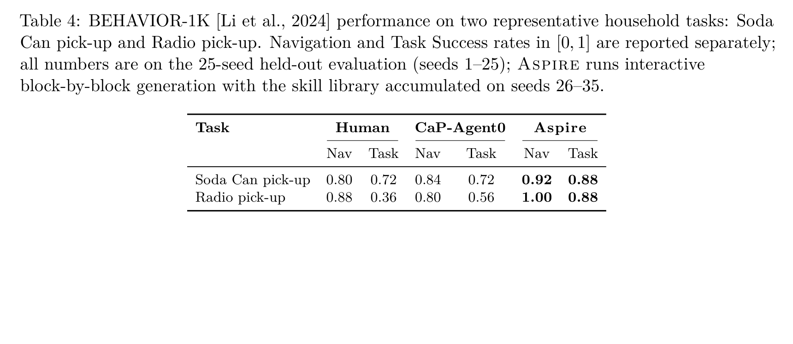

#### (3) BEHAVIOR-1K 超长程具身移动操作 (Table 4)
在逼真复杂的家庭物理大场景中，任务被解耦为导航（Nav）与操作（Task）：
- **易拉罐导航与抓取（Soda Can pick-up）**：ASPIRE 导航成功率 0.92（人类 0.80，CaP-Agent0 0.84），最终任务完成率达到 **0.88**（人类专家 0.72，CaP-Agent0 0.72）。
- **收音机长程导航与复杂家具抓取（Radio pick-up）**：
  由于收音机摆放紧贴桌体，传统直接逼近方案因规划碰撞全军覆没。人类专家编写的代码仅取得 0.36（36%）成功率，CaP-Agent0 仅取得 0.56（56%）。ASPIRE 导航成功率达到完美的 **1.00 (100%)**，任务完成率达到 **0.88 (88%)**，相比 CaP-Agent0 净增 **+32%**，相比人类专家提升 **+52%**！

---

### 零样本跨任务迁移能力评测 (LIBERO-Pro Long: 31% success vs 4% baselines, Figure 5, Table 5-6)


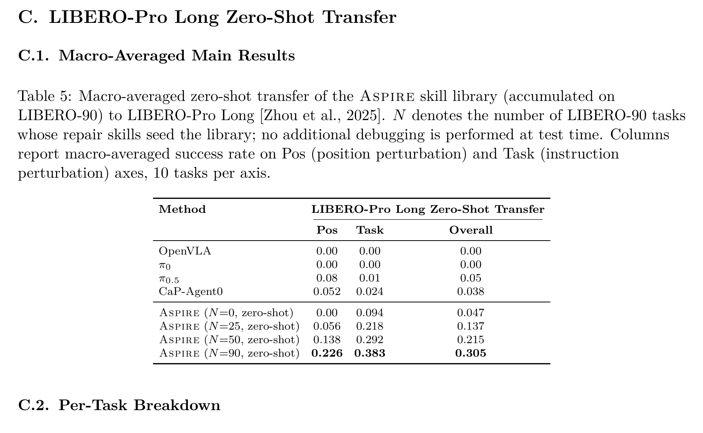

在未见过的复杂长程任务套件 LIBERO-Pro Long 上，ASPIRE 展现了极其震撼的知识复利效应：
- **先验基线在长程任务上的集体瘫痪**：
  - OpenVLA 与 $\pi_0$：零样本长程迁移成功率全部为 **0.00**。
  - $\pi_{0.5}$：在长程任务复合下发生概率级联崩溃，Pos 为 0.08，Task 为 0.01，综合仅为 **0.05**。
  - CaP-Agent0：即便具备测试期反思机制，Pos 仅 0.052，Task 仅 0.024，综合仅为 **0.038 (3.8%)**。
- **ASPIRE 技能库扩容带来的单调收益律 (Table 5 & Figure 5b)**：
  - 当技能库为空时（$N=0$），ASPIRE 在长程任务上的零样本综合成功率仅为 **0.047 (4.7%)**，与基线持平。
  - 随着引入 LIBERO-90 前 25 个任务发现的技能（$N=25$），零样本成功率倍增至 **0.137 (13.7%)**。
  - 当纳入 50 个任务经验时（$N=50$），综合成功率跃升至 **0.215 (21.5%)**。
  - 当加载完整的 90 任务技能库时（$N=90$），零样本综合成功率达到 **0.305 (约 31%)**，其中位置扰动下达到 0.226，语义扰动下高达 **0.383 (38.3%)**！
- **细粒度逐任务突破 (Table 6)**：
  在 `Stove + moka pot` 任务中，随着技能库从 $N=0 \to 90$，位置扰动成功率从 0.00 飙升至 **1.00 (100%)**；在 `Both mokas on stove` 语义扰动下，从 0.00 飙升至 **1.00**；在 `Cream cheese + butter` 上从 0.00 跃升至 **0.86~0.94**。这无可辩驳地证明：**短程任务中沉淀的物理接触与感知解歧技能，能够以零样本形式直接复用、复合赋能长程未知任务！**

---

### 真实机器人跨具身迁移实证 (Franka Emika & Universal Robots URe, Table 1)


在真实双臂 YAM 移动操作工作站（由 OpenAI Codex GPT-5.5 驱动）上进行的虚实迁移实证取得了里程碑式的结果（Table 1）：
1. **盘子放碗（Put bowl on plate）**：
   - 无技能引导（w/o Skills）：消耗 0.05M 输出 Token、8.65M 总 Token，评测 20/20 成功。
   - 检索仿真技能引导（w/ Skills）：输出 Token 降至 0.04M，总 Token 锐减至 **5.11M**，评测同样完美取得 20/20。
2. **易拉罐抓取抬升（Lift soda can）**：
   - 无技能引导：耗费 0.18M 输出 Token 与高达 61.94M 的总 Token，最终成功率仅 13/20（65%）。
   - 检索仿真技能引导：输出 Token 骤降至 0.03M，总 Token 暴降至 **6.58M**（**降低近 9.4 倍！**），而最终成功率跃升至 **19/20 (95%)**！仿真中发现的抓取下压裕度与防滑捏合参数让真实机械臂少走了巨大的弯路。
3. **高难度复杂接触任务：抽屉拉开与推入（Open/push drawer）**：
   - 无技能引导：在耗尽高达 **334.92M Token**（超 3.3 亿 Token）的极其庞大的推理预算后，因无法处理复杂铰接接触与阻尼，最终成功率依然是绝望的 **0/20 (0%)**！
   - 检索仿真技能引导：仅耗费 81.67M Token（节省超 2.5 亿 Token，**削减 75.6%**），便成功攻克该任务，取得 **11/20 (55%)** 的突破性成功率！

---

### 核心消融分析 (Multimodal traces ablation, Evolutionary search vs greedy refinement, Skill library accumulation curves, Figure 6, Table 7-9)


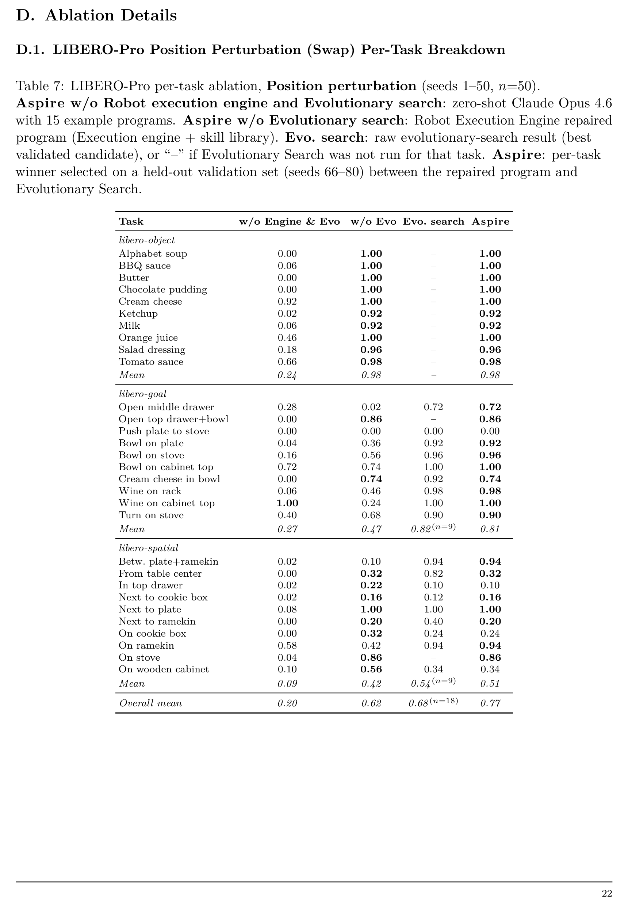


#### (1) 系统核心组件阶梯式贡献 (Figure 6a, 6b & Table 7, Table 8)
在 LIBERO-Pro 上的系统级解构清晰展现了系统各模块的不可替代性：
- **基础无引擎系统（w/o Engine & Evo）**：基于零样本 Claude Opus 4.6 配合 15 个代码少样本示例，位置扰动平均成功率仅 **0.20**，任务语义扰动平均仅 **0.09**，综合仅约 **0.14**。
- **加入闭环机器人执行引擎与技能库（w/o Evo）**：细粒度多模态轨迹与技能库使得 Agent 能够靶向定位感知丢帧和运动规划撞障。位置扰动成功率暴涨至 **0.62**（净增 +42pp），任务扰动暴涨至 **0.61**（净增 +52pp），**提供了全系统近 70% 的核心性能跃升**！
- **进一步加入进化搜索（Aspire 最终完整系统）**：进化搜索攻克了单轨迹修复难以解决的顽固长尾难题，在位置扰动下推升至 **0.77**（局部达到 0.98），在任务扰动下推升至 **0.67**，综合达到 **0.72**。

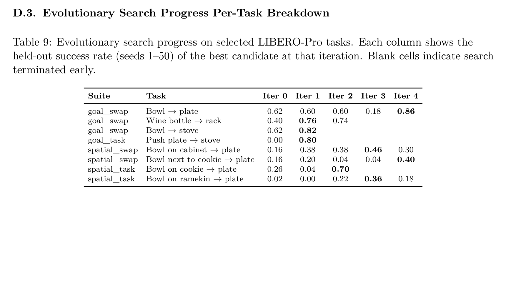

#### (2) 进化搜索跨轮次单调突破机制 (Figure 6c & Table 9)
追踪 8 项在初始单次调试中表现极差（低分甚至 0 分）的顽疾任务在进化搜索跨轮次（Iter 0~4）中的轨迹：
- `goal_swap / Push plate -> stove`：Iter 0 为 0.00，在消除错误进近假说并引入贴地水平推移后，Iter 1 瞬间突破至 **0.80**！
- `spatial_task / Bowl on cookie -> plate`：Iter 0 为 0.26，Iter 1 为 0.04，在 Iter 2 彻底重构抓取偏航角与 OBB 语义后，成功率暴增至 **0.70**！
- 这充分证实：进化搜索依托 `task_analysis.md` 账本排除死胡同分支的能力，是智能体在复杂环境中摆脱局部最优的关键保障。

---

## 深度分析

### 真正贡献是什么 (why code-as-policy + trace-guided self-repair + skill library beats end-to-end VLAs in physical adaptability; compounding robotics knowledge)
ASPIRE 的核心学术贡献绝非单纯堆砌了大模型上下文窗口或调用了几个视觉感知模型，而是**在机器人学界系统确立了“具有物理自省与知识复利的代码即策略系统”相较于“端到端隐空间神经网络映射”的范式级优势**：
- **因果可达性 vs 统计拟合**：端到端 VLA（如 $\pi_0$）试图用上亿参数的神经网络去强行拟合“高维像素输入到连续低级力矩输出”的极度非线性映射。这种映射在训练分布内表现丝滑，但本质上是对物理世界接触几何的粗糙统计插值，毫无因果机理可言。一旦发生微小的物体位姿重排，其隐空间特征便发生剧烈漂移。ASPIRE 将物理交互拆解为显式的符号化几何与逻辑因果：SAM3 提取点云、OBB 计算几何包围盒、cuRobo 计算无碰撞运动规划。代码是精确、可验证、抗空间仿射变换的。
- **从“黑盒参数更新”到“白盒代码技能复利”**：传统大模型持续学习常面临灾难性遗忘（Catastrophic Forgetting）。而 ASPIRE 将学到的经验沉淀为结构化的 Python 代码技能与明确的守卫条件（Guards）。当系统学会如何抓取细长酒瓶或如何避免桌沿碰撞时，这些代码规则以 ASCII 文本形式永久入库，后续任务的调用不仅不会破坏原有知识，反而能在长程任务中直接像搭积木一样自由组合（Skill Compounding），真正达成了人类工程师心智积累的复利效果！

### 为什么结果成立
1. **信息暴露的对称性**：以往智能体只能看到“失败”，而 ASPIRE 的执行引擎通过叠加渲染图层、夹爪物理间距与规划器错误码，为大语言模型提供了与人类调试程序完全对等的多模态诊断证据（Multimodal Diagnostic Parity）。
2. **任务与代码的解耦分层**：Coordinator-Actor 架构确保了大语言模型在每一次决策时上下文均极其纯净，消除了长对话中的幻觉与指令稀释。
3. **探索与利用的绝妙平衡**：单轨迹调试负责快速利用已知模式（Exploitation），而进化搜索通过持久账本维持探索（Exploration），有效击碎了局部修复的死循环。
4. **抽象层级的合理切分**：底层的几何解算（OBB、IK、点云反投影）由高精度数学库执行，高层的任务编排、故障归因与策略修正由大模型推理执行，扬长避短，发挥了大模型的最高能效。

### 容易误读的地方 (关于是否需要大量人类示范、技能库与基础模型的边界、纯代码与视觉隐空间动作的权衡)
- **误读一：ASPIRE 是否需要海量的人类高质量示范数据？**  
  **正解：完全不需要！** ASPIRE 是纯粹自主的开环-闭环探索自愈系统。它不仅没有使用昂贵的人类遥操示范数据，反而其最终生成的程序在多个基准（如 BEHAVIOR-1K 收音机任务）上大幅碾压了人类专家手写的代码（88% vs 36%）。
- **误读二：技能库是否只是大语言模型内部记忆的检索缓存？**  
  **正解：绝非如此。** 技能库中的绝大多数关键技能（如针对特定物体长宽比的二阶段捏合策略、针对碰撞边界的特定偏转进近角）是通用基础模型（Claude Opus 或 Codex）在初始状态下根本不具备的底层特化物理知识，必须经过模拟器真实碰撞物理闭环的“试错-归因-淬火”才能涌现出来。
- **误读三：代码即策略是否彻底淘汰了隐空间视觉动作策略？**  
  **正解：并非绝对对立，而是分层共存。** ASPIRE 证明了在结构化、几何化、长程组合以及高精度避障场景下，代码即策略具有无可比拟的鲁棒性与迁移能力；而在布料折叠、面团揉捏等非刚体连续变形接触任务中，结合底层连续扩散动作原语（如 Low-level Diffusion / Flow Primitives）作为代码调用的原子工具，将是未来最优形态。

### 复现注意点 (Multimodal trace logger overhead, PyBullet/IsaacGym integration, LLM coding temperature & validation timeouts)
- **多模态轨迹记录器的算力与 IO 开销**：每一步执行保存 RGB-D 关键帧和叠加渲染图层会导致极其庞大的磁盘 IO 与仿真步频拖慢。在复现时应采用异步流式内存缓冲，仅在发生异常或涉及感知/抓取的关键时刻触发持久化落盘。
- **严禁模拟器内部真值泄漏（Simulator State Leakage）**：复现时必须像论文项目宪法 `CLAUDE.md` 一样严厉封禁 `env.handle.env.sim`、`sim.data.body_xpos` 以及直接解析 `.bddl` / `.urdf` 文件。一旦 Agent 学会偷看模拟器内部真值坐标，看似在仿真中刷出高分，但在向真机跨具身迁移时将瞬间报废！
- **大模型温度（Temperature）与超时设定**：在 Stage 1 调试阶段，大模型代码生成的温度建议设为较保守的 0.2 以保证代码语法的严密性；在进化搜索生成 $K$ 个候选假说时，应适当提高采样多样性。同时必须给每一次代码执行设定严格的物理模拟超时（Validation Timeout，如单步仿真 15s），防止机械臂因奇异点死锁导致整个评测流水线挂起。

---

## 局限

尽管 ASPIRE 展现了无与伦比的技术突破，但在通向通用具身物理智能的道路上仍存在不可忽视的客观瓶颈：
1. **真实世界自主重置（Autonomous Real-World Reset）与评估闭环缺失**：在仿真中，失败后的环境复位与成功判定是廉价且自动化的；但在真实机器人环境中，工件掉落后的物理捡拾、抽屉复位、相机外参漂移标定以及实机自碰撞安全监控，目前仍高度依赖人类安全员干预。如何实现完全无人的真机终身在线学习闭环仍是学界公认难题。
2. **极端依赖闭源顶尖前沿大模型的高昂推理成本**：ASPIRE 在仿真中高度依赖 Claude Opus 4.6（搭配 1M 超大上下文），在真机中依赖 OpenAI Codex GPT-5.5（reasoning-xhigh 深度思考模式）。在处理困难任务时，单任务消耗的 Token 动辄数千万乃至数亿。对于参数量较小的开源端侧大模型（如 7B~14B 模型），其多模态轨迹因果归因与复杂 Python 代码编写能力尚未得到验证。
3. **表达空间受限于预定义 API 原语集合（Bounded API Expressiveness）**：系统的探索空间完全建立在系统暴露的底层 API（如 SAM3、GraspNet、cuRobo、IK 求解器）之上。如果遇到现有 API 无法描述的任务（如使用毛刷涂抹胶水、双臂连续动态抛接物体），智能体无法自主发明全新的物理传感器驱动或底层控制器，仍需人工扩展原子原语。
4. **技能库长效记忆的检索衰减与污染隐患（Skill Library Scalability）**：随着解决的任务数突破几百乃至上千，技能库条目将急剧膨胀。部分早期形成的技能可能过于狭隘、冗余，甚至在新环境下构成误导性负迁移（这也是 Table 6 中少数长程任务随 $N$ 增长偶现非单调波动的根因）。亟需建立更加智能的技能分层检索、置信度动态衰减、去重合并与垃圾回收机制。

---

## 我的笔记：具身智能与智能体演进全景图谱

为了深刻把握 ASPIRE 在整个人工智能与具身机器人学演进脉络中的坐标，我们将它置于智能体代码生成、世界模型与机器人底层控制的交叉前沿进行横向深度透视：

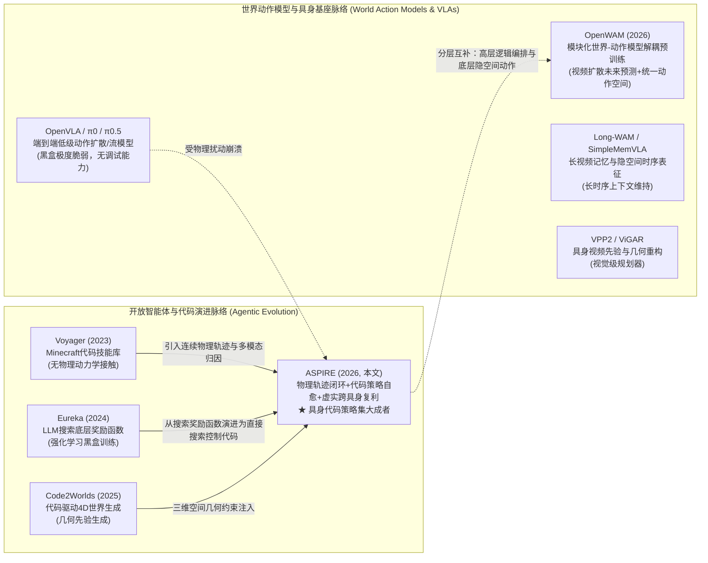

### 深度横向横向对比矩阵

| 维度 / 方法 | **Voyager (NeurIPS 2023)** | **Eureka (ICLR 2024)** | **Code2Worlds (2025)** | **OpenWAM (2026)** | **ASPIRE (本文, 2026)** |
| :--- | :--- | :--- | :--- | :--- | :--- |
| **核心范式** | 开放世界探索代码智能体 | LLM 引导的强化学习奖励设计 | 代码驱动的 4D 动态世界生成 | 解耦模块化世界动作模型 (WAM) | **闭环多模态轨迹引导的代码策略自演进** |
| **交互载体** | Minecraft 离散网格环境 | Isaac Gym 强化学习仿真器 | 连续三维物理引擎 / 渲染管线 | 真实/仿真跨具身连续视频与动作流 | **MuJoCo / Omniverse / 真实双臂机械臂** |
| **经验沉淀形式** | JS 代码控制函数库 | 文本化 Reward Function | 几何场景构建脚本 | 518.5M 帧预训练隐空间世界模型参数 | **异构代码/提示词技能库 (6大分类+守卫条件)** |
| **故障归因机制** | 离散游戏报错文本 | 训练回报曲线与标量 Reward | 视觉差分与几何重构残差 | 隐空间去噪流匹配误差 (Flow Loss) | **逐原语多模态轨迹、感知图层叠加与碰撞报警** |
| **对物理扰动的抗性** | 弱 (依赖 Minecraft 固定物理) | 强 (针对单任务过拟合训练) | 中 (受限于渲染与生成先验) | 中 (依赖预训练数据多域覆盖) | **极强 (LIBERO-Pro 达 72% vs VLA 13%)** |
| **零样本长程复合能力** | 中 (依赖技能拓扑调用) | 极弱 (奖励无法跨长任务泛化) | 弱 (主要针对单场景生成) | 中 (受限于自回归长程发散) | **极强 (LIBERO-Pro Long 取得 30.5% vs 4%)** |
| **虚实跨具身迁移** | 无实机支持 | 需通过 DR-Eureka 进行昂贵微调 | 无实机支持 | 依赖统一 80 维动作空间与实机部署协议 | **极强 (In-context 代码先验零样本降本 9.4倍)** |

### 独家学术洞见
1. **ASPIRE 补全了“Voyager 范式向连续严苛物理世界跃迁”的最后一块拼图**：  
   2023 年 Jim Fan 团队的 Voyager 在 Minecraft 中轰动一时，但机器人学界长期质疑其无法迁移到真实物理世界——因为 Minecraft 是基于离散网格与确定性状态机的虚拟世界，不存在真实世界复杂的连续逆运动学求解、摩擦力突变、点云遮挡与夹爪滑脱。ASPIRE 凭借**闭环执行引擎暴露的多模态底层原语轨迹**，成功将大模型的符号逻辑推演与物理世界极度苛刻的连续接触动力学深度缝合，是智能体演进史上里程碑式的蜕变。
2. **代码即策略与世界动作模型（WAM）的终极合流预言**：  
   在当下的具身智能前沿，以 OpenWAM、Long-WAM 为代表的“生成式世界动作模型”与以 ASPIRE 为代表的“智能体代码策略”看似走在两条不同的技术路线上。然而，两者的深层互补性极强：世界模型最擅长对未来视觉动态进行直觉象限的“未来想象”（Future Video Imagination），但在需要毫米级确定性几何控制与显式状态逻辑分支时显得算力沉重且不可控；ASPIRE 最擅长精确调用数学规划器与逻辑控制，但其假设生成缺乏对物理世界动态的底层先验直觉。未来的终极具身智能形态，必将是 **ASPIRE 充当高层元认知控制器与自愈进化中枢，而以 OpenWAM 等世界模型充当内部沙盒环境进行“脑内快进模拟推演”与底层连续动作微调的二位一体架构！**

---

## 引用

```bibtex
@article{lu2026aspire,
  title     = {ASPIRE: Agentic Skills Discovery for Robotics},
  author    = {Lu, Runyu and Wu, Yubo and Kou, Ethan and Fu, Letian and Xiao, Wenli and Mandlekar, Ajay and Xu, Yinzhen and Shi, Guanya and Goldberg, Ken and Chen, Ang and Chowdhury, Mosharaf and Zhu, Yuke and Fan, Linxi and Wang, Guanzhi},
  journal   = {arXiv preprint arXiv:2607.00272},
  year      = {2026},
  url       = {https://research.nvidia.com/labs/gear/aspire/}
}
```
