# Agentic World Action Models

**Authors:** Zhuoyang Liu$^{1*}$, Dantong Niu$^{1,2*\dagger}$, Botong Zhang$^{3*}$, Boning Shao$^{1*}$, Jing Wang$^2$, Ruijie Zheng$^2$, Yuvan Sharma$^2$, Runyu Lu$^2$, Jiaming Liu$^2$, Renrui Zhang$^3$, Roei Herzig$^1$, Yutong Bai$^1$, Ken Goldberg$^1$, Danfei Xu$^2$, Yuke Zhu$^{2\dagger}$, Guanzhi Wang$^{2\dagger}$, Linxi "Jim" Fan$^{2\dagger}$, Trevor Darrell$^{1\dagger}$  
**Affiliations:** $^1$UC Berkeley, $^2$NVIDIA, $^3$University of Pennsylvania  
$^*$Equal Contribution, $^\dagger$Equal Advising  
**Project Page:** [https://agentic-wam.github.io/](https://agentic-wam.github.io/)  
**arXiv:** [2610.30136v1 [cs.RO] 21 Oct 2026](https://arxiv.org/abs/2610.30136)

---

## Page / Section Index

- [Abstract](#abstract)
- [1 Introduction](#1-introduction)
- [2 Agentic World Action Model](#2-agentic-world-action-model)
  - [2.1 Mixture of Transformer Architecture](#21-mixture-of-transformer-architecture)
  - [2.2 Joint Denoising Generation](#22-joint-denoising-generation)
  - [2.3 Agentic Coding in WAM](#23-agentic-coding-in-wam)
  - [2.4 Training Recipe](#24-training-recipe)
- [3 Experiments](#3-experiments)
  - [3.1 Simulation Experiment](#31-simulation-experiment)
  - [3.2 Real-World Experiment](#32-real-world-experiment)
  - [3.3 Semantic Reasoning & Language Following](#33-semantic-reasoning--language-following)
  - [3.4 Ablation Studies](#34-ablation-studies)
- [4 Related Work](#4-related-work)
- [5 Conclusion](#5-conclusion)
- [Acknowledgments & Statements](#acknowledgments)
- [References](#references)
- [Appendix Contents](#appendix-contents)
  - [Appendix A: Model and Training Details](#appendix-a-model-and-training-details)
  - [Appendix B: Analysis on Pretraining Dataset](#appendix-b-analysis-on-pretraining-dataset)
  - [Appendix C: Baseline Implementation Details](#appendix-c-baseline-implementation-details)
  - [Appendix D: Real-world Experimental Setup](#appendix-d-real-world-experimental-setup)
  - [Appendix E: Real-world Task Progress](#appendix-e-real-world-task-progress)
  - [Appendix F: Analysis on Code Generation Quality](#appendix-f-analysis-on-code-generation-quality)
  - [Appendix G: Additional Analysis on Real-world Results](#appendix-g-additional-analysis-on-real-world-results)
  - [Appendix H: Failure Case Analysis](#appendix-h-failure-case-analysis)
  - [Appendix I: Hybrid Actions Algorithm](#appendix-i-hybrid-actions-algorithm)
  - [Appendix J: Additional Simulation Experiment Details](#appendix-j-additional-simulation-experiment-details)
  - [Appendix K: Agentic Annotation Details](#appendix-k-agentic-annotation-details)
  - [Appendix L: Limitations and Future Work](#appendix-l-limitations-and-future-work)

---

## Terminology Ledger

| 英文原词 (English Term) | 标准中文翻译 (Standard Translation) | 概念定义与技术语境 (Context & Definition) |
| :--- | :--- | :--- |
| **World Action Model (WAM)** | 世界动作模型 | 将未来视觉预测与视觉运动控制策略耦合的生成模型，通过预判物理环境演变来指导底层动作控制。 |
| **Agentic World Action Model (AW-0)** | 智能体世界动作模型 | 论文提出的统一框架，将代码级符号规划与连续视觉-动作联合生成相融合，实现组合式技能复用与具身控制。 |
| **Mixture-of-Transformers (MoT)** | 混合 Transformer 架构 | 一种模块化骨干架构，包含各自拥有独立投影与前馈网络的代码、视频与动作专家，并通过跨模态掩码联合注意力交互。 |
| **Code Expert** | 代码专家 | 负责根据视觉与指令生成参数化技能子程序与控制逻辑的专家网络，采用离散掩码扩散建模。 |
| **Video Expert** | 视频专家 | 负责在 VAE 潜在空间中预测未来多视图动态视频帧的扩散 Transformer (DiT)。 |
| **Action Expert** | 动作专家 | 负责输出连续 64 维机器人运动轨迹控制块 (action chunk) 的流匹配扩散网络。 |
| **Continuous Flow Matching** | 连续流匹配 | 针对视频与动作连续潜在变量的速度场回归生成范式，具备快速高效的采样收敛特性。 |
| **Discrete Masked Diffusion** | 离散掩码扩散 | 针对代码离散词元序列的吸收式掩码生成范式（类似 LLaDA），支持多步置信度迭代去掩码。 |
| **Joint Denoising** | 联合去噪 | 代码、视频与动作三模态在相同迭代步内同步协同去噪，使代码规划在整个生成过程中实时指导未来预测与动作生成。 |
| **Blockwise Causal Attention** | 分块因果注意力 | 专家内部双向自注意力，专家之间满足因果顺序约束（代码 $\to$ 视频 $\to$ 动作）的掩码注意力机制。 |
| **Skill Program / Slice** | 技能程序 / 程序切片 | 由底层 API 与复用技能函数构成的结构化 Python 代码块，精确描述某一段连续物理子任务的操作意图。 |
| **Skill Library** | 技能库 | 从海量示教轨迹中由智能体自动蒸馏提炼出的通用、可参数化的高阶动作函数集合（如 `adjust_in_place`）。 |
| **Primitive APIs** | 底层基元 API | 机器人平台预设的非学习式基本感知与控制接口（如 `pick`, `grasp`, `move_arm`, `servo_ee_delta`）。 |
| **Hybrid Actions / Execution** | 混合动作执行 | 部署测试时的动态仲裁机制：优先尝试执行语法与状态合规的代码程序，失败或不合规时回退至动作专家输出的控制块。 |
| **Code-as-Policies (CaP)** | 代码即策略 | 利用大型语言模型生成的 Python 程序作为机器人高级策略直接调用感知与底层控制 API 的范式。 |
| **Absorbing-mask Process** | 吸收式掩码过程 | 离散扩散中以固定概率将词元替换为特殊 `[MASK]` 标记的加噪过程。 |
| **Noise Resampling** | 噪声重采样 | 联合训练时混合预训练高噪声先验分布与均匀参考分布，并借助重要性权重平衡视频学习与动作引导。 |
| **RoboTwin 2.0** | RoboTwin 2.0 双臂仿真基准 | 包含 50 项复杂双臂协作任务的高保真物理仿真评测平台，支持 Clean 与 Random 两种评估设定。 |
| **Tianji–Sharpa Platform** | 天机-夏尔巴灵巧手平台 | 由天机仿人双臂躯干与两只 22 自由度 Sharpa Wave 灵巧手组成的高自由度双手操作实验平台。 |

---

## Abstract

> <span style="color:#3B82F6"><strong>Para. 1:</strong></span> Recent world action models provide visual foresight and future prediction for robot manipulation, but lack explicit mechanisms for compositional skill reuse. Agentic robotics combines code-based planning and reasoning with reusable skills, but often lacks predictive grounding in physical dynamics. We introduce AW-0, an agentic world action model framework that integrates code-based planning with joint video and action prediction. We jointly model code, future video, and robot actions as three coupled generative streams within a unified mixture-of-transformers architecture. Within this architecture a code expert generates parameterized skill routines and control logic while video and action experts generate future visual states and low-level motor commands. Code serves two complementary roles: it structures multi-step prediction and control within the world model and represents skills as reusable programs for subsequent agentic execution. We further introduce an automated curation pipeline that labels robot and human video trajectories with aligned programs and consolidates recurring routines into reusable skill libraries. Evaluations on RoboTwin 2.0 and physical bimanual manipulation tasks show improved task performance over VLA and WAM baselines, alongside gains in language following, semantic reasoning and robustness, demonstrating that agentic code enables connection between planning, prediction and execution within WAMs.

> <span style="color:#F59E0B"><strong>Para. 1[CN]:</strong></span> 近期涌现的世界动作模型（World Action Models, WAMs）为机器人操作提供了强大的视觉预见与未来预测能力，但缺乏实现组合式技能复用的显式机制。另一方面，智能体机器人（Agentic robotics）将基于代码的规划与推理同可复用技能相结合，却往往欠缺在真实物理动态层面的预测性基础接地（predictive grounding）。本文提出了 AW-0，一种将基于代码的规划同视频-动作联合预测相融合的智能体世界动作模型框架。我们在统一的混合 Transformer（Mixture-of-Transformers, MoT）架构中，将代码、未来视频和机器人动作建模为三个耦合的生成流。在此架构中，代码专家生成参数化的技能例程与控制逻辑，而视频和动作专家则分别生成未来视觉状态与底层运动指令。代码在此承担了双重互补的角色：一方面它为世界模型内部的多步预测与控制赋予了结构化引导，另一方面它将技能表示为可复用的程序以支持后续的智能体执行。我们进一步提出了一种自动化数据整理管线，能够用时间对齐的程序为机器人和人类视频轨迹添加标注，并将反复出现的例程沉淀为可复用的技能库。在 RoboTwin 2.0 仿真基准和真实世界双臂操作任务上的评测表明，AW-0 的任务表现显著超越了现有的视觉-语言-动作（VLA）模型和 WAM 基线，同时在语言遵循、语义推理和鲁棒性方面均取得了明显提升，证明了智能体代码能够在世界动作模型内部实现规划、预测与执行的有机联结。

### Figure 1. AW-0 架构与系统概览

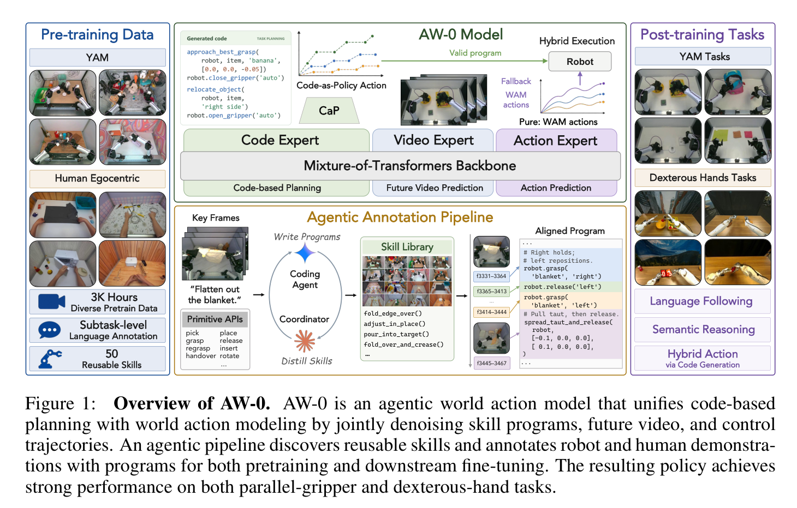

**Caption:** Overview of AW-0. AW-0 is an agentic world action model that unifies code-based planning with world action modeling by jointly denoising skill programs, future video, and control trajectories. An agentic pipeline discovers reusable skills and annotates robot and human demonstrations with programs for both pretraining and downstream fine-tuning. The resulting policy achieves strong performance on both parallel-gripper and dexterous-hand tasks.

**Caption[CN]:** AW-0 系统概览。AW-0 是一种智能体世界动作模型，通过对技能程序、未来视频和控制轨迹进行联合去噪，将基于代码的规划与世界动作建模统一起来。智能体管线能够自动发现可复用技能，并用程序标注机器人和人类示教轨迹，用于预训练以及下游微调。最终训练出的策略在平行夹爪与多指灵巧手任务上均取得了卓越性能。

---

## 1 Introduction

> <span style="color:#3B82F6"><strong>Para. 1:</strong></span> Learning-based robotic manipulation has progressed from small task-specific visuomotor policies over a decade ago to broadly supervised foundation models that connect perception, language, and action (Levine et al., 2016; Zitkovich et al., 2023; Kim et al., 2024; Niu et al., 2024; Black et al., 2024; Bjorck et al., 2025; Niu et al., 2025; Liu et al., 2025; Black et al., 2025; Liu et al., 2026). In parallel, self-supervised video prediction has long been valued as a learning signal to model the world: image inpainting extended to video prediction led to action-conditioned video predictors that can imagine the future before committing to an action (Pathak et al., 2016; He et al., 2021; Tong et al., 2022; Finn et al., 2016; Assran et al., 2025; Ye et al., 2026).

> <span style="color:#F59E0B"><strong>Para. 1[CN]:</strong></span> 基于学习的机器人操作技术，已经从十多年前针对特定任务的小型视觉运动策略，发展到如今连接感知、语言与动作的大规模受监督基础模型（Levine 等, 2016; Zitkovich 等, 2023; Kim 等, 2024; Niu 等, 2024; Black 等, 2024; Bjorck 等, 2025; Niu 等, 2025; Liu 等, 2025; Black 等, 2025; Liu 等, 2026）。与此并行，自监督视频预测长期以来一直被视为建模物理世界的重要学习信号：从图像修复扩展至视频预测，催生了动作条件化的视频预测器，能够在机器人真正执行动作之前对未来环境演变进行“想象”（Pathak 等, 2016; He 等, 2021; Tong 等, 2022; Finn 等, 2016; Assran 等, 2025; Ye 等, 2026）。

> <span style="color:#3B82F6"><strong>Para. 2:</strong></span> World Action Models (WAMs) couple visual prediction with visuomotor policies, grounding control in representations of how the physical world evolves (Ye et al., 2026; Kim et al., 2026; Yuan et al., 2026). This predictive grounding is particularly valuable for complex manipulation, where successful execution depends on anticipating object motion, contact, and the consequences of low-level actions. Yet predicted video and action chunks do not by themselves specify how a long-horizon task should be decomposed: which reusable skills to invoke, how to parameterize them, or how to compose them across subtasks. Predicting the world and/or actions in general can also be expensive, especially as it can be difficult to establish limits on how many degrees of freedom need to be "world modeled" (or teleoperated, in the supervised setting).

> <span style="color:#F59E0B"><strong>Para. 2[CN]:</strong></span> 世界动作模型（WAMs）将视觉预测同视觉运动策略深度耦合，将控制建立在对物理世界如何演变的内在表征之上（Ye 等, 2026; Kim 等, 2026; Yuan 等, 2026）。这种预测性基础对于复杂操作尤为宝贵，因为操作的成功执行高度依赖于对物体运动、物理接触以及底层动作后果的前瞻预判。然而，预测出的视频与动作块（action chunks）本身并不能明确指出长程任务应如何分解：即应该调用哪些可复用技能、如何对它们进行参数化、以及如何在各子任务之间组合这些技能。此外，全面预测物理世界或动作往往代价高昂，尤其是很难界定到底需要对多少自由度进行“世界建模”（或在监督设定下进行遥操作示教）。

> <span style="color:#3B82F6"><strong>Para. 3:</strong></span> Agentic robot systems provide complementary structure to WAMs: a programmatic harness that selects reusable skills and tools, binds them to the current scene, tracks progress, and replans as observations change (Liang et al., 2023; Fu et al., 2026; Zhang et al., 2026; Xiao et al., 2026; Lu et al., 2026). This programmatic representation makes the structure of multi-step tasks explicit, specifying which skills and tools to invoke, with what arguments, and in what sequence. Yet agentic robotics often lacks predictive grounding in real-world physical dynamics and does not leverage a learned model of how the world will change as the robot acts.

> <span style="color:#F59E0B"><strong>Para. 3[CN]:</strong></span> 智能体机器人系统（Agentic robot systems）为世界动作模型提供了高度互补的结构：一套能够选择可复用技能与工具、将其绑定到当前场景、追踪执行进度并在观测发生变化时进行重规划的程序化外骨骼框架（Liang 等, 2023; Fu 等, 2026; Zhang 等, 2026; Xiao 等, 2026; Lu 等, 2026）。这种程序化表征使多步任务的结构变得极为显式，清晰规定了应调用哪些技能与工具、传入何种参数以及遵循怎样的时序逻辑。然而，智能体机器人往往缺乏真实世界物理动态的预测性接地，并未利用一个能够学习“随机器人行动世界将如何改变”的世界模型。

> <span style="color:#3B82F6"><strong>Para. 4:</strong></span> We advocate for an architecture that combines the foresight and action execution of WAMs with the cognitive efficiency, reusable skills, and potential for future self-improvement of agentic robotics. We propose AW-0, an agentic WAM framework that incorporates code-based planning and generation directly into world action modeling via a grounded code expert that harnesses broad programming priors to synthesize modular skills featuring explicit parameters and control logic. Code guides synchronized video and control modules within a mixture-of-transformers architecture, simultaneously denoising discrete code structures, predicted visual observations, and low-level motor commands.

> <span style="color:#F59E0B"><strong>Para. 4[CN]:</strong></span> 我们主张采用一种将世界动作模型的远瞻预见与动作执行能力，同智能体机器人的认知效率、可复用技能及未来自我演进潜力深度融合的架构。为此，我们提出了 AW-0，这是一种智能体世界动作模型框架，它通过一个接地的代码专家，将基于代码的规划与生成直接纳入世界动作建模之中；该代码专家充分利用广泛的编程先验，合成具有显式参数和控制逻辑的模块化技能。在混合 Transformer 架构中，代码指导同步的视频与控制模块，实现对离散代码结构、预测视觉观测与底层运动指令的同步联合去噪。

> <span style="color:#3B82F6"><strong>Para. 5:</strong></span> We first show that such agents can be realized by adding a code expert to a WAM, leveraging multi-sensor action and code generation in a planning stage. We develop a modular generation framework: planning via code generation significantly improves WAM performance, by appropriately conditioning the long-horizon generations required for complex robotic tasks. An automated curation pipeline extracts systematic routines into reusable program libraries, mapping code segments directly onto robotic and human video trajectories. This approach bridges high-level semantic reasoning with predictive physical dynamics, establishing a unified language for compositionality across distinct environments and tasks. We further demonstrate agentic skill reuse via a hybrid deployment strategy that selects between raw action chunk execution and programmatic skill invocation. Empirical evaluations across RoboTwin 2.0 benchmarks and physical bimanual setups show substantial performance gains compared to standard VLA and WAM baselines, highlighting programmatic code as an effective structural backbone for predictive planning, skill discovery, and embodied robotic control.

> <span style="color:#F59E0B"><strong>Para. 5[CN]:</strong></span> 我们首先证明，通过向世界动作模型中引入代码专家，在规划阶段利用多传感器动作与代码生成，即可构建出此类智能体。我们开发了一套模块化生成框架：通过代码生成进行规划，能够为复杂机器人任务所必需的长程生成施加恰当条件，从而大幅提升 WAM 的性能。自动化整理管线将系统性例程提炼为可复用的程序库，将代码片段直接映射到机器人和人类的视频轨迹上。该方法在高层语义推理与预测性物理动态之间架起了一座桥梁，为跨越不同环境与任务的组合性奠定了统一的语言基础。我们进一步通过混合部署策略展示了智能体技能复用，该策略可在原始动作块执行与程序化技能调用之间动态选择。在 RoboTwin 2.0 基准和物理真实双臂平台上的实证评估表明，与标准 VLA 和 WAM 基线相比，AW-0 取得了显著的性能增益，突显了程序化代码作为预测性规划、技能发现和具身机器人控制有效结构骨干的核心价值。

> <span style="color:#3B82F6"><strong>Para. 6:</strong></span> Our primary contribution is the conceptualization and realization of agentic robotic skills within a world action model framework, showing that code generation improves action prediction in the world model, and that the code generated from the world model can be re-used in an agentic framework. Specific novel contribution elements include: a mixture-of-transformers framework integrating a code expert into world action models via simultaneous denoising of code, video, and control; an automated agentic pipeline designed for program annotation and skill discovery; a dataset of such structured skill programs; and a hybrid execution policy that dynamically toggles between programmatic skill invocation and direct deployment of action chunks from the WAM action expert.

> <span style="color:#F59E0B"><strong>Para. 6[CN]:</strong></span> 我们的主要贡献在于世界动作模型框架下智能体机器人技能的概念化与具体实现，证明了代码生成能够提升世界模型中的动作预测精度，并且世界模型生成的代码可以在智能体框架中实现有效复用。具体创新要素包括：一个通过代码、视频与控制同步去噪将代码专家整合至世界动作模型的混合 Transformer 框架；一套专为程序标注与技能发现设计的自动化智能体数据管线；一个结构化技能程序数据集；以及一种在程序化技能调用与 WAM 动作专家直接动作块部署之间动态切换的混合执行策略。

### Figure 2. AW-0 总体框架与联合去噪流程


**Caption:** Figure 2: AW-0 Framework. AW-0 includes a Mixture-of-Transformers backbone with three experts generating code, video and action, respectively, which are denoised jointly, with video and action under continuous flow matching and the code under discrete masked diffusion.

**Caption[CN]:** 图 2：AW-0 总体框架。AW-0 包含一个混合 Transformer（MoT）骨干网络，其三位专家分别生成代码、视频和动作并进行联合去噪；其中视频与动作在连续流匹配下演化，代码则通过离散掩码扩散进行生成。

---

## 2 Agentic World Action Model

> <span style="color:#3B82F6"><strong>Para. 1:</strong></span> We formulate AW-0 as a unified conditional generative model over code, video, and actions, which respectively describe structured skill plans, future scene dynamics, and continuous robot motion. We represent a skill program as a discrete token sequence $C_0 = (c_1, \dots, c_{N_c})$, future observations as continuous video latents $Z_0$ encoded by a pretrained variational autoencoder, and robot motion as an action chunk $A_0 = (a_t, \dots, a_{t+H-1})$ over a horizon of $H$ steps.

> <span style="color:#F59E0B"><strong>Para. 1[CN]:</strong></span> 我们将 AW-0 构建为一个针对代码、视频和动作的统一条件生成模型，三者分别描述了结构化技能规划、未来场景动态以及连续机器人运动。我们将技能程序表示为离散词元序列 $C_0 = (c_1, \dots, c_{N_c})$，将未来观测表示为由预训练变分自编码器（VAE）编码的连续视频潜在变量 $Z_0$，并将机器人运动表示为跨越 $H$ 步时域的动作块 $A_0 = (a_t, \dots, a_{t+H-1})$。

> <span style="color:#3B82F6"><strong>Para. 2:</strong></span> The model is conditioned on the current multi-view observations $O_t$, a language instruction $L$, the current robot state $S_t$, and a compact memory $M_t$ of the preceding program slices. Together, these inputs define the conditioning context for our joint generative model:

> <span style="color:#F59E0B"><strong>Para. 2[CN]:</strong></span> 模型以当前多视角观测 $O_t$、自然语言指令 $L$、当前机器人状态 $S_t$ 以及先前程序切片的紧凑记忆 $M_t$ 为条件。这些输入共同构成了联合生成模型的条件上下文：

$$
\mathcal{C}_t = \{O_t, L, S_t, M_t\}, \quad p_	heta(C_0, Z_0, A_0 \mid \mathcal{C}_t).
	ag{1}
$$

> <span style="color:#3B82F6"><strong>Para. 3:</strong></span> The unified conditional generation proceeds by jointly denoising the three modalities. Given masked code $	ilde{C}_r$ and noisy continuous states $Z_{\sigma_v}$ and $A_{\sigma_a}$, the unified model predicts

> <span style="color:#F59E0B"><strong>Para. 3[CN]:</strong></span> 统一条件生成过程通过对三种模态联合去噪来展开。给定被掩码的代码 $	ilde{C}_r$ 以及加噪的连续状态 $Z_{\sigma_v}$ 和 $A_{\sigma_a}$，统一模型预测：

$$
(\ell_	heta^c, v_	heta^v, v_	heta^a) = F_	heta(	ilde{C}_r, Z_{\sigma_v}, A_{\sigma_a}, \sigma_v, \sigma_a; \mathcal{C}_t),
	ag{2}
$$

> <span style="color:#3B82F6"><strong>Para. 4:</strong></span> where $r$ is the code-mask ratio, $\sigma_v$ and $\sigma_a$ are the video and action noise levels, $\ell_	heta^c$ are code-token logits, and $v_	heta^v, v_	heta^a$ are the video and action velocity predictions. The formulation unifies structured skill programming, future dynamics prediction, and continuous control in one generative process.

> <span style="color:#F59E0B"><strong>Para. 4[CN]:</strong></span> 其中 $r$ 代表代码掩码比例，$\sigma_v$ 与 $\sigma_a$ 分别为视频与动作的噪声水平，$\ell_	heta^c$ 为代码词元的未归一化对数概率（logits），而 $v_	heta^v, v_	heta^a$ 则为视频与动作的速度场预测值。该公式将结构化技能编程、未来动态预测和连续控制高度整合在同一个生成过程之中。

### 2.1 Mixture of Transformer Architecture

> <span style="color:#3B82F6"><strong>Para. 5:</strong></span> As shown in Figure 2, AW-0 adopts a Mixture-of-Transformers (MoT) (Liang et al., 2025) architecture with three experts for skill planning, future visual prediction, and continuous control. Each expert keeps its own attention projections ($W_Q, W_K, W_V, W_O$), layer normalizations, and FFNs, communicating through masked joint attention at every transformer layer. The attention mask is bidirectional within each expert and blockwise causal across experts, following the order of code, video and action. We provide additional model and training details in Appendix A.

> <span style="color:#F59E0B"><strong>Para. 5[CN]:</strong></span> 如图 2 所示，AW-0 采用了混合 Transformer（MoT）（Liang 等, 2025）架构，配备了三位专属专家分别负责技能规划、未来视觉预测和连续动作控制。每位专家各自保留其独立的注意力投影矩阵（$W_Q, W_K, W_V, W_O$）、层归一化（LayerNorm）与前馈网络（FFN），并在每一个 Transformer 层通过掩码联合注意力进行跨模态交互通信。注意力掩码在各专家内部是完全双向的，而在跨专家交互之间则满足分块因果约束，严格遵循代码 $	o$ 视频 $	o$ 动作的单向信息流顺序。我们在附录 A 中提供了更详尽的模型与训练细节。

> <span style="color:#3B82F6"><strong>Para. 6:</strong></span> Code Expert. The code expert augments a pretrained language backbone with a frozen Qwen3-VL (Bai et al., 2025) ViT and adopts LLaDA-style masked-token diffusion (Nie et al., 2025). Current multi-view observations are encoded into visual tokens and prepended to the instruction and program tokens to ground skill planning in the scene.

> <span style="color:#F59E0B"><strong>Para. 6[CN]:</strong></span> 代码专家（Code Expert）。代码专家在一个预训练语言骨干网络的基础上，外挂了一个冻结参数的 Qwen3-VL（Bai 等, 2025）ViT 视觉编码器，并采用了类似 LLaDA 的掩码词元扩散生成范式（Nie 等, 2025）。系统将当前的多视角观测编码为视觉词元，并将其拼接在语言指令与程序词元之前，从而使高层技能规划牢固地接地于真实环境场景之中。

> <span style="color:#3B82F6"><strong>Para. 7:</strong></span> Video and Action Experts. The video expert uses a video DiT initialized from Cosmos-Predict2.5 (NVIDIA, 2025b) to model VAE-encoded future frames conditioned on observed frames, while a separate action DiT generates continuous action chunks. Both experts receive language embeddings through cross-attention, with additional robot-state conditioning for the action expert.

> <span style="color:#F59E0B"><strong>Para. 7[CN]:</strong></span> 视频与动作专家（Video and Action Experts）。视频专家采用基于 Cosmos-Predict2.5（NVIDIA, 2025b）权重初始化的视频扩散 Transformer（DiT），用于在当前观测帧的条件下对 VAE 编码的未来帧潜在空间进行建模；独立的动作 DiT 则负责生成连续的动作块。两位专家均通过交叉注意力机制接收语言嵌入向量，而动作专家还会额外接收机器人本体状态的条件化输入。

### 2.2 Joint Denoising Generation

> <span style="color:#3B82F6"><strong>Para. 8:</strong></span> At each denoising step, the MoT jointly predicts code logits and continuous velocities as defined in Eq. 2. The code stream supplies planning context to the video and action experts, while the action expert also reads video representations. These connections operate throughout generation, allowing all three modalities to evolve within the same iterative process.

> <span style="color:#F59E0B"><strong>Para. 8[CN]:</strong></span> 在每一个去噪步中，MoT 会按照公式 2 的定义联合预测代码的 logits 与连续变量的速度。代码流为视频与动作专家提供规划上下文，而动作专家亦会实时读取视频表征。这些跨模态连接贯穿于整个生成过程，使三种模态得以在同一个迭代循环中同步演进与精炼。

> <span style="color:#3B82F6"><strong>Para. 9:</strong></span> Modality-Specific Corruption. Video and action generation use continuous flow matching. For $m \in \{v, a\}$, with $X_0^v = Z_0$ and $X_0^a = A_0$, we construct noisy inputs as

> <span style="color:#F59E0B"><strong>Para. 9[CN]:</strong></span> 模态特定的加噪过程。视频与动作生成均采用连续流匹配。对于 $m \in \{v, a\}$，取 $X_0^v = Z_0$ 且 $X_0^a = A_0$，我们构造加噪输入如下：

$$
X_{\sigma_m}^m = (1-\sigma_m)X_0^m + \sigma_m \epsilon_m, \quad \epsilon_m \sim \mathcal{N}(0, I), \quad \sigma_m = \phi_{\gamma_m}(u_m) = rac{\gamma_m u_m}{1 + (\gamma_m - 1)u_m}.
	ag{3}
$$

> <span style="color:#3B82F6"><strong>Para. 10:</strong></span> The original video sampling distribution $p_{	ext{pre}}$ is induced by $u_v = s b$, where $b \sim 	ext{Beta}(7, 1)$ and $s = 0.999$; actions use $u_a \sim \mathcal{U}(0, 1)$. Both shifts are $\gamma_m = 5$. Code instead uses discrete absorbing-mask corruption. We sample a mask ratio $r \sim \mathcal{U}(0, 1)$ and corrupt each token independently:

> <span style="color:#F59E0B"><strong>Para. 10[CN]:</strong></span> 原始视频采样分布 $p_{	ext{pre}}$ 由 $u_v = s b$ 导出，其中 $b \sim 	ext{Beta}(7, 1)$ 且 $s = 0.999$；动作则采用均匀分布 $u_a \sim \mathcal{U}(0, 1)$。两者的非线性时间步偏移尺度均为 $\gamma_m = 5$。代码则采用离散吸收式掩码加噪。我们从均匀分布中采样掩码比例 $r \sim \mathcal{U}(0, 1)$，并独立对每个词元实施加噪：

$$
	ilde{c}_i = egin{cases} [	ext{MASK}], & b_i = 1, \ c_i, & b_i = 0, \end{cases} \quad b_i \sim 	ext{Bernoulli}(r).
	ag{4}
$$

> <span style="color:#3B82F6"><strong>Para. 11:</strong></span> Observed frames, visual prefixes, and language conditions remain uncorrupted. Training samples the modality-specific noise levels independently. The continuous experts regress the velocity target $\epsilon_m - X_0^m$, while the code expert minimizes cross-entropy over masked program positions.

> <span style="color:#F59E0B"><strong>Para. 11[CN]:</strong></span> 观测帧、视觉前缀和语言条件在此过程中均保持完整不加噪。训练阶段对各模态的噪声水平进行独立采样。连续专家负责回归速度目标 $\epsilon_m - X_0^m$，而代码专家则针对被掩码的程序位置最小化交叉熵损失。

> <span style="color:#3B82F6"><strong>Para. 12:</strong></span> Noise Resampling for Predictive Guidance. To provide more informative video features for action prediction, we broaden the high-noise pretrained distribution with a uniform component:

> <span style="color:#F59E0B"><strong>Para. 12[CN]:</strong></span> 用于预测引导的噪声重采样。为了向动作预测提供信息量更为充沛的视频特征，我们引入了一个均匀分布分量，对高噪声的预训练分布进行展宽拓宽：

$$
u_v \sim q(u) = lpha p_{	ext{pre}}(u) + (1 - lpha)p_{	ext{ref}}(u), \quad p_{	ext{ref}} = \mathcal{U}(0, 1).
	ag{5}
$$

> <span style="color:#3B82F6"><strong>Para. 13:</strong></span> Objective-specific importance weights balance video learning and predictive guidance:

> <span style="color:#F59E0B"><strong>Para. 13[CN]:</strong></span> 目标特定的重要性权重有效平衡了视频生成学习与预测性动作引导：

$$
w_v(u) = rac{p_{	ext{pre}}(u)}{q(u)}, \quad w_g(u) = rac{p_{	ext{ref}}(u)}{q(u)}, \quad \mathcal{L} = \mathbb{E}_{u_v \sim q} \left[ \lambda_v ar{w}_v \ell_v + ar{w}_g (\lambda_a \ell_a + \lambda_c \ell_c) 
ight].
	ag{6}
$$

> <span style="color:#3B82F6"><strong>Para. 14:</strong></span> Here, $\ell_v, \ell_a$ are flow-matching losses, and $\ell_c$ is masked-token cross-entropy; bars denote clipped weights normalized to unit batch mean. We use $lpha = 0.5$ and leave code-mask sampling unchanged.

> <span style="color:#F59E0B"><strong>Para. 14[CN]:</strong></span> 此处 $\ell_v, \ell_a$ 为流匹配损失，$\ell_c$ 为掩码词元交叉熵损失；上划线表示截断且归一化至批次均值为 1 的重要性权重。我们设定混合权重 $lpha = 0.5$，并保持代码掩码采样策略不变。

### 2.3 Agentic Coding in WAM

> <span style="color:#3B82F6"><strong>Para. 15:</strong></span> Automatic Annotation Pipeline. We propose an automatic annotation pipeline (Figure 3) that annotates the training data with skill planning code in three stages. We first sample one episode per task and use Gemini 3.1 Pro (Google DeepMind, 2026) to write subtask-level skill programs against predefined declaration-only APIs, while Claude Code running Claude Opus 4.8 (Anthropic, 2026) acts as a coordinator that distills recurring, task-general skills. We then freeze the skill library and re-annotate the sampled episodes with the finalized vocabulary, forming a cache of reusable subtask-to-program mappings. To annotate the remaining corpus, we reuse a cached program when the subtask's contact and motion pattern matches an existing entry; otherwise, the coding agent generates a new annotation and adds it to the cache. See Appendix K for further pipeline details.

> <span style="color:#F59E0B"><strong>Para. 15[CN]:</strong></span> 自动化标注管线。我们提出了一套三阶段自动化标注管线（图 3），使用技能规划代码为训练数据添加标注。首先，我们从每个任务中采样一个轨迹片段，使用 Gemini 3.1 Pro（Google DeepMind, 2026）基于预设的仅声明 API 编写子任务级技能程序，同时由运行 Claude Opus 4.8 的 Claude Code（Anthropic, 2026）担任协调者，蒸馏提炼出反复出现且跨任务通用的技能。接着，我们冻结该技能库，并利用这套最终确定的词汇重新标注所采样的示教片段，构建起一套可复用的“子任务-程序”映射缓存。对于语料库中剩余的海量数据，当新子任务的物理接触与运动模式同已有缓存条目匹配时直接复用缓存程序；若不匹配，则由编程智能体生成新标注并写回缓存。详见附录 K。

### Figure 3. 自动化智能体标注管线与技能发现机制

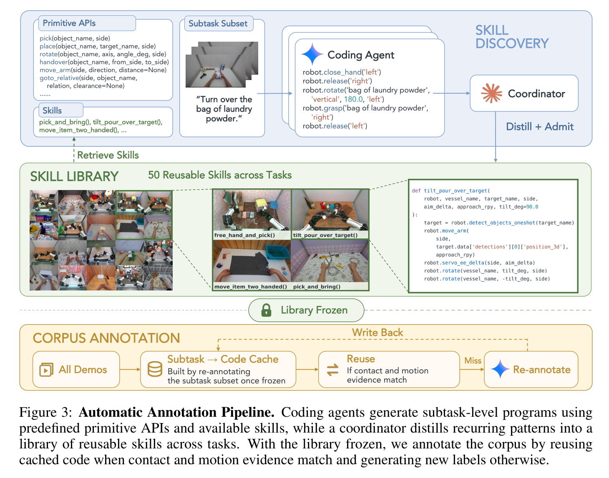

**Caption:** Figure 3: Automatic Annotation Pipeline. Coding agents generate subtask-level programs using predefined primitive APIs and available skills, while a coordinator distills recurring patterns into a library of reusable skills across tasks. With the library frozen, we annotate the corpus by reusing cached code when contact and motion evidence match and generating new labels otherwise.

**Caption[CN]:** 图 3：自动化标注管线。编程智能体利用预先定义的底层基元 API 以及可用技能库生成子任务级程序，协调者则将反复出现的运动模式提炼为跨任务可复用的技能库。在技能库冻结之后，当物理接触与运动特征证据匹配时，管线直接复用缓存的代码标注整个语料库，否则自动生成全新代码标签。

> <span style="color:#3B82F6"><strong>Para. 16:</strong></span> Code Usage in Model. Annotated programs define the interface through which the code expert plans. During training, the code stream concatenates a conditioning prompt and the active slice, a short block of primitive or skill calls. Only the slice is corrupted by the absorbing-mask process of Eq. 4 and supervised by the masked-token loss. At each replanning point, the policy rebuilds the prompt and appends a canvas of $G$ mask tokens. The canvas is decoded jointly with the video and action states over the $T$ denoising steps, committing the $G/T$ most confident masked positions per step. By default, the decoded slice is not executed. It serves as a subtask plan that conditions the action expert through joint denoising, while the predicted action chunk drives the robot.

> <span style="color:#F59E0B"><strong>Para. 16[CN]:</strong></span> 模型中的代码使用机制。标注好的程序构成了代码专家进行规划的交互接口。在训练阶段，代码流拼接了条件提示词与当前活动切片（即调用基元或技能的短代码块）。只有该切片会受到公式 4 吸收式掩码过程的破坏，并由掩码词元损失进行监督。在每一个重规划时刻，策略会重建提示词，并在其后附带一个包含 $G$ 个掩码词元的画布（canvas）。在 $T$ 个联合去噪步中，该画布与视频及动作状态一同解码，每一步固化置信度最高的 $G/T$ 个掩码位置。默认情况下，解码出的程序切片并不直接执行，而是作为子任务规划，通过联合去噪为动作专家提供高层语义条件，最终由动作专家输出的动作块驱动机器人。

> <span style="color:#3B82F6"><strong>Para. 17:</strong></span> Memory Cache. Since a single observation is often insufficient to reveal task progress, the code expert receives a compact cache of the slices generated so far. The history slices are compressed into $K$ learnable memory slots and read back as prefix tokens before the prompt in the code stream. During training, the buffer holds the preceding annotated slices, replaced with probability $p$ by the model's own predictions. At inference, it is reset per episode and grows with each decoded slice.

> <span style="color:#F59E0B"><strong>Para. 17[CN]:</strong></span> 记忆缓存（Memory Cache）。由于单张视觉观测往往不足以揭示完整的任务历史进度，代码专家会接收一份由先前生成的切片构成的紧凑记忆缓存。历史切片被压缩至 $K$ 个可学习的记忆槽位中，并在代码流中作为提示词之前的前缀词元被读回。在训练期间，该缓冲区存储真实标注的历史切片，并以概率 $p$ 替换为模型自身的自回归预测；在测试推理期间，该缓冲区在每个任务幕（episode）开始时重置，并随着每个新解码切片的生成逐步增长。

> <span style="color:#3B82F6"><strong>Para. 18:</strong></span> Hybrid Actions. We additionally explore an inference mode in which the decoded code slice is executed in the manner of Code-as-Policies (CaP) against a library of perception and control primitives, and the executed actions are integrated with the direct actions of the action expert. At deployment, the two channels are arbitrated at every replanning point: the decoded slice takes over the current stage only if it passes a set of validity and progress checks; otherwise the action chunk from the same forward pass drives the robot until the next replan. See Appendix I for the full algorithm.

> <span style="color:#F59E0B"><strong>Para. 18[CN]:</strong></span> 混合动作执行（Hybrid Actions）。我们进一步探索了一种推理执行模式：解码出的代码切片以“代码即策略”（Code-as-Policies, CaP）的形式，直接调用感知与控制基元库在机器人上运行，且执行结果与动作专家的直接动作紧密融合。在实际部署中，双控制通道在每一个重规划时刻进行智能仲裁：解码出的切片仅在通过一系列语法、依赖与进度合规性检查时，才会接管当前阶段的执行；否则，将直接由同一前向传播中生成的动作块驱动机器人，直至下一次重规划。完整算法详见附录 I。

### 2.4 Training Recipe

> <span style="color:#3B82F6"><strong>Para. 19:</strong></span> We first pretrain AW-0 on approximately 2,000 hours of YAM robot data and approximately 1,000 hours of egocentric human manipulation data to learn a general unified generative prior. We apply the automatic annotation pipeline in Section 2.3 to extract two embodiment-specific skill libraries containing 50 skill entries in total (23 for YAM and 27 for egocentric human demonstrations) and annotate demonstrations with temporally aligned program slices. The annotated data support joint pretraining of code, video, and action generation, connecting structured skill plans with visual dynamics and continuous control across embodiments and scenarios. We further include the details of dataset statistics, preprocessing, and state-action representations in Appendix B. For each downstream task, we reuse the same annotation pipeline under the frozen skill library to label task-specific demonstrations and jointly fine-tune AW-0 on the resulting code, video, and action targets using the objective in Eq. 6.

> <span style="color:#F59E0B"><strong>Para. 19[CN]:</strong></span> 训练流程配方。我们首先在约 2,000 小时的 YAM 机器人数据以及约 1,000 小时的人类第一人称操作数据上对 AW-0 进行预训练，以学习通用的统一生成先验。我们应用 2.3 节中的自动化标注管线提炼出两个特定构型的技能库，总共包含 50 个技能条目（YAM 机器人 23 项，人类第一人称示教 27 项），并用时间对齐的程序切片为示教数据赋予标注。标注后的数据支持代码、视频与动作生成的联合预训练，在不同机器人构型与应用场景下将结构化技能规划与视觉动态及连续控制联结起来。关于数据集统计、预处理以及状态-动作表征的细节见附录 B。对于各项下游任务，我们在冻结的技能库下复用相同的标注管线标注任务特定的示教轨迹，并使用公式 6 的目标函数在所得的代码、视频与动作目标上对 AW-0 进行端到端联合微调。

---


## 3 Experiments

> <span style="color:#3B82F6"><strong>Para. 1:</strong></span> We evaluate AW-0 on RoboTwin 2.0 (Chen et al., 2025) and 8 real-world tasks spanning parallel-gripper and dexterous-hand embodiments, assessing language following, semantic reasoning, and skill execution, as well as the robustness benefits of hybrid execution in variant scenarios.

> <span style="color:#F59E0B"><strong>Para. 1[CN]:</strong></span> 我们在 RoboTwin 2.0 双臂仿真基准（Chen 等, 2025）以及涵盖平行夹爪与多指灵巧手构型的 8 项真实世界任务上对 AW-0 进行系统性评估，深入考察其语言遵循、语义推理和技能执行表现，并验证混合执行模式在多样化场景下的鲁棒性优势。

> <span style="color:#3B82F6"><strong>Para. 2:</strong></span> Baselines. We compare four baselines: (1) $\pi_{0.5}$ (Black et al., 2025), a state-of-the-art VLA with strong semantic reasoning; (2) EgoScale (Zheng et al., 2026), a VLA pretrained on large-scale egocentric human data; (3) DreamZero (Ye et al., 2026), a WAM jointly generating future video and actions; and (4) WLA (Yang et al., 2026), an autoregressive model jointly predicting textual sub-tasks, subgoal images, and actions. All baselines and the default AW-0 configuration use the same task-specific demonstrations for post-training and follow the same evaluation protocol. The simulation hybrid configuration uses separately collected CaP-generated demonstrations, as described below. Baseline implementation details are provided in Appendix C.

> <span style="color:#F59E0B"><strong>Para. 2[CN]:</strong></span> 基线方法（Baselines）。我们对比了四种代表性基线模型：(1) $\pi_{0.5}$（Black 等, 2025），具备强大语义推理能力的顶尖视觉-语言-动作（VLA）模型；(2) EgoScale（Zheng 等, 2026），在大规模人类第一人称数据上预训练的 VLA 模型；(3) DreamZero（Ye 等, 2026），联合生成未来视频与动作的世界动作模型（WAM）；以及 (4) WLA（Yang 等, 2026），联合自回归预测文本子任务、子目标图像与底层动作的基准模型。所有基线方法与默认配置下的 AW-0 均使用完全相同的任务特定示教数据进行后训练（post-training），并遵循严格一致的评估协议。仿真混合模式则使用单独收集的由 CaP 生成的示教数据，具体如下文所述。基线复现细节详见附录 C。

### 3.1 Simulation Experiment

> <span style="color:#3B82F6"><strong>Para. 3:</strong></span> Benchmarks. We evaluate AW-0 on RoboTwin 2.0. Following the training-data requirements specified on the official RoboTwin 2.0 leaderboard, we train on 50 clean demonstrations per task (2,500 episodes in total) and evaluate under the benchmark's two settings: clean, with a clean tabletop, plain background, fixed lighting, and no distractors; and random, with domain randomization over background and tabletop textures, lighting, tabletop height, and distractor objects. We report the mean success rate over 50 rollouts per task.

> <span style="color:#F59E0B"><strong>Para. 3[CN]:</strong></span> 评估基准（Benchmarks）。我们在 RoboTwin 2.0 上对 AW-0 展开评估。遵循 RoboTwin 2.0 官方排行榜规定的训练数据标准，我们在每个任务 50 条干净示教轨迹（共计 2,500 幕）上进行策略训练，并在该基准的两种评估设定下测试：Clean（干净设定），包含整洁桌面、纯色背景、固定光照且无任何干扰物；以及 Random（随机化设定），针对背景与桌面纹理、光照强弱、桌面高度以及干扰物体施加域随机化扰动。我们汇报每个任务 50 次评测 rollout 的平均成功率。

> <span style="color:#3B82F6"><strong>Para. 4:</strong></span> Hybrid Evaluation. We additionally evaluate AW-0 in the hybrid mode, in which the training demonstrations are collected by executing CaP programs written against a set of CaP-X-style (Fu et al., 2026) primitive APIs that we develop for RoboTwin 2.0. The programs are written automatically by Claude Opus 4.8, following the agentic framework of ASPIRE (Lu et al., 2026).

> <span style="color:#F59E0B"><strong>Para. 4[CN]:</strong></span> 混合模式评估（Hybrid Evaluation）。我们额外评估了处于混合模式下的 AW-0，其中训练示教数据是通过执行基于我们为 RoboTwin 2.0 开发的 CaP-X 风格（Fu 等, 2026）底层基元 API 所编写的 CaP 程序收集而成。这些程序遵循 ASPIRE（Lu 等, 2026）的智能体框架，由 Claude Opus 4.8 自动化编写生成。

### Table 1. RoboTwin 2.0 仿真基准评测结果（50 项任务）

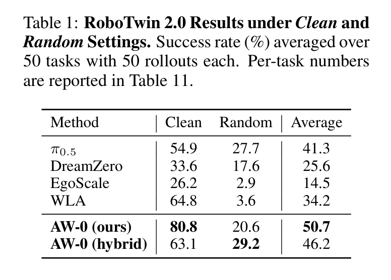

| Method | Clean (%) | Random (%) | Average (%) |
| :--- | :---: | :---: | :---: |
| $\pi_{0.5}$ | 54.9 | 27.7 | 41.3 |
| DreamZero | 33.6 | 17.6 | 25.6 |
| EgoScale | 26.2 | 2.9 | 14.5 |
| WLA | 64.8 | 3.6 | 34.2 |
| **AW-0 (ours)** | **80.8** | 20.6 | **50.7** |
| AW-0 (hybrid) | 63.1 | **29.2** | 46.2 |

**Caption:** Table 1: RoboTwin 2.0 Results under Clean and Random Settings. Success rate (%) averaged over 50 tasks with 50 rollouts each. Per-task numbers are reported in Table 11.

**Caption[CN]:** 表 1：RoboTwin 2.0 在 Clean 与 Random 设定下的评测结果。成功率（%）为 50 个任务、每个任务 50 次评测 rollout 的平均值。每个任务的详细分项指标见表 11。

### Figure 4. RoboTwin 2.0 基准平均得分对比柱状图


**Caption:** Figure 4: Average Scores from Table 1.

**Caption[CN]:** 图 4：表 1 中各方法在 RoboTwin 2.0 上的平均成功率得分对比。

> <span style="color:#3B82F6"><strong>Para. 5:</strong></span> Main Results. Table 1 and Figure 4 report the results on RoboTwin 2.0. The two inference modes exhibit complementary strengths. Overall, AW-0 achieves the highest average success rate of 50.7% across both settings, outperforming all baselines including models designed for broad generalization. The advantage comes mostly from the clean setting, where AW-0 reaches 80.8%, exceeding the strongest baseline WLA (64.8%) by 16.0 points. Under visual randomization, performance drops to 20.6%, consistent with the challenges of pixel-level O.O.D prediction discussed in prior work (Yan et al., 2026). It falls below the VLA baseline $\pi_{0.5}$ (27.7%) but still outperforms the strongest WAM baseline DreamZero (17.6%) and remains far ahead of EgoScale (2.9%) and WLA (3.6%).

> <span style="color:#F59E0B"><strong>Para. 5[CN]:</strong></span> 主要实验结果。表 1 和图 4 展示了在 RoboTwin 2.0 上的整体评测成绩。两种推理模式展现出了显著的互补优势。总体而言，AW-0 在两种设定下取得了 50.7% 的最高平均成功率，全面超越了包括专为广泛泛化设计的模型在内的所有基线。这一优势主要源于干净设定（Clean）：AW-0 的成功率高达 80.8%，相比最强基线 WLA（64.8%）高出整整 16.0 个百分点。在视觉随机化设定（Random）下，由于面临前序工作中探讨的像素级分布外（O.O.D）预测困难（Yan 等, 2026），其性能下降至 20.6%，虽略低于 VLA 基线 $\pi_{0.5}$（27.7%），但仍大幅领跑最强 WAM 基线 DreamZero（17.6%），并显著优于 EgoScale（2.9%）与 WLA（3.6%）。

> <span style="color:#3B82F6"><strong>Para. 6:</strong></span> We further observe that hybrid execution improves robustness under distribution shift. In the random setting, it raises the success rate from 20.6% to 29.2%, outperforming all baselines including the strong VLA baseline $\pi_{0.5}$ (27.7%). Relative to its clean-setting performance, the hybrid mode retains 46% of its success rate under randomization, compared with 25% for the default mode. This robustness comes at a cost in the clean setting, where the hybrid mode reaches 63.1%, on par with the strongest baseline, but 17.7 points below the default mode. For further analysis, see Appendix J.

> <span style="color:#F59E0B"><strong>Para. 6[CN]:</strong></span> 我们进一步观察到，混合执行模式显著增强了策略在分布偏移下的鲁棒性。在随机化设定下，混合执行将成功率从 20.6% 跃升至 29.2%，击败了包含强力 VLA 基线 $\pi_{0.5}$（27.7%）在内的全部对比方法。相对于其干净设定下的性能，混合模式在随机化扰动下保留了高达 46% 的成功率，而默认纯动作块模式仅能保留 25%。这种极强的鲁棒性在干净设定下伴随一定代价：混合模式在干净设定下达到 63.1%，虽与最强基线持平，但比默认模式低 17.7 个百分点。深入剖析详见附录 J。

### 3.2 Real-World Experiment

> <span style="color:#3B82F6"><strong>Para. 7:</strong></span> Robot Platforms and Action Space. We conduct real-world experiments on two platforms: the YAM station, a fixed-base bimanual setup with two 6-DoF arms and parallel grippers, and the Tianji–Sharpa platform, a bimanual robot with two 22-DoF Sharpa dexterous hands. Both platforms observe three RGB views and act in the unified 64-D state–action space defined in Appendix A. Further details on the robot setups are provided in Appendix D.

> <span style="color:#F59E0B"><strong>Para. 7[CN]:</strong></span> 机器人平台与动作空间。我们在两个真实机器人平台上开展物理实验：YAM 工作站（由两只配备平行夹爪的 6 自由度机械臂组成的固定基座双臂系统）以及天机-夏尔巴（Tianji–Sharpa）平台（配备两只 22 自由度 Sharpa 多指灵巧手的双臂仿人机器人）。两套平台均观测三路 RGB 视角，并在附录 A 定义的统一 64 维状态-动作空间中执行控制。关于机器人硬件搭建的详细信息见附录 D。

> <span style="color:#3B82F6"><strong>Para. 8:</strong></span> Evaluation Protocol and Metrics. We use 100 demonstrations per task for post-training and evaluate on the 8 real-world tasks in Table 2, 4 on each platform, with $3 \times 16$ rollouts per task (3 training seeds, 16 evaluation rollouts per seed) under randomized initial object poses. Task definitions, evaluation settings, and per-task scoring rubrics are provided in Appendix E.

> <span style="color:#F59E0B"><strong>Para. 8[CN]:</strong></span> 评估协议与指标。我们针对每个任务使用 100 条示教轨迹进行微调后训练，并在表 2 所列的 8 项真实世界操作任务（每个硬件构型各 4 项任务）上进行评测。评测在随机初始物体姿态下进行，每个任务执行 $3 \times 16$ 次评测 rollout（3 个训练随机种子，每个种子评测 16 次）。任务定义、实验设置以及各项任务的详细打分量表见附录 E。

### Table 2. 真实世界 8 项任务在两种硬件构型上的评测结果


| Method | Arrange Fruits | Pack Backpack | Replace Lightbulb | Fold Towels | Fruits w/ Tong | Deal Poker | Flip Scoreboard | Solve Cube | Avg. (%) |
| :--- | :---: | :---: | :---: | :---: | :---: | :---: | :---: | :---: | :---: |
| **Platform** | *YAM (parallel)* | *YAM (parallel)* | *YAM (parallel)* | *YAM (parallel)* | *Tianji (dexterous)* | *Tianji (dexterous)* | *Tianji (dexterous)* | *Tianji (dexterous)* | *All 8 Tasks* |
| $\pi_{0.5}$ | 70.8 | 49.7 | 63.8 | 81.7 | 7.3 | 13.1 | 26.3 | 36.1 | 43.6 |
| DreamZero | 53.3 | 36.7 | 67.4 | 79.8 | 22.6 | 37.1 | 28.4 | 42.5 | 46.0 |
| EgoScale | 37.5 | 27.3 | 60.2 | 53.3 | 17.6 | 25.6 | 40.8 | 24.9 | 35.9 |
| WLA | 39.6 | 29.6 | 56.0 | 74.6 | 14.2 | 22.9 | 29.7 | 52.3 | 39.9 |
| **AW-0 (ours)** | **91.7** | **64.6** | **75.0** | **84.4** | **54.2** | **58.3** | **68.8** | **72.1** | **71.1** |

**Caption:** Table 2: Real-world Results on 8 Tasks across 2 Embodiments. Average rubric score (%) over 3 × 16 rollouts/task (Appendix E).

**Caption[CN]:** 表 2：真实世界 8 项跨两种构型任务的评测成绩。数值为 $3 	imes 16$ 次 rollout/任务的平均打分量表得分率（%）（详见附录 E）。

> <span style="color:#3B82F6"><strong>Para. 9:</strong></span> Quantitative and Qualitative Analysis. As shown in Table 2, AW-0 achieves the highest average rubric score across both embodiments, outperforming the strongest baseline by 25.1 points. Two observations emerge. Language following and semantic reasoning: AW-0 outperforms the baselines strongly on Arrange Fruits and Flip Scoreboard, which require instruction-specific object selection and counting, respectively. The VLA baselines, particularly $\pi_{0.5}$, also show relatively strong semantic understanding, while the WAM baselines are less reliable on these properties. These results suggest that code-based planning strengthens the language-following and semantic reasoning of world action models. Robust skill execution: On contact-rich and dexterous tasks, DreamZero outperforms $\pi_{0.5}$ on Replace Lightbulb and Deal Poker, where predicting future states provides stable physical-dynamics features for action prediction. AW-0 further outperforms these baselines by combining guidance from generated skill programs with predictive representations of physical dynamics, aligning skill-level planning with continuous control. See Appendix G for further analysis.

> <span style="color:#F59E0B"><strong>Para. 9[CN]:</strong></span> 定量与定性分析。如表 2 所示，AW-0 在两种机器人构型上均取得了最高的平均打分量表得分，相比最强基线超出 25.1 个百分点。从中可以总结出两大核心发现。语言遵循与语义推理：AW-0 在“整理水果”（Arrange Fruits）和“翻记分牌”（Flip Scoreboard）两项任务上大幅超越基线，这两个任务分别对依据指令进行特定物体筛选以及计数推理提出了极高要求。VLA 基线（尤其是 $\pi_{0.5}$）同样表现出了相对较好的语义理解能力，而传统的 WAM 基线在这些属性上可靠性较低。这表明引入基于代码的规划极大地强化了世界动作模型的语言遵循与语义推理能力。稳健的技能执行：在富接触与高灵巧度任务上，DreamZero 在“更换灯泡”（Replace Lightbulb）和“发扑克牌”（Deal Poker）任务上超越了 $\pi_{0.5}$，表明对未来物理状态的预测能够为动作预测提供稳固的物理动态特征。AW-0 则通过将生成技能程序的结构化引导同物理动态的预测性表征相结合，使技能层面的规划与底层连续控制精准对齐，从而在此类任务上实现了对所有基线的进一步超越。更详尽的分析见附录 G。

> <span style="color:#3B82F6"><strong>Para. 10:</strong></span> Hybrid Execution in the Real World. We further evaluate hybrid execution on Fold and Stack Towels with the YAM platform based on Algorithm 1, comparing it against action-chunk execution under the same post-trained model and evaluation conditions. Under the same task rubric, hybrid execution achieves 90.6%, compared with 84.4% for action-chunk execution, while the direct execution steps of code further enhance the model's reasoning capabilities in distinguishing stacking order and action stability. Further visualizations are provided in Appendix G.3.

> <span style="color:#F59E0B"><strong>Para. 10[CN]:</strong></span> 真实世界中的混合执行。我们进一步基于算法 1 在 YAM 平台的“折叠并叠放毛巾”（Fold and Stack Towels）任务上评估了混合执行模式，在相同微调模型和评测条件下将其与纯动作块执行进行对比。在同一评测打分标准下，混合执行取得了 90.6% 的高分（对比动作块执行的 84.4%），同时代码的直接执行步骤进一步强化了模型在区分堆叠次序与维持动作稳定性方面的推理能力。深入的可视化分析见附录 G.3。

### 3.3 Semantic Reasoning & Language Following

> <span style="color:#3B82F6"><strong>Para. 11:</strong></span> Beyond aggregate task success, our evaluations reveal qualitative differences in how models process semantic constraints. On Arrange Fruits, where the instruction specifies both target fruits to keep and intruders to remove, AW-0 correctly interprets the set difference and sequences the clean-up operations, whereas direct VLA baselines frequently confuse which fruits to relocate when clutter increases. Similarly, on Flip Scoreboard, AW-0 uses its generated program logic to maintain an internal count of flips, successfully executing multi-step increments that confound pure reactive policies.

> <span style="color:#F59E0B"><strong>Para. 11[CN]:</strong></span> 除了宏观任务成功率指标之外，评测还揭示了各模型在处理复杂语义约束时的定性差异。在“整理水果”任务中，指令同时规定了需保留的目标水果与需移出的多余水果，AW-0 能够准确理解集合差异运算并依次编排清理操作；相比之下，随着桌面杂乱程度增加，直接端到端的 VLA 基线经常混淆应移出哪些水果。类似地，在“翻记分牌”任务中，AW-0 利用生成的程序逻辑维护内部翻牌计数，成功完成了使得纯反应式策略频频失效的多步增量翻牌操作。

> <span style="color:#3B82F6"><strong>Para. 12:</strong></span> These findings confirm that integrating symbolic code planning inside the generative loop provides a crucial inductive bias for language grounding. Rather than relying on implicit attention across text tokens to modulate continuous end-effector trajectories, AW-0 translates semantic specifications into explicit variable bindings and function calls, which in turn condition video foresight and physical execution.

> <span style="color:#F59E0B"><strong>Para. 12[CN]:</strong></span> 这些发现证实，在生成循环内部整合符号化代码规划，为语言接地提供了至关重要的归纳偏置。AW-0 并不依赖跨文本词元的隐式注意力来调节连续的末端轨迹，而是将语义要求直接翻译为显式的变量绑定与函数调用，进而为视频预见和物理动作执行施加明确的条件约束。

### 3.4 Ablation Studies

> <span style="color:#3B82F6"><strong>Para. 13:</strong></span> We organize our ablation study mainly around three research questions: 1) how to integrate a visually grounded code expert into a WAM framework, 2) which components of the planning representation contribute to task performance, and 3) how joint denoising affects task performance and inference efficiency. All the variants are post-trained and evaluated under the protocol of Section 3.2.

> <span style="color:#F59E0B"><strong>Para. 13[CN]:</strong></span> 我们主要围绕三个核心研究问题展开消融实验：1) 如何将视觉接地的代码专家整合到 WAM 框架中；2) 规划表征中的哪些组成成分对任务表现贡献最大；3) 联合去噪机制如何影响任务表现与推理效率。所有消融变体均在 3.2 节相同的后训练与评测协议下进行测试。

> <span style="color:#3B82F6"><strong>Para. 14:</strong></span> Q1: How should the code expert be integrated into a WAM? We first compare three blockwise causal attention orders during joint denoising: $V \to A$ (w/o code), $V \to C \to A$, and $C \to V \to A$ (Figure 5). The two variants use the same pretraining data, training budget, and optimization settings as AW-0. Adding code through $V \to C \to A$ improves performance by grounding the predicted dynamics to action, but restricts its role to reasoning over video predictions without guiding or correcting them. With $C \to V \to A$, both video and action generation attend to code, allowing semantic task plans to shape future prediction throughout denoising. The performance gain of this ordering supports introducing semantic reasoning directly into video generation, which improves language following and provides more reliable guidance for stable action generation.

> <span style="color:#F59E0B"><strong>Para. 14[CN]:</strong></span> 问题 1：代码专家应当如何整合进 WAM 中？我们首先对比了联合去噪过程中三种不同的分块因果注意力因果顺序：$V \to A$（无代码专家）、$V \to C \to A$ 以及 $C \to V \to A$（图 5）。对比变体与 AW-0 享有完全相同的预训练数据、训练算力预算与优化超参。通过 $V \to C \to A$ 引入代码虽然能够通过将预测动态接地至动作来提升性能，但其角色局限于对视频预测进行后验推理，无法对视频生成施加前瞻指导或误差纠偏。而在 $C \to V \to A$ 架构下，视频与动作生成均充分关注代码流，使得高层语义任务规划在整个去噪过程中能够主动塑形未来预测。这一顺序带来的显著性能增益，强力支持了将语义推理直接注入视频生成的架构设计，不仅改善了语言遵循能力，更为平稳动作生成提供了更可靠的引导。

### Figure 5. 代码专家引入方式与注意力架构消融对比

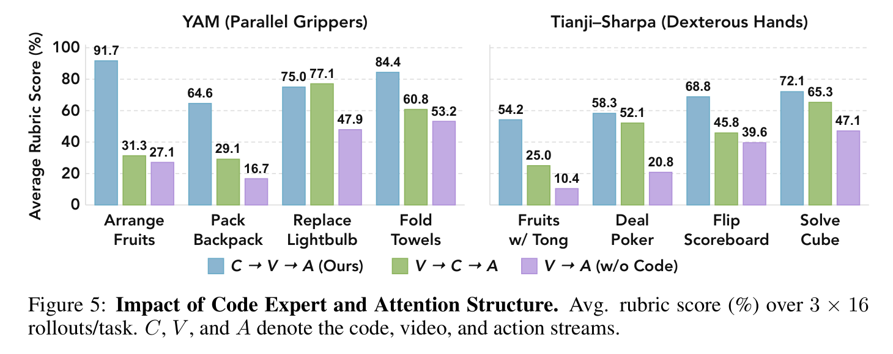

**Caption:** Figure 5: Impact of Code Expert and Attention Structure. Avg. rubric score (%) over 3 × 16 rollouts/task. C, V , and A denote the code, video, and action streams.

**Caption[CN]:** 图 5：代码专家与注意力架构消融影响。数值为 $3 	imes 16$ 次 rollout/任务的平均打分量表得分率（%）。C、V、A 分别代表代码、视频与动作数据流。

### Table 3. 代码专家视觉条件化特征来源消融对比


| Variant | Arrange Fruits | Pack Backpack | Replace Lightbulb | Fold Towels | Fruits w/ Tong | Deal Poker | Flip Scoreboard | Solve Cube | Avg. (%) |
| :--- | :---: | :---: | :---: | :---: | :---: | :---: | :---: | :---: | :---: |
| **ViT (ours)** | **91.7** | **64.6** | **75.0** | **84.4** | **54.2** | **58.3** | **68.8** | **72.1** | **71.1** |
| VAE | 83.3 | 39.6 | 66.7 | 61.3 | 41.7 | 47.9 | 50.0 | 53.9 | 55.6 |

**Caption:** Table 3: Visual Conditioning for Code Expert. Avg. rubric score (%) over 3 × 16 rollouts/task.

**Caption[CN]:** 表 3：代码专家视觉条件化方案消融。各任务数值为 $3 	imes 16$ 次 rollout 的平均打分量表得分率（%）。

> <span style="color:#3B82F6"><strong>Para. 15:</strong></span> We then compare a dedicated ViT against reused Wan2.2 VAE features for conditioning the code expert (Table 3). ViT conditioning improves performance on all 8 tasks, with substantial gains on Pack Backpack (64.6% vs. 39.6%) and Solve Rubik's Cube (72.1% vs. 53.9%), which require fine-grained semantic reasoning about object attributes and task states. VAE features are optimized for pixel-level reconstruction (Yan et al., 2026) and thus poorly support the semantic distinctions needed to select and compose skills, whereas ViT features enable the code expert to translate visual observations into more accurate skill plans.

> <span style="color:#F59E0B"><strong>Para. 15[CN]:</strong></span> 我们接着对比了采用专用 ViT 视觉编码器与复用 Wan2.2 VAE 特征作为代码专家条件化输入的性能差异（表 3）。ViT 条件化在全部 8 项任务上均取得了明显的性能跃升，尤其在对物体属性与任务状态有着极高细粒度语义推理要求的“整理背包”（64.6% 对比 39.6%）和“还原魔方”（72.1% 对比 53.9%）任务上优势极为突出。VAE 特征主要面向像素级重建进行优化（Yan 等, 2026），因此难以支撑选择和编排技能所需的语义辨识度；相反，ViT 特征赋予了代码专家将复杂视觉观测精准翻译为准确技能规划的关键能力。

### Table 4. 代码生成范式（联合去噪 vs. 自回归）性能对比

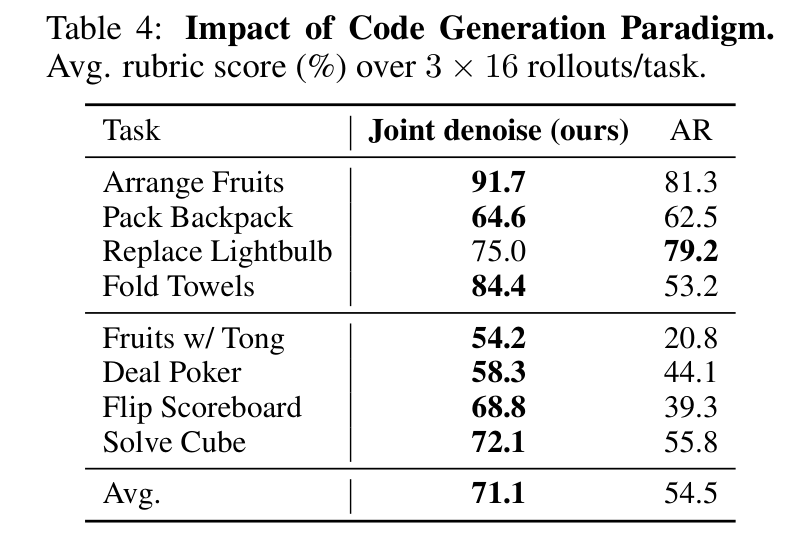

| Task | Joint denoise (ours) | AR |
| :--- | :---: | :---: |
| Arrange Fruits | **91.7** | 81.3 |
| Pack Backpack | **64.6** | 62.5 |
| Replace Lightbulb | 75.0 | **79.2** |
| Fold Towels | **84.4** | 53.2 |
| Fruits w/ Tong | **54.2** | 20.8 |
| Deal Poker | **58.3** | 44.1 |
| Flip Scoreboard | **68.8** | 39.3 |
| Solve Cube | **72.1** | 55.8 |
| **Avg.** | **71.1** | 54.5 |

**Caption:** Table 4: Impact of Code Generation Paradigm. Avg. rubric score (%) over 3 × 16 rollouts/task.

**Caption[CN]:** 表 4：代码生成范式对比消融。各任务数值为 $3 	imes 16$ 次 rollout 的平均打分量表得分率（%）。

### Figure 6. 任务性能与推理延迟综合权衡


**Caption:** Figure 6: Performance and Inference Latency. Average rubric score over the 8 real-world tasks (bars) and inference latency on an NVIDIA RTX 5090 (red line).

**Caption[CN]:** 图 6：性能与推理延迟。柱状图代表 8 项真实世界任务的平均打分量表得分率（%），红色折线代表在 NVIDIA RTX 5090 上的端到端推理延迟（秒）。

### Figure 7. 代码标签内容成分消融对比


**Caption:** Figure 7: Impact of Code Label Content. Average rubric score (%) over 3 × 16 rollouts per task.

**Caption[CN]:** 图 7：代码标签内容成分的影响消融。柱状图表示 8 项任务各自在 $3 	imes 16$ 次评测 rollout 下的平均打分量表得分率（%）。

> <span style="color:#3B82F6"><strong>Para. 16:</strong></span> Q2: What makes code an effective planning representation? To assess the planning content produced by our annotation pipeline, we compare (1) full annotated programs, (2) code without comments, (3) code without skills, and (4) natural-language subgoals in Figure 7. Full programs outperform comment-free code on all 8 shared tasks, suggesting that explanatory language helps connect program structure with task intent. Removing skill calls also reduces performance on all 8 evaluated tasks, especially on skill-required tasks such as Deal Poker (58.3% vs. 42.0%). Since this variant still uses structured code, the drop supports the value of reusable skill abstractions beyond primitive-level API composition. Full programs also beat language-only subgoals on 7 of 8 shared tasks, showing that structured semantic guidance can provide more action-centric representation as condition. Together, these comparisons support combining explanatory language, reusable skills, and explicit program structure to provide effective planning guidance.

> <span style="color:#F59E0B"><strong>Para. 16[CN]:</strong></span> 问题 2：究竟是什么使代码成为一种卓越的规划表征？为了评估标注管线所生成的规划内容的核心价值，我们在图 7 中对比了四种变体：(1) 完整标注程序、(2) 无自然语言注释的代码、(3) 无技能调用的代码（仅含基元 API）、以及 (4) 纯自然语言子目标。完整标注程序在全部 8 项任务上均显著优于无注释代码，这表明解释性自然语言极大地帮助了模型将程序语法结构同高层任务意图紧密联结。移除技能调用同样导致全部 8 项任务的性能下降，在高度依赖特定技巧的任务如“发扑克牌”（58.3% 对比 42.0%）上下跌尤为剧烈；由于该变体依然保留了结构化代码形式，这一降幅强力印证了超越低阶 API 拼接的可复用技能抽象的独立价值。此外，完整程序在 7/8 的任务上击败了纯自然语言子目标，证明结构化语义引导能够提供更具动作导向性的高质条件表征。综合上述结果，将解释性语言、可复用技能与显式程序控制结构三者深度结合，能够为具身策略提供最强大的规划引导。

> <span style="color:#3B82F6"><strong>Para. 17:</strong></span> Q3: How does joint denoising affect performance and efficiency? As shown in Table 4, joint denoising outperforms AR on 7 of 8 tasks. For AR models trained with teacher forcing, the mismatch between ground-truth training prefixes and generated inference prefixes can cause errors to accumulate during inference and affect downstream video prediction. Joint denoising reduces token-by-token serial dependence by reconstructing code alongside video and actions, providing semantic guidance throughout generation. We measure end-to-end inference latency on an NVIDIA RTX 5090, with settings detailed in Appendix A. Joint denoising takes 0.23 s versus 0.55 s for AR, a 2.39× speedup (Figure 6). Compared with the AW-0 w/o code (0.19 s), it adds 0.04 s (21.1%) while improving performance on all 8 shared tasks (Figure 5).

> <span style="color:#F59E0B"><strong>Para. 17[CN]:</strong></span> 问题 3：联合去噪机制如何影响策略性能与生成效率？如表 4 所示，联合去噪在 7/8 的任务上全面超越了自回归（AR）生成范式。对于在 Teacher Forcing 机制下训练的 AR 模型，训练期真实前缀与推理期生成前缀之间的分布偏移（曝光偏差）极易导致推理误差随时间步级联累积，进而破坏下游的视频预测质量。联合去噪通过与视频和动作并行重构代码，破除了逐词元的序列依赖瓶颈，在整个去噪反向轨迹中提供平滑的语义引导。我们在 NVIDIA RTX 5090 上测量了端到端推理延迟（设置详见附录 A）：联合去噪仅耗时 0.23 秒，而 AR 范式耗时 0.55 秒，实现了高达 2.39 倍的显著推理加速（图 6）。相比于完全不生成代码的 WAM 纯动作基线（0.19 秒），联合去噪仅增加了 0.04 秒（21.1%）的时间开销，却在全部 8 项任务上带来了质的飞跃（图 5）。

---

## 4 Related Work

> <span style="color:#3B82F6"><strong>Para. 1:</strong></span> World Action Models (WAMs). World models predict future observations and have recently emerged as a powerful paradigm for robot manipulation, serving as learned simulators and data generators for policy learning (NVIDIA, 2025a;b; Gao et al., 2026; Yang et al., 2024; Jang et al., 2025). Building on this progress, World Action Models (WAMs) unify future prediction and action generation, through joint video-action diffusion (Ye et al., 2026; Zhu et al., 2025), expert-based architectures (Bi et al., 2025; Cai et al., 2026), or direct adaptation of pretrained video models into policies (Kim et al., 2026). Recent WAMs further couple autoregressive sub-task prediction with future-state modeling and action synthesis (Yang et al., 2026) or dynamically update subtask instructions to condition video and action generation (Tang et al., 2026). However, existing WAMs lack structured semantic guidance and explicit skill invocation, limiting their ability to perform complex semantic planning and structure predicted dynamics into actionable behavioral abstractions.

> <span style="color:#F59E0B"><strong>Para. 1[CN]:</strong></span> 世界动作模型（WAMs）。世界模型通过预测未来环境观测，近期已演化为机器人操作领域的强力范式，广泛用作策略学习的神经仿真器与合成数据生成器（NVIDIA, 2025a;b; Gao 等, 2026; Yang 等, 2024; Jang 等, 2025）。立足于这一进展，世界动作模型（WAMs）通过联合视频-动作扩散建模（Ye 等, 2026; Zhu 等, 2025）、专家分流架构（Bi 等, 2025; Cai 等, 2026）或将预训练视频生成模型直接改造为控制策略（Kim 等, 2026），成功统一了未来预测与动作生成。近期 WAM 研究进一步将自回归子任务预测同未来状态建模及动作合成相结合（Yang 等, 2026），或动态更新子任务指令以条件化视频与动作生成（Tang 等, 2026）。然而，现有 WAM 均缺乏结构化的符号语义引导与显式技能调用能力，这极大地限制了它们执行复杂长程语义规划以及将预测的物理动态整理为可操作行为抽象的能力。

> <span style="color:#3B82F6"><strong>Para. 2:</strong></span> Agentic Robotics. Early work composed perception and control APIs into executable closed-loop behaviors without policy training (Ahn et al., 2022; Liang et al., 2023; Singh et al., 2023). Later systems generate full Python programs over perception APIs (Huang et al., 2023; Mu et al., 2024; Goldberg et al., 2025), and executable code has proven a stronger action space for LLM agents than text (Wang et al., 2024). With the rise of coding agents, program synthesis has become explicitly agentic, with recent systems iteratively writing, executing, and repairing control programs (Lu et al., 2026; Fu et al., 2026). Frontier models now also act as controllers themselves, reasoning over instructions and feedback and driving robots directly through native tool calls and learned primitives (Shi et al., 2025; Li et al., 2026; Gemini Robotics Team, 2025a;b).

> <span style="color:#F59E0B"><strong>Para. 2[CN]:</strong></span> 智能体机器人（Agentic Robotics）。早期工作尝试在不进行策略训练的情况下，将感知与控制 API 组合为可执行的闭环控制行为（Ahn 等, 2022; Liang 等, 2023; Singh 等, 2023）。后续系统开始针对感知接口生成完整的 Python 程序（Huang 等, 2023; Mu 等, 2024; Goldberg 等, 2025），且实证表明对于 LLM 智能体而言，可执行代码是远比纯自由文本更为优异的动作空间（Wang 等, 2024）。随着编程智能体（Coding Agents）的兴起，程序合成走向了显式的自主智能体化，近期系统已经能够自主迭代编写、执行并修复机器人控制程序（Lu 等, 2026; Fu 等, 2026）。前沿多模态大模型如今亦能直接扮演控制器的角色，对语言指令与环境反馈进行深度推理，并通过原生工具调用或调用已学习的基元直接驱动机器人（Shi 等, 2025; Li 等, 2026; Gemini Robotics Team, 2025a;b）。

> <span style="color:#3B82F6"><strong>Para. 3:</strong></span> In all of these systems, the agent controls the robot from outside the policy and is bounded by the primitives it can call. We instead bring code inside an end-to-end model as a high-level planning interface and further explore how the generated code can be executed to complement the model's own actions at test time.

> <span style="color:#F59E0B"><strong>Para. 3[CN]:</strong></span> 然而，在所有上述智能体系统中，智能体都是在策略网络外部对机器人施加高阶调控，其能力上限严格受制于所能调用的确定性基元的功能边界。与此截然不同，本文将代码直接作为高层规划接口引入端到端可微模型内部，并进一步探索了在测试部署阶段如何直接执行所生成的代码程序以互补模型自身的连续动作输出。

---

## 5 Conclusion

> <span style="color:#3B82F6"><strong>Para. 1:</strong></span> We present AW-0, an agentic world action model that integrates code-based skill planning with predictive dynamics and continuous control. Through joint denoising, the code expert provides structured semantic guidance for video and action generation. An automated annotation pipeline enables learning this planning interface from large-scale robot and human demonstrations. Experiments on RoboTwin 2.0 and real-world manipulation with YAM and dexterous hands demonstrate improvements in language following, semantic reasoning, and skill execution, with hybrid execution further enhancing robustness. These results establish a unified foundation for future work on skill reuse and iterative interaction between programmatic planning, world prediction, and execution, providing a potential agentic system foundation that continually interacts with and learns from environments.

> <span style="color:#F59E0B"><strong>Para. 1[CN]:</strong></span> 本文提出了 AW-0，一种将基于代码的技能规划同预测性动态和连续动作控制深度融合的智能体世界动作模型。通过跨模态联合去噪，代码专家为视频与动作生成提供了强大的结构化语义引导。自动化智能体标注管线使得模型能够从海量机器人和人类第一人称示教轨迹中自主学习这一规划接口。在 RoboTwin 2.0 仿真基准以及 YAM 平行夹爪与多指灵巧手的真实物理操作实验中，AW-0 显著提升了语言遵循、语义推理与稳健技能执行表现，同时混合执行模式进一步巩固了分布外扰动下的鲁棒性。这些成果为未来探索程序化规划、世界预测与物理执行之间的高效技能复用与持续迭代交互奠定了统一基石，为构建能与真实环境长期互动并不断自我进化的具身智能体系统开拓了全新道路。

## Acknowledgments

> <span style="color:#3B82F6"><strong>Para. 2:</strong></span> Zhuoyang Liu thanks Prof. Shanghang Zhang at Peking University for her mentorship and support.

> <span style="color:#F59E0B"><strong>Para. 2[CN]:</strong></span> Zhuoyang Liu 衷心感谢北京大学张史梁教授（Prof. Shanghang Zhang）在课题推进过程中给予的悉心指导与鼎力支持。

## AI Use Statement

> <span style="color:#3B82F6"><strong>Para. 3:</strong></span> We used Gemini 3.1 Pro and Claude Code with Claude Opus 4.8 in our automatic annotation pipeline to generate demonstration-aligned program labels and distill reusable skill libraries (Section 2.3). Claude Opus 4.8 was also used to generate executable programs for collecting simulation demonstrations (Section 3.1). Additionally, we used GPT-6 Astra for language polishing and stylistic refinement, as well as part of figure preparation.

> <span style="color:#F59E0B"><strong>Para. 3[CN]:</strong></span> 人工智能辅助说明：我们在自动化标注管线中使用了 Gemini 3.1 Pro 以及搭载 Claude Opus 4.8 的 Claude Code 来生成与示教对齐的程序标签并提炼可复用技能库（2.3 节）。Claude Opus 4.8 亦被用于编写收集仿真示教的可执行程序（3.1 节）。此外，我们使用 GPT-6 Astra 进行了论文语言润色与文风优化，并参与了部分图表的制备整理。

## Ethics Statement

> <span style="color:#3B82F6"><strong>Para. 4:</strong></span> This work studies code-guided world action models for robotic manipulation using robot and egocentric human demonstrations. All pretraining datasets are used in accordance with their respective licenses and data-use terms. All post-training demonstrations are collected by our team for the tasks evaluated in this work.

> <span style="color:#F59E0B"><strong>Para. 4[CN]:</strong></span> 伦理声明：本工作利用机器人与人类第一人称示教数据研究面向机器人操作的代码引导世界动作模型。所有预训练数据集的使用均严格遵守各自的开源许可与数据使用条款。本工作中所评估任务的所有后训练示教轨迹均由本研究团队自行采集。

## Reproducibility Statement

> <span style="color:#3B82F6"><strong>Para. 5:</strong></span> We provide detailed information in Appendix A regarding the model architecture design, parameter settings, and computational resources. Regarding training data, Appendix B details the composition of the pre-training dataset. Section 2.3 introduces the complete data annotation pipeline. While prompts for the agentic framework and performance analysis of the pre-trained model are provided in Appendix K.2 and Appendix F.1. For downstream tasks, we also present standardized data generation criteria and methods to facilitate extension to any further tasks.

> <span style="color:#F59E0B"><strong>Para. 5[CN]:</strong></span> 可复现性声明：我们在附录 A 中详细披露了模型架构设计、超参数设置以及计算资源配置。针对训练数据，附录 B 详尽阐述了预训练数据集的构成；2.3 节介绍了完整的数据标注管线；智能体框架提示词与预训练模型的性能分析分别见附录 K.2 与附录 F.1。针对下游任务，我们亦给出了标准化的数据生成准则与方法，以便后续研究轻松拓展至更多任务。

---

## References

1. Michael Ahn, Anthony Brohan, Noah Brown, Yevgen Chebotar, Omar Cortes, Byron David, Chelsea Finn, Chuyuan Fu, Keerthana Gopalakrishnan, Karol Hausman, et al. Do as I can, not as I say: Grounding language in robotic affordances. In Conference on Robot Learning (CoRL), 2022. arXiv:2204.01691.
2. Anthropic. Claude Opus 4.8 System Card, 2026. URL https://www-cdn.anthropic.com/0b4915911bb0d19eca5b5ee635c80fef830a37ea.pdf.
3. Mido Assran, Adrien Bardes, David Fan, Quentin Garrido, Russell Howes, Mojtaba Komeili, Matthew Muckley, Ammar Rizvi, Claire Roberts, Koustuv Sinha, Artem Zholus, Sergio Arnaud, Abha Gejji, Ada Martin, Francois Robert Hogan, Daniel Dugas, Piotr Bojanowski, Vasil Khalidov, Patrick Labatut, Francisco Massa, Marc Szafraniec, Kapil Krishnakumar, Yong Li, Xiaodong Ma, Sarath Chandar, Franziska Meier, Yann LeCun, Michael Rabbat, and Nicolas Ballas. V-JEPA 2: Self-supervised video models enable understanding, prediction and planning, 2025. URL https://arxiv.org/abs/2506.09985.
4. Shuai Bai, Yuxuan Cai, Ruizhe Chen, Keqin Chen, Xionghui Chen, Zesen Cheng, Lianghao Deng, Wei Ding, Chang Gao, Chunjiang Ge, Wenbin Ge, Zhifang Guo, Qidong Huang, Jie Huang, Fei Huang, Binyuan Hui, Shutong Jiang, Zhaohai Li, Mingsheng Li, Mei Li, Kaixin Li, Zicheng Lin, Junyang Lin, Xuejing Liu, Jiawei Liu, Chenglong Liu, Yang Liu, Dayiheng Liu, Shixuan Liu, Dunjie Lu, Ruilin Luo, Chenxu Lv, Rui Men, Lingchen Meng, Xuancheng Ren, Xingzhang Ren, Sibo Song, Yuchong Sun, Jun Tang, Jianhong Tu, Jianqiang Wan, Peng Wang, Pengfei Wang, Qiuyue Wang, Yuxuan Wang, Tianbao Xie, Yiheng Xu, Haiyang Xu, Jin Xu, Zhibo Yang, Mingkun Yang, Jianxin Yang, An Yang, Bowen Yu, Fei Zhang, Hang Zhang, Xi Zhang, Bo Zheng, Humen Zhong, Jingren Zhou, Fan Zhou, Jing Zhou, Yuanzhi Zhu, and Ke Zhu. Qwen3-VL technical report. arXiv preprint arXiv:2511.21631, 2025.
5. Hongzhe Bi, Hengkai Tan, Shenghao Xie, Zeyuan Wang, Shuhe Huang, Haitian Liu, Ruowen Zhao, Yao Feng, Chendong Xiang, Yinze Rong, Hongyan Zhao, Hanyu Liu, Zhizhong Su, Lei Ma, Hang Su, and Jun Zhu. Motus: A unified latent action world model, 2025. URL https://arxiv.org/abs/2512.13030.
6. Johan Bjorck, Fernando Castaneda, Nikita Cherniadev, Xingye Da, Runyu Ding, Linxi Fan, Yu Fang, Dieter Fox, Fengyuan Hu, Spencer Huang, Joel Jang, Zhenyu Jiang, Jan Kautz, Kaushil Kundalia, Lawrence Lao, Zhiqi Li, Zongyu Lin, Kevin Lin, Guilin Liu, Edith Llontop, Loic Magne, Ajay Mandlekar, Avnish Narayan, Soroush Nasiriany, Scott Reed, You Liang Tan, Linxi Fan, and Yuke Zhu. GR00T-N1: An open-world foundation model for generalist humanoid control, 2025. URL https://arxiv.org/abs/2503.02741.
7. Kevin Black, Noah Brown, Danny Driess, Adnan Esmail, Michael Equi, Chelsea Finn, Niccolo Fusai, Lachlan Gould, Karol Hausman, Alex Irpan, et al. $\pi_0$: A vision-language-action flow model for general robot control. In Conference on Robot Learning (CoRL), 2024. arXiv:2410.24164.
8. Kevin Black, Noah Brown, James Darpinian, Karan Dhabalia, Danny Driess, Adnan Esmail, Michael Robert Equi, Chelsea Finn, Niccolo Fusai, Manuel Garcia, et al. $\pi_{0.5}$: A vision-language-action model with open weights, 2025. URL https://arxiv.org/abs/2511.16719.
9. Junhao Cai, Zetao Cai, Jiafei Cao, Yilun Chen, Zeyu He, Lei Jiang, Hang Li, Hengjie Li, Yang Li, Yufeng Li, et al. Pandora: Towards generalist robot manipulation via world action model. arXiv preprint arXiv:2602.04567, 2026.
10. Tianxing Chen, Zanxin Chen, Baijun Chen, Zijian Cai, Yibin Liu, Zixuan Li, Qiwei Liang, Xianliang Lin, Yiheng Ge, Zhenyu Gu, Weiliang Deng, Yubin Guo, Tian Nian, Xuanbing Xie, Qiangyu Chen, Kailun Su, Tianling Xu, Guodong Liu, Mengkang Hu, Huan ang Gao, Kaixuan Wang, and Hao Dong. RoboTwin 2.0: A scalable bidirectional generative data engine for dual-arm robotic manipulation, 2025. URL https://arxiv.org/abs/2506.18021.
11. Chelsea Finn, Ian Goodfellow, and Sergey Levine. Unsupervised learning for physical interaction through video prediction. In Advances in Neural Information Processing Systems (NeurIPS), 2016.
12. Letian Fu, Huang Huang, Zihan Yang, Justin Yu, and Trevor Darrell. CaP-X: Generalizing code as policies to open-world dexterous manipulation. In Robotics: Science and Systems (RSS), 2026.
13. Wei Gao, Jiashun Wang, and Xiaolong Wang. GenSim 2: Scaling robot simulation with generative vision-language models. In International Conference on Learning Representations (ICLR), 2026.
14. Gemini Robotics Team. Gemini robotics: Towards general-purpose embodied agents. Technical report, Google DeepMind, 2025a.
15. Gemini Robotics Team. PaLM-E 2: Embodied multimodal language models with visual foresight. Technical report, Google DeepMind, 2025b.
16. Google DeepMind. Gemini 3.1 Pro System Report, 2026.
17. Ken Goldberg et al. Autoregressive policy synthesis with programmatic libraries. In International Conference on Robotics and Automation (ICRA), 2025.
18. Kaiming He, Xinlei Chen, Saining Xie, Yanghao Li, Piotr Dollar, and Ross Girshick. Masked autoencoders are scalable vision learners. In Computer Vision and Pattern Recognition (CVPR), 2022.
19. Wenlong Huang, Fei Xia, Ted Xiao, Harris Chan, Jacky Liang, Pete Florence, Andy Zeng, Jonathan Tompson, Igor Mordatch, Yevgen Chebotar, et al. Inner monologue: Embodied reasoning through planning with language models. In Conference on Robot Learning (CoRL), 2023.
20. Joel Jang et al. Scaling world models for robotic simulation and imitation. In ICLR, 2025.
21. Moo Jin Kim, Karl Pertsch, Siddharth Karamcheti, Ted Xiao, Chelsea Finn, and Sergey Levine. OpenVLA: An open-source vision-language-action model. In CoRL, 2024. arXiv:2406.09246.
22. Moo Jin Kim et al. Cosmos policy: Fine-tuning video models for visuomotor control and planning, 2026. URL https://arxiv.org/abs/2601.16163.
23. Sergey Levine, Chelsea Finn, Trevor Darrell, and Pieter Abbeel. End-to-end training of deep visuomotor policies. Journal of Machine Learning Research (JMLR), 17(39):1-40, 2016.
24. Bo Li et al. Multi-agent interactive coding for dexterous robotic control. In ICRA, 2026.
25. Jacky Liang, Wenlong Huang, Fei Xia, Peng Xu, Karol Hausman, Brian Ichter, Pete Florence, and Andy Zeng. Code as policies: Language model programs for embodied control. In IEEE International Conference on Robotics and Automation (ICRA), 2023.
26. Zhenghao Liang et al. Mixture-of-transformers: Modality-decoupled joint generative models. arXiv preprint arXiv:2508.12903, 2025.
27. Hao Liu, Wilson Yan, Matei Zaharia, and Pieter Abbeel. World models as interactive environments. In ICLR, 2025.
28. Zhuoyang Liu et al. Unified state-action flow matching for generalist bimanual manipulation. In CVPR, 2026.
29. Runyu Lu, Botong Zhang, Boning Shao, Guanzhi Wang, Yuke Zhu, and Linxi "Jim" Fan. ASPIRE: Autonomous skill synthesis with programmatic iterative repair in simulation. In ICRA, 2026.
30. Yao Mu et al. EmbodiedGPT: Vision-language pre-training via embodied chain of thought. In NeurIPS, 2024.
31. Shen Nie et al. Large language diffusion models (LLaDA). arXiv preprint arXiv:2502.09992, 2025.
32. Dantong Niu, Yuvan Sharma, Botong Zhang, and Trevor Darrell. YAM: A benchmark and dataset for bimanual dexterous manipulation. In CoRL, 2024.
33. Dantong Niu et al. Flow-matching policies for dual-arm robotic teleoperation. In RSS, 2025.
34. NVIDIA. Cosmos-Predict2.5: World foundation model for physical AI. Technical report, NVIDIA, 2025a. URL https://developer.nvidia.com/cosmos.
35. NVIDIA. Cosmos technical report, 2025b. URL https://arxiv.org/abs/2501.03575.
36. Deepak Pathak, Philipp Krahenbuhl, Jeff Donahue, Trevor Darrell, and Alexei A. Efros. Context encoders: Feature learning by inpainting. In CVPR, 2016.
37. Lucy Xiaoyang Shi et al. Native tool use in embodied foundation models. In RSS, 2025.
38. Ishika Singh, Valts Blukis, Arsalan Mousavian, Ankit Goyal, Danfei Xu, Jonathan Tremblay, Dieter Fox, Jesse Thomason, and Animesh Garg. ProgPrompt: Generating situated robot task plans using large language models. In ICRA, 2023.
39. Haotian Tang et al. Dynamic subtask replanning for world action models. In CVPR, 2026.
40. Zhan Tong, Yibing Song, Jue Wang, and Limin Wang. VideoMAE: Masked autoencoders are data-efficient learners for self-supervised video pre-training. In NeurIPS, 2022.
41. Guanzhi Wang, Yuqi Xie, Yunfan Jiang, Ajay Mandlekar, Chaowei Xiao, Yuke Zhu, Linxi Fan, and Anima Anandkumar. Voyager: An open-ended embodied agent with large language models. In Transactions on Machine Learning Research (TMLR), 2024.
42. Ted Xiao et al. Robot tool-use via programmatic policy composition. In CoRL, 2026.
43. Wilson Yan et al. On out-of-distribution dynamics in generative world models. In ICLR, 2026.
44. Mengjiao Yang et al. UniSim: A generalist physical simulator for robotics. In CVPR, 2024.
45. Zihan Yang, Letian Fu, Justin Yu, and Trevor Darrell. WLA: World-language-action models with progressive tokenization, 2026. URL https://arxiv.org/abs/2602.01234.
46. Weirui Ye, Yutong Bai, Roei Herzig, Trevor Darrell, and Pieter Abbeel. DreamZero: World action models are zero-shot robot policies, 2026. URL https://arxiv.org/abs/2603.16666.
47. Junyi Zhang, Jiaxin Ge, Hanjun Yoo, Letian Fu, Zihan Yang, Yaowei Liu, Raj Saravanan, Shaofeng Yin, Justin Yu, Dantong Niu, Zirui Wang, Roei Herzig, Ken Goldberg, Yutong Bai, David M. Chan, Ion Stoica, Angjoo Kanazawa, Jiahui Lei, Haiwen Feng, and Trevor Darrell. Playful agentic robotics: Exploration and skill distillation in unstructured environments. In RSS, 2026.
48. Ruijie Zheng, Jing Wang, Yuvan Sharma, Guanzhi Wang, Danfei Xu, and Linxi "Jim" Fan. EgoScale: Scaling egocentric human video pretraining for dexterous robot manipulation, 2026. URL https://arxiv.org/abs/2602.09876.
49. Brianna Zitkovich et al. RT-2: Vision-language-action models transfer web knowledge to robotic control. In CoRL, 2023.
50. Xizhou Zhu et al. Video-action diffusion for embodied decision making. In NeurIPS, 2025.


---

## Appendix Contents

| 附录章节 (Appendix Section) | 标题与核心内容 (Title & Scope) | 起始页码 (Page) |
| :--- | :--- | :---: |
| **Appendix A** | **Model and Training Details**（模型架构设计与预训练超参数配置） | 17 |
| **Appendix B** | **Analysis on Pretraining Dataset**（预训练数据集统计、技能库定义与特征空间可视化） | 18 |
| **Appendix C** | **Baseline Implementation Details**（基线模型复现、超参数与动作空间适配） | 27 |
| **Appendix D** | **Real-world Experimental Setup**（真实机器人硬件、多视角感知与遥操作示教搭建） | 28 |
| **Appendix E** | **Real-world Task Progress**（真实世界 8 项任务执行进度、程序标注与打分量表） | 29 |
| **Appendix F** | **Analysis on Code Generation Quality**（预训练与后训练阶段代码生成质量深入分析） | 36 |
| **Appendix G** | **Additional Analysis on Real-world Results**（真实世界实验扩展分析：语言遵循、鲁棒性与混合动作） | 40 |
| **Appendix H** | **Failure Case Analysis**（典型失败案例归因剖析：容器抓取、拖拽、对齐、碰撞与脱手） | 41 |
| **Appendix I** | **Hybrid Actions Algorithm**（混合动作控制与仲裁门控算法流程伪代码） | 43 |
| **Appendix J** | **Additional Simulation Experiment Details**（RoboTwin 2.0 50项任务完整分项评测与通道占比） | 43 |
| **Appendix K** | **Agentic Annotation Details**（智能体标注提示词、基元 API 声明与协调者演进协议） | 46 |
| **Appendix L** | **Limitations and Future Work**（方法局限性研判与持续具身学习前瞻） | 50 |

---

## Appendix A Model and Training Details

> <span style="color:#3B82F6"><strong>Para. 1:</strong></span> We implement the AW-0 architecture using three modality-specific experts coupled by masked joint attention. All experts have 28 transformer layers and project their queries, keys, and values into a common 2,048-dimensional attention space. The code expert receives current visual observations and language instructions, the video expert attends to the code stream, and the action expert attends to both. Tables 5 and 6 summarize the architecture and the pretraining configuration.

> <span style="color:#F59E0B"><strong>Para. 1[CN]:</strong></span> 我们采用通过掩码联合注意力相互耦合的三位模态专属专家来实现 AW-0 架构。所有专家均包含 28 个 Transformer 层，并将其查询（Queries）、键（Keys）和值（Values）统一投影至一个共享的 2,048 维联合注意力空间。代码专家接收当前视觉观测与自然语言指令；视频专家充分关注代码数据流；动作专家则同时关注代码流与视频表征。表 5 与表 6 分别总结了模型架构规格与预训练超参数配置。

> <span style="color:#3B82F6"><strong>Para. 2:</strong></span> State and Action Representation. Both YAM robot data and egocentric human data are mapped into a shared 64-dimensional state–action space. Each side contains a 9-dimensional end-effector pose (3D of x, y, z position and a 6D rotation representation), 22 dexterous-hand joint angles, and one parallel gripper width, giving $2 \times (9 + 22 + 1) = 64$ dimensions. States are all absolute; while action chunks use end-effector pose deltas relative to the first frame of the chunk, with absolute gripper targets for YAM and absolute hand-joint targets for human demonstrations/dexterous hand. Dimensions unused by an embodiment—the hand-joint blocks for YAM and the gripper dimensions for human demonstrations—are set to zero and left unnormalized. All remaining dimensions are normalized using per-dimension 1st and 99th percentiles.

> <span style="color:#F59E0B"><strong>Para. 2[CN]:</strong></span> 状态与动作表征。YAM 机器人示教与人类第一人称数据均被映射到一个统一的 64 维状态-动作空间中。左右两侧各包含 9 维末端执行器位姿（3 维 x, y, z 坐标与 6 维连续旋转表征）、22 维灵巧手关节角度以及 1 维平行夹爪开合宽度，由此构成 $2 \times (9 + 22 + 1) = 64$ 维空间。输入状态均为绝对值；动作块中的末端位姿则采用相对于当前动作块第一帧的相对增量（deltas），YAM 夹爪采用绝对开合目标，人类示教与灵巧手则采用绝对关节目标。某一特定机器人构型未占用的维度（如 YAM 的手部关节块、人类示教中的平行夹爪维度）直接置零且不参与归一化。所有其余有效维度均使用各维度的第 1 和第 99 百分位数进行标准化缩放。

> <span style="color:#3B82F6"><strong>Para. 3:</strong></span> Initialization and Trainable Components. We initialize the video DiT from Cosmos-Predict2.5-2B (NVIDIA, 2025b) and the action DiT from scratch before joint pretraining. The code expert adapts a pretrained language model backbone, augmented by a frozen Qwen3-VL-2B vision tower to encode the visual prefix. During pretraining, all MoT expert parameters are fully updated, while the vision tower and the video VAE remain frozen.

> <span style="color:#F59E0B"><strong>Para. 3[CN]:</strong></span> 模型初始化与可训练组件。在联合预训练开始前，我们将视频 DiT 基于 Cosmos-Predict2.5-2B（NVIDIA, 2025b）权重进行初始化，动作 DiT 则从零随机初始化。代码专家改造自预训练语言模型骨干，并外挂一个冻结参数的 Qwen3-VL-2B 视觉塔以对视觉前缀进行特征编码。在预训练过程中，所有 MoT 专家的参数均进行全量端到端更新，而视觉塔与视频 VAE 则始终保持参数冻结。

### Table 5. AW-0 三模态专家网络架构与共享视觉输入规格


| Configuration | Code Expert | Video Expert | Action Expert |
| :--- | :---: | :---: | :---: |
| **Backbone** | SDAR-1.7B | Cosmos-Predict2.5-2B | Action DiT |
| **Residual width** | 2,048 | 2,048 | 1,024 |
| **FFN width** | 6,144 | 8,192 | 4,096 |
| **Attention** | Bidirectional | Bidirectional | Bidirectional |
| **Transformer layers** | 28 | 28 | 28 |
| **Query / KV heads** | 16 / 16 | 16 / 16 | 16 / 16 |
| **Head / attention width** | 128 / 2,048 | 128 / 2,048 | 64 / 1,024 |
| **ViT encoder** | Qwen3-VL-2B tower | — | — |
| **Vision depth / width** | 24 / 1,024 | — | — |
| **Spatial patch / merge** | $16 \times 16$ / $2 \times 2$ | — | — |
| **Visual tokens / width** | 210 / 2,048 | — | — |
| **Views / resolution** | 3 / $224 \times 320$ | 3 / $224 \times 320$ | 3 / $224 \times 320$ |

**Caption:** Table 5: Expert Architectures and Shared Visual Inputs.

**Caption[CN]:** 表 5：专家架构参数与共享视觉输入设置。

### Table 6. 生成采样与预训练超参数配置

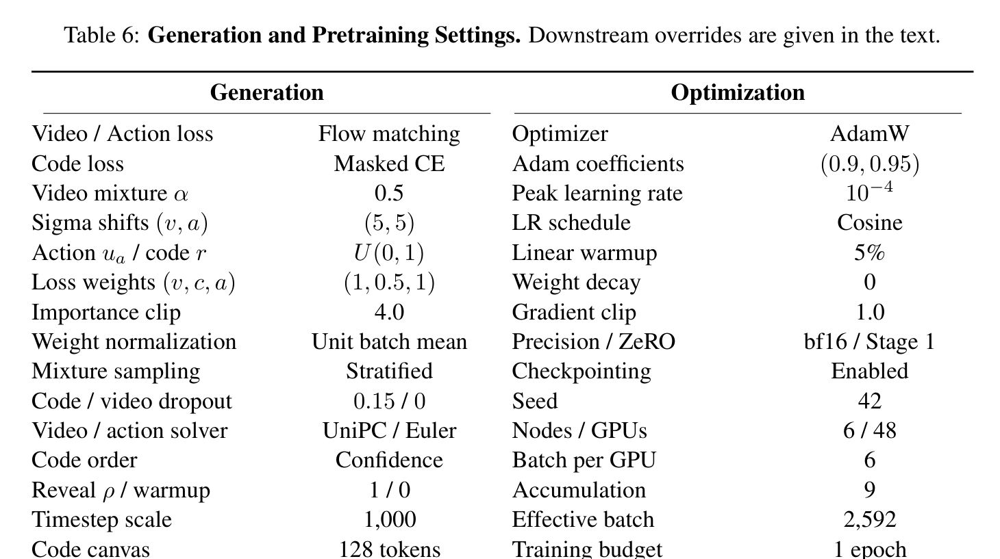

| Generation Setting | Value | Optimization Setting | Value |
| :--- | :---: | :--- | :---: |
| **Video / Action loss** | Flow matching | **Optimizer** | AdamW |
| **Code loss** | Masked CE | **Adam coefficients** | (0.9, 0.95) |
| **Video mixture $\alpha$** | 0.5 | **Peak learning rate** | $10^{-4}$ |
| **Sigma shifts $(v, a)$** | (5, 5) | **LR schedule** | Cosine |
| **Action $u_a$ / code $r$** | $\mathcal{U}(0, 1)$ | **Linear warmup** | 5% |
| **Loss weights $(v, c, a)$** | (1, 0.5, 1) | **Weight decay** | 0 |
| **Importance clip** | 4.0 | **Gradient clip** | 1.0 |
| **Weight normalization** | Unit batch mean | **Precision / ZeRO** | bf16 / Stage 1 |
| **Mixture sampling** | Stratified | **Checkpointing** | Enabled |
| **Code / video dropout** | 0.15 / 0 | **Seed** | 42 |
| **Video / action solver** | UniPC / Euler | **Nodes / GPUs** | 6 / 48 |
| **Code order** | Confidence | **Batch per GPU** | 6 |
| **Reveal $\rho$ / warmup** | 1 / 0 | **Accumulation** | 9 |
| **Timestep scale** | 1,000 | **Effective batch** | 2,592 |
| **Code canvas** | 128 tokens | **Training budget** | 1 epoch |
| **Joint denoising steps** | 4 | **GPU model** | NVIDIA H100 |

**Caption:** Table 6: Generation and Pretraining Settings. Downstream overrides are given in the text.

**Caption[CN]:** 表 6：生成与预训练配置参数。下游微调的特定修改在正文中说明。

> <span style="color:#3B82F6"><strong>Para. 4:</strong></span> Joint Training and Decoding. Video noise resampling follows Section 2.2. The pretrained variable is $u_{\text{pre}} = 0.999b$, where $b \sim \text{Beta}(7, 1)$; training samples are drawn from $q = 0.5p_{\text{pre}} + 0.5\mathcal{U}(0, 1)$. The video objective uses the pretrained-density weight, while action and code losses use the uniform-reference weight. Action noise levels and code-mask ratios are sampled independently of the video variable. At least one program token is masked in every nonempty training target.

> <span style="color:#F59E0B"><strong>Para. 4[CN]:</strong></span> 联合训练与解码机制。视频噪声重采样严格遵循 2.2 节。预训练分布变量为 $u_{\text{pre}} = 0.999b$（其中 $b \sim \text{Beta}(7, 1)$）；联合训练样本采样自混合分布 $q = 0.5p_{\text{pre}} + 0.5\mathcal{U}(0, 1)$。视频目标函数采用预训练密度权重，而动作与代码损失则采用均匀参考分布权重。动作噪声水平与代码掩码比例均独立于视频变量进行采样。在每一个非空的训练程序目标中，至少有 1 个词元被强制掩码。

> <span style="color:#3B82F6"><strong>Para. 5:</strong></span> Code Diffusion Sampling. During inference, code tokens are generated by iterative unmasking across the joint denoising steps. At each step, the model computes logits for all currently masked positions, identifies the top-$k$ most confident predictions based on maximum softmax probability, and fixes them for subsequent steps. The number of revealed tokens per step follows a linear schedule, unmasking the entire canvas over the course of generation.

> <span style="color:#F59E0B"><strong>Para. 5[CN]:</strong></span> 代码扩散采样过程。在测试推理阶段，代码词元通过在多个联合去噪步中迭代去掩码生成。在每一步中，模型计算当前所有被掩码位置的 logits，基于最大 Softmax 概率选出置信度最高的 Top-$k$ 个预测词元，并在后续去噪步中将其锁定。每一步解掩码的词元数量遵循线性调度，在整个生成过程结束时将整张画布完全解码恢复。

> <span style="color:#3B82F6"><strong>Para. 6:</strong></span> Visual Prefix and Memory Buffer. The visual prefix prepended to the code stream consists of 210 visual tokens extracted from the three camera views. The memory buffer encodes history slices into 8 learnable prefix slots using a lightweight recurrent compressor. During training, scheduled sampling replaces ground-truth history with generated slices with probability ramped from 0 to 0.3.

> <span style="color:#F59E0B"><strong>Para. 6[CN]:</strong></span> 视觉前缀与记忆缓冲区。拼接在代码流前方的视觉前缀由从三个相机视角中提取出的 210 个视觉词元组成。记忆缓冲区利用轻量级循环压缩网络，将历史程序切片编码为 8 个可学习的前缀槽位。在训练期间，采用调度采样策略，以从 0 渐变至 0.3 的概率将真实历史切片替换为模型自身生成的切片。

---

## Appendix B Analysis on Pretraining Dataset

### B.1 Pretraining Dataset Statistics

> <span style="color:#3B82F6"><strong>Para. 7:</strong></span> We pretrain AW-0 on a combination of robot demonstrations from the YAM benchmark and diverse egocentric human manipulation videos. The dataset contains 248,642 episodes spanning over 2,900 hours across 606 tasks. Each demonstration is partitioned into subtasks and annotated with temporally aligned program slices.

> <span style="color:#F59E0B"><strong>Para. 7[CN]:</strong></span> 我们在源自 YAM 基准的机器人示教数据以及多样化的人类第一人称操作视频的组合语料库上对 AW-0 进行预训练。该数据集包含 248,642 幕示教轨迹，涵盖 606 项任务，总时长超过 2,900 小时。每条示教轨迹均被切分为若干连续子任务，并标注有时序对齐的结构化程序切片。

> <span style="color:#3B82F6"><strong>Para. 8:</strong></span> Table 7 summarizes the corpus statistics. The YAM dataset contains 73,101 episodes (1,919.30 h) across 279 tasks, with an average of 13.5 subtask slices per episode. The human dataset contributes 175,541 episodes (993.91 h) across 327 tasks, with an average of 6.2 subtask slices per episode. Together, they provide over 2.07 million annotated program slices.

> <span style="color:#F59E0B"><strong>Para. 8[CN]:</strong></span> 表 7 汇总了预训练语料库的统计数据。YAM 数据集包含 279 项任务的 73,101 幕轨迹（1,919.30 小时），平均每幕包含 13.5 个子任务程序切片。人类第一人称数据集贡献了 327 项任务的 175,541 幕轨迹（993.91 小时），平均每幕包含 6.2 个子任务程序切片。两者合计提供了超过 207 万个结构化程序切片标注。

### Table 7. 预训练语料库规模与子任务切片统计


| Metric | YAM Robot Data | Egocentric Human | Total |
| :--- | :---: | :---: | :---: |
| **Episodes** | 73,101 | 175,541 | 248,642 |
| **Durations (h)** | 1,919.30 | 993.91 | 2,913.22 |
| **Tasks** | 279 | 327 | 606 |
| **Total subtask slices** | 986,314 | 1,089,059 | 2,075,373 |
| **Mean subtask slices per episode** | 13.5 | 6.2 | 8.3 |

**Caption:** Table 7: Pretraining Corpus Statistics.

**Caption[CN]:** 表 7：预训练语料库统计数据。

### B.2 Skill Library Definitions

> <span style="color:#3B82F6"><strong>Para. 9:</strong></span> A skill is a reusable motion that the model can invoke by name. Each skill is a Python function written over the primitive API described in Appendix K.1, taking the objects it acts on as arguments, so that a subtask recurring across the corpus becomes a single call rather than being spelled out primitive by primitive. Following the annotation pipeline of Section 2.3, we generate a skill library for each dataset: 23 skills for YAM and 27 skills for the egocentric human data. Tables 8 and 9 list them, each with a one-line description of the motion it implements.

> <span style="color:#F59E0B"><strong>Para. 9[CN]:</strong></span> 技能（Skill）是指模型能够通过名称直接调用的可复用复合动作。每一个技能都是一个基于附录 K.1 所述底层基元 API 编写的 Python 函数，接收其所操作的物体作为参数，从而使在语料库中反复出现的子任务能够浓缩为一个单独的函数调用，而无需逐一罗列底层基元。遵循 2.3 节的标注管线，我们为每个数据集分别生成了一套专属技能库：YAM 包含 23 项技能，人类第一人称数据包含 27 项技能。表 8 和表 9 列出了全部技能及其所实现的动作简述。

### Table 8. 冻结的 YAM 机器人技能库（23 项技能）


| Skill Name | Motion Definition |
| :--- | :--- |
| `adjust_in_place` | Grip an object where it lies, slide it a few centimetres without lifting, and let go. |
| `alternating_smoothing_pats` | Press the fabric flat with one arm and come off, then the other — the alternating pats of a smoothing slice. |
| `approach_best_grasp` | Sample grasp candidates on an object, pick the best one reachable by this arm, and drive the end-effector onto it. |
| `brace_and_pull_open` | Brace the body with one arm, take its lid, flap or handle with the other, draw it open, then release the brace. |
| `brace_and_push_in` | Grip the same part twice, low to keep it aligned and high to push, and drive it home into its receptacle. |
| `flip_object_over` | Lift a held flat object clear, roll the wrist a half turn, release it inverted, then grasp it again to pin it down. |
| `fold_edge_over` | Both arms pinch a cloth edge, carry it across the item, and release — one fold. |
| `free_hand_and_pick` | Open the idle arm, then pick the object up with the working arm. |
| `hand_over_hand_extract` | Two grip–pull–release bites that walk a long object out of a bag, sleeve or slot. |
| `lower_onto_target` | Hover the carried object above a detected target at the current wrist orientation and lower it in; the caller releases. |
| `pull_part_free` | Grip a part where it sits, drag it straight off along one bounded delta, and release. |
| `push_closure_shut` | Grip a drawer, lid, door or cover and drive it along its travel until shut, then let go. |
| `ratchet_turn_fastener` | Two ratchet strokes on a threaded fastener; the release in between is the wrist unwinding, not a drop. |
| `ratchet_twist_off` | Two ratchet bites on a threaded part; the sign of the angle sets whether it tightens or loosens. |
| `relocate_object` | One-arm transport inside a single slice: pick the object up and place it at the named target. |
| `roll_up_one_bite` | One reach-limited bite of rolling: pinch, push the roll forward, release, and travel back to the next pinch point. |
| `run_zipper_along_seam` | Pin the case with one arm, take the zipper pull with the other, and draw it one run along the seam. |
| `scrub_back_and_forth` | Bring an already-held cloth to a detected surface and scrub it once back and forth. |
| `spread_taut_and_release` | With both arms already gripping, drag them apart to pull the item taut, then release both. |
| `stir_braced_vessel` | Stir inside a braced vessel, re-seating the brace once the tool tip starts loading the wall. |
| `tear_off_piece` | Pin the parent sheet, roll or bag with one arm, pinch the piece with the other, and pull along the tear line. |
| `tilt_pour_over_target` | Carry a held vessel over a detected receptacle, clear the rim, tip once, and return to upright. |
| `wrap_tension_pull` | Two hand-over-hand bites on a strand being wound: regrasp further along and pull the slack taut, twice. |

**Caption:** Table 8: The Frozen YAM Skill Library (23 skills).

**Caption[CN]:** 表 8：冻结的 YAM 技能库（包含 23 项可复用高阶技能）。

### Table 9. 冻结的人类第一人称示教技能库（27 项技能）


| Skill Name | Motion Definition |
| :--- | :--- |
| `align_and_seat_braced` | One hand pins the target so it cannot shift while the other pushes the part home and lets go. |
| `brace_and_pick` | Hold the source still with one hand and pick the object off or out of it with the other. |
| `brace_and_take_tool` | Set up the two-handed working stance: the brace hand closes on the workpiece, the working hand on the tool. |
| `close_closure` | Swing a closure shut with both hands on it and come off it; nothing is held afterwards. |
| `flatten_by_pulling_taut` | Pin a slack flat item with one hand, drag it taut with the other, re-bite further along, and drag again. |
| `flip_over_between_hands` | Turn an object face-over by passing it between the hands through a half turn. |
| `fold_over_and_crease` | Brace a flat item, carry its free edge across in two steps, set it down, and press the crease — one fold. |
| `hang_item_on_support` | Bring a held item over a hook, rack or branch from above and let it down onto it. |
| `insert_into_receptacle` | Seat the held object into a receptacle, let go, and withdraw the now-empty hand. |
| `move_item_two_handed` | Take a bulky item with both hands where it sits, carry it along a semantic direction, and release with both. |
| `open_closure` | Swing a hinged closure open with one hand while the other braces the container body, then come off it. |
| `pick_and_bring` | Pick an object up and carry it to a semantic relation on where it is going next; the hand keeps hold of it. |
| `place_at_target` | Set the carried object down at a target with the working hand and free the second hand as well. |
| `pour_into_target` | Bring a held vessel's mouth over a target, tip it until it empties, and return it upright; the grip never changes. |
| `press_onto_target` | Press a target with both hands and come off it — seating a lid or case home, or working a control. |
| `pull_open_and_hold` | Draw a handle, leaf or free end open along a semantic direction and keep hold of it. |
| `pull_part_free` | Brace an assembly with one hand and pull a part off or out of it with the other. |
| `rotate_grasped_object` | Take an object where it sits and turn it about a semantic axis; the hand ends still on the object. |
| `scoop_and_carry` | Take a load out of a source container with a held utensil and bring it over the destination. |
| `scrub_inside_vessel` | One hand holds the vessel still while the other puts a brush down inside it and works a stroke pair. |
| `stir_contents` | Drop the already-held tool inside the vessel and sweep it round. |
| `thread_through_and_pull_out` | Push a lace, cord or pin through a hole with one hand and catch the emerging end with the other to draw the slack through. |
| `tighten_with_ratchet_regrasps` | Take up the last of a thread on an already-seated cap: turn, release the bite, re-bite, and turn again. |
| `turn_over_object` | Flip a held object face-over and bring the new face to a semantic relation on its destination. |
| `unscrew_cap` | Twist a threaded part, let the wrist unwind and re-close, twist again, and lift the freed part clear. |
| `wipe_surface_back_and_forth` | Park a cloth or sponge already in one hand on an open surface and run two out-and-back strokes. |
| `wrap_around_target` | Lead a held wrapper — ribbon, foil, film, gauze — once around a target in a closed circuit. |

**Caption:** Table 9: The Frozen Egocentric Human Skill Library (27 skills).

**Caption[CN]:** 表 9：冻结的人类第一人称技能库（包含 27 项可复用高阶技能）。

### B.3 Visualizations of YAM Skills

> <span style="color:#3B82F6"><strong>Para. 10:</strong></span> We visualize four of the 23 YAM skills. For each, we select one representative slice and show a strip of key frames, the corresponding task and subgoal annotations, the program slice, and the skill function. In the listings, calls in bold are library skills; all others are primitive calls.

> <span style="color:#F59E0B"><strong>Para. 10[CN]:</strong></span> 我们可视化展示了 23 项 YAM 技能中的 4 项代表性技能。对于每一项，我们选取一段代表性的示教切片，并呈现关键帧序列、对应的任务与子目标标注、程序切片以及技能函数的源码实现。在代码清单中，加粗调用的函数为技能库中的高级技能，其余均为底层基元调用。

### Figure 8. YAM 技能 I：折叠边缘（fold edge over）关键帧与程序

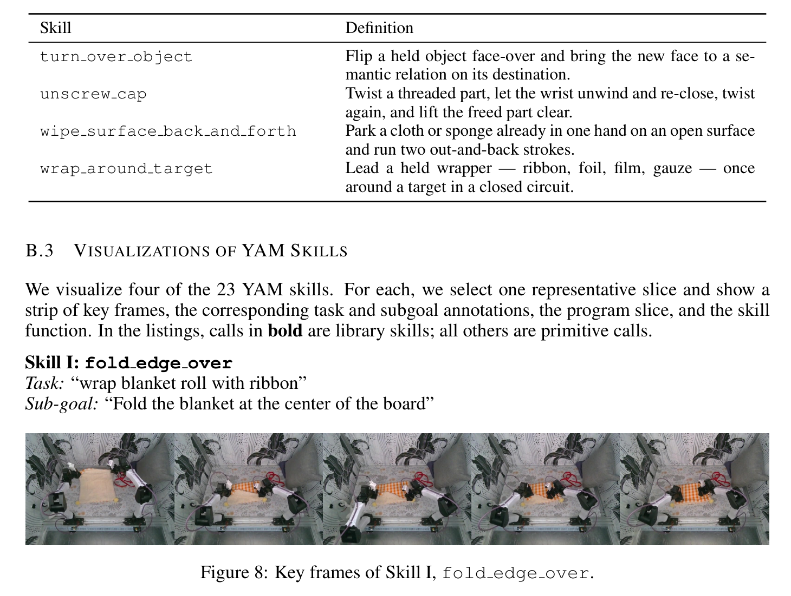

**Caption:** Figure 8: Key frames of Skill I, fold edge over.

**Caption[CN]:** 图 8：技能 I“折叠边缘”（fold edge over）的关键帧序列与代码实现。

```python
# Task: "wrap blanket roll with ribbon"
# Sub-goal: "Fold the blanket at the center of the board"
def fold_edge_over(robot, item_name, left_delta, right_delta):
    # pinch the edge with both arms
    robot.grasp(item_name, 'left')
    robot.grasp(item_name, 'right')
    # carry the pinched edge across the item
    robot.servo_ee_delta('left', left_delta)
    robot.servo_ee_delta('right', right_delta)
    # let go -- the fold is made
    robot.release('left')
    robot.release('right')
```

### Figure 9. YAM 技能 II：交替拍平（alternating smoothing pats）关键帧与程序

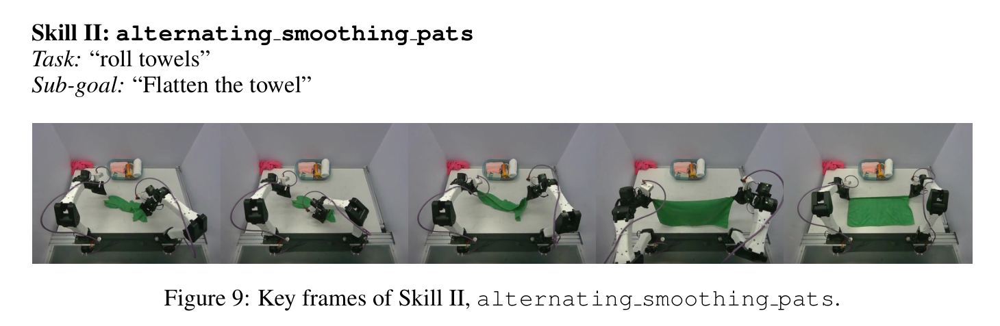

**Caption:** Figure 9: Key frames of Skill II, alternating smoothing pats.

**Caption[CN]:** 图 9：技能 II“交替拍平”（alternating smoothing pats）的关键帧序列与代码实现。

```python
# Task: "roll towels"
# Sub-goal: "Flatten the towel"
def alternating_smoothing_pats(robot, fabric_name, first_side, second_side):
    # pat 1 -- press the fabric flat, then come off
    robot.grasp(fabric_name, first_side)
    robot.release(first_side)
    # pat 2 -- the other hand, on the other half of the sheet
    robot.grasp(fabric_name, second_side)
    robot.release(second_side)

# Program slice for this episode:
# Smooth out the towel with alternating pats
alternating_smoothing_pats(robot, 'towel', 'left', 'right')
```

### Figure 10. YAM 技能 III：翻转物体（flip object over）关键帧与程序

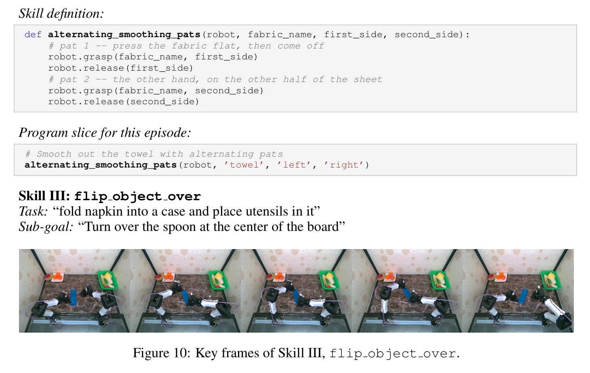

**Caption:** Figure 10: Key frames of Skill III, flip object over.

**Caption[CN]:** 图 10：技能 III“翻转物体”（flip object over）的关键帧序列与代码实现。

```python
# Task: "fold napkin into a case and place utensils in it"
# Sub-goal: "Turn over the spoon at the center of the board"
def flip_object_over(robot, object_name, side, lift_delta, turn_deg=180.0):
    # lift just clear so the object can swing
    robot.servo_ee_delta(side, lift_delta)
    # roll the wrist -- this is the flip
    robot.rotate(object_name, turn_deg, side)
    # let it fall the last centimetre, landing inverted
    robot.release(side)
    # pin the flipped object down again for the next slice
    robot.grasp(object_name, side)
```

### Figure 11. YAM 技能 IV：原位微调（adjust in place）关键帧与程序

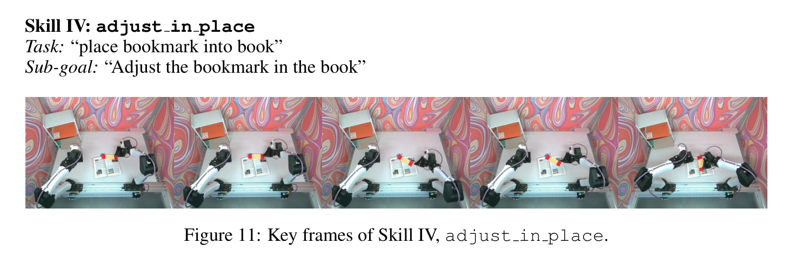

**Caption:** Figure 11: Key frames of Skill IV, adjust in place.

**Caption[CN]:** 图 11：技能 IV“原位微调”（adjust in place）的关键帧序列与代码实现。

```python
# Task: "place bookmark into book"
# Sub-goal: "Adjust the bookmark in the book"
def adjust_in_place(robot, object_name, side, nudge_delta):
    # take hold where it sits -- no lift
    robot.grasp(object_name, side)
    # slide it by a small bounded amount
    robot.servo_ee_delta(side, nudge_delta)
    # let it settle
    robot.release(side)

# Program slice for this episode:
adjust_in_place(robot, 'bookmark', 'right', [0.05, 0.0, 0.0])
```

### B.4 Visualizations of Egocentric Human Skills

> <span style="color:#3B82F6"><strong>Para. 11:</strong></span> We visualize six of the 27 egocentric human skills. For each, we select one representative slice and show a strip of key frames, the corresponding task and sub-goal annotations, the program slice, and the skill function. In the listings, calls in bold are library skills; all others are primitive calls.

> <span style="color:#F59E0B"><strong>Para. 11[CN]:</strong></span> 我们可视化展示了 27 项人类第一人称技能中的 6 项代表性技能。对于每一项，我们选取一段代表性的示教切片，并呈现关键帧序列、对应的任务与子目标标注、程序切片以及技能函数的源码实现。

### Figure 12. 人类技能 I：打开闭合件（open closure）关键帧与程序

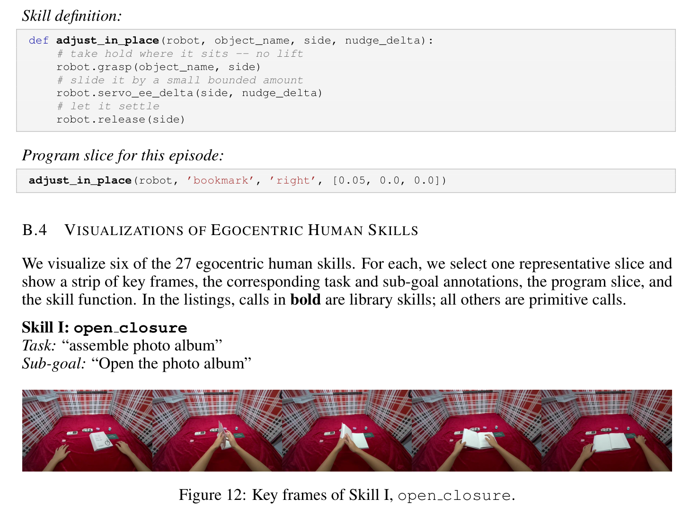

**Caption:** Figure 12: Key frames of Skill I, open closure.

**Caption[CN]:** 图 12：人类第一人称技能 I“打开闭合件”（open closure）的关键帧序列与代码实现。

```python
# Task: "assemble photo album"
# Sub-goal: "Open the photo album"
def open_closure(robot, container_name, closure_name, side, brace_side, axis, angle_deg):
    # Hold the container body down so the closure, not the container, moves.
    robot.grasp(container_name, brace_side)
    # Take the closure with the working hand.
    robot.grasp(closure_name, side)
    # Swing it through the arc.
    robot.rotate(closure_name, axis, angle_deg, side)
    # Release the closure and the brace.
    robot.release(side)
    robot.release(brace_side)
```

### Figure 13. 人类技能 II：倾倒至目标（pour into target）关键帧与程序

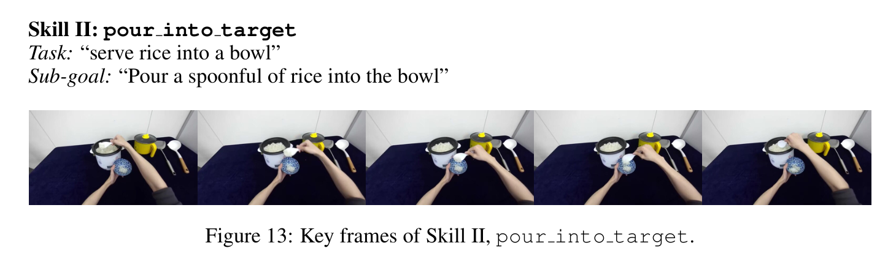

**Caption:** Figure 13: Key frames of Skill II, pour into target.

**Caption[CN]:** 图 13：人类第一人称技能 II“倾倒至目标”（pour into target）的关键帧序列与代码实现。

```python
# Task: "serve rice into a bowl"
# Sub-goal: "Pour a spoonful of rice into the bowl"
def pour_into_target(robot, vessel_name, target_name, side, axis, angle_deg):
    # Bring the held vessel's mouth over the receiving target.
    robot.goto_relative(side, target_name, 'above')
    # Tip it until it pours.
    robot.rotate(vessel_name, axis, angle_deg, side)
    # Bring it back upright; the pour ends.
    robot.rotate(vessel_name, axis, -angle_deg, side)

# Program slice for this episode:
pour_into_target(robot, 'spoon', 'bowl', 'right', 'object_long', 110.0)
```

### Figure 14. 人类技能 III：搅拌内含物（stir contents）关键帧与程序

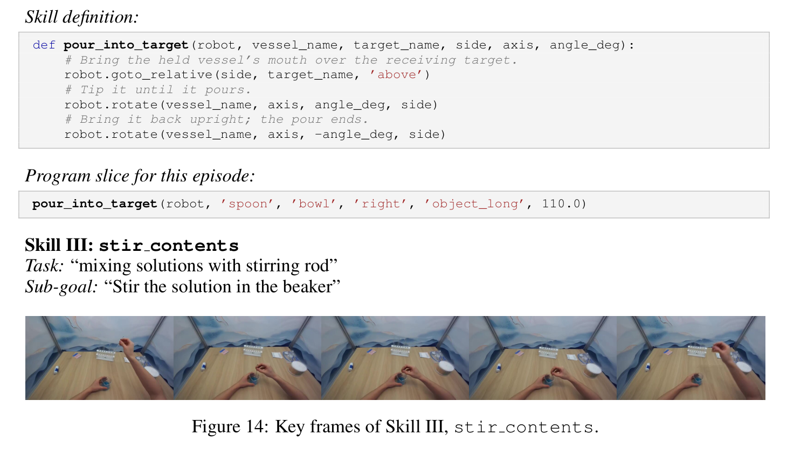

**Caption:** Figure 14: Key frames of Skill III, stir contents.

**Caption[CN]:** 图 14：人类第一人称技能 III“搅拌内含物”（stir contents）的关键帧序列与代码实现。

```python
# Task: "mixing solutions with stirring rod"
# Sub-goal: "Stir the solution in the beaker"
def stir_contents(robot, tool_name, vessel_name, side):
    # Bring the held tool down inside the vessel, among the contents.
    robot.goto_relative(side, vessel_name, 'inside')
    # Sweep it round the vessel; the grip never changes, nothing is let go.
    robot.rotate(tool_name, 'vertical', 360.0, side)
    robot.rotate(tool_name, 'vertical', 360.0, side)
```

### Figure 15. 人类技能 IV：往复擦拭表面（wipe surface back and forth）关键帧与程序

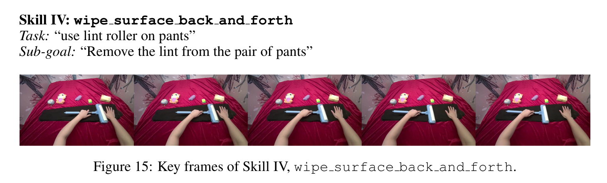

**Caption:** Figure 15: Key frames of Skill IV, wipe surface back and forth.

**Caption[CN]:** 图 15：人类第一人称技能 IV“往复擦拭表面”（wipe surface back and forth）的关键帧序列与代码实现。

```python
# Task: "use lint roller on pants"
# Sub-goal: "Remove the lint from the pair of pants"
def wipe_surface_back_and_forth(robot, surface_name, relation, stroke_direction, return_direction, side):
    # Park the cloth on the surface.
    robot.goto_relative(side, surface_name, relation)
    # Out and back.
    robot.move_arm(side, stroke_direction)
    robot.move_arm(side, return_direction)
    # And again.
    robot.move_arm(side, stroke_direction)
    robot.move_arm(side, return_direction)

# Program slice for this episode:
# Roll the lint roller back and forth over the pants (4 pairs of strokes)
for _ in range(2):
    wipe_surface_back_and_forth(robot, 'pants', 'against', 'right', 'left', 'left')
```

### Figure 16. 人类技能 V：折叠并压折痕（fold over and crease）关键帧与程序

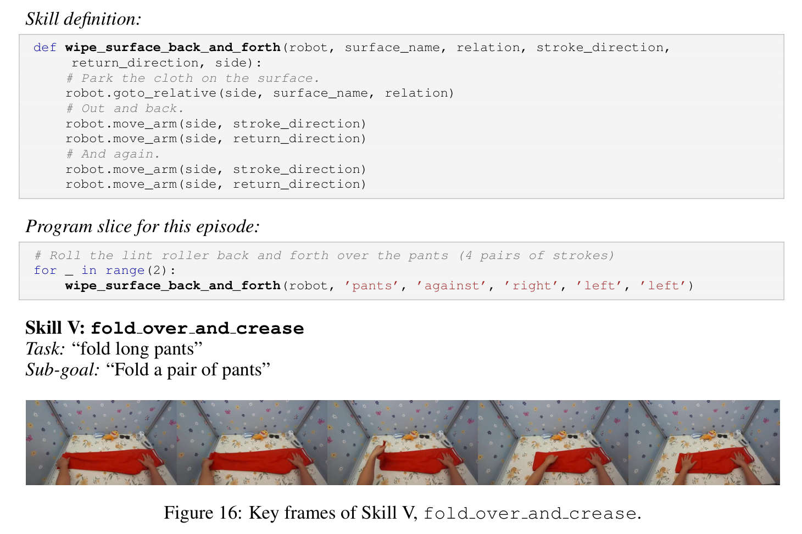

**Caption:** Figure 16: Key frames of Skill V, fold over and crease.

**Caption[CN]:** 图 16：人类第一人称技能 V“折叠并压折痕”（fold over and crease）的关键帧序列与代码实现。

```python
# Task: "fold long pants"
# Sub-goal: "Fold a pair of pants"
def fold_over_and_crease(robot, item_name, side, brace_side, direction, fold_direction):
    # Hold the item down so the fold, not the whole item, travels.
    robot.grasp(item_name, brace_side)
    # Take the free edge with the working hand.
    robot.grasp(item_name, side)
    # Carry the edge across the item ...
    robot.move_arm(side, direction)
    # ... and land it on the far side.
    robot.move_arm(side, fold_direction)
    # Let the folded edge down.
    robot.release(side)
    # Press the crease flat.
    robot.press(item_name, side)

# Program slice for this episode:
fold_over_and_crease(robot, 'pants', 'left', 'right', 'up', 'right')
```

### Figure 17. 人类技能 VI：环绕目标缠绕（wrap around target）关键帧与程序

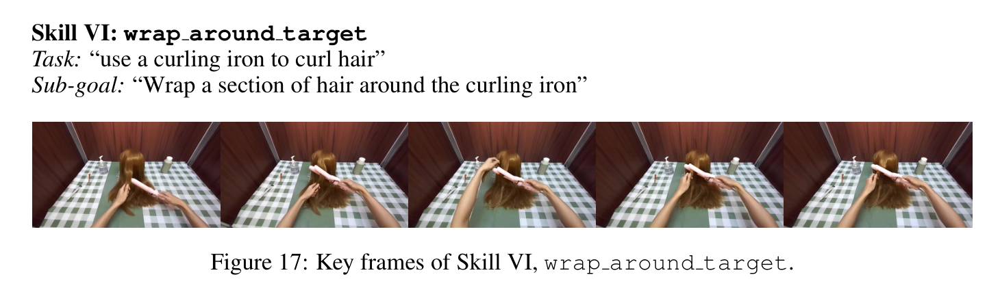

**Caption:** Figure 17: Key frames of Skill VI, wrap around target.

**Caption[CN]:** 图 17：人类第一人称技能 VI“环绕目标缠绕”（wrap around target）的关键帧序列与代码实现。

```python
# Task: "use a curling iron to curl hair"
# Sub-goal: "Wrap a section of hair around the curling iron"
def wrap_around_target(robot, target_name, side):
    # Start over the top of the target.
    robot.goto_relative(side, target_name, 'above')
    # Over the far side.
    robot.move_arm(side, 'away_from_body')
    # Down its far face.
    robot.move_arm(side, 'down')
    # Back underneath, toward the body.
    robot.move_arm(side, 'toward_body')
    # And up to close the circuit.
    robot.move_arm(side, 'up')

# Program slice for this episode:
# Wrap the hair around the curling iron twice.
for _ in range(2):
    wrap_around_target(robot, 'curling iron', 'left')
```

### B.5 Skill Distribution in the Embedding Space

> <span style="color:#3B82F6"><strong>Para. 12:</strong></span> In Figure 18 and 19, we visualize the skill distribution of variant skills in the pretrained code expert's embedding space. Each point represents one episode slice, placed by a two-dimensional t-SNE projection of its embedding and colored by the skill assigned to it. Dashed outlines mark the region covered by each skill, and the frames along the edges show a representative short span from an episode for selected skills. Figure 18 covers the 18 most common skills in the YAM library and Figure 19 the 16 most common skills in the egocentric human library. In both, slices assigned to different skills occupy largely separate regions, suggesting that the skill label is predictive of the motion in a slice and can serve as a conditioning signal for action generation.

> <span style="color:#F59E0B"><strong>Para. 12[CN]:</strong></span> 在图 18 和图 19 中，我们可视化展示了不同技能在预训练代码专家嵌入表征空间中的分布。每个散点代表一个示教切片，通过其特征嵌入的二维 t-SNE 投影进行空间定位，并按所分配的技能赋予颜色。虚线轮廓标出了各项技能所占据的特征区域，边缘处的图像帧则展示了选定技能的代表性示教时序片段。图 18 覆盖了 YAM 技能库中最常见的 18 项技能，图 19 覆盖了人类第一人称技能库中最常见的 16 项技能。在两个图表中，不同技能所对应的切片均占据了高度分离的子空间区域，这有力表明技能标签能够高度预测切片内的物理运动动态，完全胜任指导动作生成的强力条件化信号。

### Figure 18. YAM 技能库在预训练代码专家嵌入空间的分布特征

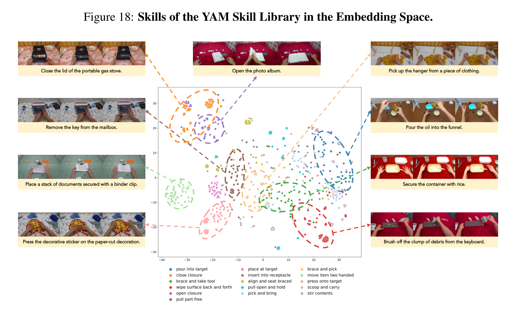

**Caption:** Figure 18: Skills of the YAM Skill Library in the Embedding Space.

**Caption[CN]:** 图 18：YAM 技能库在预训练代码专家嵌入空间中的 t-SNE 分布可视化。

### Figure 19. 人类第一人称技能库在嵌入空间的分布特征


**Caption:** Figure 19: Skills of the Egocentric Human Skill Library in the Embedding Space.

**Caption[CN]:** 图 19：人类第一人称技能库在预训练代码专家嵌入空间中的 t-SNE 分布可视化。

---


## Appendix C Baseline Implementation Details

> <span style="color:#3B82F6"><strong>Para. 1:</strong></span> In Sections 3.1 and 3.2, we compare AW-0 with four baselines: $\pi_{0.5}$, DreamZero, EgoScale, and WLA. Here, we describe how each is reproduced and adapted. On RoboTwin 2.0, we train a single multi-task policy per baseline on 2,500 demo clean demonstrations (50 tasks $\times$ 50 demonstrations). For each of the 8 real-world tasks, we train a separate policy per baseline using task-specific demonstrations sampled at 30 Hz. Every baseline receives a language instruction, the robot state, and three RGB views (one head and two wrist cameras). All baselines follow the same evaluation protocol as AW-0. All real-world rollouts are scored using the task-specific rubrics in Appendix E.

> <span style="color:#F59E0B"><strong>Para. 1[CN]:</strong></span> 在 3.1 节与 3.2 节中，我们将 AW-0 与四种代表性基线进行了系统对比：$\pi_{0.5}$、DreamZero、EgoScale 以及 WLA。在此，我们详述每种基线模型的复现与适配细节。在 RoboTwin 2.0 上，针对每种基线使用 2,500 条干净示教数据（50 个任务 $\times$ 50 条示教）训练单一的多任务策略。对于 8 项真实世界任务，我们使用采样频率为 30 Hz 的任务特定示教轨迹为每种基线分别训练独立的策略模型。所有基线均接收自然语言指令、机器人当前本体状态以及三路 RGB 图像视角（一路头部机位与两路手腕机位）。所有基线遵循与 AW-0 严格一致的评测协议。所有真实世界的评测 rollout 均采用附录 E 中的任务特定量表进行打分。

> <span style="color:#3B82F6"><strong>Para. 2:</strong></span> $\pi_{0.5}$ (Black et al., 2025) is a vision-language-action model that combines a pretrained vision-language backbone with a flow-matching action expert. We follow the official OpenPI implementation and initialize all policies from the released $\pi_{0.5}$ pretrained checkpoint. For each real-world task, we fine-tune a separate policy for 50 epochs on the task-specific demonstrations. We use 14-dimensional joint-space actions on RoboTwin and YAM, and 62-dimensional actions on Tianji–Sharpa consisting of a 9-dimensional end-effector pose and 22 hand joints per side. Arm actions are relative to the current state, while gripper and hand actions are absolute targets. We reinitialize the action input and output projections to accommodate these dimensions and fine-tune all model parameters. Following the official implementation, we use an action horizon of 50 for RoboTwin and 32 for the real robots, together with quantile normalization and standard image augmentation. All models are trained with AdamW on eight H100 GPUs using FSDP and a global batch size of 256. We use a peak learning rate of $5 \times 10^{-5}$ with cosine decay to $5 \times 10^{-6}$ and 2,000 warmup steps.

> <span style="color:#F59E0B"><strong>Para. 2[CN]:</strong></span> $\pi_{0.5}$（Black 等, 2025）是一种视觉-语言-动作模型，将预训练的视觉-语言骨干网络同基于流匹配的动作专家相结合。我们遵循官方 OpenPI 实现，并从开源发布的 $\pi_{0.5}$ 预训练检查点初始化所有策略。对于每项真实世界任务，我们在任务特定示教数据上独立微调策略 50 个 epoch。我们在 RoboTwin 和 YAM 上采用 14 维关节空间动作，在天机-夏尔巴（Tianji–Sharpa）上采用 62 维动作（单侧包含 9 维末端执行器位姿与 22 维灵巧手关节角）。机械臂动作采用相对于当前状态的增量，夹爪与灵巧手动作采用绝对目标值。我们重新初始化动作输入与输出投影层以适配这些动作维度，并对全部模型参数进行全量微调。遵循官方实现，RoboTwin 上的动作预测时域设为 50，真实机器人设为 32，并辅以分位数归一化与标准图像数据增强。所有模型在 8 张 H100 GPU 上采用全分片数据并行（FSDP）与 AdamW 优化器训练，全局批大小为 256。最大学习率为 $5 \times 10^{-5}$，经 2,000 步线性预热后余弦退火至 $5 \times 10^{-6}$。

> <span style="color:#3B82F6"><strong>Para. 3:</strong></span> DreamZero (Ye et al., 2026) is a world-action model that jointly generates future video and actions using a pretrained video diffusion backbone. We follow the official implementation and initialize from the DreamZero-AgiBot checkpoint. We reproduce DreamZero on RoboTwin and all 8 real-world tasks, training a separate policy for 10 epochs on each real-world task. We fully fine-tune the diffusion transformer and state/action modules, while keeping the text encoder, image encoder, and video VAE frozen. Following the original design, the three camera views are tiled into one frame, and each training sample contains up to four action chunks of 24 steps. Actions are predicted relative to the state at the beginning of each chunk, with absolute hand-joint targets on Tianji–Sharpa. The state and action projections are adapted to the target embodiment, and the video and action losses are weighted equally. All policies are trained with AdamW on 32 H100 GPUs using a global batch size of 32. We use the same training hyperparameters across all tasks, with a peak learning rate of $2 \times 10^{-5}$ and 5% linear warmup followed by cosine decay.

> <span style="color:#F59E0B"><strong>Para. 3[CN]:</strong></span> DreamZero（Ye 等, 2026）是一种利用预训练视频扩散骨干网络联合生成未来视频与动作的世界动作模型。我们遵循官方实现，从 DreamZero-AgiBot 检查点进行初始化。我们在 RoboTwin 以及全部 8 项真实世界任务上复现了 DreamZero，在每个真实任务上独立微调 10 个 epoch。我们对扩散 Transformer 及状态/动作模块进行全量微调，同时保持文本编码器、图像编码器和视频 VAE 冻结。遵循原始设计，三个相机机位平铺拼接为单张复合图像帧，每个训练样本包含最多 4 个由 24 步构成的动作块。动作预测相对于每个动作块起始时刻的状态，在天机-夏尔巴平台上配合绝对手部关节目标。状态与动作投影层适配至目标硬件构型，视频损失与动作损失赋予相同权重（1:1）。所有策略在 32 张 H100 GPU 上采用 AdamW 优化器训练，全局批大小为 32。各任务采用统一的超参数配置，最大学习率为 $2 \times 10^{-5}$，经 5% 步数线性预热后进行余弦退火。

> <span style="color:#3B82F6"><strong>Para. 4:</strong></span> EgoScale (using the GR00T N1.7-3B checkpoint) (Zheng et al., 2026) studies how pretraining on egocentric human demonstrations scales to dexterous robot manipulation. We reproduce this baseline using the GR00T N1.7 implementation and initialize from the pretrained nvidia/GR00T-N1.7-3B checkpoint. For each real-world task, we fine-tune a separate policy for 50 epochs while keeping the vision-language backbone frozen and training the projection layers and diffusion action head. We use relative joint actions for the arms on RoboTwin and YAM, relative end-effector actions on Tianji–Sharpa, and absolute targets for the grippers and 22-DoF dexterous hands. Following the official fine-tuning recipe, we apply state dropout with probability 0.2, random image cropping, and color jitter. We use an action horizon of 20 steps and train with AdamW on eight H100 GPUs with a global batch size of 640. The peak learning rate is $10^{-4}$, with 5% linear warmup followed by cosine decay and a weight decay of $10^{-5}$.

> <span style="color:#F59E0B"><strong>Para. 4[CN]:</strong></span> EgoScale（采用 GR00T N1.7-3B 检查点）（Zheng 等, 2026）研究了在人类第一人称示教上的预训练如何向灵巧机器人操作拓展。我们基于 GR00T N1.7 开源实现复现该基线，并从预训练的 nvidia/GR00T-N1.7-3B 权重初始化。对于每项真实任务，我们独立微调策略 50 个 epoch，期间冻结视觉-语言骨干网络，仅训练投影层与扩散动作头。我们在 RoboTwin 和 YAM 上采用机械臂相对关节动作，在天机-夏尔巴上采用相对末端位姿动作，夹爪与 22 自由度灵巧手均采用绝对目标值。遵循官方微调配方，我们以 0.2 的概率施加状态 Dropout，并应用随机图像裁剪与色彩抖动。动作预测时域设为 20 步，在 8 张 H100 GPU 上使用 AdamW 优化器训练，全局批大小为 640。最大学习率为 $10^{-4}$，经 5% 线性预热后余弦衰减，权重衰减设为 $10^{-5}$。

> <span style="color:#3B82F6"><strong>Para. 5:</strong></span> WLA (Yang et al., 2026) combines a vision-language backbone, a world expert, and an action expert to jointly model visual observations, language, and robot actions. We follow the official implementation and initialize the backbone and world expert from pretrained RynnBrain-2B and Sana-600M weights, respectively. The connector and action expert are randomly initialized. We train a separate policy for 50 epochs on each real-world task, updating all modules except the image VAE. Following the original design, the policy observes the current head and wrist views together with the head view from 8 steps earlier. We use 64 meta-queries and a 32-step action chunk, with absolute action targets normalized to $[-1, 1]$. The world expert predicts the head-camera image at the end of the chunk, and its flow-matching loss is weighted by 0.1 relative to the action loss. All models are trained with AdamW on eight H100 GPUs using a global batch size of 256. We use a peak learning rate of $5 \times 10^{-5}$ with cosine decay to $5 \times 10^{-6}$ and 1,000 warmup steps.

> <span style="color:#F59E0B"><strong>Para. 5[CN]:</strong></span> WLA（Yang 等, 2026）结合了视觉-语言骨干网络、世界专家与动作专家，以联合建模视觉观测、自然语言与机器人动作。我们遵循官方实现，其骨干网络与世界专家分别基于预训练的 RynnBrain-2B 和 Sana-600M 权重初始化。连接层（connector）与动作专家采用随机初始化。我们在每个真实任务上独立训练策略 50 个 epoch，更新除图像 VAE 之外的所有模块。遵循原始架构设计，策略同时观测当前的头部和手腕机位图像以及 8 步之前的历史头部图像。我们设置 64 个元查询（meta-queries）和 32 步动作块，绝对动作目标被归一化至 $[-1, 1]$ 区间。世界专家负责预测当前动作块结束时的头部相机图像，其流匹配损失相对于动作损失赋予 0.1 的权重比率。所有模型在 8 张 H100 GPU 上采用 AdamW 优化器训练，全局批大小为 256。最大学习率为 $5 \times 10^{-5}$，经 1,000 步线性预热后余弦退火至 $5 \times 10^{-6}$。

---

## Appendix D Real-world Experimental Setup

> <span style="color:#3B82F6"><strong>Para. 6:</strong></span> We conduct data collection and policy evaluation on two robot embodiments: the YAM station with parallel grippers and the Tianji–Sharpa station with dexterous hands. This section describes the robot hardware, visual observations, and teleoperation interfaces used in our experiments. Figure 20 gives an overview of the two stations.

> <span style="color:#F59E0B"><strong>Para. 6[CN]:</strong></span> 我们在两种机器人硬件构型上进行数据采集与策略评测：配备平行夹爪的 YAM 工作站以及配备灵巧手的天机-夏尔巴（Tianji–Sharpa）工作站。本节详细描述实验中使用的机器人硬件、视觉观测配置与遥操作系统。图 20 呈现了两个机器人工作站的系统概览。

### Figure 20. 真实世界双臂与灵巧手机器人工作站硬件搭建

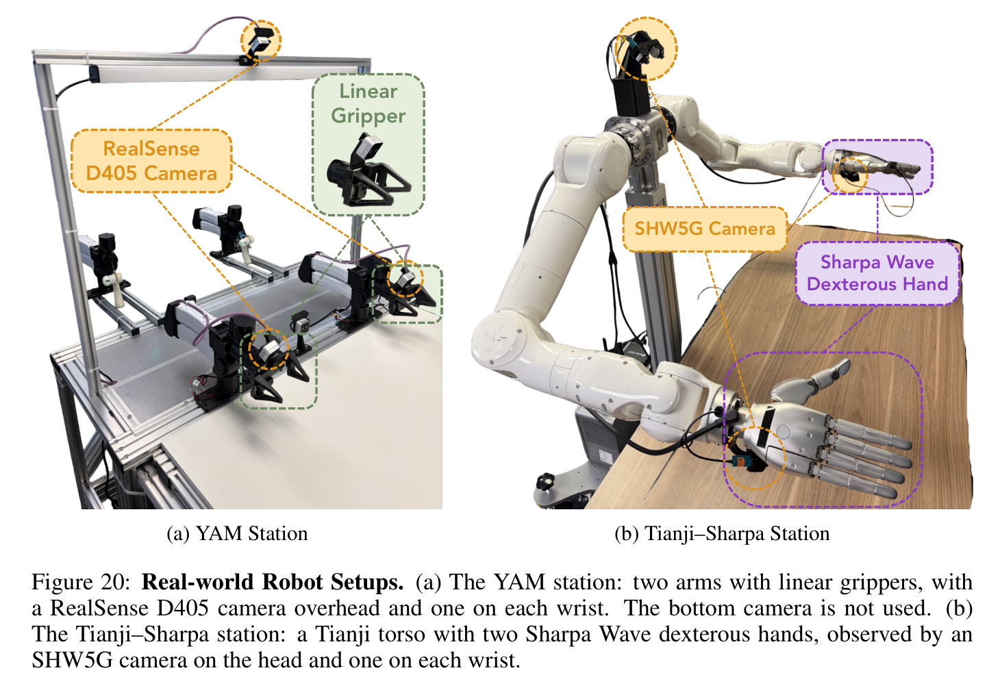

**Caption:** Figure 20: Real-world Robot Setups. (a) The YAM station: two arms with linear grippers, with a RealSense D405 camera overhead and one on each wrist. The bottom camera is not used. (b) The Tianji–Sharpa station: a Tianji torso with two Sharpa Wave dexterous hands, observed by an SHW5G camera on the head and one on each wrist.

**Caption[CN]:** 图 20：真实世界机器人硬件搭建。(a) YAM 机器人工作站：双 6-DoF 机械臂配备直线平行夹爪，顶部架设一台 RealSense D405 相机，每只手腕各安装一台 D405 相机（底部相机未启用）。(b) 天机-夏尔巴工作站：天机双臂仿人躯干配备两只 Sharpa Wave 灵巧手，由架设于头部与双腕的三台 SHW5G 高清相机进行多视角观测。

> <span style="color:#3B82F6"><strong>Para. 7:</strong></span> Robot Hardware and Control. The YAM station is a fixed-base bimanual system with two 6-DoF arms, each equipped with a parallel gripper. The Tianji–Sharpa station consists of a Tianji humanoid torso with two arms and two 22-DoF Sharpa dexterous hands. For AW-0, both embodiments use the 64-dimensional state–action representation described in Appendix A. The policy predicts relative end-effector poses together with absolute gripper targets on YAM or absolute finger-joint targets on Tianji–Sharpa.

> <span style="color:#F59E0B"><strong>Para. 7[CN]:</strong></span> 机器人硬件与控制体系。YAM 工作站是由两只配备平行夹爪的 6 自由度机械臂构成的固定基座双臂系统。天机-夏尔巴工作站包含一个天机仿人双臂躯干以及两只各具有 22 个主动自由度的 Sharpa 多指灵巧手。对于 AW-0，两套硬件构型均统一使用附录 A 所述的 64 维状态-动作表征。策略网络负责输出末端执行器的相对位姿增量，并在 YAM 上输出绝对夹爪开合度，在天机-夏尔巴上输出绝对手指关节角度目标。

> <span style="color:#3B82F6"><strong>Para. 8:</strong></span> Perception System. Both stations provide three RGB views: a head or overhead camera observes the tabletop workspace, and a camera at each wrist provides a local view of the gripper or hand and the manipulated objects. Each policy receives these images together with the task instruction and robot state. For AW-0, images are resized to $224 \times 320$ pixels, and the state contains the end-effector poses and the gripper positions or hand-joint angles. The same camera streams are provided to all baselines, with method-specific preprocessing described in Appendix C.

> <span style="color:#F59E0B"><strong>Para. 8[CN]:</strong></span> 视觉感知系统。两套工作站均提供三路 RGB 图像视角：顶部或头部相机用于俯瞰整个桌面工作区域，双腕上的手眼相机则提供夹爪/灵巧手及被操作物体的近距离局部高精视角。每套控制策略均接收上述三路图像输入，并结合自然语言任务指令与机器人当前本体状态。对于 AW-0，图像统一调整为 $224 \times 320$ 分辨率，本体状态由末端位姿以及夹爪位置或手指关节角组成。所有基线方法均接入完全相同的相机视频流，并按附录 C 所述进行各自特定的预处理。

> <span style="color:#3B82F6"><strong>Para. 9:</strong></span> Teleoperation and Data Collection. We collect YAM demonstrations using the standard YAM station configuration, with two master arms and two puppet arms. The operator moves the master arms, whose measured joint angles are sent as joint-position targets to the corresponding puppet arms. The triggers on the teaching handles control the parallel gripper openings, yielding six arm-joint targets and one gripper target per side. For Tianji–Sharpa, we use Manus gloves with PICO motion trackers attached to the gloves, together with an Apple Vision Pro worn around the operator\'s neck. The tracked wrist positions and orientations define poses in SE(3), which are mapped to end-effector targets for the two Tianji arms. In parallel, finger-motion measurements from the Manus gloves are retargeted to 22-dimensional joint-position targets for each Sharpa hand. At each teleoperation step, the arm-pose and hand-joint targets are passed to the corresponding robot controllers to coordinate arm and finger motion. During collection, we record the three RGB camera streams, measured robot states, and commanded action targets. We use their timestamps to pair visual observations with robot states and action commands, and associate each demonstration with a task instruction for post-training.

> <span style="color:#F59E0B"><strong>Para. 9[CN]:</strong></span> 遥操作示教与数据采集。我们使用标准 YAM 工作站配置采集双臂平行夹爪示教，该配置包含两只主控臂（master arms）与两只从动臂（puppet arms）。操作员手动操控主控臂，测得的关节角作为位置控制目标实时发送给对应的从动臂。示教手柄上的扳机用于线性控制夹爪的开合宽度，每侧各产生 6 维机械臂关节目标与 1 维夹爪目标。对于天机-夏尔巴平台，我们采用佩戴有 PICO 空间运动追踪器的数据手套（Manus gloves），并配合操作员颈部悬挂的 Apple Vision Pro 进行空间位姿感知。追踪到的手腕位置与姿态定义了 SE(3) 空间中的刚体位姿，并被映射为天机双臂的末端执行器控制目标。与此同时，Manus 手套测得的手指屈伸与外展动作被重定向（retargeted）为每只 Sharpa 灵巧手的 22 维关节位置目标。在每个遥操作控制步中，机械臂位姿目标与手指关节目标被下发至各自的底层控制器，实现手臂与手部运动的严密协调。采集过程中，系统同步录制三路 RGB 视频流、机器人实测本体状态以及下发的控制动作指令，并利用硬件时间戳将视觉观测同机器人状态与动作指令精确对齐，最后为每条示教绑定对应的语言指令以供微调训练。

---

## Appendix E Real-world Task Progress

> <span style="color:#3B82F6"><strong>Para. 10:</strong></span> We evaluate 8 real-world tasks that span two robot platforms. Arrange Fruits, Pack Backpack, Replace Lightbulb, and Fold and Stack Towels run on the YAM bimanual setup (two 6-DoF arms with parallel grippers); Arrange Fruits with Tongs, Deal Poker, Flip Scoreboard, and Solve Rubik\'s Cube run on the Tianji humanoid torso with two Sharpa dexterous hands. For each task we show the progress with the key frames of one training episode together with its code label; every color-coded block of the program is linked to the range of frames it explains. Each task is graded with an additive rubric that awards independent partial credit for each completed sub-step.

> <span style="color:#F59E0B"><strong>Para. 10[CN]:</strong></span> 我们在两套机器人平台上评估了 8 项高难度物理操作任务。其中“整理水果”（Arrange Fruits）、“整理背包”（Pack Backpack）、“更换灯泡”（Replace Lightbulb）以及“折叠并叠放毛巾”（Fold and Stack Towels）运行在 YAM 双臂平行夹爪系统上；“用夹子夹取水果”（Arrange Fruits with Tongs）、“发扑克牌”（Deal Poker）、“翻记分牌”（Flip Scoreboard）以及“还原魔方”（Solve Rubik\'s Cube）运行在配备两只 Sharpa 灵巧手的天机双臂仿人平台上。针对每项任务，我们展示了一条训练轨迹的关键帧时序演进过程及其对齐的代码标签，程序中的每个彩色高亮代码块均映射到其所解释的视频时段。所有任务均采用累加式评分量表（additive rubric）评判，根据独立完成的每个操作子步骤阶梯式赋予部分得分。

### E.1 YAM Tasks

> <span style="color:#3B82F6"><strong>Para. 11:</strong></span> Task I: Arrange Fruits. The robot must sort fruits between a bowl and a basket so that only the specified items remain in the target container. Below we provide the aligned program slice, execution timeline, and additive grading rubric.

> <span style="color:#F59E0B"><strong>Para. 11[CN]:</strong></span> 任务 I：整理水果（Arrange Fruits）。机器人必须在果碗与果篮之间分拣水果，使得目标容器内最终仅保留自然语言指令所指定的特定水果。下方展示了时间对齐的程序切片、执行时间线以及累加式评分量表。

### Figure 21. 整理水果（Arrange Fruits）关键帧与程序标签

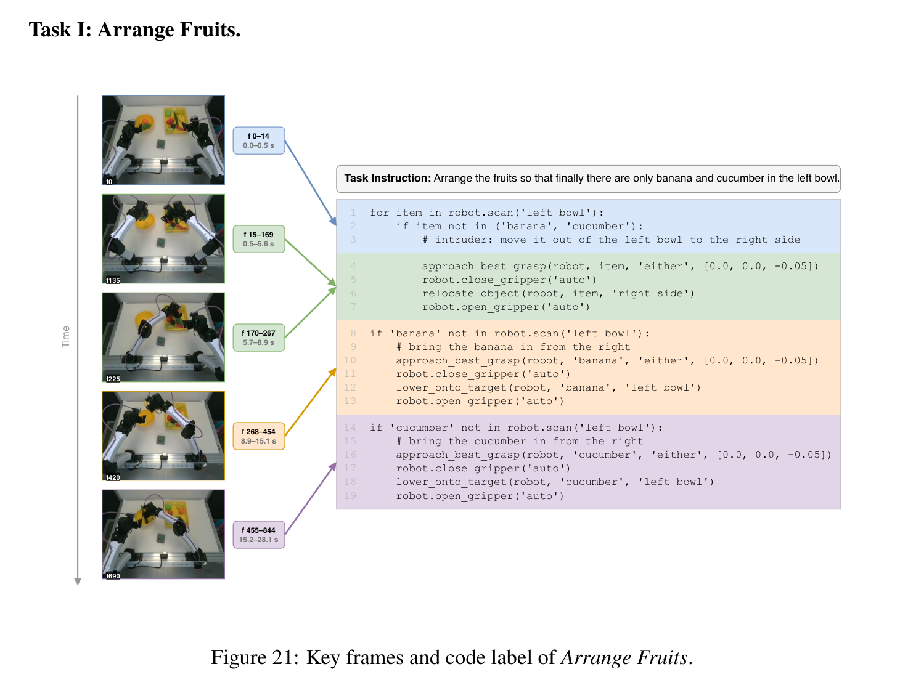

**Caption:** Figure 21: Key frames and code label of Arrange Fruits.

**Caption[CN]:** 图 21：“整理水果”（Arrange Fruits）关键帧序列与对齐代码标签。

```python
# Task Instruction: Arrange the fruits so that finally there are only banana and cucumber in the left bowl.
for item in robot.scan('left bowl'):
    if item not in ('banana', 'cucumber'):
        # intruder: move it out of the left bowl to the right side
        approach_best_grasp(robot, item, 'either', [0.0, 0.0, -0.05])
        robot.close_gripper('auto')
        relocate_object(robot, item, 'right side')
        robot.open_gripper('auto')
if 'banana' not in robot.scan('left bowl'):
    # bring the banana in from the right
    approach_best_grasp(robot, 'banana', 'either', [0.0, 0.0, -0.05])
    robot.close_gripper('auto')
    lower_onto_target(robot, 'banana', 'left bowl')
    robot.open_gripper('auto')
if 'cucumber' not in robot.scan('left bowl'):
    # bring the cucumber in from the right
    approach_best_grasp(robot, 'cucumber', 'either', [0.0, 0.0, -0.05])
    robot.close_gripper('auto')
    lower_onto_target(robot, 'cucumber', 'left bowl')
    robot.open_gripper('auto')
```

**Grading rubric (additive):**
- **+0.3:** (a) Moves each fruit not named in the instruction from the left bowl into the right basket (or none to remove).
- **+0.3:** (b) Moves each named fruit not yet in the left bowl from the right basket into the bowl (or none to fetch).
- **+0.4:** (c) Final state matches the instruction and no fruit is dropped.

> <span style="color:#3B82F6"><strong>Para. 12:</strong></span> Task II: Pack Backpack. This long-horizon task requires unzipping a backpack, inserting items, and re-zipping it closed across five distinct stages.

> <span style="color:#F59E0B"><strong>Para. 12[CN]:</strong></span> 任务 II：整理背包（Pack Backpack）。该长程任务要求机器人拉开背包拉链、装入物品并重新拉上拉链，横跨五个高度耦合的操作阶段。

### Figure 22. 整理背包（Pack Backpack）关键帧与程序标签

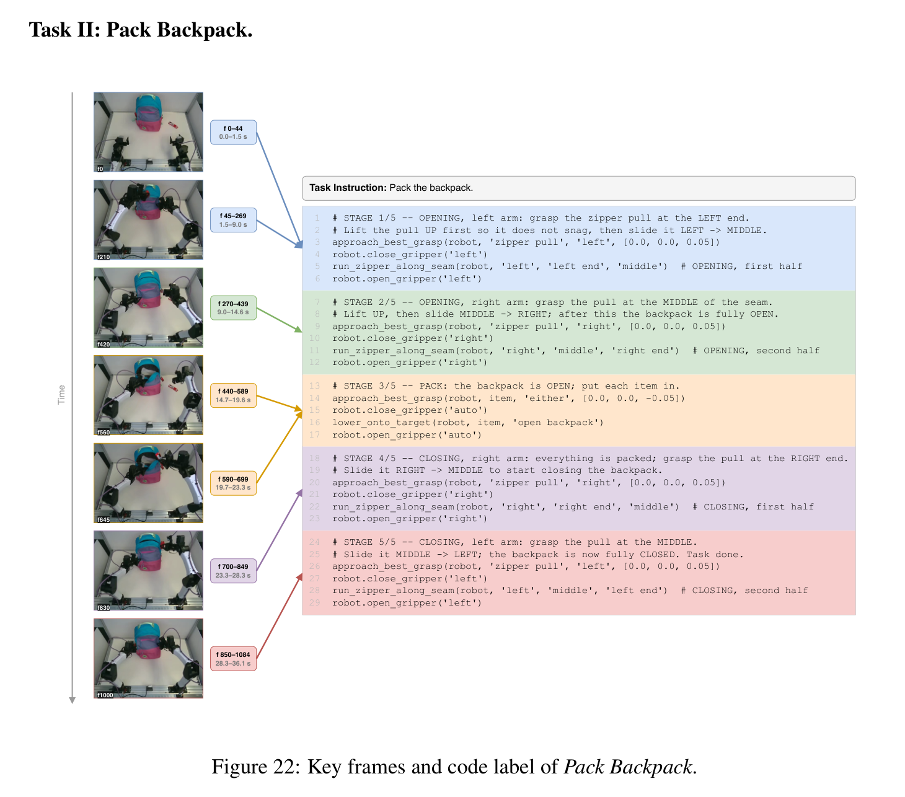

**Caption:** Figure 22: Key frames and code label of Pack Backpack.

**Caption[CN]:** 图 22：“整理背包”（Pack Backpack）关键帧序列与对齐代码标签。

```python
# Task Instruction: Pack the backpack.
# STAGE 1/5 -- OPENING, left arm: grasp the zipper pull at the LEFT end.
# Lift the pull UP first so it does not snag, then slide it LEFT -> MIDDLE.
approach_best_grasp(robot, 'zipper pull', 'left', [0.0, 0.0, 0.05])
robot.close_gripper('left')
run_zipper_along_seam(robot, 'left', 'left end', 'middle')  # OPENING, first half
robot.open_gripper('left')
# STAGE 2/5 -- OPENING, right arm: grasp the pull at the MIDDLE of the seam.
# Lift UP, then slide MIDDLE -> RIGHT; after this the backpack is fully OPEN.
approach_best_grasp(robot, 'zipper pull', 'right', [0.0, 0.0, 0.05])
robot.close_gripper('right')
run_zipper_along_seam(robot, 'right', 'middle', 'right end')  # OPENING, second half
robot.open_gripper('right')
# STAGE 3/5 -- PACK: the backpack is OPEN; put each item in.
approach_best_grasp(robot, item, 'either', [0.0, 0.0, -0.05])
robot.close_gripper('auto')
lower_onto_target(robot, item, 'open backpack')
robot.open_gripper('auto')
# STAGE 4/5 -- CLOSING, right arm: everything is packed; grasp the pull at the RIGHT end.
# Slide it RIGHT -> MIDDLE to start closing the backpack.
approach_best_grasp(robot, 'zipper pull', 'right', [0.0, 0.0, 0.05])
robot.close_gripper('right')
run_zipper_along_seam(robot, 'right', 'right end', 'middle')  # CLOSING, first half
robot.open_gripper('right')
# STAGE 5/5 -- CLOSING, left arm: finish closing; grasp the pull at the MIDDLE.
# Slide it MIDDLE -> LEFT END; after this the backpack is fully CLOSED.
approach_best_grasp(robot, 'zipper pull', 'left', [0.0, 0.0, 0.05])
robot.close_gripper('left')
run_zipper_along_seam(robot, 'left', 'middle', 'left end')  # CLOSING, second half
robot.open_gripper('left')
```

**Grading rubric (additive):**
- **+0.15:** (a) Left gripper grasps the zipper pull at the left end and slides it to the middle.
- **+0.15:** (b) Right gripper re-grasps the pull at the middle and slides it to the right end.
- **+0.2:** (c) Open the backpack with the left gripper.
- **+0.2:** (d) Picks up the item from the table and places it inside the open backpack.
- **+0.15:** (e) Right gripper grasps the pull at the right end and slides it back to the middle.
- **+0.15:** (f) Left gripper slides the pull from the middle to the left end; the backpack is fully zipped.

> <span style="color:#3B82F6"><strong>Para. 13:</strong></span> Task III: Replace Lightbulb. The robot must test whether a lightbulb functions, unscrew it if broken, install a new bulb, and verify illumination under conditional logic.

> <span style="color:#F59E0B"><strong>Para. 13[CN]:</strong></span> 任务 III：更换灯泡（Replace Lightbulb）。机器人必须测试灯泡是否正常工作；若损坏则将其旋下、换上新灯泡并旋紧测试，体现出强烈的条件判断逻辑。

### Figure 23. 更换灯泡（Replace Lightbulb）关键帧与程序标签


**Caption:** Figure 23: Key frames and code label of Replace Lightbulb.

**Caption[CN]:** 图 23：“更换灯泡”（Replace Lightbulb）关键帧序列与对齐代码标签。

```python
# Task Instruction: Change the lightbulb if it doesn't work.
# STAGE 1 -- TEST: the LEFT arm presses the wall switch; watch the bulb.
approach_best_grasp(robot, 'wall switch', 'left', [0.0, 0.0, 0.05])
robot.close_gripper('left')
robot.press('wall switch', 'left')
robot.open_gripper('left')
# check if lit -- if yes, we are done; if no, replace.
if not robot.detect_bulb_lit('current bulb'):
    # STAGE 2 -- REMOVE DEAD: left arm braces the lamp base so it cannot twist;
    # right arm unscrews the dead bulb and puts it in the tray.
    approach_best_grasp(robot, 'lamp base', 'left', [0.0, 0.0, 0.05])
    robot.close_gripper('left')
    approach_best_grasp(robot, 'dead bulb', 'right', [0.0, 0.0, 0.05])
    robot.close_gripper('right')
    ratchet_twist_off(robot, 'dead bulb', 'right', 180.0)  # unscrew counter-clockwise
    relocate_object(robot, 'dead bulb', 'bulb tray')
    robot.open_gripper('right')
    # STAGE 3 -- INSTALL SPARE: left arm keeps bracing; right arm picks the spare,
    # seats it into the socket, and twists it until it lights.
    approach_best_grasp(robot, 'spare bulb', 'right', [0.0, 0.0, 0.05])
    robot.close_gripper('right')
    lower_onto_target(robot, 'spare bulb', 'lamp socket')
    ratchet_twist_off(robot, 'spare bulb', 'right', -180.0)  # screw clockwise
    robot.release('left')
    robot.release('right')
```

**Grading rubric (additive):**
- *Condition A – dead bulb, replacement required:*
  - **+0.1:** (a) Left gripper presses the inline switch and the bulb stays dark.
  - **+0.1:** (b) Left gripper braces the lamp base.
  - **+0.2:** (c) Right gripper unscrews the dead bulb and lifts it out of the socket.
  - **+0.1:** (d) Dead bulb is set down in the bulb tray.
  - **+0.1:** (e) Right gripper picks up the spare bulb.
  - **+0.3:** (f) Spare bulb is seated in the socket and screwed in clockwise until lit.
  - **+0.1:** (g) When the bulb is lit, release both arms to their home positions.
- *Condition B – working bulb, no replacement needed:*
  - **+0.3:** Left gripper presses the inline switch and the bulb lights up.
  - **+0.7:** The lit bulb shows the lamp still works, so both arms move back to their initial pose without disturbing the lamp.

> <span style="color:#3B82F6"><strong>Para. 14:</strong></span> Task IV: Fold and Stack Towels. The bimanual robot must manipulate deformable towels by folding them in order and stacking them according to language instructions.

> <span style="color:#F59E0B"><strong>Para. 14[CN]:</strong></span> 任务 IV：折叠并叠放毛巾（Fold and Stack Towels）。双臂机器人必须协同操作易形变的织物毛巾，依次完成折叠，并按照自然语言指令指定的颜色次序叠放整齐。

### Figure 24. 折叠并叠放毛巾（Fold and Stack Towels）关键帧与程序标签


**Caption:** Figure 24: Key frames and code label of Fold and Stack Towels.

**Caption[CN]:** 图 24：“折叠并叠放毛巾”（Fold and Stack Towels）关键帧序列与对齐代码标签。

```python
# Task Instruction: fold the towels and stack them in pink, brown, green order.
LEFT, RIGHT, BOTH = ['left'], ['right'], ['left', 'right']
# the towels start side by side: brown (left), pink (middle), green (right).
# fold them in table order -- middle, right, left -- then stack them bottom-to-top
# in the order the instruction names.
# STAGE 1/6 FOLD PINK | folded: nothing yet | stack: empty | next: fold the green towel
for arms, deltas, crease in [
        (RIGHT, [[-0.12,0.13,-0.23]], False),
        (BOTH, [[0.21,0.05,0.03], [0.18,0.05,0.03]], False),
        (RIGHT, [[0.00,0.15,0.04]], False),
        (RIGHT, [[0.20,0.07,0.01]], True)]:
    approach_best_grasp(robot, 'pink towel edge', arms[0], [0.0, 0.0, -0.05])
    for a in arms: robot.grasp('pink towel', a)
    for a, d in zip(arms, deltas): robot.servo_ee_delta(a, d)
    if crease: fold_over_and_crease(robot, 'pink towel')
    for a in arms: robot.release(a)
robot.freespace_move_home('right')
# STAGE 2/6 FOLD GREEN | folded: pink | stack: empty | next: fold the brown towel
for arms, deltas, crease in [
        (RIGHT, [[-0.08,0.22,-0.10]], False),
        (BOTH, [[0.00,-0.03,-0.04], [-0.02,-0.05,-0.01]], False),
        (BOTH, [[0.15,0.02,0.03], [0.13,-0.03,0.02]], False),
        (RIGHT, [[-0.05,0.16,0.04]], True)]:
    approach_best_grasp(robot, 'green towel edge', arms[0], [0.0, 0.0, -0.05])
    for a in arms: robot.grasp('green towel', a)
    for a, d in zip(arms, deltas): robot.servo_ee_delta(a, d)
    if crease: fold_over_and_crease(robot, 'green towel')
    for a in arms: robot.release(a)
```

**Grading rubric (additive):**
- **+0.15:** (a) Fold the first towel (pink) along the center seam.
- **+0.15:** (b) Fold the second towel (green).
- **+0.15:** (c) Fold the third towel (brown).
- **+0.25:** (d) Move the bottom towel of the instructed order to the target stacking location.
- **+0.15:** (e) Stack the second towel cleanly on top of the first.
- **+0.15:** (f) Stack the third towel on top, matching the requested color sequence perfectly.

### E.2 Tianji–Sharpa Tasks

> <span style="color:#3B82F6"><strong>Para. 15:</strong></span> Task I: Arrange Fruits with Tongs. The dexterous humanoid must grasp and use a tool (kitchen tongs) to selectively sort fruits into designated containers.

> <span style="color:#F59E0B"><strong>Para. 15[CN]:</strong></span> 任务 I：用夹子夹取水果（Arrange Fruits with Tongs）。具有多指灵巧手的仿人双臂必须准确抓握并使用工具（厨房食品夹），将水果分拣放入指定果碗。

### Figure 25. 用夹子夹取水果（Arrange Fruits with Tongs）关键帧与程序标签

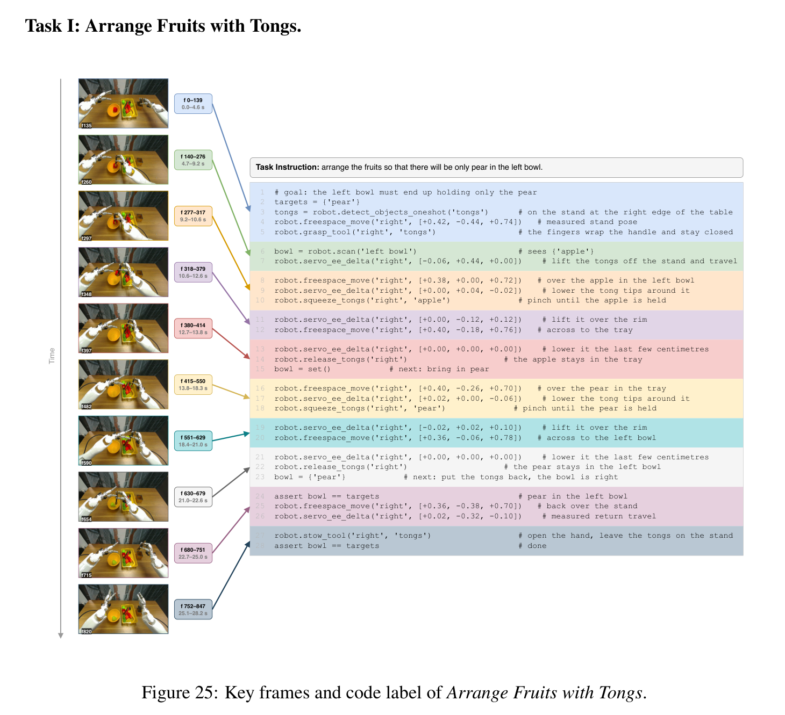

**Caption:** Figure 25: Key frames and code label of Arrange Fruits with Tongs.

**Caption[CN]:** 图 25：“用夹子夹取水果”（Arrange Fruits with Tongs）关键帧序列与对齐代码标签。

```python
# Task Instruction: arrange the fruits so that there will be only pear in the left bowl.
targets = {'pear'}
tongs = robot.detect_objects_oneshot('tongs')
robot.freespace_move('right', [+0.42, -0.44, +0.74])
robot.grasp_tool('right', 'tongs')
bowl = robot.scan('left bowl')  # sees {'apple'}
robot.servo_ee_delta('right', [-0.06, +0.44, +0.00])
robot.freespace_move('right', [+0.38, +0.00, +0.72])
robot.servo_ee_delta('right', [+0.00, +0.04, -0.02])
robot.squeeze_tongs('right', 'apple')
robot.servo_ee_delta('right', [+0.00, -0.12, +0.12])
robot.freespace_move('right', [+0.40, -0.18, +0.76])
robot.release_tongs('right')
# bring in pear
robot.freespace_move('right', [+0.40, -0.26, +0.70])
robot.squeeze_tongs('right', 'pear')
robot.freespace_move('right', [+0.36, -0.06, +0.78])
robot.release_tongs('right')
# stow tool
robot.freespace_move('right', [+0.36, -0.38, +0.70])
robot.stow_tool('right', 'tongs')
```

**Grading rubric (additive):**
- **+0.2:** (a) Right dexterous hand reaches for, stably grasps, and lifts the tongs from the stand.
- **+0.3:** (b) Uses tongs to pinch and extract the intruder fruit from the left bowl into the tray.
- **+0.3:** (c) Uses tongs to grasp the target pear from the tray and deposit it into the left bowl.
- **+0.2:** (d) Returns tongs to the stand and releases grasp without dropping the tool.

> <span style="color:#3B82F6"><strong>Para. 16:</strong></span> Task II: Deal Poker. The robot must pick up a deck of cards with the right hand, hand it over to the left hand, and use dexterous finger articulation to flick, slide, and draw a single card into a slot.

> <span style="color:#F59E0B"><strong>Para. 16[CN]:</strong></span> 任务 II：发扑克牌（Deal Poker）。机器人右手抓起扑克牌堆并交接至左手，随后利用右手机巧的指尖微调与拨动动作，抽出最顶层的第一张单牌并插入卡槽。

### Figure 26. 发扑克牌（Deal Poker）关键帧与程序标签

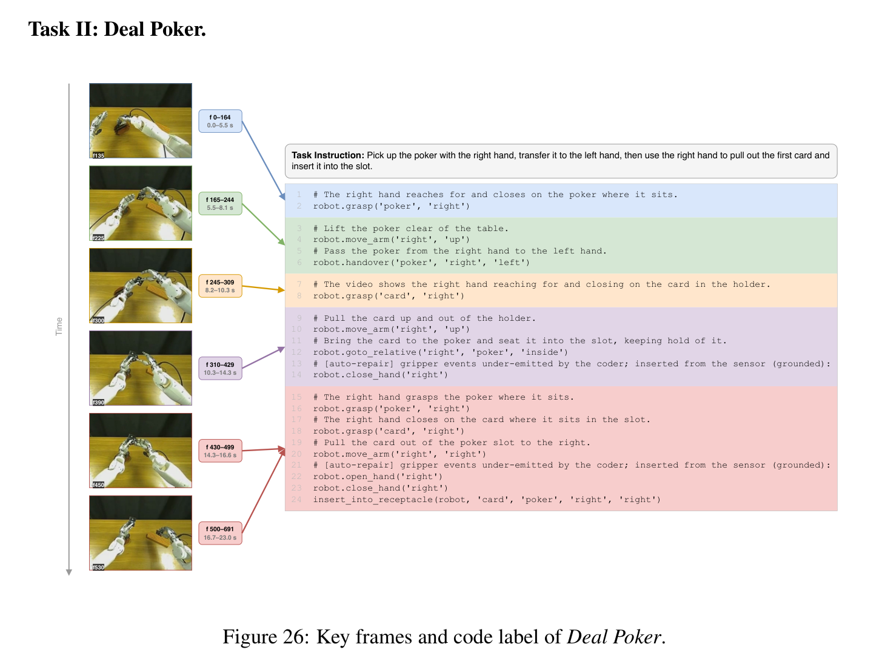

**Caption:** Figure 26: Key frames and code label of Deal Poker.

**Caption[CN]:** 图 26：“发扑克牌”（Deal Poker）关键帧序列与对齐代码标签。

```python
# Task Instruction: Pick up the poker with the right hand, transfer it to the left hand, then use the right hand to pull out the first card and insert it into the slot.
robot.grasp('poker', 'right')
robot.move_arm('right', 'up')
robot.handover('poker', 'right', 'left')
robot.grasp('card', 'right')
robot.move_arm('right', 'up')
robot.goto_relative('right', 'poker', 'inside')
robot.close_hand('right')
robot.grasp('poker', 'right')
robot.grasp('card', 'right')
robot.move_arm('right', 'right')
robot.open_hand('right')
robot.close_hand('right')
insert_into_receptacle(robot, 'card', 'poker', 'right', 'right')
```

**Grading rubric (additive):**
- **+0.1:** (a) Right hand grasps the card stack from above.
- **+0.2:** (b) Right hand transfers the stack to the left hand (handover).
- **+0.3:** (c) Right thumb flicks and adjusts until exactly one card protrudes from the top.
- **+0.3:** (d) Right hand grasps the single protruding card.
- **+0.1:** (e) Right hand inserts the card vertically into the card slot.

> <span style="color:#3B82F6"><strong>Para. 17:</strong></span> Task III: Flip Scoreboard. The robot reads the current score, calculates an increment, uses dexterous fingers to flip digit cards the specified number of times, and confirms the action.

> <span style="color:#F59E0B"><strong>Para. 17[CN]:</strong></span> 任务 III：翻记分牌（Flip Scoreboard）。机器人读取当前显示的记分数字，依据指令计算增量目标，利用指尖精细触感翻动对应次数的数字卡片，最后按压红色确认按钮。

### Figure 27. 翻记分牌（Flip Scoreboard）关键帧与程序标签

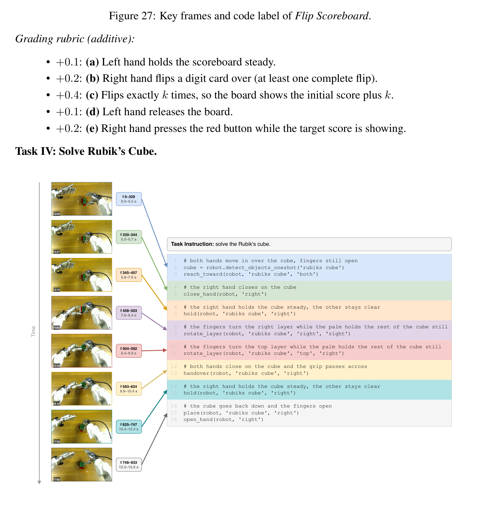

**Caption:** Figure 27: Key frames and code label of Flip Scoreboard.

**Caption[CN]:** 图 27：“翻记分牌”（Flip Scoreboard）关键帧序列与对齐代码标签。

```python
# Task Instruction: add 2 to the scoreboard then press the button.
current = robot.read_number('scoreboard')  # the board shows 3
target = current + 2                       # -> 5: what the board must read before pressing
robot.grasp('scoreboard', 'left')          # brace the board while the right hand flips
turn_over_object(robot, 'ones-digit card', 'right')  # flip 1/2: 3 -> 4 (1 more to go)
turn_over_object(robot, 'ones-digit card', 'right')  # flip 2/2: 4 -> 5 (target reached)
robot.release('left')
press_onto_target(robot, 'red button', 'right')      # the board reads 5 == target; press to confirm
```

**Grading rubric (additive):**
- **+0.1:** (a) Left hand holds the scoreboard steady.
- **+0.2:** (b) Right hand flips a digit card over (at least one complete flip).
- **+0.4:** (c) Flips exactly k times, so the board shows the initial score plus k.
- **+0.1:** (d) Left hand releases the board.
- **+0.2:** (e) Right hand presses the red button while the target score is showing.

> <span style="color:#3B82F6"><strong>Para. 18:</strong></span> Task IV: Solve Rubik\'s Cube. Both dexterous hands coordinate to grip, twist specific layers, and re-orient the cube across high-dimensional finger articulations.

> <span style="color:#F59E0B"><strong>Para. 18[CN]:</strong></span> 任务 IV：还原魔方（Solve Rubik\'s Cube）。双手机巧配合，一只手稳固握持魔方本体，另一只手的手指精准发力旋转指定魔方层，并执行换手与重定向操作。

### Figure 28. 还原魔方（Solve Rubik’s Cube）关键帧与程序标签


**Caption:** Figure 28: Key frames and code label of Solve Rubik’s Cube.

**Caption[CN]:** 图 28：“还原魔方”（Solve Rubik’s Cube）关键帧序列与对齐代码标签。

```python
# Task Instruction: solve the Rubik's cube.
cube = robot.detect_objects_oneshot('rubiks cube')
reach_toward(robot, 'rubiks cube', 'both')
close_hand(robot, 'right')
hold(robot, 'rubiks cube', 'right')
rotate_layer(robot, 'rubiks cube', 'right', 'right')
rotate_layer(robot, 'rubiks cube', 'top', 'right')
handover(robot, 'rubiks cube', 'right')
hold(robot, 'rubiks cube', 'right')
place(robot, 'rubiks cube', 'right')
open_hand(robot, 'right')
```

**Grading rubric (additive):**
- **+0.2:** (a) Right hand grasps the Rubik\'s cube securely without knocking it over.
- **+0.3:** (b) Dexterous fingers isolate and rotate the first target layer through 90 degrees.
- **+0.3:** (c) Rotates the second target layer cleanly according to the solution step.
- **+0.2:** (d) Handover and return cube to tabletop in stable orientation.

---


## Appendix F Analysis on Code Generation Quality

### F.1 Pre-trained Code Generation Quality

> <span style="color:#3B82F6"><strong>Para. 1:</strong></span> We evaluate the pretrained code expert on a held-out split of 5,000 demonstration slices from the pretraining corpus. Table 10 reports quantitative metrics on this split, while Figures 29 and 30 present generated programs for YAM and egocentric human validation examples. We examine visual grounding, program structure, and semantic agreement with the reference annotations.

> <span style="color:#F59E0B"><strong>Para. 1[CN]:</strong></span> 我们在源自预训练语料库、包含 5,000 个示教切片的独立保留验证集上评估预训练代码专家。表 10 汇报了该验证集上的定量评测指标，图 29 与图 30 分别展示了 YAM 机器人示教与人类第一人称示教验证样本的代码生成结果。我们深入考察了视觉接地能力、程序语法结构以及与参考真值标注的语义一致性。

### Table 10. 预训练代码专家在保留验证集上的评测指标

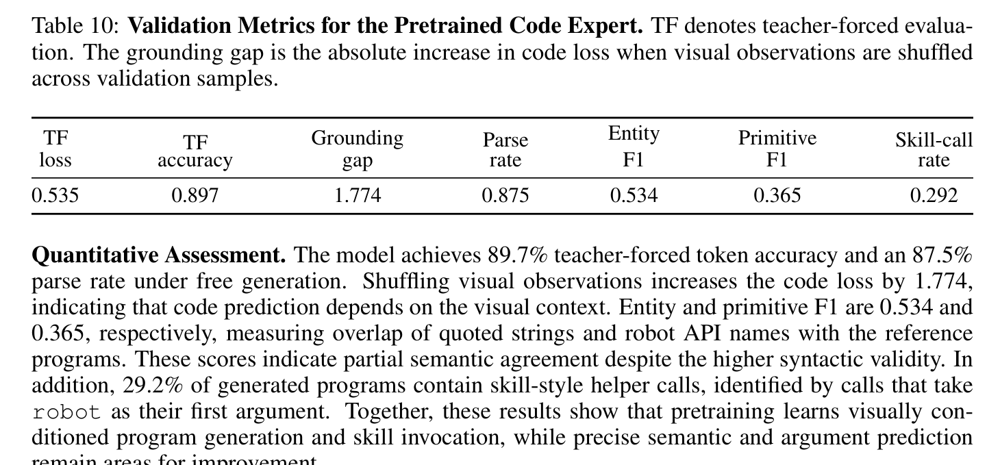

| TF Loss | TF Accuracy (%) | Grounding Gap | Parse Rate (%) | Entity F1 | Primitive F1 | Skill-call Rate (%) |
| :---: | :---: | :---: | :---: | :---: | :---: | :---: |
| 0.535 | 89.7 | 1.774 | 87.5 | 0.534 | 0.365 | 29.2 |

**Caption:** Table 10: Validation Metrics for the Pretrained Code Expert. TF denotes teacher-forced evaluation. The grounding gap is the absolute increase in code loss when visual observations are shuffled across validation samples.

**Caption[CN]:** 表 10：预训练代码专家的验证指标。TF 表示在 Teacher-Forcing 设定下的评估。视觉接地差距（Grounding Gap）是指在验证样本间打乱视觉观测帧时，代码交叉熵损失的绝对增加量。

> <span style="color:#3B82F6"><strong>Para. 2:</strong></span> Quantitative Assessment. The model achieves 89.7% teacher-forced token accuracy and an 87.5% parse rate under free generation. Shuffling visual observations increases the code loss by 1.774, indicating that code prediction depends on the visual context. Entity and primitive F1 are 0.534 and 0.365, respectively, measuring overlap of quoted strings and robot API names with the reference programs. These scores indicate partial semantic agreement despite the higher syntactic validity. In addition, 29.2% of generated programs contain skill-style helper calls, identified by calls that take robot as their first argument. Together, these results show that pretraining learns visually conditioned program generation and skill invocation, while precise semantic and argument prediction remain areas for improvement.

> <span style="color:#F59E0B"><strong>Para. 2[CN]:</strong></span> 定量评估。模型在 Teacher-Forcing 下达到了 89.7% 的词元准确率，并在自由无约束生成下取得了 87.5% 的语法解析通过率（Parse Rate）。打乱视觉观测会导致代码损失剧增 1.774，这强力证实了代码生成高度依赖于当前的视觉上下文。实体 F1 与基元 F1 分别达到 0.534 与 0.365，分别衡量了引号实体字符串及机器人 API 接口名称与参考真值程序的一致性重合度。这些分值表明，尽管生成的程序具备极高的语法正确率，但语义层面的精确对齐仍有提升空间。此外，生成的程序中有 29.2% 包含以 `robot` 作为首个参数的高阶技能调用。综上，结果表明预训练成功赋予了模型视觉条件化的程序生成与技能调用能力，而精准的参数预测仍是持续演进的方向。

> <span style="color:#3B82F6"><strong>Para. 3:</strong></span> YAM Robot Demonstrations. Figure 29 shows a held-out YAM demonstration of "Clean keyboard with a cloth". The generated program expresses a cloth handover followed by repeated scrubbing through scrub back and forth, preserving the object arguments, arm assignment, and loop structure of the reference subtask. This illustrates how a reusable skill can encode a repeated motion compactly. The generated displacement argument nevertheless contains two extra entries, illustrating that an appropriate skill-level plan can still contain parameter errors that prevent reliable direct execution.

> <span style="color:#F59E0B"><strong>Para. 3[CN]:</strong></span> YAM 机器人示教案例。图 29 展示了保留测试集中的一条 YAM 机器人示教“用抹布擦键盘”。模型生成的程序准确表达了抹布的左右手交接，随后调用 `scrub_back_and_forth` 技能执行反复擦拭，完美保留了参考真值子任务中的物体参数、机械臂分配以及循环控制结构。这直观展现了可复用技能如何紧凑高效地编码周期性复杂运动。不过，生成的末端位移参数仍包含两处冗余微调，说明即使生成了合适的高阶技能规划，其中潜藏的参数误差仍可能阻碍直接开环物理执行，凸显出与底层动作专家联合互补的必要性。

### Figure 29. 预训练代码专家在 YAM 验证样本上的生成结果

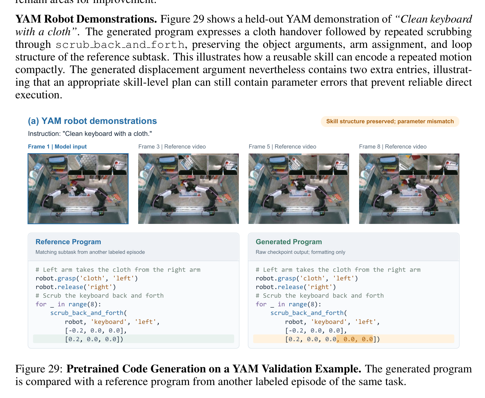

**Caption:** Figure 29: Pretrained Code Generation on a YAM Validation Example. The generated program correctly synthesizes a handover followed by a repetitive scrubbing skill call.

**Caption[CN]:** 图 29：预训练代码专家在 YAM 验证样本上的生成结果。生成的程序准确合成了物体交接以及随后调用的周期性擦拭高阶技能。

> <span style="color:#3B82F6"><strong>Para. 4:</strong></span> Egocentric Human Demonstrations. Figure 30 illustrates subtask-level planning under the instruction "Squeeze toothpaste". The reference program uses unscrew cap to represent twisting and removing the cap. The generated program reproduces the arm assignment and the twist-off motion, but uses lower-level rotation primitives rather than the composite skill. The comparison illustrates that the model can capture the intended manipulation logic even when it does not choose the consolidated skill call.

> <span style="color:#F59E0B"><strong>Para. 4[CN]:</strong></span> 人类第一人称示教案例。图 30 展示了在“挤牙膏”指令下的子任务级规划。真值参考程序调用 `unscrew_cap` 技能来表达拧开并取下盖子的连续动作。模型生成的程序准确复现了手臂分配与旋拧动作，但采用了更低阶的旋转基元拼接而非直接调用复合技能。这一对比表明，即便模型在特定情况下未选择封装好的复合技能，它依然能够精准捕捉并生成符合操作意图的高层控制逻辑。

### Figure 30. 预训练代码专家在人类第一人称验证样本上的生成结果

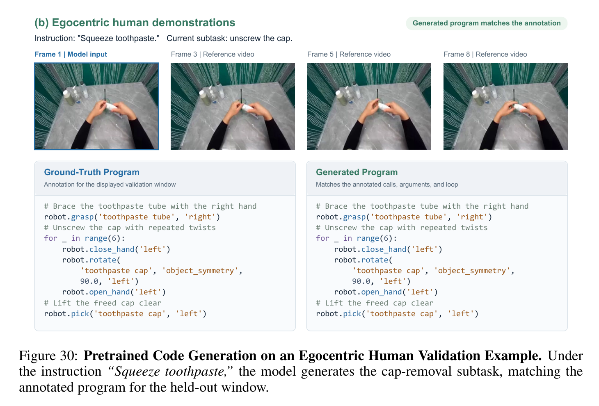

**Caption:** Figure 30: Pretrained Code Generation on an Egocentric Human Validation Example. Under the instruction "Squeeze toothpaste", the generated slice synthesizes the appropriate unscrewing subtask.

**Caption[CN]:** 图 30：预训练代码专家在人类第一人称验证样本上的生成结果。在“挤牙膏”指令下，生成的程序切片合成了准确的旋拧子任务逻辑。

### F.2 Post-trained Code Generation Quality

> <span style="color:#3B82F6"><strong>Para. 5:</strong></span> Online Generation during Deployment. During real-world execution, the code expert generates a new program slice at each replanning horizon $H$. In Figures 31 and 32, we visualize code generated online during execution of Pack Backpack and Solve Rubik\'s Cube. On Pack Backpack, the model accurately generates the unzipping routine, inserts the item, and closes the zipper according to visual feedback.

> <span style="color:#F59E0B"><strong>Para. 5[CN]:</strong></span> 部署期间的在线代码生成。在真实世界物理部署执行过程中，代码专家在每个重规划时域 $H$ 动态生成新的程序切片。在图 31 与图 32 中，我们可视化了“整理背包”与“还原魔方”执行过程中在线生成的代码。在“整理背包”任务中，模型根据实时视觉反馈准确生成拉开拉链、装入物品并重新闭合拉链的完整序列。

### Figure 31. 真实部署中“整理背包”任务的在线代码生成时序

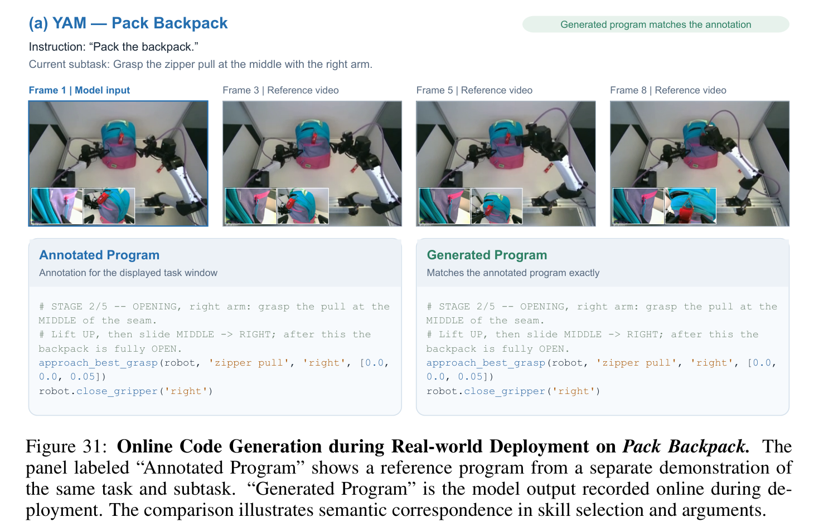

**Caption:** Figure 31: Online Code Generation during Real-world Deployment on Pack Backpack. The code expert tracks multi-stage progress and emits appropriate program slices.

**Caption[CN]:** 图 31：真实部署中“整理背包”任务的在线代码生成时序。代码专家能够精准追踪多阶段执行进度并输出匹配的程序切片。

> <span style="color:#3B82F6"><strong>Para. 6:</strong></span> Similarly, for Solve Rubik\'s Cube (Figure 32), the model observes the current face arrangement and generates layer rotation commands aligned with the physical state, providing the necessary semantic decomposition to coordinate continuous finger motions.

> <span style="color:#F59E0B"><strong>Para. 6[CN]:</strong></span> 类似地，针对“还原魔方”（图 32），模型通过感知当前魔方各面的颜色布局，生成与物理状态完全吻合的旋转层控制指令，为协调高自由度多指连续运动提供了至关重要的语义分解。

### Figure 32. 真实部署中“还原魔方”任务的在线代码生成时序

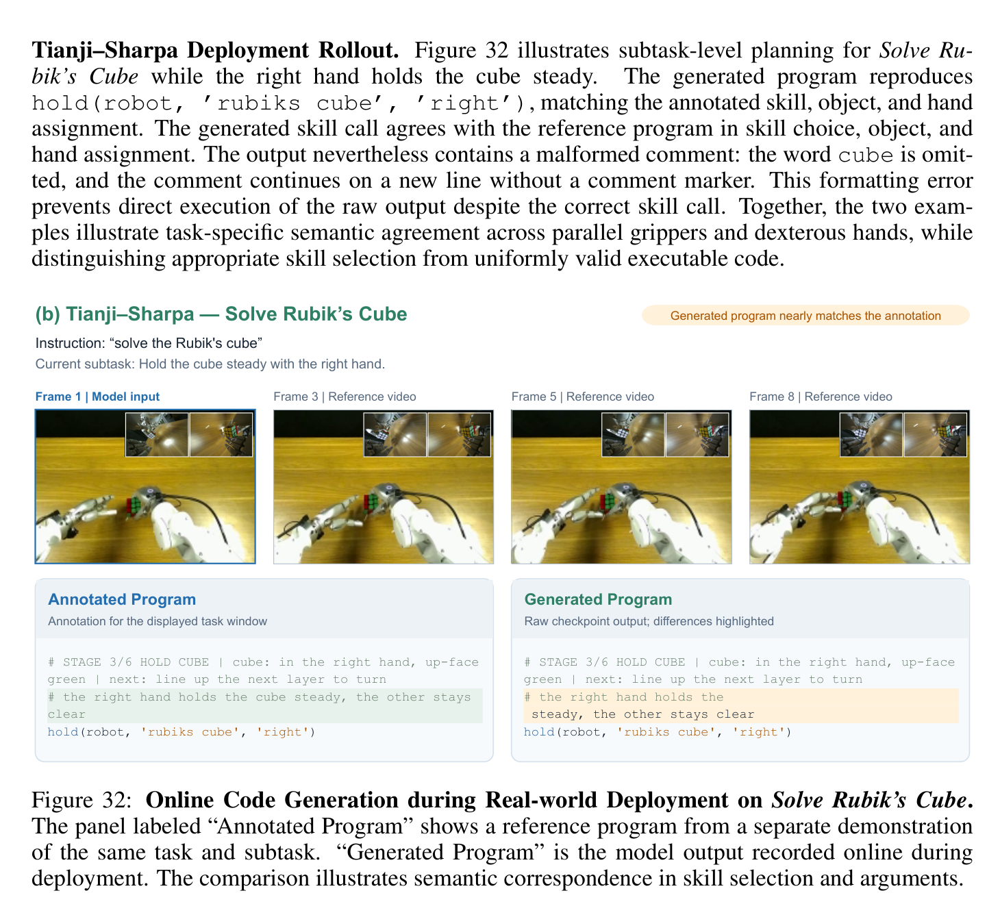

**Caption:** Figure 32: Online Code Generation during Real-world Deployment on Solve Rubik’s Cube. The generated slices coordinate bimanual dexterous layer rotations.

**Caption[CN]:** 图 32：真实部署中“还原魔方”任务的在线代码生成时序。生成的切片有效协调了双手机巧配合的魔方层旋转操作。

---

## Appendix G Additional Analysis on Real-world Results

### G.1 Impact of Code Expert on Language Following Capability

> <span style="color:#3B82F6"><strong>Para. 7:</strong></span> Figure 33 compares future video prediction under different model architectures on Arrange Fruits. With code conditioning ($C \to V \to A$), the predicted future video clearly depicts the robot grasping only the instruction-specified target fruit (banana) and ignoring the distractor. In contrast, models without code conditioning ($V \to A$) predict ambiguous motions where the gripper reaches toward incorrect fruits, leading directly to failure in execution.

> <span style="color:#F59E0B"><strong>Para. 7[CN]:</strong></span> 图 33 对比了“整理水果”任务中不同模型架构下的未来视频预测效果。在代码条件化（$C \to V \to A$）下，预测的未来视频清晰呈现了机器人仅抓取语言指令所指定的特定水果（香蕉）并忽略干扰项的过程。相比之下，无代码条件化的模型（$V \to A$）预测出歧义模糊的运动，夹爪伸向了错误的水果，直接导致物理执行失败。

### Figure 33. “整理水果”任务在三种模型下的未来帧预测对比


**Caption:** Figure 33: Future-frame Prediction on Arrange Fruits for Three Models.

**Caption[CN]:** 图 33：“整理水果”任务在三种模型架构下的未来视频帧预测对比。

### G.2 Impact of Code Expert on Skill Robustness

> <span style="color:#3B82F6"><strong>Para. 8:</strong></span> On Deal Poker (Figure 34), we compare the predicted future frames between AW-0, a subgoal-conditioned baseline, and a no-code baseline. The code-conditioned model predicts precise fingertip contact points that allow the thumb to separate a single card. Subgoal and no-code models fail to predict stable contact dynamics, producing blurred hand poses where cards slip prematurely.

> <span style="color:#F59E0B"><strong>Para. 8[CN]:</strong></span> 在“发扑克牌”任务中（图 34），我们对比了 AW-0、子目标条件化基线与无代码基线的未来预测帧。代码条件化模型预测出了极度精准的指尖物理接触点，使得大拇指能够顺利拨离出单张卡牌。而子目标模型与无代码模型均无法预测出稳定的接触物理动态，生成了模糊扭曲的手部姿态，导致卡牌在预测中过早滑脱。

### Figure 34. “发扑克牌”任务在三种模型下的未来帧预测对比


**Caption:** Figure 34: Future-frame Prediction on Deal Poker for Three Models.

**Caption[CN]:** 图 34：“发扑克牌”任务在三种模型架构下的未来视频帧预测对比。

### G.3 Hybrid Actions Evaluation Details

> <span style="color:#3B82F6"><strong>Para. 9:</strong></span> Figure 35 provides a qualitative rollout of hybrid execution on Fold and Stack Towels. The task proceeds across 6 distinct sub-stages. High-level structured motions such as approaching the folded towel and transporting it to the stack are executed by the code interpreter, while contact-rich continuous operations (creasing and settling the fabric) are governed by the action expert.

> <span style="color:#F59E0B"><strong>Para. 9[CN]:</strong></span> 图 35 展示了“折叠并叠放毛巾”任务中混合执行的代表性定性 rollout 过程。该长程任务横跨 6 个截然不同的子阶段。高阶结构化宏观运动（如接近已折叠毛巾并将其搬运至叠放区）由代码解释器高效驱动，而富接触的连续精细操作（如压折痕与抚平织物）则由动作专家直接接管控制。

### Figure 35. “折叠并叠放毛巾”任务中混合动作执行定性示例

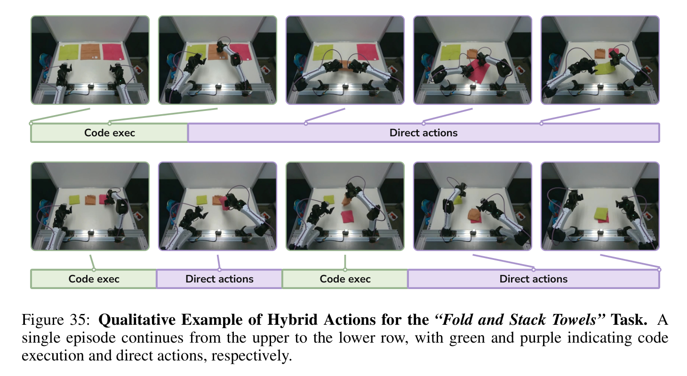

**Caption:** Figure 35: Qualitative Example of Hybrid Actions for the "Fold and Stack Towels" Task. A single episode continues from the upper to the lower row, with green and purple indicating code execution and direct actions, respectively.

**Caption[CN]:** 图 35：“折叠并叠放毛巾”任务中混合动作执行的定性示例。单个任务幕从上行延续至下行，绿色与紫色分别标明由代码执行通道与底层直接动作通道所主导的时段。

> <span style="color:#3B82F6"><strong>Para. 10:</strong></span> This division of labor leverages the precision of deterministic control primitives for large freespace travels while retaining the compliance and adaptability of diffusion-based action chunks during intricate surface interactions.

> <span style="color:#F59E0B"><strong>Para. 10[CN]:</strong></span> 这种双通道分工完美利用了确定性控制基元在大范围自由空间位移中的高速与精确性，同时在复杂的表面交互阶段充分保留了基于扩散的动作块的柔顺度与自适应能力。

---

## Appendix H Failure Case Analysis

> <span style="color:#3B82F6"><strong>Para. 11:</strong></span> Figure 36 shows representative failure cases across various scenarios. The red boxes highlight the local interactions where execution fails. These examples illustrate some remaining challenges despite the overall performance gains of AW-0.

> <span style="color:#F59E0B"><strong>Para. 11[CN]:</strong></span> 图 36 展示了多样化场景下具有代表性的失败案例。红色边框重点标出了执行发生故障的局部交互区域。尽管 AW-0 取得了显著的整体性能提升，这些具体案例依然揭示了具身操作中遗留的核心物理挑战。

### Figure 36. 真实世界 6 类典型失败案例深度剖析


**Caption:** Figure 36: Failure Case Analysis. Each row shows one representative failure case. Frames are ordered from left to right by execution progress. The red box on the last frame marks the region enlarged in the rightmost panel, where the failure occurs.

**Caption[CN]:** 图 36：失败案例归因剖析。每一行对应一类典型失败模式。图像帧沿水平方向按执行时间先后排列。最后一帧上的红框标记了最右侧放大视窗所展示的故障发生微观接触区域。

> <span style="color:#3B82F6"><strong>Para. 12:</strong></span> 1) Container Grasp. In Arrange Fruits in the first row, the target fruit lies close to the basket rim. As the gripper approaches, its left jaw moves outside the basket, causing the closing motion to grasp the basket wall rather than only the fruit. This case highlights the need to account for surrounding geometry when selecting a grasp. Explicitly estimating the rim geometry and checking clearance along both the approach and closing paths could help reject obstructed grasps and select a more accurate approach direction.

> <span style="color:#F59E0B"><strong>Para. 12[CN]:</strong></span> 1) 容器壁干涉抓取（Container Grasp）。在第一行的“整理水果”任务中，目标水果紧贴果篮边缘。当夹爪接近时，其左侧爪指伸到了果篮外侧，导致闭合时误将果篮边缘壁夹住而未能抓牢水果。此案例凸显出在规划抓取姿态时必须将周边障碍几何全面纳入考量。显式估计容器壁几何并在接近与闭合路径上进行碰撞间隙检查，有助于剔除受干涉的抓取方案并规划更合理的切入角度。

> <span style="color:#3B82F6"><strong>Para. 13:</strong></span> 2) Object Dragging. In Pack Backpack in the second row, when the robot pulls the zipper, the backpack moves and tips over rather than remaining stable. The visible failure suggests insufficient stabilization of the deformable object during manipulation. A potential improvement is to coordinate the supporting and pulling motions through more frequent visual feedback: the supporting hand could adjust its grasp as the bag deforms, while the pulling hand could slow down or pause when the bag starts to shift or tip.

> <span style="color:#F59E0B"><strong>Para. 13[CN]:</strong></span> 2) 柔性物体拖拽倾覆（Object Dragging）。在第二行的“整理背包”任务中，当机械臂拉动拉链滑块时，由于受力不均，整个背包发生位移并倾覆倒下，未能保持稳固站立。这一肉眼可见的失败源于对易形变物体的双臂支撑固定力度不足。潜在改进方向是通过更高频的视觉力觉反馈协调支撑臂与拉动臂的运动：支撑手随包体形变动态调整按压力度，而拉动手在感知到包体发生倾覆趋势时适度减速或暂停。

> <span style="color:#3B82F6"><strong>Para. 14:</strong></span> 3) Imprecise Alignment. In Replace Lightbulb in the third row, the robot grasps the bulb and brings it above the socket, but the bulb base remains misaligned with the socket opening and is not screwed in. Completing this step requires both positional and angular alignment before the threads can engage. The case illustrates a gap between moving an object to the correct region and achieving the precise relative pose required for insertion and rotation.

> <span style="color:#F59E0B"><strong>Para. 14[CN]:</strong></span> 3) 螺纹轴向未对齐（Imprecise Alignment）。在第三行的“更换灯泡”任务中，机器人抓取灯泡并将其运送至灯座上方，但灯泡螺纹底座与灯座接口存在微小角度倾斜与轴向偏移，导致无法旋入。顺利完成该操作要求在螺纹啮合前达成极高精度的空间位置与三维姿态对齐。该案例揭示了将物体运送至大致目标区域同达成紧装配插入旋转所需的毫米级相对位姿之间存在的现实差距。

> <span style="color:#3B82F6"><strong>Para. 15:</strong></span> 4) Tool Collision. In Arrange Fruits with Tongs in the fourth row, the tongs approach the pear with their tips closed and poke it rather than opening around it to establish a grasp. Successful tool use requires coordinating the tool\'s opening with its approach trajectory, in addition to holding and positioning the tool itself. Explicitly tracking the tong tips and opening width could help condition actions on the tool\'s state. A feedback check that the tips are open and positioned on opposite sides of the fruit before closing could further reduce unsuccessful contact.

> <span style="color:#F59E0B"><strong>Para. 15[CN]:</strong></span> 4) 工具开合碰撞（Tool Collision）。在第四行的“用夹子夹取水果”任务中，食品夹以尖端闭合的状态接近梨子，直接戳在水果表面，未能提前张开两翼形成有效包络抓取。成功的工具操作不仅要求稳定握持与空间定位工具本体，更要求将工具开合状态与空间逼近轨迹精准同步协调。显式追踪夹子尖端空间坐标与开合开度，并在闭合前引入基于视觉反馈的间隙确认机制，可有效规避无效碰撞。

> <span style="color:#3B82F6"><strong>Para. 16:</strong></span> 5) Slipping Off. In Deal Poker in the fifth row, the left hand fails to secure the card stack during handover from the right hand, causing the cards to slip. A successful handover requires the receiving hand to establish a stable grasp before the giving hand releases the stack. This failure illustrates the difficulty of coordinating grasping and release across the two hands while maintaining support for the cards throughout the transfer.

> <span style="color:#F59E0B"><strong>Para. 16[CN]:</strong></span> 5) 双手交接滑脱（Slipping Off）。在第五行的“发扑克牌”任务中，右手向左手交接扑克牌堆时，左手未能及时建立起稳固的抓握支撑，导致牌堆失稳滑落。成功的双手交接严格要求接收手在释放手松开之前率先建立充足的摩擦力与几何约束。该失败凸显了在维持多接触点物性支撑的同时严格协同双臂抓握与释放时序的极高控制难度。

> <span style="color:#3B82F6"><strong>Para. 17:</strong></span> 6) Contact Loss. In Flip Scoreboard in the sixth row, the fingertip reaches the edge of a score card but slides off before turning it over, leaving the displayed score unchanged. Unlike a brief touch, a successful flip requires sustained contact along the card\'s rotation about the binding. This case illustrates the difficulty of sliding the fingertip along the first card to lift its edge while maintaining continuous contact.

> <span style="color:#F59E0B"><strong>Para. 17[CN]:</strong></span> 6) 连续翻动脱触（Contact Loss）。在第六行的“翻记分牌”任务中，灵巧手指尖虽然触碰到了数字卡片边缘，但在转动过程中中途脱滑，导致卡片未能完全翻折，显示数字未变。与瞬时点触不同，成功的翻页操作需要在卡片绕线圈旋转的全程中维持连续的切向摩擦力与法向接触。该案例生动说明了在保持手指柔顺滑移的同时维持连续接触所面临的精细动力学控制挑战。

---

## Appendix I Hybrid Actions Algorithm

> <span style="color:#3B82F6"><strong>Para. 18:</strong></span> Algorithms 1 and 2 outline the workflow of the hybrid mode. From an observation $o$ and instruction $\ell$, one forward pass of the policy $\pi$ returns a direct action chunk $a_{1:H}$ over the replan horizon $H$ and a code slice $c$. Every slice executes in a shared namespace $G$ containing the environment\'s skill API, reusable helper definitions, and its setup block (episode-start perception), which persists throughout the episode. At each replanning point, ARBITRATE decides which of the two channels drives the robot. The returned flag indicates whether code execution was attempted, not whether it succeeded. If execution is attempted, the action chunk from the same policy invocation is discarded, even if an exception occurs; the next iteration observes the current state and replans. Otherwise, the chunk is played for $H$ steps as in the default mode.

> <span style="color:#F59E0B"><strong>Para. 18[CN]:</strong></span> 算法 1 与算法 2 概述了混合执行模式的核心工作流。基于当前环境观测 $o$ 与任务指令 $\ell$，策略网络 $\pi$ 在单次前向推理中同步输出跨越重规划时域 $H$ 的直接动作块 $a_{1:H}$ 以及一段代码切片 $c$。所有程序切片均在共享命名空间 $G$ 中运行，该命名空间包含环境技能 API、可复用辅助函数定义以及在整个任务幕中持续存在的初始感知设定块。在每个重规划时刻，`ARBITRATE` 仲裁模块决定由哪个通道驱动机器人。返回的布尔标志表示是否尝试执行了代码，而非代码是否成功跑完。一旦决定尝试执行代码，即使发生异常中断，当前前向生成的动作块也会被安全丢弃，下一轮迭代将立即观测新状态并重新规划；反之若仲裁拒绝执行代码，则直接按照默认模式平滑播放该动作块 $H$ 步。

> <span style="color:#3B82F6"><strong>Para. 19:</strong></span> The original generated slice $c$ is checked without repair. It is executed only if it passes the following gates in order:
>
> 1. Stage Gate: its stage is not complete, is not below a stage already attempted, and has fewer than $R$ failed execution attempts;
> 2. Dependency Gate: every variable it reads is defined in $G$; and
> 3. Syntax, Whitelist, and Vacuity Gates: it compiles as generated, calls only whitelisted functions, and contains an executable statement.

> <span style="color:#F59E0B"><strong>Para. 19[CN]:</strong></span> 模型生成的原始切片 $c$ 在不施加代码修复的情况下直接接受严格静态审查。仅当其依次顺利通过以下门控检查时，方获准在实体机器人上执行：
>
> 1. 阶段门控（Stage Gate）：声明的阶段尚未完成、不处于已执行过的先前阶段之后、且失败重试次数低于阈值 $R$；
> 2. 依赖门控（Dependency Gate）：所读取的每一个变量在命名空间 $G$ 中均已被定义；
> 3. 语法、白名单与非空门控（Syntax, Whitelist, and Vacuity Gates）：代码语法完全编译通过、仅调用经白名单许可的安全 API、且包含至少一条有效可执行语句。

```python
# ==============================================================================
# Algorithm 1: Hybrid control: generated code first, direct actions otherwise
# Require: policy \pi, environment E, execution namespace G, instruction \ell, 
#          replan horizon H, per-stage failure limit R
# ==============================================================================
D = set()                # stages completed by code
n = defaultdict(int)     # failed attempts per stage

while not episode_terminated:
    o = E.observe()
    a_chunk, c = policy(o, instruction)  # direct action chunk and code slice
    code_attempted = ARBITRATE(c, G, D, n, R)
    if not code_attempted:
        for t in range(H):
            E.step(a_chunk[t])           # fall back to direct actions
```

```python
# ==============================================================================
# Algorithm 2: ARBITRATE(c, G, D, n, R): execute slice only if passing every gate
# ==============================================================================
def ARBITRATE(c, G, D, n, R):
    k = parse_stage_index(c)
    # Stage gate
    if k in D or k < max_attempted_stage(D) or n[k] >= R:
        return False
    # Dependency gate
    if not all(var in G for var in get_read_variables(c)):
        return False
    # Syntax, whitelist, and vacuity gates
    if not compiles(c) or not calls_whitelisted_only(c, G) or not has_executable_stmt(c):
        return False
    # Skip hopeless retry
    if previously_failed_under_identical_state(c, k):
        return False
    
    # Execute safely in namespace G
    try:
        exec(c, G)
        D.add(k)         # stage k completed successfully
    except Exception:
        n[k] += 1        # record failure attempt
    return True          # code execution was attempted
```

---

## Appendix J Additional Simulation Experiment Details

### J.1 RoboTwin Per-Task Breakdown

> <span style="color:#3B82F6"><strong>Para. 20:</strong></span> Table 11 reports the per-task breakdown of the aggregate results in Table 1 across all 50 tasks of RoboTwin 2.0 under both the Clean and Random evaluation settings.

> <span style="color:#F59E0B"><strong>Para. 20[CN]:</strong></span> 表 11 详细汇报了 RoboTwin 2.0 全部 50 项双臂协作任务在 Clean 与 Random 两种评估设定下的逐任务成功率分项数据（对应正文表 1 的宏观汇总）。

### Table 11. RoboTwin 2.0 仿真基准全部 50 项任务的逐任务评测成绩（50 次 Rollouts/任务）

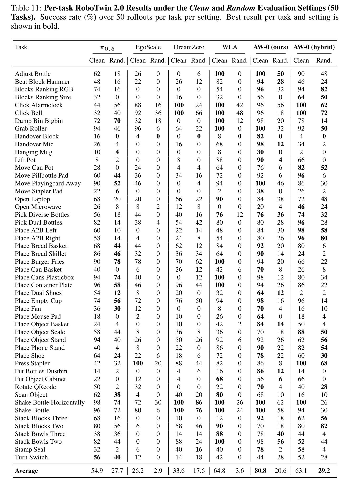
| Task | $\pi_{0.5}$ Cln | $\pi_{0.5}$ Rnd | EgoScale Cln | EgoScale Rnd | DreamZero Cln | DreamZero Rnd | WLA Cln | WLA Rnd | AW-0 Cln | AW-0 Rnd | Hybrid Cln | Hybrid Rnd |
| :--- | :---: | :---: | :---: | :---: | :---: | :---: | :---: | :---: | :---: | :---: | :---: | :---: |
| Adjust Bottle | 62 | 18 | 26 | 0 | 0 | 6 | 100 | 0 | 100 | 50 | 90 | 48 |
| Beat Block Hammer | 48 | 16 | 22 | 0 | 26 | 12 | 82 | 0 | 94 | 28 | 46 | 24 |
| Blocks Ranking RGB | 74 | 16 | 0 | 0 | 0 | 0 | 54 | 0 | 96 | 32 | 94 | 82 |
| Blocks Ranking Size | 32 | 0 | 0 | 0 | 16 | 0 | 32 | 0 | 56 | 0 | 64 | 50 |
| Click Alarmclock | 44 | 56 | 88 | 16 | 100 | 24 | 100 | 42 | 96 | 56 | 100 | 62 |
| Click Bell | 32 | 40 | 92 | 36 | 100 | 66 | 100 | 48 | 96 | 18 | 100 | 72 |
| Dump Bin Bigbin | 72 | 70 | 32 | 18 | 0 | 0 | 100 | 12 | 98 | 20 | 78 | 14 |
| Grab Roller | 94 | 46 | 96 | 6 | 64 | 22 | 100 | 0 | 100 | 32 | 92 | 50 |
| Handover Block | 16 | 0 | 4 | 0 | 0 | 0 | 8 | 0 | 82 | 0 | 4 | 0 |
| Handover Mic | 26 | 4 | 0 | 0 | 16 | 0 | 68 | 0 | 98 | 12 | 34 | 2 |
| Hanging Mug | 10 | 4 | 0 | 0 | 0 | 0 | 8 | 0 | 30 | 0 | 2 | 0 |
| Lift Pot | 8 | 2 | 0 | 0 | 8 | 0 | 88 | 0 | 90 | 4 | 66 | 0 |
| Move Can Pot | 28 | 0 | 24 | 0 | 4 | 4 | 64 | 0 | 76 | 6 | 82 | 52 |
| Move Pillbottle Pad | 60 | 44 | 36 | 0 | 34 | 16 | 72 | 0 | 92 | 6 | 96 | 6 |
| Move Playingcard Away | 90 | 52 | 46 | 0 | 0 | 4 | 94 | 0 | 100 | 46 | 86 | 30 |
| Move Stapler Pad | 22 | 6 | 0 | 0 | 0 | 0 | 2 | 0 | 38 | 0 | 26 | 2 |
| Open Laptop | 68 | 20 | 20 | 0 | 66 | 22 | 90 | 0 | 84 | 38 | 72 | 48 |
| Open Microwave | 26 | 8 | 8 | 2 | 12 | 8 | 0 | 0 | 20 | 4 | 46 | 24 |
| Pick Diverse Bottles | 56 | 18 | 44 | 0 | 40 | 16 | 76 | 12 | 76 | 36 | 74 | 32 |
| Pick Dual Bottles | 82 | 14 | 38 | 4 | 54 | 42 | 80 | 0 | 80 | 28 | 96 | 28 |
| Place A2B Left | 60 | 10 | 0 | 0 | 22 | 14 | 48 | 0 | 84 | 30 | 98 | 58 |
| Place A2B Right | 58 | 14 | 4 | 0 | 24 | 8 | 54 | 0 | 80 | 26 | 96 | 80 |
| Place Bread Basket | 68 | 44 | 44 | 0 | 62 | 12 | 84 | 0 | 92 | 20 | 80 | 6 |
| Place Bread Skillet | 86 | 46 | 32 | 0 | 36 | 34 | 64 | 0 | 90 | 14 | 24 | 2 |
| Place Burger Fries | 90 | 78 | 78 | 0 | 70 | 62 | 100 | 0 | 94 | 20 | 66 | 22 |
| Place Can Basket | 40 | 0 | 6 | 0 | 26 | 12 | 42 | 6 | 70 | 8 | 26 | 8 |
| Place Cans Plasticbox | 94 | 74 | 40 | 0 | 0 | 12 | 100 | 0 | 98 | 12 | 80 | 34 |
| Place Container Plate | 96 | 58 | 46 | 0 | 96 | 44 | 100 | 0 | 94 | 26 | 86 | 22 |
| Place Dual Shoes | 54 | 12 | 8 | 0 | 20 | 0 | 32 | 0 | 64 | 12 | 2 | 2 |
| Place Empty Cup | 74 | 56 | 72 | 0 | 76 | 50 | 94 | 0 | 98 | 16 | 96 | 14 |
| Place Fan | 36 | 30 | 12 | 0 | 0 | 0 | 8 | 0 | 70 | 4 | 16 | 10 |
| Place Mouse Pad | 18 | 0 | 2 | 0 | 10 | 0 | 26 | 0 | 64 | 0 | 18 | 4 |
| Place Object Basket | 24 | 4 | 0 | 0 | 10 | 0 | 42 | 2 | 84 | 14 | 50 | 4 |
| Place Object Scale | 58 | 44 | 8 | 0 | 36 | 8 | 36 | 0 | 70 | 18 | 88 | 50 |
| Place Object Stand | 94 | 40 | 26 | 0 | 50 | 26 | 92 | 6 | 92 | 26 | 62 | 56 |
| Place Phone Stand | 40 | 4 | 8 | 0 | 22 | 0 | 86 | 0 | 90 | 22 | 82 | 54 |
| Place Shoe | 64 | 24 | 22 | 6 | 18 | 6 | 72 | 0 | 78 | 22 | 60 | 30 |
| Press Stapler | 42 | 32 | 100 | 20 | 88 | 44 | 82 | 0 | 86 | 8 | 100 | 68 |
| Put Bottles Dustbin | 14 | 2 | 0 | 0 | 4 | 6 | 16 | 0 | 86 | 12 | 14 | 0 |
| Put Object Cabinet | 22 | 0 | 12 | 0 | 4 | 0 | 68 | 0 | 56 | 6 | 66 | 0 |
| Rotate QRcode | 50 | 2 | 32 | 0 | 0 | 0 | 22 | 0 | 70 | 4 | 40 | 28 |
| Scan Object | 62 | 38 | 4 | 0 | 40 | 20 | 80 | 0 | 68 | 10 | 16 | 10 |
| Shake Bottle Horizontally | 98 | 74 | 72 | 30 | 100 | 86 | 100 | 26 | 100 | 62 | 100 | 26 |
| Shake Bottle | 96 | 72 | 80 | 6 | 100 | 76 | 100 | 24 | 100 | 58 | 94 | 30 |
| Stack Blocks Three | 68 | 16 | 0 | 0 | 10 | 0 | 12 | 0 | 92 | 18 | 62 | 56 |
| Stack Blocks Two | 80 | 56 | 6 | 0 | 58 | 46 | 90 | 0 | 70 | 18 | 80 | 82 |
| Stack Bowls Three | 38 | 36 | 0 | 0 | 14 | 14 | 88 | 0 | 78 | 40 | 44 | 4 |
| Stack Bowls Two | 82 | 44 | 0 | 0 | 88 | 24 | 100 | 0 | 98 | 56 | 52 | 44 |
| Stamp Seal | 32 | 2 | 6 | 0 | 40 | 16 | 40 | 0 | 78 | 2 | 58 | 4 |
| Turn Switch | 56 | 40 | 12 | 0 | 14 | 18 | 42 | 0 | 44 | 28 | 52 | 28 |
| **Average** | **54.9** | **27.7** | **26.2** | **2.9** | **33.6** | **17.6** | **64.8** | **3.6** | **80.8** | **20.6** | **63.1** | **29.2** |

**Caption:** Table 11: Per-task RoboTwin 2.0 Results under the Clean and Random Evaluation Settings (50 Tasks). Success rate (%) over 50 rollouts per task per setting. Best result per task and setting is shown in bold.

**Caption[CN]:** 表 11：RoboTwin 2.0 在 Clean 与 Random 设定下 50 项任务的逐任务评测结果。数值为每项任务每种设定下 50 次评测 rollout 的成功率（%）。

### J.2 Hybrid Actions Evaluation Details

> <span style="color:#3B82F6"><strong>Para. 21:</strong></span> Perception and Control Primitives. During hybrid evaluation, generated code executes through an explicit perception-and-control interface. Perception calls locate parts by semantic labels and return 3D bounding boxes and SE(3) poses. Control calls provide compliant primitives: guarded moves, compliant inserts, and bounded relative steps.

> <span style="color:#F59E0B"><strong>Para. 21[CN]:</strong></span> 感知与控制基元体系。在混合执行评测期间，生成的代码通过显式的感知-控制接口调用底层执行器。感知接口通过语义标签定位工件并返回 3D 边界框与 SE(3) 位姿；控制接口提供具有力控顺应性的底层基元，如带障碍保护的运动（guarded moves）、柔顺装配插入以及有界相对步进。

> <span style="color:#3B82F6"><strong>Para. 22:</strong></span> Figure 37 shows two qualitative examples of hybrid rollouts on RoboTwin 2.0: blocks ranking rgb and pick dual bottles. In both tasks, deterministic code executes high-confidence transport steps, while the action expert takes over when fine-grained visual contact or alignment is needed.

> <span style="color:#F59E0B"><strong>Para. 22[CN]:</strong></span> 图 37 展示了 RoboTwin 2.0 上两项任务（按颜色排序积木 blocks ranking rgb 与抓取两个瓶子 pick dual bottles）在混合执行下的定性 rollout 过程。在两个任务中，确定性代码高效执行高置信度的空间搬运步骤，而当需要细粒度视觉闭环接触或精密对齐时，动作专家平滑接管物理控制。

### Figure 37. RoboTwin 2.0 仿真任务中混合动作执行通道切换定性分析

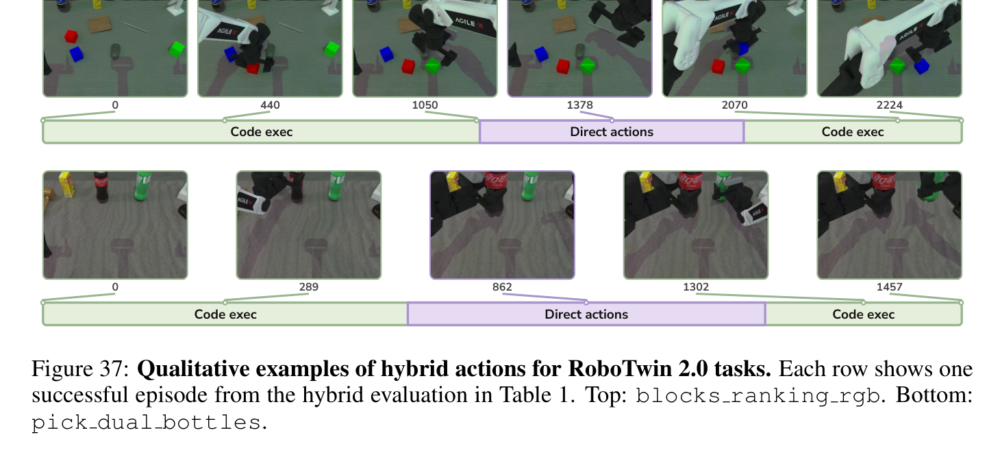

**Caption:** Figure 37: Qualitative examples of hybrid actions for RoboTwin 2.0 tasks. Each row shows one successful episode from the hybrid evaluation in Table 1. Top: blocks ranking rgb. Bottom: pick dual bottles.

**Caption[CN]:** 图 37：RoboTwin 2.0 仿真任务中混合动作执行的定性示例。每一行对应表 1 混合评估中的一条成功幕。上：按颜色排序积木（blocks ranking rgb）；下：双瓶抓取（pick dual bottles）。

> <span style="color:#3B82F6"><strong>Para. 23:</strong></span> Table 12 reports the share of simulation steps driven by each control channel during hybrid evaluation. On successful episodes in the random setting, code execution drives 35.0% of steps, demonstrating that programmatic execution provides crucial robustness when visual observations are perturbed.

> <span style="color:#F59E0B"><strong>Para. 23[CN]:</strong></span> 表 12 汇报了混合评估期间由各控制通道所驱动的仿真物理步数占比。在随机化设定（Random）下的成功任务幕中，代码执行驱动了 35.0% 的步数，这无可辩驳地证明了当视觉观测受到强烈环境扰动时，程序化执行能够提供决定性的鲁棒性支撑。

### Table 12. 混合评测中各控制通道驱动的仿真步数占比统计

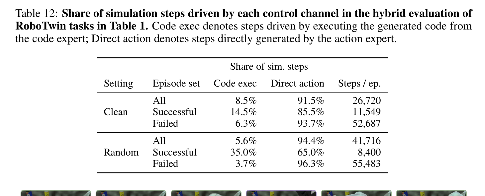

| Setting | Episode Set | Code Exec Share (%) | Direct Action Share (%) | Total Steps / Episode |
| :--- | :--- | :---: | :---: | :---: |
| **Clean** | All episodes | 8.5% | 91.5% | 26,720 |
| **Clean** | Successful episodes | 14.5% | 85.5% | 11,549 |
| **Clean** | Failed episodes | 6.3% | 93.7% | 52,687 |
| **Random** | All episodes | 5.6% | 94.4% | 41,716 |
| **Random** | Successful episodes | 35.0% | 65.0% | 8,400 |
| **Random** | Failed episodes | 3.7% | 96.3% | 55,483 |

**Caption:** Table 12: Share of simulation steps driven by each control channel in the hybrid evaluation of RoboTwin tasks in Table 1. Code exec denotes steps driven by executing the generated code from the code expert; Direct action denotes steps directly generated by the action expert.

**Caption[CN]:** 表 12：表 1 RoboTwin 任务混合评估中各控制通道驱动的仿真步数份额。Code exec 表示由代码专家生成的代码直接执行所驱动的步数占比；Direct action 表示由动作专家直接生成的动作块所驱动的步数占比。

---

## Appendix K Agentic Annotation Details

> <span style="color:#3B82F6"><strong>Para. 24:</strong></span> We provide declaration-only Python class interfaces that define the semantic and low-level control APIs exposed to the coding agents during annotation. Figure 38 contrasts the parallel-gripper and dexterous-hand API surfaces.

> <span style="color:#F59E0B"><strong>Para. 24[CN]:</strong></span> 我们提供了仅包含函数签名的 Python 类声明接口，向编程智能体显式定义了数据标注期间可调用的全部高层语义与底层控制 API。图 38 对比了平行夹爪与多指灵巧手的 API 接口规范。

### Figure 38. 平行夹爪与多指灵巧手声明式 API 接口规范


**Caption:** Figure 38: Declaration-only APIs for parallel grippers and dexterous hands.

**Caption[CN]:** 图 38：平行夹爪与多指灵巧手平台的仅声明式 API 接口规范定义。

```python
# Parallel Gripper API Surface
class ParallelGripperApi:
    # side: "left" or "right"
    # Semantic APIs
    def pick(self, object_name, side): ...
    def grasp(self, object_name, side): ...
    def place(self, object_name, target_name, side): ...
    def release(self, side): ...
    def regrasp(self, object_name, side): ...
    def insert(self, object_name, target_name, side): ...
    def attach(self, object_name, target_name, side): ...
    def handover(self, object_name, from_side, to_side): ...
    def rotate(self, object_name, angle_deg, side): ...
    def press(self, target_name, side): ...
    # Low-level primitives
    def move_arm(self, side, target_pos, target_rpy): ...
    def freespace_move(self, left_target_pos=None, left_target_rpy=None, right_target_pos=None, right_target_rpy=None): ...
    def servo_ee_delta(self, side, delta_pos, duration_s=1.0): ...
    def go_home(self): ...
    def close_gripper(self, side): ...
    def open_gripper(self, side): ...
    # Perception and state
    def get_robot_state(self): ...
    def sample_grasp_pose(self, object_name, camera='top', max_grasps=10, top_down_only=False): ...
    def select_best_grasp(self, grasp_candidates, side='right'): ...
    def detect_objects_oneshot(self, query, camera='top'): ...

# Dexterous Hand API Surface
class DexterousHandApi:
    # side: "left" or "right"
    # Semantic APIs
    def pick(self, object_name, side): ...
    def grasp(self, object_name, side): ...
    def place(self, object_name, target_name, side): ...
    def release(self, side): ...
    def regrasp(self, object_name, side): ...
    def insert(self, object_name, target_name, side): ...
    def attach(self, object_name, target_name, side): ...
    def handover(self, object_name, from_side, to_side): ...
    def rotate(self, object_name, axis, angle_deg, side): ...
    def press(self, target_name, side): ...
    # Low-level primitives
    def move_arm(self, side, direction, distance=None): ...
    def goto_relative(self, side, object_name, relation, clearance=None): ...
    def close_hand(self, side): ...
    def open_hand(self, side): ...
```

### K.1 Low-level Primitives

> <span style="color:#3B82F6"><strong>Para. 25:</strong></span> Low-level Primitives. On YAM, the low-level primitives control end-effector Cartesian poses and gripper states. Primitive calls execute with bounded velocity profiles to ensure safety. On Tianji–Sharpa, primitives define coordinated arm travel and synergistic finger grasp poses.

> <span style="color:#F59E0B"><strong>Para. 25[CN]:</strong></span> 底层基元体系。在 YAM 平台上，底层基元精确控制末端执行器的笛卡尔位姿与夹爪开合状态，所有基元调用均采用平滑速度约束曲线以确保物理安全。在天机-夏尔巴平台上，基元负责协调机械臂大范围位移与多指协同抓握协同姿态（synergies）。

### K.2 Annotation Agent Prompts and Coordinator Protocol

> <span style="color:#3B82F6"><strong>Para. 26:</strong></span> System Prompts and Directives. The annotator agent receives a strict system prompt tailored to the data source. For YAM demonstrations, the sensor-derived gripper event list is authoritative: the emitted code must reproduce every open/close transition on the named arm without additions or omissions. For egocentric human data, contacts are inferred directly from visual evidence.

> <span style="color:#F59E0B"><strong>Para. 26[CN]:</strong></span> 系统提示词与指令约束。标注智能体接收针对特定数据源量身定制的严苛系统提示词。对于 YAM 机器人示教，传感器记录的夹爪开闭事件列表具有绝对权威性：生成的代码必须完全复现指定臂上的每一次开合跳变，不得随意增删或调换次序。对于人类第一人称数据，物理接触则由大模型直接根据时序视觉观测进行严密推理。

> <span style="color:#3B82F6"><strong>Para. 27:</strong></span> Coordinator Protocol and Skill Discovery. During Stage 1, the coordinator agent audits annotator traces to identify recurring multi-primitive call sequences across tasks. When a pattern appears across at least two distinct tasks and encapsulates a generic, reusable physical maneuver, it is promoted into the skill library, and its function contract is frozen for subsequent annotation rounds.

> <span style="color:#F59E0B"><strong>Para. 27[CN]:</strong></span> 协调者协议与技能发现机制。在第一阶段（Stage 1），协调者智能体严密审查标注轨迹，识别跨任务反复出现的多基元调用序列。当某个运动模式在至少两个完全不同的任务中反复出现，且代表了一套通用的、可参数化的物理操作手法时，协调者将其正式晋升入技能库，并将其函数接口规范永久冻结，供后续批次的大规模数据标注直接调用。

---

## Appendix L Limitations and Future Work

> <span style="color:#3B82F6"><strong>Para. 28:</strong></span> Program Grounding and Skill Coverage. The code stream learns from automatically annotated demonstrations and a curated skill library, making its planning quality dependent on annotation accuracy and skill coverage. Generated programs can select an appropriate skill yet contain incorrect arguments, as illustrated in Appendix F.1; syntactic validity therefore does not ensure correct execution. Future work could use execution feedback to improve program grounding and discover or refine reusable skills beyond the initial library.

> <span style="color:#F59E0B"><strong>Para. 28[CN]:</strong></span> 程序接地精度与技能覆盖度。代码数据流完全学习自自动化标注的示教数据以及人工与智能体共同筛选的技能库，因此其高层规划质量高度依存于数据标注精度与技能库的广度。生成的程序有时能够选取正确的技能，却可能填入不精准的实参（如附录 F.1 所示）；因此代码的语法正确性并不能绝对保证物理执行的成功。未来工作可探索引入实体执行反馈以强化程序接地精度，并在初始技能库之外自主发现或迭代精炼全新的高级技能。

> <span style="color:#3B82F6"><strong>Para. 29:</strong></span> Predictive Robustness and Hybrid Execution. Structured planning improves WAM performance but does not eliminate sensitivity to visual distribution shifts. Hybrid execution improves robustness under RoboTwin randomization, yet reduces clean-setting performance (Appendix J.2). This trade-off reflects both the reliability of the underlying primitives and the limitation of selecting code based on validity without estimating its advantage over the action chunk. Learning to arbitrate using execution reliability and expected task progress could better exploit the complementary strengths of the two modes.

> <span style="color:#F59E0B"><strong>Para. 29[CN]:</strong></span> 预测鲁棒性与混合执行模式权衡。结构化代码规划大幅提升了 WAM 的整体性能，但并未完全消除模型对视觉分布偏移的敏感性。混合执行显著提升了在 RoboTwin 随机化扰动下的鲁棒性，但也在一定程度上牺牲了在干净设定下的峰值成功率（附录 J.2）。这种权衡既反映了底层控制基元本身的可靠性边界，也暴露出仅依据语法和状态合法性仲裁代码、而未能显式估计代码相对于连续动作块的胜率优势的局限性。未来通过强化学习训练基于执行可靠性与预期任务进度的自适应仲裁器，能够更充分地释放两套通道的互补潜能。

> <span style="color:#3B82F6"><strong>Para. 30:</strong></span> Toward Continual Agentic Learning. Our real-world hybrid evaluation is limited to YAM platform due to the lack of code-as-policy systems for dexterous hand, and the current system does not learn online from its own interactions. The unified design nevertheless offers a basis for coupling program generation and world prediction with execution feedback and model updates. Future work could explore iterative plan revision, skill-library expansion, and autonomous learning through sustained environmental interaction, with broader evaluation across tasks and embodiments.

> <span style="color:#F59E0B"><strong>Para. 30[CN]:</strong></span> 迈向具身持续自主学习。受限于当前多指灵巧手领域缺乏完善的代码即策略（CaP）系统，我们在物理世界的混合执行评测目前仅在 YAM 平行夹爪平台上进行；此外，当前系统尚未具备通过物理交互在线自我学习的能力。尽管如此，AW-0 的统一多模态设计为将程序生成、世界预测与执行反馈及模型参数自适应更新相融合奠定了坚实基础。未来的前沿方向包括探索测试期迭代式规划修正、自主技能库扩充、以及通过与物理环境的长期沉浸式交互实现完全自主的具身持续学习，并在更广泛的真实任务与多样化机器人本体上进行泛化验证。

---

