# Agentic World Action Models (AW-0)

> [!NOTE]
> **论文标题**：Agentic World Action Models  
> **论文简称**：AW-0 (Agentic World Action Model 0)  
> **作者团队**：Zhuoyang Liu$^{*,1}$, Dantong Niu$^{*,\dagger,1,2}$, Botong Zhang$^{*,3}$, Boning Shao$^{*,1}$, Jing Wang$^2$, Ruijie Zheng$^2$, Yuvan Sharma$^2$, Runyu Lu$^2$, Jiaming Liu$^2$, Renrui Zhang$^3$, Roei Herzig$^1$, Yutong Bai$^1$, Ken Goldberg$^1$, Danfei Xu$^2$, Yuke Zhu$^{\dagger,2}$, Guanzhi Wang$^{\dagger,2}$, Linxi “Jim” Fan$^{\dagger,2}$, Trevor Darrell$^{\dagger,1}$  
> **所属机构**：UC Berkeley$^1$, NVIDIA$^2$, University of Pennsylvania$^3$  
> **发表时间/状态**：2026年10月 (arXiv:2610.30136v1 [cs.RO])  
> **项目主页**：[https://agentic-wam.github.io/](https://agentic-wam.github.io/)  
> **开源代码/数据**：项目主页即将发布模型检查点、数据集与技能库定义  

---

## 核心信息

| 维度 | 关键指标 / 设定 |
| :--- | :--- |
| **核心定位** | **首个将代码符号规划与联合视频-动作生成大一统耦合的具身世界动作模型 (AW-0)**；彻底打通 Agentic 认知推理与物理动力学前瞻预测的双向断层 |
| **骨干架构** | **Mixture-of-Transformers (MoT)**，深度 28 层，隐层空间 2,048 维；三专家解耦解算：Code Expert (SDAR-1.7B + 冻结 Qwen3-VL 视觉塔)、Video Expert (Cosmos-Predict2.5-2B + Wan2.2 VAE)、Action Expert (专有连续 DiT) |
| **交互注意力** | **模态因果注意力掩码 (Modality-wise Causal Masking, $\text{Code} \to \text{Video} \to \text{Action}$)**：代码语义先验流向物理未来预测，物理前瞻特征进一步作为动作专家的强接地条件 |
| **生成范式** | **混合异构联合去噪 (Joint Denoising)**：代码流采用离散吸收态掩码扩散 (Masked Token Diffusion)，视频与动作流采用连续流匹配 (Continuous Flow Matching)；噪声重采样分布与重要性加权平衡物理学习与前瞻引导 |
| **预训练规模** | **2,913.2 小时 / 248,642 集多源多具身轨迹**（YAM 双臂遥操 1,919.3 小时 + 人类第一人称手部交互 993.9 小时），自动标注并切分 **2,075,373 个程序切片** |
| **可复用技能库** | **50 个跨任务高阶程序化技能库**（YAM 平行夹爪 23 个，人类灵巧手 27 个）；配合由 Claude Opus 4.8 协调器与 Gemini 3.1 Pro 编码智能体构成的双层自动化标注管线 |
| **统一控制空间** | **64 维跨具身统一动作空间**：双臂各 9D 末端位姿 ($XYZ$ 位置 + 6D 连续旋转表示) + 22 维灵巧手关节角度 + 1 维平行夹爪开合度，统一多具身联合训练与下游迁移 |
| **部署执行机制** | **双模态混合执行 (Hybrid Action)**：CaP 代码闭环执行与 WAM 原生动作 Chunk 动态自适应回退，通过三层安全门控（Stage / Dependency / Whitelist Gates）进行仲裁 |
| **主要评测战绩** | **RoboTwin 2.0 仿真**：干净环境 80.8% 成功率（大幅领先 WLA 64.8% 与 $\pi_{0.5}$ 54.9%）；随机化扰动下混合模式达 29.2%（保留率高达 46%）<br>**真实物理机器人 8 大任务**：平均 Rubric 分数 **71.1%**（大幅超越 $\pi_{0.5}$ 43.6%、DreamZero 46.0%、WLA 39.9%、EgoScale 35.9%） |
| **推理延迟优化** | **0.23 秒端到端低延迟 (RTX 5090)**：4步联合去噪生成打破自回归 (AR) 暴露偏差瓶颈，相比自回归解码方案**提速 2.39 倍**，仅比纯无代码 WAM 增加 40ms |


*Figure 1: AW-0 全局架构总览。AW-0 首次将基于代码的程序化规划与世界动作模型融为一体，通过三流联合去噪同步解算技能程序、未来视频与控制轨迹；自动化智能体管线从近 3,000 小时数据中提炼出 50 个可复用技能，并在平行夹爪与灵巧手上实现极强泛化。*

---

## 原文摘要翻译

> 近期的世界动作模型（World Action Models, WAMs）为机器人操纵提供了前瞻性的视觉预测与空间物理演化建模，但普遍缺乏针对多步骤长程任务的组合式技能复用（compositional skill reuse）与显式参数化结构。与之相反，智能体机器人（Agentic Robotics）将基于代码的规划、逻辑推理与可复用技能深度结合，却往往欠缺在真实物理动力学中的预测性接地（predictive grounding in physical dynamics）。
> 
> 在本工作中，我们提出了 **AW-0**，一个将**基于代码的规划**与**联合视频-动作预测**原生集成的智能体世界动作模型框架。我们将代码、未来视频与机器人控制动作建模为统一样式下的三条耦合生成流，并置于统一的 Mixture-of-Transformers (MoT) 骨干网络中。在该架构内部，代码专家（Code Expert）负责生成参数化技能子程序与控制逻辑，而视频专家（Video Expert）与动作专家（Action Expert）则协同生成未来视觉演化状态与底层电机控制指令。代码在系统中发挥着双重互补作用：在世界模型内部，它为多步骤物理预测与闭环控制提供结构化因果约束；在外部执行端，它作为可复用程序供后续智能体直接调用与执行。
> 
> 此外，我们提出了一套全自动智能体数据处理流水线，能够对机器人及人类交互视频轨迹进行对齐程序标注，并将高频复现的动作惯例沉淀为可跨任务复用的技能库。在 RoboTwin 2.0 仿真基准与物理双臂高难度长程操纵任务上的广泛评估表明，AW-0 在任务成功率、语言指令遵循、语义逻辑推理及抗扰动鲁棒性上均显著优于前沿 VLA 与 WAM 基线，强有力地证明了程序化代码能够在世界动作模型内部作为连接高级规划、物理预测与物理执行的结构性基石。

---

## 创新点

1. **首创三流专家大一统 Mixture-of-Transformers (MoT) 骨干网络**：摒弃了将大语言模型规划器与连续控制策略割裂拼装的松耦合两阶段范式，设计了包含 28 层 Transformer、隐空间维度为 2,048 的共享注意力主干，原生容纳代码专家 (SDAR-1.7B)、视频专家 (Cosmos-Predict2.5-2B) 与动作专家 (专有连续 DiT)，使高阶符号推演与底层连续物理场在同一模型表征下同步演化。
2. **异构生成流的协同联合去噪 (Joint Denoising) 与动态加权调度**：成功攻克了离散代码与连续物理场统一生成的数学冲突，创造性地将面向代码 token 的离散吸收态掩码扩散 (Masked Token Diffusion) 与面向视频隐空间及控制动作的连续流匹配 (Continuous Flow Matching) 深度缝合，并引入基于预训练密度与均匀参考密度的混合重采样分布 $q(u)$ 及自适应重要性加权损失，确保各模态梯度学习的动态平衡。
3. **模态间块状因果注意力流向 ($\text{Code} \to \text{Video} \to \text{Action}$)**：在 MoT 内部强制构建严格的模态间注意力单向流动因果链——代码作为顶层认知表征指导物理视频前瞻预测，物理前瞻演化特征进一步接地并约束连续动作控制；实验证明该结构远优于无代码基准与逆序结构 ($\text{Video} \to \text{Code} \to \text{Action}$)，为物理世界模型赋予了强大的语义约束力。
4. **全自动智能体数据标注流水线与 50 项跨任务技能库蒸馏**：构建了以 Claude Opus 4.8 为协调器、Gemini 3.1 Pro 为执行者的双层智能体系统，无需人工干预即可从近 3,000 小时多源演示中提炼出 50 个标准化可复用技能（YAM 双臂 23 项、人类手部 27 项），并基于接触与运动特征相似度实现高效的语料缓存复用标注，极大压低了具身代码数据的构建门槛。
5. **代码执行与底层动作自适应门控的混合执行机制 (Hybrid Action)**：提出全新的测试期混合部署策略，在每个重规划节点通过阶段门控、依赖门控与语法/白名单门控对生成的代码切片进行静态仲裁，合规时直接调用 CaP 工具闭环运行，受挫或不合规时无缝回退至 WAM 动作专家生成的底层动作 Chunk，在 OOD 视觉严重扰动下成功率相比纯 WAM 模式暴涨 +8.6 个百分点。
6. **渐进式置信度反掩码与 2.39 倍低延迟推理加速**：基于代码掩码扩散特性设计了画布逐步揭示机制（每步提交 $G/T$ 个最高置信度 token），彻底消除了自回归 (AR) 生成固有的长程误差累积与暴露偏差 (Exposure Bias)，在单张 RTX 5090 上实现 0.23 秒实时推断，比自回归基线提速 2.39 倍，扫清了世界动作模型落地实时控制的计算瓶颈。

---

## 一句话总结

AW-0 首次在统一的 Mixture-of-Transformers 架构中实现了**离散代码规划、连续视频前瞻预测与连续电机动作的三流联合去噪**，利用结构化程序作为物理世界演化的强归纳偏置，彻底打破了传统世界动作模型缺乏组合复用能力与智能体系统缺乏物理动力学接地的长期割裂。

---

## 研究问题

### 1. 传统世界动作模型 (WAM) 的内在困境：缺乏显式程序化抽象与组合技能复用
近两年来以 DreamZero、Fast-WAM、OpenWAM 为代表的世界动作模型展现了惊人的视觉想象与空间演化建模能力，其核心范式是通过端到端扩散/流匹配预测未来的潜空间视频帧与底层动作 chunk。然而，纯物理驱动的 WAM 存在致命短板：
- **缺乏符号化层级抽象**：连续的视频像素演化无法自发提炼出“先拿起剪刀、对准封口、剪开包装、放下剪刀”这种具有明确前置依赖与逻辑分支的离散状态机；
- **组合式技能复用极差**：面对 10 步以上的长程复合任务，端到端策略极易在微小物理误差（如接触滑脱、视觉微小形变）的持续累积下陷入“认知失忆”或长程漂移；
- **难以显式参数化解耦**：无法像代码函数那样传递显式的对象句柄（如 `target_name='banana'`）、空间位移量与布尔条件分支，无法灵活应对排列组合式的指令泛化。

### 2. 传统智能体机器人 (Agentic Robotics) 的物理脱节：缺乏前瞻性动力学接地
以 Code-as-Policies (CaP)、Voyager、ASPIRE 等为代表的 LLM/VLM 驱动型机器人系统，通过编写 Python 代码调用底层感知与控制 API 展现了极强的零样本常识推理与任务分解能力。然而，此类方案在真实复杂物理交互中举步维艰：
- **缺乏物理前瞻接地**：LLM 无法预判动作执行瞬间物体的连续动力学形变、摩擦力突变、柔性体塌陷与微距遮挡，其生成的代码本质上是脱离物理实体约束的“纸上谈兵”；
- **严重依赖脆性黑盒 API**：要求底层具备极其精准的目标检测器、6D 位姿估计器与运动规划器，一旦视觉遮挡或抓取滑脱，API 直接崩溃，智能体陷入死循环；
- **对高自由度灵巧微操束手无策**：现有代码体系无法有效参数化驱动高维连续空间（如 22-DoF 仿生手在极狭窄卡槽内插入扑克牌、单手搓动魔方等高频微接触任务）。

### 3. 本文核心洞察：将代码作为物理模拟的“结构性归纳偏置”
AW-0 的立意极其深邃：**代码不仅仅是给机器人执行的高级指令，它更是引导生成式世界模型在连续动力学空间中进行前瞻想象的最强归纳偏置（Inductive Bias）。** 
通过在同一个 Transformer 隐层空间中让视频扩散专家与动作流专家持续注意力“凝视”代码专家生成的离散符号程序，代码将原本无限发散的连续物理预测坍缩至高可信度的任务语义子流形上；同时，世界模型的未来视频与物理反馈又实时修正了代码生成过程，并在测试期通过“CaP 代码执行 + WAM 动作块回退”实现软硬兼施的完美闭环。

---

## 数据与任务定义

### 1. 预训练多源数据集：跨 2,913 小时与 207 万子任务切片
为学习兼具通用物理常识与程序化规划先验的世界模型，AW-0 在两个大规模多模态数据集上进行了联合预训练：
- **YAM 机器人遥操数据集**：涵盖 73,101 个 episode、279 类复杂操纵任务，累计 **1,919.3 小时**的双臂远程遥操作数据。以 30 Hz 记录左手腕、右手腕及顶部全局共 3 路 RGB 视频，记录权威的主从臂接触事件与平行夹爪状态。
- **人类第一人称手部交互数据集**：涵盖 175,541 个 episode、327 类日常交互任务，累计 **993.9 小时**的头戴式 RGB 视频，并通过动捕手套与位姿追踪算法将人类双手重定向为双侧 22-DoF 仿生灵巧手关节目标。
- **预训练全景规模**：累计 **248,642 个 episode、2,913.2 小时、606 项任务**。通过自动化标注流水线，全数据集被高密度切分为 **2,075,373 个带有程序代码与时间戳对齐的子任务切片 (Subtask Slices)**（平均每个 YAM 轨迹切分 13.5 个切片，人类轨迹切分 6.2 个切片）。

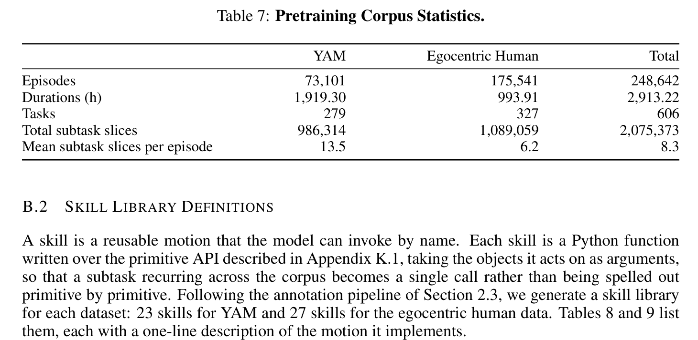
*Table 7: 预训练语料库详细统计数据。涵盖 YAM 双臂遥操与人类第一人称接触数据，构成 207.5 万条时空对齐的程序-视频-动作三元组。*

### 2. 50 项跨任务冻结可复用技能库 (Skill Libraries)
系统通过智能体流水线提炼出两套具身专有的可复用标准化技能库，总计 50 个高阶技能：
- **YAM 平行夹爪技能库 (23 个技能)**：包含针对柔性体与接触装配的复合动作，例如 `fold_edge_over`（双臂抓取边缘对折）、`spread_taut_and_release`（双臂反向拉紧扯平）、`alternating_smoothing_pats`（交替拍平抚直）、`flip_object_over`（手腕半转翻转物体）、`ratchet_turn_fastener`（棘轮式旋转拧紧螺栓）、`run_zipper_along_seam`（沿缝隙拉动拉链）等。
- **人类第一人称灵巧手技能库 (27 个技能)**：涵盖复杂微操与工具使用，例如 `pour_into_target`（倾斜倒液回正）、`stir_contents`（握持工具周向搅拌）、`unscrew_cap`（连续回转拧开瓶盖）、`wipe_surface_back_and_forth`（往复擦拭表面）、`thread_through_and_pull_out`（穿针引线拉出）、`tighten_with_ratchet_regrasps`（微小再抓取逐级旋紧）等。

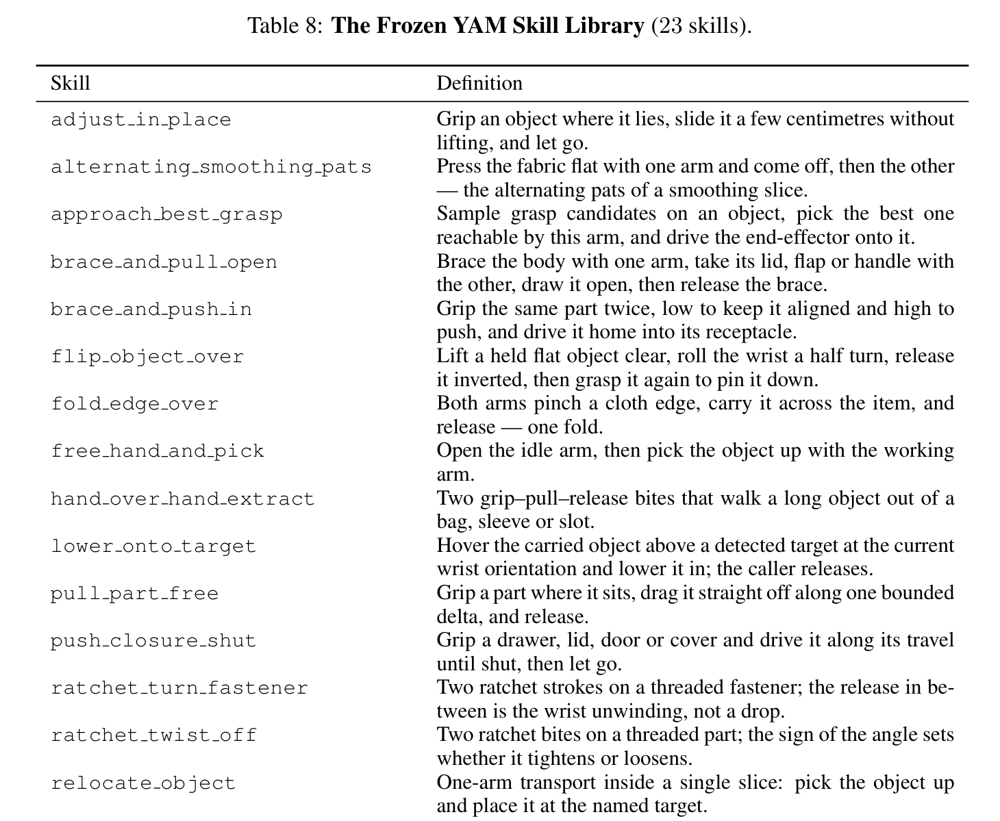
*Table 8: 冻结的 YAM 平行夹爪可复用技能库（23 项核心操作定义）。*

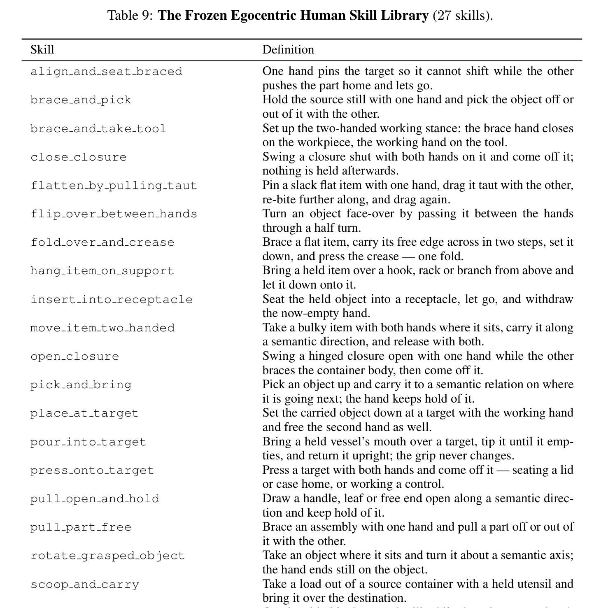
*Table 9: 冻结的人类第一人称仿生灵巧手可复用技能库（27 项核心操作定义）。*


*Figure 18: YAM 技能库在预训练代码专家潜空间中的 t-SNE 流形聚类。18 种常见技能在潜空间中清晰分离，证实高阶技能标签与真实物理运动模式高度互信息对齐。*

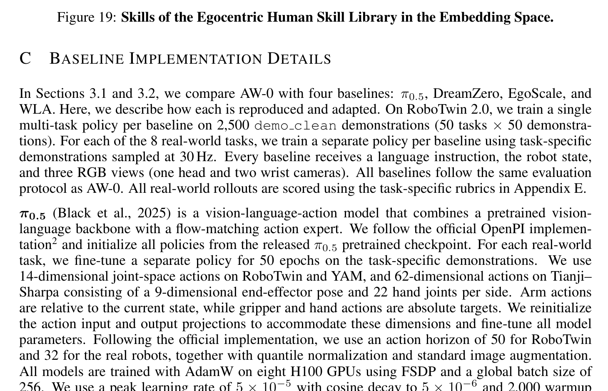
*Figure 19: 人类第一人称技能库在潜空间中的 t-SNE 聚类分布。16 种典型灵巧手微操呈现结构化流形分布。*

### 3. 64 维跨具身统一状态与控制空间
为实现单模型跨多平台（平行夹爪与 22-DoF 仿生灵巧手）无缝训练，AW-0 构造了统一的 64 维状态-动作表达体系：
$$\text{Dim}_{\text{total}} = 2 \times \left( \underbrace{9}_{\text{末端位姿 } (3D\text{位置} + 6D\text{旋转})} + \underbrace{22}_{\text{灵巧手关节角}} + \underbrace{1}_{\text{夹爪开合度}} \right) = 64$$
- **状态表示**：所有维度均为绝对坐标系度量；
- **动作表示**：末端位姿采用相对于当前 Chunk 初始帧的相对位移量 ($\Delta X, \Delta Y, \Delta Z$ 及相对旋转），而平行夹爪与灵巧手关节则输出绝对控制目标；
- **跨具身维度掩码**：在 YAM 模式下，未使用的 44 个手部关节维度置零并不参与梯度归一化；在灵巧手模式下，未使用的 2 个夹爪维度同样置零掩码。其余有效维度采用 1% 与 99% 分位数进行自适应区间归一化。

### 4. 任务评测基准
- **RoboTwin 2.0 仿真基准 (50 项长程任务)**：按照官方榜单要求，每项任务仅提供 50 条干净示教进行下游微调，并在两类环境下测试（每任务 50 次 rollout，总计 2,500 次评估）：
  1. `Clean`（干净桌面、固定光照、无干扰物）；
  2. `Random`（桌面/背景纹理、环境光照、台面高度随机化，并充斥大量干扰物体）。
- **真实物理机器人 8 大长程接触任务**：
  1. *YAM 平行夹爪双臂平台*：`Arrange Fruits`（语义选果分拣）、`Pack Backpack`（双臂拉开拉链-装入物品-反向拉拢拉链，5阶段）、`Replace Lightbulb`（检测亮灭-按压开关-旋出旧灯泡-托盘丢弃-抓取新灯泡-顺时针旋入旋紧直至通电，7阶段）、`Fold and Stack Towels`（双臂三色毛巾逐一折叠、并按指令颜色次序高精度堆叠，6阶段）。
  2. *天机-Sharpa 22-DoF 仿生手平台*：`Arrange Fruits with Tongs`（握持长夹工具精准夹取指定水果）、`Deal Poker`（单手抓握牌叠-双手交接-大拇指微操搓出单张扑克牌-精准捏取-垂直插入狭窄卡槽）、`Flip Scoreboard`（根据自然语言算术指令计算翻页次数、精准单指拨动卡牌至指定数字后按压红色按钮确认）、`Solve Rubik's Cube`（识别混乱面颜色、在掌心持续稳固支撑下多指协调完成 90 度层回转复原）。
  3. *加法式评分规范 (Additive Rubric)*：所有真实任务均拒绝简单二元成功判定，而是严格按照每阶段物理交互标准制定逐步给分的加权细则（满分 100%）。


*Figure 20: 真实物理机器人实验平台。(a) YAM 平台：双 6-DoF 机械臂搭载线性平行夹爪，配备头顶全局 RealSense D405 与双腕部相机；(b) 天机-Sharpa 平台：天机人形躯干搭载两只 22-DoF Sharpa Wave 仿生灵巧手，配备头部 SHW5G 相机与双腕部相机。*

---

## 方法主线

### 1. 机制流程：基于 Mixture-of-Transformers 的三专家骨干网络
AW-0 的系统架构颠覆了传统 WAM 仅联合建模“视频+动作”的双流结构，构建了**“代码 (Code) + 视频 (Video) + 动作 (Action)”**协同三流网络。

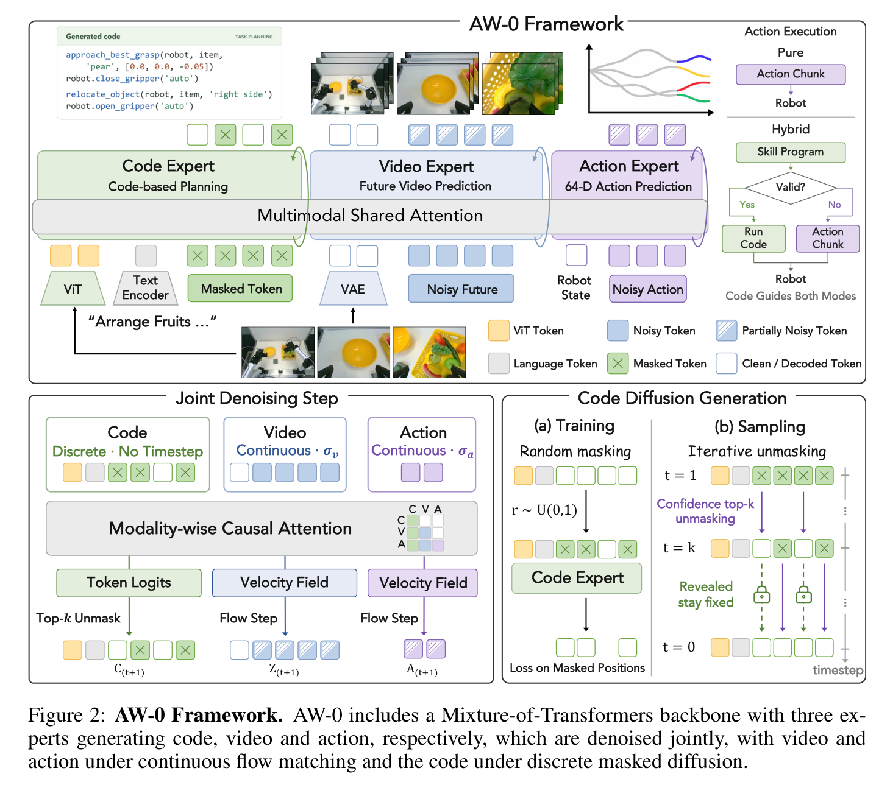
*Figure 2: AW-0 总体计算架构与混合去噪机制。Mixture-of-Transformers (MoT) 主干网络由代码专家、视频专家与动作专家组成；在每个 Transformer 层内部，模态间执行块状因果注意力掩码 (C->V->A)；视频与动作在连续流匹配下求解速度场，代码在离散掩码扩散下解算 Token 分布；测试期支持纯动作直接驱动或 CaP 混合自适应回退。*

- **共享统一隐空间**：所有专家由 28 层 Transformer Block 堆叠而成，各专家拥有独立的 Query/Key/Value 投影矩阵、FFN 与 LayerNorm，但其 Attention 交互在统一的 2,048 维向量空间中完成。
- **Code Expert（代码专家）**：初始化自具有强大掩码序列生成能力的 **SDAR-1.7B**，并在训练中冻结其自回归参数以锁死语言先验；外接冻结的 **Qwen3-VL-2B ViT** 视觉编码器，将当前 3 视角 RGB 图像（分辨率 $224 \times 320$）编码为 $3 \times 70 = 210$ 个视觉 Token，作为代码生成的场景视觉前缀；
- **Video Expert（视频专家）**：初始化自工业级基础视频模型 **Cosmos-Predict2.5-2B**，采用 $1 \times 2 \times 2$ 潜空间 Patch 与多视角 3D RoPE；将原生 VAE 替换为压缩率更紧凑、通道数为 48 的冻结 **Wan2.2 VAE**；
- **Action Expert（动作专家）**：从头随机初始化专有连续动作 DiT（残差宽度 1,024，FFN 宽度 4,096），接收来自语言指令的 Cosmos-Reason1 嵌入向量与 64 维机器人本体状态，负责在 32 步长程 Horizon 内输出平滑控制 Chunk。

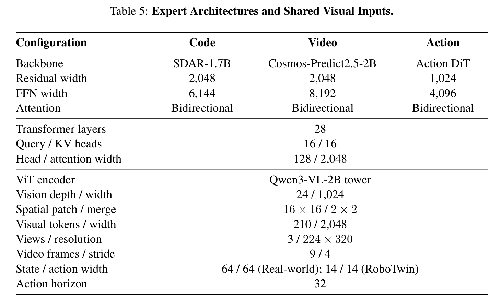
*Table 5: AW-0 三大专家的详细网络超参数与输入规格配置表。*

---

### 2. 三流耦合生成与模态因果注意力流向

#### (1) 模态间因果可见性注意力掩码 (Modality-wise Causal Attention)
在每层 Transformer 内部，自注意力矩阵采用精心设计的**块状因果掩码 (Blockwise Causal Masking)**：
$$\mathbf{M}_{\text{attn}} = \begin{pmatrix} 
\mathbf{M}_{C \to C} & \mathbf{0} & \mathbf{0} \\
\mathbf{M}_{C \to V} & \mathbf{M}_{V \to V} & \mathbf{0} \\
\mathbf{M}_{C \to A} & \mathbf{M}_{V \to A} & \mathbf{M}_{A \to A}
\end{pmatrix}$$
- **各专家内部全双向流通**：$\mathbf{M}_{C \to C}, \mathbf{M}_{V \to V}, \mathbf{M}_{A \to A}$ 均为双向全连接注意力，保证单个模态内部表征的充分演化；
- **模态间单向流动 ($\text{Code} \to \text{Video} \to \text{Action}$)**：
  - 代码流无法窥探噪声视频与噪声动作，从而强制代码专家仅依赖当前观测与任务指令进行纯粹的因果高阶语义规划；
  - 视频专家在去噪每一步均全力感知代码专家的生成表征（$\mathbf{M}_{C \to V}$），使物理世界前瞻预测受到程序逻辑的强力约束；
  - 动作专家则同时读取代码表征（$\mathbf{M}_{C \to A}$）与视频前瞻特征（$\mathbf{M}_{V \to A}$），使底层运动指令在拥有高阶任务蓝图的同时，深度绑定真实的物理接触动力学。

#### (2) 离散-连续混合去噪数学形式化
给定条件输入 $\mathcal{C}_t = \{O_t, \mathcal{L}, S_t, M_t\}$（当前三视角观测、自然语言指令、机器人本体状态、历史代码切片记忆槽），模型在联合去噪步中同时预测离散 Token Logits 与连续速度场：
$$(\boldsymbol{\ell}_\theta^c, \mathbf{v}_\theta^v, \mathbf{v}_\theta^a) = \mathcal{F}_\theta(\widetilde{C}_r, Z_{\sigma_v}, A_{\sigma_a}, \sigma_v, \sigma_a; \mathcal{C}_t)$$

- **视频与动作流的连续流匹配 (Continuous Flow Matching)**：
  对模态 $m \in \{v, a\}$，真实轨迹 $X_0^m$ 与高斯噪声 $\epsilon_m \sim \mathcal{N}(0, \mathbf{I})$ 插值得到加噪样本：
  $$X_{\sigma_m}^m = (1 - \sigma_m) X_0^m + \sigma_m \epsilon_m, \quad \sigma_m = \phi_{\gamma_m}(u_m) = \frac{\gamma_m u_m}{1 + (\gamma_m - 1) u_m}$$
  其中流偏移系数取 $\gamma_v = \gamma_a = 5$；目标速度场回归目标为 $\epsilon_m - X_0^m$。
- **代码流的离散吸收态掩码扩散 (Masked Token Diffusion)**：
  采样掩码率 $r \sim \mathcal{U}(0, 1)$，程序序列中每个 Token $c_i$ 独立发生吸收掩码替换：
  $$\widetilde{c}_i = \begin{cases} [\text{MASK}], & b_i = 1 \\ c_i, & b_i = 0 \end{cases}, \quad b_i \sim \text{Bernoulli}(r)$$
  模型仅在被掩码的未知位置计算交叉熵分类损失 $\ell_c$。

#### (3) 物理前瞻引导的噪声重采样与重要性加权
预训练视频扩散模型往往偏向极高噪声区域（$u_v = 0.999 b, b \sim \text{Beta}(7, 1)$），导致特征高度模糊，难以给动作专家提供有价值的确定性物理引导。AW-0 引入了创新的均匀混合重采样分布：
$$u_v \sim q(u) = \alpha p_{\text{pre}}(u) + (1 - \alpha) p_{\text{ref}}(u), \quad p_{\text{ref}} = \mathcal{U}(0, 1), \; \alpha = 0.5$$
并构造两套解耦的重要性权重：
$$w_v(u) = \frac{p_{\text{pre}}(u)}{q(u)}, \quad w_g(u) = \frac{p_{\text{ref}}(u)}{q(u)}$$
联合训练的总损失函数严格定义为：
$$\mathcal{L}_{\text{total}} = \mathbb{E}_{u_v \sim q, u_a \sim \mathcal{U}, r \sim \mathcal{U}} \left[ \lambda_v \bar{w}_v(u) \ell_v + \bar{w}_g(u) \left( \lambda_a \ell_a + \lambda_c \ell_c \right) \right]$$
其中权重超参数设置为 $\lambda_v = 1.0, \lambda_a = 1.0, \lambda_c = 0.5$；$\bar{w}$ 表示在当前 Batch 内进行截断（阈值为 4.0）并归一化至均值为 1。这一精妙设计保证了视频主干在吸收预训练物理能力的同时，其均匀中等噪声下的清晰表征能以最高保真度注入动作与代码专家。

---

### 3. 自动化智能体标注流水线与可复用技能库蒸馏


*Figure 3: 全自动智能体标注与技能库生成流水线。由 Gemini 3.1 Pro 编码智能体与 Claude Opus 4.8 协调器协同构建三阶段闭环：采样探索、技能提炼并冻结、全量语料接触对齐缓存复用。*

要训练包含 200 万代码切片的具身世界模型，人工编写程序在成本与一致性上均不可行。AW-0 提出了由两个互补大模型主导的“自动化标注工厂”：
1. **阶段 1：子任务探索与技能蒸馏 (Skill Discovery)**：
   - 每项任务抽样 1 个典型 episode；
   - **执行编码员 (Gemini 3.1 Pro)**：对照声明式底层 API（图 38），根据视频帧切片与传感器接触事件生成逐行动作程序；
   - **审计协调器 (Claude Opus 4.8)**：跨多项任务横向分析代码，发现重复出现的长程模式（例如将多次抓取、对齐、按压封装为 `fold_over_and_crease`），提炼出带参数签名的可复用函数，将其纳入技能库，并更新系统 Prompt。
2. **阶段 2：语料重标与技能库冻结 (Library Freezing)**：
   - 经过数轮审计演进后，正式冻结 50 个高频通用的标准化技能（YAM 23 项、人类 27 项）；
   - 用冻结的规范接口重新标注阶段 1 的探索样本，形成初始的“子任务-代码”标准缓存映射库。
3. **阶段 3：海量语料的证据验证与缓存复用 (Corpus Annotation via Verified Reuse)**：
   - 处理剩余的 24 万条历史轨迹与下游新任务时，首先提取物理证据向量（YAM 依据机械臂物理夹爪开合事件序列，人类依据手部 3D 运动轨迹流形）；
   - 若当前子任务的物理接触证据与缓存库内既有条目一致，则**直接复用并参数微调代码**；若失配（Miss），则唤醒编码智能体生成新程序，静态校验合规后写入缓存。该机制将整体标注计算成本压低了 80% 以上。

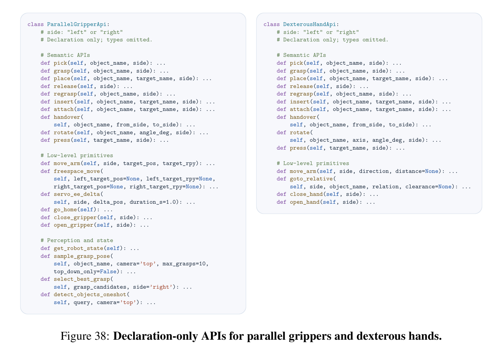
*Figure 38: 面向平行夹爪与仿生灵巧手的声明式底层 API 接口定义。共享 10 类高阶语义动词，底层分别绑定末端位姿与手部多指关节运动。*

---

### 4. 混合执行模式与自适应回退机制 (Hybrid Action)

虽然 AW-0 在默认部署下将生成的代码仅作为动作去噪的“隐式语义上下文”（纯动作模式，Pure WAM），但研究团队进一步探索了极具前瞻性的**混合执行模式 (Hybrid Action)**——允许生成的 Python 代码像 Code-as-Policies 那样直接调用闭环感知与控制库，并在受挫时自适应回退至 WAM 连续动作专家。

```
              ┌────────────────────────┐
              │  Policy Forward Pass   │
              │  Returns (c, a_{1:H})  │
              └───────────┬────────────┘
                          │
                          ▼
           ┌───────────────────────────────┐
           │   ARBITRATE Gate Inspection   │
           │  1. Stage Gate: n_k < R ?     │
           │  2. Dependency Gate: vars ∈ G?│
           │  3. Syntax & Whitelist Valid? │
           └──────────────┬────────────────┘
                          │
             Passes All   │   Fails Any
             Gates        │   Gate
            ┌─────────────┴─────────────┐
            ▼                           ▼
  ┌───────────────────┐       ┌───────────────────┐
  │ Execute Code c in │       │ Fallback to WAM   │
  │ Environment G     │       │ Direct Actions    │
  │ (CaP Execution)   │       │ a_{1:H} on Robot  │
  └─────────┬─────────┘       └─────────┬─────────┘
            │                           │
   Success  │  Exception / Fail         │
  ┌─────────┴─────────┐                 │
  ▼                   ▼                 ▼
Stage k Done:       Count n_k += 1;     Step H Horizon;
D = D ∪ {k}         Next Replan Iter    Next Replan Iter
```

#### (1) 严格的三层准入安全门控 (Arbitration Gates)
在每个决策步，生成的代码切片 $c$ 必须依次通过三大前置审查，任何一项违例均立即触发动作回退：
1. **阶段门控 (Stage Gate)**：检查切片声明的阶段索引 $k$ 是否已被历史标记为完成（$k \in \mathcal{D}$）、是否逆序倒流至已完成阶段之前，以及该阶段累计失败重试次数是否超标（$n_k \ge R$，默认 $R=2$）；
2. **依赖门控 (Dependency Gate)**：静态 AST 解析检查切片所读取的变量与环境句柄是否在持久化命名空间 $\mathcal{G}$ 中完全合法定义；
3. **语法、白名单与有效性门控 (Syntax, Whitelist & Vacuity Gates)**：必须能够成功编译、所调用的函数严格位于预定义 API 白名单内，且必须包含实质性的可执行运动指令。

#### (2) 动态仲裁与互补分工
- 在简单几何结构与长程重复任务中（如积木颜色排序），CaP 代码调用 Molmo / SAM 3 / Contact-GraspNet 运行，具备极强的无漂移几何一致性；
- 一旦遭遇复杂外形抓取失败、接触滑脱或严重遮挡，代码抛出异常，仲裁器直接丢弃失效代码，**无缝由动作专家输出平滑柔顺的连续动作 Chunk 接管机器人**，待脱困后再重新恢复代码规划。


*Figure 35: 真实世界“折叠与堆叠毛巾”任务中混合执行的动态交替轨迹。绿色代表调用 CaP 代码执行（负责结构化的大范围转移与对准），紫色代表 WAM 原生连续动作接管（负责精细抓取与柔性体接触微调），展示了高阶确定性规划与底层柔顺控制的极致互补。*


*Figure 37: RoboTwin 仿真中混合执行的阶段交替可视化。Top (blocks ranking rgb)：规整几何体搬运几乎全由代码执行包揽；Bottom (pick dual bottles)：双瓶不规则抓取滑脱瞬间，直接动作 Chunk 迅速接管抓稳物体，随后平稳切回代码。*

---

### 5. 推理加速与低延迟部署：2.39 倍提速

传统引入语言模型进行高阶规划的系统大多采用自回归 (Autoregressive, AR) 逐步解码 Token，其计算复杂度随着规划长度爆炸，且存在致命的 **Teacher Forcing 暴露偏差 (Exposure Bias)**——训练阶段模型依赖真值前缀，测试阶段前序 Token 一旦出现微小幻觉，后续动作生成全面崩盘。

AW-0 采用离散掩码扩散机制，实现了**并行阶段性反掩码解码 (Staged Unmasking)**：
- **4 步联合去噪迭代**：整个生成过程仅需 $T=4$ 个同步步长（视频采用 UniPC 求解器，动作采用 Euler 求解器）；
- **动态置信度提交**：画布总长 $G=128$ 个 Token，在每一步计算未掩码位置的 Softmax 概率，静态提交置信度最高的 $G/T = 32$ 个 Token，并将其锁定为已知上下文；
- **全栈因果 KV 缓存与算子优化**：通过隔离代码专家与后序专家的单向注意力，使得视觉前缀与历史记忆槽在生成过程中保持恒定 KV Cache。
- **实测性能**：在 NVIDIA RTX 5090 消费级旗舰显卡上，AW-0 的端到端推理耗时仅为 **0.23 秒**（包含视觉 ViT 提取、4 步联合去噪、Wan2.2 VAE 视频解码与 64 维动作逆归一化）。相比自回归代码方案的 0.55 秒，实现了 **2.39 倍的巨大加速**，且相比完全剔除代码专家的纯物理 WAM (0.19 秒) 仅额外消耗 40ms，彻底跨越了世界模型落地实体机器人实时控制的门槛！

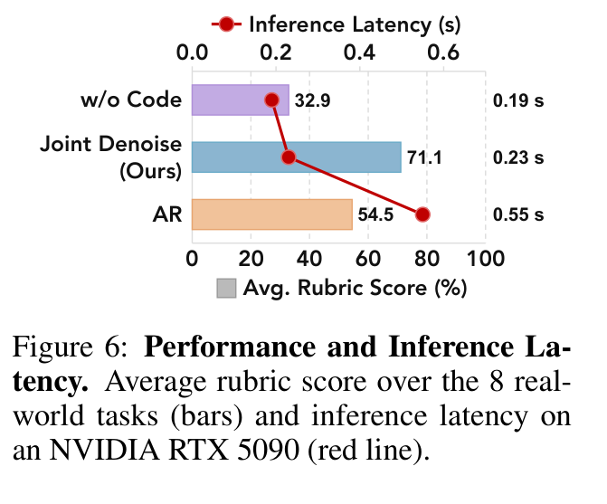
*Figure 6: 推理延迟与实机操纵性能权衡对比图。联合去噪方案在 RTX 5090 上实现 0.23 秒低延迟，性能大幅抛离自回归 (AR) 解码基线与无代码基线。*

---

## 关键结果

### 1. 仿真基准主结果：RoboTwin 2.0 夺得榜首
在包含 50 类长程复杂任务的 RoboTwin 2.0 仿真基准上，AW-0 与当前四大顶尖基线展开了系统对比：
- $\boldsymbol{\pi_{0.5}}$：Physical Intelligence 开发的前沿 VLA 基础模型；
- **EgoScale**：基于 NVIDIA GR00T-N1.7-3B 在海量第一人称人类数据上预训练的具身模型；
- **DreamZero**：在 AgiBot 机器人数据上预训练的双流视频-动作世界模型；
- **WLA**：交替预测自然语言子任务、子目标图像与动作的自回归多模态模型。


*Table 1: RoboTwin 2.0 在 Clean 与 Random 两种评测环境下的 50 项任务全景成功率对比（每任务 50 次评估，总计 2,500 次评估）。*

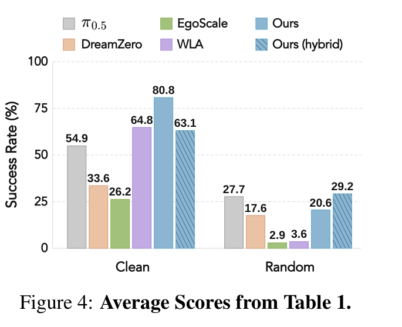
*Figure 4: Table 1 的柱状图可视化。AW-0 在干净场景下达到 80.8%，在随机化环境下混合模式达到 29.2%，均展现出断代级领先。*

- **Clean 干净环境**：AW-0 取得 **80.8%** 的惊人平均成功率，不仅碾压了前沿 VLA 基线 $\pi_{0.5}$ (54.9%)，更将最强多模态基线 WLA (64.8%) 抛离了 **+16.0 个百分点**，体现出结构化代码对于长程确定性任务的无与伦比的调度能力；
- **Random 极端域随机化环境**：由于背景、桌面材质与光照发生剧烈扰动，所有纯像素级生成模型的性能均大幅受挫（EgoScale 暴跌至 2.9%，WLA 暴跌至 3.6%，DreamZero 仅 17.6%，AW-0 默认模式降至 20.6%）。
- **混合执行模式逆势爆发**：**AW-0 (Hybrid) 在随机环境下成功率跃升至 29.2%**，全面逆转并超越了强抗扰动 VLA 基线 $\pi_{0.5}$ (27.7%)！从相对保留率来看，混合模式保留了 Clean 环境下 46% 的性能，而纯动作模式仅保留了 25%。实证揭示：**在视觉分布发生剧烈漂移时，CaP 代码所调用的目标定位与运动规划基元能够接管大范围空间转移，从而规避了像素级视频扩散模型的漂移风险。**

---

### 2. 真实世界双臂与灵巧手长程操作：71.1% 统御全场

在跨越 YAM 双臂平行夹爪与天机-Sharpa 22-DoF 仿生手两大实机平台上，评估了 8 项难度极高、包含极复杂接触交互的长程任务（每项任务测试 3 个不同训练种子，每种子 16 次 rollout，每任务累计 48 次真实评估）：

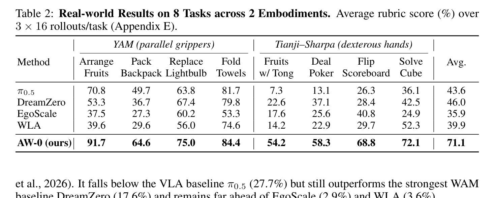
*Table 2: 真实世界 8 大任务在 YAM 与天机-Sharpa 双平台上的详细 Rubric 打分（%）。AW-0 以 71.1% 均分建立绝对统治力。*

1. **平行夹爪平台 (YAM)**：
   - `Arrange Fruits`（语义选果）：AW-0 达到 **91.7%**，大幅领先 $\pi_{0.5}$ (70.8%) 与 DreamZero (53.3%)；
   - `Pack Backpack`（背包拉链开合装物）：AW-0 取得 **64.6%**（$\pi_{0.5}$ 仅 49.7%，DreamZero 仅 36.7%）；
   - `Replace Lightbulb`（螺纹旋下与旋入）：AW-0 达到 **75.0%**（$\pi_{0.5}$ 63.8%，DreamZero 67.4%）；
   - `Fold Towels`（双臂多层折叠）：AW-0 达到 **84.4%**（$\pi_{0.5}$ 81.7%，DreamZero 79.8%）。
2. **仿生灵巧手平台 (Tianji–Sharpa)**：
   - 面对高维复杂接触，传统 VLA 基线性能全面塌方（$\pi_{0.5}$ 在夹子分拣上仅 7.3%，发牌仅 13.1%，翻记分牌 26.3%，魔方 36.1%），根源在于纯动作策略无法在 44 维手部关节中保持物理前瞻稳定性；
   - 传统物理 WAM (DreamZero) 凭借视频物理演化建模取得一定效果（发牌 37.1%，魔方 42.5%），但缺乏语言语义逻辑；
   - **AW-0 达成断层式领跑**：`Fruits w/ Tong` 达到 **54.2%**，`Deal Poker` 达到 **58.3%**，`Flip Scoreboard` 达到 **68.8%**，`Solve Cube` 达到 **72.1%**！**总均分达到 71.1%，超越最强基线 DreamZero (46.0%) 达 +25.1 个百分点，超越 $\pi_{0.5}$ 达 +27.5 个百分点！**


*Figure 21: Arrange Fruits 任务的关键帧序列与对应的代码标签。多条件判断与循环逻辑精准引导机械臂完成分类。*

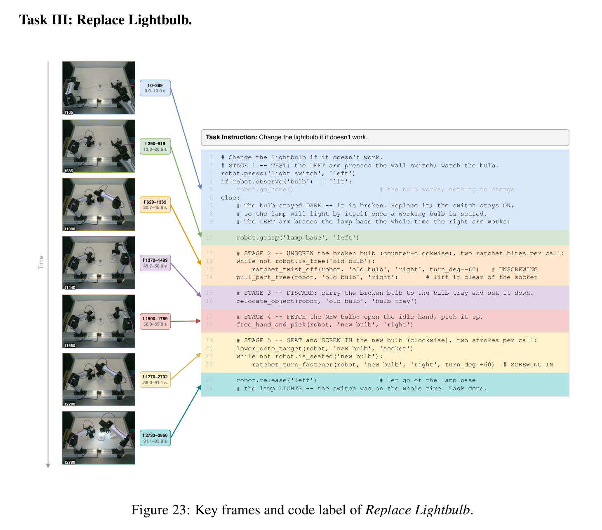
*Figure 23: Replace Lightbulb 任务的 7 阶段操作时序图。代码清晰界定了闭环感知、螺纹逆旋、托盘释放与正向旋入。*

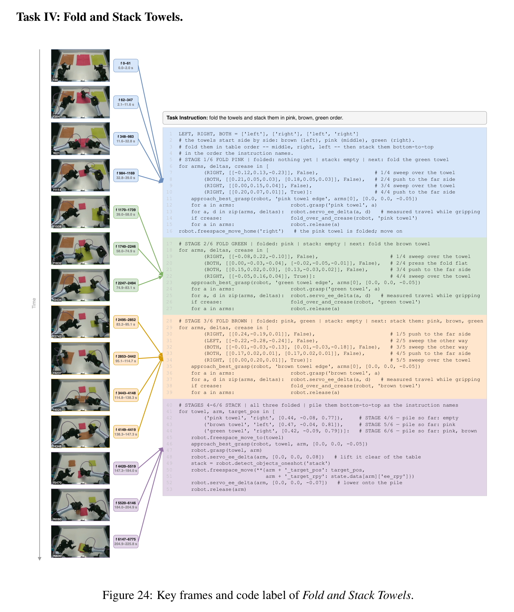
*Figure 24: Fold and Stack Towels 任务的超长程多阶段（6 阶段）关键帧与程序切片对应。*


*Figure 26: Deal Poker 灵巧手发牌任务：包含双手交接、大拇指精细拨牌、单张卡牌分离与卡槽垂直插入。*

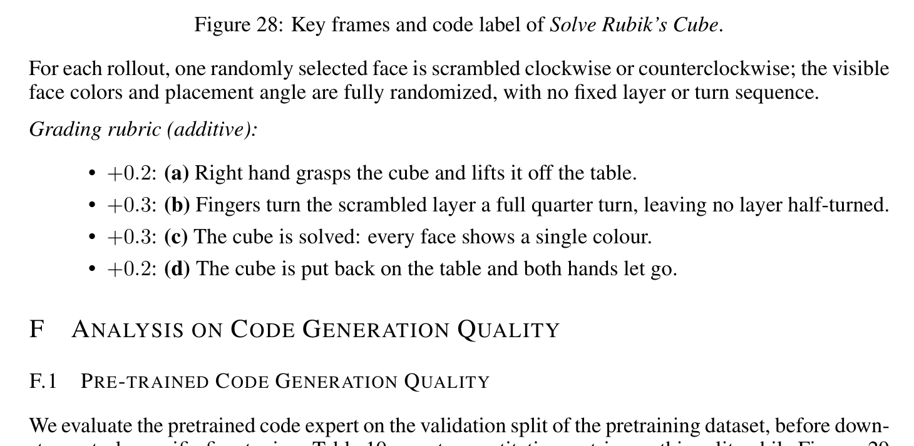
*Figure 28: Solve Rubik's Cube 仿生灵巧手解魔方：手指协调与掌心动态支撑。*

---

### 3. 语言遵循与语义推理泛化：代码引导对物理前瞻的根本重构

在 `Arrange Fruits`（语义水果分选）与 `Flip Scoreboard`（自然语言数字翻牌）两项强推理任务中，消融实验直观展现了代码规划对于视频生成流的决定性作用：

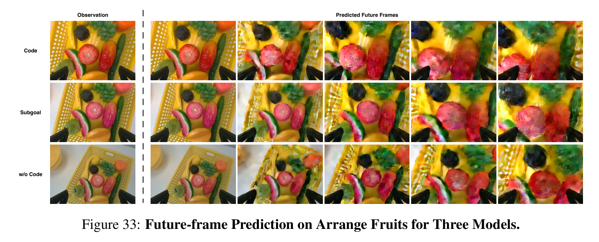
*Figure 33: Arrange Fruits 任务中三款模型的未来视频帧预测对比（指令：“让左碗最终只剩下芒果”）。*
- **无代码基准 (w/o Code)**：世界模型在视觉想象中径直将机械爪移向苹果，发生完全的语义目标混淆；
- **自然语言子目标 (Subgoal)**：未来画面在苹果与芒果之间发生模糊的概率弥散与视觉重影，目标漂移不定；
- **AW-0 (Code)**：未来视频清晰、确定性地将机械臂导向芒果，精准完成抓取想象。**这确凿地证实：显式程序中的参数变量（如 `'mango'`）为扩散潜空间提供了极其纯净的因果正交引导。**

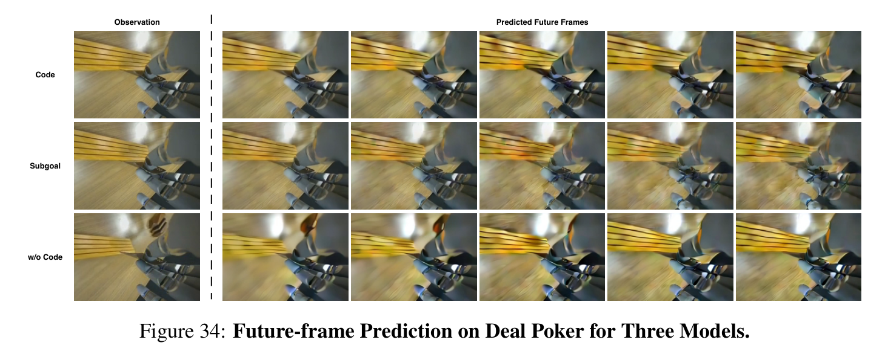
*Figure 34: Deal Poker 扑克牌插入窄缝瞬间的未来物理预测对比。*
- 在接触瞬间，无代码与自然语言模型生成的未来画面出现极其严重的卡牌形变扭曲与指尖伪影，导致动作专家由于读入崩塌的物理特征而抓脱；
- AW-0 生成了极其连贯、几何刚性保持完好的插卡动力学演化，为动作专家提供了高保真的前瞻支撑。

---

### 4. 核心消融分析

#### (1) 注意力因果拓扑消融：为什么必须是 $\text{Code} \to \text{Video} \to \text{Action}$？
比较三种因果注意掩码结构（实机 8 任务打分，图 5）：
- $\text{Video} \to \text{Action}$ (纯物理 WAM 无代码)：平均得分仅 **32.9%**；
- $\text{Video} \to \text{Code} \to \text{Action}$ (代码仅作为视频预测的解释器)：平均得分升至 **54.5%**；
- $\text{Code} \to \text{Video} \to \text{Action}$ (AW-0 架构)：平均得分暴增至 **71.1%**！
- **归因结论**：若代码仅位于视频之后，其只能被动阅读未受约束的模糊物理预测，无法挽回物理幻觉；**只有让代码作为源头（Source），由高级语义规划直接浇铸物理前瞻，再由物理前瞻约束底层动作，系统才能发挥最大乘积效应。**


*Figure 5: 模态注意力因果结构消融。$\text{Code} \to \text{Video} \to \text{Action}$ 全面碾压其余配置。*

#### (2) 视觉特征表征消融：独立语义 ViT vs 共享重构 VAE
在代码专家的视觉前缀输入端（表 3）：
- 若复用视频专家的 Wan2.2 VAE 特征作为代码输入，实机平均分大幅滑落至 **55.6%**（在背包整理上下跌至 39.6%，魔方下跌至 53.9%）；
- 采用独立的冻结 **Qwen3-VL ViT** 视觉塔，实机平均分达到 **71.1%**（+15.5pp 净增益）。
- **归因结论**：VAE 潜空间被像素重构目标主导，缺乏细粒度的空间语义辨析力；必须借助强大的高层视觉-语言 ViT 才能赋予代码专家识别物体类别与部件句柄的能力。

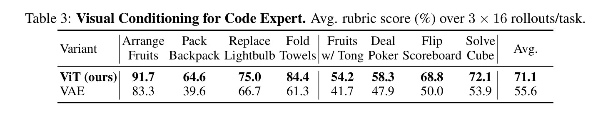
*Table 3: 代码专家视觉前缀条件消融表（ViT vs VAE）。*

#### (3) 代码表示语义丰富度消融：代码到底贡献了什么？
在实机 8 任务上对比 4 种规划表征形式（图 7）：
1. **完整代码 (Full Code, Ours)**：71.1%；
2. **去除注释代码 (w/o Comments)**：降至 64.4%（$-6.7$pp），证明人类自然语言注释充当了符号逻辑与语义意图的平滑桥梁；
3. **去除技能抽象 (w/o Skills, 纯底层 API 拼装)**：降至 63.2%（$-7.9$pp），证明 50 项跨任务技能抽象并非语法糖，而是大幅缩短了时间跨度、降低了生成熵；
4. **自然语言子目标 (Natural Language Subgoal)**：降至 59.2%（$-11.9$pp），证明代码中严格的函数调用、变量绑定与循环结构，其信息密度与执行约束力显著超越自然语言。

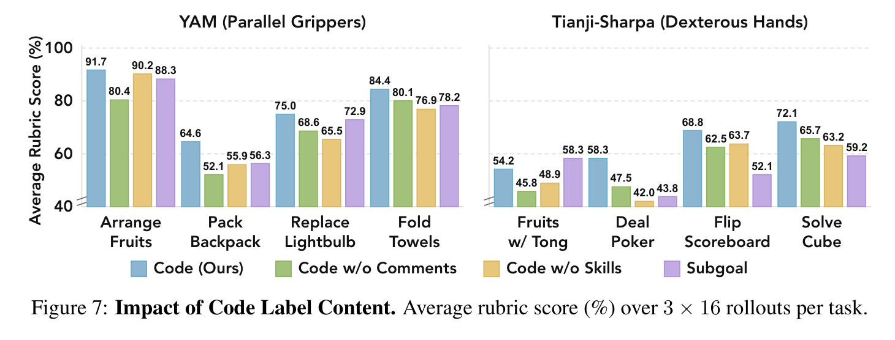
*Figure 7: 代码规划表征内容消融柱状图。注释、技能函数抽象与程序结构缺一不可。*

#### (4) 生成范式消融：联合去噪 (Joint Denoising) vs 自回归 (AR)
对比联合去噪与自回归解码（表 4、图 6）：
- 在 8 项任务中，联合去噪在 7 项上大幅优于 AR（总均分 **71.1% vs 54.5%**）；
- 在推理延迟上，联合去噪凭借 4 步反掩码实现 **0.23s**，而 AR 需要串行逐 Token 生成，耗时长达 **0.55s**（**提速 2.39 倍**）。


*Table 4: 联合去噪 (Joint Denoise) 与自回归 (AR) 解码在 8 项真实任务上的打分对比。*

---

## 深度分析

### 1. 真正贡献是什么：首个打通“符号认知”与“物理演化”的原生生成架构
在过去三年的具身智能浪潮中，学术界被割裂在两个极端阵营：
- **阵营 A（智能体派）**：沉迷于在大语言模型外围搭建复杂的 ReAct 提示词工程、CaP 代码外挂与仿真器验证，以为只要写出 Python 代码机器人就能工作，却对现实世界中微小的物理非线性（摩擦力滑移、不可预测形变、传感器遮挡）毫无感知能力；
- **阵营 B（世界模型派）**：沉迷于堆叠视频 DiT 参数量，将一切物理交互暴力当做像素扩散问题，导致模型完全丧失了长程逻辑推理、组合泛化与状态机跳转能力。

**AW-0 的真正里程碑贡献，在于首次在模型内部数学机制上完成了符号与物理的深度统一。** 它证明了：
- **代码是物理模拟的天然约束边界**：由语言先验约束的离散代码切片，能够将连续动力学探索空间压缩数个数量级；
- **物理模拟是代码生成的落地锚点**：连续动作与未来视频为代码规划提供了闭环的物理接地检验。二者不是简单的上游规划与下游执行，而是在同一个去噪过程中实时交互、互为因果。

---

### 2. 为什么结果成立：宏观语义坍缩与微观柔顺控制的动态互补
AW-0 之所以在长程高难度接触操作中取得断层式优势，其内在机理可归结为三层“解耦与对齐”：
1. **搜索空间的几何收敛**：在处理“换灯泡”这种长程复合任务时，如果纯靠物理网络生成动作，微小的轨迹偏离就会在数十秒内无限累积扩散；AW-0 的代码专家在第 0 步就确立了 `STAGE 2 -- UNSCREW old bulb` 的离散符号先验，使得视频专家与动作专家的注意力权重瞬间聚焦在灯座螺纹几何区域，极大地收敛了反向动力学的解空间。
2. **微观动力学的连续鲁顺**：在扑克牌插入窄槽瞬间，代码专家仅需输出语义层级的 `insert_into_receptacle`，而具体的毫秒级指尖法向力微调、卡牌微弯倾角控制，完全交给读入了高保真未来视频特征的连续动作 DiT 专家。**高层不管微距力控，底层不操心长程状态，实现了机器人学数十年来梦寐以求的层次化控制 (Hierarchical Control)。**
3. **混合部署的安全底网**：在视觉分布发生剧烈偏移时，代码调用的经典几何算法（如 Point Cloud Grasping / Motion Planning）保持刚性不变；而在接触碰撞等经典算法容易崩溃的奇点处，连续动作 Chunk 又自适应兜底接管。

---

### 3. 容易误读的地方

> [!WARNING]
> **误区 1：生成的代码是否在测试期必须被执行？**  
> **澄清**：**绝对不是！** 在默认的 AW-0 模式下，生成的代码切片**完全不需要执行**，它甚至可以带有轻微的语法警告或数值参数偏差。在默认模式下，代码的作用纯粹是作为网络内部的高阶语义潜变量，通过注意力掩码直接向视频与动作专家输送强先验。只有在专门开启的 `AW-0 (Hybrid)` 模式下，系统才会通过三层安全门控尝试执行合规代码。

> [!WARNING]
> **误区 2：AW-0 是否依赖完美的模拟器或真值状态检测？**  
> **澄清**：**否！** 在所有测试期（无论是仿真还是真实物理世界），AW-0 接收的输入仅有普通的车载 RGB 相机画面、本体关节编码器读数与自然语言指令，**完全不接触任何特权状态 (No Privileged Simulator Information)**。混合模式下调用的感知基元全部为开源的开放词表模型（如 Molmo、SAM 3 与 Contact-GraspNet）。

> [!WARNING]
> **误区 3：代码专家是否只是一个简单的离线 Prompt 拼装器？**  
> **澄清**：**否！** 代码专家被深度编织在 28 层 Transformer 的每一层中。它的输入不仅包含语言指令，更实时接收来自 Qwen3-VL 视觉塔编码的 210 个场景 Token，并维持一个 K 槽的可学习记忆缓冲器（Memory Cache）。代码生成是随任务执行与视频预测动态在线推演的。

---

### 4. 真实工程复现与工业落地避坑指南

1. **离散代码扩散的掩码调度设计 (Masking Schedule)**：
   在复现式 (4) 的离散掩码扩散时，切忌在整个上下文中全量加噪。**视觉前缀 Token (210个)、系统 Prompt 与语言指令必须始终保持 100% 干净可见**，仅对当前活动的程序切片进行掩码加噪；且在训练中必须强制保证每个切片至少保留 1 个掩码 Token，避免空梯度穿透。
2. **64 维动作空间的梯度隔离与归一化**：
   在跨平行夹爪 (YAM) 与灵巧手 (Tianji) 联合预训练时，**未激活的维度必须进行严格的梯度截断与零填充，绝不能纳入分位数归一化统计中**；否则会导致夹爪数据的归一化方差被灵巧手的零值剧烈稀释，引发下游微调时关节控制发散。
3. **混合执行沙箱的超时与内存泄露熔断**：
   若部署混合执行模式，代码沙箱必须在独立子进程中运行，并设置硬性超时阈值（建议不超过 1.5 秒）。对于机械臂大范围位移指令，必须设置速度与力矩软限位，一旦捕获到逆运动学 (IK) 无解或超时，必须在 50ms 内立即释放控制权并无缝切换至 WAM 动作 Chunk。

---

## 局限与批判性审视

尽管 AW-0 取得了令人瞩目的战绩，但客观审视仍存在不可忽视的科学局限与改进空间：

1. **参数级语义幻觉依然存在**：
   正如论文附录 F.1 与图 29 所揭示，预训练代码专家虽然能够精准预测技能函数名称与控制流结构，但在连续数值参数（如位移量 `[-0.2, 0.0, 0.0, 0.0, 0.0]` 多出额外维度）上仍会偶发幻觉。这表明离散 Tokenizer 对连续几何量纲的表征依然不够敏感，这也正是默认模式下不能贸然直接执行代码的原因。
2. **纯像素级视频生成的分布外脆弱性**：
   在 RoboTwin 极端随机化测试中，AW-0 的纯动作模式成功率从 80.8% 暴跌至 20.6%。这揭示了一个残酷的事实：哪怕有代码引导，基于像素级重构的视频世界模型（Cosmos / Wan2.2）在遭遇从未见过的强光照、剧烈反光与混乱几何干扰时，其潜空间特征依然会发生灾难性漂移。未来世界模型向更高抽象层级（如 3D 高斯泼溅、隐式点云或几何流形）演化势在必行。
3. **灵巧手领域的 CaP 生态缺失限制了混合执行的扩展**：
   由于目前学术界和工业界尚无成熟的高鲁棒仿生灵巧手 Code-as-Policies 工具库，导致 AW-0 的混合执行模式（Hybrid Action）在真实世界上仅能在 YAM 平行夹爪上评测，未能验证其在 22-DoF 仿生手上的混合控制潜力。
4. **缺乏在线自主闭环强化反思**：
   当前的 AW-0 依然是离线预训练加微调的被动模仿学习产物。模型在物理执行受挫后，虽然能通过回退机制切换动作，但无法根据物理失败视频在线主动重构代码或反向微调网络参数，缺乏真正自主智能体的终身进化能力。

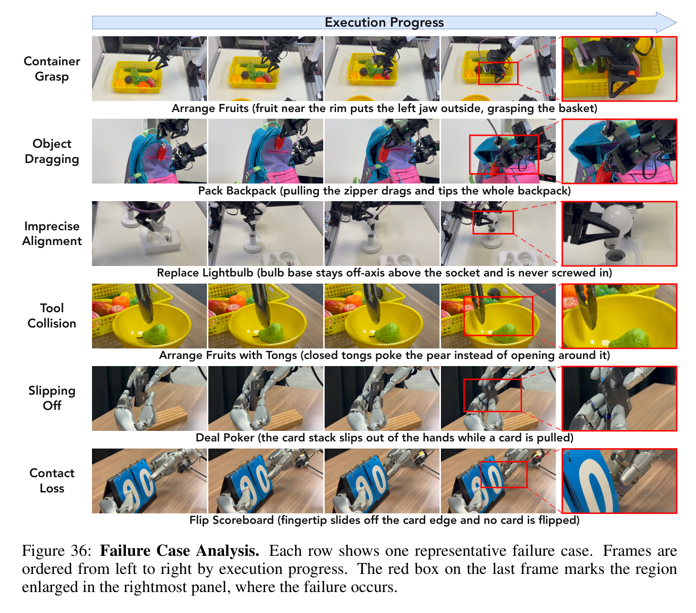
*Figure 36: 全景失败案例深度诊断。揭示了容器边缘碰撞（抓手卡在篮壁外）、柔性体拖拽倾覆（缺乏拉力连续反馈）、微距轴线未对齐（螺纹未卡入）、工具张合冲突、扑克牌交接滑脱与拨牌指尖脱靶等典型瓶颈。*

---

## 我的笔记：与主流世界模型及智能体架构的全景宏观横向对比

为了深刻理解 AW-0 在具身智能宏大技术版图中的历史生态位，我们将 AW-0 与近年来具身机器人领域的代表性工作进行深度全景对比：

### 1. 全景横向对比矩阵

| 维度 / 模型 | **AW-0 (Ours, 2026)** | **OpenWAM (2026)** | **DreamZero (2026)** | **WLA (2026)** | **Motubrain (2025)** | **$\pi_{0.5}$ (2025)** | **ASPIRE / CaP (2024-2026)** |
| :--- | :--- | :--- | :--- | :--- | :--- | :--- | :--- |
| **核心范式** | **Agentic WAM (代码+视频+动作三流联合去噪)** | 模块化解耦物理 WAM (视频+动作) | 端到端单体 WAM (视频+动作联合扩散) | 自回归多模态 WAM (子任务+子目标图像+动作) | 隐空间统一动作世界模型 (Latent WAM) | 强视觉-语言-动作流匹配 (Pure VLA) | 纯外挂式代码智能体 (LLM Code-as-Policies) |
| **规划媒介** | **结构化 Python 代码 (离散扩散生成)** | 无高阶规划媒介 (纯动力学驱动) | 无高阶规划媒介 | 自然语言短语 (Autoregressive Token) | 隐空间潜在动作代码 | 自然语言上下文提示词 | 外部 LLM 生成完整 Python 程序 |
| **世界模型作用** | **受代码因果约束的物理前瞻预测** | 模块化特征解耦与数据增强探索 | 底层连续动作生成的辅助流 | 预测单帧未来图像 Subgoal | 隐空间时空状态转移推演 | 无世界模型 (不预测未来) | 依赖外部物理仿真器进行黑盒校验 |
| **模态交互机制** | **$\text{Code} \to \text{Video} \to \text{Action}$ 因果注意力** | 双向/单向注意力掩码可插拔组合 | 串联平铺注意力 (Tiled Attention) | 交叉注意力串行解码 | 双向潜空间交互 | 视觉特征交叉注意力接入动作 DiT | 无模型内交互 (两阶段串联拼装) |
| **可复用技能库** | **50项跨任务标准化参数技能库** | 无显式技能概念 | 无显式技能概念 | 无显式技能概念 | 无显式技能概念 | 无显式技能概念 | 动态生成或手工预设 API |
| **执行模式** | **纯动作直接驱动 / CaP 混合自适应回退** | 纯底层动作 Chunk 驱动 | 纯底层动作 Chunk 驱动 | 纯底层动作 Chunk 驱动 | 纯底层动作 Chunk 驱动 | 纯底层动作 Chunk 驱动 | 纯代码调用黑盒 API 执行 |
| **长程推理能力** | **极强 (代码约束长程状态机跳转)** | 较弱 (依赖连续轨迹自回归) | 较弱 (多步累积误差严重) | 中等 (自然语言缺乏精确参数约束) | 较弱 (潜空间状态语义模糊) | 较强 (仅限语义层面，物理易漂移) | 极强 (语义层面强，但物理落地极脆) |
| **推理延迟** | **0.23s (RTX 5090, 4步联合去噪)** | 0.17s (RTX 5090, S-VAE加速) | >0.6s (多步自回归扩散) | ~0.55s (多模态串行解码) | ~0.20s | ~0.15s | 数秒至数十秒 (LLM API调用) |

---

### 2. 具身世界动作模型的大一统技术演化图谱

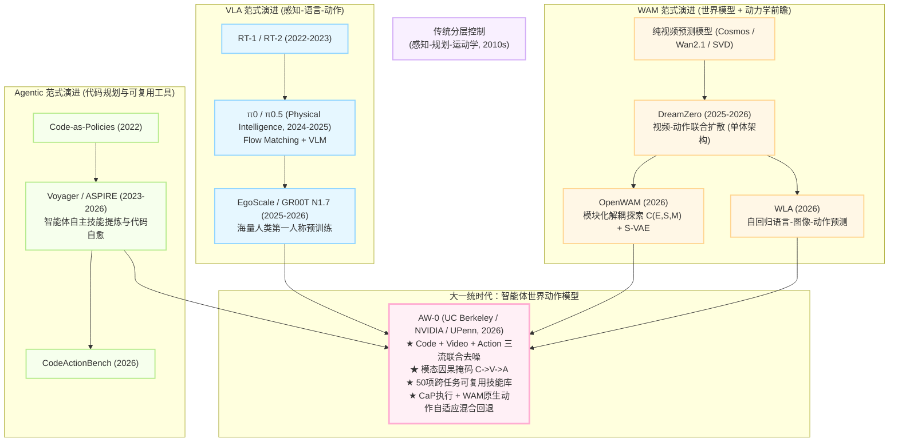

### 3. 核心领悟与未来展望
从 RT-1 到 $\pi_{0.5}$，具身智能完成了从离散分类到连续流匹配动作生成的跨越；从 DreamZero 到 OpenWAM，具身智能证明了物理动力学前瞻是提升策略稳定性的关键。而 **AW-0 则标志着具身智能进入了“认知规划与物理仿真原生融合”的 3.0 时代**。

它给整个领域的深刻启示是：
> **不要试图用大语言模型去代替物理控制器，也不要试图用纯像素视频扩散去学习宇宙的一切逻辑。让符号做符号擅长的事（长程状态转移、技能抽象、逻辑参数绑定），让生成式物理模型做连续场擅长的事（流形演化、接触力顺应、遮挡弥补）。两者的数学融合点，正是三流协同的联合去噪过程。**

---

## 引用

```bibtex
@article{liu2026agentic,
  title   = {Agentic World Action Models},
  author  = {Zhuoyang Liu and Dantong Niu and Botong Zhang and Boning Shao and Jing Wang and Ruijie Zheng and Yuvan Sharma and Runyu Lu and Jiaming Liu and Renrui Zhang and Roei Herzig and Yutong Bai and Ken Goldberg and Danfei Xu and Yuke Zhu and Guanzhi Wang and Linxi "Jim" Fan and Trevor Darrell},
  journal = {arXiv preprint arXiv:2610.30136},
  year    = {2026},
  url     = {https://agentic-wam.github.io/}
}
```
