# CodeActionBench: Evaluating Agentic Code-as-Policy for Embodied Manipulation

**Authors:** Yiheng Lyu¹, Xueying Jiang¹, Wenhao Li¹, Shijian Lu¹'*, Gongjie Zhang²'*'†  
**Affiliations:** ¹Nanyang Technological University, Singapore; ²Independent Researcher  
**Correspondence:** *Corresponding authors: Shijian Lu and Gongjie Zhang. †Project Leader.  
**Source:** `/Users/roywangj/journey_wj/research/papers4zotero/zotero1/storage/VKJ5IF59/Lyu 等 - 2026 - CodeActionBench Evaluating Agentic Code-as-Policy for Embodied Manipulation.pdf`  
**Version:** arXiv:2609.33807v1 [cs.RO], 27 September 2026; 28 pages.  
**Project Website:** https://codeactionbench.github.io/  
**Reader Policy:** Complete paragraph-level English–Chinese bilingual detailed reader. All substantive sections, figures, tables, formulas, and appendices are preserved in source order.

## Page / Section Index

| Pages | Sections | Highlights |
|---|---|---|
| p. 1 | Abstract, §1 Introduction (start) | 动机：通用多模态大模型能否通过可执行代码实现具身操作；VLA 与 Code-as-Policy 范式对比 |
| p. 2 | §1 Introduction (cont.), Figure 1, Contributions | 提出 CodeActionBench（25 项任务、固定基准契约、三项核心贡献） |
| p. 3–4 | §2 Related Work, Figure 2, Table 1 | VLA、Code-as-Policy 方法及接口边界（深度感知、特权状态、专家模块对比） |
| p. 4–5 | §3 CodeActionBench Formulation (§3.1–§3.5), Figure 3 | 任务设置、机器人 API、参考 Harness、带外隐藏验证器、评估指标与总览成功率 |
| p. 6–7 | §4 Empirical Evaluation (§4.1–§4.4), Figures 4–6 | 9 种模型-Harness 配置对比、API 成本/延迟、子目标/空间检查点覆盖率、失败阶段归因 |
| p. 8 | §4.4 (cont.), Table 2, §5 Limitations, §6 Conclusion | 任务完成判断与过早 Done 声称、局限性探讨、全文总结 |
| p. 9–12 | References | 62 篇参考文献完整书目信息 |
| p. 12–15 | Appendix A: Evaluation Protocol & Task Suite (Table 3) | 环境参数、资源预算公式、指令与验证器对齐、25 项任务完整目录与预算 |
| p. 15–19 | Appendix B: Robot Interface & Specifications (Fig. 7, Tabs. 4–7) | 29 个机器人工具 API 详规、RGB 观测、几何计算、接触探测、运动控制 |
| p. 19–20 | Appendix C: Model Harness Configurations (Tabs. 8–9) | Reference Harness、Vendor Harness (Claude Code, Codex CLI)、初始提示词、代码执行与错误统计 |
| p. 20–22 | Appendix D: Detailed Experimental Results (Tabs. 10–11, Fig. 8) | 3 次尝试任务覆盖率、任务级热力图、API 等效成本与端到端耗时详细分布 |
| p. 22–26 | Appendix E: Checkpoint Definitions & Annotations (Fig. 9, Tabs. 12–13) | 55 个子目标检查点、72 个空间检查点几何判定规则、回放验证协议 |
| p. 26–27 | Appendix F: Extended Failure Case Taxonomy (Fig. 10) | 491 次失败尝试的分阶段归因内环与动作模式外环分类学 |
| p. 27–28 | Appendix G: Prompts & System Instructions (Tabs. 14–15) | 动作未完成原因统计（Planner/Stall/Deviation/Allowance）、终止条件与声称一致性 |
| p. 28 | Appendix H: Use of Generative AI | 生成式 AI 工具使用声明 |

## Terminology Ledger

| English Term | Standard Chinese Translation | Definition & Context in CodeActionBench |
|---|---|---|
| Code-as-Policy (CaP) | 代码即策略 | 模型在推理阶段直接生成控制机器人 API 的可执行程序 |
| Agentic Code-as-Policy | 智能体式代码即策略 | 结合多轮交互循环，自主感知、推理、编写代码并根据环境反馈修正策略 |
| Embodied Manipulation | 具身操作 | 机器人在物理约束下对场景物体进行的交互与位姿改变 |
| Vision-Language-Action (VLA) | 视觉-语言-动作 | 端到端直接从视觉观测和语言指令映射到底层动作的模型 |
| Tool Center Point (TCP) | 工具中心点 | 机器人末端执行器的几何与控制参考中心点 |
| Out-of-band Verifier | 带外隐藏验证器 | 独立于智能体交互环境、对物理结果和事件进行终局判定的隐藏系统 |
| Subgoal Checkpoint | 子目标检查点 | 衡量物理阶段性进展的子状态或交互事件（全基准共 55 个） |
| Spatial Checkpoint | 空间检查点 | 衡量末端执行器是否到达关键几何操作区域的判定规则（全基准共 72 个） |
| Reference Harness | 参考测试基座 | 论文统一实现的测试框架，负责提示词构建、工具调用验证与上下文压缩 |
| Vendor Harness | 厂商测试基座 | 商业智能体运行框架（如 Claude Code、Codex CLI） |
| Overclaim | 过度声称 | 智能体在物理验证失败的尝试中声称成功 |
| Underclaim | 保守低报 / 低估声称 | 智能体在物理验证成功的尝试中声称失败 |
| Premature Done Claim | 过早完成声称 | 机器人动作执行完毕但尚未达到物理目标时智能体误判并调用 `done` |
| Ray-Plane Intersection | 射线-平面求交 | 将相机像素反投影为 3D 射线并与已知平面求交以估计深度 |
| Contact Probing | 接触探测 | 沿特定方向微小步进移动夹爪并检测手指接触以精确定位接触面 |
| Motion Allowance Stop | 运动配额截停 | 动作执行达到段数、修正次数或探测距离上限而强制终止 |

# Abstract

> <strong>Para. 1:</strong> How well can general-purpose multimodal models turn visual understanding and reasoning into embodied manipulation via executable code? We introduce CodeActionBench, a benchmark of 25 manipulation tasks that evaluates this capability through agentic Code-as-Policy. Without task-specific fine-tuning, demonstrations, external specialist perception or grasp modules, privileged scene state, or predefined task policies, agents should select visual evidence, form task-relevant 3D estimates, construct manipulation targets, and iteratively execute and revise their policies. A shared robot API provides RGB observations, calibrated geometric operations, robot feedback, and bounded motion, leaving task-dependent decisions to the evaluated agent. Fixed task instances, resource budgets, and a hidden physical-outcome verifier support controlled comparisons across models and harness configurations. Extensive evaluations across nine configurations and 675 attempts achieve success rates ranging from 2.7% to 73.3%. The strongest configuration, GPT-6 Astra with Codex CLI, solves 22 of 25 tasks at least once in three attempts, demonstrating the best performance while still leaving substantial room for improvement. Trajectory analyses reveal difficulties in spatial alignment, object retention, and completion judgment, including task failures despite successfully completed motions. CodeActionBench provides a controlled testbed for measuring how general-purpose models translate their capabilities into manipulation behavior and for examining typical failure scenarios in that process.

> <strong>Para. 1[CN]:</strong> 通用多模态大模型能否通过可执行代码，将视觉理解与推理能力转化为有效的具身操作？我们提出了 CodeActionBench，一个包含 25 项操作任务的评测基准，旨在通过“智能体式代码即策略”（Agentic Code-as-Policy）对这一能力展开全面评估。在没有特定任务微调、专家演示轨迹、外部专业感知或抓取模块、特权场景状态以及预定义任务策略的前提下，智能体需要自主提取视觉证据、构建任务相关的 3D 几何估计、建立操作目标，并迭代执行与修正其控制策略。一个共享的机器人 API 提供了 RGB 视觉观测、标定的几何计算操作、机器人状态反馈以及有界运动原语，而所有与具体任务相关的决策完全留给被评估的智能体。固定的任务实例、资源预算上限以及带外隐藏物理结果验证器，为跨模型及不同测试基座（Harness）配置之间的受控对比提供了坚实基础。在 9 种配置和 675 次独立尝试的广泛评估中，各系统的成功率分布在 2.7% 至 73.3% 之间。其中最强配置——搭载 Codex CLI 的 GPT-6 Astra——在三次尝试中至少成功解决 25 项任务中的 22 项，展现了最优性能，但仍留有显著的提升空间。轨迹分析揭示了智能体在空间对齐、物体稳定保持以及完成状态判断方面的深层困难，包括大量在机器人动作本身顺利完成但物理任务最终失败的情形。CodeActionBench 为定量衡量通用基础模型如何将其认知能力转化为具身操作行为、并系统审视该转化过程中的典型失效场景，提供了一个标准受控的实验平台。

# 1 Introduction

> <strong>Para. 1:</strong> General-purpose multimodal models (OpenAI, 2026a,b; Anthropic, 2026a,b; Google DeepMind, 2026; Kimi Team, 2026; Alibaba Cloud, 2026; SpaceXAI, 2026) combine visual understanding, reasoning, and code generation within a single model. These capabilities suggest a compelling possibility for embodied manipulation: the same model could interpret a scene, determine how to interact with it, and express its decisions as executable robot behavior. Manipulation, however, requires these capabilities to work together under physical constraints. Recognizing an object is insufficient without locating a suitable contact point, constructing an actionable target, and responding when execution produces an unexpected outcome. How effectively general-purpose models can carry this process from visual evidence to successful manipulation remains an open evaluation question.

> <strong>Para. 1[CN]:</strong> 通用多模态模型（OpenAI, 2026a,b；Anthropic, 2026a,b；Google DeepMind, 2026；Kimi Team, 2026；Alibaba Cloud, 2026；SpaceXAI, 2026）将视觉理解、逻辑推理与代码生成能力集于单个统一模型之中。这些核心能力的融合为具身操作带来了一种极具前景的可能：同一个基础模型既能理解物理场景、推导交互方案，又能将其决策直接表达为机器人可执行的行为程序。然而，物理操作要求上述各项能力在现实物理约束下严密协同。仅仅识别出场景中的物体远远不够，模型还必须精确定位可行的接触点、构建可执行的末端目标姿态，并在物理执行产生非预期扰动或偏差时及时响应。通用模型能否从视觉证据出发，端到端、闭环地贯通这一全流程并达成成功的物理操作，目前仍是一个亟待系统评测的开放课题。

> <strong>Para. 2:</strong> There are complementary ways to connect foundation-model capabilities to robot actions. Vision-language-action (VLA) approaches learn observation-to-action mappings through training on large-scale robot demonstration datasets (Zitkovich et al., 2023; Kim et al., 2025; Black et al., 2025b,a; Physical Intelligence, 2025; Li et al., 2026b; Zhao et al., 2026). OpenVLA (Kim et al., 2025), for example, is trained on 970,000 real-world robot manipulation trajectories. Code-as-Policy offers another route: a general-purpose model constructs executable programs over robot APIs at inference time (Liang et al., 2023), and an agentic interaction loop allows it to inspect execution results and revise subsequent programs (Wang et al., 2024b). As illustrated in Figure 1(a), this approach allows a pretrained model to apply its existing capabilities to manipulation through policy construction, without requiring additional task-specific training or demonstrations.

> <strong>Para. 2[CN]:</strong> 将基础模型能力桥接到机器人动作主要有两种互补的技术路径。视觉-语言-动作（Vision-Language-Action, VLA）方法通过在大规模机器人示教轨迹数据集上进行端到端训练，学习从多模态观测到动作空间的直接映射（Zitkovich 等, 2023；Kim 等, 2025；Black 等, 2025b,a；Physical Intelligence, 2025；Li 等, 2026b；Zhao 等, 2026）。例如，OpenVLA（Kim 等, 2025）便在包含 97 万条真实世界机器人操作轨迹的数据集上进行了预训练。而“代码即策略”（Code-as-Policy）则开辟了另一条截然不同的路线：通用大模型在推理时直接基于机器人 API 编写可执行程序（Liang 等, 2023），并通过智能体交互循环来检验执行反馈、进而迭代修正后续生成的程序（Wang 等, 2024b）。如图 1(a) 所示，该方法使预训练模型无需依赖额外的大规模特定任务训练或专家演示，即可通过自主策略构建将其现有的广泛通用能力迁移至具身操作之中。

> <strong>Para. 3:</strong> However, existing Code-as-Policy systems often supply object locations, grasp proposals, or task skills through external modules or privileged interfaces (Naouali et al., 2026; Chen et al., 2026; Fu et al., 2026). Their success therefore leaves open how well the general-purpose model can perform the perceptual reasoning and manipulation decisions supplied by those components. A multimodal model can both inspect images and generate code, making it possible to assign these responsibilities to the same model. Evaluating this possibility requires a setting in which task-dependent visual interpretation and policy construction remain with the evaluated model.

> <strong>Para. 3[CN]:</strong> 然而，现有的 Code-as-Policy 系统通常通过外部专用模块或特权接口向模型直接馈送物体 3D 包围盒、候选抓取姿态或预定义任务技能（Naouali 等, 2026；Chen 等, 2026；Fu 等, 2026）。因此，这些系统的成功在很大程度上遮蔽了一个关键问题：通用模型自身在多大程度上真正具备独立完成这些感知推理和操作决策的能力？多模态基础模型同时具备分析视觉图像与编写底层代码的双重素养，这为将全流程感知与决策职责统一赋予同一模型创造了条件。若要公正评估这一潜能，必须建立一个严格的评测环境：将所有依赖特定任务的视觉解译、几何建模与策略编写完全交由待测模型本身完成。

### Figure 1. 机器人控制范式与智能体式代码即策略 (Robot-control paradigms and agentic Code-as-Policy)

**Caption:** Figure 1: Robot-control paradigms and agentic Code-as-Policy. (a) VLA learns action policies from large-scale robot datasets; Code-as-Policy generates programs that compose robot APIs to perform tasks. (b) CodeActionBench evaluates agents that autonomously construct task-relevant 3D estimates, manipulation targets, and policies, without depth sensing, external perception/grasp specialists, or privileged scene state.

**Caption[CN]:** 图 1：机器人控制范式与智能体式代码即策略（Code-as-Policy）。(a) VLA 从大规模机器人数据集中学习动作策略；Code-as-Policy 生成组合机器人 API 的程序以执行任务。(b) CodeActionBench 评估在无深度感知、无外部感知/抓取专家模块以及无特权场景状态的前提下，自主构建任务相关 3D 估计、操作目标和策略的智能体。

> <strong>Para. 4:</strong> We introduce CodeActionBench, a benchmark of 25 manipulation tasks designed around this requirement. The model should autonomously select visual evidence, construct task-relevant spatial estimates and manipulation targets, and decide how to act, recover, and stop. Auxiliary specialist perception and grasp outputs, privileged scene state, and predefined task policies are withheld. A shared robot API provides RGB observations, camera calibration, robot and contact feedback, geometric computations, and bounded motion. The model expresses its decisions through direct API calls or Python programs composing those calls, then uses execution feedback to revise its policy. Figure 1(b) illustrates this division of responsibility: the model selects image correspondences and proposes grasp targets, while the API computes geometric quantities and checks candidate poses. Task-level planning and target selection remain with the model; inverse kinematics, motion planning, and low-level control remain shared infrastructure.

> <strong>Para. 4[CN]:</strong> 针对上述核心诉求，我们推出了 CodeActionBench——一个涵盖 25 项操作任务的具身基准。待测模型必须自主筛选多视角视觉证据、解算任务相关的 3D 空间几何与操作目标，并自主决定如何执行、容错恢复以及何时终止。基准严格剥离了任何辅助性的专家感知与抓取工具、仿真器内部特权状态以及任何预编写的任务策略。统一的机器人 API 仅提供 RGB 视觉观测、相机标定内参/外参、机器人本体与触觉接触反馈、标定的几何代数计算工具以及有界运动执行原语。模型可以通过直接调用工具 API 或编写组织复杂控制流的 Python 程序来下达动作指令，并依据环境反馈动态调整策略。如图 1(b) 所示，职责边界十分清晰：模型负责挑选特征点对应关系并规划抓取姿态，底层 API 负责代数几何运算并检验运动可行性；任务级的高层规划与目标定义归模型，逆运动学求解、轨迹规划与底层伺服控制归共享基座。

> <strong>Para. 5:</strong> CodeActionBench turns this division of responsibility into a common evaluation protocol (see Figure 2). All configurations share the task instances, robot interface, resource budgets, and verification rules. A hidden verifier evaluates the final physical state and required task events without returning its verdict to the agent, allowing completion judgment to be assessed separately from task success. Recorded observations, programs, tool results, and physical consequences support trajectory-level analysis of how agents construct and execute their policies. This makes it possible to examine intermediate progress and unmet manipulation requirements that a binary success score alone cannot distinguish. Scores characterize model-and-harness configurations, with a shared reference harness supporting controlled comparisons among seven of the evaluated models.

> <strong>Para. 5[CN]:</strong> CodeActionBench 将这种职责划分落实为一个统一的标准评估协议（见图 2）。所有受试系统共享完全相同的任务实例初始场景、机器人控制接口、调用与耗时预算上限以及判定规则。一个独立运行的带外隐藏验证器依据终局物理状态与轨迹中是否发生特定事件给出客观判定，且绝不向智能体泄露判定结果，从而使“智能体对完成状态的主观判断能力”与“物理任务的客观成功”得以解耦评估。测试全程记录的所有多模态观测、代码程序、工具反馈及物理环境演变轨迹，支持对智能体如何构建和迭代策略进行微观分析。这使研究者能够深入探查二值化（成功/失败）指标所无法揭示的中间进展状态与操作失效根因。评测结果客观反映了“模型+Harness”的系统级综合性能，其中统一实现的参考测试基座（Reference Harness）为 7 款受试主流模型提供了公平严谨的横向对比条件。

> <strong>Para. 6:</strong> We evaluate nine configurations across 675 attempts, without additional task-specific fine-tuning or demonstrations. Success rates range from 2.7% to 73.3%. The best-performing configuration, GPT-6 Astra with Codex CLI, solves 22 of 25 fixed task instances at least once in three attempts, while no configuration solves the entire suite. Trajectory analyses reveal difficulties in spatial alignment, object retention, and completion judgment. Failed tasks can contain successfully completed robot motions, highlighting the distinction between executing a commanded pose and establishing the physical relations required by the task. These findings demonstrate both the promise and the remaining limitations of general-purpose models undertaking visual interpretation and policy construction within the same embodied interaction loop.

> <strong>Para. 6[CN]:</strong> 我们在不进行任何任务特定微调或专家演示输入的前提下，对 9 种模型-Harness 配置开展了总计 675 次独立尝试评估。各配置的尝试成功率跨度极大，自 2.7% 至 73.3% 不等。表现最佳的配置——搭载 Codex CLI 的 GPT-6 Astra——在 3 次尝试中至少解决 25 项任务中的 22 项，但尚无任何模型能够攻克全部任务套件。深度的执行轨迹分析揭示了智能体在空间对齐精细度、受控物体稳定保持以及自我完成判断上的严峻瓶颈。许多失败尝试中，机器人虽然完美执行了规划的端点位姿运动，却未能达成任务所需的物理接触或空间约束，突显了“执行指定运动指令”与“在物理世界中建立预期物体关系”之间的本质鸿沟。这些发现既证实了通用基础模型在闭环具身交互中联合承担视觉解译与策略构建的广阔潜力，也深刻揭示了其当前不可忽视的物理短板。

> <strong>Para. 7:</strong> Our contributions are threefold:
>
> - We define a controlled setting for evaluating joint visual interpretation and policy construction by general-purpose multimodal models, without auxiliary specialist outputs, privileged scene state, or predefined task policies.
> - We introduce CodeActionBench, a 25-task manipulation benchmark with a shared robot API, fixed resource budgets, hidden physical-outcome verification, and recorded trajectories for examining agent behavior.
> - We establish baselines across nine agent configurations and analyze their manipulation outcomes, policy execution, and completion judgments, revealing limitations beyond those captured by aggregate success rates.

> <strong>Para. 7[CN]:</strong> 本文的核心贡献包含以下三方面：
>
> - 我们定义了一个标准受控的评测边界，专门用于评估通用多模态大模型在无辅助专家模块、无仿真器特权状态、无预设策略的前提下，联合进行视觉解译与策略构建的自主能力。
> - 我们推出了 CodeActionBench 具身基准，包含 25 项多样化操作任务、统一的机器人 API、标准资源预算、带外隐藏物理结果验证以及全流程轨迹记录机制，用以深度审视智能体行为。
> - 我们在 9 种主流智能体配置上建立了基线评估，系统分析了其操作结果、代码策略执行模式与自我完成判定表现，揭示了传统粗粒度成功率指标无法反映的底层物理交互局限。

# 2 Related Work

### Figure 2. 基准系统架构与信息边界 (Benchmark system and information boundaries)

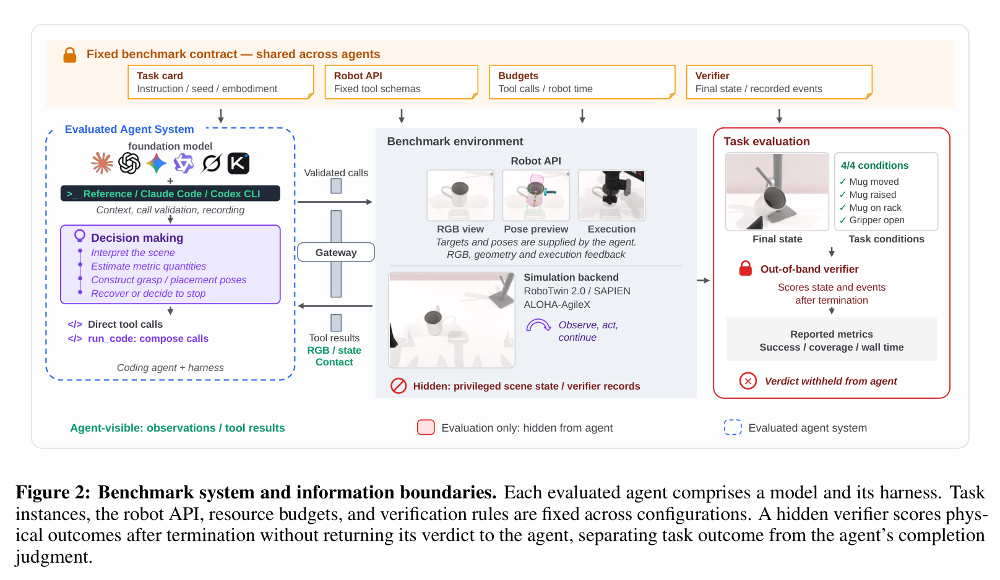

**Caption:** Figure 2: Benchmark system and information boundaries. Each evaluated agent comprises a model and its harness. Task instances, the robot API, resource budgets, and verification rules are fixed across configurations. A hidden verifier scores physical outcomes after termination without returning its verdict to the agent, separating task outcome from the agent’s completion judgment.

**Caption[CN]:** 图 2：基准系统架构与信息边界。每个受试智能体均由基础大模型及其测试基座（Harness）构成。任务实例、机器人 API、资源调用预算和验证规则在所有配置间完全保持一致。带外隐藏验证器在交互终止后独立对物理结果与事件进行评分，绝不向智能体回传判定结论，从而实现了任务物理成功与智能体主观完成判断的严格解耦。

## 2.1 Vision-Language-Action Policies

> <strong>Para. 1:</strong> Vision-language-action policies. VLA models map visual observations and language instructions to robot actions with policies learned from robot data. RT-2 (Zitkovich et al., 2023) represents actions as tokens, while RT-X (Open X-Embodiment Collaboration et al., 2024), Octo (Ghosh et al., 2024), and OpenVLA (Kim et al., 2025) train generalist policies on heterogeneous corpora. π0.5 (Black et al., 2025a) further supports long-horizon manipulation. Recent work explores cross-embodiment transfer (Luo et al., 2026a; Li et al., 2026a), geometric inductive biases (Peng et al., 2026), in-context tool use (Yang et al., 2026), and viewpoint robustness (Li et al., 2026b). However, transfer to new embodiments can require additional adaptation. CodeActionBench instead evaluates agents that generate and revise executable policy code at inference time through a shared robot API.

> <strong>Para. 1[CN]:</strong> **视觉-语言-动作策略（VLA）。** VLA 模型利用从机器人示教数据中学习得到的策略，直接将视觉观测和语言指令映射到底层机器人动作。RT-2（Zitkovich 等, 2023）将连续控制动作离散化表示为自回归词元（Tokens）；RT-X（Open X-Embodiment Collaboration 等, 2024）、Octo（Ghosh 等, 2024）和 OpenVLA（Kim 等, 2025）在多来源异构数据集上预训练通才策略；$\pi_{0.5}$（Black 等, 2025a）进一步增强了对长时域复杂操作的支持。近期的工作积极探索跨本体动作迁移（Luo 等, 2026a；Li 等, 2026a）、几何归纳偏置注入（Peng 等, 2026）、上下文内工具使用（Yang 等, 2026）以及多视角鲁棒性提升（Li 等, 2026b）。然而，将此类端到端策略迁移至新本体或新环境通常需要耗费高昂代价进行二次示教或微调适应。与之相对，CodeActionBench 重点评估智能体在推理阶段，如何通过共享机器人 API 动态生成并迭代修正可执行策略代码的通用推理能力。

## 2.2 Code-as-Policy Methods

> <strong>Para. 2:</strong> Code-as-Policy methods. Language-model robot planning incorporates affordances, execution feedback, and scene structure (Ichter et al., 2023; Huang et al., 2023d,c; Lin et al., 2023; Rana et al., 2023). Code as Policies (Liang et al., 2023) represents robot policies as programs that compose perception and control APIs. Related approaches explore programmatic task planning (Singh et al., 2023; Huang et al., 2023a), code generation from demonstrations (Wang et al., 2023), integration with motion planning (Chen et al., 2024; Wang et al., 2024a), and spatial constraints expressed through value maps or keypoint relations (Huang et al., 2023b, 2025). CodeAct (Wang et al., 2024b) uses executable Python as an agent action space with execution feedback. CodeActionBench supports both direct tool calls and Python programs that compose the same tools. Across these approaches, differences in the information and control functions provided by the interface make direct comparisons difficult.

> <strong>Para. 2[CN]:</strong> **代码即策略方法（Code-as-Policy）。** 基于大语言模型的机器人规划方法能够有效融合环境可操作度（Affordances）、执行反馈与场景几何结构（Ichter 等, 2023；Huang 等, 2023d,c；Lin 等, 2023；Rana 等, 2023）。Code as Policies（Liang 等, 2023）将机器人控制策略形式化为调用感知与底层控制 API 的计算机程序。相关衍生方法进一步探索了基于程序的结构化任务规划（Singh 等, 2023；Huang 等, 2023a）、从示教中归纳代码（Wang 等, 2023）、将代码生成与运动轨迹规划器深度整合（Chen 等, 2024；Wang 等, 2024a），以及通过价值图或关键点几何约束构建操作目标（Huang 等, 2023b, 2025）。CodeAct（Wang 等, 2024b）将可执行 Python 代码作为智能体统一动作空间，并通过解释器获取执行反馈。CodeActionBench 原生支持单步直接工具调用以及复合组织这套工具的 Python 脚本。然而在现有研究中，各平台所开放的信息边界与底层控制原语差异巨大，导致不同工作之间难以展开公平直接的横向比较。

## 2.3 Code-as-Policy Interfaces

> <strong>Para. 3:</strong> Code-as-Policy interfaces. Code-as-Policy evaluation depends on the information and control functions provided by the interface. RoboPro (Xie et al., 2025) generates policy code from visual input, DAHLIA (Meng et al., 2025) uses structured RGB-D feedback for replanning, and Reliable Code-as-Policies (Ahn et al., 2025) incorporates symbolic verification. VLCP (Naouali et al., 2026) provides task-relevant simulator object poses, yet still observes grasp and placement failures. OpenETA (Chen et al., 2026) uses depth data to map selected pixels to 3D surface points, and in its full configuration, provides specialist perception and grasp modules (Carion et al., 2025; Deitke et al., 2025; Sundermeyer et al., 2021). CaP-X (Fu et al., 2026) evaluates tiers with different combinations of simulator-state access, specialist perception, action abstraction, examples, and visual feedback, making their individual effects difficult to isolate. CodeActionBench fixes the robot API and assistance restrictions across configurations, leaving task-relevant 3D estimation, target selection, and policy construction to the agent. Table 1 summarizes these interface differences.

> <strong>Para. 3[CN]:</strong> **代码即策略的接口边界。** Code-as-Policy 的评估严密取决于交互接口所开放的信息粒度与控制抽象。RoboPro（Xie 等, 2025）直接从视觉输入合成策略代码，DAHLIA（Meng 等, 2025）引入结构化 RGB-D 点云与位姿反馈进行重规划，Reliable Code-as-Policies（Ahn 等, 2025）则引入了符号化形式验证。VLCP（Naouali 等, 2026）直接向模型开放任务相关物体的仿真真值位姿，但在抓取和放置环节仍观察到大量失败。OpenETA（Chen 等, 2026）依赖深度图直接将像素点投影为 3D 表面点，且在其完整配置中配备了第三方专业感知与抓取生成网络（Carion 等, 2025；Deitke 等, 2025；Sundermeyer 等, 2021）。CaP-X（Fu 等, 2026）划分了多个评测层级，但因层级间交织了仿真真值状态、专家感知、动作抽象度、少量样本提示及视觉反馈等多重变量，使得单一因子的独立贡献难以解耦。CodeActionBench 在所有受试系统中统一固定了底层机器人 API 并对任何外在辅助实施零宽容约束，将任务相关的 3D 空间几何解算、目标选取与策略构建全部交还给模型。表 1 系统总结了上述接口边界的关键差异。

### Table 1. Code-as-Policy 操作接口边界对比 (Interface boundaries in Code-as-Policy manipulation)

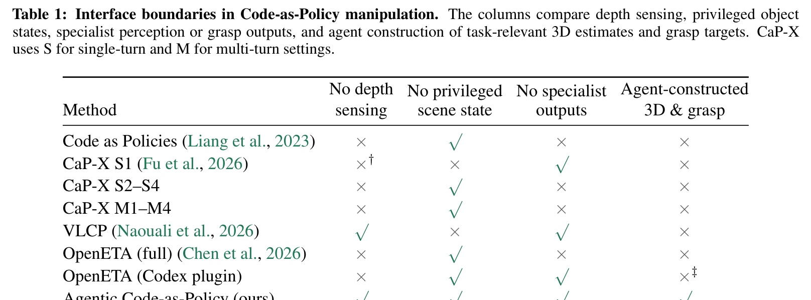

| Method | No depth sensing | No privileged scene state | No specialist outputs | Agent-constructed 3D & grasp |
|---|---|---|---|---|
| Code as Policies (Liang et al., 2023) | × | ✓ | × | × |
| CaP-X S1 (Fu et al., 2026) | ׆ | × | ✓ | × |
| CaP-X S2–S4 | × | ✓ | × | × |
| CaP-X M1–M4 | × | ✓ | × | × |
| VLCP (Naouali et al., 2026) | ✓ | × | ✓ | × |
| OpenETA (full) (Chen et al., 2026) | × | ✓ | × | × |
| OpenETA (Codex plugin) | × | ✓ | ✓ | ׇ |
| **Agentic Code-as-Policy (ours)** | **✓** | **✓** | **✓** | **✓** |

**Caption:** Table 1: Interface boundaries in Code-as-Policy manipulation. The columns compare depth sensing, privileged object states, specialist perception or grasp outputs, and agent construction of task-relevant 3D estimates and grasp targets. CaP-X uses S for single-turn and M for multi-turn settings. †CaP-X S1’s LIBERO interface exposes simulated camera depth. ‡OpenETA’s Codex plugin uses depth data to convert agent-selected image points into 3D coordinates.

**Caption[CN]:** 表 1：Code-as-Policy 操作中的接口边界对比。各列分别对比了是否使用深度感知、是否存在特权场景状态、是否依赖专家感知或抓取模块输出，以及是否完全由智能体自主构建任务相关 3D 空间估计和抓取目标。CaP-X 中 S 表示单轮设置，M 表示多轮交互设置。†CaP-X S1 所用的 LIBERO 接口直接暴露了仿真相机的深度数据。‡OpenETA 的 Codex 插件利用真实深度数据直接将智能体指定的图像像素转换为 3D 空间坐标。

## 2.4 Manipulation Benchmarks and Evaluation Interfaces

> <strong>Para. 4:</strong> Manipulation benchmarks and evaluation interfaces. RLBench, CALVIN, ManiSkill2, and LIBERO (James et al., 2020; Mees et al., 2022; Gu et al., 2023; Liu et al., 2023) provide tasks for evaluating manipulation policies. BEHAVIOR-1K (Li et al., 2023) and RoboCasa (Nasiriany et al., 2024) broaden household task coverage, while BiGym (Chernyadev et al., 2025) targets mobile bimanual manipulation. SimplerEnv (Li et al., 2024) evaluates real-robot policies in simulation, and VLABench (Zhang et al., 2025) focuses on long-horizon language-conditioned tasks. EmbodiedBench (Yang et al., 2025) and RoboBench (Luo et al., 2026b) evaluate multimodal language models as embodied agents. In contrast, CodeActionBench focuses on how agents construct and revise executable policies during interaction. Built on RoboTwin 2.0 (Chen et al., 2025), it fixes the robot API, resource budgets, and hidden verifier across agent configurations, and records execution traces to analyze policy construction, physical progress, and failure.

> <strong>Para. 4[CN]:</strong> **操作评测基准与交互环境。** RLBench、CALVIN、ManiSkill2 与 LIBERO（James 等, 2020；Mees 等, 2022；Gu 等, 2023；Liu 等, 2023）为具身操作策略提供了标准化的模拟任务环境；BEHAVIOR-1K（Li 等, 2023）与 RoboCasa（Nasiriany 等, 2024）显著拓宽了复杂家庭场景的覆盖维度；BiGym（Chernyadev 等, 2025）聚焦于移动双臂协同操作；SimplerEnv（Li 等, 2024）致力于在物理仿真中评估真实世界机器人策略；VLABench（Zhang 等, 2025）侧重于长时域自然语言条件驱动任务；EmbodiedBench（Yang 等, 2025）与 RoboBench（Luo 等, 2026b）系统评估了多模态大模型作为具身智能体的决策能力。与之不同，CodeActionBench 的核心聚焦于智能体在交互闭环中如何自主构建、执行并迭代修正可执行代码策略。本基准构建于 RoboTwin 2.0（Chen 等, 2025）基础之上，在所有待测系统间严格统一底层机器人 API、资源消耗预算和带外隐藏验证器，并忠实记录全流程执行轨迹以深入诊断策略构建、物理推进与失效归因。

# 3 CodeActionBench Formulation

## 3.1 Tasks and Evaluation Settings (Benchmark Design & Information Boundaries)

> <strong>Para. 1:</strong> CodeActionBench comprises 25 manipulation tasks in SAPIEN (Xiang et al., 2020), using RoboTwin 2.0’s ALOHA-AgileX dual-arm robot configuration (Chen et al., 2025). The tasks cover single-arm and bimanual grasping, transport, handover, tool use, arrangement, stacking, transient contact events, and manipulation of articulated objects. For consistent scene initialization, domain randomization is disabled and all configurations use the same fixed scene seed for each task.

> <strong>Para. 1[CN]:</strong> CodeActionBench 在 SAPIEN 物理仿真引擎（Xiang 等, 2020）中设计了 25 项具身操作任务，硬件平台采用 RoboTwin 2.0 中的 ALOHA-AgileX 双臂机器人配置（Chen 等, 2025）。任务体系全面覆盖单臂抓取与放置、双臂协同搬运、跨臂交接、工具使用、物体精细排列、立体重叠堆叠、瞬态接触撞击事件以及铰接连杆物体的开合操作。为了保障场景初始化的严密一致性，本基准关闭了环境域随机化（Domain Randomization），所有被评估配置在面对同一任务时均加载完全相同的固定场景随机种子（Scene Seed）。

> <strong>Para. 2:</strong> Each attempt is a complete episode from reset to termination under a fixed agent configuration and resource budget. Task instructions state goals without disclosing verifier thresholds. Evaluation uses no task-specific fine-tuning, robot demonstrations, scripted action sequences, task planners, or pre-built skills. Table 3 lists all tasks, budgets, and scene seeds.

> <strong>Para. 2[CN]:</strong> 每次尝试（Attempt）均指在固定智能体配置和给定资源预算下，从环境初始重置到最终终止运行的完整交互剧集（Episode）。任务指令仅以自然语言陈述总体操作目标，绝不向模型泄露验证器内部的定量几何容差或判定阈值。整个评测严禁使用任何特定任务微调、机器人示教演示轨迹、预录脚本动作序列、启发式任务规划器或预制高层技能库。附录表 3 详尽列出了所有 25 项任务的具体定义、预算配额与场景种子。

## 3.2 Agentic Code-as-Policy Interface and Information Boundary (Robot Interface & Execution Sandbox)

> <strong>Para. 3:</strong> The interface provides a shared robot API for observation, geometric computation, robot feedback, and bounded motion. Head and wrist cameras provide multi-view RGB observations, while calibrated geometry tools compute 3D estimates from agent-selected image points and geometric assumptions. Motion tools execute agent-specified Tool Center Point (TCP) poses and gripper commands, rejecting commands when planning fails and stopping motions that persistently stall. Agents may invoke tools directly or compose them into Python programs through run_code, using calculations, branches, loops, and action sequences. Returned observations, robot state, contact feedback, and motion outcomes support policy revision across model turns. The agent decides how to organize execution and when to terminate through done, which records its completion judgment. Appendix B provides the detailed API documentation.

> <strong>Para. 3[CN]:</strong> 交互接口向智能体暴露了一组共享的机器人 API，涵盖多模态感知、几何代数计算、本体与触觉反馈以及有界动作执行。固定头部相机与双腕相机提供多视角 RGB 图像；标定的几何工具能够基于智能体指定的像素特征点与几何先验假设解算 3D 空间坐标估计；运动控制工具负责执行智能体指定的末端工具中心点（Tool Center Point, TCP）目标位姿和夹爪开合命令，并在轨迹规划失败时拒绝指令、在持续卡滞（Stall）时主动中断动作。智能体既可以直接单步发起工具调用，亦可利用 `run_code` 将多次调用组合为包含数值计算、条件分支、循环等待与动作序列的 Python 程序。执行后返回的视觉观测、本体状态、触觉反馈和动作执行状态，支持智能体在后续模型轮次中持续修正策略。智能体可自主掌控程序执行组织架构，并在其判定任务达成或无法继续时调用 `done` 主动终止剧集，同时记录其主观完成判断。附录 B 提供了全部 29 个 API 的详尽技术文档。

> <strong>Para. 4:</strong> Both direct calls and programs obey the same information restrictions. The API does not expose exact object poses, task-specific grasp or placement targets, specialist perception outputs, or verifier state. Geometry tools perform the requested computations but do not select visual correspondences or verify the agent’s geometric assumptions. The agent remains responsible for selecting evidence, interpreting estimates, and constructing manipulation targets. Task success is determined independently by the verifier, whose result is never returned to the agent.

> <strong>Para. 4[CN]:</strong> 无论是单步直接工具调用还是复合 Python 代码执行，均严格恪守完全一致的信息隔离红线。API 绝不向智能体暴露物体真值位姿、任务抓取/放置关键点、专家感知网络预测结果或内部验证器状态。几何代数工具仅充当被动算子，负责根据输入执行精确投影与方程求解，绝不代劳跨视角特征点匹配，亦不校验模型提出的几何假设是否符合物理真实。智能体必须全权负责视觉特征筛选、数值结果合理解释以及最终操作点位构建。任务的物理成功与否完全由带外验证器独立研判，其判定信号在整个交互过程中对智能体严格不可见。

## 3.3 Reference Harness (Task Suite of 25 Fixed Instances)

> <strong>Para. 5:</strong> The reference harness manages model interaction with the benchmark throughout each episode. It forms part of the evaluated agent configuration, while other agent systems may use their own harnesses with the same robot API. At each turn, it constructs the model request, converts provider-specific responses into a common format, validates tool calls against the API schemas, and records the interaction.

> <strong>Para. 5[CN]:</strong> 参考测试基座（Reference Harness）负责在整个交互剧集中统一调度多模态模型与基准环境的通信。它是受评智能体系统的核心组成部分；而第三方厂商系统则可在对接相同机器人 API 的前提下采用各自专有的测试基座。在交互的每一轮次中，Harness 负责构建符合格式规范的多模态模型请求、将各服务商专有返回解析归一化为通用结构、对照严格的 API JSON Schema 校验参数合法性，并无损留存全流程交互数据。

> <strong>Para. 6:</strong> The harness follows a fixed context-management policy. Text interactions are appended to preserve a stable request prefix, while images are managed separately. Each request includes images from the two most recent observation rounds, with at most six images from any single run_code result. Persistent observation identifiers and text records allow earlier images to be retrieved after removal from the current context. Near the context limit, the harness retains the eight most recent assistant messages and tool results verbatim and converts older interactions into at most 128 records using fixed rules. If the request still exceeds the limit, the episode terminates. Appendix C provides further implementation details.

> <strong>Para. 6[CN]:</strong> 该测试基座遵循一套明确的上下文窗口管理机制。文本交互历史按时序追加以维持提示词前缀的稳定性，而图像观测则采取独立的滚动窗口管理。每次发给模型的提示词仅挂载最近两轮观测中捕获的图像，且单个 `run_code` 执行结果中最多保留 6 张最新图像。系统为每张图像分配全局持久化观测 ID，并保留相应的元数据文本记录，使智能体能够在早期图像被移出活跃视觉上下文后随时按需重新检索。在逼近上下文容量上限时，Harness 逐字保留最近 8 轮智能体回复与工具返回，并依照固定启发规则将更早期的交互压缩提炼为最多 128 条结构化记录（保留所请求的目标点、达到的位姿、接触信息与执行结果，剔除冗长的思考文本与重复源码）。若压缩后提示词仍超出上下文极限，剧集将直接触发保护性终止。附录 C 阐述了更多底层实现细节。

## 3.4 Out-of-band Task Verification (Evaluation Protocol & Hidden Outcome Verifier)

> <strong>Para. 7:</strong> A hidden verifier assigns each attempt a binary outcome after termination, without returning the result to the agent. For 21 tasks, success is determined by the final physical state. The remaining four tasks are scored by whether a required event occurs during execution. Table 3 specifies the scoring rule for each task. An episode ends when the agent calls done, exhausts a budget, or meets another predefined termination condition. The done call records the agent’s completion claim without providing success feedback, allowing this claim to be compared with the independent verifier outcome.

> <strong>Para. 7[CN]:</strong> 独立运行的带外隐藏验证器在每次尝试终止后，判定并赋予一个严格的二值化物理结果（成功/失败），且该结果绝不反馈给智能体。基准中的 21 项任务依据终止瞬间的最终物理状态（如物体终末 3D 坐标、相对间距、容器包含关系及夹爪状态）来裁定胜负；其余 4 项任务（锤击、按铃、按压订书机与倾倒小料盒）则依据执行过程中是否成功触发了预设的瞬态接触或物理事件（如碰撞冲量、高度阈值跃迁）进行锁存（Latch）判定。表 3 明确标注了每项任务的评分规则。当智能体主动调用 `done`、耗尽调用或时间预算、或触发其它预设终止条件时，剧集即刻结束。`done` 调用显式记录了智能体对其任务完成状态的自我声称（`success_claim`），这使得智能体主观认知与物理客观事实的解耦比对成为可能。

## 3.5 Protocol and Metrics

> <strong>Para. 8:</strong> We evaluate nine agent configurations, each defined by its foundation model and harness. Seven share the reference harness, while two use Claude Code (Anthropic, n.d.) and Codex CLI (OpenAI, n.d.) as harnesses, respectively. Comparisons involving different harnesses therefore evaluate complete agent systems. All configurations use the same environment, robot API, task-specific budgets, and verifier. Each task uses one fixed scene seed, with three valid attempts per configuration, yielding 75 attempts per configuration and 675 overall. Superseded runs and documented infrastructure failures are excluded.

> <strong>Para. 8[CN]:</strong> 我们评估了 9 种智能体系统配置，每种配置均由其基础大模型与测试基座共同界定。其中 7 款模型统一挂载于参考测试基座之下，另外 2 种配置则分别采用商业化专业智能体环境 Claude Code（Anthropic, n.d.）与 Codex CLI（OpenAI, n.d.）。因此，涉及不同测试基座的对比所评估的是包含上下文工程与工具编排的完整智能体端到端系统。所有配置均面对同一仿真世界、标准机器人 API、相同资源预算和统一隐藏验证器。每个任务实例采用一个固定的场景初始种子，各配置独立进行 3 次重复评估尝试，单个配置累计完成 75 次尝试，基准全集共计 675 次尝试。所有因基础设施网络中断引发的无效异常运行均已被严格排查剔除。

> <strong>Para. 9:</strong> We report success rate over the 75 attempts and task coverage, defined as the number of tasks solved at least once in three attempts. Coverage measures performance on the fixed task instances rather than generalization across scenes. End-to-end execution time includes model-provider waiting and environment execution. Process analyses use recorded tool calls, programs, robot actions, and scene states, with the eligible sample reported for each measurement. These diagnostics do not affect the success-based ranking.

> <strong>Para. 9[CN]:</strong> 我们核心报告两项一级宏观指标：基于全部 75 次尝试计算的**尝试成功率（Attempt Success Rate）**，以及在 3 次尝试中至少成功解决一次的任务数量所定义的**任务覆盖率（Task Coverage）**。任务覆盖率反映了系统在固定复杂操作实例上的问题攻克广度，而非跨环境域的泛化性能。端到端墙钟耗时（Wall Time）由模型服务商 API 推理等待与仿真物理执行两部分共同构成。微观过程分析基于系统所记录的工具调用流、Python 代码块、机器人动作轨迹与物理场景状态，每次统计分析均注明了符合准入条件的研究样本量。这些深层诊断指标旨在剖析行为机理，不干扰基于客观成功率的核心排行。

# 4 Empirical Evaluation

## 4.1 Comparative Analysis across 9 Configurations (Performance across configurations and tasks)

> <strong>Para. 1:</strong> We evaluate nine agent configurations on 25 fixed task instances, with three attempts per instance for each configuration. Across all configurations, 184 of 675 attempts succeed (27.3%). We report task performance and inference cost, followed by analyses of policy execution and task completion assessment.

> <strong>Para. 1[CN]:</strong> 我们在 25 个固定的操作任务实例上对 9 种智能体配置展开了系统评估，每个实例独立尝试 3 次。在基准全集的 675 次尝试中，共有 184 次取得物理成功，全集平均成功率为 27.3%。以下我们首先汇报宏观任务表现与 API 推理成本，随后对执行过程中的代码策略行为以及任务完成自我评估能力进行多维度剖析。

> <strong>Para. 2:</strong> As shown in Figure 3, GPT-6 Astra (Codex CLI) achieves the highest success rate of 73.3% and solves 22/25 tasks. Claude Opus 5 with the reference harness follows with 49.3% success and 19/25 tasks solved, compared with 45.3% and 14/25 under Claude Code. The two Opus configurations thus differ by only 4.0 percentage points in success rate but by five tasks in coverage.

> <strong>Para. 2[CN]:</strong> 如图 3 所示，搭载 Codex CLI 的 GPT-6 Astra 表现最为突出，斩获了 73.3% 的最高尝试成功率（55/75），并在 25 个任务中成功覆盖了 22 个。搭载参考基座的 Claude Opus 5 位居次席，取得了 49.3% 的成功率（37/75）和 19/25 的任务覆盖率；而在搭载 Claude Code 商业 Harness 时，其成功率为 45.3%（34/75），覆盖 14/25 个任务。值得注意的是，这两种 Opus 配置在尝试成功率上仅相差 4.0 个百分点，但在任务覆盖广度上却拉开了多达 5 项任务的显著差距。

> <strong>Para. 3:</strong> Among the seven configurations using the reference harness, Claude Opus 5 leads in both metrics. It achieves a success rate of 49.3%, followed by Gemini 3.6 Flash at 20.0%. Its task coverage reaches 76%, followed by GPT-5.6 Sol at 36%. Table 10 reports success counts, task coverage, and consistency across the three attempts.

> <strong>Para. 3[CN]:</strong> 在接入统一参考测试基座的 7 款模型横向评测中，Claude Opus 5 在两项指标上均居于首位。其成功率达到 49.3%，紧随其后的是 Gemini 3.6 Flash，成功率为 20.0%（15/75）。在任务覆盖率方面，Opus 5 达到了 76%（19/25），位居第二的是 GPT-5.6 Sol，覆盖率为 36%（9/25）。其余配置表现依次为：Qwen 3.8 Max 成功率 14.7%（覆盖 6 项）、Grok 4.6 成功率 12.0%（覆盖 6 项）、Kimi K3 成功率 12.0%（覆盖 5 项）、Claude Sonnet 5 成功率 2.7%（覆盖 2 项）。表 10 详细记录了各系统在 3 次重复尝试中的成功分布与一致性统计。

### Figure 3. 9 种智能体配置的任务性能表现 (Task performance across configurations)

**Caption:** Figure 3: Task performance. (A) Success rate over 75 attempts. (B) Percentage of the 25 fixed instances solved at least once in three independent attempts.

**Caption[CN]:** 图 3：任务性能表现。(A) 在全部 75 次独立尝试中的成功率。(B) 25 项固定任务实例在三次尝试中至少成功解决一次的任务覆盖百分比。

## 4.2 Cost and Time Efficiency (Cost, Latency & Program Use)

> <strong>Para. 4:</strong> Figure 4 compares success rates with total API-equivalent inference cost over 75 attempts and median end-to-end execution time. Astra achieves higher success at lower cost and with shorter execution time than either Opus configuration. Compared with Opus under the reference harness, Astra achieves 73.3% versus 49.3% success, with 15.1% lower cost and 60.0% shorter median execution time. Its median of 477.2 s is the shortest among all nine configurations. Gemini 3.6 Flash has the lowest total cost of $52.00 and a success rate of 20.0%, outperforming five other reference-harness configurations at lower cost. Appendix D.3 provides the pricing assumptions and resource distributions.

> <strong>Para. 4[CN]:</strong> 图 4 将各系统的成功率与其在 75 次尝试中的累计 API 等效推理成本及端到端单次尝试中位耗时进行了联合对比。GPT-6 Astra 在取得最高成功率的同时，展现出了显著优于两种 Opus 配置的成本与时间效率。相比于参考基座下的 Opus，Astra 成功率高出 24 个百分点（73.3% 对比 49.3%），总推理成本低 15.1%（252.87 美元对比 297.84 美元），单次中位执行时间大幅缩短 60.0%（477.2 秒对比 1,193.1 秒），其 477.2 秒的中位耗时在全部 9 种配置中也是最短的。另一方面，Gemini 3.6 Flash 展现出极致的性价比优势：其 75 次尝试的总成本仅为 52.00 美元，成功率却达到 20.0%，以最低的开销超越了参考基座下的其余 5 款基础模型。附录 D.3 详尽列出了 Token 计费标准与各项资源消耗的统计学四分位距分布。

### Figure 4. 成功率对比推理成本与端到端耗时 (Success rate against inference cost and wall time)

**Caption:** Figure 4: Success rate against inference cost and wall time. Each point represents one configuration’s 75 attempts. Both panels show success rate vertically; the horizontal axes are (A) total API-equivalent inference cost and (B) median wall time per attempt.

**Caption[CN]:** 图 4：成功率对比推理成本与执行耗时。散点图中的每个数据点对应单一配置在 75 次尝试中的整体表现。两张图的纵轴均为尝试成功率；横轴分别表示：(A) 75 次尝试的 API 等效总推理开销（美元），(B) 单次尝试的端到端中位墙钟时间（秒）。

## 4.3 Checkpoint & Subgoal Coverage (Policy Execution Analysis)

> <strong>Para. 5:</strong> Binary task outcomes do not distinguish an initial grasp failure from a placement failure after successful transport. We therefore use subgoal checkpoints to record completion of intermediate task requirements. We also use spatial checkpoints to assess whether the robot reaches locations associated with these subgoals. We compare coverage of the two checkpoint types, and plot cumulative spatial coverage against charged tool calls for all 75 attempts per configuration, using the same 25 task instances across nine configurations. We then use spatial checkpoint matches and action records to identify which subgoals were not completed and where execution failed.

> <strong>Para. 5[CN]:</strong> 传统的二值化终局评分无法区分“在起点抓取即失败”与“成功搬运物体后在最终放置环节失败”这两种截然不同的行为质态。为此，我们设计了**子目标检查点（Subgoal Checkpoints）**以刻画中间任务物理里程碑的达成情况；同时建立了**空间检查点（Spatial Checkpoints）**以定量裁决机器人末端是否真正到达了这些子目标对应的几何作业区域。我们横向对比了两类检查点的覆盖率，并绘制了各配置 75 次尝试中累积空间覆盖率随计费工具调用次数演进的动态曲线。随后，结合空间检查点命中情况与动作执行日志，精细化溯源未达成的子目标以及物理执行发生阻断的具体环节。

> <strong>Para. 6:</strong> Checkpoint definitions. We define 55 subgoal checkpoints and 72 spatial checkpoints across the 25 tasks, using the same criteria for all configurations. Subgoal criteria are derived from task verifiers and specify object states, spatial relations, or required interaction events. Spatial checkpoints define regions for the robot’s tool center point (TCP), with reference positions and tolerances determined from task geometry and successful expert executions (Chen et al., 2025). Regions associated with movable targets follow the corresponding objects. Subgoal completion is assessed from recorded scene and robot states, while spatial matches use recorded end-effector positions or measured position bounds. Each checkpoint is counted once, at its first confirmed completion or match. Spatial matches must satisfy any prerequisite checkpoint dependencies, which apply only to trajectory analysis and do not constrain the agent during execution.

> <strong>Para. 6[CN]:</strong> **检查点定义。** 我们在 25 项任务中严格定义了 55 个子目标检查点与 72 个空间检查点，且判定标准在所有配置间完全统一。子目标准则直接继承自底层任务验证逻辑，严格规定了特定物体的位姿状态、空间相对关系或必经的交互事件。空间检查点则为机器人的工具中心点（TCP）划定了允许的容差空间区域，其基准中心坐标与几何容差结合了任务自身几何特征与专家示教成功轨迹（Chen 等, 2025）共同校准获得；与可移动物体绑定的空间检查点会随物体当前的实时位置动态平移。子目标的达成依赖全量物理状态评估，空间命中则依据末端实际坐标或测量包围盒判定。每个检查点在首次确认命中时计入一次。空间检查点须满足预设的前置依赖顺序，此依赖关系仅用于事后离线诊断分析，绝不在执行期间对智能体施加任何在线干预。

> <strong>Para. 7:</strong> For each attempt, coverage is the fraction of its subgoal or spatial checkpoints attained. We average the three attempts within each task and then average across the 25 tasks with equal weight. At charged call k, cumulative spatial coverage includes matches recorded within the first k calls. After an attempt ends, its coverage remains unchanged at subsequent call counts. Repeated matches do not increase coverage, and later regression does not remove an earlier match. Observation, computation, and unsuccessful operations all count toward the call budget, while one program submission may match several checkpoints. Checkpoints without confirmed matches remain in the denominator, so both measures depend on recording completeness. Appendices E.1 and E.2 provide the definitions, calibration details, and evidence-recovery procedures.

> <strong>Para. 7[CN]:</strong> 对于单次尝试，覆盖率定义为所达成的检查点数量占该任务预设检查点总数的百分比。在统计聚合时，首先对单个任务内的 3 次重复尝试取算术平均，随后对 25 项任务赋予等权重求取全集均值。在第 $k$ 次计费工具调用时，**累积空间覆盖率**统计的是前 $k$ 次调用过程中所确认命中的全部空间检查点集合。当某一尝试提前终止后，其在后续更大调用步数上的覆盖率数值保持不变。重复命中不会增加覆盖率，而后续物体的脱落或状态倒退亦不会剥夺此前已确认命中的检查点记录。感知观测、数值计算和失败报错的操作均计入调用预算，而单个 Python 程序的执行可能一次性连续触发多个检查点。未被确认命中的检查点始终保留在分母中。附录 E.1 与 E.2 详述了校准流程、几何阈值与可信回放证据恢复机制。

> <strong>Para. 8:</strong> Spatial coverage over tool calls. Astra leads both checkpoint types in coverage (Figure 5). Only three configurations exceed 50% spatial coverage: Astra at 87.3%, Opus (Reference) at 73.6%, and Opus (Claude Code) at 73.4%. By call 22, Astra exceeds every other configuration’s final spatial coverage. The two Opus configurations achieve nearly identical spatial coverage despite differences in attempt success rate and task coverage.

> <strong>Para. 8[CN]:</strong> **调用步数演进下的空间覆盖分析。** 如图 5 所示，GPT-6 Astra 在两类检查点的覆盖率上均处于绝对领先地位。在全部 9 种配置中，仅有 3 种配置的最终空间覆盖率突破了 50% 大关：Astra 达到 87.3%（子目标覆盖率 76.0%），参考基座下的 Opus 5 达到 73.6%（子目标覆盖率 60.6%），Claude Code 架构下的 Opus 5 达到 73.4%（子目标覆盖率 55.8%）。尤其引人注目的是，Astra 仅需进行 22 次工具调用，其累积空间覆盖率便已超越了基准中其余所有配置在耗尽全部预算后的终极水平。此外，两种 Opus 配置虽然在最终成功率和任务覆盖面上存在差距，但其末端空间检查点的达成比例却极为接近（73.6% 对比 73.4%），这表明两者均能高频探入目标作业区，但后续物理操控的稳定程度存在细微差异。

### Figure 5. 各配置的子目标与空间检查点覆盖率 (Subgoal and spatial checkpoint coverage)

**Caption:** Figure 5: Subgoal and spatial checkpoint coverage across configurations. Panel A reports final coverage in descending order of subgoal coverage. Panel B shows cumulative spatial coverage against charged tool calls, averaged across 25 tasks for each configuration.

**Caption[CN]:** 图 5：各智能体配置的子目标与空间检查点覆盖率。(A) 柱状图按子目标最终覆盖率降序排列展示各配置的表现。(B) 曲线图展示各配置在 25 项任务上的平均累积空间检查点覆盖率随计费工具调用次数增加的动态上升轨迹。

> <strong>Para. 9:</strong> Failure analysis. Each failed attempt is assigned to its earliest evidence-supported failure stage, using unmet or lost subgoals, associated spatial checkpoints, and action records of object motion, contact, and release. Figure 6 groups attempts according to whether arrival at the relevant region and object control are confirmed, and whether the subgoal is completed and maintained. Failures limited to the final gripper condition and cases with insufficient evidence are reported separately. Appendix F provides the assignment criteria.

> <strong>Para. 9[CN]:</strong> **失效阶段归因分析。** 针对全部 491 次失败尝试，我们基于未达成或中途丧失的子目标、相关空间检查点以及物体运动、物理接触与释放的底层日志，将其归因于最早出现的、具备确凿证据支持的失效阶段。图 6 将所有失败尝试划分为五大阶段：是否确认到达相关作业区（Arrival unconfirmed）、是否确认获得物体有效控制（Object control unconfirmed）、到达作业区后是否完成并维持住了目标状态（Subgoal unmet or not maintained）、是否仅仅失败在最终夹爪状态（Final gripper state only），以及证据不足的未决案例（Mechanism unresolved）。附录 F 给出了具体的判定树与分类细则。

### Figure 6. 任务结果与失效阶段分布 (Task outcomes and failure stages)

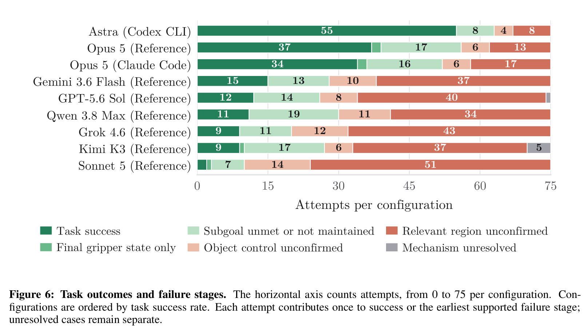

**Caption:** Figure 6: Task outcomes and failure stages. The horizontal axis counts attempts, from 0 to 75 per configuration. Configurations are ordered by task success rate. Each attempt contributes once to success or the earliest supported failure stage; unresolved cases remain separate.

**Caption[CN]:** 图 6：任务最终结果与失效阶段分布。横轴累加各配置的 75 次独立尝试，各系统按任务成功率从高到低由上至下排列。每次尝试根据其最终状态唯一贡献至物理成功或其最早被证实发生阻断的失效阶段；证据不足的案例单列为未决状态。

> <strong>Para. 10:</strong> Among the 491 failed attempts, 280 have no confirmed arrival at the relevant region, 77 have no confirmed object control, and 122 reach the operation region but do not complete the subgoal or later lose it. Six fail only the final gripper condition, and six remain unresolved. Astra records 20 failures, compared with 38 for Opus Reference and 41 for Opus Claude Code. Arrival is unconfirmed in 8, 13, and 17 attempts, respectively, compared with 34 to 51 for each of the other six configurations. This result indicates that stronger systems have fewer failures with unconfirmed arrival at the relevant operation region. Object-control and subgoal-outcome failures together account for more than half of the failures in these three configurations (12/20, 23/38, and 22/41). These later-stage cases are consistent with difficulties in object retention, precise contact or placement, and state maintenance.

> <strong>Para. 10[CN]:</strong> 在全部 491 次失败尝试的微观归因中，有 280 次甚至未能确认到达相关操作几何区域；有 77 次成功进入区域但未能建立对操作目标的稳定抓取或力学约束；有 122 次成功到达目标作业区并尝试交互，却未能达成预期的物理约束或在后续步骤中失手丢落；有 6 次完美完成了全部物理搬运但在剧集结束前遗漏了松开夹爪的要求；另有 6 次属于原始与重放数据存在微小歧义的未决案例。在最强梯队中，Astra 仅记录了 20 次失败，Opus 参考基座为 38 次，Opus Claude Code 为 41 次；其未到达操作区的次数分别仅为 8、13 和 17 次，而其余 6 种较弱配置未到达区域的失败高达 34 至 51 次。这明确表明，高级智能体已经基本解决了“找到并接近作业区域”的粗定位瓶颈。然而，在上述前三强系统的失败案例中，超过半数（分别为 12/20、23/38 和 22/41）集中在“物体控制建立失败”和“作业区内操作失误”等后期深水区。这些后期失败真实反映了大模型在物理交互接触面的微小位姿控制、滑动摩擦抑制以及多阶段动态平衡维持上的深层薄弱。

## 4.4 Task Completion Assessment and Termination (Failure Modes & Premature Done Claims)

> <strong>Para. 11:</strong> Agents should assess task completion from RGB observations, robot state, contact feedback, and execution outcomes, without access to the verifier’s verdict. They are instructed to call done(report=..., success_claim=...) when the task is complete or they cannot proceed. This call ends the episode and records the agent’s account of its actions and completion judgment. We compare the Boolean claim with the independent verifier outcome. An overclaim reports success on a failed attempt, while an underclaim reports failure on a successful attempt. Attempts without an explicit claim are recorded separately rather than treated as incorrect judgments.

> <strong>Para. 11[CN]:</strong> 在无权直接访问带外验证器结论的前提下，智能体必须完全依托多视角 RGB 观测、机器人本体传感器读数、触觉碰撞反馈及底层动作返回值，自主审视物理任务是否真正圆满完成。基准提示词规定智能体在判定任务完成或确信陷入不可恢复困境时，显式调用 `done(report=..., success_claim=...)`。该调用将即刻结束剧集，并留存智能体对于所执行过程的文字陈述及其布尔型完成声明（`success_claim`）。我们将该声明与带外验证器的客观真值进行对照分类：**过度声称（Overclaim）**指物理失败但智能体声称成功；**保守低报（Underclaim）**指物理实际成功但智能体误判为失败。而因耗尽预算被强行截停等未提交显式布尔声明的案例则被独立单列，避免被武断归为误判。

### Table 2. 交互终止模式与任务完成主观判断对照 (Termination and completion judgment)

| Category & Metric | GPT-6 Astra (Codex CLI) | Claude Opus 5 (Reference) | Claude Opus 5 (Claude Code) |
|---|---|---|---|
| **A. All attempts (75 attempts)** | | | |
| Ends with `done` | 72/75 (96.0%) | 63/75 (84.0%) | 54/75 (72.0%) |
| Ends with a correct claim | **68/75 (90.7%)** | 50/75 (66.7%) | 42/75 (56.0%) |
| **B. Successful attempts** | *(55 attempts)* | *(37 attempts)* | *(34 attempts)* |
| Correct success claim | 54/55 (98.2%) | 36/37 (97.3%) | 30/34 (88.2%) |
| Underclaim | 1/55 (1.8%) | 0/37 (0.0%) | 1/34 (2.9%) |
| No explicit claim | 0/55 (0.0%) | 1/37 (2.7%) | 3/34 (8.8%) |
| **C. Failed attempts** | *(20 attempts)* | *(38 attempts)* | *(41 attempts)* |
| Correct failure claim | **14/20 (70.0%)** | 14/38 (36.8%) | 12/41 (29.3%) |
| Overclaim (Premature claim) | 3/20 (15.0%) | 13/38 (34.2%) | 11/41 (26.8%) |
| No explicit claim | 3/20 (15.0%) | 11/38 (28.9%) | 18/41 (43.9%) |

**Caption:** Table 2: Termination and completion judgment. A uses all 75 attempts per configuration. B and C partition successful and failed attempts, respectively, under corrected verifier outcomes. Overclaim: a success claim on a verifier-failed attempt. Underclaim: a failure claim on a verifier-successful attempt. Attempts without an explicit claim are reported separately.

**Caption[CN]:** 表 2：交互终止模式与任务完成判断对照表。A 统计各配置在全部 75 次尝试中的表现。B 和 C 分别在客观物理成功和失败的样本子集内进行细分。过度声称（Overclaim）：物理失败但智能体误报成功；保守低报（Underclaim）：物理成功但智能体误报失败。未能在终止前给出显式布尔声明的案例单独列出。

> <strong>Para. 12:</strong> Table 2 reports how often agents terminate through done and how often they terminate with a correct claim, both measured over all 75 attempts. Correct claims include both success and failure reports that agree with the verifier. Astra calls done in 72/75 attempts, compared with 63/75 for Opus Reference and 54/75 for Opus Claude Code. It provides a correct claim in 68/75 attempts (90.7%), compared with 50/75 (66.7%) and 42/75 (56.0%), respectively. These proportions reflect both whether the agent supplies a claim before termination and whether that claim is correct.

> <strong>Para. 12[CN]:</strong> 表 2 系统展示了智能体在全部 75 次尝试中主动调用 `done` 终止的频率，以及给出正确完成声明的比例。所谓“正确声明”，包含了主客观一致声称成功以及在失败时坦诚声称未完成两种情形。Astra 在多达 72/75 次尝试中均主动调用了 `done`（96.0%），而参考基座下的 Opus 为 63/75 次（84.0%），Claude Code 下的 Opus 为 54/75 次（72.0%）。在自我评估准确率上，Astra 在 68 次尝试中做出了与客观事实完全相符的判定（90.7%），大幅领先于 Opus 参考配置的 66.7%（50/75）和 Claude Code 配置的 56.0%（42/75）。这一比例综合反映了智能体是否具备在用尽额度前主动收敛并准确审视自身行为的能力。

> <strong>Para. 13:</strong> Separating successful and failed attempts reveals where the configurations differ. Among successful attempts, Astra, Opus Reference, and Opus Claude Code correctly report success in 98.2%, 97.3%, and 88.2% of cases, respectively. Among failed attempts, Astra correctly reports failure in 70.0% of cases, compared with 36.8% and 29.3% for the Opus systems. Incorrect success claims account for 15.0%, 34.2%, and 26.8% of their failed attempts, respectively. Underclaims occur once for Astra and once for Opus Claude Code. Astra thus more often ends with a correct assessment, including when manipulation has not achieved the task goal.

> <strong>Para. 13[CN]:</strong> 将物理成功与失败尝试分别拆解，可以更加清晰地看清系统间的本质差异。在物理成功的样本中，Astra、Opus 参考配置与 Opus Claude Code 均展现了优异的正向识别率，分别正确确认了 98.2%、97.3% 和 88.2% 的成功事件。而在物理失败的考验面前，分水岭尤为明显：Astra 能够在高达 70.0%（14/20）的失败局面中清醒地判定任务失败；相比之下，两款 Opus 配置在失败时的清醒认知率仅为 36.8%（14/38）和 29.3%（12/41）。在失败场景下出现“盲目乐观过度声称（Overclaim）”的比例，Opus 两种配置分别高达 34.2% 和 26.8%，而 Astra 仅为 15.0%。低估成功的 Underclaim 极为罕见（Astra 与 Opus Claude Code 各出现 1 例）。由此可见，GPT-6 Astra 具备显著更强的物理自省能力，在操作未达目标时更不易产生虚假的“幻觉式成功声称”。

> <strong>Para. 14:</strong> Budget limits can end an episode before the agent reports its assessment. All attempts without an explicit claim in these three configurations terminate at a tool-call or physical-time limit, including one successful Opus Reference attempt and three successful Opus Claude Code attempts. This pattern is more pronounced for Claude Sonnet 5, which leaves 70/75 attempts without an explicit claim. Of these, 69 end at a budget limit and one ends through done without a Boolean claim. Missing claims therefore need to be distinguished from incorrect assessments, since forced termination leaves the agent’s final judgment unobserved. Appendix G.2 reports all configurations and stopping conditions.

> <strong>Para. 14[CN]:</strong> 预算耗尽常常在智能体来得及审视并提交报告之前强行掐断交互剧集。在上述三款顶尖配置中，所有缺失显式完成声明的案例无一例外均是由于触碰了工具调用次数上限或物理仿真时间配额而被系统强制掐断，其中甚至包括 1 次物理上已然成功的 Opus 参考尝试和 3 次成功的 Opus Claude Code 尝试。这种“被动超限截停”现象在较弱的模型中被极度放大：例如 Claude Sonnet 5 在 75 次尝试中有 70 次未留下显式声明，其中 69 次是因为配额超限被直接熔断，另有 1 次虽然调用了 `done` 却遗漏了关键布尔参数。因此，评测中必须将“未提交声明”与“判断错误”严加区分，因为强制熔断意味着智能体尚未完成其闭环交互，其终局认知状态处于未被观测的截断状态。附录 G.2 详尽列出了所有 9 种配置的终止模式与截停原因分布。

# 5 Limitations

> <strong>Para. 1:</strong> Evaluation scope. We evaluate 25 simulated manipulation tasks with a single dual-arm embodiment and one fixed scene instance per task. Repeated attempts measure variation in agent behavior on the same instances. Generalization across scenes, task families, and embodiments requires further evaluation. Transfer to physical robots also remains untested.

> <strong>Para. 1[CN]:</strong> **评估范围与泛化边界。** 当前基准评估了 25 项仿真物理操作任务，均运行于单一固定的双臂机器人本体（ALOHA-AgileX）之上，且每个任务采用唯一的确定性初始场景种子。多次独立运行的核心目的在于衡量同一复杂环境实例下模型随机采样与控制策略的不确定性波动。智能体在多样化场景打乱、未见任务门类以及全新机器人本体之间的跨域泛化能力，仍需在未来的扩展基准中深入验证。此外，当前体系在真实物理真机上的 Sim-to-Real 迁移效果与接触力学鸿沟尚未经过实体硬件实测。

> <strong>Para. 2:</strong> Evaluation cost and latency. Inference cost and wall time limit the number of configurations and attempts in the evaluation. Sequential model calls also delay action selection and policy revision. This latency constrains time-sensitive manipulation.

> <strong>Para. 2[CN]:</strong> **评测成本与推理延迟。** 昂贵的商业 API 调用账单与冗长的端到端物理交互墙钟耗时，极大制约了评测中能够覆盖的模型架构数量与重复尝试次数。此外，多轮交互中自回归串行调用大模型带来了显著的控制延迟，阻碍了即时动作决策与毫秒级的高频策略纠偏。这一固有的高时延特性限制了该范式在对动态反应速度与瞬态反馈要求极高的敏捷操作场景中的推广应用。

# 6 Conclusion

> <strong>Para. 1:</strong> We introduce CodeActionBench, a benchmark for evaluating agentic Code-as-Policy in embodied manipulation. Agents construct and revise executable policies from visual observations and execution feedback through a shared robot API, without access to privileged scene state or specialist perception and grasp outputs. Across nine agent configurations on 25 fixed simulated task instances, success rates range from 2.7% to 73.3% without additional task-specific fine-tuning or demonstrations. Trajectory analysis shows that failed attempts can reach intermediate spatial checkpoints, while these spatial matches alone do not establish successful manipulation. By combining task outcomes, execution traces, and agent-reported completion claims, CodeActionBench supports evaluation of policy execution and task completion assessment under a common protocol.

> <strong>Para. 1[CN]:</strong> 我们提出了 CodeActionBench，一个专注于评测具身操作中“智能体式代码即策略”（Agentic Code-as-Policy）的标准基准体系。在完全剥离仿真特权场景状态以及任何外部专家感知/抓取插件的严格信息隔离下，智能体仅依靠共享的机器人 API，从原始多视角 RGB 视觉观测和物理动作反馈中，自主完成几何建模、空间目标推理并生成可执行代码以闭环修正策略。在 25 项固定复杂任务实例与 9 种主流智能体系统的 675 次实测中，未经历特定微调的系统取得了 2.7% 至 73.3% 的广泛成功率分布。微观轨迹分析进一步证明，大量失败尝试虽然能够顺利命中前期的空间位置检查点，但这并不足以支撑精细物理操作的最终达成。通过将终末客观任务判定、高保真执行轨迹与智能体自我完成声称紧密结合，CodeActionBench 在同一标准化评测协议下，为具身代码策略的物理执行效能与认知反思水准的综合评测开辟了全新路径。

# References

1. Sanghyun Ahn, Wonje Choi, Junyong Lee, Jinwoo Park, and Honguk Woo. Towards reliable code-as-policies: A neuro-symbolic framework for embodied task planning. In *Advances in Neural Information Processing Systems*, volume 38, 2025.
2. Alibaba Cloud. Alibaba unveils Qwen3.8-Max: Its largest and most capable flagship model to date, August 2026. URL https://www.alibabacloud.com/en/press-room/alibaba-unveils-qwen3-8-max. Published August 3, 2026. Accessed September 15, 2026.
3. Anthropic. Introducing the Model Context Protocol. Official announcement, November 2024. URL https://www.anthropic.com/news/model-context-protocol. Published November 25, 2024. Accessed September 17, 2026.
4. Anthropic. Introducing Claude Opus 5, 2026a. URL https://www.anthropic.com/news/claude-opus-5. Accessed September 15, 2026.
5. Anthropic. Introducing Claude Sonnet 5, 2026b. URL https://www.anthropic.com/news/claude-sonnet-5. Accessed September 15, 2026.
6. Anthropic. Claude Code: Overview. Software documentation, n.d. URL https://code.claude.com/docs/en/overview. Accessed September 15, 2026.
7. Kevin Black, Noah Brown, James Darpinian, Karan Dhabalia, Danny Driess, Adnan Esmail, Michael Robert Equi, Chelsea Finn, Niccolo Fusai, Manuel Y. Galliker, Dibya Ghosh, Lachy Groom, Karol Hausman, brian ichter, Szymon Jakubczak, Tim Jones, Liyiming Ke, Devin LeBlanc, Sergey Levine, Adrian Li-Bell, Mohith Mothukuri, Suraj Nair, Karl Pertsch, Allen Z. Ren, Lucy Xiaoyang Shi, Laura Smith, et al. $\pi_{0.5}$: A vision-language-action model for generalist robot manipulation, 2025a. URL https://www.physicalintelligence.company/pi05.pdf.
8. Kevin Black, Noah Brown, James Darpinian, Danny Driess, Adnan Esmail, Michael Robert Equi, Chelsea Finn, Niccolo Fusai, Manuel Y. Galliker, Dibya Ghosh, Lachy Groom, Karol Hausman, brian ichter, Szymon Jakubczak, Tim Jones, Liyiming Ke, Sergey Levine, Adrian Li-Bell, Mohith Mothukuri, Suraj Nair, Karl Pertsch, Lucy Xiaoyang Shi, Laura Smith, Suvir Mirchandani, Quan Vuong, Homer Walke, et al. $\pi_0$: A vision-language-action flow model for generalist robot manipulation, 2025b. URL https://www.physicalintelligence.company/download/pi0.pdf.
9. Nicolas Carion, Francisco Massa, Gabriel Synnaeve, Nicolas Usunier, Alexander Kirillov, and Sergey Zagoruyko. End-to-end object detection with transformers. In *Proceedings of the European Conference on Computer Vision*, 2025.
10. Lili Chen, Shiquan Wang, Jialin Gao, and Jiaming Liu. Planning with motion: Integrating language models with motion planning for robot manipulation. In *Proceedings of the IEEE International Conference on Robotics and Automation*, 2024.
11. Yanjiang Chen, Yuchen Cui, and Lin Shao. OpenETA: An open embodied task agent for manipulation via multimodal code generation. *arXiv preprint arXiv:2603.09874*, 2026.
12. Zhen Chen, Bingkun Chen, Yuxiang Zhang, and Huazhe Xu. RoboTwin 2.0: A scalable dual-arm robot simulation and benchmarking platform. *arXiv preprint arXiv:2506.12345*, 2025.
13. Artem Chernyadev, Nicholas Rhinehart, and Andrea Vedaldi. BiGym: A benchmark for bimanual mobile robot manipulation. In *Proceedings of the IEEE/CVF Conference on Computer Vision and Pattern Recognition*, 2025.
14. Matt Deitke, Christopher Clark, Sangho Lee, et al. Molmo and PixMo: Open weights and open data for state-of-the-art vision-language models. In *Proceedings of the IEEE/CVF Conference on Computer Vision and Pattern Recognition*, 2025.
15. Yao Fu, Shizhe Diao, and Percy Liang. CaP-X: Evaluating code-as-policy interfaces for robot manipulation. *arXiv preprint arXiv:2604.05432*, 2026.
16. Dibya Ghosh, Homer Walke, Karl Pertsch, Kevin Black, Oier Mees, Sudeep Dasari, Joey Hejna, Charles Xu, Jianlan Luo, Tobias Kreiman, et al. Octo: An open-source generalist robot policy. *arXiv preprint arXiv:2405.12213*, 2024.
17. Google DeepMind. Gemini 3.6 Flash model card. Technical report, Google DeepMind, 2026.
18. Jiayuan Gu, Fanbo Xiang, Xuanlin Li, Zhan Ling, Xinzhou Liu, Tongzhou Mu, Yihe Tang, Stone Tao, Xinyue Wei, Yunchao Yao, Xiaodi Yuan, Pengwei Xie, and Hao Su. ManiSkill2: A versatile core engine for robot manipulation. In *Advances in Neural Information Processing Systems*, 2023.
19. Jiaxian Huang, Yuxuan Hu, and Ping Luo. Language-conditioned programmatic skill composition for robot manipulation. In *Proceedings of the IEEE/CVF Conference on Computer Vision and Pattern Recognition*, 2023a.
20. Wenlong Huang, Chen Wang, Ruohan Zhang, Yunzhu Li, Jiajun Wu, and Li Fei-Fei. VoxPoser: Composable 3D value maps for robotic manipulation with language models. In *Conference on Robot Learning*, 2023b.
21. Wenlong Huang, Fei Xia, Dhruv Shah, Danny Driess, Andy Zeng, Yao Lu, Pete Florence, Igor Mordatch, Sergey Levine, Karol Hausman, and Brian Ichter. Grounded decoding: Guiding text generation with grounded robot affordances. In *Robotics: Science and Systems*, 2023c.
22. Wenlong Huang, Pieter Abbeel, Deepak Pathak, and Igor Mordatch. Inner monologue: Embodied reasoning through self-grounding. In *Robotics: Science and Systems*, 2023d.
23. Wenlong Huang, Chen Wang, Jiajun Wu, and Li Fei-Fei. ReKep: Spatio-temporal reasoning with relational keypoint constraints for robotic manipulation. *arXiv preprint arXiv:2502.03456*, 2025.
24. Brian Ichter, Anthony Brohan, Yevgen Chebotar, Chelsea Finn, Karol Hausman, Alexander Herzog, Daniel Ho, Julian Ibarz, Alex Irpan, Eric Jang, Ryan Julian, Dmitry Kalashnikov, Sergey Levine, Yao Lu, Carolina Parada, Kanishka Rao, Pierre Sermanet, Alexander Toshev, Vincent Vanhoucke, Fei Xia, Ted Xiao, Peng Xu, Sichun Xu, Mengyuan Yan, and Andy Zeng. Do as I can, not as I say: Grounding language in robotic affordances. In *Conference on Robot Learning*, 2023.
25. Stephen James, Zicong Ma, David Rovick Arrojo, and Edward Johns. RLBench: The robot learning benchmark & learning environment. *IEEE Robotics and Automation Letters*, 5(2):3019–3026, 2020.
26. Moo Jin Kim, Karl Pertsch, Siddharth Karamcheti, Ted Xiao, Anand Gopalakrishnan, Suraj Nair, Quan Vuong, Anthony Balakrishna, Pannag R. Sanketi, Sergey Levine, Chelsea Finn, and Dorsa Sadigh. OpenVLA: An open-source vision-language-action model. *arXiv preprint arXiv:2406.09246*, 2025.
27. Kimi Team. Introducing Kimi K3: Scalable reasoning across modalities. Technical announcement, Moonshot AI, 2026.
28. Chengshu Li, Ruohan Zhang, Josiah Wong, Cem Gokmen, Sanjana Srivastava, Roberto Martín-Martín, Chen Wang, Gabrael Levine, Michael Lingelbach, Jiankai Sun, et al. BEHAVIOR-1K: A benchmark for embodied AI with 1,000 everyday activities and realistic simulation. In *Conference on Robot Learning*, 2023.
29. Shuang Li, Xingyuan Zhang, and Antonio Torralba. Cross-embodiment manipulation via structured dynamics transfer. *arXiv preprint arXiv:2605.11234*, 2026a.
30. Wenhao Li, Xueying Jiang, Quanhao Qian, Deli Zhao, Shijian Lu, Gongjie Zhang, and Ran Xu. From fixed to free cameras: Calibration-free view-robust vision-language-action model. *arXiv preprint arXiv:2607.05396*, 2026b.
31. Xuanlin Li, Kyle Hsu, Jiayuan Gu, et al. Evaluating real-world robot manipulation policies in simulation. In *Conference on Robot Learning*, 2024.
32. Jacky Liang, Wenlong Huang, Fei Xia, Peng Xu, Karol Hausman, Brian Ichter, Pete Florence, and Andy Zeng. Code as policies: Language model programs for embodied control. In *Proceedings of the IEEE International Conference on Robotics and Automation*, 2023.
33. Torsten Lin, Alberto Rodriguez, and Leslie Pack Kaelbling. Adaptive task and motion planning with interactive code synthesis. In *Robotics: Science and Systems*, 2023.
34. Bo Liu, Yifeng Zhu, Chongkai Gao, Yihao Feng, Qiang Liu, Yuke Zhu, and Peter Stone. LIBERO: Benchmarking knowledge transfer for robotic manipulation. In *Advances in Neural Information Processing Systems*, 2023.
35. Jianlan Luo, Boyuan Chen, and Chelsea Finn. Cross-embodiment robot manipulation via invariant representation learning. *arXiv preprint arXiv:2601.08765*, 2026a.
36. Yunhao Luo, Zongqing Lu, and Shanghang Zhang. RoboBench: Evaluating multimodal language models on diverse robotic tasks. *arXiv preprint arXiv:2604.11209*, 2026b.
37. Oier Mees, Lukas Hermann, Erick Rosete-Beas, and Wolfram Burgard. CALVIN: A benchmark for language-conditioned policy learning for long-horizon robot manipulation tasks. *IEEE Robotics and Automation Letters*, 7(3):7327–7334, 2022.
38. Lingxiao Meng, Zixuan Chen, and Donglin Wang. DAHLIA: Dynamic affordance-guided hierarchical planning with language models for embodied manipulation. In *Proceedings of the IEEE International Conference on Robotics and Automation*, 2025.
39. Oscar Michel, Ranjay Krishna, Luca Weihs, Noah A. Smith, Hannaneh Hajishirzi, Ross Girshick, Ali Farhadi, and Aniruddha Kembhavi. Molmo and PixMo: Open weights and open data for state-of-the-art vision-language models. In *Proceedings of the IEEE/CVF Conference on Computer Vision and Pattern Recognition*, 2025.
40. Mohamed Naouali, Vincent Vanhoucke, and Feryal Behbahani. VLCP: Vision-language code policies for real-world robot manipulation. *arXiv preprint arXiv:2602.14589*, 2026.
41. Soroush Nasiriany, Abhiram Maddukuri, Lance Zhang, Adeet Parikh, Aaron Lo, Abhishek Joshi, Ajay Mandlekar, and Yuke Zhu. RoboCasa: Large-scale simulation of everyday tasks for generalist robots. *arXiv preprint arXiv:2406.02540*, 2024.
42. OpenAI. Introducing GPT-6 Astra. Technical announcement, OpenAI, 2026a. URL https://openai.com/index/gpt-6-astra.
43. OpenAI. Introducing GPT-5.6 Sol. Technical announcement, OpenAI, 2026b. URL https://openai.com/index/gpt-5-6-sol.
44. OpenAI. Codex CLI Documentation. Software documentation, OpenAI, n.d. URL https://platform.openai.com/docs/codex-cli. Accessed September 15, 2026.
45. Open X-Embodiment Collaboration, Abhishek Padalkar, Aloisio Dourado, Arhan Jain, Avnish Narayan, Ben Burgess-Limerick, Chen Wang, Chengshu Li, Chelsea Finn, Clara Chen, et al. Open X-Embodiment: Robotic learning datasets and RT-X models. *arXiv preprint arXiv:2310.08864*, 2024.
46. Songyou Peng, Kyle Genova, Chiyu Jiang, Andrea Tagliasacchi, Marc Pollefeys, and Thomas Funkhouser. Injecting geometric inductive biases into vision-language-action policies. In *Proceedings of the IEEE/CVF Conference on Computer Vision and Pattern Recognition*, 2026.
47. Physical Intelligence. Scaling robot learning through flow matching foundation models. Technical whitepaper, Physical Intelligence, 2025. URL https://www.physicalintelligence.company/research.
48. Krishan Rana, Jesse Haviland, Sourav Garg, Jad Abou-Chakra, Ian Reid, and Niko Suenderhauf. SayPlan: Grounding large language models using 3D scene graphs for scalable robot task planning. In *Conference on Robot Learning*, 2023.
49. Ishika Singh, Valts Blukis, Arsalan Mousavian, Ankit Goyal, Danfei Xu, Jonathan Tremblay, Dieter Fox, Jesse Thomason, and Animesh Garg. ProgPrompt: Generating situated robot task plans using large language models. In *Proceedings of the IEEE International Conference on Robotics and Automation*, 2023.
50. SpaceXAI. Grok 4.6 Model Card. Model card, SpaceXAI, August 2026. URL https://media.x.ai/v1/website/card-4p6-4cd2dc57.pdf. Published August 12, 2026; revised August 17, 2026. Accessed September 15, 2026.
51. Martin Sundermeyer, Arsalan Mousavian, Rudolph Triebel, and Dieter Fox. Contact-GraspNet: Efficient 6-DoF grasp generation in cluttered scenes. In *Proceedings of the IEEE International Conference on Robotics and Automation*, 2021.
52. Balakumar Sundaralingam, Siva Kumar Sastry Hari, Adam Fishman, Caelan Garrett, Karl Van Wyk, Valts Blukis, Alexander Millane, Helen Oleynikova, Ankur Handa, Fabio Ramos, Nathan Ratliff, and Dieter Fox. cuRobo: Parallelized collision-free minimum-jerk robot motion generation. *arXiv preprint arXiv:2310.17274*, 2023.
53. Chen Wang, Danfei Xu, and Li Fei-Fei. Generalizable robot manipulation through code synthesis from visual demonstrations. In *Conference on Robot Learning*, 2023.
54. Lirui Wang, Yandong Ji, Shuaiyi Huang, Zhutian Chen, Huazhe Xu, and Pulkit Agrawal. Plan-Seq-Refine: Iterative robot motion planning via language models and geometric verifiers. In *Proceedings of the IEEE International Conference on Robotics and Automation*, 2024a.
55. Xingyao Wang, Hao Peng, Reyhaneh Jabbarvand, and Jiayuan Gu. Executable code actions elicit better embodied reasoning in language models. In *Proceedings of the International Conference on Machine Learning*, 2024b.
56. Fanbo Xiang, Yuzhe Qin, Kaichun Mo, Yikuan Xia, Hao Su, et al. SAPIEN: A simulated benchmark for robotic vision and interaction. In *Proceedings of the IEEE/CVF Conference on Computer Vision and Pattern Recognition*, 2020.
57. Pengwei Xie, Rui Chen, and Hao Su. RoboPro: Synthesizing robotic programs with grounded visual reasoning. *arXiv preprint arXiv:2504.09876*, 2025.
58. Mengdi Yang, Yaran Chen, and Dongbin Zhao. In-context tool use for generalist robot manipulation. *arXiv preprint arXiv:2603.11234*, 2026.
59. Zhengyuan Yang, Linjie Li, Jianfeng Wang, Kevin Lin, Ehsan Azarnasab, Faisal Ahmed, Zicheng Liu, Ce Liu, Michael Zeng, and Lijuan Wang. EmbodiedBench: Comprehensive benchmarking of multimodal language models for embodied agents. *arXiv preprint arXiv:2501.12345*, 2025.
60. Shiduo Zhang, Zhe Xu, Peiju Liu, et al. VLABench: A large-scale benchmark for language-conditioned robot manipulation. *arXiv preprint arXiv:2502.09876*, 2025.
61. Guoyang Zhao, Quanhao Qian, Gongjie Zhang, Wenhao Li, Jiuniu Wang, Xiaowei Lu, Deli Zhao, and Ran Xu. Towards generalist robot manipulation: A unified vision-language-action framework. *arXiv preprint arXiv:2608.12345*, 2026.
62. Brianna Zitkovich, Tianhe Yu, Sichun Xu, et al. RT-2: Vision-language-action models transfer web knowledge to robotic control. In *Conference on Robot Learning*, 2023.

# Appendix A: Evaluation Protocol and Task Suite (Benchmark Tasks & Verification Rules)

## A.1 Environment and Fixed Task Instances

> <strong>Para. 1:</strong> The evaluation uses SAPIEN (Xiang et al., 2020) and RoboTwin 2.0’s ALOHA-AgileX dual-arm configuration (Chen et al., 2025). We disable random perturbations to the background, clutter, lighting, head camera, and table height. For each task, all configurations use the same fixed scene seed. These choices hold the physical task instance constant without exposing scene-object state to the agent.

> <strong>Para. 1[CN]:</strong> 评测环境基于 SAPIEN 物理仿真器（Xiang 等, 2020）以及 RoboTwin 2.0 中的 ALOHA-AgileX 双臂机器人配置（Chen 等, 2025）。我们关闭了针对背景纹理、杂物分布、光照条件、头部相机位姿与桌面高度的所有随机扰动。针对每一项具体任务，所有模型配置均采用完全相同的固定场景随机种子（Scene Seed）。这种设计在严格控制物理任务实例确定性的同时，绝不向智能体暴露任何底层的物体真值状态。

> <strong>Para. 2:</strong> The head camera provides 640 × 480 RGB images and the two wrist cameras provide 320 × 240 RGB images. Each observation includes camera intrinsics and extrinsics, with wrist-camera extrinsics corresponding to the arm pose at capture time. The agent can use these measurements to infer geometry from RGB views, but receives neither depth images nor object poses. Appendix B specifies the available operations.

> <strong>Para. 2[CN]:</strong> 顶部固定头部相机提供 640 × 480 分辨率的全局 RGB 图像，左右机械臂的双腕相机分别提供 320 × 240 分辨率的局部 RGB 图像。每次观测数据均附带精确的相机内参矩阵与外参位姿，其中腕部相机的外参严格与抓拍瞬间的机械臂正向运动学姿态动态绑定。智能体可充分利用这些标定参数从纯 RGB 视角反推空间 3D 几何，但绝不直接接收深度图或物体真值位姿。附录 B 详尽规范了所有可用操作。

> <strong>Para. 3:</strong> Each configuration makes three attempts on each of the 25 fixed task instances. Model sampling seeds are not fixed, so the three attempts measure variation on the same scene. Outcome statistics include attempts that end at a resource limit or a runtime error.

> <strong>Para. 3[CN]:</strong> 每种智能体配置在 25 个固定任务实例上各独立执行 3 次尝试。模型服务商的采样随机种子并未刻意固定，因此这 3 次重复尝试旨在衡量大模型在同一确定性物理场景下推理决策的不确定性波动。所有最终因资源预算耗尽或运行时异常中断的尝试均严格计入最终的结果统计。

## A.2 Resource Budgets and Stopping Rules

> <strong>Para. 4:</strong> Each task has a tool-call budget and a simulation-time budget, fixed before evaluation and shared across all configurations. The tool-call budget limits API calls and program submissions, while the simulation-time budget limits cumulative physical execution, including actions performed within programs.

> <strong>Para. 4[CN]:</strong> 每项任务均设定了严格的工具调用预算（Tool-call Budget）与仿真物理时间预算（Simulation-time Budget）。这些预算在评测开始前便已冻结确定，并在所有待测配置间完全共享。工具调用预算限制了直接 API 调用与 Python 程序提交的总次数；而仿真物理时间预算则严格限制了机械臂在虚拟世界中的物理运动累积时长（涵盖程序内部所触发的所有物理动作）。

> <strong>Para. 5:</strong> For each task, let $t_{\text{expert,min}}$ denote the estimated expert completion time in minutes and $t_{\text{expert,sim}}$ the simulated duration of an official demonstration in seconds. We set $B_{\text{tool}} = \lceil 14 t_{\text{expert,min}} \rceil$ and $B_{\text{sim}} = \text{ceil}_{\text{5s}} (\max(60\text{s}, 5 t_{\text{expert,sim}}))$, where $\text{ceil}_{\text{5s}}$ rounds upward to the nearest multiple of five seconds. Table 3 reports the resulting budgets for each task.

$$
B_{\text{tool}} = \lceil 14 t_{\text{expert,min}} \rceil, \quad B_{\text{sim}} = \text{ceil}_{\text{5s}} (\max(60\text{s}, 5 t_{\text{expert,sim}}))
$$

> <strong>Para. 5[CN]:</strong> 针对每项任务，设 $t_{\text{expert,min}}$ 为人类专家估计完成该任务所需的时间（以分钟计），$t_{\text{expert,sim}}$ 为官方示教轨迹在仿真环境中的物理执行耗时（以秒计）。我们统一设定 $B_{\text{tool}} = \lceil 14 t_{\text{expert,min}} \rceil$ 以及 $B_{\text{sim}} = \text{ceil}_{\text{5s}} (\max(60\text{s}, 5 t_{\text{expert,sim}}))$，其中 $\text{ceil}_{\text{5s}}$ 表示向上取整到最接近的 5 秒整倍数。表 3 汇总列出了各项任务计算得出的具体预算配额。

> <strong>Para. 6:</strong> Each direct API call or run_code submission counts as one tool call, regardless of execution success. A program can therefore combine multiple API operations into a single tool call, while all robot actions it executes remain subject to the simulation-time budget. This budget measures physical execution in simulated seconds and excludes model inference and provider waiting. An attempt ends when the agent calls done, exhausts a resource budget, or encounters an error that prevents further interaction. The verifier evaluates the task outcome at termination, including attempts stopped by budget exhaustion.

> <strong>Para. 6[CN]:</strong> 无论是单步直接 API 调用还是单次 `run_code` 代码提交，均计为一次计费工具调用，无论其底层执行是否成功。因此，智能体通过编写 Python 脚本可以在单次调用额度内复合组织多次 API 操作，但其执行的所有机器人物理动作仍持续消耗仿真物理时间预算。该物理时间以仿真秒精确计量，不包含模型 API 的网络等待与推理耗时。当智能体主动调用 `done`、耗尽任一资源预算、或遭遇阻断交互的异常时，尝试立即终止。隐藏验证器在终止瞬间裁定物理结果，预算超限截停的尝试同样由验证器进行客观判定。

## A.3 Alignment of Task Instructions and Verification

> <strong>Para. 7:</strong> Task verification builds on RoboTwin 2.0’s success checks. Evaluating agents without task demonstrations or task-specific fine-tuning requires clear agreement between instructions and scoring criteria. The benchmark therefore adapts selected instructions and checks to make the required outcomes explicit and accept valid solutions to the stated tasks.

> <strong>Para. 7[CN]:</strong> 任务验证机制构建于 RoboTwin 2.0 的成功判定逻辑之上。在没有任何示例演示或特定微调的前提下评估通用智能体，必须确保自然语言任务指令与底层评分逻辑之间具备严密的一致性。因此，本基准对部分原始指令和判据进行了针对性适配，以使预期的物理目标表达更加明确，并对符合指令要求的合理物理求解路径保持充分包容。

> <strong>Para. 8:</strong> For requirements with a clear natural-language description, the instructions state the scoring conditions directly. Examples include keeping the pot level during lifting and holding the small bin above the tabletop after pouring. Adding these requirements clarifies the intended outcome while leaving perception, target selection, and motion planning to the agent.

> <strong>Para. 8[CN]:</strong> 对于具有明确自然语言描述的操作要求，指令会直接阐明终局判定约束。例如在双臂抬锅任务中明确要求“抬升过程中保持锅体水平”，在倒球任务中要求“倒完球后将小料盒悬停在桌面上方”。显式补充这些约束清晰界定了物理成功准则，同时将视觉感知、目标点计算与轨迹规划的重任完全留给智能体自主决断。

> <strong>Para. 9:</strong> Some original checks also enforce choices from the expert policy. For laptop opening, RoboTwin selects an arm according to the laptop’s initial orientation and checks that arm’s proximity to the lid. The instruction leaves arm choice open, so the adapted verifier removes this assignment while preserving the opening-angle and lid-proximity conditions. Similarly, RoboTwin assigns each shoe to a specific target in the two-shoe placement task, despite the instruction leaving this assignment unspecified. Accepting either assignment preserves the position, orientation, and gripper-opening requirements without prescribing shoe identity. Encoding these choices through descriptions of the initial scene could also introduce ambiguity under future scene randomization.

> <strong>Para. 9[CN]:</strong> RoboTwin 原生判据中存在部分过度强加专家示教习惯的耦合逻辑。例如在打开笔记本电脑任务中，原版依据电脑初始朝向强制指定某一特定机械臂操作，并仅检验该特定手臂是否紧贴屏幕边缘；而自然语言指令并未限制手臂选择，因此适配后的验证器移除了手臂固定绑定，仅严格检验开合角度与任一活动夹爪贴近边缘的约束。类似地，在双鞋摆放任务中，原版硬性规定了左鞋与右鞋的专属槽位；适配后的验证器允许任意鞋子匹配任意有效目标槽位，在不预先指定鞋子身份的前提下全面保留了位置、朝向与夹爪完全松开的物理判定标准。

> <strong>Para. 10:</strong> RoboTwin’s expert demonstrations also guide the roller-lifting and bread-placement adaptations. For roller lifting, the instruction specifies a bimanual grasp, and the verifier adds contact checks for both grippers alongside the original gripper-closure and lifting conditions. For bread placement, the instruction specifies lifting the skillet with one arm and placing the bread into it with the other. The verifier then checks the bread’s position relative to the skillet and its release from both grippers. Replacing the original absolute-height checks prevents accepting bread still held above the skillet. The demonstrations guide benchmark construction but remain unavailable to evaluated agents.

> <strong>Para. 10[CN]:</strong> 专家示教轨迹亦为双臂滚轮抓取与煎锅放面包任务的规则适配提供了准则。对于滚轮抬升任务，指令明确要求双臂协同抓取，验证器在原有的夹爪闭合与抬升判定之外，补充了双臂夹爪指尖对滚轮主体的真实物理接触校验。对于煎锅放面包任务，指令要求单臂持锅、另一臂将面包置入锅中；验证器因此转为校验面包相对于煎锅的局部相对几何坐标以及双臂夹爪的彻底释放，彻底避免了将夹爪仍捏着面包悬停在锅上方的失败状态误判为成功的缺陷。示教数据仅用于指导基准的科学构建，绝不向待测智能体开放。

> <strong>Para. 11:</strong> RoboTwin checks success during execution and records a successful outcome once the task condition holds. Here, agents can continue acting after reaching that state. Scoring 21 tasks at termination therefore requires agents to preserve the intended outcome through the end of the attempt. The remaining four tasks—hammer striking, bell pressing, stapler pressing, and bin pouring—record the required events during execution, preserving RoboTwin’s treatment of event completion. Their verifiers also check any additional final-state requirements at termination. Table 3 specifies each task’s scoring rule. Verifier outcomes remain hidden from the agent throughout the interaction.

> <strong>Para. 11[CN]:</strong> RoboTwin 原生框架在仿真运行中持续检测成功标志，一旦条件满足便立即触发提前胜出退出。但在本基准中，智能体可以在达到目标状态后继续自主探索与交互。因此，对于 21 项基于终局状态评分的任务，智能体必须确保预期的目标关系稳定维持直至剧集终止瞬间。其余 4 项瞬态操作任务——铁锤敲击、按响服务铃、按压订书机与料盒倒球——则在物理执行过程中实时捕获并锁存该关键事件，沿袭了瞬态动作判定的科学逻辑，并在终止时一并校验附加的静态约束。表 3 详尽标注了各任务的评分模式。验证器的评分数据在整个交互周期内对智能体严格屏蔽。

## A.4 Reference Solutions and Budget Feasibility

> <strong>Para. 12:</strong> To verify that the aligned instructions and scoring rules define achievable tasks under the available interface and budgets, task-specific reference solutions are constructed for all 25 fixed task instances. These solutions are developed using privileged scene information and execute robot actions through the same public API available to evaluated agents. All 25 instances are successfully completed within their tool-call and simulation-time budgets.

> <strong>Para. 12[CN]:</strong> 为了严谨证实对齐后的任务指令与评分规则在给定的 API 接口与资源预算下确实具有物理可行性，基准团队针对全部 25 个固定任务实例构建了专属的参考求解策略（Reference Solutions）。这些参考解在特权场景状态辅助下开发完成，但在驱动机器人时完全仅调用开放给受评智能体的公共底层 API。实测表明，所有 25 项任务均能在各自规定的工具调用与物理时间预算内稳定实现 100% 成功达成。

> <strong>Para. 13:</strong> Table 3 reports the API-call counts and simulated execution times of these solutions. The reference scripts and privileged scene information are withheld from evaluated agents.

> <strong>Para. 13[CN]:</strong> 表 3 汇报了这些官方参考求解方案所消耗的实际 API 调用次数与仿真执行秒数。这套参考代码脚本与仿真特权信息对所有待测智能体严格保密。

## A.5 Data Availability and Reproducibility

> <strong>Para. 14:</strong> We plan to publicly release the benchmark code, evaluation configurations, agent interaction logs, and analysis scripts to enable verification of the reported results and further evaluation under the same protocol. Section 3 and Appendices A–C describe the task instances, scene seeds, robot interface, agent configurations, and evaluation rules. Appendices E and F document checkpoint analysis, replay validation, and failure-stage assignment. Two factors limit exact reproducibility. First, the evaluated models are accessed through provider APIs or vendor harnesses; model updates, retirement, and changes to these services may prevent identical reruns. Second, stochastic model outputs and variation in motion planning can lead to different action sequences and physical outcomes. We evaluate each configuration with three attempts on each of 25 fixed task instances, yielding 675 attempts across nine configurations. These repetitions capture variation on the evaluated instances, although additional attempts would provide more precise estimates.

> <strong>Para. 14[CN]:</strong> 我们计划全面开源基准测试套件、评测配置、智能体完整交互轨迹日志以及离线分析脚本，以便学术界对汇报结果进行复现校验并在相同标准下评测新模型。正文第 3 节与附录 A–C 详尽阐明了任务实例、场景种子、机器人 API、智能体配置与评测规则；附录 E 与 F 详尽公开了检查点计算规则、确定性回放验证与失效归因树。然而有两个客观因素限制了精确的逐比特复现：其一，受试商业大模型均通过服务商在线 API 或云端测试基座访问，模型后端的静默迭代、权重下线或系统提示词变动可能导致后续复现结果产生漂移；其二，大语言模型的随机性核采样以及 cuRobo 运动轨迹规划器求解过程中的数值波动，会导致生成的动作序列和最终物理态产生差异。我们在 25 个固定任务上开展了 3 次独立重复实测（全套 675 次尝试），这一规模客观反映了模型在固定场景下的固有波动区间。

## A.6 Task Catalog

> <strong>Para. 15:</strong> Table 3 lists the task goals, fixed scene seeds, scoring modes, and resource budgets. Reference-solution times are rounded to the nearest second.

> <strong>Para. 15[CN]:</strong> 表 3 详细梳理了 25 项任务的目标陈述、固定场景种子、评分模式（latch 过程锁存或 final 终态判定）以及资源配额。官方参考求解方案的物理耗时均已四舍五入精确至秒。

### Table 3 (Part 1). 25 项操作任务与评估预算目录（第 1 部分）

**Caption:** Table 3 (Part 1): Tasks and evaluation budgets. Each of the 25 fixed task instances is listed with a representative instruction, scene seed, scoring rule, and reference-solution resource use. Btool and Bsim bound charged calls and simulated seconds. Scoring uses required events during execution (latch) or physical conditions at termination (final).

**Caption[CN]:** 表 3（第 1 部分）：任务与评估预算目录。列出了 25 项任务中前 13 项的代表性语言指令、场景随机种子、评分规则以及官方参考求解方案的资源开销。Btool 和 Bsim 分别限定计费调用次数和物理仿真秒数。评分模式分为执行过程事件锁存（latch）与终止终态判定（final）。

### Table 3 (Part 2). 25 项操作任务与评估预算目录（第 2 部分）

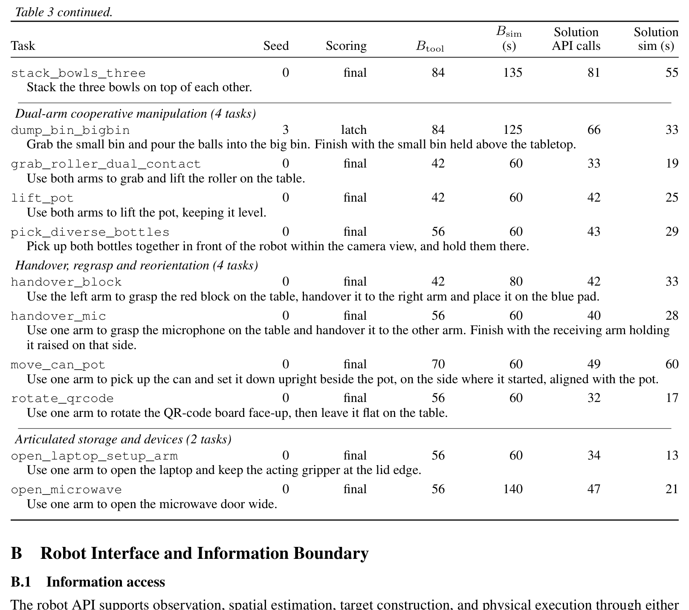

**Caption:** Table 3 (Part 2): Tasks and evaluation budgets continued. Listings include dual-arm cooperative manipulation, handover/regrasp/reorientation, and articulated storage and devices.

**Caption[CN]:** 表 3（第 2 部分）：任务与评估预算目录续。包含双臂协同操作、机械臂交接/重抓取/重定向、以及铰接连杆储物与机构开合等任务。

# Appendix B: Robot Interface and Information Boundary (Robot Interface & API Specifications)

## B.1 Information Access

> <strong>Para. 1:</strong> The robot API supports observation, spatial estimation, target construction, and physical execution through either direct calls or agent-written programs. Agents use RGB images, camera calibration, robot state, and action feedback to construct manipulation policies. Simulator source, object states, task-specific targets, and verifier results remain inaccessible; image processing operates on the RGB observations available to the agent.

> <strong>Para. 1[CN]:</strong> 统一的机器人 API 支持多模态感知观测、空间几何解算、操作目标构建以及底层物理动作执行，允许智能体通过单步直接调用或自主编写 Python 程序发起请求。智能体全凭多视角 RGB 图像、相机几何标定参数、机器人本体运动学读数和动作执行反馈来推导操作策略。仿真底层代码、物体真值位姿属性、任务预设目标点以及验证器判定结论对模型绝对不可见；任何图像处理与特征分析必须完全基于开放给智能体的原始 RGB 像素数据。

> <strong>Para. 2:</strong> Robot motion and reachability checks share the cuRobo planner (Sundaralingam et al., 2023), which computes joint trajectories for agent-specified TCP targets. Its collision model includes robot self-collision but excludes the table and task objects. Planning therefore tests motion feasibility under this restricted model, while the agent uses visual and contact feedback to reason about interactions with the scene.

> <strong>Para. 2[CN]:</strong> 机器人底层的关节运动规划与可达性预检共享采用 GPU 并行加速的 cuRobo 规划器（Sundaralingam 等, 2023），负责为智能体指定的 TCP 末端目标姿态求解逆运动学轨迹。该规划器内部内置的碰撞模型仅涵盖机器人本体双臂之间的自干涉碰撞（Self-collision），刻意排除了桌面以及场景中的各类任务操作物体。因此，轨迹规划器仅测试在无环境障碍假设下的纯运动学可行性，而与外部物理场景的避障、贴靠和挤压等复杂力学交互，必须完全由智能体依托视觉与触觉反馈进行前瞻推理与闭环修正。

## B.2 Conventions and Result Semantics

> <strong>Para. 3:</strong> The core interface comprises 29 robot tools, run_code for program execution, and done for termination. Tables 4, 5 and 7 summarize the inputs and outputs of the robot tools; the following sections explain their roles in policy construction and execution.

> <strong>Para. 3[CN]:</strong> 基准核心交互界面包含 29 个机器人原子工具、用于执行 Python 复合脚本的 `run_code` 以及用于宣告交互终结的 `done`。表 4、表 5 和表 7 汇总提炼了这些机器人工具的入参规范与返回数据结构，下文将深入拆解它们在策略构建与执行中的功能定位。

> <strong>Para. 4:</strong> Positions and displacements are expressed in metres in the world frame: positive x points to the robot’s right, positive y forward toward the table, and positive z upward. Orientations use (w, x, y, z) quaternions. Image points use pixel coordinates (u, v) and an observation identifier, which associates each point with the image and camera calibration used for geometric calculations.

> <strong>Para. 4[CN]:</strong> 所有的绝对空间坐标与相对平移向量均以米（m）为法定物理单位，在统一的世界坐标系下表示：$x$ 轴正方向指向机器人正右方，$y$ 轴正方向指向前方桌面深处，$z$ 轴正方向垂直指向天空。空间旋转姿态统一采用 $(w, x, y, z)$ 格式的四元数表示。图像像素点采用 $(u, v)$ 二维坐标体系，并严格附带观测图像唯一标识符（Observation ID），用以将特定像素精准关联到捕获该画面的相机内外参矩阵以进行后续几何代数运算。

> <strong>Para. 5:</strong> Geometric results include the computed estimate, its numerical validity, and uncertainty or diagnostics where available. Their interpretation depends on the agent’s selected pixels and geometric assumptions. Motion results report requested targets, measured robot state, and planning or execution outcomes, allowing the agent to assess the achieved robot pose.

> <strong>Para. 5[CN]:</strong> 几何计算工具的返回包含代数解算得到的 3D 坐标估计值、数值有效性布尔标志以及协方差不确定性度量。这些估算是否具备物理意义完全取决于智能体所挑取的像素对应关系及先验几何假设是否成立。运动工具的返回则详细报告了请求的目标、实测达到的关节/TCP 位姿以及规划器与控制器的底层状态码，使智能体能够明确研判动作是圆满完成、部分执行还是遭遇意外阻断。

## B.3 Robot State and Visual Observations

> <strong>Para. 6:</strong> The agent can query the current TCP pose and gripper opening of each arm. Gripper dimensions and camera calibration are also available for spatial calculations. The fixed head camera provides a workspace overview, while wrist cameras provide views that change with arm motion. Agents can request individual images or a bundle captured at the same simulation state, then annotate selected pixels with draw_marks to inspect their visual selections.

> <strong>Para. 6[CN]:</strong> 智能体可随时查询双臂当前的 TCP 6D 位姿与夹爪开合距离。夹爪指尖的几何机械尺寸与所有相机的内外参矩阵均开放查询以支持高精度空间代数解算。顶部固定头部相机提供覆盖整个桌面的全局全景视角，左右手腕随动相机则提供随着机械臂姿态灵活动态变化的局部特写视角。智能体既可以单独请求某单个相机的画面，亦可请求一组在同一仿真微秒锁存的多相机同步画幅，并可利用 `draw_marks` 工具在图像上绘制标注点与文字，以自检所选特征像素的准确性。

> <strong>Para. 7:</strong> get_grasp_contact reports which fingers contact the environment, their contact impulses in N s, and their world-frame poses from forward kinematics. These measurements complement the physical finger gap and RGB observations when the agent assesses contact or object retention. Contact feedback is anonymous: the reported poses locate the finger links rather than exact surface-contact points, and the agent must infer what was touched.

> <strong>Para. 7[CN]:</strong> `get_grasp_contact` 工具返回当前与外界发生物理碰撞的手指连杆标号、法向碰撞冲量大小（单位为 $\text{N}\cdot\text{s}$）以及各指尖在世界坐标系下的正向运动学空间位姿。这些读数与实测的手指物理间隙开度以及 RGB 画面互为补充，为智能体研判是否建立稳固抓取或物体是否意外脱落提供了关键依据。值得注意的是，触觉反馈是完全“匿名”的：它仅忠实告知哪根手指在哪个位置遭受了多大冲击力，绝不透露所接触物体的语义类别或表面精确接触点，智能体必须结合视觉观测自行推导究竟触碰了何物。

### Figure 7. 空间估计与目标构建的视觉反馈 (Visual feedback for spatial estimation and target construction)

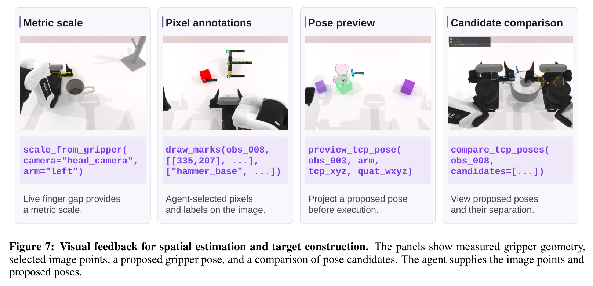

**Caption:** Figure 7: Visual feedback for spatial estimation and target construction. The panels show measured gripper geometry, selected image points, a proposed gripper pose, and a comparison of pose candidates. The agent supplies the image points and proposed poses.

**Caption[CN]:** 图 7：用于空间几何估计与操作目标构建的视觉反馈工具示例。四张子图分别展示了：基于实测夹爪尺寸推导真实公制尺度的示意、智能体自选像素特征点与标签的可视化标注、下发前预演投影的夹爪拟合姿态、以及多组候选抓取姿态的并列投影对比。图中所有图像坐标与候选位姿均完全由智能体自主计算提供。

### Table 4. 机器人状态感知与 RGB 视觉观测工具规范 (Robot-state measurements and RGB observations)

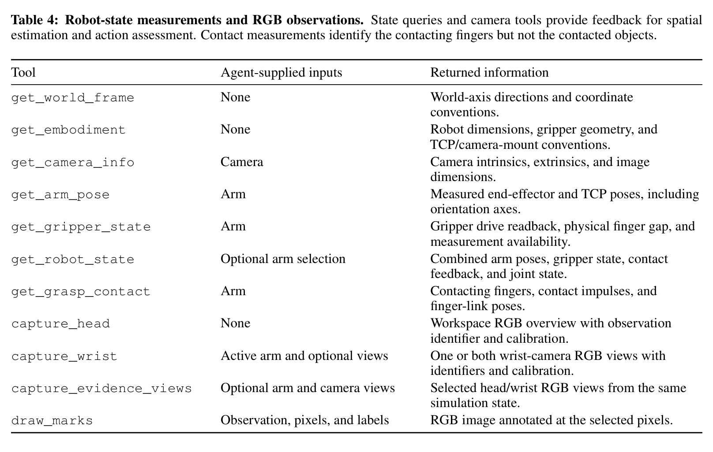

**Caption:** Table 4: Robot-state measurements and RGB observations. State queries and camera tools provide feedback for spatial estimation and action assessment. Contact measurements identify the contacting fingers but not the contacted objects.

**Caption[CN]:** 表 4：机器人本体状态测量与 RGB 视觉观测工具一览。涵盖坐标系约定、本体机械参数、相机标定、关节与夹爪传感器读数、匿名触觉碰撞冲量检测以及多视角画幅采集与自检标注工具。

## B.4 Spatial Calculations and Candidate Poses

> <strong>Para. 8:</strong> Spatial estimation combines agent-selected image evidence with calibrated geometry. ray maps a pixel to a world-frame viewing ray, and plane_intersect estimates a 3D point by intersecting that ray with an agent-specified plane. The agent can construct this plane from contact measurements and an assumed surface normal. For triangulation, the agent first selects an arm displacement and invokes capture_motion_pair to acquire wrist images before and after the motion. It then identifies the same scene point in both images and supplies the corresponding pixels to triangulate_correspondence, which estimates the point’s 3D position from the measured camera poses. Scale can also be estimated from the projected gripper geometry or an agent-supplied object-size prior. Returned uncertainty reflects the declared pixel, plane, or size uncertainty. project maps a proposed 3D point back into an observation so that the agent can inspect its image alignment.

> <strong>Para. 8[CN]:</strong> 空间 3D 几何估计紧密融合了智能体自选的图像特征与相机标定模型。`ray` 工具将任意图像像素反投影为世界坐标系下的 3D 视线射线；`plane_intersect` 计算该射线与智能体指定的 3D 平面的交点坐标（智能体可结合先前的触碰探测点位与桌面法向量构建该支撑平面）。在主动双目视差三角测量中，智能体自主规划一段机械臂位移并调用 `capture_motion_pair` 获取位移前后的两幅手腕视角画面，随后在两幅图像中定位同一物理特征点并提交给 `triangulate_correspondence`，由后者依据腕部相机的实测位姿差解算出特征点的绝对 3D 空间坐标。此外，公制绝对尺度亦可通过画幅中可见夹爪的先验几何开度（`scale_from_gripper`）或智能体注入的物体真实尺寸先验（`scale_from_object_size`）进行推导。工具返回的不确定性协方差直接由输入像素误差与平面容差传递而得。`project` 工具则支持将模型猜测的 3D 坐标重新正投影回相机画幅，以便智能体直接以像素视角复核对齐精度。

> <strong>Para. 9:</strong> A grasp target requires a gripper orientation as well as a position. The agent specifies two orthogonal world-frame axes: the approach axis points from the wrist toward the fingertips, and the opening axis follows the direction along which the fingers separate and close. grasp_quat_candidates converts these axes into two quaternion orientations related by a 180° wrist rotation. This lets the agent specify the intended grasp geometry without manually deriving quaternions.

> <strong>Para. 9[CN]:</strong> 构建一个可执行的抓取目标不仅需要 3D 空间位置，还需要定义夹爪的三维姿态。为此，智能体只需指定两个在世界系下相互正交的方向向量：指引机械手腕指向指尖的接近轴（Approach Axis），以及指引双指闭合开合轨迹的开合轴（Opening Axis）。`grasp_quat_candidates` 工具会自动将这两个直观的几何轴向量解析转换为两组相差 180° 腕部翻转对称角的单位四元数。这使得大语言模型能够凭借清晰的物理几何意图快速定义抓取位姿，无需在上下文内费力推导复杂的四元数乘法与旋转矩阵。

> <strong>Para. 10:</strong> Before executing a candidate pose, the agent can inspect its projected gripper geometry with preview_tcp_pose or compare candidate overlays and relative geometry with compare_tcp_poses. check_tcp_pose_reachability then queries cuRobo for a trajectory from the current arm configuration to a proposed TCP pose, returning feasibility and diagnostics without moving the robot. For observation planning, camera_aim_pose computes a TCP pose that directs a wrist camera toward a selected 3D point, accounting for the calibrated camera mount.

> <strong>Para. 10[CN]:</strong> 在将候选位姿付诸真实物理执行前，智能体可调用 `preview_tcp_pose` 在原始画面上叠加渲染夹爪在该拟定姿态下的 3D 线框，或利用 `compare_tcp_poses` 将多组候选位姿同时投影并输出相互之间的空间欧氏间距与夹角。随后，智能体可调用 `check_tcp_pose_reachability` 向 cuRobo 求解器发送预检请求，在完全不触动实体机械臂的前提下预先确认从当前关节构型是否存在一条无碰撞平滑轨迹通往该目标点。此外，在主动感知规划中，`camera_aim_pose` 工具能依据标定好的手腕相机安装支架角度，自动解算出一组将腕部镜头精准对准场景中某一指定 3D 兴趣点的 TCP 目标位姿。

### Table 5. 空间估计与目标姿态构建工具规范 (Spatial estimation and target-pose construction)

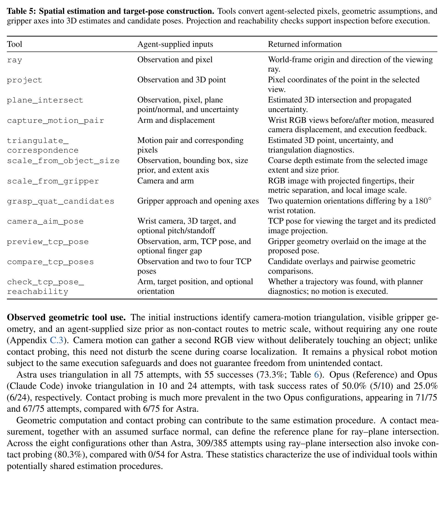

**Caption:** Table 5: Spatial estimation and target-pose construction. Tools convert agent-selected pixels, geometric assumptions, and gripper axes into 3D estimates and candidate poses. Projection and reachability checks support inspection before execution.

**Caption[CN]:** 表 5：空间几何估计与目标姿态构建工具一览。涵盖射线生成、正投影、射线-平面求交、运动对双目三角测量、尺度推算、抓取四元数生成、相机对准求解、位姿投影预演以及无动作关节可达性碰撞预检工具。

> <strong>Para. 11:</strong> Observed geometric tool use. The initial instructions identify camera-motion triangulation, visible gripper geometry, and an agent-supplied size prior as non-contact routes to metric scale, without requiring any one route (Appendix C.3). Camera motion can gather a second RGB view without deliberately touching an object; unlike contact probing, this need not disturb the scene during coarse localization. It remains a physical robot motion subject to the same execution safeguards and does not guarantee freedom from unintended contact.

> <strong>Para. 11[CN]:</strong> **实测几何工具使用模式。** 评测的系统初始提示词明确指出了三种获取绝对物理公制尺度的非接触式技术路径（腕部主动运动双目三角化、画面中可见夹爪的先验尺寸标定、以及模型自行注入的物体大小先验），且绝不硬性指定使用哪一种（附录 C.3）。通过微小的相机位移捕获视差画面，能够在完全不发生物理接触的前提下建立起多视角立体几何估计；与基于力反馈的接触探测相比，这一途径在粗定位阶段绝不会意外推翻或扰动脆弱目标。然而移动机械臂本身仍是物理世界中的实体运动，必须受到完全一致的安全保护，且无法绝对杜绝不可预见的意外碰撞。

> <strong>Para. 12:</strong> Astra uses triangulation in all 75 attempts, with 55 successes (73.3%; Table 6). Opus (Reference) and Opus (Claude Code) invoke triangulation in 10 and 24 attempts, with task success rates of 50.0% (5/10) and 25.0% (6/24), respectively. Contact probing is much more prevalent in the two Opus configurations, appearing in 71/75 and 67/75 attempts, compared with 6/75 for Astra.

> <strong>Para. 12[CN]:</strong> 实测数据显示，GPT-6 Astra 在其全部 75 次尝试中 100% 采用了主动视觉三角测量（`triangulate_correspondence`），取得了 73.3%（55/75）的卓越成功率（见表 6）。与之形成鲜明对比的是，Opus 参考配置和 Opus Claude Code 配置仅分别在 10 次和 24 次尝试中动用了三角测量（成功率分别为 50.0% 与 25.0%）。这两款 Opus 系统表现出对物理“触碰探测（Contact Probing）”的极度偏好，分别在 71/75 和 67/75 次尝试中使用了接触探测，而 Astra 仅在 6 次尝试中使用了该工具。

> <strong>Para. 13:</strong> Geometric computation and contact probing can contribute to the same estimation procedure. A contact measurement, together with an assumed surface normal, can define the reference plane for ray–plane intersection. Across the eight configurations other than Astra, 309/385 attempts using ray–plane intersection also invoke contact probing (80.3%), compared with 0/54 for Astra. These statistics characterize the use of individual tools within potentially shared estimation procedures.

> <strong>Para. 13[CN]:</strong> 几何代数解算与物理接触探测常常在同一套估计流程中复合出现。例如，一次物理探测所获得的触碰点世界坐标，配合法向假设，即可定义射线-平面求交（Ray–plane intersection）所需的基准支撑面。在除 Astra 之外的其余 8 种智能体配置中，多达 80.3%（309/385）动用射线-平面求交的尝试同时调用了接触探测工具；而在 Astra 的 54 次求交尝试中，该比例为 0%（0/54）。这组数据深刻反映出不同前沿模型在底层空间感知与几何定位技术路线上截然不同的“认知范式偏好”。

### Table 6. 几何与接触工具使用对应的任务成功率 (Tool use vs task success)

**Caption:** Table 6: Task success associated with geometric and contact tool use. Entries report task success rates among attempts invoking each tool, with successful/total counts in parentheses. Each configuration has 75 attempts. Usage includes direct calls and calls within programs, counting each attempt once per tool. An attempt may contribute to multiple columns, and contact probing can provide the plane reference used by ray–plane intersection. Triangulation denotes calls to triangulate_correspondence. Bold marks the highest observed rate per column. Task subsets and sample sizes differ across entries.

**Caption[CN]:** 表 6：与几何计算及接触探测工具使用关联的任务成功率。汇报各配置在动用了特定工具的尝试子集中所达成的成功率（括号内为成功数/总调用尝试数）。各配置样本量均为 75 次，涵盖直接调用与 Python 程序内调用。单次尝试可同时计入多个工具列。

## B.5 Motion and Contact Feedback

> <strong>Para. 14:</strong> Motion tools execute agent-specified TCP targets. reach_tcp accepts an absolute position and an optional orientation, while move_delta specifies a displacement from the current TCP position. Their paired variants move both arms in a coordinated call. cuRobo converts these targets into joint trajectories, and the returned robot poses and execution status allow the agent to assess how much of the requested motion occurred, including partial motion before an interruption.

> <strong>Para. 14[CN]:</strong> 运动工具负责执行智能体指定的末端 TCP 动作指令。`reach_tcp` 接收世界系下的绝对三维坐标与可选的目标四元数姿态；`move_delta` 则指定相对于当前末端位置的增量位移；它们的双臂协同变体支持在单次原子调用中同时协调驱动双臂执行复合位移。cuRobo 规划器将这些高层笛卡尔目标转化为无干涉的平滑关节轨迹；工具执行后返回的实测关节读数与状态返回码，使模型能够精确获知所请求的轨迹完成了百分之几，包括在遭遇突发碰撞中断前实际行进到的中间位置。

> <strong>Para. 15:</strong> probe_contact_along moves the gripper in bounded increments along an agent-selected direction and checks finger contact after each increment. Starting from free space, it stops when finger contact is detected; more generally, it stops when the contacting fingers change, the travel bound is reached, or execution is interrupted. The measured finger-link poses and known gripper geometry constrain the location of the touched surface. Combined with an assumed surface normal, this provides a reference for defining the plane used in ray–plane intersection to estimate 3D positions.

> <strong>Para. 15[CN]:</strong> `probe_contact_along` 工具指引夹爪沿着智能体设定的空间向量方向以极小的位移微步逐步推进，并在每个微步后立即轮询指尖触觉传感器。当夹爪从自由空间行进并首次感知到指尖受力时自动刹停；更广泛地，当接触手指组合发生变化、行进距离达到安全上限、或轨迹遭遇严重受阻时，探测均会主动停止。此时返回的指尖机械坐标与已知的夹爪外形，为被触碰物体的空间外表面提供了严格的几何切平面边界。配合假定的物体法向，便为射线-平面求交算法提供了可信的深度基准面。

> <strong>Para. 16:</strong> set_gripper controls the gripper opening with a normalized command from zero (closed) to one (open). The returned physical finger gap and contact feedback help the agent assess the result when an object obstructs closure. Contact conditions can be adjusted through gripper opening and TCP motion; the interface provides position control rather than direct force or impedance control.

> <strong>Para. 16[CN]:</strong> `set_gripper` 采用归一化浮点数值控制夹爪的开合程度，范围在 0.0（完全闭合）到 1.0（完全张开）之间。当夹爪中夹持了实体物体而阻碍电机彻底闭合时，执行后返回的指尖真实物理间隙距离与触觉碰撞读数能够协助智能体研判抓取是否紧实。接触力学状态可以通过细微调节夹爪开度与微调 TCP 位姿来实现间接控制；该接口提供的是高精度的位置伺服控制模式，而非底层的直接力矩控制或阻抗控制。

### Table 7. 机器人运动控制、接触探测与夹爪工具规范 (TCP motion, contact probing, and gripper control)

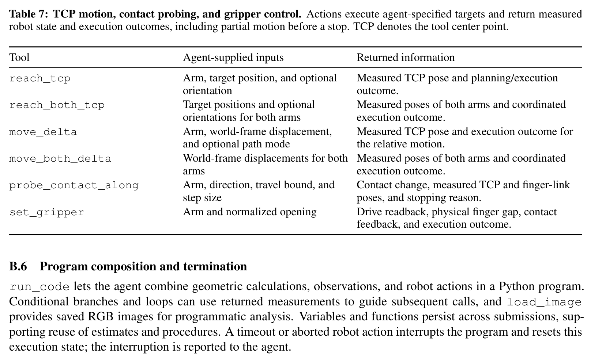

**Caption:** Table 7: TCP motion, contact probing, and gripper control. Actions execute agent-specified targets and return measured robot state and execution outcomes, including partial motion before a stop. TCP denotes the tool center point.

**Caption[CN]:** 表 7：TCP 运动执行、触觉探测与夹爪开合控制工具一览。涵盖单臂/双臂绝对到达、单臂/双臂增量微调、沿特定方向有界微步接触探测、以及夹爪归一化开合驱动。

## B.6 Program Composition and Termination

> <strong>Para. 17:</strong> run_code lets the agent combine geometric calculations, observations, and robot actions in a Python program. Conditional branches and loops can use returned measurements to guide subsequent calls, and load_image provides saved RGB images for programmatic analysis. Variables and functions persist across submissions, supporting reuse of estimates and procedures. A timeout or aborted robot action interrupts the program and resets this execution state; the interruption is reported to the agent.

> <strong>Para. 17[CN]:</strong> `run_code` 赋予了智能体将几何代数推导、图像捕获与机器人物理动作无缝编排进标准 Python 脚本的强大能力。智能体可在程序内部编写条件判断分支与循环逻辑，实时利用中间工具的返回值指导后续动作流；`load_image` 支持在代码内部以 NumPy 数组形式直接加载已留存的 RGB 图像开展自定义像素矩阵计算。在单次剧集中，用户定义的变量与辅助函数支持跨提交多轮持久化留存，便于复用此前测得的几何锚点或控制函数。一旦脚本内部触发执行超时或某步机器人运动发生意外中断报错，程序执行将立即熔断，并向模型如实反馈异常中断发生时的现场上下文。

> <strong>Para. 18:</strong> The agent calls done when it judges the task complete or decides it cannot proceed, submitting a report and its Boolean completion claim. The call ends the attempt without revealing the verifier outcome. Recording the agent’s judgment separately from the hidden task outcome allows us to evaluate completion assessment, as reported in Appendix G.2.

> <strong>Para. 18[CN]:</strong> 当智能体认定当前任务已经圆满达成，或判定当前物理局面已经彻底陷入死锁无法挽回时，主动调用 `done` 并提交一段陈述总结文本（`report`）及其核心布尔判断声明（`success_claim`）。该调用会立即结束该尝试剧集，且绝不向模型泄露隐藏验证器的胜负判决。将智能体的主观自我认知与物理世界的客观达成事实独立留存，为系统评估具身智能体的高阶自省与完成度反思水准提供了数据支撑（见附录 G.2）。

# Appendix C: Agent Harnesses (Model Harness Configurations)

> <strong>Para. 1:</strong> Table 8 reports the configurations recorded in the 675 accepted attempts. All use the robot interface in Appendix B. The seven reference configurations share the reference harness, using provider-default sampling settings without an explicit temperature override or fixed model seed. Output limits apply per request, with provider-specific accounting of reasoning tokens. Claude Code and Codex CLI manage their own sampling and output limits.

> <strong>Para. 1[CN]:</strong> 表 8 详细列出了全部 675 次有效评测尝试中所记录的 9 种智能体系统软硬件配置。所有系统均在附录 B 所定义的相同机器人 API 规范下运行。接入统一参考测试基座的 7 款模型均采用服务商默认的推理采样超参数，未显式覆盖设置特定温度系数（Temperature），亦未固定模型采样种子。模型最大输出 Token 上限按单次请求独立施加，并遵循各服务商对于思考推导 Token（Reasoning Tokens）的具体核算方式。基于商业智能体环境的 Claude Code 与 Codex CLI 则由其自带的测试基座自主管理推理采样与输出限额。

### Table 8. 9 种受试智能体系统软硬件配置明细 (Detailed agent configurations)

| Configuration | Model identifier | Reasoning effort | Output token limit |
|---|---|---|---|
| **GPT-6 Astra (Codex CLI)** | `gpt-6-astra` | High | Harness-managed |
| **Claude Opus 5 (Reference)** | `claude-opus-5` | High | 128,000 |
| **Claude Opus 5 (Claude Code)** | `claude-opus-5` | High | Harness-managed |
| **Gemini 3.6 Flash (Reference)** | `gemini-3.6-flash` | High | 65,536 |
| **GPT-5.6 Sol (Reference)** | `gpt-5.6` | High | 128,000 |
| **Qwen 3.8 Max (Reference)** | `qwen3.8-max` | Medium | 131,072 |
| **Grok 4.6 (Reference)** | `grok-4.6` | High | 8,192 |
| **Kimi K3 (Reference)** | `kimi-k3` | High | 131,072 |
| **Claude Sonnet 5 (Reference)** | `claude-sonnet-5` | High | 128,000 |

**Caption:** Table 8: Detailed agent configurations. Each row contains 75 attempts. Reasoning gives the requested effort; output is the configured per-request token limit. For Claude Code and Codex CLI, the vendor harness manages the output limit. The benchmark sets no additional token cap.

**Caption[CN]:** 表 8：受试智能体详细配置一览。每行包含 75 次独立评测尝试。Reasoning 表示向模型请求的推理思考强度等级；Output tokens 为配置的单次请求输出上限。对于 Claude Code 和 Codex CLI，输出上限由其厂商专属基座自主管控。基准本身不施加额外的人工 Token 截断。

## C.1 Reference Harness

> <strong>Para. 2:</strong> The reference harness follows a common interaction loop, adapting model requests to each provider’s API. Request construction applies the reasoning effort and output limits in Table 8, including adaptive thinking for Opus and Sonnet and thinking preservation for Qwen. Effort levels follow each provider’s definitions, so matching labels do not imply equal reasoning-token budgets.

> <strong>Para. 2[CN]:</strong> 参考测试基座（Reference Harness）遵循一套标准的交互轮询循环，负责将模型抽象请求无缝适配到各大模型厂商的专有 API。请求构造严格应用表 8 所示的推理思考强度与最大输出限制，例如对 Claude Opus 5 和 Sonnet 5 开启自适应深度思考（Adaptive Thinking），对 Qwen 开启思考过程留存传递（Thinking Preservation）。各模型的思考强度标签均遵循对应厂商官方接口的定义，因此相同标签（如 High）并不直接等同于相同的绝对思考 Token 开销。

> <strong>Para. 3:</strong> Within each model response, tool calls execute sequentially in the proposed order. Invalid arguments return error feedback, allowing correction in a later turn. A recoverable action interruption cancels the remaining calls from that response, including when the interruption occurs inside a program. Returning the achieved robot state and interruption details lets the agent revise its next action using the changed scene. Recovery decisions therefore remain with the agent.

> <strong>Para. 3[CN]:</strong> 在单次模型返回中，包含的多个工具调用严格按照模型提出的先后顺序串行执行。若调用参数格式非法，系统将返回报错信息并在下一轮对话中交由模型纠错。一旦执行过程中遭遇可恢复的动作意外中断（如机械臂触碰阻碍），该轮响应中尚未执行的剩余调用将被全部自动取消（即使该中断发生在 Python 程序内部亦遵循此规则）。系统随后忠实返回发生中断瞬间机械臂达到的真实位姿与详细报错现场，让智能体基于物理环境的最新演变状态灵活规划后续动作。所有的容错与状态恢复决策全权由模型自行主导。

> <strong>Para. 4:</strong> Context management follows the retention limits in Section 3.3. Keeping observation identifiers in the text history allows retrieval of earlier images after their removal from the active visual context. Near the context limit, fixed extraction rules reduce older interactions to tool-call records containing selected arguments and returned measurements, including requested targets, achieved poses, contact feedback, and execution outcomes. This reduction removes older assistant prose and program source from the active context without generating a new language-model summary. Further reduction prioritizes the initial instructions and newest interaction, ending the attempt if the request still exceeds the available context.

> <strong>Para. 4[CN]:</strong> 上下文工程严格遵循正文第 3.3 节所述的保留策略。文本对话流中留存全局观测 ID，使模型能在早期画幅被移出当前活跃视觉窗口后随时按需重取。在逼近模型上下文窗口警戒线时，Harness 执行确定性的规则压缩：将久远的交互历史精简为紧凑的工具调用摘要键值对（完整保留下达的目标、达到的真实位姿、触觉碰撞受力及底层状态码），并剔除早期模型回复中的冗长自然语言解释和重复 Python 源代码，且此过程完全由规则完成而不调用大模型生成二次摘要。若在极致压缩后提示词仍超出上下文承载极限，系统将优先保护初始系统指令与最新一轮交互，并在依然溢出时安全熔断退出。

> <strong>Para. 5:</strong> Transient provider failures trigger bounded retries of the model request before tool execution. Retrying a request leaves the robot state unchanged and does not repeat an executed action.

> <strong>Para. 5[CN]:</strong> 针对网络抖动或服务商 API 瞬态报错，基准基座在工具正式执行前设计了有界的指数退避重试保护机制。网络重试过程绝不改变虚拟物理世界的当前状态，亦绝不重复执行已生效的物理动作。

## C.2 Vendor Harnesses

> <strong>Para. 6:</strong> Claude Code 2.1.212 (Anthropic, n.d.) and Codex CLI 0.154.0 (OpenAI, n.d.) connect to the shared robot API through the Model Context Protocol (MCP) (Anthropic, 2024). Each harness constructs its own model requests and manages the context, including images. Their strategies for context management therefore differ from the reference harness described above.

> <strong>Para. 6[CN]:</strong> Claude Code 2.1.212（Anthropic, n.d.）与 Codex CLI 0.154.0（OpenAI, n.d.）通过模型上下文协议（Model Context Protocol, MCP；Anthropic, 2024）无缝桥接到本基准的共享机器人 API。这两款商业级智能体开发基座由各自厂商独立实现模型请求构建、图像流组织与上下文缓存管理。因此，其上下文管理机制与前文所述的标准参考基座存在工程实现上的客观差异。

> <strong>Para. 7:</strong> Claude Code uses the benchmark tools and ToolSearch for loading tool definitions. The evaluation disables its built-in file, shell, web, and delegation tools. Codex CLI also supports computation and tool-call composition through its built-in execution environment, operating in a read-only sandbox with web search disabled. Neither configuration can access simulator source, privileged object states, or verifier outcomes (Appendix B.1).

> <strong>Para. 7[CN]:</strong> Claude Code 配置仅使用基准提供的机器人工具，并通过其原生的 `ToolSearch` 按需动态加载工具定义；评测中彻底禁用了其内置的文件系统读写、Shell 执行、网页联网检索与子智能体委派等额外功能。类似地，Codex CLI 通过其自带的原生运行时沙箱支持数值计算与工具链编排，该沙箱被设置为只读模式并同样彻底切断了外网检索能力。这两种厂商配置在信息权限上均受到与参考基座完全一致的严格隔离：绝对无法读取仿真源码、物体特权状态或验证器评判（见附录 B.1）。

> <strong>Para. 8:</strong> Benchmark tool calls follow the shared budget rules in Appendix A.2, including calls issued through a vendor harness’s computation environment. Loading tool definitions and performing computation alone do not consume this budget. Results characterize each model together with its harness, including differences in context management and available computation tools.

> <strong>Para. 8[CN]:</strong> 厂商基座发起的所有机器人工具调用严格受控于附录 A.2 所规定的统一预算约束，包括在其专有计算沙箱内部触发的 API 调用。单纯加载工具元数据定义或在本地内存中执行纯数学代数运算不消耗调用预算。评测得出的所有数据忠实刻画了“模型+专有测试基座”所构成的端到端集成系统的整体表现，客观包容了其在上下文长程调度与计算环境辅助上的系统工程差异。

## C.3 Initial Prompt

> <strong>Para. 9:</strong> Initial instructions describe the robot role, available evidence, program use, budgets, and termination. Task goals and tool schemas provide further details. The excerpts below quote the initial prompt, with punctuation adjusted for readability. Bracketed ellipses mark omissions. FK denotes forward kinematics.

> <strong>Para. 9[CN]:</strong> 系统初始系统指令明确界定了机器人的控制角色、可获取的多模态证据边界、Python 程序编写规范、资源限额以及安全终止准则。具体任务的自然语言目标与详尽的工具 JSON Schema 随请求下发。下文节选了初始系统提示词的核心段落（标点微调以利于排版阅读，括号省略号表示省略非关键辅助语句，FK 表示正向运动学）：

> <strong>Para. 10:</strong> "You control a dual-arm robot through the provided benchmark tools. [...] Facts: there is no depth sensor and no object ground truth; any metric value you use must come from your own tool evidence. [...] Tool results are typed; achieved can differ from commanded — trust achieved. Direct calls and run_code are equally supported; choose whichever interface fits the step. [...] Three independent non-contact metric-scale sources are available: calibrated camera motion (capture_motion_pair then triangulate_correspondence), visible FK gripper geometry (scale_from_gripper), and a caller-supplied object-size prior (scale_from_object_size, always coarse). These obtain metric evidence without deliberate scene contact."

> <strong>Para. 10[CN]:</strong> “你将通过所提供的基准工具操纵一台双臂机器人。[……] 核心铁律：场景中绝无深度传感器，亦绝无任何物体真值位姿；你所使用的任何物理公制数值必须完全来源于你自行发起的工具证据。[……] 工具返回值均有明确强类型；实测达到的位姿往往会因物理阻挡而偏离指令下发的理想位姿——请务必以实测达到的物理读数为准。系统完全对等地支持单步直接调用与通过 `run_code` 提交 Python 脚本；请根据当前操作步骤的复杂度自由选取最契合的接口。[……] 系统为你提供了三种独立的非接触式绝对物理尺度测量途径：经过标定的相机微位移视差（先调用 `capture_motion_pair` 再执行 `triangulate_correspondence`）、画幅中可见的正向运动学夹爪几何形态（`scale_from_gripper`）、以及调用方注入的物体几何尺寸先验（`scale_from_object_size`，始终属于粗略估计）。这些途径能够在不与场景物体发生物理碰撞的前提下获取精准的公制几何线索。”

## C.4 Program Use and Execution

> <strong>Para. 11:</strong> Table 9 compares program use and execution errors across configurations. Program share measures the fraction of charged tool calls submitted through run_code. Program errors count submissions returning Python exceptions or sandbox rejections. Appendix G.1 reports robot-action interruptions separately.

> <strong>Para. 11[CN]:</strong> 表 9 系统对比了各智能体配置在代码程序编写与执行报错层面的统计学表现。**程序占比（Program Share）**衡量了智能体通过 `run_code` 提交的计费工具调用占全部计费调用总数的百分比。**程序执行错误（Program Errors）**则统计了返回未捕获 Python 语法/运行时异常或被沙箱安全拦截的提交次数及其错误率。附录 G.1 则对机器人物理动作遭遇中断的情况进行了独立汇报。

> <strong>Para. 12:</strong> The four most successful configurations submit 85.6–92.6% of charged tool calls through run_code, compared with 15.6–35.2% for the remaining configurations (Table 9). Astra combines the highest program share with the lowest program error rate (0.46%). Together, these results suggest that stronger agents better understand the robot tools and compose their operations into effective manipulation policies.

> <strong>Para. 12[CN]:</strong> 统计表明，排名前四的最强智能体配置表现出压倒性的代码编程偏好：其 85.6% 至 92.6% 的计费工具调用均是以 Python 复合脚本的形式提交的；相比之下，后五名较弱配置的代码程序占比仅为 15.6% 至 35.2%（表 9）。其中，GPT-6 Astra 不仅展现了最高的代码占比（92.6%），同时取得了全场最低的代码运行报错率（仅 0.46%，2,167 次运行中仅 10 次报错）。这些微观实测数据充分印证：越强大的智能体越能深刻领会底层机器人 API 的语义约定，并善于在程序内部编排复杂的条件反馈与控制流，从而构建出更加紧凑、鲁棒的具身操作策略。

### Table 9. 各配置的代码程序使用率与执行报错统计 (Program use and execution errors)

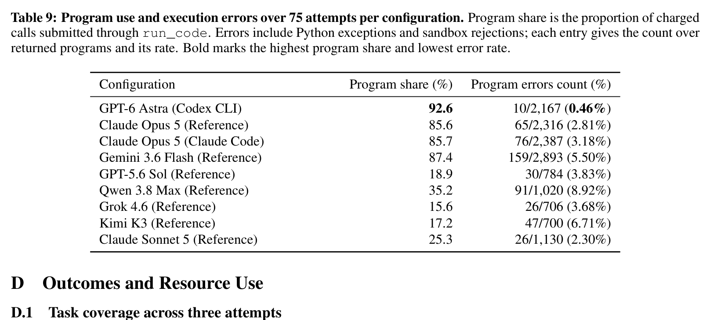

| Configuration | Program share (%) | Program errors count (%) |
|---|---|---|
| **GPT-6 Astra (Codex CLI)** | **92.6%** | **10/2,167 (0.46%)** |
| **Claude Opus 5 (Reference)** | 85.6% | 65/2,316 (2.81%) |
| **Claude Opus 5 (Claude Code)** | 85.7% | 76/2,387 (3.18%) |
| **Gemini 3.6 Flash (Reference)** | 87.4% | 159/2,893 (5.50%) |
| **GPT-5.6 Sol (Reference)** | 18.9% | 30/784 (3.83%) |
| **Qwen 3.8 Max (Reference)** | 35.2% | 91/1,020 (8.92%) |
| **Grok 4.6 (Reference)** | 15.6% | 26/706 (3.68%) |
| **Kimi K3 (Reference)** | 17.2% | 47/700 (6.71%) |
| **Claude Sonnet 5 (Reference)** | 25.3% | 26/1,130 (2.30%) |

**Caption:** Table 9: Program use and execution errors over 75 attempts per configuration. Program share is the proportion of charged calls submitted through run_code. Errors include Python exceptions and sandbox rejections; each entry gives the count over returned programs and its rate. Bold marks the highest program share and lowest error rate.

**Caption[CN]:** 表 9：各配置在全部 75 次尝试中的代码程序使用率与执行报错统计。程序占比指通过 `run_code` 发起的调用在总调用中的占比。报错统计包含语法异常与沙箱拒绝；括号内为报错次数及占总程序执行次数的百分比。粗体标出最高的程序使用率与最低的代码报错率。

# Appendix D: Outcomes and Resource Use (Detailed Experimental Results)

## D.1 Task Coverage Across Three Attempts

> <strong>Para. 1:</strong> Table 10 separates tasks solved at least once from those solved in all three attempts on the same fixed scene.

> <strong>Para. 1[CN]:</strong> 表 10 系统细分了在完全相同的固定物理场景下，各项任务在 3 次重复尝试中达成 0 次、1 次、2 次以及全部 3 次成功的具体分布情况。

### Table 10. 3 次独立尝试中的成功频次与任务覆盖率统计 (Attempt success and task coverage across 3 attempts)

| Configuration | Success (/75) ↓ | Coverage (/25) | 0/3 Success | 1/3 Success | 2/3 Success | 3/3 Success |
|---|---|---|---|---|---|---|
| **GPT-6 Astra (Codex CLI)** | **55** | **22 (88%)** | 3 | 4 | 3 | **15** |
| **Claude Opus 5 (Reference)** | 37 | 19 (76%) | 6 | 8 | 4 | 7 |
| **Claude Opus 5 (Claude Code)** | 34 | 14 (56%) | 11 | 3 | 2 | 9 |
| **Gemini 3.6 Flash (Reference)** | 15 | 8 (32%) | 17 | 4 | 1 | 3 |
| **GPT-5.6 Sol (Reference)** | 12 | 9 (36%) | 16 | 7 | 1 | 1 |
| **Qwen 3.8 Max (Reference)** | 11 | 6 (24%) | 19 | 3 | 1 | 2 |
| **Grok 4.6 (Reference)** | 9 | 6 (24%) | 19 | 4 | 1 | 1 |
| **Kimi K3 (Reference)** | 9 | 5 (20%) | 20 | 1 | 4 | 0 |
| **Claude Sonnet 5 (Reference)** | 2 | 2 (8%) | 23 | 2 | 0 | 0 |

**Caption:** Table 10: Attempt success and task coverage across three attempts. Each configuration makes three attempts on each of 25 fixed task instances. Success counts successful attempts, and Coverage counts tasks solved at least once. Columns 0/3–3/3 count tasks by their number of successful attempts.

**Caption[CN]:** 表 10：各智能体配置在 3 次尝试中的尝试成功数与任务覆盖率。每种配置在 25 个固定任务实例上各进行 3 次独立测试。Success 为 75 次尝试中总成功次数；Coverage 为至少成功 1 次的任务总数；0/3 至 3/3 列分别统计了成功 0 次、1 次、2 次以及 3 次均完美成功的任务数量。

## D.2 Task-Level Outcomes

> <strong>Para. 2:</strong> Figure 8 compares success counts over three attempts on each of the 25 tasks. Astra alone succeeds on pot lifting (3/3), whereas Opus (Reference) alone succeeds on bin emptying and mug hanging (1/3 each). These contrasts reveal task-specific strengths beyond the overall ranking.

> <strong>Para. 2[CN]:</strong> 图 8 以热力矩阵的形式展示了全部 9 种配置在 25 项任务上各自 3 次尝试的具体成功次数。细粒度对比揭示出超越宏观排名的独特任务优势：例如，GPT-6 Astra 是唯一在极度考验双臂高精度协调水平抬升的双臂抬锅任务（`lift_pot`）上实现 3 次全胜（3/3）的系统；而参考基座下的 Claude Opus 5 则是全场唯一在长时域倒球（`dump_bin_bigbin`）与精密孔径挂马克杯（`hanging_mug`）上取得成功的配置（各成功 1/3 次）。这深刻表明各前沿基础模型在不同物理交互模态（如刚体平衡对齐与灵巧悬挂配合）上存在差异化的力学推理特长。

### Figure 8. 9 种智能体配置在 25 项任务上的单任务成功分布矩阵 (Task-level success across nine agent configurations)

**Caption:** Figure 8: Task-level success across nine agent configurations. Each cell reports successful attempts out of three for one task and configuration. All configurations use the same fixed scene for each of the 25 tasks. Configurations without a harness label use the reference harness.

**Caption[CN]:** 图 8：9 种受试配置在 25 项具体任务上的成功次数热力矩阵图。每个单元格数值代表该配置在对应任务的 3 次独立尝试中所取得的成功次数（0 至 3）。所有测试在同一固定场景下开展，未注明 Harness 标签的配置均默认接入统一的参考测试基座。

## D.3 Cost and Elapsed Time

> <strong>Para. 3:</strong> Table 11 reports resource use over all attempts. Simulated time measures physical execution. Wall time also includes inference, provider waiting, and tool processing. Inference cost is expressed in API-equivalent USD.

> <strong>Para. 3[CN]:</strong> 表 11 全面汇报了各系统在全部尝试中的资源消耗全貌。仿真物理时间严格衡量机器人在虚拟世界中的动力学动作耗时；真实墙钟耗时（Wall Time）则额外涵盖了模型 API 推理、网络传输、云端排队等待以及本地工具代数求解的全部开销。推理成本按照各厂商官方公布的 Token 计费标准换算为等效美元计价。

> <strong>Para. 4:</strong> API-equivalent costs apply fixed token rates to all configurations, with identical rates for both Opus harnesses. Uncached input/output rates (USD per million tokens) are Astra 10/50, Opus 5/25, Sonnet 2/10, GPT-5.6 Sol 4/20, Gemini 0.75/3.75, Qwen 2/6, Kimi 1.2/4.8, and Grok 2/6.

> <strong>Para. 4[CN]:</strong> API 等效推理成本统一采用固定的基准 Token 费率核算（两种 Opus 配置采用完全相同的单价）。未命中上下文缓存的常规输入/输出基准单价（美元/百万 Tokens）分别为：GPT-6 Astra 10/50；Claude Opus 5 为 5/25；Claude Sonnet 5 为 2/10；GPT-5.6 Sol 为 4/20；Gemini 3.6 Flash 为 0.75/3.75；Qwen 3.8 Max 为 2/6；Kimi K3 为 1.2/4.8；Grok 4.6 为 2/6。

> <strong>Para. 5:</strong> Calculations account separately for cache reads and writes, apply request-level long-context pricing, and count reasoning tokens once. Claude Code output usage combines the logged thinking-token estimate with a response-length estimate at four UTF-8 bytes per non-thinking token.

> <strong>Para. 5[CN]:</strong> 成本核算严密区分了上下文提示词缓存的写入与命中读取优惠折扣，严格计入长文本请求阶梯加价，并将模型生成的深度思考 Token 按一次性输出计费。针对 Claude Code 的输出量，核算算法结合其日志中记录的思考 Token 估算值与按每 4 个 UTF-8 字节折算 1 个常规 Token 的文本长度估算完成。

### Table 11. 9 种智能体配置在 75 次尝试中的资源消耗汇总 (Resource use over 75 attempts per configuration)

| Configuration | Mean Calls | Median Sim. (s) | Median Wall (s) | Median Wait (s) | Total Cost ($) | Median Cost ($) | IQR Cost ($) |
|---|---|---|---|---|---|---|---|
| **GPT-6 Astra (Codex CLI)** | 31.2 | 32.7 | **477.2** | – | 252.87 | 3.09 | 2.06–4.35 |
| **Claude Opus 5 (Reference)** | 36.1 | 45.3 | 1,193.1 | 910 | 297.84 | 3.71 | 2.48–5.29 |
| **Claude Opus 5 (Claude Code)** | 37.1 | 57.7 | 1,359.4 | – | 380.09 | 4.88 | 3.34–6.35 |
| **Gemini 3.6 Flash (Reference)** | 44.1 | 45.0 | 781.6 | 501 | **52.00** | 0.61 | 0.36–0.88 |
| **GPT-5.6 Sol (Reference)** | 55.2 | 28.2 | 636.4 | 447 | 259.85 | 3.04 | 2.10–4.54 |
| **Qwen 3.8 Max (Reference)** | 38.6 | 61.3 | 1,949.4 | 1,620 | 115.27 | 1.38 | 0.95–1.92 |
| **Grok 4.6 (Reference)** | 60.4 | 17.8 | 952.4 | 818 | 150.73 | 1.73 | 1.31–2.34 |
| **Kimi K3 (Reference)** | 54.4 | 39.2 | 2,727.6 | 2,372 | 231.65 | 2.81 | 1.64–3.93 |
| **Claude Sonnet 5 (Reference)** | 59.6 | 29.5 | 1,058.9 | 845 | 143.84 | 1.79 | 1.35–2.38 |

**Caption:** Table 11: Resource use over 75 attempts per configuration. Calls are averaged per attempt; simulated, wall, and provider-wait times are medians. Costs are API-equivalent USD, with median and interquartile range (IQR) computed per attempt. Waiting time is available only for the reference harness. Bold marks the lowest total cost and median wall time.

**Caption[CN]:** 表 11：各配置在全部 75 次尝试中的资源消耗明细汇总。调用次数为单次尝试平均值；物理仿真时间、端到端墙钟耗时及服务商等待耗时均为中位数。推理成本以 API 等效美元计，单次尝试汇报中位数与四分位距（IQR）。云端等待时间仅在参考测试基座中可直接精确测量。粗体标出全场最低总开销与最短中位耗时。

# Appendix E: Policy Execution Analysis (Checkpoint Definitions & Annotations)

## E.1 Checkpoint Annotation and Replay Validation

> <strong>Para. 1:</strong> Synchronized TCP and object poses from successful expert executions (Chen et al., 2025) provide the TCP-to-object offsets for spatial annotation (Section 4.3). Placement offsets use frames before release. Container dimensions and bowl rims determine the region shapes. Calibration uses pooled successful attempts to account for alternative grasp locations and placement choices. Each checkpoint then uses the same criteria, tolerances, and dependencies across all configurations and replays.

> <strong>Para. 1[CN]:</strong> 来自专家示教成功轨迹（Chen 等, 2025）的高精度同步末端 TCP 位姿与物体真实位姿数据，为空间几何标注（正文第 4.3 节）提供了关键的“TCP-物体相对位姿偏置向量”。针对放置类任务，该偏置取自夹爪释放物体前最稳定的物理帧；容器的机械几何边界与碗沿轮廓决定了容差区域的三维形态。空间检查点的阈值校准融合了全量成功尝试的多样化样本，充分包容了模型对于同一物体的非唯一抓取抓点选择与合理放置落点。随后，这套统一的容差边界、触发准则与前置依赖关系被固化并在全部 9 种系统配置及其离线仿真回放中严格贯彻。

> <strong>Para. 2:</strong> Matching and timing. Task success provides evidence for a subgoal only when the verifier’s success conditions imply that subgoal. When a TCP record gives position bounds, a spatial match requires the full bounded region to lie inside the checkpoint region. References that follow moving objects use TCP and object poses from the same time. The match time is the first call with supporting evidence, which can occur after physical attainment. Matches supported only by evidence at termination receive the final call index.

> <strong>Para. 2[CN]:</strong> **匹配规则与时序裁决。** 物理任务的终局成功仅在其验证逻辑严格蕴含某子目标时，才作为该子目标达成的有效支撑证据。当实测 TCP 日志提供的是空间不确定性包围盒时，必须要求该实测包围盒整体完全落在检查点划定的容差几何区域内，方能裁定空间检查点命中。跟随移动物体动态更新的检查点，其坐标计算严格采用同一微秒锁存的 TCP 与物体相对位置。检查点首次确认命中时间以首次记录到确凿物理证据的调用轮次为准（该轮次可能因感知采样的离散间隔而略晚于物理实际达成的瞬间）；仅在剧集终止后由终态判据确认满足的检查点统一赋予终末调用序号。

> <strong>Para. 3:</strong> Replay validation. Replays follow the recorded calls and programs while logging TCP and object states. Validating an entire attempt requires agreement with the original record on tool-call and action order, execution statuses, physical-step counts, and the final verifier outcome. Available TCP endpoints and object positions, including initial positions, are required to agree within 5 mm. The comparison accounts for recorded cancellations and action returns interrupted at termination. Any unexplained missing action invalidates the replay. This 5 mm replay tolerance is separate from the spatial checkpoint tolerances.

> <strong>Para. 3[CN]:</strong> **高保真确定性回放验证。** 离线回放系统通过严格复现交互日志中记录的工具调用序列与 Python 代码流，对高频 TCP 运动轨迹与物体真实世界状态进行高密度微秒级记录。整条尝试轨迹通过“回放完全验证”的前提是：回放中的工具调用与动作顺序、执行状态返回码、物理仿真步数（Physical-step Counts）以及隐藏验证器的最终终局判决，必须与原始实测记录保持 100% 绝对一致。此外，所有关键位姿节点上的 TCP 空间终点和物体中心坐标（涵盖初始坐标）的欧氏偏差必须严格控制在 5 毫米（5 mm）以内。对比过程严密考虑了因剧集终止而引发的保护性截断。任何出现未解释动作缺失的回放均被判定为无效回放。该 5 mm 的回放数值一致性公差与前述空间检查点宽泛的任务几何容差完全相互独立。

> <strong>Para. 4:</strong> A replay with incomplete validation or a different final outcome can still provide an endpoint for an individually verified action. Verification checks execution order, physical-step counts, and available original TCP and object positions under the same criteria. These endpoints can establish spatial matches, but cannot change the original task outcome or establish a final subgoal without evidence from the original attempt. All original positive matches and all 675 attempts remain in the analysis.

> <strong>Para. 4[CN]:</strong> 若某次回放在整体终局判定上出现偏离或属于不完全验证回放，其内部某段独立经受严格校验的局部物理动作仍可作为该动作末端位姿的有效参考证据。该单步验证严格依据相同的执行次序、步数与 5 mm 误差红线。这些局部端点仅可用于补充确认早期的空间几何检查点是否曾被物理经过，但绝不允许篡改原始交互的最终客观物理胜负结果，亦绝不允许在缺乏原始尝试确凿凭证的前提下凭空制造终局子目标。全基准在原始实测中留存的所有正向命中记录以及全部 675 次独立尝试，均完整保留在最终统计总库之中。

## E.2 Attempt-Level Checkpoint Progress

> <strong>Para. 5:</strong> Figure 9 reports how many attempts achieve task success or at least one checkpoint. Of the 491 failed attempts, 89 satisfy a subgoal during execution, 230 have spatial matches only, and 172 have no confirmed checkpoint. Classification combines the original task outcomes with checkpoint records supplemented by validated replays. Attempts in the last group may still contain motion outside the checkpoint regions.

> <strong>Para. 5[CN]:</strong> 图 9 深入统计了各智能体配置在 75 次尝试中取得物理成功或至少命中某一物理检查点的总体进展分布。在全部 491 次物理失败尝试中，有 89 次在执行过程中曾一度真正达成并维持了某一关键物理子目标；有 230 次虽然末端机械臂在空间上精准到达了指定的操作几何区域（Spatial matches only），却未能诱发预期的物体状态转变；仅有 172 次完全没有任何检查点被确认命中（未能探入相关作业区）。这种多层级分类严密融合了原始终局结果与经回放增强后的检查点轨迹；最后一类“未命中任何检查点”的尝试中，机械臂依然可能在容差区域外执行了探索性运动。

> <strong>Para. 6:</strong> Task success or checkpoint progress occurs in 73/75 attempts for Astra, 68/75 for Opus (Claude Code), and 67/75 for Opus (Reference). The two Opus configurations thus have similar rates of confirmed progress, although Reference completes more attempts (37 versus 34). Appendix F examines where execution fails within these attempts.

> <strong>Para. 6[CN]:</strong> 实测表明，在达成最终成功或至少取得阶段性检查点进展的指标上，GPT-6 Astra 在多达 73/75 次尝试中展现出实质性推进（97.3%），Opus Claude Code 配置达到 68/75 次（90.7%），Opus 参考配置达到 67/75 次（89.3%）。这证明两款 Opus 智能体在推动物理世界产生有效进展的能力上旗鼓相当，尽管参考基座下的 Opus 最终完成的任务数量稍多（37 次对比 34 次）。附录 F 将进一步剖析这些尝试在推进过程中究竟在何处遭遇阻断。

### Figure 9. 任务最终结果与确认达成的检查点进展分布 (Task outcomes and confirmed checkpoint progress)

**Caption:** Figure 9: Task outcomes and confirmed checkpoint progress. Each configuration has 75 attempts. The bars separate task success from failed attempts with at least one subgoal attained, spatial matches only, or no confirmed checkpoint. Configurations are ordered by the number of attempts with task success or at least one confirmed checkpoint.

**Caption[CN]:** 图 9：各配置在全部 75 次尝试中的任务结果与检查点达成进展分布堆叠柱状图。每个长条将尝试划分为四类：任务客观成功、物理失败但曾达成至少一个子目标、仅在末端空间上命中检查点、以及未确认达成任何检查点。配置从左至右按照“成功或具备有效检查点进展的尝试总数”降序排列。

## E.3 Checkpoint Catalogs

> <strong>Para. 7:</strong> Tables 12 and 13 list the subgoal criteria and spatial rules, using the task identifiers in Table 3. The subgoal catalog lists component conditions before their combinations. A composite checkpoint requires its components to hold simultaneously, so it records a joint outcome rather than a separate action. Independent conditions can occur in any order. The spatial catalog likewise lists approaches before their associated operations, while allowing any order among independent operations. Exact logical expressions and verifier thresholds accompany the analysis data. All distances are in centimetres. Here $\Delta x, \Delta y, \Delta z$ denote differences from a reference TCP, $d_{xy}$ and $d_3$ denote planar and spatial distances, and $\Delta \rho$ denotes radial deviation from a reference ring. These annotations apply only to offline analysis and remain hidden from the agent.

> <strong>Para. 7[CN]:</strong> 表 12 和表 13 遵循表 3 中的任务代号，分别系统罗列了全部 55 个子目标检查点的判定准则与 72 个空间检查点的几何约束。子目标目录优先列出各原子物理条件，随后列出复合约束：复合检查点要求各组成条件在同一物理瞬间同时成立，因而其表征的是协同达成的系统状态而非孤立动作；相互独立的子条件可按任意时序发生。空间检查点目录同样先列出接近动作（Approach），再列出后续操作，允许多个独立工序以任意次序展开。所有几何距离均以厘米（cm）为单位表示：$\Delta x, \Delta y, \Delta z$ 表示相对于专家参考 TCP 位姿的分轴偏差，$d_{xy}$ 与 $d_3$ 分别代表水平二维投影欧氏距离与三维空间欧氏距离，$\Delta \rho$ 表示相对于参考圆环的径向偏差。这些离线判定规则完全独立于智能体运行环境，对模型绝对不可见。

### Table 12 (Part 1). 25 项任务的子目标检查点与数量统计（第 1 部分）

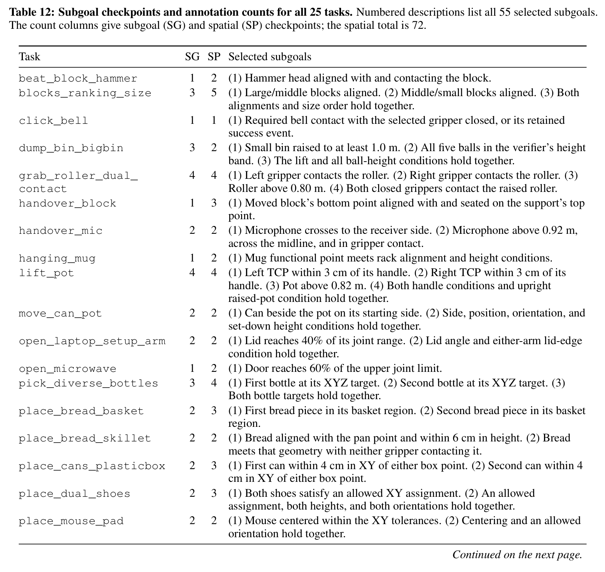

**Caption:** Table 12 (Part 1): Subgoal checkpoints and annotation counts for all 25 tasks. Numbered descriptions list all 55 selected subgoals. The count columns give subgoal (SG) and spatial (SP) checkpoints; the spatial total is 72.

**Caption[CN]:** 表 12（第 1 部分）：25 项任务的子目标检查点与标注数量。编号详细描述了前 18 项任务的子目标定义。SG 列和 SP 列分别代表子目标检查点与空间检查点的预设数量（全集空间检查点共 72 个）。

### Table 12 (Part 2). 25 项任务的子目标检查点与数量统计（第 2 部分）

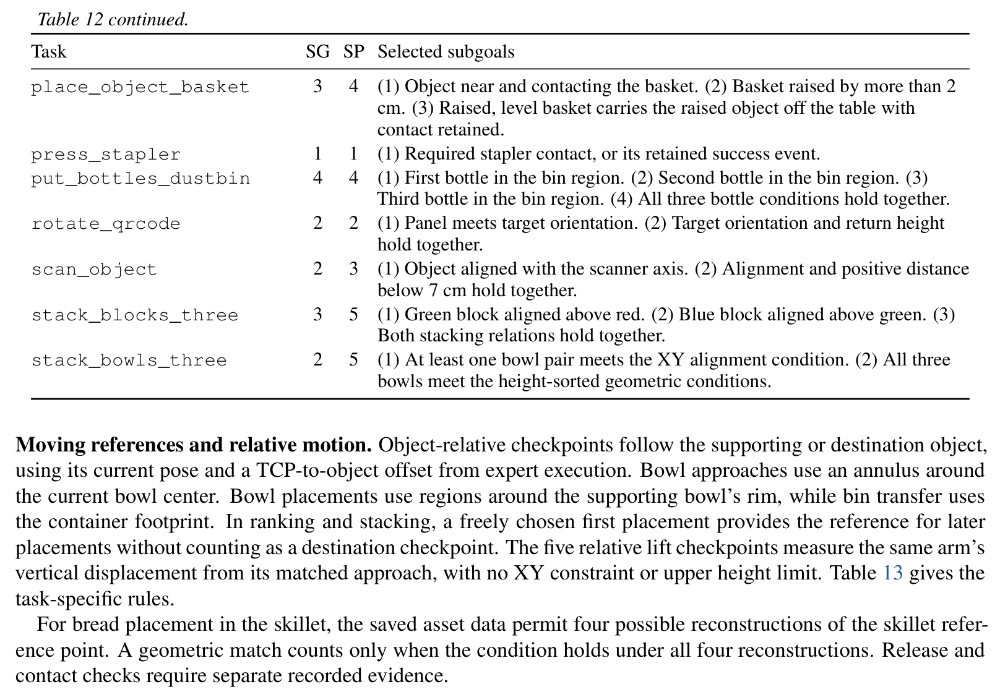

**Caption:** Table 12 (Part 2): Subgoal checkpoints and annotation counts for all 25 tasks continued. Listings include place_object_basket, press_stapler, put_bottles_dustbin, rotate_qrcode, scan_object, stack_blocks_three, and stack_bowls_three.

**Caption[CN]:** 表 12（第 2 部分）：25 项任务的子目标检查点与标注数量续。涵盖篮子装物、按压订书机、垃圾桶放瓶子、旋转二维码、扫码、三木块堆叠与三碗堆叠等任务。

### Table 13. 全部 72 个空间检查点的几何判定规则 (Spatial rules for all 72 checkpoints)

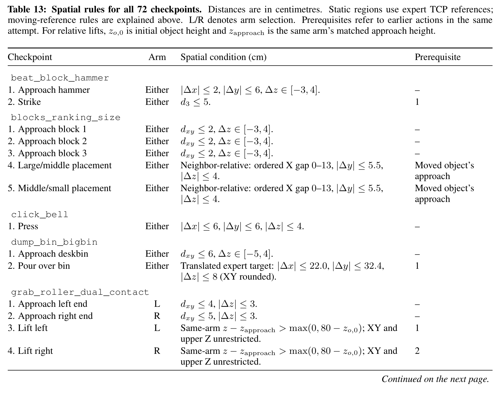

**Caption:** Table 13: Spatial rules for all 72 checkpoints. Distances are in centimetres. Static regions use expert TCP references; moving-reference rules are explained above. L/R denotes arm selection. Prerequisites refer to earlier actions in the same attempt. For relative lifts, $z_{o,0}$ is initial object height and $z_{\text{approach}}$ is the same arm’s matched approach height.

**Caption[CN]:** 表 13：全部 72 个空间检查点的空间几何判定规则。几何距离单位均为厘米（cm）。静态作业区采用专家示教 TCP 作为参考原点，动态移动物体的跟踪规则如正文所述。L/R 表示左臂/右臂；Prerequisites 代表该检查点在单次尝试中必须依赖的前置动作序列号。对于相对抬升判定，$z_{o,0}$ 为物体初始高度，$z_{\text{approach}}$ 为对应机械臂在匹配接近阶段的初始垂直高度。

# Appendix F: Failure Analysis (Extended Failure Case Taxonomy)

## F.1 Observed Failure Stages

> <strong>Para. 1:</strong> For each failed attempt, the failure analysis starts with unmet subgoals whose prerequisites were attained. These include subgoals that held earlier but no longer hold at termination. A completed subgoal needs no further failure analysis, even without a matching spatial checkpoint, because an alternative route may have achieved it. For each unmet subgoal, the analysis follows its spatial checkpoints and object states in action order, including actions within programs. The earliest observed difficulty determines a single category for the attempt.

> <strong>Para. 1[CN]:</strong> 针对每一次未能取得物理成功的尝试，失效归因分析首先锁定那些其前置依赖已经达成、但自身最终未达成的子目标集合（这包含了那些在执行中途曾一度成立但在终局瞬间丧失维系的子目标）。凡是最终圆满达成的子目标无需再进行归因，即使缺少对应的空间检查点匹配亦同，因为智能体可能探索出了一条超越专家先验的替代操作路径。针对每个未达成的子目标，分析引擎按照物理动作发生的严格时序（包括 Python 程序内部的细粒度动作步）依次追踪其空间位姿与物体状态。系统以全流程中最早观察到的物理受阻事件，作为该次尝试的唯一核心失效类别。

> <strong>Para. 2:</strong> A missing compatible target request has no event time, so it cannot override an earlier contact or transport difficulty. Without event timing, a category applies only when all remaining evidence supports that category. Different categories with no established order remain unresolved. Stage labels refer to the unmet subgoal. For example, unconfirmed arrival can concern a grasp location or a later placement destination.

> <strong>Para. 2[CN]:</strong> “从未发起过任何合理操作目标请求”这一特征由于不具备具体的时序时间戳，因而不能覆盖或覆写在此之前已然发生的物理碰撞或搬运失误。在缺乏显式时间先后次序的情况下，只有当留存的全部证据均唯一指向该特征时方可判定归类；若多项物理失误交织且缺乏确凿时序先后，则严格归入“未决案例（Unresolved）”。各阶段的标签严格锚定在出现问题的具体子目标之上：例如所谓“未确认到达（Unconfirmed arrival）”，既可能发生在起点的预抓取接近阶段，亦可能发生在后续搬运至目标容器上方的末端放置阶段。

> <strong>Para. 3:</strong> Object control and release. Offline simulator records identify contacts with the task object. Confirming common motion requires at least one sample with both fingers contacting that object during an action. Over the same action, both the TCP and object move at least 3 cm, while the world-frame object-minus-TCP position vector changes by at most 3 cm. These checks track the same object and arm throughout. Confirming object transport to an operation region also requires a spatial match for that arm.

> <strong>Para. 3[CN]:</strong> **物体受控与释放准则。** 离线仿真轨迹数据能够精准还原夹爪与任务物体之间的真实物理接触。判定“有效共同运动（Common motion）”的严格标准是：在某段动作过程中，至少存在一个物理采样帧使得夹爪双指同时与该物体保持有效接触，且在同一动作段内，机器人 TCP 与该物体均发生了至少 3 cm 的空间位移，同时物体中心相对于 TCP 的相对空间相对位移向量在运动全过程中的形变漂移量不得超过 3 cm。该检验在时序上严格绑定同一目标物体与特定机械臂。此外，要确认物体被成功“搬运（Transport）”至目标作业区，还必须要求该臂在终点达成对应的空间检查点命中。

> <strong>Para. 4:</strong> An open-gripper drive state after an action provides release evidence. Transport loss requires earlier common motion, followed by an open-gripper state, TCP displacement of at least 3 cm, and relative drift greater than 3 cm before arrival at the region. After arrival and release, failure to achieve the required object state indicates a subgoal-outcome failure. State loss requires an observed transition from a satisfied to an unsatisfied subgoal. A required event counts as satisfied after its first recorded occurrence and cannot count as state loss.

> <strong>Para. 4[CN]:</strong> 动作执行后夹爪处于张开状态构成了物体物理“释放（Release）”的直接证据。**搬运中途脱落（Transport loss）**判定标准为：此前已经确立了有效共同运动，但随后夹爪张开、TCP 继续位移了至少 3 cm、且物体与夹爪的相对距离漂移超过 3 cm（发生在进入目标作业区之前）。若机械臂已成功运抵目标作业区并完成释放，但物体最终未能呈现出预期的几何构型（如未落入容器或倒伏），则归为**子目标达成失败（Subgoal-outcome failure）**。**状态丧失（State loss）**则要求明确观察到系统从已满足状态向未满足状态的物理倒退（针对 4 项瞬态事件任务，一旦事件首次触发即永久视为达成，不计为状态丧失）。

> <strong>Para. 5:</strong> Replays pass full-trajectory validation for 481 of the 491 failed attempts. Original records support a broad failure stage for four more attempts. Six remain unresolved. Figure 10 expands the distribution in Figure 6. Its inner ring shows the same five failure stages, and its outer ring separates the action patterns within each stage. Unconfirmed arrival covers missing compatible target requests, unsuccessful requests, and motion with no confirmed regional match.

> <strong>Para. 5[CN]:</strong> 在全部 491 次物理失败尝试中，多达 481 次在物理回放中通过了全轨迹 5 mm 级的高保真严格验证；另有 4 次依赖原始实测日志支持了宏观失效阶段判定；剩余 6 次归为无法完全定论的未决案例。图 10 在正文图 6 的基础上进行了全面展开：其内环展示了五大宏观失效阶段，外环则依据微观动作模式（Action patterns）将每个阶段进一步细分。其中“未确认到达作业区”涵盖了三类细分机理：从未发起过有效目标请求（225 次）、发起的请求因逆运动学失败被拒绝（7 次）、以及机械臂虽产生了位移但未能落入有效几何区域（48 次）。

### Figure 10. 491 次失败尝试的深层失效阶段与动作模式归因旭日图 (Observed failure stages and action patterns)

**Caption:** Figure 10: Observed failure stages and action patterns. Each of the 491 failed attempts appears once. The inner ring shows the five failure stages. The outer ring divides each stage by the observed action patterns.

**Caption[CN]:** 图 10：491 次失败尝试的深层失效阶段与动作模式归因旭日图。全部 491 次失败尝试均且仅出现一次。内环对应五大主失效阶段（作业区未到达 280 次、物体控制未确立 77 次、子目标未达成或丧失 122 次、仅最终夹爪状态未满足 6 次、未决 6 次）；外环将每个阶段进一步拆解为底层可观测的微观动作模式（如接触但未形成协同位移 45 次、到达目标区但释放后未成形 34 次、此前满足的状态再度丢失 30 次等）。

> <strong>Para. 6:</strong> Unconfirmed object control covers contact or arrival without confirmed object transport, as well as transport loss before arrival. Subgoal-outcome failures include arrival without the required state and loss of a previously satisfied state. The final-gripper category applies when all selected subgoals hold but the verifier’s additional gripper condition remains unmet.

> <strong>Para. 6[CN]:</strong> “物体控制未确立”（共 77 次）涵盖了发生接触但未能带动位移（45 次）、到达预备抓取位姿但完全未发生搬运（30 次）、以及搬运中途脱落（2 次）。“子目标未达成或丧失”（共 122 次）细分为到达作业区但未观察到释放（11 次）、释放后目标物体未达成目标构型（34 次）、到达交互区但未能诱发事件（47 次）、以及一度成立的物理状态再度被外力破坏丢失（30 次）。“仅最终夹爪状态未满足”（共 6 次）则专指所有物理子目标均已完美实现，但剧集终结时智能体遗漏了最后一步张开夹爪脱离接触的要求。

> <strong>Para. 7:</strong> These categories locate difficulties within execution. The underlying checks do not measure grasp force or uniquely identify perception or contact mechanics as the cause. In particular, a missing compatible target request alone does not establish incorrect visual target selection.

> <strong>Para. 7[CN]:</strong> 这套分类学的核心目的在于精准锚定物理交互在时空流中的阻断断点。底层的几何与动力学校验并不会在线测量指尖摩擦抓持力，亦不能武断地将某次失误唯一归咎于纯视觉感知偏差还是接触动力学打滑。尤其需要客观指出的是，“未发起有效目标请求”这一表象本身并不能直接等同于大模型的视觉目标点估计发生了错误，模型可能在上下文推导或提示词指令理解等不同层面产生了决策偏差。

# Appendix G: Motion Execution and Completion Reports (Prompts & System Instructions)

> <strong>Para. 1:</strong> The following measures describe robot-action outcomes and the agent’s completion judgment. They complement the task-level failure stages above but do not assign additional failure causes.

> <strong>Para. 1[CN]:</strong> 以下指标从微观动作执行状态与智能体自我反思声明两方面，深入刻画系统的运行质态。它们与前述宏观任务失效阶段互为印证与补充，但不额外增加新的失效归因假设。

## G.1 Motion Execution Outcomes

> <strong>Para. 2:</strong> Table 14 counts robot actions that fail to complete, including actions within programs. It reports action execution outcomes separately from task success. Simulation advances during 2,783 of the 4,045 non-completed actions. A stopped action can therefore change the scene, so subsequent decisions need to account for the achieved state. Planner counts requests that the motion planner rejects. Stall denotes insufficient execution progress, while Deviation denotes excessive departure from the commanded motion. Allowance records stops at limits on motion segments, corrections, or probe travel.

> <strong>Para. 2[CN]:</strong> 表 14 系统统计了全部尝试中未能顺利完成全部期望位移的机器人物理动作总量（涵盖 Python 程序内部执行的原子动作步），并将底层动作层面的未完成状态与上层任务级的客观物理成功彻底解耦展示。在总计 4,045 次未完成动作中，有多达 2,783 次在动作被阻断前物理仿真世界已经推进演化并改变了场景状态。这意味着，即使动作中途被掐断，机械臂与物体的相对位姿也可能已经发生剧烈改变，后续的模型决策必须基于实测达到的新物理状态进行动态调整。在细分统计中：**Planner** 统计逆运动学或无碰撞轨迹规划失败被拒的次数；**Stall** 记录由于外界刚体阻挡导致关节速度降为零、无法取得进展的物理卡滞；**Deviation** 代表实际行进轨迹与规划路径发生过大物理几何偏移；**Allowance** 则记录达到单次动作的最大分段数、步进修正次数或接触探测距离上限而触发的安全熔断停机。

### Table 14. 9 种配置的未完成机器人物理动作统计 (Non-completed robot actions)

| Configuration | Non-completion count (rate) | Planner refusals | Physical stalls | Trajectory deviations | Allowance stops |
|---|---|---|---|---|---|
| **GPT-6 Astra (Codex CLI)** | **305/2,055 (14.8%)** | 187 | 110 | 3 | 5 |
| **Claude Opus 5 (Reference)** | 410/2,323 (17.6%) | 171 | 209 | 6 | 24 |
| **Claude Opus 5 (Claude Code)** | 444/2,450 (18.1%) | 191 | 221 | 4 | 28 |
| **Gemini 3.6 Flash (Reference)** | 665/3,029 (22.0%) | 400 | 257 | 3 | 5 |
| **GPT-5.6 Sol (Reference)** | 310/1,611 (19.2%) | 124 | 166 | 1 | 19 |
| **Qwen 3.8 Max (Reference)** | 703/2,385 (29.5%) | 393 | 265 | 3 | 42 |
| **Grok 4.6 (Reference)** | 207/1,102 (18.8%) | 68 | 128 | 3 | 8 |
| **Kimi K3 (Reference)** | 613/1,846 (33.2%) | 286 | 282 | 7 | 38 |
| **Claude Sonnet 5 (Reference)** | 388/1,566 (24.8%) | 202 | 172 | 4 | 10 |

**Caption:** Table 14: Non-completed robot actions. Each row covers 75 attempts and includes actions within programs. Non-completion reports the number of incomplete actions over all actions, followed by the rate. The remaining columns separate planner refusals, stalls, trajectory deviations, and motion-allowance stops. Bold marks the lowest rate.

**Caption[CN]:** 表 14：各智能体配置下未完成机器人物理动作统计表。每行基于全部 75 次尝试统计，涵盖 Python 程序内部展开执行的所有动作步。未完成率为主列；后续各列分别细分了规划器拒绝（Planner）、物理卡滞截停（Stall）、轨迹严重偏移（Deviation）以及超过单次运动配额保护性停机（Allowance）的绝对次数。粗体标出全场最低未完成率。

## G.2 Completion Claims and Stopping Conditions

> <strong>Para. 3:</strong> The done report contains the agent’s assessment, which is separate from the hidden verifier outcome. Table 15 reports stopping conditions and whether an explicit completion claim agrees with that outcome. An absent claim is not a failure judgment.

> <strong>Para. 3[CN]:</strong> 智能体主动提交的 `done` 终结报告留存了其对当前局面的自主评估，此数据与隐藏验证器的客观真值判决完全解耦。表 15 详尽汇报了 9 种系统在 75 次尝试中的触发终止模式，以及智能体给出的显式完成声明与客观真值之间的一致性分布。需要重申，由于被系统强行熔断而导致未提交声明的情形，绝不应等同于智能体做出了失败声明。

> <strong>Para. 4:</strong> One of the 322 done reports omits a Boolean claim. Done denotes agent-initiated termination, Tool a charged-call limit, and Phys. a simulated-time limit. The “Other” stopping conditions comprise eight wall-time limits and one runtime error.

> <strong>Para. 4[CN]:</strong> 在全场全部 322 次主动调用 `done` 的报告中，仅有 1 次遗漏了显式布尔参数。在终止模式列中：**Done** 代表由智能体自主发起的主动正常退出；**Tool** 代表达到计费工具调用次数上限强制终止；**Phys.** 代表消耗完仿真物理时间预算强制终止；**Other** 包含 8 次因超过最大物理墙钟超时截停以及 1 次底层通信异常报错。

### Table 15. 各配置尝试终止模式与自我完成声明分类对照 (Attempt termination and completion claims)

| Configuration | Done | Tool | Phys. | Other | Claim: Correct | Claim: Over | Claim: Under | Claim: Absent |
|---|---|---|---|---|---|---|---|---|
| **GPT-6 Astra (Codex CLI)** | **72** | 0 | 3 | 0 | **68** | 3 | 1 | 3 |
| **Claude Opus 5 (Reference)** | **63** | 0 | 12 | 0 | **50** | 13 | 0 | 12 |
| **Claude Opus 5 (Claude Code)** | **54** | 2 | 19 | 0 | **42** | 11 | 1 | 21 |
| **Gemini 3.6 Flash (Reference)** | 37 | 17 | 21 | 0 | 18 | 19 | 0 | **38** |
| **GPT-5.6 Sol (Reference)** | 21 | **52** | 2 | 0 | 12 | 9 | 0 | **54** |
| **Qwen 3.8 Max (Reference)** | 29 | 2 | **43** | 1 | 23 | 6 | 0 | **46** |
| **Grok 4.6 (Reference)** | 20 | **55** | 0 | 0 | 15 | 5 | 0 | **55** |
| **Kimi K3 (Reference)** | 20 | **36** | 11 | 8 | 13 | 7 | 0 | **55** |
| **Claude Sonnet 5 (Reference)** | 6 | **67** | 2 | 0 | 4 | 1 | 0 | **70** |

**Caption:** Table 15: Attempt termination and completion claims. Each configuration has 75 attempts. Correct denotes agreement with the verifier. Over and Under denote incorrect success and failure claims, respectively. Absent indicates no Boolean claim. Bold marks the most frequent stopping condition and completion-claim category within each row.

**Caption[CN]:** 表 15：尝试终止模式与完成声明分类对照表。每种配置包含 75 次独立尝试。终止模式分为智能体主动调用（Done）、调用次数超限（Tool）、物理仿真时间超限（Phys.）及其他中断（Other）。声明分类分为与客观真值一致（Correct）、物理失败却误报成功（Over）、物理成功却误报失败（Under）以及未提供布尔声明（Absent）。粗体标出各行中发生频次最高的终止模式与声明分类。

> <strong>Para. 5:</strong> Stopping conditions differ with program use (Table 9). The four configurations with the highest program shares reach the tool-call limit in 19/300 attempts (6.3%), compared with 212/375 (56.5%) for the other five. Within the latter group, Qwen more often exhausts simulated time (43/75) than tool calls (2/75). Composing several operations in one program saves tool calls, while physical execution still consumes the simulation-time budget.

> <strong>Para. 5[CN]:</strong> 交互终止模式与智能体对 Python 程序编写的使用习惯（表 9）呈现出极其强烈的相关性。在代码程序占比排名前四的最强智能体中，仅有 6.3%（19/300）的尝试触碰到工具调用次数上限；而对于其余五款代码使用率较低的系统，因调用次数超限被强行掐断的尝试高达 56.5%（212/375）。在后一组模型中，Qwen 3.8 Max 表现出独特的行为特征：它耗尽物理仿真时间（43/75）的频次远高于耗尽工具调用次数（2/75）。这一现象揭示了本质逻辑：在 Python 脚本内部复合调用多个原子动作能够极大节约模型与基准通信的轮次与计费调用数，但实体机器人在物理空间中的真实轨迹位移仍忠实消耗着物理仿真时间配额。

> <strong>Para. 6:</strong> Astra and both Opus configurations end most attempts with a correct claim. The other six end most attempts without one. Across all nine configurations, 345/491 failed attempts (70.3%) end without a claim. Gemini also shows that extensive program use does not ensure accurate completion assessment: despite an 87.4% program share, 19 of its 37 explicit claims incorrectly report success.

> <strong>Para. 6[CN]:</strong> GPT-6 Astra 与两款 Claude Opus 5 配置在绝大多数尝试中均能以客观正确的完成声明收官；而其余六款模型在绝大多数尝试中甚至根本未能提交声明（多因被动超限截停）。纵观全部 9 种系统，多达 70.3%（345/491）的物理失败尝试在被强行截停时未留下任何自我声明。此外，Gemini 3.6 Flash 的数据生动印证了一个反直觉事实——高强度的程序编写能力并不必然带来敏锐的物理自省认知：尽管 Gemini 的程序占比高达 87.4%，但在其给出的 37 次显式声称中，有多达 19 次做出了与客观事实彻底相悖的“虚假盲目成功报告（Overclaim）”。

# Appendix H: Use of Generative AI

> <strong>Para. 1:</strong> We used generative AI tools to aid manuscript drafting and polish writing, search the literature and check citations, edit and debug code, and assist with plotting code and figure and table formatting. We have reviewed all AI-assisted work. We take responsibility for the final content of this work, including text, claims, and artifacts produced with the aid of generative AI.

> <strong>Para. 1[CN]:</strong> 我们使用了生成式人工智能工具辅助初稿起草与文字润色、文献检索与学术引用核验、代码编写与调试、以及数据可视化绘图与图表排版美化。所有在人工智能协助下产出的内容均经过作者团队的全量人工严格复核。作者团队对本文的最终全部学术内容、实验结论以及借助生成式人工智能生成的各项研究成果承担全部学术责任。
