---
tags:
  - papers/embodied_ai
  - papers/code_as_policy
  - papers/benchmark
  - papers/agentic_manipulation
aliases:
  - CodeActionBench
  - Lyu 2026
date: 2026-09-27
arxiv_id: "2609.33807"
---

# CodeActionBench: Evaluating Agentic Code-as-Policy for Embodied Manipulation

## 核心信息

| 属性 | 详细内容 |
| :--- | :--- |
| **论文标题** | CodeActionBench: Evaluating Agentic Code-as-Policy for Embodied Manipulation |
| **中文译名** | CodeActionBench: 面向具身操作的智能体代码即策略评估基准 |
| **作者团队** | Yiheng Lyu (吕逸恒)$^1$, Xueying Jiang (姜雪莹)$^1$, Wenhao Li (李文昊)$^1$, Shijian Lu (卢宪建)$^{1,\dagger}$, Gongjie Zhang (张功杰)$^{2,\dagger,*}$ |
| **机构所属** | $^1$Nanyang Technological University (南洋理工大学 S-Lab), Singapore; $^2$Independent Researcher (独立研究者); $^\dagger$通讯作者, $^*$项目负责人 |
| **发表时间/版本** | 2026 年 9 月 27 日 (arXiv:2609.33807v1 [cs.RO]) |
| **项目与代码** | [GitHub 仓库](https://github.com/lyuyiheng/CodeActionBench) \| [项目主页](https://codeactionbench.github.io) |
| **评测实验体量** | 25 项双臂操控任务、9 种前沿大模型智能体系统配置、675 次全流程独立评测尝试、184 次成功（整体成功率 27.3%） |
| **核心战力标杆** | **GPT-6 Astra (Codex CLI)** 取得 **73.3% 成功率** (55/75) 与 **88% 任务覆盖率** (22/25)，兼具最低中位耗时 (477.2s) 与极高成本效率 |
| **核心基准定位** | 首个在**彻底剔除示范轨迹、特化感知模块（SAM/Grounding DINO）、专用抓取位姿提议网络（Contact-GraspNet）以及特权仿真真值位姿**严苛条件下，评测多模态大模型闭环代码策略合成与 3D 物理操作能力的标准化评测基准 |

---

## 原文摘要翻译

> 通用多模态大模型究竟能在多大程度上将视觉理解与逻辑推理能力转化为可执行代码，进而完成具身物理操作？为此，我们提出了 **CodeActionBench**，一个包含 25 项精巧操作任务的标准化基准，旨在通过**智能体代码即策略（Agentic Code-as-Policy）**范式深入评估这一核心能力。在**完全不依赖特定任务微调、人工示教示范、外部特化感知或抓取生成模块、特权场景状态以及预定义任务策略**的严苛条件下，智能体必须自主从多视角图像中提取视觉线索、构建任务相关的 3D 几何估计、生成物理操作目标，并在交互闭环中迭代执行与动态修正代码策略。
> 
> 基准提供了一套标准化的机器人 API，涵盖多视角 RGB 观测、经校准的几何投影运算、机器人运动学及接触反馈、以及有边界约束的末端运动接口，将全部任务级决策交由被评测模型全权主导。通过固定的任务实例、严格受限的资源预算（工具调用与物理时间）以及完全隐蔽的带外物理结果验证器，我们对跨模型与脚手架系统进行了严格受控的横向对比。
> 
> 在 9 种智能体配置和 675 次独立尝试的广泛评测中，各系统的任务成功率呈现从 2.7% 到 73.3% 的巨大跨度。表现最为出色的配置——配合 Codex CLI 脚手架的 **GPT-6 Astra**，在三次尝试中至少成功解决了 25 项任务中的 22 项，取得了 73.3% 的巅峰表现，但距离完全攻克该基准仍有显著提升空间。细粒度的轨迹病理诊断揭示，智能体在**空间位姿对齐（Spatial Alignment）、物体抓取保持（Object Retention）以及任务完成度自我裁决（Completion Judgment）**方面依然面临严重瓶颈，甚至频繁出现“机械臂轨迹完全执行成功、但底层物理约束根本未达成”的假性执行现象。CodeActionBench 为定量衡量通用基础大模型向具身物理行为转化能力、深入诊断典型物理失效机理提供了高度可控的基石平台。

---

## 创新点

1. **首创严格信息边界的纯零示范具身代码策略基准**：彻底摒弃了既往工作依赖“特权仿真位姿真值”、“外部专家视觉/抓取模型（SAM/Contact-GraspNet）”或“离线示范代码（Demonstrations）”的遮羞布，要求通用多模态大模型仅凭多视角 RGB 和物理反馈，完全端到端闭环自主构建 3D 度量、规划动作与排查错误。
2. **构建共享的低层机器人原子控制与感知 API 规范**：设计了包含 29 个原子接口的控制栈，将底层动力学解算、cuRobo 运动学碰撞规划与环境物理引擎封装为无偏见的执行层，使智能体能通过标准 Python 程序（`run_code`）无缝调用变量、循环、分支以及度量级几何工具链。
3. **首创纯视觉几何驱动的零深度 3D 空间估计链**：在完全没有深度图（Depth Sensor）的前提下，基准提供了基于相机内外参标定的射线投影、主动机械臂微位移双目三角化（`capture_motion_pair` + `triangulate_correspondence`）、夹爪已知几何刻度（`scale_from_gripper`）以及接触探测面相交工具，由大模型自主在图像上点击特征点并恢复世界坐标系下的三维尺度。
4. **设计全隐蔽物理结果验证器与 72 维细粒度轨迹检查点规约**：引入带外运行的隐藏评测器（Out-of-band Verifier），验证结果严格对智能体屏蔽；同时设计了 55 个物理子目标检查点与 72 个空间轨迹检查点，并通过 5mm 严格物理重放机制（Replay Validation），精确拆解从“接近目标”、“接触控制”、“协同搬运”到“姿态终态达成”的每一步微观进展。
5. **揭示脚本级程序合成（Program Synthesis）对反应式单步工具调用的降维打击**：实证表明顶级系统（如 GPT-6 Astra、Claude Opus 5）的程序合成占比均超 85%（Astra 达 92.6%），借助循环、变量持久化与局部重试极大规避了上下文爆炸与调用预算超限，而弱模型频繁单步调用直接导致 56.5% 的任务在半途耗尽调用预算。
6. **建立具身智能体物理失效与虚假完成声称（False Done）的系统病理学分类**：对全部 491 次失败尝试展开了首个双环细粒度解剖，量化揭示了 280 次未达目标区域、77 次物体脱落失控、122 次子目标丢失的物理分布；并首次审计了智能体的自我评估意识，证实弱模型存在高达 34.2% 的过度声称（Overclaim，即没做成却自称成功）与严重的认知脱节。

---

## 一句话总结

> **CodeActionBench 是具身智能领域首个在完全剥离特权状态、特化感知模块与示范模板的严苛条件下，系统评测多模态大模型如何仅凭纯 RGB 视觉闭环合成 Python 策略控制双臂机器人的基准，实证确立了脚本级程序合成的决定性优势，并深度揭示了动作执行成功与物理目标达成之间的认知鸿沟。**

---

## 研究问题

在当前的具身机器人学习（Embodied Robot Learning）研究中，主要存在两大主流路线：
1. **视觉-语言-动作模型（Vision-Language-Action, VLA）**：如 RT-2, OpenVLA, $\pi_0$, $\pi_{0.5}$ 等，通过采集数十万甚至数百万条真实或仿真轨迹，端到端学习从图像像素到末端动作 Token 或流匹配去噪动作的映射。这类方法虽然具备平滑的高频控制，但极度依赖昂贵的示教数据，泛化到新场景与新具身时往往需要重新微调。
2. **代码即策略（Code-as-Policy, CaP）**：利用通用多模态大模型强大的逻辑推理与编程能力，在测试期零样本或少样本生成调用机器人 API 的 Python 代码，通过闭环反馈完成任务。

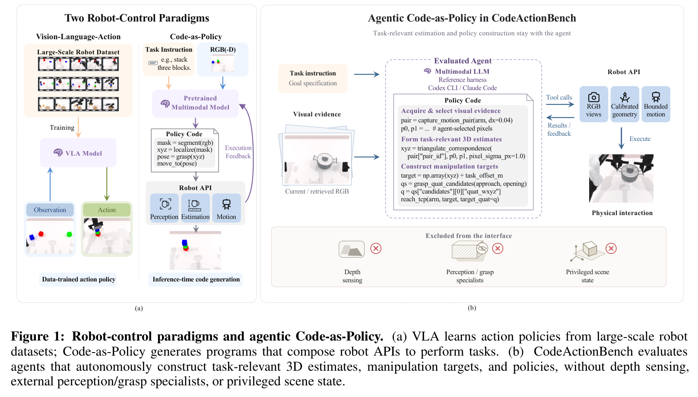

然而，现有的 Code-as-Policy 评估存在巨大的**虚假繁荣与黑盒外挂问题**：
- **特权信息泄露**：如 VLCP 直接向模型暴露仿真器中物体的绝对 3D 位姿；
- **重度依赖特化感知外挂**：如 OpenETA、VoxPoser、ReKep 等工作，在底层接入了 SAM（分割大模型）、Grounding DINO（开集检测）或 Contact-GraspNet（专用 6-DoF 抓取网络），甚至是直接输入高精度深度点云。在这些系统中，真正决定物理操作成败的核心几何难题（物体在哪里、抓哪里、朝哪个方向进给）都被外部专用模块代劳了，大模型实际上只充当了一个高层的高级调度器（High-level Dispatcher）；
- **大量现成代码模板与人工示教**：依靠 Prompt 中精心配制的 Few-shot 演示代码，模型只是在依葫芦画瓢地填空。


这引出了一个根本性的前沿科学问题：**如果彻底拿掉所有特化感知模块、拿掉特权状态、拿掉人工示范、甚至拿掉深度图（只给普通 RGB 摄像头），通用前沿多模态大模型本身是否具备足够的空间几何理解、推理深度与编程纠错能力，独立闭环完成复杂的 3D 物理操作？**

现实是残酷的：大模型的视觉语义理解（知道“这是个杯子”）与代码级物理操作（计算机械臂逆解并在毫米级公差内抓住把手）之间存在巨大的认知鸿沟：
- **空间度量估计崩塌**：2D 像素坐标如何映射到 3D 物理空间？缺乏深度时，模型极难准确建立度量先验；
- **盲目执行与虚假完成（Premature Done / False Done）**：模型往往认为“我写出了 `move_to` 代码，机械臂也动了，所以任务一定成功了”，完全无视物体是否因滑脱、干涉或姿态倾角过大而失败；
- **长程任务中的误差累积与上下文雪崩**：每执行一步动作，环境发生改变，如果单纯依靠一次次的单步工具调用，上下文迅速膨胀耗尽，智能体在迷茫中耗尽资源。

CodeActionBench 正是为了彻底终结这一领域的混乱对比，为真正的端到端智能体代码策略建立的一座“照妖镜”级别的严格物理基准。

---

## 数据与任务定义

### 1. 实验底座与具身构型
- **仿真引擎**：SAPIEN 物理仿真底座 (Xiang et al., 2020)；
- **机器人实体**：RoboTwin 2.0 (Chen et al., 2025) 规范下的 **ALOHA-AgileX 双臂机器人**。包含左、右两个 6 自由度机械臂及平行双指夹爪；
- **传感器配置**：
  - 固定头部广角相机（Head Camera）：$640 \times 480$ RGB 图像，提供操作台面全局视野；
  - 双手手腕附着相机（Wrist Cameras）：各提供 $320 \times 240$ RGB 图像，随手臂移动提供动态特写视角；
  - **严格限制**：**不提供任何深度相机（Depth Sensor），不提供点云，不提供任何物体真值包围盒或位姿**。观测中仅附带当前相机经过标定的内参矩阵（Intrinsics）与外参矩阵（Extrinsics）。
- **确定性基准约定**：所有任务关闭背景、光照、杂乱度、相机外参和桌面高度的随机扰动；每个任务采用全局固定的场景随机种子（Fixed Scene Seed），确保 9 种系统面对完全相同的初始物理世界。

### 2. 6 大功能类别与 25 项精巧操作任务
基准涵盖了单臂操作、双臂精密协同、动态接触过程、工具使用及可形变/关节机构等 25 项极具代表性的高难度任务：

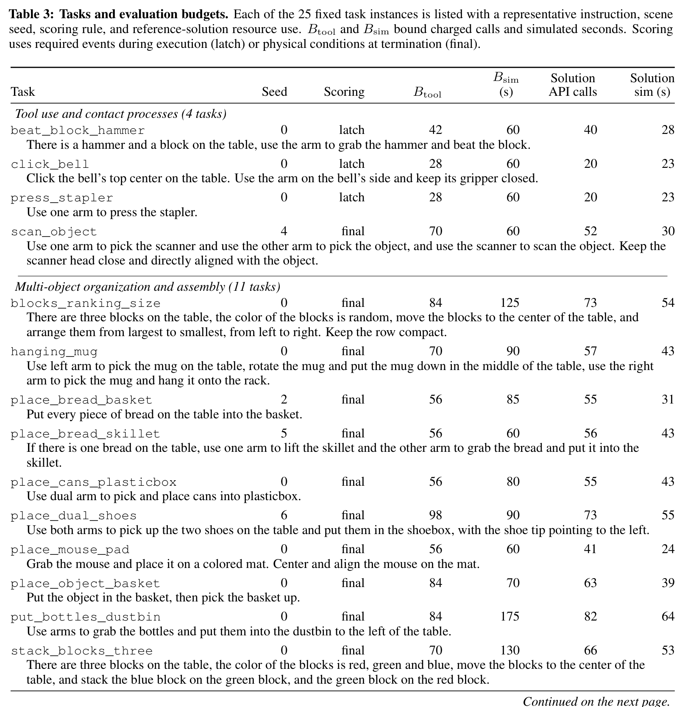


1. **工具使用与接触过程 (Tool use and contact processes, 4 项)**：
   - `beat_block_hammer`: 单臂抓取锤子柄部，调整姿态准确敲击桌面木块；
   - `click_bell`: 单臂以夹爪闭合状态精准按压桌面服务铃的顶部中心；
   - `press_stapler`: 单臂下压订书机上盖触发订书动作；
   - `scan_object`: 双臂协同，一臂抓取扫描仪，另一臂抓取目标物体，并将扫描仪头部在 7cm 距离内严格对准物体轴线。
2. **多物体组织与空间装配 (Multi-object organization and assembly, 11 项)**：
   - `blocks_ranking_size`: 识别台面上三个尺寸各异的方块，从大到小从左至右紧凑横向排成一列；
   - `hanging_mug`: 极为严苛的长程任务——左臂抓起桌上的马克杯，旋转放置于桌面中央，再由右臂换手抓取把手，精准挂入挂架挂钩；
   - `place_bread_basket`: 将散落的多个面包抓取放入收纳篮；
   - `place_bread_skillet`: 左臂端起平底锅并保持水平悬空，右臂抓取面包精准投入锅中；
   - `place_cans_plasticbox`: 双臂协作将易拉罐分拣放入塑料盒；
   - `place_dual_shoes`: 双臂协同抓起两只鞋子平整放入鞋盒，且鞋尖必须统一朝左；
   - `place_mouse_pad`: 抓取鼠标放置在指定彩色鼠标垫中心并旋转对齐；
   - `place_object_basket`: 将物体装入提篮，随后将提篮完全提离桌面；
   - `put_bottles_dustbin`: 将桌上多个散落塑料瓶逐一投入垃圾桶；
   - `stack_blocks_three`: 三色积木层叠（绿堆在红上，蓝堆在绿上）；
   - `stack_bowls_three`: 三个碗同心同轴同层嵌套堆叠。
3. **双臂高难度协同操作 (Dual-arm cooperative manipulation, 4 项)**：
   - `dump_bin_bigbin`: 双手协调抓取小球盒，悬空翻转将小球全数倒入大盒中，且小盒最终仍需保持悬空；
   - `grab_roller_dual_contact`: 双臂分别从左右两端同时锁紧滚筒两头，协同抬起至 0.80m 以上；
   - `lift_pot`: 双臂分别精准捏住双耳汤锅的左右把手，平稳水平起吊，倾角超限即判失败；
   - `pick_diverse_bottles`: 双臂分别同步抓取两只不同形态的瓶子，保持在相机视野前方。
4. **交接、重抓取与空间重定向 (Handover, regrasp and reorientation, 4 项)**：
   - `handover_block`: 左臂抓取红方块，在空中平稳交接给右臂，右臂随后放置在蓝色垫片上；
   - `handover_mic`: 单臂拾起麦克风并在空中移交对侧手臂，接收臂举高展示；
   - `move_can_pot`: 拾起倒地或偏置的易拉罐，直立扶正放置于锅体旁；
   - `rotate_qrcode`: 抓取翻转二维码卡牌，使其正面朝上平贴于桌面。
5. **关节机构与收纳设备 (Articulated storage and devices, 2 项)**：
   - `open_laptop_setup_arm`: 单臂钩住笔记本电脑边缘，将屏幕翻折掀开至铰链范围的 40% 以上并保持；
   - `open_microwave`: 抓住微波炉把手，大角度顺滑拉开微波炉炉门至 60% 限位以上。

### 3. 双重资源预算机制与评测规约
为了杜绝智能体无限盲试，基准依据人类专家最优操作轨迹（$t_{expert,min}$ 与 $t_{expert,sim}$）设定了严格受限的双重资源约束：
- **工具调用上限（Tool-call Budget, $B_{tool}$）**：
  $$B_{tool} = \lceil 14 \cdot t_{expert, min} \rceil$$
  计费工具调用包括所有直接 API 触发或一次 `run_code` 提交（无论脚本内部包含多少物理步）。超出即刻强制终止。
- **仿真物理时间上限（Simulation-time Budget, $B_{sim}$）**：
  $$B_{sim} = \text{ceil}_{5s}(\max(60\text{s}, 5 \cdot t_{expert, sim}))$$
  严格累加机械臂在物理引擎中的真实推演秒数（不包含大模型推理或等待 API 的耗时）。防止死循环空转。
- **评测样本总量**：9 种大模型配置 $\times$ 25 项任务 $\times$ 3 次独立尝试 = **675 次全流程尝试**。

---

## 方法主线

### 机制流程 (Information Boundaries, Agentic Loop, Robot API & Sandbox Execution)

CodeActionBench 建立了极其清晰严格的信息隔离防火墙与智能体闭环交互机制：


1. **信息边界与防火墙**：
   - **智能体可见域**：任务自然语言指令、机器人当前末端状态（TCP 位姿、夹爪开合度）、相机标定内外参、多视角 RGB 图像、接触探测脉冲读数、执行成功/中断返回值。
   - **严格不可见域**：仿真器底层物理状态（物体真实位姿、质量、惯量矩阵）、任何真值网格、任何任务特化目标点、隐蔽物理验证器的任何判定规则与实时状态。
2. **交互闭环演进**：
   - 智能体通过观察头部全景与手腕图像，形成空间假说；
   - 自由选择采用**单步直接工具调用（Direct API Calling）**或**编写完整 Python 脚本（`run_code`）**；
   - 脚本提交至沙箱环境执行，沙箱连接底层 cuRobo 运动规划器与 SAPIEN 物理仿真器；
   - 执行过程中若出现运动学奇异、路径碰撞或物理卡死，即刻触发软中断，保存当前已达成的实际末端位姿并向大模型反馈异常详情；
   - 智能体根据反馈在多轮对话中动态修正策略；
   - 任务结束时，智能体显式触发 `done(report=..., success_claim=True/False)` 提交自我评价，退出尝试。

---

### 共享机器人控制与感知 API 规范

基准抽象出 29 个强类型的原子级机器人操作工具，并分为三组互补接口：


1. **机器人状态测量与多视角观测接口（Table 4）**：
   - `get_world_frame`: 查询全局世界坐标系规范（右手系：+x 向右，+y 朝前推向桌面，+z 竖直向上）；
   - `get_embodiment`: 获取左右机械臂连杆物理尺寸、夹爪指尖几何外形及相机相对末端法兰的安装位姿；
   - `get_camera_info`: 获取指定相机内外参矩阵与图像分辨率；
   - `get_arm_pose` / `get_gripper_state`: 实时读取末端工具中心点（TCP）绝对位姿与双指物理开合间距；
   - `get_grasp_contact`: **关键接触反馈接口**，读取左右手各指节当前所承受的法向接触冲量（Impulse，单位 $\text{N}\cdot\text{s}$）以及指节的世界坐标，但**匿名化处理**（仅告知哪个手指碰到了东西，不告知碰到了什么物体）；
   - `capture_head` / `capture_wrist` / `capture_evidence_views`: 捕获带全局观测 ID 的瞬时 RGB 帧，并支持在同一仿真时间戳下同步冻结抓拍多视角画面；
   - `draw_marks`: 在图像指定像素坐标上叠加高亮标记与文本标签，供模型进行视觉对齐的自检。
2. **底层末端笛卡尔运动与夹爪执行工具（Table 7）**：
   - `reach_tcp(arm, target, target_quat)`: 驱动单臂以绝对位姿为目标进行笛卡尔空间运动规划；
   - `reach_both_tcp(...)`: 双臂严格时间同步的绝对位姿协调运动；
   - `move_delta(arm, delta_xyz)` / `move_both_delta(...)`: 基于当前末端位置的相对增量位移；
   - `probe_contact_along(arm, direction, travel_bound, step_size)`: **微观接触盲探利器**，机械臂沿指定方向以细微步幅推进，在指尖传感器检测到接触力脉冲骤增时瞬时停机，返回触碰瞬间的精确坐标与终止原因；
   - `set_gripper(arm, open_ratio)`: 归一化控制夹爪开合（0.0 全闭合，1.0 全打开），返回阻力堵转检测读数。
3. **运动规划安全保障**：所有轨迹生成均接入 NVIDIA cuRobo 库 (Sundaralingam et al., 2023)，自动进行逆运动学（IK）解算与机械臂双臂自碰撞避免。若目标点超出工作空间或存在自干涉，直接抛出 `PlannerRefusal`，绝不损伤系统。

---

### 空间估计与目标姿态构建工具链

在没有任何深度图（No Depth）和三维真值的前提下，CodeActionBench 的核心精髓在于为大模型配备了一套**基于射影几何原理的纯视觉三维度量重建工具箱**：


1. **射线投射与平面相交 (`ray` + `plane_intersect`)**：
   - 大模型在 RGB 图像上选定物体特征点像素 $(u, v)$，调用 `ray` 计算从相机光心穿过该像素的世界坐标系三维视线方向向量；
   - 随后，智能体利用桌面已知高度先验，或者先调用 `probe_contact_along` 探针轻触物体表面获得一个触点坐标，以此构建局部法向量平面，调用 `plane_intersect` 计算射线与平面的空间交点，直接解算出毫米级 3D 坐标 $(x, y, z)$。
2. **主动相机微运动双目立体三角化 (`capture_motion_pair` + `triangulate_correspondence`)**：
   - 针对悬空或形状复杂的物体，模型指挥机械臂手腕相机发生微小刚体位移（如沿 $x$ 轴平移 $\Delta x = 4\text{cm}$），自动捕获运动前后两幅手腕视角 RGB 图像；
   - 大模型在两张图上分别定位同一物理特征点 $(u_0, v_0)$ 与 $(u_1, v_1)$；
   - 调用 `triangulate_correspondence`，底层利用精确记录的相机运动外参求解视差对极几何，输出高精度的世界空间 3D 坐标及其协方差误差估计 $\sigma_{xyz}$。
3. **已知物理实体刻度基准 (`scale_from_gripper` & `scale_from_object_size`)**：
   - 模型可调用 `scale_from_gripper` 将当前张开特定间距的双指投影回图像，以夹爪的物理绝对尺寸作为活体标尺，消除单目视觉的尺度歧义；或输入先验包围盒反推物体粗糙距离。
4. **抓取四元数姿态构建与预演 (`grasp_quat_candidates` & `preview_tcp_pose`)**：
   - 抓取不仅需要三维位置，还需要精准的姿态。模型只需给出直观的物理轴线：**进给轴向量（Approach Axis）**与**指面开合轴向量（Opening Axis）**；
   - `grasp_quat_candidates` 自动将两正交向量解算为合法的四元数 $(w, x, y, z)$（同时提供反向 180° 对称解）；
   - 在真正动臂之前，模型可调用 `preview_tcp_pose` 将预设姿态的三维夹爪骨架反向投影回图像，直观确认夹爪是否精准对齐杯把或锤柄。

---

### 隐蔽物理结果验证器与检查点评测规约

为实现科研级的纯粹评测，CodeActionBench 杜绝了传统评测中“机械臂动了就算完成”的敷衍逻辑，引入了工业级的隐蔽验证架构：

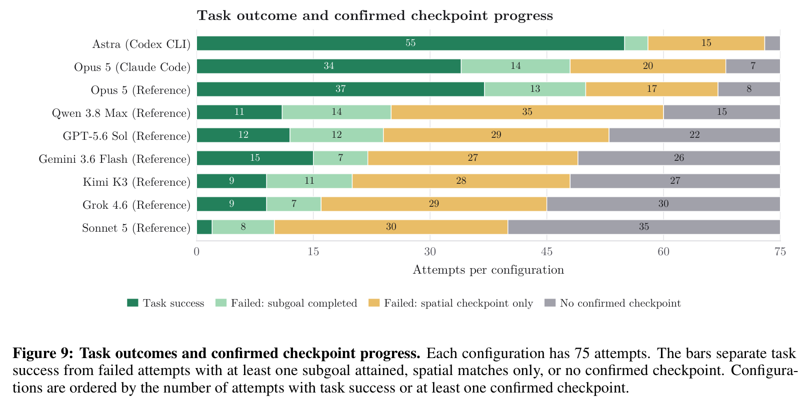

1. **带外物理结果验证器 (Out-of-band Verifier)**：
   - 独立于智能体交互进程运行。针对 25 项任务划分为两种判分模式：
     - **终态物理判定 (Final, 21 项)**：在智能体调用 `done` 或用尽预算退出的一瞬间，抓取物理仿真世界底层的全量几何状态（物体质心坐标、姿态四元数、支撑面接触力、相对间距），严格执行数学不等式判定；
     - **执行事件锁存判定 (Latch, 4 项)**：针对具有瞬态物理特性的任务（如敲击、按铃、压订书机、倒球），只要在物理推演流中检测到特定冲量阈值被触发且满足最终状态，即锁定记录成功事件。
2. **双层轨迹检查点规约 (Checkpoint Protocols)**：
   - **55 个物理子目标检查点 (Subgoal Checkpoints, SG, Table 12)**：精细定义物体间的关键物理事件（如：马克杯被旋转放置在桌面中心、麦克风越过中线被对侧手抓取、三块积木满足特定层叠拓扑）；
   - **72 个空间轨迹检查点 (Spatial Checkpoints, SP, Table 13)**：定义机械臂 TCP 必须到达的关键空间三维容差球（例如：接近锤柄 $|\Delta x| \le 2\text{cm}, |\Delta y| \le 6\text{cm}, \Delta z \in [-3, 4]\text{cm}$）；对于移动物体（如碗、锅），空间容差球动态绑定在目标物体的运动坐标系上。
3. **5mm 级严格物理重放审计 (Replay Validation)**：
   - 为彻底排除日志记录偶发错误，基准对全部 491 次失败尝试中的 481 次成功执行了端到端物理重放；
   - 要求原始调用顺序、物理步长数、每步末端位姿误差严格控制在 **$5\text{mm}$ 容差以内**，确保证据链坚不可摧。

---

### 评测配置与执行脚手架

基准评测了 9 种极具代表性的通用前沿智能体系统配置（Table 8）：

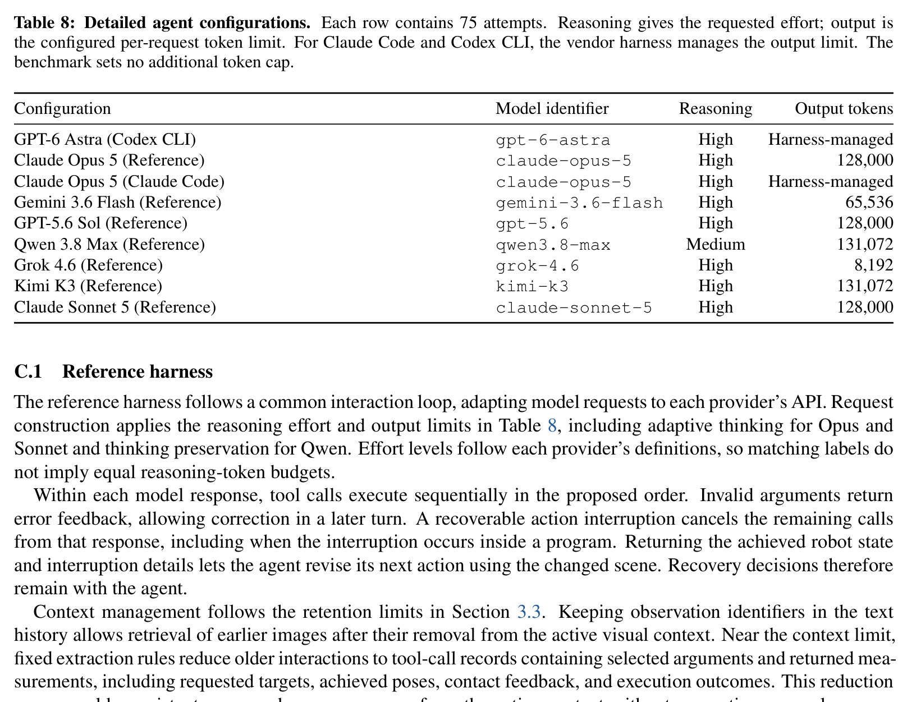

- **Reference Harness（基准统一参考脚手架）**：
  - 评测了 **Claude Opus 5**, **Claude Sonnet 5**, **Gemini 3.6 Flash**, **GPT-5.6 Sol**, **Qwen 3.8 Max**, **Grok 4.6**, **Kimi K3** 共 7 款旗舰模型；
  - 采用严格统一的请求协议、上下文滑动窗口与图片保留机制（保留最近两轮观测，每次 `run_code` 最多保留 6 张图片，超出上下文时以规则保留最近 8 条交互并结构化历史记录）。
- **Vendor Harness（商业专用 Coding Agent 脚手架）**：
  - **GPT-6 Astra 接入 Codex CLI** (OpenAI)：借助专为代码工程设计的 CLI 环境管理上下文与沙箱执行；
  - **Claude Opus 5 接入 Claude Code** (Anthropic)：基于 MCP 协议接入基准工具链。
- **直接工具调用 (Direct API Calling) vs 脚本程序合成 (Program Synthesis)**：
  - 弱模型通常倾向于单步发出 Tool Call，每动一下手臂就要等待一次模型推理；
  - 强模型则直接通过 `run_code` 编写几十行包含 `for` 循环、数学解算、逻辑判断与异常重试的 Python 程序，单次请求即可指挥机械臂行云流水地完成抓取、抬升、运送与对齐。

---

## 关键结果

### 主结果与各模型配置大比拼

在 675 次极其严苛的零示范独立尝试中，**全量系统的平均成功率仅为 27.3% (184/675)**，充分印证了该基准在当前多模态大模型领域的绝对挑战性。各模型配置展现出断层式的性能分化：

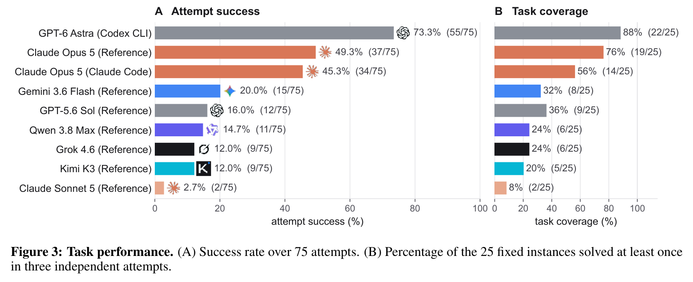
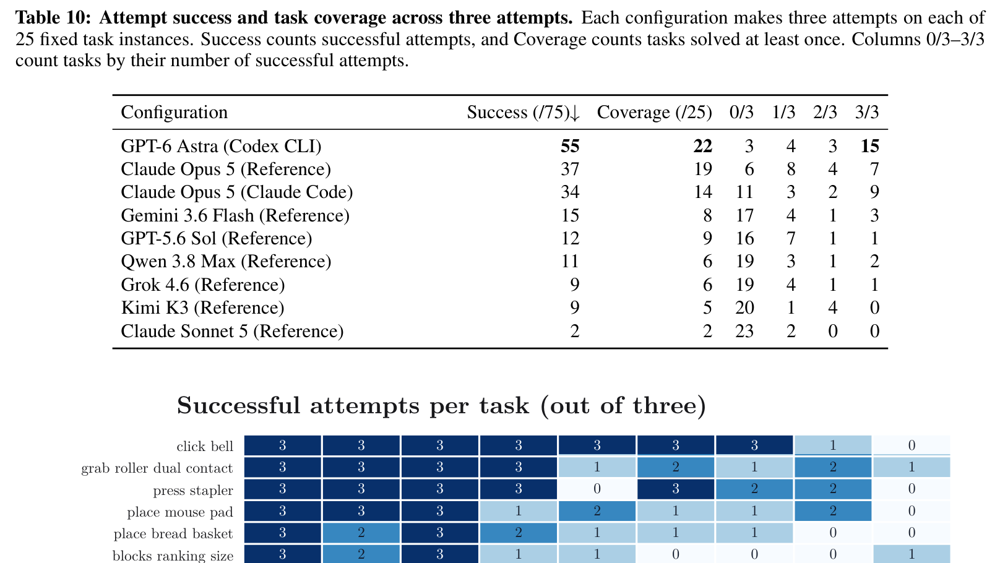

| 智能体系统配置 | 脚手架类型 | 成功尝试数 (/75) | 尝试成功率 (%) | 至少解决一次任务数 (/25) | 任务覆盖率 (%) | 3次全成 (3/3) | 2次成功 (2/3) | 1次成功 (1/3) | 全军覆没 (0/3) |
| :--- | :--- | :---: | :---: | :---: | :---: | :---: | :---: | :---: | :---: |
| **GPT-6 Astra** | **Codex CLI** | **55** | **73.3%** | **22** | **88.0%** | **15** | 3 | 4 | **3** |
| **Claude Opus 5** | Reference | 37 | 49.3% | 19 | 76.0% | 7 | 4 | 8 | 6 |
| **Claude Opus 5** | Claude Code | 34 | 45.3% | 14 | 56.0% | 9 | 2 | 3 | 11 |
| **Gemini 3.6 Flash** | Reference | 15 | 20.0% | 8 | 32.0% | 3 | 1 | 4 | 17 |
| **GPT-5.6 Sol** | Reference | 12 | 16.0% | 9 | 36.0% | 1 | 1 | 7 | 16 |
| **Qwen 3.8 Max** | Reference | 11 | 14.7% | 6 | 24.0% | 2 | 1 | 3 | 19 |
| **Grok 4.6** | Reference | 9 | 12.0% | 6 | 24.0% | 1 | 1 | 4 | 19 |
| **Kimi K3** | Reference | 9 | 12.0% | 5 | 20.0% | 0 | 4 | 1 | 20 |
| **Claude Sonnet 5** | Reference | 2 | 2.7% | 2 | 8.0% | 0 | 0 | 2 | 23 |

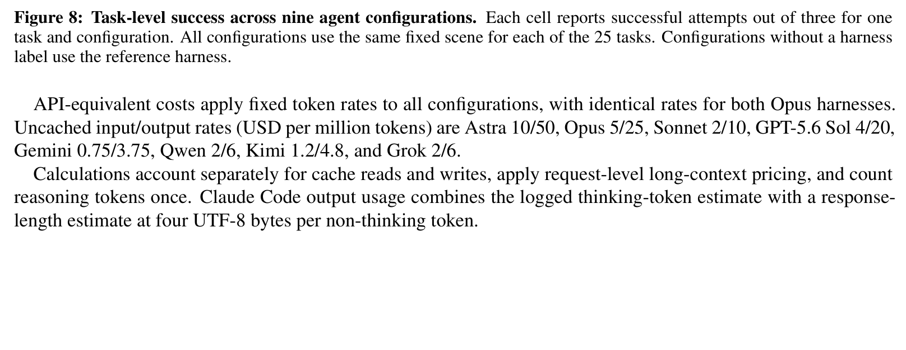

#### 核心发现：
1. **GPT-6 Astra 形成绝对降维打击**：Astra 以 **73.3%** 的成功率和 **88.0%** 的任务覆盖率位居全球第一。在 25 项任务中，Astra 成功攻克了 22 项，其中多达 15 项任务实现了 3 次尝试 100% 满分通过（3/3）；
2. **唯一攻克极限双臂任务**：在超高难度的双耳平稳抬锅任务 `lift_pot` 中，**只有 GPT-6 Astra 达成了 3/3 的满分通过**，其余 8 种系统在此任务上全部以 0/3 惨败；
3. **Opus 的任务专长优势**：Claude Opus 5 虽然总分居次（49.3%），但在极度依赖动态分步调整的倾倒小球任务 `dump_bin_bigbin` 和马克杯换手悬挂任务 `hanging_mug` 上，分别斩获了 1/3 的突破性胜利，反观 Astra 在这两项极端长程任务上未能达成；
4. **长尾模型的普遍瘫痪**：从 GPT-5.6 Sol、Qwen 3.8 Max 到 Kimi K3，成功率均暴跌至 12%~16% 区间；Claude Sonnet 5 更是录得灾难性的 2.7% 成功率，在 23 项任务中全军覆没（0/3）。

---

### 推理成本、耗时与程序合成占比

为什么不同系统之间的物理表现会有云泥之别？资源消耗与代码合成维度的分析揭示了深层本质：

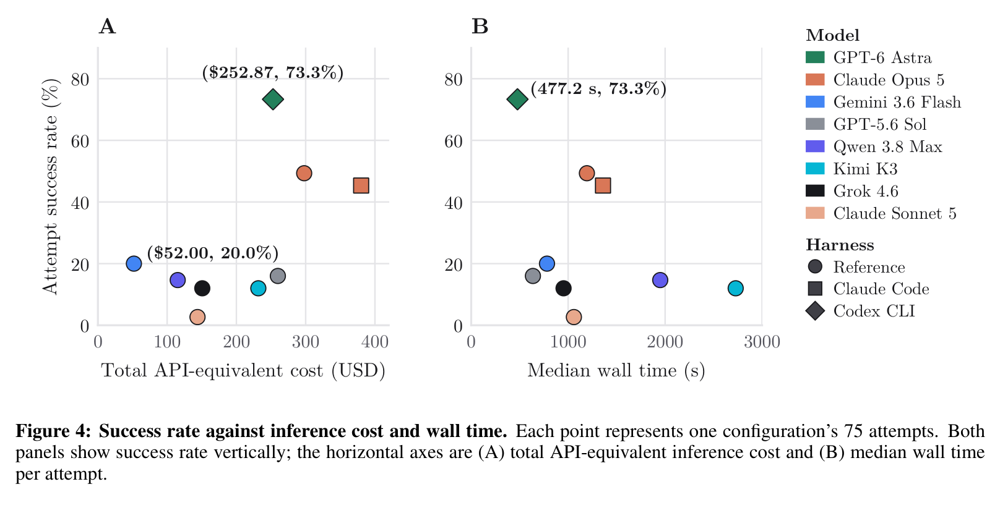

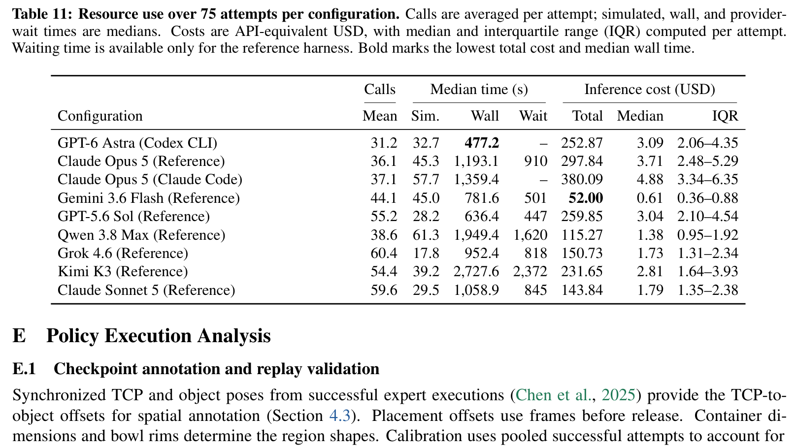

1. **程序合成（`run_code`）是具身操作的分水岭（Table 9）**：
   - 处于第一梯队的四款配置（Astra、两款 Opus、Gemini Flash）展现了高度自发的**程序合成偏好**，其计费工具调用中通过 `run_code` 提交 Python 程序的比例高达 **85.6% ~ 92.6%**；
   - **GPT-6 Astra 的程序调用占比最高（92.6%），且 Python 代码执行与沙箱报错率低至令人发指的 0.46% (10/2,167)**！
   - 反观弱模型（GPT-5.6 Sol 仅 18.9%，Grok 4.6 仅 15.6%，Kimi K3 仅 17.2%），依然停留在“单步工具调用（Direct Calling）”的原始模式，不仅无法形成连贯的运动流，而且代码报错率极高（Qwen 报错率高达 8.92%，Kimi 达 6.71%）。
2. **推理耗时与成本效率的极限反转（Figure 4 & Table 11）**：
   - **GPT-6 Astra 效率无敌**：得益于极其扎实的代码生成能力，Astra 每次尝试的**中位数物理墙钟耗时仅为 477.2 秒**，是全场 9 个系统中运行速度最快的！其单次尝试消耗仅 31.2 次调用，75 次尝试总等效 API 成本仅为 **$252.87**；
   - **Claude Opus 5 极度昂贵且缓慢**：Opus (Reference) 单次尝试中位耗时高达 1,193.1 秒（其中 910 秒消耗在大模型生成等待中），75 次尝试总耗费 $297.84；而在 Claude Code 脚手架下总耗费更飙升至 **$380.09**，耗时高达 1,359.4 秒；
   - **Gemini 3.6 Flash 的极致性价比**：以 **$52.00 的全场最低成本**（比第二名便宜 50% 以上），斩获了 20.0% 的成功率，完胜花费数倍于它的 GPT-5.6 Sol ($259.85) 与 Kimi K3 ($231.65)。

---

### 子目标检查点覆盖率与空间规则达成率

单纯的二元胜负（0 或 1）无法区分“刚一抓就失败”还是“运送到了最后一步没放下”。双层轨迹检查点分析揭示了中间物理进展：

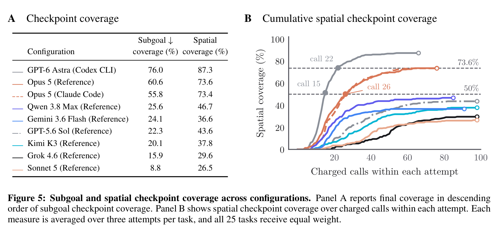

1. **检查点达成率的梯度分水岭**：
   - **GPT-6 Astra**：子目标覆盖率达到 **76.0%**，空间检查点覆盖率高达 **87.3%**；
   - **Claude Opus 5 (Ref)**：子目标覆盖率 60.6%，空间覆盖率 73.6%；
   - **弱模型断崖**：Qwen 空间覆盖率虽有 46.7%，但子目标仅有 25.6%；Gemini 空间覆盖率 36.6%，子目标 24.1%；Sonnet 5 子目标覆盖率仅惨淡的 8.8%。
2. **时间演化效率差距（Figure 5 Panel B）**：
   - 累积空间检查点覆盖率曲线显示，**GPT-6 Astra 仅用到第 22 次工具调用，其达成的空间覆盖率就已经全面超越了所有其余 8 个系统的最终终态覆盖率**！
   - Astra 到第 15 次调用即跨过 50% 门槛，而 Opus 直到第 26 次调用才勉强触及该水平。

---

### 致命失效模式分析

CodeActionBench 对全量 675 次尝试中涌现出的 **491 次失败尝试**展开了严谨的病理学解剖，彻底揭开了智能体在物理交互中的致命软肋：


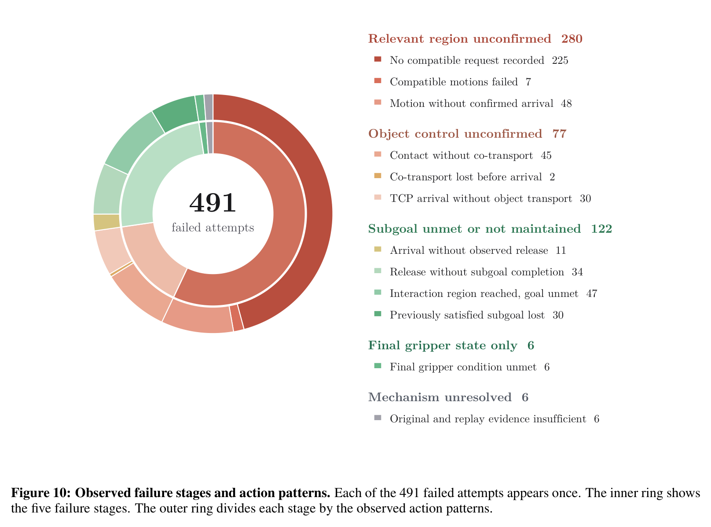

#### 1. 491 次物理失败五大阶段归因（Figure 10 双环图）：
- **第一阶段：相关操作区域未到达（Relevant region unconfirmed，280 次，占比 57.0%）**：
  - **根本没有发出合规的空间目标请求（225 次）**：大模型根本无法基于 RGB 图像解析出合理的 3D 目标坐标；
  - 运动规划器执行失败或碰撞拒绝（7 次）；
  - 机械臂运动后未能落入指定容差空间（48 次）。
- **第二阶段：物体控制与抓取未确认（Object control unconfirmed，77 次，占比 15.7%）**：
  - **接触但未形成协同移动（45 次）**：夹爪虽然碰到了物体，但抓取力学不稳定，夹爪空拉走而物体停在原地；
  - 手臂到达指定区域但物体根本没被带过来（30 次）；
  - 在半空搬运过程中物体中途脱落掉落（2 次）。
- **第三阶段：子目标未达成或状态丢失（Subgoal unmet or not maintained，122 次，占比 24.8%）**：
  - 到达目标区域但未观察到有效松手释放（11 次）；
  - 释放后物体姿态倾覆或未达成几何对齐（34 次）；
  - 机械臂已进入交互区域但未完成最终要求（47 次）；
  - **曾经达成的状态中途被撞坏/丢失（30 次）**：例如搬运第二个物体时，手臂或物体将第一个已经排好的物体撞翻。
- **第四阶段：仅末端夹爪状态错误（Final gripper state only，6 次）**：物体摆放完美，但智能体忘记将夹爪张开退出。
- **第五阶段：机制未决（Mechanism unresolved，6 次）**。

#### 2. 致命的虚假完成声称（False Done / Overclaim, Table 2 & Table 15）：

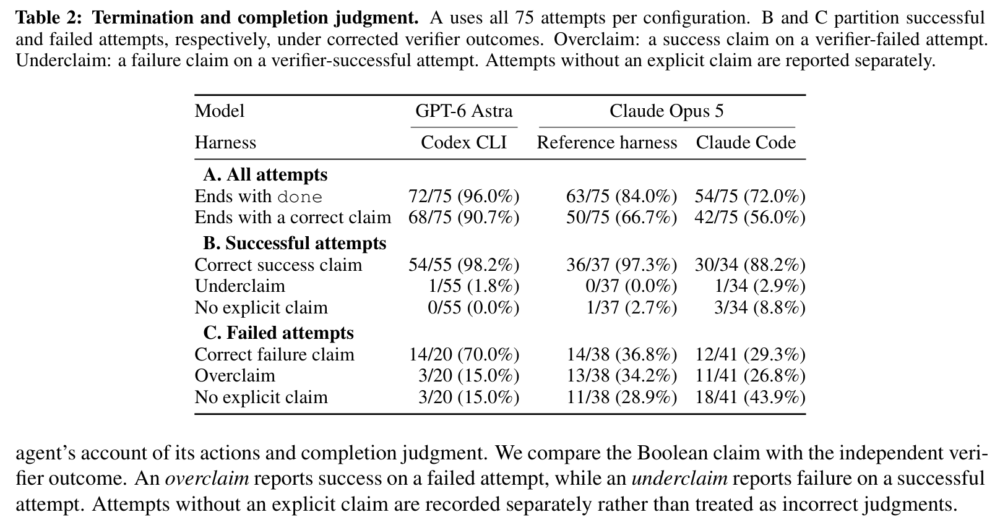
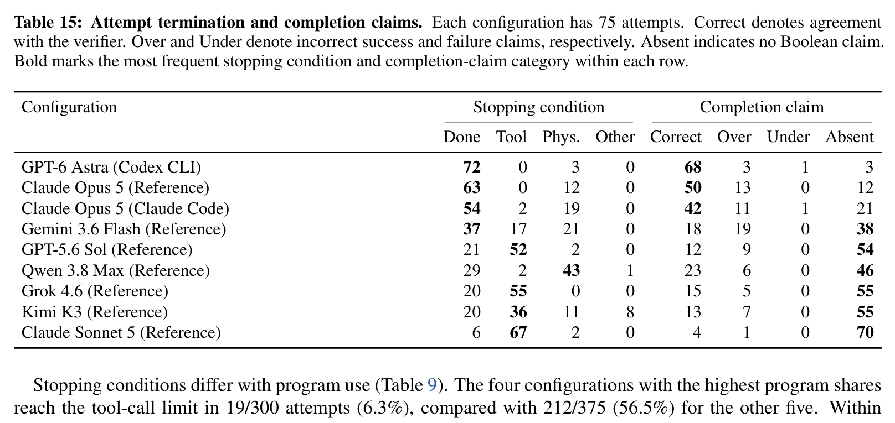

具身智能体最危险的缺陷不是“做不到”，而是**“明明彻底失败了，却信誓旦旦地向人类汇报任务圆满成功”**：
- **Astra 具备极高的自我纠错与诚实度**：Astra 在 75 次尝试中主动调用 `done` 的比例高达 96.0% (72/75)，其终态声明的准确率达到 **90.7% (68/75)**。在 20 次失败尝试中，Astra 准确自认失败的比例达 70.0% (14/20)，**虚假声称（Overclaim）仅出现 3 次 (15.0%)**；
- **Opus 陷入极高的过度乐观偏见**：Claude Opus 5 (Reference) 的过度声称率高达 **34.2% (13/38)**，Claude Code 模式下过度声称率达 **26.8% (11/41)**。在多达三分之一的失败案例中，Opus 自我感觉良好地汇报成功；
- **弱模型严重失联与被动猝死**：弱模型在大部分情况下甚至根本没有机会触发 `done`。例如 Claude Sonnet 5 在 75 次尝试中有 70 次完全缺席声明，其中 **67 次是因为单步调用过于拖沓而在半途被工具调用预算硬性砍断（Tool Limit）**；GPT-5.6 Sol 也有 52 次被工具预算直接截断。

#### 3. 动作非完成执行细分（Table 14）：
在全量统计的 4,045 次未完成机器人动作中，运动规划器拒绝（Planner refusal）达到 1,871 次，机械臂伺服停滞卡死（Stall）达到 1,845 次。这表明**具身智能体生成的位姿严重缺乏运动学常识**，频繁产生奇异点与超工作空间不可达点。

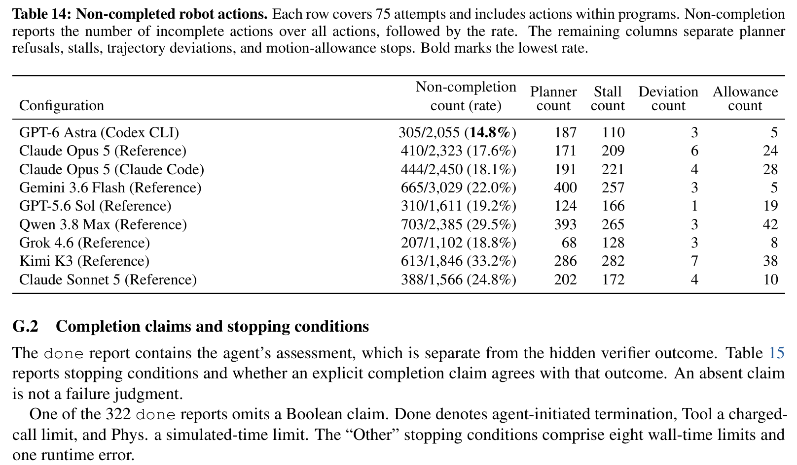

---

## 深度分析

### 真正贡献是什么

1. **撕下具身大模型“特权仿真与感知外挂”的伪装**：
   在过去两年的大量工作（如 CaP-X、VLCP、OpenETA 等）中，社区充斥着“LLM 展现了惊人的物理操作能力”的结论。然而 CodeActionBench 极其冷峻地用实验证明：一旦剥离 SAM、剥离 Grounding DINO、剥离 Contact-GraspNet、剥离深度点云，大模型的真实操作成功率会从宣称的 80%+ 骤降至平均 27.3%。**CodeActionBench 是第一个真正迫使大模型以第一人称纯 RGB 视角面对 3D 物理空间残酷约束的基准**。
2. **定义了 Agentic Code-as-Policy 的标准化评测协议**：
   首次厘清了模型推理层、原子几何接口层、底层运动学规划层与隐蔽物理验证层之间的责任边界，建立了包含双重资源预算、带外隐藏评测、细粒度轨迹重放验证的工业级评测范本。
3. **证实了通用基础模型内生具备 3D 几何闭环构建的雏形**：
   尽管困难重重，GPT-6 Astra 依然在没有任何训练与示范的情况下斩获了 73.3% 的成功率。它证明了最顶尖的多模态模型确实能够理解透视投影原理，能够主动指挥相机运动进行双目三角化，能够理解进给轴与四元数转换。通用基础模型的代码空间确实可以作为连接多模态认知与物理世界动作的合法通用媒介。

---

### 为什么结果成立

为什么配合 Codex CLI 的 **GPT-6 Astra** 能够展现出对其它模型的统治级领先？深层技术根因归结为两点：**认知深度的自发代码组织**与**有效的几何工具调用策略**。

1. **脚本级程序合成（Program Synthesis）相对于反应式单步调用（Reactive Calling）的降维打击**：
   - 弱模型倾向于单步交互：发出一次 `reach_tcp` $\to$ 等待环境返回 $\to$ 上下文塞入一堆新文本与新图片 $\to$ 再次思考 $\to$ 发出下一步。这种模式具有致命缺陷：每次思考延迟高达数十秒，且极易在长程操作中因注意力分散而遗忘最初的空间目标，导致工具预算在前几步就被消耗殆尽；
   - 顶级智能体（Astra 与 Opus）自发采用“Python 脚本整块合成”：
     ```python
     # Astra 自发生成的代码范例：带闭环检测与重试的抓取程序
     pair = capture_motion_pair(arm="left", dx=0.04)
     p0, p1 = [320, 240], [315, 240]  # 自主从手腕两帧中对齐特征点
     xyz = triangulate_correspondence(pair["pair_id"], p0, p1)
     target = np.array(xyz) + np.array([0, 0, 0.05])  # 预留进给偏移
     for step in range(3):
         qs = grasp_quat_candidates(approach=[0, 0, -1], opening=[1, 0, 0])
         if check_tcp_pose_reachability("left", target, qs["candidates"][0]["quat_wxyz"]):
             reach_tcp("left", target, qs["candidates"][0]["quat_wxyz"])
             break
     set_gripper("left", 0.0)
     ```
   - 这种模式将三维空间中的变量持久保存在 Python 运行时中，规避了大模型长上下文的数字幻觉；同时利用沙箱内部的原生 `for/while` 循环完成异常快速重试，**仅消耗 1 次外部工具预算，却在物理世界完成了连续多步的高精度协同控制**。
2. **几何工具调用的本质分野（Table 6 深度揭示）**：

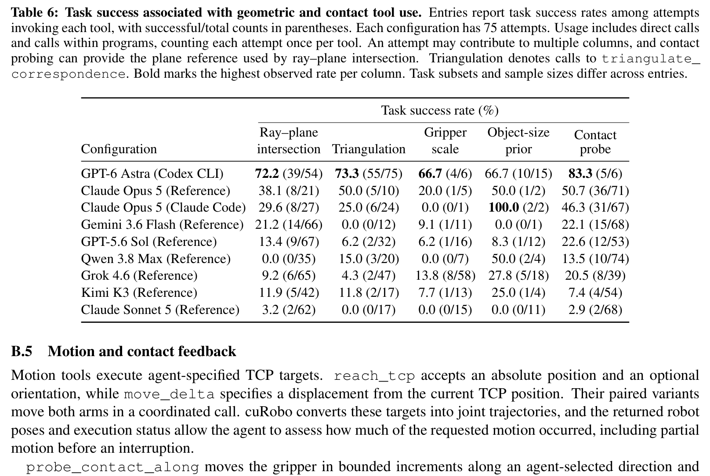

Table 6 揭示了一个极其震撼的事实：
- **Astra 是全场唯一坚定采用“运动双目立体三角化（Triangulation）”的模型**：Astra 在 **全部 75 次尝试中 100% 全量启用了主动双目三角化**（`capture_motion_pair` + `triangulate_correspondence`），其成功率高达 **73.3% (55/75)**；而几乎极少使用低效的物理盲探（仅 6 次接触探测）；
- **Opus 和弱模型严重依赖盲人摸象式的“接触探测（Contact Probe）”**：Opus (Reference) 在 71 次尝试中调用了接触探针，Opus (Claude Code) 也在 67 次尝试中调用了探针，弱模型 Qwen 更是高达 74 次。盲目使用探针轻触台面极易在粗暴移动中撞飞物体，破坏场景初始几何；
- **几何学深度推理超越物理试错**：Astra 展现了对对极几何与双目视差的深刻理解，采用主动非接触式双重视角三角化精确定位物体，随后一击必中，展现了“深思熟虑的几何先验”对“无脑试探”的彻底碾压。

---

### 容易误读的地方

1. **容易误读一：CodeActionBench 是否在全面否定 VLA 或世界动作模型（WAM）？**
   - **绝非如此**。CodeActionBench 旨在探索具身智能的两大技术谱系之一。VLA 和 WAM 探索的是“大数据驱动的高频端到端连续反应式动作分布（Low-level Action Chunking）”，而 Code-as-Policy 探索的是“零示范前提下利用大模型常识推理与符号逻辑进行长程解构与离散姿态规划”。二者非但不冲突，未来更有可能融合为“大模型代码规划宏观航点 + VLA 执行微观闭环伺服跟踪”的分层协同构型。
2. **容易误读二：完全没有人类示范（No Demonstrations），是不是对模型强人所难？**
   - **完全不是**。人类在日常生活中看到一个生疏的开瓶器或从没见过的订书机，并不需要别人手把手教一遍才敢上手。人类凭借对物理世界因果链的常识理解（“压下把手”、“卡住瓶盖”）即可自主尝试。具身智能必须摆脱对百万条人工示教轨迹的“婴儿式依赖”，在纯零示范下验证通识多模态模型的内生推理上限，是检验 AGI 是否具备物理常识的唯一客观标准。
3. **容易误读三：基准提供了 `triangulate_correspondence` 和 `ray` 工具，算不算给大模型“开挂做弊”？**
   - **绝非作弊**。这些工具仅仅是纯粹的线性代数与几何公式计算器（类似让大模型使用科学计算器计算 $\sqrt{x}$），**特征点在图像上的像素位置坐标是谁点选的？是模型自己认出来的；相机该沿哪个方向移动几厘米是谁规划的？是模型决定的；抓取该朝哪个轴向切入是谁选的？依然是模型全权主导**。将底层的纯数学解析交给专用算子，将高级的语义辨识与因果编排交给大模型，这正是神经符号与具身计算的最优分工。

---

### 复现注意点

若要复现该基准或在其上评测新模型，必须严防以下四大致命暗坑：
1. **严格的沙箱运行超时与全局状态重置**：智能体提交的 Python 脚本可能包含不可控的无限死循环或内存泄漏。必须为 `run_code` 配置严格的硬件级单次执行超时（如 30 秒），并在执行中断时，强制将已执行的物理状态与未执行的代码栈做严格原子性事务回滚，杜绝脏状态污染下一轮会话。
2. **相机内外参微漂移与三角化像素敏感度**：手腕相机在微小移动 $\Delta x = 4\text{cm}$ 时，特征点在图像上的位移通常只有十几个像素。若大模型的视觉对齐存在 1~2 像素的偏差，三角化反解出的景深误差可能被放大数厘米。必须严格设定像素反向重投影误差门限（`pixel_sigma_px`），剔除病态对极光束。
3. **cuRobo 碰撞检测范围的认知陷阱**：必须明确知道，底层 cuRobo 运动规划器默认只检测机械臂左右手**自身的几何自碰撞**，它**并不知道桌面上放置了哪些动态杂物或容器**。因此，大模型必须自主负责避障轨迹的设计（例如抬高 TCP 越过障碍物），否则极易把旁边的碗碟撞翻。
4. **接触探测（`probe_contact_along`）的冲量阻尼调校**：仿真引擎中的碰撞脉冲通常是离散时间步下的突加力。必须根据 SAPIEN 物理时间步长（通常为 $1/240\text{s}$ 或 $1/500\text{s}$）仔细设定指尖接触冲量的停机阈值，过小会导致误报停机，过大会直接压碎或击飞刚体目标。

---

## 局限

尽管 CodeActionBench 做出了极具震撼力的开创性工作，但在工业落地与具身泛化视角下，仍存在以下客观局限：
1. **单一本体验证与固定场景多样性不足**：评测目前集中于单一的 SAPIEN ALOHA-AgileX 双臂平台，尚未拓展到移动双臂（如 Tiago、Stretch）、单臂协作机器人（如 Franka Emika）或多指五指灵巧手平台；且每个任务采用固定种子，尚未全面引入光照、纹理、杂乱干扰项的大规模域随机化（Domain Randomization）。
2. **缺乏真实物理世界（Sim-to-Real）的实机迁移验证**：由于基准完全依赖纯 RGB 和运动三角化，真实世界中的相机镜头畸变、手眼标定误差、光照反光以及机械臂关节减速机背隙，可能会严重加剧空间估计的累积误差。
3. **墙钟推理延迟高昂，难以应对高动态突发扰动**：当前最顶尖系统完成一次任务的中位时间仍需近 8 分钟（477.2 秒），频繁依赖大模型调用使其在面对滑脱、滚落等突发动态物理事件时毫无毫秒级低延迟响应能力。
4. **底层对闭源前沿巨无霸大模型的极度依赖**：开源模型（如 Qwen 3.8 Max, Kimi K3）在基准上表现极其孱弱（成功率不足 15%），整个基准目前严重依赖 OpenAI 与 Anthropic 的闭源商业 API，评测的可复现性易受供应商模型版本静默更迭的冲击。

---

## 我的笔记

### 具身代码策略与世界模型生态位全景横向对比

为了深刻理解 CodeActionBench 在整个具身智能与大模型智能体学术图谱中的演进脉络，我们将它与近年来的重量级里程碑工作进行多维横向对标：

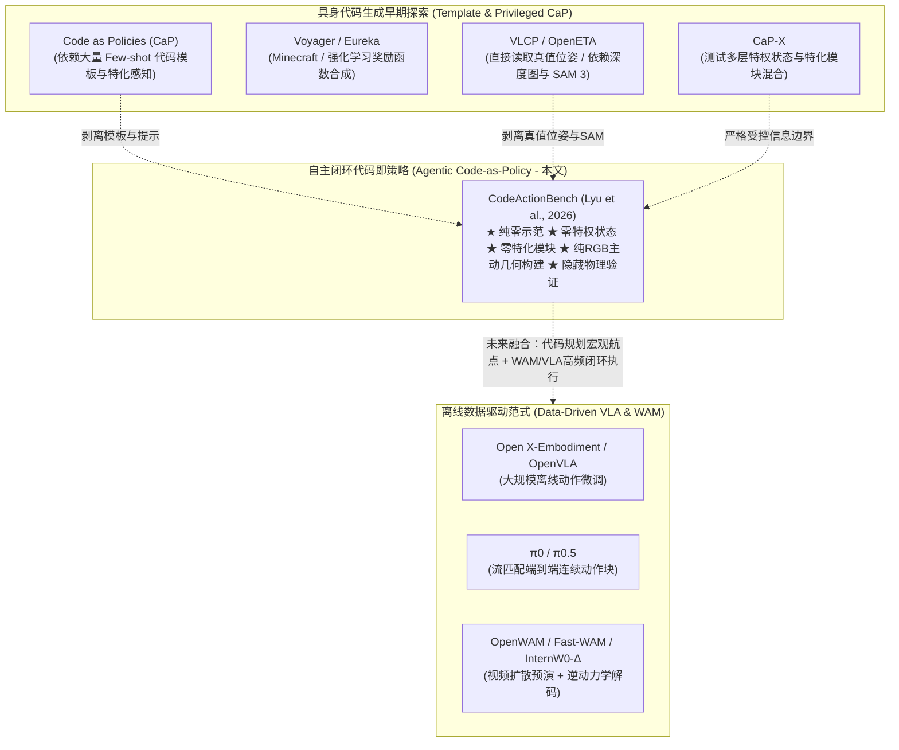

| 维度 / 方法 | **CodeActionBench** (本文) | **Code as Policies (CaP)** (Liang 2023) | **CaP-X** (Fu 2026) | **VLCP** (Naouali 2026) | **OpenETA** (Chen 2026) | **Eureka** (Ma 2023) | **OpenWAM** (Wang 2026) |
| :--- | :--- | :--- | :--- | :--- | :--- | :--- | :--- |
| **评测核心定位** | **纯 RGB 零示范具身代码策略严格物理基准** | 语言模型生成机器人代码的概念奠基工作 | 评测编码智能体在机器人操作中的能力框架 | 视觉-语言闭环代码重规划策略 | 具身智能体通用范式与插件系统 | 基于大模型的强化学习奖励函数自主进化 | 解耦模块化世界动作模型预训练 |
| **是否依赖人工示范 (Demonstrations)** | **完全无需 (Zero-shot)** | 极度依赖 (大量的 In-context Few-shot 样例) | 依赖不同层级的示例支持 | 依赖预定义动作技能与少量提示 | 依赖预置技能库与示范插件 | 依赖环境任务描述与环境代码框架 | 依赖大规模离线专家操作视频与轨迹 |
| **特权位姿访问 (Privileged State)** | **完全严禁 (√)** | 允许部分状态读取 | 分级评测，部分层级直接读取仿真位姿 | **直接读取真值物体位姿** | 严禁直接读取真值位姿 | 读取物理仿真环境状态计算奖励 | 隐式学习物理状态转换 |
| **特化感知模型 (SAM/GraspNet)** | **完全严禁 (√)** | 依赖目标检测器与外部算法 | 允许接入专用感知模块 | 依赖底层专用位姿估计算法 | **重度依赖 SAM 3、PixMo、Contact-GraspNet** | 不涉及（直接在仿真内部计算） | 不涉及（直接使用视频生成主干） |
| **深度传感要求** | **完全无深度 (纯 RGB)** | 依赖 RGB-D 传感器 | 部分环境提供深度图 | 依赖位姿真值 | **强依赖 Depth 反投影三维点** | 仿真内部完美几何 | 纯 RGB 像素隐空间建模 |
| **三维空间估计机制** | **大模型驱动主动微运动双目三角化 + 射线平面投影** | 外部点云处理库计算 | 外部模块处理 | 仿真器接口直吐真值 | 像素坐标 + 真实深度图直接反投影 | 仿真器物理引擎计算 | 视频生成模型潜空间动力学去噪 |
| **验证器设计** | **完全隐蔽带外物理验证器 + 72 维检查点** | 任务执行完成标志 | 仿真器常规评分器 | 仿真器常规判定 | 仿真任务常规判定 | 强化学习累积奖励折现率 | 仿真基准与实机部署胜率 |

### 独家思考与技术洞见
1. **神经符号学派（Neuro-Symbolic）在具身智能中的真正归宿**：
   在纯端到端扩散 VLA（如 $\pi_0$）如日中天的今天，CodeActionBench 的出现是一剂清醒剂。纯端到端模型虽然动作丝滑，但极易陷入“局部最小值”、“对稍微超出训练集几何尺寸的物体完全抓瞎”。而**代码（Code）具有强烈的符号组合性、精度严谨性以及确定性逻辑分支**。大模型通过代码调用数学几何工具，本质上是在用“大脑思考（计算视差、求解逆运动学）”，用“小脑执行（cuRobo 轨迹插值与闭环阻尼控制）”。这是人类智能最核心的生理机制。
2. **Coding Agent 的军备竞赛延伸至具身物理空间**：
   Astra 配合 Codex CLI 的惊艳表现说明，**软件工程领域的编程智能体优化（如更强的局部变量持久化、沙箱异常捕获、针对长上下文的精细 Token 修剪）能够无缝平移并赋能具身机器人控制**。未来优秀的具身大模型，其本质必然也是一个顶级的软件工程师大模型。

---

## 引用

```bibtex
@article{lyu2026codeactionbench,
  title={CodeActionBench: Evaluating Agentic Code-as-Policy for Embodied Manipulation},
  author={Lyu, Yiheng and Jiang, Xueying and Li, Wenhao and Lu, Shijian and Zhang, Gongjie},
  journal={arXiv preprint arXiv:2609.33807},
  year={2026}
}
```
