# Zero-Shot to New Robots: Introducing Dream-1

## Metadata / 元数据

| Field | Value |
|---|---|
| Title | **Zero-Shot to New Robots: Introducing Dream-1** |
| Publisher / author | Dream Labs (byline: “The Dream Labs team”) |
| Source type | **Official web page (technical blog / launch post), not a paper.** There is no arXiv/PDF paper for Dream-1; this web page is the source document. / **官方网页（技术博客／发布文章），不是论文。** Dream-1 没有 arXiv 或 PDF 论文，本网页即为源文档。 |
| Canonical URL | <https://dreamlabs.ai/research/dream-1/> |
| Page label | Research . October 2026 · 10 min read |
| Model | **Dream-1** (also **Dream-1-flash**), a World Action Model (WAM) served via a public API |
| Saved source | `/workspace/dream1_research/src/dream1.html` (SHA256 `dc264c99de004796e0c1dd7fa5c682e6099dcb4df25d67ddfbff03fcfa63a5b8`) |
| Live refetch | 2026-10-21 (UTC+8), HTTP 200; live HTML byte-identical to the saved copy |
| Embedded figure pages | `assets/chicken-and-egg.html`, `assets/robot-price-ladder.html`, `assets/wam.html` (iframes on the page) |
| Cite (as given on page) | `@misc{dreamlabs2026dream1, ...}` — see [Cite this post](#cite-this-post--引用本文) |
| Related (context only, not translated here) | DreamZero, *World Action Models are Zero-shot Policies* (arXiv:2602.15922), which has its own reader in the sibling folder `World Action Models are Zero-shot Policies/` |

**Reader policy / 阅读稿说明：** English source text is the cleaned visible text of the web page, in page order; each paragraph is followed immediately by its Chinese translation. Navigation menus, the floating “Contents” widget, video player controls, the “Join us / We’re hiring” footer and copyright line are site chrome and are not translated. Figure and table numbers are **assigned by this reader**; the web page itself does not number its figures. Videos cannot be reproduced in Markdown; each is represented by its poster still downloaded from the page, and all chart values are transcribed from the page’s embedded chart data (`data-chart` JSON). / 英文原文为网页可见正文按页面顺序清理后的文本，每段后紧接中文译文。导航菜单、浮动“Contents”目录、视频播放器控件、“Join us / We’re hiring”页脚与版权行属于网站框架，未翻译。图号与表号**由本阅读稿编排**，原网页本身不给图编号。视频无法在 Markdown 中重现，均以从页面下载的封面静帧代替；所有图表数值均转录自页面内嵌图表数据（`data-chart` JSON）。

**Asset policy / 资源策略：** All images live in `assets/` next to this file and use relative links. `assets/render/` holds headless-browser renderings of interactive charts and animated diagrams captured from the live page on 2026-10-21; `assets/price-ladder/` holds the 24 robot card images decoded from the price-ladder embed; the other folders mirror the page’s own `assets/` paths. / 所有图片均位于本文件旁的 `assets/` 目录并使用相对链接。`assets/render/` 存放 2026-10-21 从在线页面以无头浏览器截取的交互图表与动画示意图；`assets/price-ladder/` 存放从价格阶梯嵌入页解码出的 24 张机器人卡片图片；其余子目录沿用网页自身的 `assets/` 路径。

## Page / Section Index

| Page section (web) | Original page anchor | Reader anchor |
|---|---|---|
| Header, lead, launch video | (top of page) | [Lead](#lead--导语) |
| 01 Breaking the chicken-and-egg problem | [`#chicken-and-egg`](https://dreamlabs.ai/research/dream-1/#chicken-and-egg) | [01](#01-breaking-the-chicken-and-egg-problem--打破先有鸡还是先有蛋的困境) |
| 02 The Cambrian explosion of cheap, affordable robots | [`#cambrian-explosion`](https://dreamlabs.ai/research/dream-1/#cambrian-explosion) | [02](#02-the-cambrian-explosion-of-cheap-affordable-robots--廉价机器人的寒武纪大爆发) |
| 03 The result that started Dream Labs | [`#the-result`](https://dreamlabs.ai/research/dream-1/#the-result) | [03](#03-the-result-that-started-dream-labs--催生-dream-labs-的那个结果) |
| 04 Introducing Dream-1 | [`#introducing-dream-1`](https://dreamlabs.ai/research/dream-1/#introducing-dream-1) | [04](#04-introducing-dream-1--介绍-dream-1) |
| 04.1 Get started in minutes | [`#get-started`](https://dreamlabs.ai/research/dream-1/#get-started) | [04.1](#041-get-started-in-minutes--几分钟即可上手) |
| 04.2 Zero-shot on robots it has never seen | [`#zero-shot`](https://dreamlabs.ai/research/dream-1/#zero-shot) | [04.2](#042-zero-shot-on-robots-it-has-never-seen--在从未见过的机器人上零样本运行) |
| 04.3 How zero-shot embodiment generalization works | [`#how-it-works`](https://dreamlabs.ai/research/dream-1/#how-it-works) | [04.3](#043-how-zero-shot-embodiment-generalization-works--零样本形态泛化如何实现) |
| 04.4 What Dream-1 can and can't do | [`#can-and-cant`](https://dreamlabs.ai/research/dream-1/#can-and-cant) | [04.4](#044-what-dream-1-can-and-cant-do--dream-1-能做什么不能做什么) |
| 04.5 One-shot embodiment learning | [`#one-shot`](https://dreamlabs.ai/research/dream-1/#one-shot) | [04.5](#045-one-shot-embodiment-learning--单次形态学习) |
| 05 Looking forward | [`#looking-forward`](https://dreamlabs.ai/research/dream-1/#looking-forward) | [05](#05-looking-forward--展望) |
| Notes and references (fn 1–6), Cite this post | [`#footnotes`](https://dreamlabs.ai/research/dream-1/#footnotes) | [Notes](#notes-and-references--注释与参考) |

Note: the page’s floating table of contents uses shorter labels for three sections (“The Cambrian explosion of cheap robots”, “Zero-shot on unseen robots”, “How it works”); the index above uses the in-body headings. / 注：页面浮动目录对三个小节使用了较短标签（“The Cambrian explosion of cheap robots”“Zero-shot on unseen robots”“How it works”）；上表采用正文中的实际标题。

## Terminology Ledger

| Canonical term / identifier | 中文统一译法 | Scope note |
|---|---|---|
| World Action Model (WAM) | 世界动作模型 | Model that predicts video and actions together; `WAM` retained. |
| Dream-1 / Dream-1-flash | Dream-1 / Dream-1-flash | Model names, not translated; `-flash` is “the faster, lighter model”. |
| embodiment | 机器人形态（本体） | A specific robot body / hardware configuration. |
| zero-shot embodiment generalization | 零样本形态泛化 | Controlling an unseen robot body without any data from it. |
| one-shot embodiment learning | 单次形态学习 | The page’s term for adapting with a small amount (e.g., 5 min) of the new robot’s data. |
| Fine-tuning-as-a-Service (FaaS) | 微调即服务（FaaS） | Dream Labs’ fine-tuning offering; `FaaS` retained. |
| end-effector (EEF) pose | 末端执行器（EEF）位姿 | Where each gripper should be, plus open/closed state. |
| inverse kinematics (IK) solver | 逆运动学（IK）求解器 | Converts EEF poses into joint commands on each robot. |
| joint angles | 关节角 | Per-robot action space tied to one body. |
| bimanual, parallel-gripper robot | 双臂平行夹爪机器人 | The class of robots Dream-1 targets today. |
| head view / wrist view (camera) | 头部视角／腕部视角（相机） | Three cameras: one head camera, one wrist camera per arm. |
| Universal Manipulation Interface (UMI) | 通用操控接口（UMI） | Chi et al., RSS 2024; also a gripper design (“UMI gripper”). |
| action chunk | 动作块 | The block of actions the robot executes after each prediction. |
| joint denoising | 联合去噪 | Video tokens and action tokens denoised in the same step (WAM diagram). |
| language following | 语言遵循 | Simulated evaluation axis (150 rollouts of 50 tasks). |
| unseen task generalization | 未见任务泛化 | Simulated evaluation axis (150 rollouts of 150 tasks). |
| progress score / success rate | 进度分／成功率 | Partial-completion score vs. full-success fraction. |
| rollout | 执行回合（rollout） | One autonomous attempt / episode. |
| Pareto frontier | 帕累托前沿 | Robocurve chart term: best score for a given cost or time. |
| System 1 | 系统 1 | Fast, intuitive acting system (vs. LLM planning). |
| forward-deployed engineer | 前线部署工程师 | Engineer embedded with a customer to deploy a product. |
| YAM | YAM | I2RT robot that Dream-1 was actually trained on; the 100% reference in charts. |

## Lead / 导语

*Source anchor / 原页锚点：* page header (top of page, before section 01).

> <span style="color:#3B82F6"><strong>Para. 1:</strong></span> Research . October 2026 — **Zero-Shot to New Robots: Introducing Dream-1**

> <span style="color:#F59E0B"><strong>Para. 1[CN]:</strong></span> 研究 · 2026 年 10 月 —— **零样本迁移到新机器人：Dream-1 发布**

> <span style="color:#3B82F6"><strong>Para. 2:</strong></span> Today, we're releasing Dream-1, a World Action Model that controls robots it has never seen, performs tasks it was never shown, and runs from \$3/hour.

> <span style="color:#F59E0B"><strong>Para. 2[CN]:</strong></span> 今天，我们发布 Dream-1：一个世界动作模型，它能控制从未见过的机器人、执行从未被示范过的任务，且运行成本低至每小时 3 美元起。

> <span style="color:#3B82F6"><strong>Para. 3:</strong></span> The Dream Labs team . October 2026 . 10 min read

> <span style="color:#F59E0B"><strong>Para. 3[CN]:</strong></span> Dream Labs 团队 · 2026 年 10 月 · 阅读时长 10 分钟

### Figure 1. Launch video (poster still) / 发布视频（封面静帧）


**Caption:** Launch video (01:59). *Reader note: the video itself is not reproducible here; this is the page’s poster still (alt: “A still from the launch video”).*

**Caption[CN]:** 发布视频（时长 01:59）。*阅读稿注：视频本身无法在此重现，此处为页面提供的封面静帧（alt 文本：“A still from the launch video”）。*

> <span style="color:#3B82F6"><strong>Para. 4:</strong></span> Give Dream-1 a new bimanual robot with parallel grippers, connect it to our API, and it can start performing tasks out of the box. No fine-tuning, no demonstrations from that robot, and no machine learning expertise required.

> <span style="color:#F59E0B"><strong>Para. 4[CN]:</strong></span> 给 Dream-1 一台新的、配备平行夹爪的双臂机器人，把它接入我们的 API，它就能开箱即用地开始执行任务。无需微调，无需来自该机器人的示范，也不需要机器学习专业知识。

> <span style="color:#3B82F6"><strong>Para. 5:</strong></span> This is an important step toward general-purpose robot intelligence.

> <span style="color:#F59E0B"><strong>Para. 5[CN]:</strong></span> 这是迈向通用机器人智能的重要一步。

> <span style="color:#3B82F6"><strong>Para. 6:</strong></span> Today, Dream Labs is also coming out of stealth with \$90M in seed funding and making Dream-1 available to people all around the world through a public API.

> <span style="color:#F59E0B"><strong>Para. 6[CN]:</strong></span> 今天，Dream Labs 也正式结束隐身状态，宣布获得 9000 万美元种子轮融资，并通过公共 API 向全球用户开放 Dream-1。

> <span style="color:#3B82F6"><strong>Para. 7:</strong></span> **From day one** — Dream-1 controls robots it has never seen, on tasks it was never shown, in places it has never been, from \$3/hour.

> <span style="color:#F59E0B"><strong>Para. 7[CN]:</strong></span> **从第一天起** —— Dream-1 就能在从未到过的地方、以从未被示范过的任务，控制从未见过的机器人，成本低至每小时 3 美元起。

## 01 Breaking the chicken-and-egg problem / 打破“先有鸡还是先有蛋”的困境

*Source anchor / 原页锚点：* [`#chicken-and-egg`](https://dreamlabs.ai/research/dream-1/#chicken-and-egg)

### Figure 2. Robotics’ chicken-and-egg problem / 机器人领域的“鸡与蛋”问题

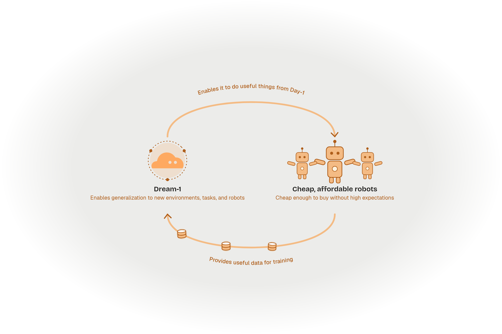

**Caption:** Robotics' chicken-and-egg problem. *Reader note: animated embedded diagram (`assets/chicken-and-egg.html`, titled “Chicken and egg, then the real thing”), captured at its final “after” state. Embedded description: “Before: a ghost egg and a ghost chicken, each waiting on the other, with no lines between them. After: the egg becomes Dream-1, the chicken becomes a cheap robot, and the two arrows appear with what each one gives the other.” Visible labels: “Dream-1 — Enables generalization to new environments, tasks, and robots”; “Cheap, affordable robots — Cheap enough to buy without high expectations”; arrows “Enables it to do useful things from Day-1” and “Provides useful data for training”. Strings used in the earlier “before” phase include “Which comes first?”, “Nobody buys one without a brain”, “Needs robot data for training”, “The loop”, “Two shifts”, “Robots deployed”.*

**Caption[CN]:** 机器人领域的“鸡与蛋”问题。*阅读稿注：嵌入式动画示意图（`assets/chicken-and-egg.html`，标题为“Chicken and egg, then the real thing”），截取于动画结束时的“之后”状态。嵌入说明：“之前：一只虚影的蛋和一只虚影的鸡彼此等待，二者之间没有连线。之后：蛋变成 Dream-1，鸡变成一台廉价机器人，两条箭头出现，并标出各自给予对方的东西。”可见标签：“Dream-1——使模型能泛化到新环境、新任务和新机器人”；“廉价、买得起的机器人——便宜到无需抱太高期望就能买下”；箭头文字“使它从第一天起就能做有用的事”与“为训练提供有用数据”。动画前段“之前”阶段的字符串包括“Which comes first?（谁先出现？）”“Nobody buys one without a brain（没有大脑就没人会买）”“Needs robot data for training（训练需要机器人数据）”“The loop（循环）”“Two shifts（两个转变）”“Robots deployed（已部署机器人）”。*

> <span style="color:#3B82F6"><strong>Para. 1:</strong></span> For decades, robotics has been stuck in a chicken-and-egg problem: a robot needs to be useful before people want to buy it, but making it useful requires data from that exact robot, and that data only exists once enough people start using it. Dream-1 is our first step toward breaking that loop.

> <span style="color:#F59E0B"><strong>Para. 1[CN]:</strong></span> 几十年来，机器人领域一直困在“先有鸡还是先有蛋”的问题里：机器人必须先有用，人们才愿意购买；但要让它有用，就需要来自这台具体机器人的数据，而这些数据只有在足够多的人开始使用它之后才会存在。Dream-1 是我们打破这一循环的第一步。

> <span style="color:#3B82F6"><strong>Para. 2:</strong></span> Self-driving found a way around this cold-start problem. Cars were useful from day one with zero autonomy, so millions of people drove them every day and generated the data needed to train increasingly capable models. Most other robots never had that advantage.

> <span style="color:#F59E0B"><strong>Para. 2[CN]:</strong></span> 自动驾驶找到了绕过这一冷启动问题的办法。汽车在零自主能力时从第一天起就是有用的，于是数以百万计的人每天驾驶它们，产生了训练日益强大的模型所需的数据。大多数其他机器人从未拥有这种优势。

> <span style="color:#3B82F6"><strong>Para. 3:</strong></span> Two things are changing that.

> <span style="color:#F59E0B"><strong>Para. 3[CN]:</strong></span> 有两件事正在改变这一局面。

> <span style="color:#3B82F6"><strong>Para. 4:</strong></span> First, robot hardware is getting cheap enough to reach far more people. A capable bimanual arm setup can now cost as little as [\$2k](https://www.makermods.ai/maker-arm)<sup>[1](#fn-1-maker-arm)</sup>.

> <span style="color:#F59E0B"><strong>Para. 4[CN]:</strong></span> 第一，机器人硬件正变得足够便宜，可以触达多得多的人。一套能力不错的双臂机械臂系统如今最低只需 [2000 美元](https://www.makermods.ai/maker-arm)<sup>[1](#fn-1-maker-arm)</sup>。

> <span style="color:#3B82F6"><strong>Para. 5:</strong></span> Second, a robot may no longer need a large dataset of its own before it can be useful. If a model can generalize zero-shot to unseen environments, tasks, and even robots, a new robot can start with useful capabilities.

> <span style="color:#F59E0B"><strong>Para. 5[CN]:</strong></span> 第二，机器人在变得有用之前，可能不再需要一个属于它自己的大规模数据集。如果一个模型能零样本泛化到未见过的环境、任务乃至机器人，那么一台新机器人一开始就能具备有用的能力。

> <span style="color:#3B82F6"><strong>Para. 6:</strong></span> Put those together and the flywheel can finally start. Cheaper hardware puts more robots into the world. Generalizable models make those robots useful earlier. Useful robots generate more data, and that data makes the models better for the next robot.

> <span style="color:#F59E0B"><strong>Para. 6[CN]:</strong></span> 把两者结合起来，飞轮终于可以转动。更便宜的硬件让更多机器人进入世界；可泛化的模型让这些机器人更早变得有用；有用的机器人产生更多数据，而这些数据又让模型对下一台机器人更好。

## 02 The Cambrian explosion of cheap, affordable robots / 廉价机器人的寒武纪大爆发

*Source anchor / 原页锚点：* [`#cambrian-explosion`](https://dreamlabs.ai/research/dream-1/#cambrian-explosion)

### Figure 3. Dream Labs enabled robots (price ladder) / Dream Labs 支持的机器人（价格阶梯）

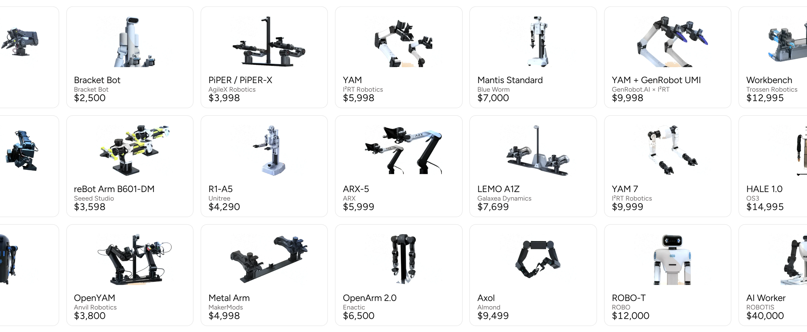

**Caption:** Dream Labs enabled robots. *Reader note: embedded iframe `assets/robot-price-ladder.html`, titled “Dream Labs enabled robots: 24 robots from \$399 to \$40,000, cheapest first”. It is a continuously scrolling carousel, so the rendering is a snapshot of part of it; all 24 cards are transcribed in Table 1 and each card image is saved under `assets/price-ladder/`.*

**Caption[CN]:** Dream Labs 支持的机器人。*阅读稿注：嵌入 iframe `assets/robot-price-ladder.html`，标题为“Dream Labs enabled robots: 24 robots from \$399 to \$40,000, cheapest first”（Dream Labs 支持的机器人：24 款，从 399 美元到 40,000 美元，按价格从低到高）。它是持续滚动的轮播，截图只是其中一部分的快照；全部 24 张卡片已在表 1 中转录，各卡片图片保存在 `assets/price-ladder/`。*

**Table 1 (transcribed from Figure 3 data). Dream Labs enabled robots, cheapest first / 表 1（转录自图 3 数据）：Dream Labs 支持的机器人，按价格由低到高**

| # | Robot | Company | Price (as shown) | Card image |
|---:|---|---|---:|---|
| 1 | Microduck | Hugging Face | \$399 | [01-microduck.webp](assets/price-ladder/01-microduck.webp) |
| 2 | XLeRobot | MakerMods | \$999 | [02-xlerobot.webp](assets/price-ladder/02-xlerobot.webp) |
| 3 | OMX | ROBOTIS | \$1,178 | [03-omx.webp](assets/price-ladder/03-omx.webp) |
| 4 | Maker Arm | MakerMods | \$1,998 | [04-maker-arm.webp](assets/price-ladder/04-maker-arm.webp) |
| 5 | 7X Dual-Arm | 7X Robotics | \$1,999 | [05-7x-dual-arm.webp](assets/price-ladder/05-7x-dual-arm.webp) |
| 6 | Sourccey | Vulcan Robotics | \$1,999 | [06-sourccey.webp](assets/price-ladder/06-sourccey.webp) |
| 7 | Bracket Bot | Bracket Bot | \$2,500 | [07-bracket-bot.webp](assets/price-ladder/07-bracket-bot.webp) |
| 8 | reBot Arm B601-DM | Seeed Studio | \$3,598 | [08-rebot-arm-b601-dm.webp](assets/price-ladder/08-rebot-arm-b601-dm.webp) |
| 9 | OpenYAM | Anvil Robotics | \$3,800 | [09-openyam.webp](assets/price-ladder/09-openyam.webp) |
| 10 | PiPER / PiPER-X | AgileX Robotics | \$3,998 | [10-piper-piper-x.webp](assets/price-ladder/10-piper-piper-x.webp) |
| 11 | R1-A5 | Unitree | \$4,290 | [11-r1-a5.webp](assets/price-ladder/11-r1-a5.webp) |
| 12 | Metal Arm | MakerMods | \$4,998 | [12-metal-arm.webp](assets/price-ladder/12-metal-arm.webp) |
| 13 | YAM | I²RT Robotics | \$5,998 | [13-yam.webp](assets/price-ladder/13-yam.webp) |
| 14 | ARX-5 | ARX | \$5,999 | [14-arx-5.webp](assets/price-ladder/14-arx-5.webp) |
| 15 | OpenArm 2.0 | Enactic | \$6,500 | [15-openarm-2-0.webp](assets/price-ladder/15-openarm-2-0.webp) |
| 16 | Mantis Standard | Blue Worm | \$7,000 | [16-mantis-standard.webp](assets/price-ladder/16-mantis-standard.webp) |
| 17 | LEMO A1Z | Galaxea Dynamics | \$7,699 | [17-lemo-a1z.webp](assets/price-ladder/17-lemo-a1z.webp) |
| 18 | Axol | Almond | \$9,499 | [18-axol.webp](assets/price-ladder/18-axol.webp) |
| 19 | YAM + GenRobot UMI | GenRobot.AI × I²RT | \$9,998 | [19-yam-genrobot-umi.webp](assets/price-ladder/19-yam-genrobot-umi.webp) |
| 20 | YAM 7 | I²RT Robotics | \$9,999 | [20-yam-7.webp](assets/price-ladder/20-yam-7.webp) |
| 21 | ROBO-T | ROBO | \$12,000 | [21-robo-t.webp](assets/price-ladder/21-robo-t.webp) |
| 22 | Workbench | Trossen Robotics | \$12,995 | [22-workbench.webp](assets/price-ladder/22-workbench.webp) |
| 23 | HALE 1.0 | OS3 | \$14,995 | [23-hale-1-0.webp](assets/price-ladder/23-hale-1-0.webp) |
| 24 | AI Worker | ROBOTIS | \$40,000 | [24-ai-worker.webp](assets/price-ladder/24-ai-worker.webp) |

> <span style="color:#3B82F6"><strong>Para. 1:</strong></span> Robot hardware is getting cheap faster than anyone expected. See the robots above, where 7 semi-humanoid robots cost less than \$15k, a price tier that barely existed a year ago. At the far end of the price curve, Hugging Face's \$399 Microduck sold more than 10,000 units within 4 days of its launch in late August<sup>[2](#fn-2-microduck)</sup>. We believe the robotics take-off will start with robots like these.

> <span style="color:#F59E0B"><strong>Para. 1[CN]:</strong></span> 机器人硬件变便宜的速度超出了所有人的预期。看看上面的机器人：其中有 7 款半人形机器人售价低于 1.5 万美元，而这一价位一年前几乎还不存在。在价格曲线的最低端，Hugging Face 售价 399 美元的 Microduck 在 8 月下旬发布后 4 天内售出超过 10,000 台<sup>[2](#fn-2-microduck)</sup>。我们相信，机器人的腾飞将从这样的机器人开始。

> <span style="color:#3B82F6"><strong>Para. 2:</strong></span> Key figures (stat cards on the page):
>
> - **\$2,000** — a bimanual arm setup: A capable two-arm setup, as of today.
> - **7** — semi-humanoids under \$15k: Wheels, two arms, parallel grippers; a tier that barely existed a year ago.
> - **\$399** — Hugging Face Microduck: Launched late August.
> - **10,000+** — Microducks in 4 days: Sold within four days of launch.<sup>[2](#fn-2-microduck)</sup>

> <span style="color:#F59E0B"><strong>Para. 2[CN]:</strong></span> 关键数字（页面上的统计卡片）：
>
> - **2,000 美元** —— 一套双臂机械臂系统：截至目前，一套能力不错的双臂系统的价格。
> - **7 款** —— 低于 1.5 万美元的半人形机器人：轮式底盘、双臂、平行夹爪；这一价位一年前几乎还不存在。
> - **399 美元** —— Hugging Face Microduck：8 月下旬发布。
> - **10,000+ 台** —— 4 天内售出的 Microduck：发布后四天内售出。<sup>[2](#fn-2-microduck)</sup>

> <span style="color:#3B82F6"><strong>Para. 3:</strong></span> That's because their buyers are consumers, prosumers, and small teams, not enterprises. An enterprise buyer is making a spreadsheet decision. If the robot doesn't beat a person on cost, speed, or reliability, it doesn't get bought; that's a high bar to clear. Consumers are different. 10,000+ people just paid \$399 within 4 days for a robot whose main job is to be delightful and cute: it walks, waddles, and roller-skates. Somewhere between that and a fully capable home robot is a sweet spot, a robot affordable enough to be an easy yes and useful enough to earn its place in the home. Once robots hit that point, we think adoption starts to compound, and every robot in a home becomes a source of new training data. Imagine two Microducks folding your laundry, using their beaks as grippers.

> <span style="color:#F59E0B"><strong>Para. 3[CN]:</strong></span> 这是因为它们的买家是消费者、专业消费者（prosumer）和小团队，而不是企业。企业买家做的是“电子表格式”的决策：如果机器人在成本、速度或可靠性上比不过人，就不会被购买——这是一道很高的门槛。消费者则不同。10,000 多人刚刚在 4 天内花 399 美元买下一台主要任务只是讨人喜欢、可爱的机器人：它会走路、摇摇摆摆地踱步，还会滑旱冰。在它与一台全能家用机器人之间，存在一个甜蜜点：一台便宜到让人毫不犹豫地买下、又有用到足以在家中占据一席之地的机器人。我们认为，一旦机器人达到这一点，普及就会开始复利式增长，每台家中的机器人都会成为新训练数据的来源。想象一下，两只 Microduck 用它们的喙当夹爪，帮你叠衣服。

## 03 The result that started Dream Labs / 催生 Dream Labs 的那个结果

*Source anchor / 原页锚点：* [`#the-result`](https://dreamlabs.ai/research/dream-1/#the-result)

> <span style="color:#3B82F6"><strong>Para. 1:</strong></span> In February 2026, [our team](https://dreamlabs.ai/team/) released DreamZero, the paper that introduced [World Action Models](https://dreamzero0.github.io/)<sup>[3](#fn-3-dreamzero)</sup>. Since then, the community has adopted WAMs as one of the most promising paradigms in robot learning. At that time, the most surprising result for us was when after post-training DreamZero on just 30 minutes of YAM robot data, we saw it generalize zero-shot to tasks it had never seen. That kind of generalization used to take hundreds or even thousands of hours of embodiment-specific data. If 30 minutes of data from a given robot was enough to transfer general-purpose task knowledge to that robot, breaking the chicken-and-egg loop no longer looked impossible. Combined with the hardware wave above, the timing felt right. That's when we decided to start Dream Labs.

> <span style="color:#F59E0B"><strong>Para. 1[CN]:</strong></span> 2026 年 2 月，[我们的团队](https://dreamlabs.ai/team/)发布了 DreamZero——提出[世界动作模型](https://dreamzero0.github.io/)的论文<sup>[3](#fn-3-dreamzero)</sup>。自那以后，社区已将 WAM 视为机器人学习中最有前景的范式之一。当时，最让我们惊讶的结果是：仅用 30 分钟的 YAM 机器人数据对 DreamZero 进行后训练后，我们看到它零样本泛化到了从未见过的任务上。这种程度的泛化过去需要数百甚至数千小时的特定形态数据。如果来自某台机器人的 30 分钟数据就足以把通用任务知识迁移到这台机器人上，那么打破“鸡与蛋”循环就不再显得不可能。再结合上文所述的硬件浪潮，时机似乎恰到好处。正是在那时，我们决定创立 Dream Labs。

> <span style="color:#3B82F6"><strong>Para. 2:</strong></span> After six months of building, we're excited to share a new research breakthrough that was only made possible through world action models: early signs of zero-shot embodiment generalization.

> <span style="color:#F59E0B"><strong>Para. 2[CN]:</strong></span> 经过六个月的构建，我们很高兴分享一项只有借助世界动作模型才得以实现的新研究突破：零样本形态泛化的早期迹象。

## 04 Introducing Dream-1 / 介绍 Dream-1

*Source anchor / 原页锚点：* [`#introducing-dream-1`](https://dreamlabs.ai/research/dream-1/#introducing-dream-1)

> <span style="color:#3B82F6"><strong>Para. 1:</strong></span> Dream-1 is our first World Action Model available through a public API that can be used all around the world. Out of the box, it can control unseen robots for unseen tasks in unseen environments.

> <span style="color:#F59E0B"><strong>Para. 1[CN]:</strong></span> Dream-1 是我们首个通过公共 API 提供、可在全球范围内使用的世界动作模型。它开箱即可在未见过的环境中、针对未见过的任务控制未见过的机器人。

### Figure 4. Unseen tasks Dream-1 was able to do / Dream-1 完成的未见任务

The figure is a two-tab video wall: **Partners — Beta testers (12 sites · 8x)** and **Dream Labs — In-house (18 runs · 4x)**. Both tab states were rendered; individual clip posters are linked in Tables 2–3. / 该图是一个双标签视频墙：**Partners——Beta 测试者（12 个站点 · 8 倍速）** 与 **Dream Labs——内部（18 次运行 · 4 倍速）**。两个标签状态均已渲染；各片段封面链接见表 2–3。

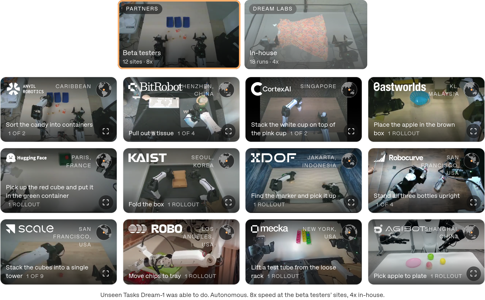

**Caption:** Unseen Tasks Dream-1 was able to do. Autonomous. 8x speed at the beta testers’ sites, 4x in-house. *(Tab: Partners / Beta testers.)*

**Caption[CN]:** Dream-1 能够完成的未见任务。自主运行。Beta 测试者站点视频为 8 倍速，内部视频为 4 倍速。*（标签：Partners／Beta 测试者。）*

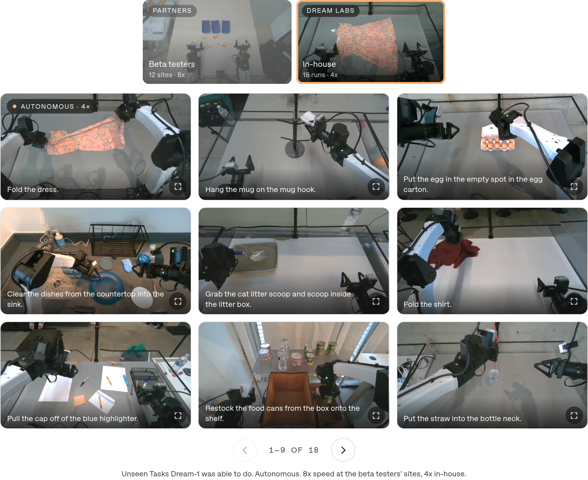

**Caption:** Unseen Tasks Dream-1 was able to do. Autonomous. 8x speed at the beta testers’ sites, 4x in-house. *(Tab: Dream Labs / In-house; the wall pages 9 clips at a time, “1–9 of 18”.)*

**Caption[CN]:** Dream-1 能够完成的未见任务。自主运行。Beta 测试者站点视频为 8 倍速，内部视频为 4 倍速。*（标签：Dream Labs／内部；视频墙每页显示 9 个片段，“1–9 of 18”。）*

**Table 2. Beta-tester clips (Figure 4a) / 表 2：Beta 测试者片段（图 4a）**

| # | Partner | Location | Instruction (verbatim) | 中文 | Clip counter | Poster |
|---:|---|---|---|---|---|---|
| 1 | Anvil Robotics | Caribbean | “Sort the candy into containers” | 把糖果分拣到容器里 | 1 of 2 | [anvil.jpg](assets/beta/anvil.jpg) |
| 2 | BitRobot | Shenzhen, China | “Pull out a tissue” | 抽出一张纸巾 | 1 of 4 | [frodobots.jpg](assets/beta/frodobots.jpg) |
| 3 | Cortex | Singapore | “Stack the white cup on top of the pink cup” | 把白色杯子叠到粉色杯子上 | 1 of 2 | [cortex.jpg](assets/beta/cortex.jpg) |
| 4 | Eastworld | KL, Malaysia | “Place the apple in the brown box” | 把苹果放进棕色盒子 | 1 rollout | [eastworld.jpg](assets/beta/eastworld.jpg) |
| 5 | Hugging Face | Paris, France | “Pick up the red cube and put it in the green container” | 拿起红色方块放进绿色容器 | 1 rollout | [hugging-face.jpg](assets/beta/hugging-face.jpg) |
| 6 | KAIST | Seoul, Korea | “Fold the box” | 折好盒子 | 1 rollout | [kaist.jpg](assets/beta/kaist.jpg) |
| 7 | XDOF | Jakarta, Indonesia | “Find the marker and pick it up” | 找到记号笔并拿起来 | 1 rollout | [xdof.jpg](assets/beta/xdof.jpg) |
| 8 | RoboCurve | San Francisco, USA | “Stand all three bottles upright” | 把三个瓶子都立起来 | 1 of 4 | [robocurve.jpg](assets/beta/robocurve.jpg) |
| 9 | Scale AI | San Francisco, USA | “Stack the cubes into a single tower” | 把方块叠成一座塔 | 1 of 9 | [scale-ai.jpg](assets/beta/scale-ai.jpg) |
| 10 | Robo Inc. | Los Angeles, USA | “Move chips to tray” | 把薯片移到托盘上 | 1 rollout | [robo-inc.jpg](assets/beta/robo-inc.jpg) |
| 11 | Mecka | New York, USA | “Lift a test tube from the loose rack” | 从松动的试管架上取出一支试管 | 1 rollout | [mecka.jpg](assets/beta/mecka.jpg) |
| 12 | AgiBot | Shanghai, China | “Pick apple to plate” | 把苹果拿到盘子上 | 1 rollout | [agibot.jpg](assets/beta/agibot.jpg) |

“Clip counter” is the per-card label (e.g., “1 of 4” = the card cycles through 4 rollouts). The wall’s pager reads “1–13 of 13” although the HTML contains 12 partner cards (“12 sites”). The BitRobot card’s poster file is named `frodobots.jpg` on the page. / “Clip counter”为每张卡片上的标签（如“1 of 4”表示该卡片轮播 4 个回合）。视频墙分页显示“1–13 of 13”，但 HTML 中只有 12 张合作方卡片（“12 sites”）。BitRobot 卡片的封面文件在页面上名为 `frodobots.jpg`。

**Table 3. In-house clips (Figure 4b) / 表 3：内部片段（图 4b）**

| # | Instruction (verbatim) | 中文 | Poster |
|---:|---|---|---|
| 1 | “Fold the dress.” | 叠好连衣裙。 | [demo/0.jpg](assets/demo/0.jpg) |
| 2 | “Clear the dishes from the countertop into the sink.” | 把台面上的餐具清理到水槽里。 | [demo/1.jpg](assets/demo/1.jpg) |
| 3 | “Pull the cap off of the blue highlighter.” | 拔下蓝色荧光笔的笔帽。 | [demo/2.jpg](assets/demo/2.jpg) |
| 4 | “Hang the mug on the mug hook.” | 把马克杯挂到杯钩上。 | [demo/3.jpg](assets/demo/3.jpg) |
| 5 | “Grab the cat litter scoop and scoop inside the litter box.” | 拿起猫砂铲，在猫砂盆里铲。 | [demo/4.jpg](assets/demo/4.jpg) |
| 6 | “Restock the food cans from the box onto the shelf.” | 把箱子里的食品罐头补货到货架上。 | [demo/5.jpg](assets/demo/5.jpg) |
| 7 | “Put the egg in the empty spot in the egg carton.” | 把鸡蛋放进蛋盒的空位。 | [demo/6.jpg](assets/demo/6.jpg) |
| 8 | “Fold the shirt.” | 叠好衬衫。 | [demo/7.jpg](assets/demo/7.jpg) |
| 9 | “Put the straw into the bottle neck.” | 把吸管插进瓶口。 | [demo/8.jpg](assets/demo/8.jpg) |
| 10 | “Wipe the countertop with the blue sponge.” | 用蓝色海绵擦台面。 | [demo/9.jpg](assets/demo/9.jpg) |
| 11 | “Put the tools back in their slots.” | 把工具放回各自的槽位。 | [demo/10.jpg](assets/demo/10.jpg) |
| 12 | “Pour the fruits from the bowl on the left to the bowl on the right.” | 把左边碗里的水果倒进右边的碗。 | [demo/11.jpg](assets/demo/11.jpg) |
| 13 | “Slide the middle book out from the stack of three books.” | 从三本书的书堆中抽出中间那本。 | [demo/12.jpg](assets/demo/12.jpg) |
| 14 | “Fold the green placemat in half.” | 把绿色餐垫对折。 | [demo/13.jpg](assets/demo/13.jpg) |
| 15 | “Dry the plate with the towel and place it on the drying rack.” | 用毛巾擦干盘子并放到沥水架上。 | [demo/14.jpg](assets/demo/14.jpg) |
| 16 | “Open the box, take out the pink jump rope and close the lid.” | 打开盒子，取出粉色跳绳，再合上盖子。 | [demo/15.jpg](assets/demo/15.jpg) |
| 17 | “Use the knife to push the chopped carrot to the right side of the cutting board.” | 用刀把切好的胡萝卜推到砧板右侧。 | [demo/16.jpg](assets/demo/16.jpg) |
| 18 | “Fold the long sleeve shirt.” | 叠好长袖衬衫。 | [demo/17.jpg](assets/demo/17.jpg) |

### 04.1 Get started in minutes / 几分钟即可上手

*Source anchor / 原页锚点：* [`#get-started`](https://dreamlabs.ai/research/dream-1/#get-started)

> <span style="color:#3B82F6"><strong>Para. 1:</strong></span> We want generalizable robotics to be accessible to anyone with a robot, not just large labs. So we designed Dream-1 to be as close to plug-and-play as possible. Connect your robot, point it at the API, and run. No machine learning background is needed to get started. Every week, we run internal hackathons to keep time-to-deploy as short as possible. [Getting started tutorial](https://platform.dreamlabs.ai/setup-api)

> <span style="color:#F59E0B"><strong>Para. 1[CN]:</strong></span> 我们希望可泛化的机器人技术能为任何拥有机器人的人所用，而不仅限于大型实验室。因此，我们把 Dream-1 设计得尽可能接近即插即用：连接你的机器人，把它指向 API，然后运行。上手无需任何机器学习背景。我们每周都会举办内部黑客松，以尽量缩短部署所需时间。[入门教程](https://platform.dreamlabs.ai/setup-api)

**Code listing 1. Condensed client side code (verbatim from the page) / 代码清单 1：精简版客户端代码（逐字转录自页面）**

```python
import dream

client = dream.DreamClient(
    api_key=<API_KEY>,
)
client.policy({"checkpoint": "dreamlabs/dream-1"})
client.set_observation(observation)
action = client.get_action()
client.close()
```

> <span style="color:#3B82F6"><strong>Para. 2:</strong></span> Condensed client side code. *(Listing caption on the page. Reader note: `<API_KEY>` is a placeholder shown as-is; `dreamlabs/dream-1` is the checkpoint identifier; as printed, the listing is condensed and not directly runnable Python.)*

> <span style="color:#F59E0B"><strong>Para. 2[CN]:</strong></span> 精简版客户端代码。*（页面上的代码清单说明。阅读稿注：`<API_KEY>` 为页面原样显示的占位符；`dreamlabs/dream-1` 为检查点标识符；按页面原样，该清单为精简版，不能直接作为 Python 运行。）*

### 04.2 Zero-shot on robots it has never seen / 在从未见过的机器人上零样本运行

*Source anchor / 原页锚点：* [`#zero-shot`](https://dreamlabs.ai/research/dream-1/#zero-shot)

> <span style="color:#3B82F6"><strong>Para. 1:</strong></span> Dream-1 can zero-shot generalize to many bimanual, parallel-gripper robots. Here are some we've tested. It can even control the original PR2, a general-purpose bimanual research robot released 18 years ago. Note that no embodiment-specific data was used to get these rollouts.

> <span style="color:#F59E0B"><strong>Para. 1[CN]:</strong></span> Dream-1 能零样本泛化到许多双臂、平行夹爪机器人上。以下是我们测试过的一部分。它甚至能控制最初的 PR2——一款 18 年前发布的通用双臂研究机器人。请注意，获得这些执行回合时没有使用任何特定形态的数据。

### Figure 5. Unseen robots Dream-1 was able to control / Dream-1 能够控制的未见机器人

Two-tab gallery: **Simulation — 27 unseen robots (up to 5 picked rollouts each · 3x)** and **Real robots — Bimanual gripper robots (21 clips · 4x)**. / 双标签视频库：**仿真——27 款未见机器人（每款最多 5 个精选回合 · 3 倍速）** 与 **真实机器人——双臂夹爪机器人（21 个片段 · 4 倍速）**。

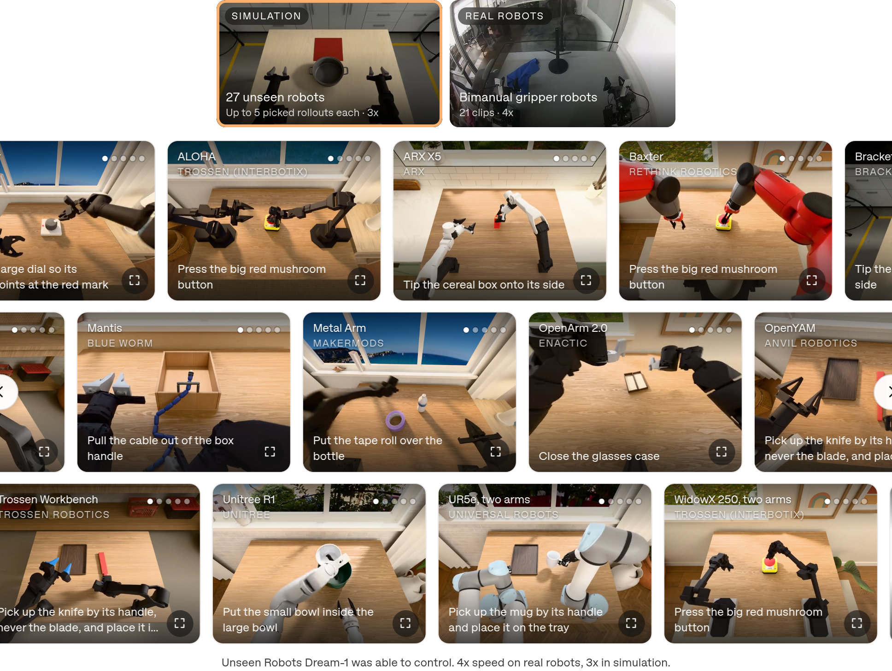

**Caption:** Unseen Robots Dream-1 was able to control. 4x speed on real robots, 3x in simulation. *(Tab: Simulation; carousel snapshot.)*

**Caption[CN]:** Dream-1 能够控制的未见机器人。真实机器人视频为 4 倍速，仿真视频为 3 倍速。*（标签：仿真；轮播快照。）*

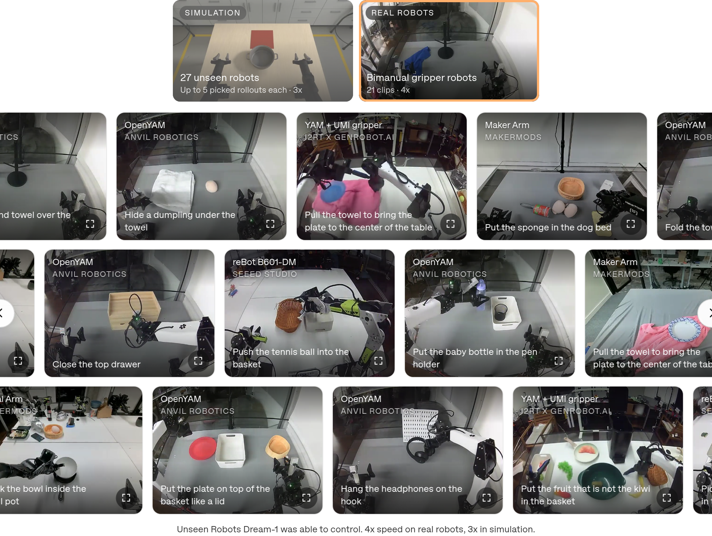

**Caption:** Unseen Robots Dream-1 was able to control. 4x speed on real robots, 3x in simulation. *(Tab: Real robots; carousel snapshot.)*

**Caption[CN]:** Dream-1 能够控制的未见机器人。真实机器人视频为 4 倍速，仿真视频为 3 倍速。*（标签：真实机器人；轮播快照。）*

**Table 4. Simulation gallery, 27 unseen robots (Figure 5a) / 表 4：仿真视频库，27 款未见机器人（图 5a）**

| # | Robot | Maker | Shown instruction (verbatim) | Poster |
|---:|---|---|---|---|
| 1 | AI Worker | ROBOTIS | “Turn the large dial so its pointer points at the red mark” | [robotis-ai-worker_0.jpg](assets/zero-shot/picks/robotis-ai-worker_0.jpg) |
| 2 | ALOHA | Trossen (Interbotix) | “Press the big red mushroom button” | [aloha_3.jpg](assets/zero-shot/picks/aloha_3.jpg) |
| 3 | ARX X5 | ARX | “Tip the cereal box onto its side” | [arx-x5_3.jpg](assets/zero-shot/picks/arx-x5_3.jpg) |
| 4 | Baxter | Rethink Robotics | “Press the big red mushroom button” | [baxter_2.jpg](assets/zero-shot/picks/baxter_2.jpg) |
| 5 | Bracket Bot | Bracket Bot | “Tip the plastic bottle onto its side” | [bracket-bot_1.jpg](assets/zero-shot/picks/bracket-bot_1.jpg) |
| 6 | Franka Research 3, two arms | Franka Robotics | “Tip the cereal box onto its side” | [franka-dual_0.jpg](assets/zero-shot/picks/franka-dual_0.jpg) |
| 7 | Galaxea A1Z | Galaxea | “Push the tennis ball into the basket” | [galaxea-a1z_1.jpg](assets/zero-shot/picks/galaxea-a1z_1.jpg) |
| 8 | Gen3, two arms | Kinova | “Place the umbrella into the bucket” | [kinova-gen3-dual_1.jpg](assets/zero-shot/picks/kinova-gen3-dual_1.jpg) |
| 9 | LBR iiwa 14 | KUKA | “Pick up the tape and place it in the round white bin” | [iiwa14_0.jpg](assets/zero-shot/picks/iiwa14_0.jpg) |
| 10 | Maker Arm | MakerMods | “Close the glasses case” | [makermods-maker-arm_2.jpg](assets/zero-shot/picks/makermods-maker-arm_2.jpg) |
| 11 | Mantis | Blue Worm | “Pull the cable out of the box handle” | [blueworm-mantis_0.jpg](assets/zero-shot/picks/blueworm-mantis_0.jpg) |
| 12 | Metal Arm | MakerMods | “Put the tape roll over the bottle” | [metal-arm_3.jpg](assets/zero-shot/picks/metal-arm_3.jpg) |
| 13 | OpenArm 2.0 | Enactic | “Close the glasses case” | [enactic-openarm-2_0.jpg](assets/zero-shot/picks/enactic-openarm-2_0.jpg) |
| 14 | OpenYAM | Anvil Robotics | “Pick up the knife by its handle, never the blade, and place it in the tray” | [anvil-openyam_2.jpg](assets/zero-shot/picks/anvil-openyam_2.jpg) |
| 15 | PiPER, two arms | AgileX Robotics | “Lift the pot by its two handles, carry it to the red mat and set it down level” | [piper-dual_0.jpg](assets/zero-shot/picks/piper-dual_0.jpg) |
| 16 | PR2 | Willow Garage | “Press the big red mushroom button” | [pr2_1.jpg](assets/zero-shot/picks/pr2_1.jpg) |
| 17 | reBot B601-DM | Seeed Studio | “Pick up the knife by its handle, never the blade, and place it in the tray” | [seeed-rebot-b601_0.jpg](assets/zero-shot/picks/seeed-rebot-b601_0.jpg) |
| 18 | Sawyer, two arms | Rethink Robotics | “Close the top drawer” | [sawyer-dual_0.jpg](assets/zero-shot/picks/sawyer-dual_0.jpg) |
| 19 | SO-101 | Hugging Face | “Tip the plastic bottle onto its side” | [so-101_0.jpg](assets/zero-shot/picks/so-101_0.jpg) |
| 20 | Trossen Workbench | Trossen Robotics | “Pick up the knife by its handle, never the blade, and place it in the tray” | [trossen-workbench_0.jpg](assets/zero-shot/picks/trossen-workbench_0.jpg) |
| 21 | Unitree R1 | Unitree | “Put the small bowl inside the large bowl” | [unitree-r1_0.jpg](assets/zero-shot/picks/unitree-r1_0.jpg) |
| 22 | UR5e, two arms | Universal Robots | “Pick up the mug by its handle and place it on the tray” | [ur5e-dual_0.jpg](assets/zero-shot/picks/ur5e-dual_0.jpg) |
| 23 | WidowX 250, two arms | Trossen (Interbotix) | “Press the big red mushroom button” | [widowx-250-dual_3.jpg](assets/zero-shot/picks/widowx-250-dual_3.jpg) |
| 24 | xArm 7, two arms | UFactory | “Tip the plastic bottle onto its side” | [xarm7-dual_2.jpg](assets/zero-shot/picks/xarm7-dual_2.jpg) |
| 25 | YAM + UMI gripper | I2RT x GenRobot.AI | “Tip the plastic bottle onto its side” | [yam-umi_3.jpg](assets/zero-shot/picks/yam-umi_3.jpg) |
| 26 | YAM-7 | I2RT | “Tip the plastic bottle onto its side” | [i2rt-yam-7_1.jpg](assets/zero-shot/picks/i2rt-yam-7_1.jpg) |
| 27 | YuMi | ABB | “Tip the cereal box onto its side” | [yumi_3.jpg](assets/zero-shot/picks/yumi_3.jpg) |

Each simulation card cycles through up to 5 picked rollouts; only the first pick’s poster is present in the static HTML and is linked here. / 每张仿真卡片最多轮播 5 个精选回合；静态 HTML 中只有第一个回合的封面，此处链接的即为该封面。

**Table 5. Real-robot gallery, 21 clips (Figure 5b) / 表 5：真实机器人视频库，21 个片段（图 5b）**

| # | Robot | Maker | Instruction (verbatim) | Poster |
|---:|---|---|---|---|
| 1 | OpenYAM | Anvil Robotics | “Drape the hand towel over the rack” | [real_openyam_1.jpg](assets/zero-shot/real_openyam_1.jpg) |
| 2 | OpenYAM | Anvil Robotics | “Hide a dumpling under the towel” | [real_openyam_6.jpg](assets/zero-shot/real_openyam_6.jpg) |
| 3 | YAM + UMI gripper | I2RT x GenRobot.AI | “Pull the towel to bring the plate to the center of the table” | [real_yamumi_1.jpg](assets/zero-shot/real_yamumi_1.jpg) |
| 4 | Maker Arm | MakerMods | “Put the sponge in the dog bed” | [real_makers_4.jpg](assets/zero-shot/real_makers_4.jpg) |
| 5 | OpenYAM | Anvil Robotics | “Fold the towel” | [real_openyam_7.jpg](assets/zero-shot/real_openyam_7.jpg) |
| 6 | Metal Arm | MakerMods | “Go ahead and put the banana in the bowl” | [real_metal_1.jpg](assets/zero-shot/real_metal_1.jpg) |
| 7 | reBot B601-DM | Seeed Studio | “Go ahead and put the banana in the bowl” | [real_seeed_4.jpg](assets/zero-shot/real_seeed_4.jpg) |
| 8 | YAM + Enpire grippers | I2RT x Enpire | “Put the straw into the bottle neck” | [real_enpire_1.jpg](assets/zero-shot/real_enpire_1.jpg) |
| 9 | Metal Arm | MakerMods | “Put the grape into the pan” | [real_metal_5.jpg](assets/zero-shot/real_metal_5.jpg) |
| 10 | OpenYAM | Anvil Robotics | “Close the top drawer” | [real_openyam_2.jpg](assets/zero-shot/real_openyam_2.jpg) |
| 11 | reBot B601-DM | Seeed Studio | “Push the tennis ball into the basket” | [real_seeed_2.jpg](assets/zero-shot/real_seeed_2.jpg) |
| 12 | OpenYAM | Anvil Robotics | “Put the baby bottle in the pen holder” | [real_openyam_8.jpg](assets/zero-shot/real_openyam_8.jpg) |
| 13 | Maker Arm | MakerMods | “Pull the towel to bring the plate to the center of the table” | [real_makers_3.jpg](assets/zero-shot/real_makers_3.jpg) |
| 14 | OpenYAM | Anvil Robotics | “Grab a handful of cotton balls and put them in the cup” | [real_openyam_3.jpg](assets/zero-shot/real_openyam_3.jpg) |
| 15 | OpenYAM | Anvil Robotics | “Set the tennis ball on top of the upside-down mug” | [real_openyam_4.jpg](assets/zero-shot/real_openyam_4.jpg) |
| 16 | Metal Arm | MakerMods | “Stack the bowl inside the small pot” | [real_metal_6.jpg](assets/zero-shot/real_metal_6.jpg) |
| 17 | OpenYAM | Anvil Robotics | “Put the plate on top of the basket like a lid” | [real_openyam_9.jpg](assets/zero-shot/real_openyam_9.jpg) |
| 18 | OpenYAM | Anvil Robotics | “Hang the headphones on the hook” | [real_openyam_5.jpg](assets/zero-shot/real_openyam_5.jpg) |
| 19 | YAM + UMI gripper | I2RT x GenRobot.AI | “Put the fruit that is not the kiwi in the basket” | [real_yamumi_3.jpg](assets/zero-shot/real_yamumi_3.jpg) |
| 20 | reBot B601-DM | Seeed Studio | “Pick up the mango and place it in the bowl” | [real_seeed_1.jpg](assets/zero-shot/real_seeed_1.jpg) |
| 21 | Vega 1 Pro + YAM Gripper | Dexmate x I2RT | “Pick up all markers one by one and put into black pencil holder using both arms” | [real_dexmate_1.jpg](assets/zero-shot/real_dexmate_1.jpg) |

> <span style="color:#3B82F6"><strong>Para. 2:</strong></span> This is one of the first reported zero-shot generalizations to completely unseen robot embodiments.<sup>[4](#fn-4-lap)</sup> If you have a bimanual parallel-gripper robot, try prompting Dream-1 and let us know how it goes. Zero-shot performance depends partly on your robot's inverse kinematics (IK) solver, so we've written a guide to help you get the most out of it. [IK guide](https://platform.dreamlabs.ai/docs/). Performance also varies across robots. Below, we break down zero-shot performance in simulation and on real robots.

> <span style="color:#F59E0B"><strong>Para. 2[CN]:</strong></span> 这是最早报道的、向完全未见过的机器人形态进行零样本泛化的成果之一。<sup>[4](#fn-4-lap)</sup>如果你有一台双臂平行夹爪机器人，不妨试着给 Dream-1 下指令，并告诉我们效果如何。零样本性能部分取决于你的机器人的逆运动学（IK）求解器，因此我们编写了一份指南，帮助你充分发挥它的能力：[IK 指南](https://platform.dreamlabs.ai/docs/)。性能也因机器人而异。下面我们分别给出仿真和真实机器人上的零样本性能细分。

### Figure 6. Zero-shot performance relative to YAM / 相对 YAM 的零样本性能

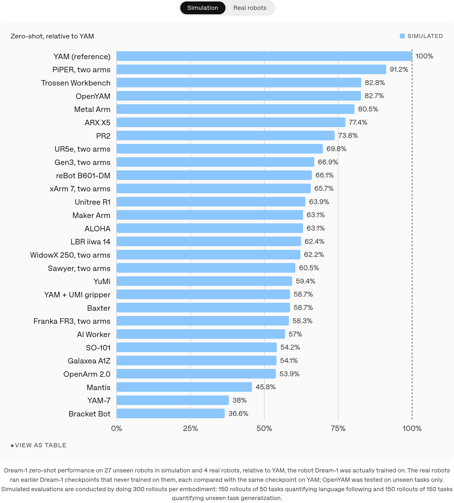

**Caption:** Dream-1 zero-shot performance on 27 unseen robots in simulation and 4 real robots, relative to YAM, the robot Dream-1 was actually trained on. The real robots ran earlier Dream-1 checkpoints that never trained on them, each compared with the same checkpoint on YAM; OpenYAM was tested on unseen tasks only. Simulated evaluations are conducted by doing 300 rollouts per embodiment: 150 rollouts of 50 tasks quantifying language following and 150 rollouts of 150 tasks quantifying unseen task generalization. *(Tab: Simulation.)*

**Caption[CN]:** Dream-1 在仿真中 27 款未见机器人以及 4 款真实机器人上的零样本性能，均相对于 YAM（Dream-1 实际训练所用的机器人）。真实机器人运行的是从未在它们身上训练过的较早期 Dream-1 检查点，每款都与同一检查点在 YAM 上的表现比较；OpenYAM 仅在未见任务上测试。仿真评测对每种形态执行 300 个回合：其中 150 个回合覆盖 50 个任务，用于量化语言遵循能力；另 150 个回合覆盖 150 个任务，用于量化未见任务泛化能力。*（标签：仿真。）*

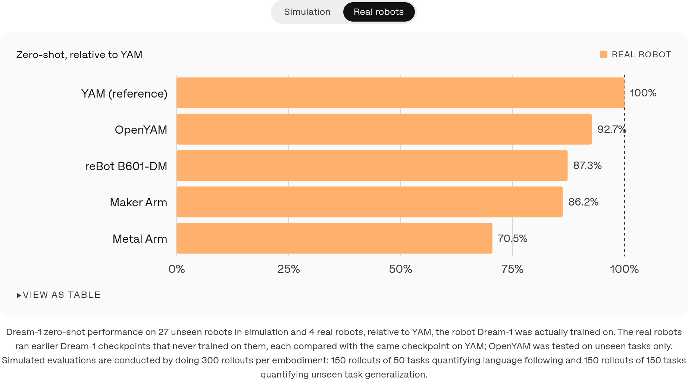

**Caption:** Dream-1 zero-shot performance on 27 unseen robots in simulation and 4 real robots, relative to YAM, the robot Dream-1 was actually trained on. The real robots ran earlier Dream-1 checkpoints that never trained on them, each compared with the same checkpoint on YAM; OpenYAM was tested on unseen tasks only. Simulated evaluations are conducted by doing 300 rollouts per embodiment: 150 rollouts of 50 tasks quantifying language following and 150 rollouts of 150 tasks quantifying unseen task generalization. *(Tab: Real robots.)*

**Caption[CN]:** Dream-1 在仿真中 27 款未见机器人以及 4 款真实机器人上的零样本性能，均相对于 YAM（Dream-1 实际训练所用的机器人）。真实机器人运行的是从未在它们身上训练过的较早期 Dream-1 检查点，每款都与同一检查点在 YAM 上的表现比较；OpenYAM 仅在未见任务上测试。仿真评测对每种形态执行 300 个回合：其中 150 个回合覆盖 50 个任务，用于量化语言遵循能力；另 150 个回合覆盖 150 个任务，用于量化未见任务泛化能力。*（标签：真实机器人。）*

**Table 6. Zero-shot, relative to YAM — Simulation (series “Simulated”; values from the page’s chart data) / 表 6：相对 YAM 的零样本性能——仿真（系列“Simulated”；数值取自页面图表数据）**

| Rank | Robot | Relative to YAM (%) | Preview rollout prompt (verbatim) | Preview poster |
|---:|---|---:|---|---|
| ref | YAM (reference) | 100.0 | “pick up the mango and place it in the bowl.” | [yam.jpg](assets/embodiments/rollouts/yam.jpg) |
| 1 | PiPER, two arms | 91.2 | “pick up the toy frog and place it in the round white bin.” | [piper-dual.jpg](assets/embodiments/rollouts/piper-dual.jpg) |
| 2 | Trossen Workbench | 82.8 | “put the tape wherever the sticky notes are” | [trossen-workbench.jpg](assets/embodiments/rollouts/trossen-workbench.jpg) |
| 3 | OpenYAM | 82.7 | “put the tape wherever the sticky notes are” | [anvil-openyam.jpg](assets/embodiments/rollouts/anvil-openyam.jpg) |
| 4 | Metal Arm | 80.5 | “pick up the mango and place it in the bowl.” | [metal-arm.jpg](assets/embodiments/rollouts/metal-arm.jpg) |
| 5 | ARX X5 | 77.4 | “place the kiwi in the left half of the pan.” | [arx-x5.jpg](assets/embodiments/rollouts/arx-x5.jpg) |
| 6 | PR2 | 73.8 | “put the bar soap in the basket” | [pr2.jpg](assets/embodiments/rollouts/pr2.jpg) |
| 7 | UR5e, two arms | 69.8 | “pick up the tape and place it in the round white bin.” | [ur5e-dual.jpg](assets/embodiments/rollouts/ur5e-dual.jpg) |
| 8 | Gen3, two arms | 66.9 | “put the toy frog next to the toy car” | [kinova-gen3-dual.jpg](assets/embodiments/rollouts/kinova-gen3-dual.jpg) |
| 9 | reBot B601-DM | 66.1 | “put the tape wherever the sticky notes are” | [seeed-rebot-b601.jpg](assets/embodiments/rollouts/seeed-rebot-b601.jpg) |
| 10 | xArm 7, two arms | 65.7 | “push the bottle over to the egg carton, keeping it on the table” | [xarm7-dual.jpg](assets/embodiments/rollouts/xarm7-dual.jpg) |
| 11 | Unitree R1 | 63.9 | “pick up the bar soap and place it in the trash bin.” | [unitree-r1.jpg](assets/embodiments/rollouts/unitree-r1.jpg) |
| 12 | Maker Arm | 63.1 | “put the mug in the brown basket” | [makermods-maker-arm.jpg](assets/embodiments/rollouts/makermods-maker-arm.jpg) |
| 13 | ALOHA | 63.1 | “put the tape wherever the sticky notes are” | [aloha.jpg](assets/embodiments/rollouts/aloha.jpg) |
| 14 | LBR iiwa 14 | 62.4 | “put the toy frog into the cardboard box please” | [iiwa14.jpg](assets/embodiments/rollouts/iiwa14.jpg) |
| 15 | WidowX 250, two arms | 62.2 | “move the writing utensil into the jar” | [widowx-250-dual.jpg](assets/embodiments/rollouts/widowx-250-dual.jpg) |
| 16 | Sawyer, two arms | 60.5 | “slide the spoon toward the white tray without lifting it” | [sawyer-dual.jpg](assets/embodiments/rollouts/sawyer-dual.jpg) |
| 17 | YuMi | 59.4 | “put the tape wherever the sticky notes are” | [yumi.jpg](assets/embodiments/rollouts/yumi.jpg) |
| 18 | YAM + UMI gripper | 58.7 | “put the loofah on the towel” | [yam-umi.jpg](assets/embodiments/rollouts/yam-umi.jpg) |
| 19 | Baxter | 58.7 | “slide the spoon toward the white tray without lifting it” | [baxter.jpg](assets/embodiments/rollouts/baxter.jpg) |
| 20 | Franka FR3, two arms | 58.3 | “pick up the tape and place it in the round white bin.” | [franka-dual.jpg](assets/embodiments/rollouts/franka-dual.jpg) |
| 21 | AI Worker | 57.0 | “put the blue lego in the pan” | [robotis-ai-worker.jpg](assets/embodiments/rollouts/robotis-ai-worker.jpg) |
| 22 | SO-101 | 54.2 | “put the highlighter in the pan” | [so-101.jpg](assets/embodiments/rollouts/so-101.jpg) |
| 23 | Galaxea A1Z | 54.1 | “push the bottle over to the egg carton, keeping it on the table” | [galaxea-a1z.jpg](assets/embodiments/rollouts/galaxea-a1z.jpg) |
| 24 | OpenArm 2.0 | 53.9 | “pick up the tape and place it in the round white bin.” | [enactic-openarm-2.jpg](assets/embodiments/rollouts/enactic-openarm-2.jpg) |
| 25 | Mantis | 45.8 | “go ahead and put the banana in the bowl” | [blueworm-mantis.jpg](assets/embodiments/rollouts/blueworm-mantis.jpg) |
| 26 | YAM-7 | 38.0 | “put the loofah on the towel” | [i2rt-yam-7.jpg](assets/embodiments/rollouts/i2rt-yam-7.jpg) |
| 27 | Bracket Bot | 36.6 | “slide the sticky notes over to the jar” | [bracket-bot.jpg](assets/embodiments/rollouts/bracket-bot.jpg) |

**Table 7. Zero-shot, relative to YAM — Real robots (series “Real robot”) / 表 7：相对 YAM 的零样本性能——真实机器人（系列“Real robot”）**

| Rank | Robot | Relative to YAM (%) | Preview rollout prompt (verbatim) | Preview poster |
|---:|---|---:|---|---|
| ref | YAM (reference) | 100.0 | “pick up the banana and place it in the bowl” | [2301.jpg](assets/capability/2301.jpg) |
| 1 | OpenYAM | 92.7 | “hang the headphones on the hook” | [real_openyam_5.jpg](assets/zero-shot/real_openyam_5.jpg) |
| 2 | reBot B601-DM | 87.3 | “go ahead and put the banana in the bowl” | [real_seeed_4.jpg](assets/zero-shot/real_seeed_4.jpg) |
| 3 | Maker Arm | 86.2 | “pull the towel to bring the plate to the center of the table” | [real_makers_3.jpg](assets/zero-shot/real_makers_3.jpg) |
| 4 | Metal Arm | 70.5 | “go ahead and put the banana in the bowl” | [real_metal_1.jpg](assets/zero-shot/real_metal_1.jpg) |

Names differ slightly between gallery and chart (“Franka Research 3, two arms” vs. “Franka FR3, two arms”). / 视频库与图表中的名称略有差异（“Franka Research 3, two arms”与“Franka FR3, two arms”）。

> <span style="color:#3B82F6"><strong>Para. 3:</strong></span> Below, we explain how zero-shot embodiment generalization works and where it falls short. We then show how one-shot embodiment learning closes that gap.

> <span style="color:#F59E0B"><strong>Para. 3[CN]:</strong></span> 下面我们解释零样本形态泛化是如何实现的、又在哪些方面有所不足，随后展示单次形态学习如何弥合这一差距。

### 04.3 How zero-shot embodiment generalization works / 零样本形态泛化如何实现

*Source anchor / 原页锚点：* [`#how-it-works`](https://dreamlabs.ai/research/dream-1/#how-it-works)

> <span style="color:#3B82F6"><strong>Para. 1:</strong></span> **Two ways to control a robot: joints or end-effectors.** Robot policies commonly output joint angles, which ties them to one specific robot's body. Dream-1 can do the same for the embodiments it supports natively, but it can also predict end-effector (EEF) poses: where each gripper should be and whether it should be open or closed. Every robot with two arms and parallel grippers shares that EEF action space, and its own IK solver turns the poses into joint commands. That shared interface gives Dream-1 a common way to command robots it has never seen, but on its own it isn't enough to make zero-shot transfer work.

> <span style="color:#F59E0B"><strong>Para. 1[CN]:</strong></span> **控制机器人的两种方式：关节或末端执行器。** 机器人策略通常输出关节角，这会把策略绑定在某一台特定机器人的本体上。对于它原生支持的形态，Dream-1 也可以这样做；但它还能预测末端执行器（EEF）位姿：每个夹爪应处于何处，以及应张开还是闭合。每台拥有双臂和平行夹爪的机器人都共享这一 EEF 动作空间，再由其自身的 IK 求解器把位姿转换为关节指令。这一共享接口为 Dream-1 提供了指挥从未见过的机器人的通用方式，但仅凭它本身，还不足以让零样本迁移奏效。

> <span style="color:#3B82F6"><strong>Para. 2:</strong></span> **Why does this work?** Dream-1 sees the world through three cameras: a head view and a wrist view on each arm. Prior work on the [Universal Manipulation Interface (UMI)](https://umi-gripper.github.io/) showed that policies can transfer zero-shot across robot arms when every arm uses the same gripper and the policy relies only on wrist cameras<sup>[5](#fn-5-umi)</sup>. From the wrist's point of view, the robots look identical. But that shortcut has a hard limit. It only works when the gripper hardware matches exactly, and it gives up the head camera's view of the whole scene.

> <span style="color:#F59E0B"><strong>Para. 2[CN]:</strong></span> **为什么这能奏效？** Dream-1 通过三台相机观察世界：一个头部视角，以及每条手臂上的一个腕部视角。此前关于[通用操控接口（UMI）](https://umi-gripper.github.io/)的工作表明，当每条手臂使用相同的夹爪、且策略只依赖腕部相机时，策略可以在不同机械臂之间零样本迁移<sup>[5](#fn-5-umi)</sup>。从腕部的视角看，这些机器人看起来完全相同。但这条捷径有一个硬性限制：它只在夹爪硬件完全一致时才有效，并且放弃了头部相机对整个场景的视野。

> <span style="color:#3B82F6"><strong>Para. 3:</strong></span> World Action Models remove that limit. A WAM learns to predict video and actions together, so controlling a robot and imagining what that robot will do are the same problem. And every robot shows up the same way: as pixels. The head camera sees a UMI gripper, a two-finger gripper or an arm Dream-1 has never met as nothing more than shapes moving through a scene, which makes video the one representation every robot type shares. If Dream-1 can predict what a robot will look like as it completes a task, it can produce the actions that get it there. That’s why it can control robots with grippers that look nothing like UMI’s, and even entirely new bodies seen through the head camera.

> <span style="color:#F59E0B"><strong>Para. 3[CN]:</strong></span> 世界动作模型消除了这一限制。WAM 学习同时预测视频与动作，因此“控制一台机器人”与“想象这台机器人将做什么”是同一个问题。而且每台机器人都以同样的方式呈现：像素。在头部相机看来，UMI 夹爪、二指夹爪或 Dream-1 从未遇到过的机械臂，都不过是在场景中移动的形状——这使视频成为所有机器人类型共享的唯一表征。如果 Dream-1 能预测一台机器人在完成任务时看起来会是什么样，它就能生成让机器人到达那一状态的动作。这就是为什么它能控制夹爪外观与 UMI 完全不同的机器人，甚至能控制通过头部相机看到的全新本体。

### Figure 7. How a World Action Model works / 世界动作模型如何工作

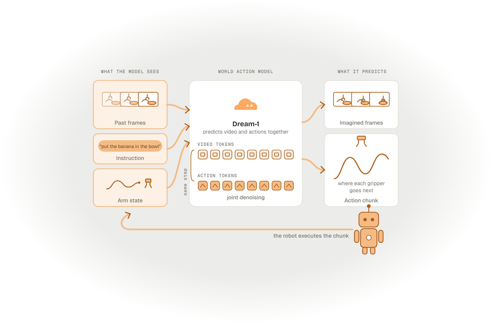

**Caption:** How a World Action Model works. *Reader note: animated embedded diagram (`assets/wam.html`), captured mid-cycle. Embedded description: “Past frames, the instruction and the arm state go in. Joint denoising fills the video tokens and the action tokens together, so the imagined frames and the action chunk are the same prediction. The robot executes the chunk, and the real frame replaces the imagined one.” Labels: WHAT THE MODEL SEES (Past frames; Instruction “put the banana in the bowl”; Arm state) → WORLD ACTION MODEL (Dream-1, “predicts video and actions together”; VIDEO TOKENS / ACTION TOKENS, “same step”, “joint denoising”) → WHAT IT PREDICTS (Imagined frames; Action chunk, “where each gripper goes next”); loop arrow “the robot executes the chunk”; phase labels “Observe”, “Imagine and act”, “Observe again”, “the real frame replaces the imagined one”.*

**Caption[CN]:** 世界动作模型如何工作。*阅读稿注：嵌入式动画示意图（`assets/wam.html`），截取于动画循环中段。嵌入说明：“输入为过去帧、指令和手臂状态。联合去噪同时填充视频 token 与动作 token，因此想象出的帧与动作块是同一个预测。机器人执行该动作块，真实帧随即替换想象帧。”标签：模型看到什么（过去帧；指令“put the banana in the bowl”；手臂状态）→ 世界动作模型（Dream-1，“同时预测视频与动作”；视频 token／动作 token，“同一步”，“联合去噪”）→ 它预测什么（想象帧；动作块，“每个夹爪下一步去哪里”）；回路箭头“机器人执行该动作块”；阶段标签“观察”“想象并行动”“再次观察”“真实帧替换想象帧”。*

> <span style="color:#3B82F6"><strong>Para. 4:</strong></span> **Limitations** — Predicting EEF trades some control for generality. Compared with joint-angle prediction with per-embodiment adaptation:
>
> - Performance depends on the quality of each robot's IK solver.
> - Dream-1 doesn't control how the arm reaches a pose, only where the gripper ends up, which can matter around obstacles or near joint limits.
> - Robots whose workspace or kinematics / dynamics differ sharply from what Dream-1 has seen may predict future states that are infeasible.

> <span style="color:#F59E0B"><strong>Para. 4[CN]:</strong></span> **局限性** —— 预测 EEF 是以牺牲部分控制力换取通用性。与针对每种形态进行适配的关节角预测相比：
>
> - 性能取决于每台机器人 IK 求解器的质量。
> - Dream-1 并不控制手臂如何到达某个位姿，只控制夹爪最终到达何处；在障碍物附近或接近关节极限时，这一点可能很重要。
> - 对于工作空间或运动学／动力学与 Dream-1 所见过的差异极大的机器人，（模型）可能会预测出不可行的未来状态。

### 04.4 What Dream-1 can and can't do / Dream-1 能做什么、不能做什么

*Source anchor / 原页锚点：* [`#can-and-cant`](https://dreamlabs.ai/research/dream-1/#can-and-cant)

### Figure 8. Robocurve independent report / Robocurve 独立评测报告

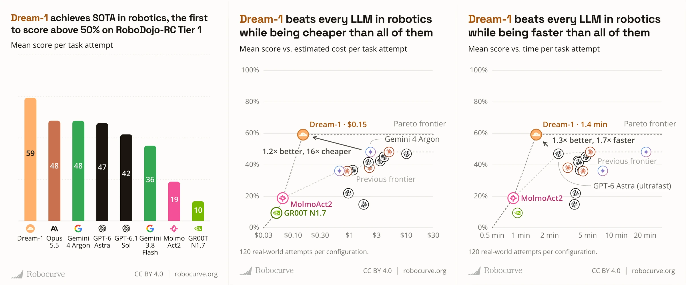

**Caption:** Robocurve’s independent report on Dream-1: mean score per task attempt on RoboDojo-RC Tier 1. *(Image alt text: “Three Robocurve charts: Dream-1 scores 59 on RoboDojo-RC Tier 1 against 48 for Opus 5.5 and Gemini 4 Argon, and sits on the Pareto frontier for both cost and time per task attempt”. This chart exists only as an image; Table 8 values are read from the image.)*

**Caption[CN]:** Robocurve 对 Dream-1 的独立评测报告：RoboDojo-RC Tier 1 上每次任务尝试的平均得分。*（图片 alt 文本：“三张 Robocurve 图表：Dream-1 在 RoboDojo-RC Tier 1 上得分 59，Opus 5.5 与 Gemini 4 Argon 为 48；在每次任务尝试的成本和时间两个维度上，Dream-1 都位于帕累托前沿”。该图仅以图片形式存在；表 8 数值读自图片。）*

**Table 8. Robocurve charts transcribed from Figure 8 (read from the image) / 表 8：图 8 中 Robocurve 图表转录（读图所得）**

Panel 1 — “Dream-1 achieves SOTA in robotics, the first to score above 50% on RoboDojo-RC Tier 1”; mean score per task attempt. / 面板 1——“Dream-1 在机器人领域达到 SOTA，是首个在 RoboDojo-RC Tier 1 上得分超过 50% 的模型”；每次任务尝试的平均得分。

| Model | Mean score per task attempt |
|---|---:|
| Dream-1 | 59 |
| Opus 5.5 | 48 |
| Gemini 4 Argon | 48 |
| GPT-6 Astra | 47 |
| GPT-6.1 Sol | 42 |
| Gemini 3.8 Flash | 36 |
| MolmoAct2 | 19 |
| GR00T N1.7 | 10 |

Panel 2 — “Dream-1 beats every LLM in robotics while being cheaper than all of them”; mean score vs. estimated cost per task attempt (log x-axis, 0.03 to 30 USD). Labelled points/annotations: “Dream-1 · \$0.15”; “1.2× better, 16× cheaper” (arrow from Gemini 4 Argon); “Pareto frontier”; “Previous frontier”; MolmoAct2; GR00T N1.7. Footnote: “120 real-world attempts per configuration.” / 面板 2——“Dream-1 在机器人领域击败所有 LLM，同时比它们都便宜”；平均得分与每次任务尝试估算成本（对数横轴，0.03 至 30 美元）。标注点／注释：“Dream-1 · \$0.15”；“1.2× better, 16× cheaper”（好 1.2 倍、便宜 16 倍；箭头起自 Gemini 4 Argon）；“Pareto frontier（帕累托前沿）”；“Previous frontier（先前前沿）”；MolmoAct2；GR00T N1.7。脚注：“每种配置 120 次真实世界尝试。”

Panel 3 — “Dream-1 beats every LLM in robotics while being faster than all of them”; mean score vs. time per task attempt (log x-axis, 0.5 to 20 min). Annotations: “Dream-1 · 1.4 min”; “1.3× better, 1.7× faster” (vs. “GPT-6 Astra (ultrafast)”); “Pareto frontier”; “Previous frontier”; MolmoAct2. Footnote: “120 real-world attempts per configuration.” Each panel is marked “Robocurve · CC BY 4.0 · robocurve.org”. Unlabelled scatter points (other model configurations) cannot be identified from the image. / 面板 3——“Dream-1 在机器人领域击败所有 LLM，同时比它们都快”；平均得分与每次任务尝试耗时（对数横轴，0.5 至 20 分钟）。注释：“Dream-1 · 1.4 min”；“1.3× better, 1.7× faster”（好 1.3 倍、快 1.7 倍，对比“GPT-6 Astra (ultrafast)”）；“Pareto frontier”；“Previous frontier”；MolmoAct2。脚注：“每种配置 120 次真实世界尝试。”每个面板均标注“Robocurve · CC BY 4.0 · robocurve.org”。未标注的散点（其他模型配置）无法从图片中识别。

> <span style="color:#3B82F6"><strong>Para. 1:</strong></span> Ahead of launch, [Robocurve](https://robocurve.org/)<sup>[6](#fn-6-robocurve)</sup>, a Public Benefit Corporation that measures and reports frontier robotics capabilities to the public, evaluated Dream-1 independently. Their report, above, shows Dream-1 is better, faster and cheaper: a new Pareto frontier for robot control. It scores above the next best models, Opus 5.5 and Gemini 4 Argon, at 16x lower cost per task attempt than Gemini 4 Argon and 1.7x faster than the fastest LLM, GPT-6 Astra. While current LLMs excel at planning, robots still require a fast, general System 1 to act, and that is what Dream-1 is built to be.

> <span style="color:#F59E0B"><strong>Para. 1[CN]:</strong></span> 在发布之前，[Robocurve](https://robocurve.org/)<sup>[6](#fn-6-robocurve)</sup>——一家衡量并向公众报告前沿机器人能力的公益公司（Public Benefit Corporation）——对 Dream-1 进行了独立评测。上方的报告显示，Dream-1 更好、更快、更便宜：为机器人控制确立了新的帕累托前沿。它的得分高于次优模型 Opus 5.5 和 Gemini 4 Argon，每次任务尝试的成本比 Gemini 4 Argon 低 16 倍，速度比最快的 LLM GPT-6 Astra 快 1.7 倍。尽管当前的 LLM 擅长规划，机器人仍然需要一个快速、通用的“系统 1”来执行动作，而这正是 Dream-1 的设计定位。

> <span style="color:#3B82F6"><strong>Para. 2:</strong></span> **How much does it cost to run Dream-1?** We want you to know exactly what to expect before you try it. Running the model costs just \$3 per hour for Dream-1, or \$2 per hour for Dream-1-flash. Each call to the model returns 1.6 seconds of actions, so an hour is 2,250 calls: about \$0.0013 an action for Dream-1, and \$0.0009 for Dream-1-flash.

> <span style="color:#F59E0B"><strong>Para. 2[CN]:</strong></span> **运行 Dream-1 需要多少钱？** 我们希望你在尝试之前就确切知道会花多少。运行 Dream-1 每小时仅需 3 美元，Dream-1-flash 每小时 2 美元。每次调用模型返回 1.6 秒的动作，因此一小时为 2,250 次调用：Dream-1 每次动作约 0.0013 美元，Dream-1-flash 约 0.0009 美元。

Reader arithmetic check (not in source) / 阅读稿核算（非原文）：

$$
N_{\text{calls}} = \frac{3600\ \text{s}}{1.6\ \text{s}} = 2250,\qquad \frac{3\ \text{USD}}{2250} \approx 0.00133\ \text{USD},\qquad \frac{2\ \text{USD}}{2250} \approx 0.00089\ \text{USD}
$$

The page’s figures (\$0.0013 and \$0.0009 per call, which the page calls “an action”) are consistent with this. / 页面给出的数字（每次调用约 0.0013 与 0.0009 美元，页面称之为“每次动作”）与此一致。

> <span style="color:#3B82F6"><strong>Para. 3:</strong></span> Pricing cards:
>
> - **\$3 / hour — Dream-1**: Everything above the hourly cost is yours to keep.
> - **\$2 / hour — Dream-1-flash**: The faster, lighter model.

> <span style="color:#F59E0B"><strong>Para. 3[CN]:</strong></span> 价格卡片：
>
> - **每小时 3 美元 —— Dream-1**：超出小时成本的部分全归你所有。
> - **每小时 2 美元 —— Dream-1-flash**：更快、更轻量的模型。

> <span style="color:#3B82F6"><strong>Para. 4:</strong></span> **Across tasks.** We break Dream-1’s performance down into eight task categories, from what it handles well to where it still struggles.

> <span style="color:#F59E0B"><strong>Para. 4[CN]:</strong></span> **跨任务表现。** 我们把 Dream-1 的性能细分为八个任务类别，从它擅长的到它仍有困难的。

### Figure 9. Unseen task generalization capabilities / 未见任务泛化能力

Two-tab chart: **YAM** and **YAM + UMI gripper**. Below each chart the page shows per-category rollout clips grouped by progress bucket (Full success / Progress 0.75 / 0.5 / 0.25 / No progress); bucket counts are tabulated in Table 10. This figure has no caption on the page. / 双标签图表：**YAM** 与 **YAM + UMI gripper**。每张图下方，页面按进度档（完全成功／进度 0.75／0.5／0.25／无进度）展示各类别的执行回合片段；各档计数见表 10。该图在页面上没有图注。

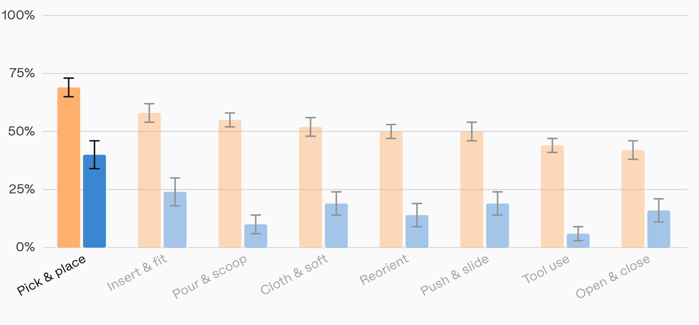

**Caption:** *(No caption on the page; reader-supplied description.)* Unseen Task Generalization Capabilities — tab “YAM”: progress score (orange) and success rate (blue) with standard-error bars across eight task categories. Rendered with “Pick & place” selected (other categories dimmed).

**Caption[CN]:** *（页面无图注；以下为阅读稿补充说明。）* 未见任务泛化能力——标签“YAM”：八个任务类别上的进度分（橙色）与成功率（蓝色），附标准误误差棒。渲染时选中了“Pick & place”（其他类别呈淡色）。

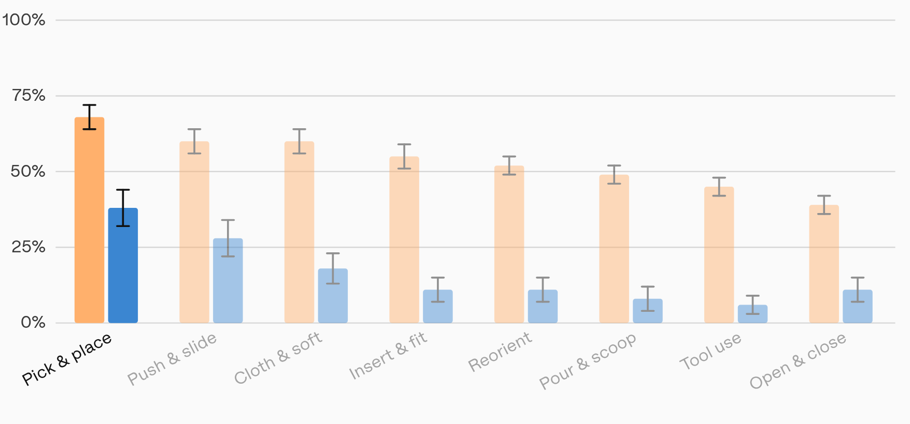

**Caption:** *(No caption on the page; reader-supplied description.)* Unseen Task Generalization Capabilities — tab “YAM + UMI gripper”: progress score and success rate with standard-error bars across eight task categories (category order differs from the YAM tab).

**Caption[CN]:** *（页面无图注；以下为阅读稿补充说明。）* 未见任务泛化能力——标签“YAM + UMI gripper”：八个任务类别上的进度分与成功率，附标准误误差棒（类别顺序与 YAM 标签不同）。

**Table 9. Unseen task generalization by category (values in %, ± is the chart data’s `se` field, shown as error bars) / 表 9：按类别的未见任务泛化（单位 %，± 为图表数据 `se` 字段，即图中误差棒）**

*Tab: YAM* (category order as on the page)

| Category | 中文 | Progress score | Success rate | Rollouts (per title) |
|---|---|---:|---:|---:|
| Pick & place | 抓取与放置 | 69 ± 4 | 40 ± 6 | 60 |
| Insert & fit | 插入与装配 | 58 ± 4 | 24 ± 6 | 55 |
| Pour & scoop | 倾倒与舀取 | 55 ± 3 | 10 ± 4 | 52 |
| Cloth & soft | 布料与软物 | 52 ± 4 | 19 ± 5 | 57 |
| Reorient | 重新定向 | 50 ± 3 | 14 ± 5 | 57 |
| Push & slide | 推动与滑动 | 50 ± 4 | 19 ± 5 | 58 |
| Tool use | 工具使用 | 44 ± 3 | 6 ± 3 | 54 |
| Open & close | 打开与关闭 | 42 ± 4 | 16 ± 5 | 57 |

*Tab: YAM + UMI gripper* (category order as on the page)

| Category | 中文 | Progress score | Success rate | Rollouts (per title) |
|---|---|---:|---:|---:|
| Pick & place | 抓取与放置 | 68 ± 4 | 38 ± 6 | 60 |
| Push & slide | 推动与滑动 | 60 ± 4 | 28 ± 6 | 58 |
| Cloth & soft | 布料与软物 | 60 ± 4 | 18 ± 5 | 57 |
| Insert & fit | 插入与装配 | 55 ± 4 | 11 ± 4 | 55 |
| Reorient | 重新定向 | 52 ± 3 | 11 ± 4 | 57 |
| Pour & scoop | 倾倒与舀取 | 49 ± 3 | 8 ± 4 | 52 |
| Tool use | 工具使用 | 45 ± 3 | 6 ± 3 | 54 |
| Open & close | 打开与关闭 | 39 ± 3 | 11 ± 4 | 57 |

**Table 10. Rollout clips per progress bucket (counted from the page’s clip lists) / 表 10：各进度档的执行回合片段数（由页面片段列表统计）**

*Tab: YAM*

| Category | Title count | Clips listed | Full success (1) | 0.75 | 0.5 | 0.25 | No progress (0) |
|---|---:|---:|---:|---:|---:|---:|---:|
| Pick & place | 60 | 60 | 24 | 13 | 9 | 13 | 1 |
| Insert & fit | 55 | 55 | 13 | 11 | 15 | 12 | 4 |
| Pour & scoop | 52 | 52 | 5 | 15 | 18 | 13 | 1 |
| Cloth & soft | 57 | 57 | 11 | 6 | 18 | 20 | 2 |
| Reorient | 57 | 57 | 8 | 5 | 22 | 22 | 0 |
| Push & slide | 58 | 57 | 11 | 8 | 15 | 18 | 5 |
| Tool use | 54 | 54 | 3 | 5 | 24 | 19 | 3 |
| Open & close | 57 | 57 | 9 | 6 | 7 | 28 | 7 |

*Tab: YAM + UMI gripper*

| Category | Title count | Clips listed | Full success (1) | 0.75 | 0.5 | 0.25 | No progress (0) |
|---|---:|---:|---:|---:|---:|---:|---:|
| Pick & place | 60 | 60 | 23 | 15 | 6 | 14 | 2 |
| Push & slide | 58 | 58 | 16 | 13 | 12 | 13 | 4 |
| Cloth & soft | 57 | 57 | 10 | 19 | 13 | 14 | 1 |
| Insert & fit | 55 | 55 | 6 | 19 | 16 | 9 | 5 |
| Reorient | 57 | 57 | 6 | 12 | 21 | 17 | 1 |
| Pour & scoop | 52 | 51 | 4 | 9 | 21 | 16 | 1 |
| Tool use | 54 | 54 | 3 | 8 | 23 | 16 | 4 |
| Open & close | 57 | 56 | 6 | 1 | 14 | 34 | 1 |

Reader check (not in source): the progress score matches the mean bucket value and the success rate matches the full-success share, e.g. for YAM Pick & place: / 阅读稿核对（非原文）：进度分与各档数值均值一致，成功率与完全成功占比一致，例如 YAM 抓取与放置：

$$
\frac{24\cdot 1 + 13\cdot 0.75 + 9\cdot 0.5 + 13\cdot 0.25 + 1\cdot 0}{60} \approx 0.692 \;(\text{chart: }69),\qquad \frac{24}{60} = 0.40 \;(\text{chart: }40)
$$

Three categories list one clip fewer than their title count (YAM Push & slide 57/58; YAM + UMI Pour & scoop 51/52 and Open & close 56/57). The individual task prompts of the ~450 rollout clips are in the page data but are not reproduced here, and the clips themselves were not downloaded. / 有三个类别列出的片段比标题计数少一个（YAM 推动与滑动 57/58；YAM + UMI 倾倒与舀取 51/52、打开与关闭 56/57）。约 450 个回合片段的具体任务指令存在于页面数据中，但未在此逐条转录，片段本身也未下载。

> <span style="color:#3B82F6"><strong>Para. 5:</strong></span> **Fine-tune for your task with FaaS.** If Dream-1 falls short on a task you care about, you don’t have to wait for our next release. Collect some data on your own robot, run it through FaaS, and get a custom model built for that task.

> <span style="color:#F59E0B"><strong>Para. 5[CN]:</strong></span> **用 FaaS 为你的任务微调。** 如果 Dream-1 在你关心的任务上表现不足，你不必等待我们的下一个版本。在你自己的机器人上采集一些数据，通过 FaaS 处理，就能得到一个为该任务定制的模型。

> <span style="color:#3B82F6"><strong>Para. 6:</strong></span> We want anyone with a robot to work like a forward-deployed engineer: find a task someone needs done, collect a bit of data, adapt Dream-1 to it, and deploy. If people will pay for what your robot does, you keep everything above the hourly cost.

> <span style="color:#F59E0B"><strong>Para. 6[CN]:</strong></span> 我们希望任何拥有机器人的人都能像前线部署工程师那样工作：找到一个有人需要完成的任务，采集一点数据，让 Dream-1 适配它，然后部署。如果人们愿意为你的机器人所做的事付费，超出小时成本的部分都归你。

> <span style="color:#3B82F6"><strong>Para. 7:</strong></span> **Dream-1 is a research beta.** It will make mistakes, and it has not been validated for safety-critical use. Please test it in controlled settings, and take extra care whenever a robot is running near people. If you see unsafe behavior, please report it to [safety@dreamlabs.ai](mailto:safety@dreamlabs.ai).

> <span style="color:#F59E0B"><strong>Para. 7[CN]:</strong></span> **Dream-1 是研究测试版（research beta）。** 它会犯错，且尚未针对安全关键用途进行验证。请在受控环境中测试，并在机器人靠近人员运行时格外小心。如果发现不安全行为，请报告至 [safety@dreamlabs.ai](mailto:safety@dreamlabs.ai)。

### 04.5 One-shot embodiment learning / 单次形态学习

*Source anchor / 原页锚点：* [`#one-shot`](https://dreamlabs.ai/research/dream-1/#one-shot)

> <span style="color:#3B82F6"><strong>Para. 1:</strong></span> When zero-shot isn't enough, we fine-tune Dream-1 for your robot. We call this Fine-tuning-as-a-Service (FaaS).

> <span style="color:#F59E0B"><strong>Para. 1[CN]:</strong></span> 当零样本不够用时，我们会为你的机器人微调 Dream-1。我们称之为“微调即服务”（FaaS）。

> <span style="color:#3B82F6"><strong>Para. 2:</strong></span> Here's what that looks like in practice: timelapses of data collection on two of our partners' robots, 5 minutes each.

> <span style="color:#F59E0B"><strong>Para. 2[CN]:</strong></span> 实际情况如下：在我们两家合作方的机器人上进行数据采集的延时视频，每台各 5 分钟。

### Figure 10. Data collection timelapse / 数据采集延时视频

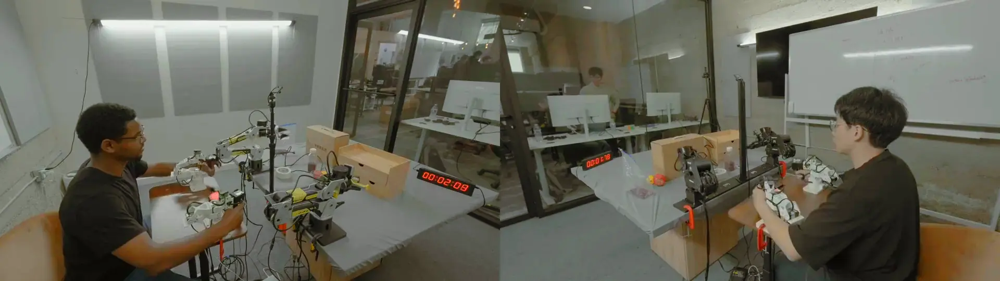

**Caption:** Five minutes of data collection on two robots at 8x: reBot B601-DM on the left, Maker Arm on the right. *(Video “Data collection timelapse”, 00:38; poster still shown — alt: “Two data-collection stations side by side, each with a person teleoperating a bimanual robot and a timer on the table”.)*

**Caption[CN]:** 两台机器人上各 5 分钟的数据采集，8 倍速：左为 reBot B601-DM，右为 Maker Arm。*（视频“Data collection timelapse”，时长 00:38；此处为封面静帧——alt 文本：“两个并排的数据采集工位，每个工位都有一人遥操作一台双臂机器人，桌上放着计时器”。）*

> <span style="color:#3B82F6"><strong>Para. 3:</strong></span> After adapting on just those 5 minutes, the difference shows side-by-side with the zero-shot run. Dream-1 now understands a bit better the affordance and kinematics of the robot.

> <span style="color:#F59E0B"><strong>Para. 3[CN]:</strong></span> 仅用这 5 分钟数据完成适配后，与零样本运行并排对比即可看出差异。Dream-1 现在对该机器人的可供性（affordance）与运动学理解得更好了一些。

### Figure 11. Zero-shot vs. after FaaS (5 minutes of data) / 零样本与 FaaS 之后对比（5 分钟数据）

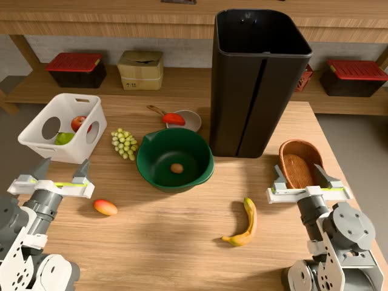

**Caption:** *Panel 11a: reBot B601-DM · Simulated twin · Zero-shot (video poster still).* Zero-shot and after FaaS on the same instruction, “go ahead and put the banana in the bowl”, with five minutes of the robot’s own data in between: reBot B601-DM in its simulated twin, Maker Arm on the real robot. 3x speed.

**Caption[CN]:** *面板 11a：reBot B601-DM · 仿真孪生 · 零样本（视频封面静帧）。* 在同一条指令“go ahead and put the banana in the bowl”（把香蕉放进碗里）下的零样本与 FaaS 之后对比，二者之间只加入了该机器人自身 5 分钟的数据：reBot B601-DM 在其仿真孪生中，Maker Arm 在真实机器人上。3 倍速。

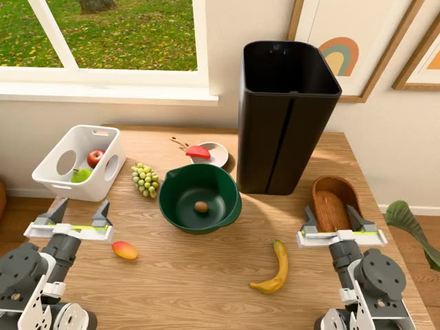

**Caption:** *Panel 11b: reBot B601-DM · Simulated twin · After FaaS (+ 5 min) (video poster still).* Zero-shot and after FaaS on the same instruction, “go ahead and put the banana in the bowl”, with five minutes of the robot’s own data in between: reBot B601-DM in its simulated twin, Maker Arm on the real robot. 3x speed.

**Caption[CN]:** *面板 11b：reBot B601-DM · 仿真孪生 · FaaS 之后（+5 分钟）（视频封面静帧）。* 在同一条指令“go ahead and put the banana in the bowl”（把香蕉放进碗里）下的零样本与 FaaS 之后对比，二者之间只加入了该机器人自身 5 分钟的数据：reBot B601-DM 在其仿真孪生中，Maker Arm 在真实机器人上。3 倍速。

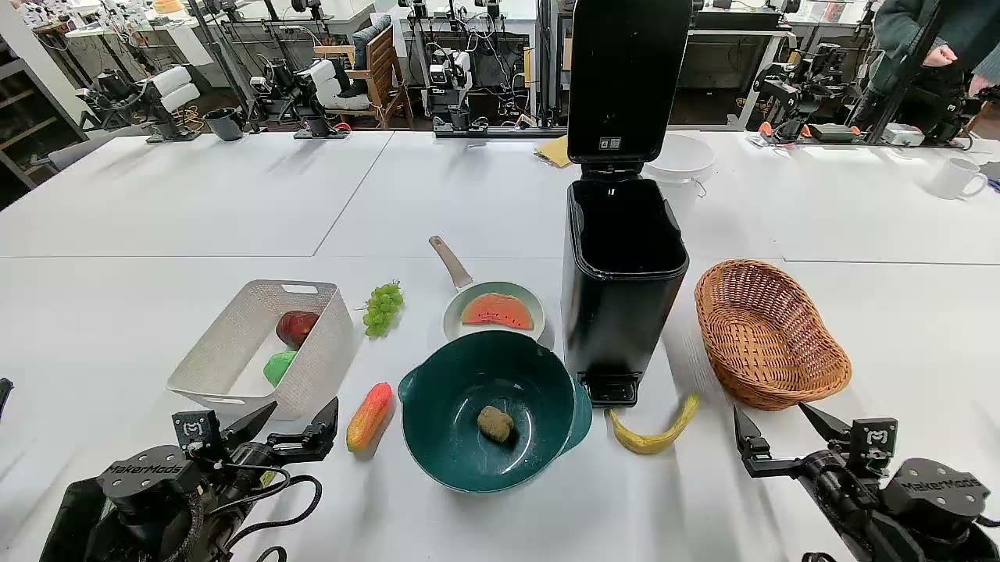

**Caption:** *Panel 11c: Maker Arm · Real robot · Zero-shot (video poster still).* Zero-shot and after FaaS on the same instruction, “go ahead and put the banana in the bowl”, with five minutes of the robot’s own data in between: reBot B601-DM in its simulated twin, Maker Arm on the real robot. 3x speed.

**Caption[CN]:** *面板 11c：Maker Arm · 真实机器人 · 零样本（视频封面静帧）。* 在同一条指令“go ahead and put the banana in the bowl”（把香蕉放进碗里）下的零样本与 FaaS 之后对比，二者之间只加入了该机器人自身 5 分钟的数据：reBot B601-DM 在其仿真孪生中，Maker Arm 在真实机器人上。3 倍速。

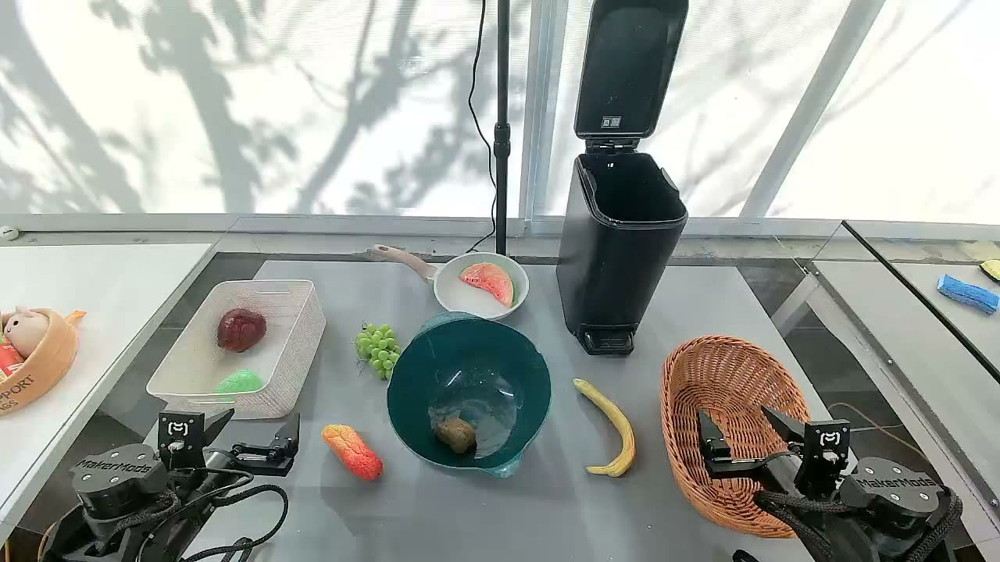

**Caption:** *Panel 11d: Maker Arm · Real robot · After FaaS (+ 5 min) (video poster still).* Zero-shot and after FaaS on the same instruction, “go ahead and put the banana in the bowl”, with five minutes of the robot’s own data in between: reBot B601-DM in its simulated twin, Maker Arm on the real robot. 3x speed.

**Caption[CN]:** *面板 11d：Maker Arm · 真实机器人 · FaaS 之后（+5 分钟）（视频封面静帧）。* 在同一条指令“go ahead and put the banana in the bowl”（把香蕉放进碗里）下的零样本与 FaaS 之后对比，二者之间只加入了该机器人自身 5 分钟的数据：reBot B601-DM 在其仿真孪生中，Maker Arm 在真实机器人上。3 倍速。

> <span style="color:#3B82F6"><strong>Para. 4:</strong></span> Some embodiments sit much further from what Dream-1 already knows, and closing a gap that large takes more of the robot’s own data. Dexmate with Sharpa dexterous hands grasps with hands in place of grippers, and took 77 minutes of its data. On YAM, we swapped in different end effectors for this task, a compliant gripper and a modified knife gripper, and it took 98 minutes of data.

> <span style="color:#F59E0B"><strong>Para. 4[CN]:</strong></span> 有些形态与 Dream-1 已知的相差甚远，弥合如此大的差距需要更多该机器人自身的数据。配备 Sharpa 灵巧手的 Dexmate 用手而非夹爪进行抓取，用了 77 分钟的自身数据。在 YAM 上，我们为这项任务换装了不同的末端执行器——一个柔顺夹爪和一个改装的刀具夹爪——用了 98 分钟的数据。

### Figure 12. After FaaS on far-from-training embodiments / 远离训练分布的形态在 FaaS 之后的表现

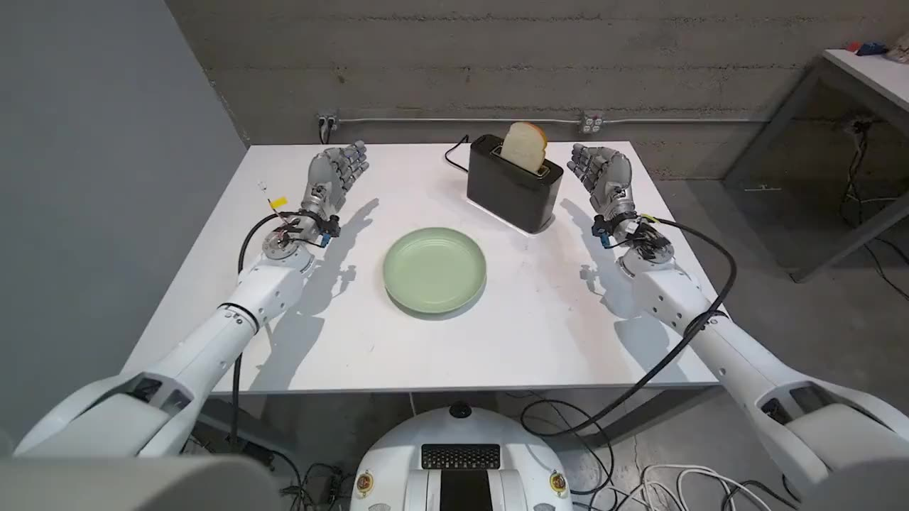

**Caption:** *Panel 12a: After FaaS · 5x speed · **Dexmate**, Sharpa dexterous hands, 77 minutes of data · “Pick bread from toaster and place on plate” (video poster still).* After FaaS on embodiments far from Dream-1’s training data, on the real robots. 5x speed.

**Caption[CN]:** *面板 12a：FaaS 之后 · 5 倍速 · **Dexmate**，Sharpa 灵巧手，77 分钟数据 ·“从烤面包机取出面包并放到盘子上”（视频封面静帧）。* 在远离 Dream-1 训练数据的形态上、于真实机器人上进行 FaaS 之后的效果。5 倍速。

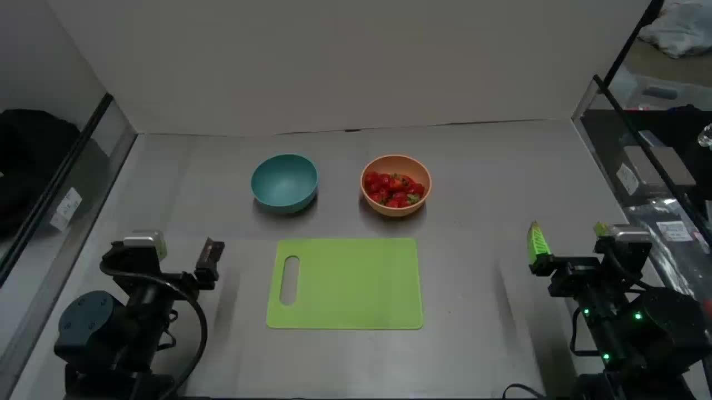

**Caption:** *Panel 12b: After FaaS · 5x speed · **YAM**, compliant gripper and modified knife gripper, 98 minutes of data · “Cut the leaf off the strawberry” (video poster still).* After FaaS on embodiments far from Dream-1’s training data, on the real robots. 5x speed.

**Caption[CN]:** *面板 12b：FaaS 之后 · 5 倍速 · **YAM**，柔顺夹爪与改装刀具夹爪，98 分钟数据 ·“切掉草莓的叶子”（视频封面静帧）。* 在远离 Dream-1 训练数据的形态上、于真实机器人上进行 FaaS 之后的效果。5 倍速。

> <span style="color:#3B82F6"><strong>Para. 5:</strong></span> Across twelve robots from our FaaS beta partners, fine-tuning lifts the language-following score on ten of them:

> <span style="color:#F59E0B"><strong>Para. 5[CN]:</strong></span> 在来自我们 FaaS 测试合作方的十二台机器人中，微调提升了其中十台的语言遵循得分：

### Figure 13. Zero-shot vs. after FaaS on twelve robots / 十二台机器人上零样本与 FaaS 之后对比

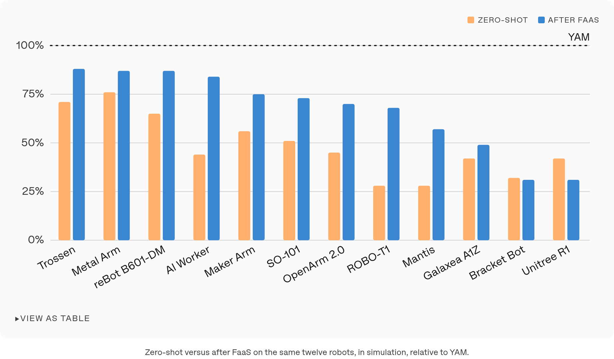

**Caption:** Zero-shot versus after FaaS on the same twelve robots, in simulation, relative to YAM.

**Caption[CN]:** 在仿真中，同样十二台机器人上零样本与 FaaS 之后的对比，均相对于 YAM。

**Table 11. Language-following score relative to YAM (= 100), zero-shot vs. after FaaS (values from the page’s chart data) / 表 11：相对 YAM（=100）的语言遵循得分，零样本与 FaaS 之后（数值取自页面图表数据）**

| Robot | Zero-shot | After FaaS | Δ (reader-computed) | After-FaaS preview prompt (verbatim) | Poster |
|---|---:|---:|---:|---|---|
| Trossen | 71 | 88 | +17 | “put the tape wherever the sticky notes are” | [ft-trossen-workbench.jpg](assets/faas/ft-trossen-workbench.jpg) |
| Metal Arm | 76 | 87 | +11 | “put the bar soap in the basket” | [ft-metal-arm.jpg](assets/faas/ft-metal-arm.jpg) |
| reBot B601-DM | 65 | 87 | +22 | “put the fork on the pan” | [ft-seeed-rebot-b601.jpg](assets/faas/ft-seeed-rebot-b601.jpg) |
| AI Worker | 44 | 84 | +40 | “pick up the tape and place it in the round white bin.” | [ft-robotis-ai-worker.jpg](assets/faas/ft-robotis-ai-worker.jpg) |
| Maker Arm | 56 | 75 | +19 | “put the loofah on the towel” | [ft-makermods-maker-arm.jpg](assets/faas/ft-makermods-maker-arm.jpg) |
| SO-101 | 51 | 73 | +22 | “go ahead and put the banana in the bowl” | [ft-so-101.jpg](assets/faas/ft-so-101.jpg) |
| OpenArm 2.0 | 45 | 70 | +25 | “put the leftmost object in the bucket” | [ft-enactic-openarm-2.jpg](assets/faas/ft-enactic-openarm-2.jpg) |
| ROBO-T1 | 28 | 68 | +40 | “push the bottle over to the egg carton, keeping it on the table” | [ft-robo-t1.jpg](assets/faas/ft-robo-t1.jpg) |
| Mantis | 28 | 57 | +29 | “put the red knife in the brown basket” | [ft-blueworm-mantis.jpg](assets/faas/ft-blueworm-mantis.jpg) |
| Galaxea A1Z | 42 | 49 | +7 | “put the red knife in the brown basket” | [ft-galaxea-a1z.jpg](assets/faas/ft-galaxea-a1z.jpg) |
| Bracket Bot | 32 | 31 | -1 | “push the bottle over to the egg carton, keeping it on the table” | [ft-bracket-bot.jpg](assets/faas/ft-bracket-bot.jpg) |
| Unitree R1 | 42 | 31 | -11 | “put the red knife in the brown basket” | [ft-unitree-r1.jpg](assets/faas/ft-unitree-r1.jpg) |

Ten of twelve robots improve; Bracket Bot (32 → 31) and Unitree R1 (42 → 31) do not, consistent with “ten of them”. The chart’s y-axis is labelled only in % with a dashed YAM = 100% reference; the metric name (language-following score) comes from the body text. ROBO-T1 appears in this chart but not in the 27-robot simulation list; “Trossen” here corresponds to “Trossen Workbench” elsewhere. / 十二台中有十台提升；Bracket Bot（32 → 31）与 Unitree R1（42 → 31）未提升，与“其中十台”一致。图表纵轴仅以 % 标注，并以虚线表示 YAM = 100% 参考；指标名称（语言遵循得分）来自正文。ROBO-T1 出现在此图中，但不在 27 款仿真机器人列表里；此处的“Trossen”对应其他处的“Trossen Workbench”。

> <span style="color:#3B82F6"><strong>Para. 6:</strong></span> One-shot adaptation still outperforms zero-shot, so a gap remains. Closing it is one of our main goals: the better zero-shot gets, the closer any new robot comes to working out of the box.

> <span style="color:#F59E0B"><strong>Para. 6[CN]:</strong></span> 单次适配仍优于零样本，因此差距依然存在。弥合这一差距是我们的主要目标之一：零样本越好，任何新机器人就越接近开箱即用。

## 05 Looking forward / 展望

*Source anchor / 原页锚点：* [`#looking-forward`](https://dreamlabs.ai/research/dream-1/#looking-forward)

> <span style="color:#3B82F6"><strong>Para. 1:</strong></span> Dream-1 today is a manipulation policy for bimanual robots with parallel grippers. It’s a starting point. We believe a strong, general robot foundation model can extend to mobile manipulators, dexterous hands, and bodies we haven't imagined yet, opening up many more of the things people actually want robots to do. Robotics won't be solved on day one, and Dream-1 has real limits, which we've tried to show transparently above.

> <span style="color:#F59E0B"><strong>Para. 1[CN]:</strong></span> 如今的 Dream-1 是一个面向配备平行夹爪的双臂机器人的操控策略。这是一个起点。我们相信，一个强大、通用的机器人基础模型可以扩展到移动操作机器人、灵巧手，以及我们尚未想象到的本体，从而解锁更多人们真正希望机器人去做的事。机器人问题不会在第一天就被解决，Dream-1 也有真实的局限，我们已尽力在上文中透明地展示。

> <span style="color:#3B82F6"><strong>Para. 2:</strong></span> Robotics is still stuck in a difficult loop: every new robot or task demands new data and a custom policy, often with limited generalization. With Dream-1 as a robotics API, we want to break that loop and put robot intelligence into more people's hands, so everyday users, not only researchers, can discover new applications for general-purpose robot intelligence.

> <span style="color:#F59E0B"><strong>Para. 2[CN]:</strong></span> 机器人领域仍困在一个艰难的循环中：每一台新机器人或每一项新任务都需要新数据和定制策略，且泛化能力往往有限。借助作为机器人 API 的 Dream-1，我们希望打破这一循环，把机器人智能交到更多人手中，让普通用户——而不只是研究人员——也能为通用机器人智能发掘新的应用。

> <span style="color:#3B82F6"><strong>Para. 3:</strong></span> **Dream-1 . public API — Put Dream‑1 on your robot.** If you're building robots or putting them to work on real tasks, we want Dream-1 to be the fastest way to make them useful. Tell us what you're working on. [Use Dream-1 Today](https://platform.dreamlabs.ai) · [Work with us](mailto:info@dreamlabs.co)

> <span style="color:#F59E0B"><strong>Para. 3[CN]:</strong></span> **Dream-1 · 公共 API —— 把 Dream-1 装到你的机器人上。** 如果你正在制造机器人，或让它们投入真实任务，我们希望 Dream-1 成为让它们变得有用的最快方式。告诉我们你在做什么。[立即使用 Dream-1](https://platform.dreamlabs.ai) · [与我们合作](mailto:info@dreamlabs.co)

### Figure 14. Dream-1 MicroDuck control / Dream-1 控制 MicroDuck

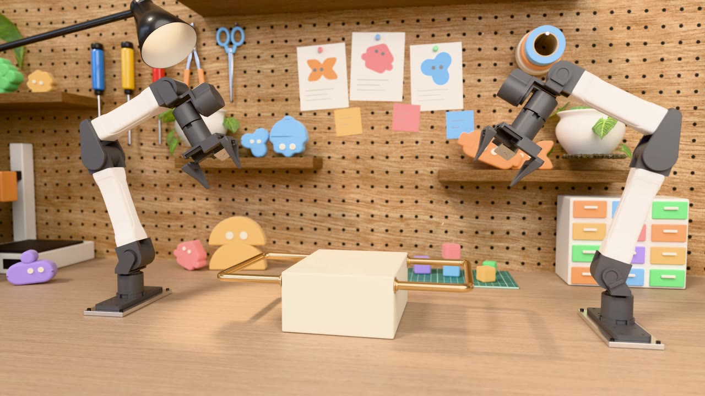

**Caption:** A fine-tuned Dream-1 checkpoint controlling multiple embodiments, including the Microduck. *(Video “Dream-1 MicroDuck control”, 00:16; poster still shown — alt: “Two robot arms at a workbench with a box between them”.)*

**Caption[CN]:** 一个经过微调的 Dream-1 检查点控制多种形态，其中包括 Microduck。*（视频“Dream-1 MicroDuck control”，时长 00:16；此处为封面静帧——alt 文本：“工作台上的两条机械臂，中间放着一个盒子”。）*

## Notes and references / 注释与参考

*Source anchor / 原页锚点：* [`#footnotes`](https://dreamlabs.ai/research/dream-1/#footnotes) — footnote anchors `#fn-1` … `#fn-6`; in-text markers `#ref-1` … `#ref-6` (fn 2 is cited twice, `#ref-2` and `#ref-2b`).

Bibliographic titles and URLs are kept in their original English form for searchability; the annotation text of each note is translated. / 文献标题与 URL 保留英文原文以便检索；各注释的说明文字已翻译。

#### fn 1 Maker Arm

> <span style="color:#3B82F6"><strong>Para. fn1:</strong></span> MakerMods, [Maker Arm](https://www.makermods.ai/maker-arm): a bimanual arm setup from about \$2k.

> <span style="color:#F59E0B"><strong>Para. fn1[CN]:</strong></span> MakerMods，[Maker Arm](https://www.makermods.ai/maker-arm)：一套起价约 2000 美元的双臂机械臂系统。

#### fn 2 Microduck

> <span style="color:#3B82F6"><strong>Para. fn2:</strong></span> Yahoo Tech, [Hugging Face's \$399 Microduck robot has already sold more than 10,000 units](https://tech.yahoo.com/general/article/hugging-faces-399-microduck-robot-has-already-sold-more-than-10000-units-150737607.html), 1 September 2026: more than 10,000 units since pre-orders opened on 28 August.

> <span style="color:#F59E0B"><strong>Para. fn2[CN]:</strong></span> Yahoo Tech，[Hugging Face's \$399 Microduck robot has already sold more than 10,000 units](https://tech.yahoo.com/general/article/hugging-faces-399-microduck-robot-has-already-sold-more-than-10000-units-150737607.html)，2026 年 9 月 1 日：自 8 月 28 日开放预订以来已售出超过 10,000 台。

#### fn 3 DreamZero

> <span style="color:#3B82F6"><strong>Para. fn3:</strong></span> [DreamZero](https://dreamzero0.github.io/): the paper that introduced World Action Models, February 2026.

> <span style="color:#F59E0B"><strong>Para. fn3[CN]:</strong></span> [DreamZero](https://dreamzero0.github.io/)：提出世界动作模型的论文，2026 年 2 月。

#### fn 4 LAP

> <span style="color:#3B82F6"><strong>Para. fn4:</strong></span> LAP also showed signs of life of embodiment generalization: Zha et al., [LAP: Language-Action Pre-Training Enables Zero-shot Cross-Embodiment Transfer](https://arxiv.org/abs/2602.10556).

> <span style="color:#F59E0B"><strong>Para. fn4[CN]:</strong></span> LAP 也展现了形态泛化的初步迹象：Zha 等，[LAP: Language-Action Pre-Training Enables Zero-shot Cross-Embodiment Transfer](https://arxiv.org/abs/2602.10556)。

#### fn 5 UMI

> <span style="color:#3B82F6"><strong>Para. fn5:</strong></span> Chi et al., [Universal Manipulation Interface: In-The-Wild Robot Teaching Without In-The-Wild Robots](https://umi-gripper.github.io/), RSS 2024: zero-shot transfer across arms that share one gripper, from wrist cameras alone.

> <span style="color:#F59E0B"><strong>Para. fn5[CN]:</strong></span> Chi 等，[Universal Manipulation Interface: In-The-Wild Robot Teaching Without In-The-Wild Robots](https://umi-gripper.github.io/)，RSS 2024：仅凭腕部相机，在共用同一夹爪的机械臂之间实现零样本迁移。

#### fn 6 Robocurve

> <span style="color:#3B82F6"><strong>Para. fn6:</strong></span> [Robocurve](https://robocurve.org/), a Public Benefit Corporation measuring and reporting frontier robotics capabilities to the public: Dream-1 on RoboDojo-RC Tier 1, October 18, 2026, CC BY 4.0.

> <span style="color:#F59E0B"><strong>Para. fn6[CN]:</strong></span> [Robocurve](https://robocurve.org/)，一家衡量并向公众报告前沿机器人能力的公益公司：Dream-1 在 RoboDojo-RC Tier 1 上的评测，2026 年 10 月 18 日，CC BY 4.0 许可。

### Cite this post / 引用本文

```bibtex
@misc{dreamlabs2026dream1,
  title  = {Zero-Shot to New Robots: Introducing Dream-1},
  author = {Dream Labs},
  year   = {2026},
  url    = {https://dreamlabs.ai/research/dream-1}
}
```

## Source Coverage Audit

| Page section | Source text blocks | Reader pairs | Figures / tables | Status |
|---|---|---:|---|---|
| Lead | title, dek, byline, 3 lead paragraphs, “From day one” banner | 7 | Fig 1 | complete |
| 01 chicken-and-egg | 6 paragraphs | 6 | Fig 2 | complete |
| 02 cambrian-explosion | 2 paragraphs + 4-card stat list | 3 | Fig 3, Table 1 | complete |
| 03 the-result | 2 paragraphs | 2 | — | complete |
| 04 introducing-dream-1 | 1 paragraph | 1 | Fig 4a–b, Tables 2–3 | complete |
| 04.1 get-started | 1 paragraph + listing caption | 2 | Code listing 1 | complete |
| 04.2 zero-shot | 3 paragraphs | 3 | Fig 5a–b, Fig 6a–b, Tables 4–7 | complete |
| 04.3 how-it-works | 3 paragraphs + limitations list | 4 | Fig 7 | complete |
| 04.4 can-and-cant | 6 paragraphs + pricing cards | 7 | Fig 8, Fig 9a–b, Tables 8–10 | complete |
| 04.5 one-shot | 6 paragraphs | 6 | Fig 10, Fig 11a–d, Fig 12a–b, Fig 13, Table 11 | complete |
| 05 looking-forward | 2 paragraphs + CTA | 3 | Fig 14 | complete |
| Notes fn 1–6 | 6 notes | 6 | BibTeX | complete |

All substantive visible text blocks of the web page are mapped in order to 50 bilingual pairs (body + footnotes). 22 figure/panel cards (22 embedded images) carry bilingual captions (Figures 1–14; Figure 9 has no caption on the page, so its caption is reader-supplied and marked as such). Tables 1–11 transcribe all chart data embedded in the page (price ladder, clip walls/galleries, zero-shot charts, capability charts, FaaS chart) plus the image-only Robocurve chart. Site navigation, the floating contents widget, player controls and the hiring/footer block are intentionally omitted as site chrome. / 网页全部实质性可见文本块已按顺序映射为 50 组中英段落对（正文 + 脚注）；22 个图／子图卡片（22 张嵌入图片）配有中英图注（图 1–14；图 9 在页面上无图注，故其图注由阅读稿补充并已注明）；表 1–11 转录了页面内嵌的全部图表数据（价格阶梯、视频墙／视频库、零样本图表、能力图表、FaaS 图表）以及仅以图片提供的 Robocurve 图表。网站导航、浮动目录、播放器控件与招聘／页脚区块作为网站框架有意省略。

## Reader postscript (not part of the source) / 阅读稿附记（非原文内容）

- This is a product-launch web page, not a peer-reviewed paper: beyond what is transcribed above, it gives no model size, architecture details, training-data composition, training recipe, simulator name, full task lists, or statistical protocol. Claims such as “one of the first reported zero-shot generalizations to completely unseen robot embodiments” are the authors’ own and cannot be verified from the page alone. / 这是一篇产品发布网页，而非同行评审论文：除上文转录内容外，它没有给出模型规模、架构细节、训练数据构成、训练方案、仿真器名称、完整任务清单或统计规程。“最早报道的、向完全未见机器人形态零样本泛化的成果之一”等表述为作者自述，无法仅凭本页核实。
- “Relative to YAM” scores are normalized to the same checkpoint on YAM (= 100%); absolute per-robot success rates are not given. Real-robot results used earlier checkpoints than the released model, and the real-robot gallery includes embodiments (YAM + UMI, YAM + Enpire, Vega 1 Pro) that are not among the 4 charted real robots. / “相对 YAM”得分以同一检查点在 YAM 上的表现归一（=100%），未给出各机器人的绝对成功率。真实机器人结果使用的是比发布版本更早的检查点；真实机器人视频库中还包含未出现在 4 款图表真实机器人中的形态（YAM + UMI、YAM + Enpire、Vega 1 Pro）。
- The Robocurve comparison (Figure 8) is presented as an independent third-party evaluation; its numbers are read from an image, and the comparison models (e.g., Opus 5.5, Gemini 4 Argon, GPT-6 Astra) are named exactly as on the page. / Robocurve 对比（图 8）被表述为独立第三方评测；其数值读自图片，对比模型名称（如 Opus 5.5、Gemini 4 Argon、GPT-6 Astra）与页面完全一致。
- The page calls 5-minute adaptation “one-shot embodiment learning”; the Dexmate (77 min) and YAM knife-gripper (98 min) examples show that far-off embodiments need substantially more data. / 页面把 5 分钟适配称为“单次形态学习”；Dexmate（77 分钟）与 YAM 刀具夹爪（98 分钟）的例子表明，差距较大的形态需要多得多的数据。
