---
tags:
  - papers/WorldModel
  - robotics
  - world-action-model
  - cross-embodiment
aliases:
  - Dream-1
  - Zero-Shot to New Robots
  - 零样本控制新机器人：Dream-1 发布
date: 2026-10
source_type: official-web-page
url: https://dreamlabs.ai/research/dream-1/
---

# Zero-Shot to New Robots: Introducing Dream-1

> [!warning] 来源性质
> Dream-1 没有论文、技术报告或模型卡。本笔记的**唯一一手来源是官方网页** https://dreamlabs.ai/research/dream-1/ （2026-10-21 重新抓取，与本地存档 `dream1.html` 字节一致，sha256 `dc264c99…a5b8`）。图表数值取自页面 `data-chart` 字段内嵌的 JSON，不是从截图读数。凡标注「〔上下文：非 Dream-1 页面〕」的内容来自 DreamZero 论文（arXiv:2602.15922）、Robocurve 公开页面或 runs.json，只用来帮助理解，不能当作 Dream-1 已披露的事实。标注「【推断】」的是我的分析。

## 核心信息

- 标题: Zero-Shot to New Robots: Introducing Dream-1
- 标题翻译: 零样本控制新机器人：Dream-1 发布
- 作者: The Dream Labs team（页面没有列出个人作者；BibTeX 写作 `author = {Dream Labs}`）
- 机构: Dream Labs（San Francisco）
- 发表时间: 2026 年 10 月（页面标注 "Research · October 2026 · 10 min read"）
- 发表渠道: 官方研究博客 / 产品发布页。无 arXiv，无同行评审
- 链接: https://dreamlabs.ai/research/dream-1/
- 代码 / 项目: 无开源代码和权重，只有公开 API（`checkpoint: "dreamlabs/dream-1"`）。提供 Fine-tuning-as-a-Service（FaaS）
- 数据 / 资源: 训练数据完全没有披露。页面只说 YAM 是 "the robot Dream-1 was actually trained on"
- 前身: DreamZero（同一团队，2026-02，页面脚注 3）
- 类型: 机器人基础模型发布（产品 + 研究结果），属于 World Action Model（WAM）路线

## 原文摘要翻译

页面没有摘要，下面翻译导语和第 04 节开头的核心句。

今天我们发布 Dream-1：一个世界动作模型（World Action Model），能控制它从未见过的机器人，完成它从未被示范过的任务，运行成本每小时 3 美元起。给 Dream-1 一台新的、带平行夹爪的双臂机器人，接上我们的 API，它就能开箱执行任务：不需要微调，不需要这台机器人的示范数据，也不需要机器学习背景。Dream Labs 同时结束隐身状态，宣布完成 9000 万美元种子轮融资，并通过公开 API 面向全球提供 Dream-1。Dream-1 是我们第一个通过公开 API 提供的世界动作模型，开箱即可在未见环境中为未见任务控制未见机器人。经过六个月的研发，我们看到了一项只有世界动作模型才能带来的研究突破：零样本本体泛化（zero-shot embodiment generalization）的早期迹象。

## 创新点

1. **把"零样本"从任务和环境扩展到本体。** DreamZero 的零样本指同一机器人上的未见任务。Dream-1 声称未见机器人也能直接控制：仿真中 27 个未见机器人，真机上 4 个（另有 21 段真机视频）。页面自己的措辞是 "one of the first reported zero-shot generalizations to completely unseen robot embodiments"，并引用 LAP 作为先例（脚注 4）。
2. **两个接口一起用：共享 EEF 动作空间，加上视频作为共享表征。** 对原生支持的本体，模型输出关节角。对未见本体，模型输出每只夹爪的末端位姿和开合，由用户机器人自己的 IK 转换成关节指令。页面明确说这个接口"on its own it isn't enough"。真正的跨本体依据放在 WAM 上：头部相机里，所有机器人都只是"在场景中移动的形状"。
3. **把 UMI 式的腕部视角不变性推广到"任意外观"。** 页面认为，UMI 只靠腕部相机、要求夹爪硬件完全一致。Dream-1 保留头部相机，再用视频预测消化外观差异。这是页面给出的机制性论点，但页面没有消融。
4. **把零样本结果和分钟级适配连成一条产品化路线。** zero-shot 不够时用 FaaS：相近本体 5 分钟数据，远离训练分布的本体（灵巧手、特殊末端）77–98 分钟。页面同时报告 12 个机器人中有 2 个微调后反而下降。

## 一句话总结

Dream-1 页面给出了**同族本体（双臂、平行夹爪、头部加双腕三相机）内零样本迁移的可信早期信号**，也给出了一个把 EEF 加 IK 接口和 WAM 视频先验组合起来的清晰叙事。但全部定量结果都是**相对训练机器人 YAM 的百分比**，YAM 自己的绝对分没有给出；没有消融说明 EEF 接口和视频先验各贡献多少；即使在训练机器人 YAM 上，未见任务的完全成功率也只有 6%–40%（按 rollout 汇总约 18.7%）。它是一份有内部数据支撑的发布文，不是可以复现的论文。

## 研究问题

页面把动机写成机器人的"先有鸡还是先有蛋"：机器人要先有用才有人买，要有用又得先有这台机器人的数据，而这些数据要等很多人用起来才会出现（§01）。自动驾驶绕开了这个问题，因为汽车在零自动化时就已经有用。Dream Labs 的判断有两条：第一，硬件在快速变便宜（双臂套装约 2000 美元起，7 款半人形机器人低于 1.5 万美元，§02）；第二，如果模型能零样本泛化到未见环境、任务乃至机器人，新机器人"出厂即有用"，数据飞轮就能转起来。

所以技术问题可以收窄为：**一台没有任何自身数据的双臂夹爪机器人，能否直接接入一个通用策略，并得到接近训练本体的表现？** 页面给出的直接动机来自 DreamZero：在 30 分钟 YAM 数据上后训练后，模型对从未见过的任务也能零样本泛化（§03）。〔上下文：DreamZero 论文第 5 节写的是 55 条轨迹、11 个任务、约 30 分钟 play data，并把这种效率归因于两点：AgiBot G1 和 YAM 外观相似、都是双臂平行夹爪；从预测视频学隐式 IDM 本身更省样本。〕

值得注意的是，页面把问题写成"embodiment generalization"，实际验证范围限定在 **bimanual, parallel-gripper** 机器人（§04.2、§05）。这比"任意机器人"窄得多。

## 数据与任务定义

### 训练侧：几乎没有披露

| 项目 | 页面披露内容 | 状态 |
|---|---|---|
| 训练本体 | "YAM, the robot Dream-1 was actually trained on"（图注） | 只有这一句。是否还有其他机器人数据、人类视频，页面没有说明 |
| 数据规模 / 来源 / 时长 | 无 | ❌ |
| 骨干 / 参数量 / 分辨率 / 上下文 | 无。只有 WAM 示意图 | ❌ |
| 观测 | 三路相机：头部视角，加每只手臂一个腕部视角（§04.3） | ✅ |
| 动作 | 原生本体输出关节角；未见本体输出 EEF 位姿和夹爪开合，经用户 IK 转成关节指令（§04.3） | ✅ |
| 动作块 | 每次调用返回 1.6 s 动作，每小时 2250 次调用（§04.4） | ✅ |
| 规格 | Dream-1（$3/h）与 Dream-1-flash（$2/h，"faster, lighter"） | ✅，但 flash 怎么变轻没有说明 |
| 训练算力 / 推理硬件 / 时延 | 无 | ❌ |

### 评测侧：三类"未见"

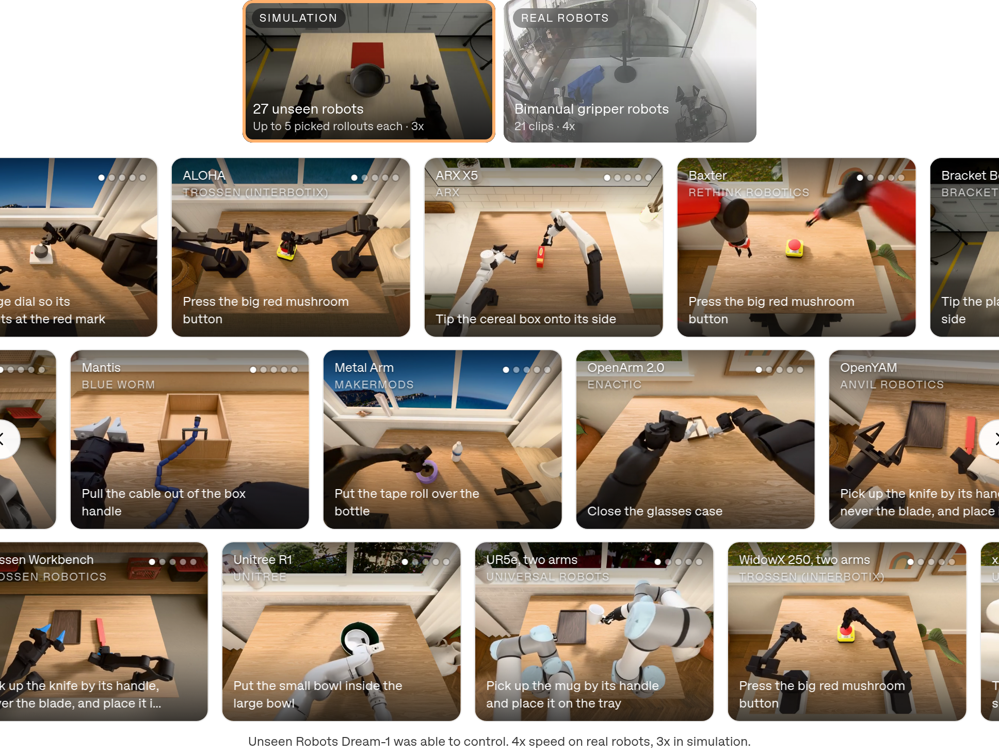
*页面图"Unseen Robots Dream-1 was able to control"：仿真 27 个未见机器人，每个最多 5 条挑选过的 rollout，3 倍速；真机 21 段，4 倍速。截图来自 2026-10-21 实时页面，滚动墙只截到可见部分。*

1. **未见本体（§04.2）。** 仿真：每个本体 300 次 rollout，其中 150 次覆盖 50 个任务、衡量语言跟随，另 150 次覆盖 150 个任务、衡量未见任务泛化。结果全部归一化到 YAM = 100。真机：4 台机器人，用的是**更早的 Dream-1 checkpoint**，这些 checkpoint 从未在这些机器人上训练过，每台都和同一 checkpoint 在 YAM 上的表现比较。其中 OpenYAM 只测了未见任务。真机 rollout 次数没有披露。
2. **未见任务（§04.4 "Across tasks"）。** 8 个任务类别，每类 52–60 次 rollout，图中可以切换 YAM 和 YAM + UMI gripper 两个视图。指标有两个：Progress score（部分得分）和 Success rate。页面**没有说明**这组评测在真机还是仿真上做、用的是哪个 checkpoint、"未见"怎么判定。【推断】rollout 缩略图看起来像真实实验室场景。
3. **未见地点。** 合作方站点视频墙：页面称 12 个站点，8 倍速。每个站点只放 1 条或少量 rollout，并标注为 "Unseen Tasks Dream-1 was able to do"。

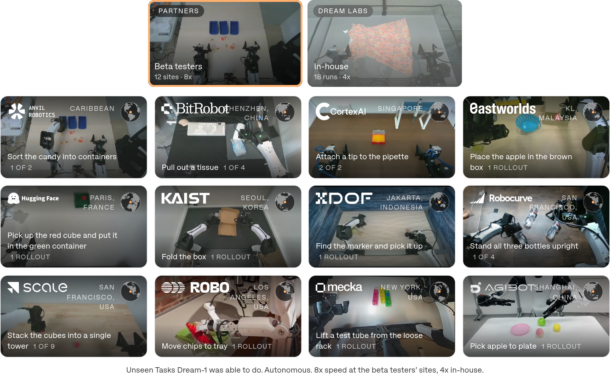
*页面图"Unseen Tasks Dream-1 was able to do"：合作方 12 个站点（8 倍速），内部 18 段（4 倍速）。这些是展示性 rollout，不是统计样本。*

### 指标到底怎么算（从页面内嵌数据反推）

未见任务图的 `data-chart` 里，每条 rollout 都带一个分数后缀，取值只有 {0, 0.25, 0.5, 0.75, 1}。我用这些逐条分数重算：每类平均分 ×100 等于 Progress score，分数等于 1 的比例等于 Success rate，和图上的数字相差不超过 1 个百分点，超过 0.5 的只出现在嵌入数据少 1 条 rollout 的类别（例如 YAM Pick & place：60 条，均值 69.2，满分率 40.0；图上是 69 和 40）。所以：

- **Success rate = 完全完成率**，Progress = 按 25% 一档的阶段进度均值；
- 页面嵌入的 rollout 数量：YAM 视图 449 条，YAM+UMI 视图 448 条。类别标题合计 450 条，有 1–2 条没有嵌入；
- 「± se」只写了 se，没有说明计算方式。

〔上下文：DreamZero 对未见任务的定义是"动作 + 物体类型"的组合，新动作模式才算未见。Dream-1 页面没有给出自己的定义，所以不能默认沿用。〕

## 方法主线

### 机制流程

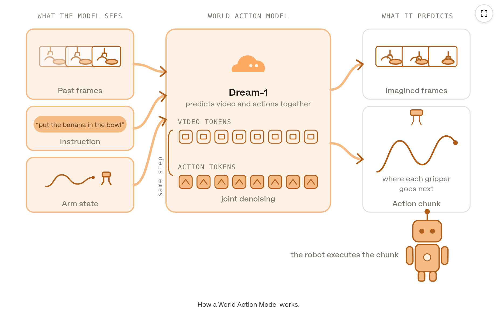
*页面图"How a World Action Model works"（iframe 动画 `assets/wam.html`，截取的是动画完成状态）。左边是模型看到的三类输入，中间是对视频 token 和动作 token 的联合去噪，右边是想象帧和动作块，机器人执行动作块。*

页面示意图的原文："Past frames, the instruction and the arm state go in. Joint denoising fills the video tokens and the action tokens together, so the imagined frames and the action chunk are the same prediction. The robot executes the chunk, and the real frame replaces the imagined one."

按这段话还原的执行链：

1. **输入。** 过去帧（三路相机）、语言指令、臂状态（arm state）。
2. **联合去噪。** 视频 token 和动作 token 在同一步里一起去噪（图中标注 "same step"），想象帧和动作块是同一个预测的两部分。
3. **执行。** 机器人执行动作块；API 每次返回 1.6 s 动作。对未见本体，动作是每只夹爪的 EEF 位姿和开合，由本地 IK 转成关节指令。
4. **闭环回填。** 真实帧替换想象帧，进入下一轮。

〔上下文：这条链和 DreamZero 的推理流程一一对应。DreamZero 是 Wan2.1-I2V-14B 自回归 DiT，视频和动作共享 flow-matching 时间步，执行后把真实观测写回 KV cache，AgiBot 上 48 步 @30 Hz = 1.6 s/chunk，DROID 上 24 步 @15 Hz 也是 1.6 s。DreamZero 默认动作是 relative joint positions，多视角拼成单帧输入。〕【推断】Dream-1 很可能是 DreamZero 架构的延续，主要变化在 EEF 动作头和跨本体数据。但骨干、参数量和视频帧率都**没有披露**，不应把 DreamZero 的 14B、7 Hz、2×GB200 等数字直接套到 Dream-1 上。

### 动作接口：关节角 vs EEF + 每台机器人自己的 IK

§04.3 原文的关键句："Robot policies commonly output joint angles, which ties them to one specific robot's body. Dream-1 can do the same for the embodiments it supports natively, but it can also predict end-effector (EEF) poses… Every robot with two arms and parallel grippers shares that EEF action space, and its own IK solver turns the poses into joint commands. That shared interface gives Dream-1 a common way to command robots it has never seen, but on its own it isn't enough to make zero-shot transfer work."

这一设计把本体差异中的**运动学部分**移到了模型外面：连杆长度、自由度、关节限位都交给 IK。模型只需要回答"两只夹爪下一步应该在哪里、开还是合"。代价在页面的 Limitations 框里写得很清楚：

- 性能依赖每台机器人 IK 求解器的质量（页面另有需要登录的 IK guide，本笔记无法读取）；
- 模型不控制手臂"怎么到达"位姿，只控制夹爪最终位置，在障碍物附近或关节极限附近会出问题；
- 工作空间或运动学 / 动力学和已见本体差异很大的机器人，模型可能预测出**物理上不可行**的未来状态。

【推断】还有两个页面没有说的隐含约束：(a) EEF 位姿需要一个跨机器人一致的坐标系约定（基座坐标系？头部相机坐标系？），页面没有说明；(b) 双臂之间的基座间距和朝向一旦不同，同一个"EEF 轨迹"在头部相机里的样子也会不同。这正是视频先验需要补上的部分。

### 视频作为共享表征：为什么页面认为 WAM 才是关键

页面的论证分两步。第一步，引用 UMI（脚注 5）：所有手臂用同一款夹爪、策略只依赖腕部相机时，从腕部看过去所有机器人都一样，于是可以零样本跨臂。但这条捷径要求夹爪硬件完全相同，而且放弃了头部相机的全局视野。第二步，WAM 去掉这个限制：所有机器人都以像素的形式出现，"a UMI gripper, a two-finger gripper or an arm Dream-1 has never met [is] nothing more than shapes moving through a scene"。只要能预测这台机器人完成任务时的样子，就能产生让它到达那里的动作。

这是全文最核心的机制主张，也是**证据最弱**的部分：页面没有任何对照实验，比如去掉头部相机、只用腕部相机、不做视频预测的同数据策略、只用关节动作等。"EEF + IK 必要但不充分，WAM 补上了剩下的部分"在页面上是一个论断，不是一个被测量过的分解。

## 关键结果

### 主结果与强基线：零样本到未见本体（相对 YAM，无强基线）

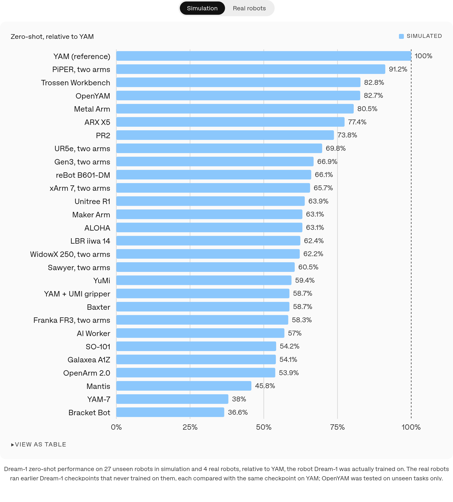
*Chart "Zero-shot, relative to YAM"（仿真视图）：27 个未见机器人，每个 300 次 rollout，YAM = 100%。*

| 统计（仿真 27 个本体，相对 YAM） | 数值 |
|---|---:|
| 最高 | PiPER 双臂 91.2 |
| 中位数【计算】 | 62.4 |
| 简单平均【计算】 | 63.2 |
| 最低 | Bracket Bot 36.6；YAM-7 38.0；Mantis 45.8 |
| 有代表性的"远亲" | PR2 73.8；UR5e 双臂 69.8；Baxter 58.7；YuMi 59.4；Franka FR3 双臂 58.3 |
| 同族变体 | OpenYAM 82.7；YAM + UMI gripper 58.7；YAM-7 38.0 |

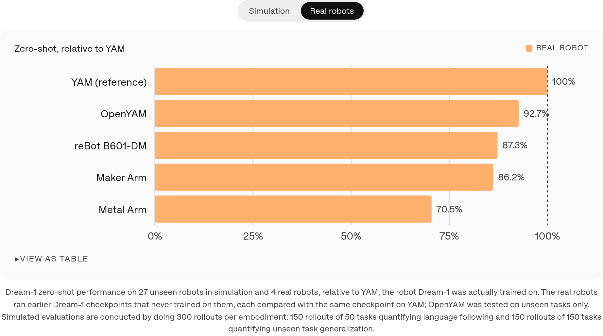
*同一图的真机视图：OpenYAM 92.7、reBot B601-DM 87.3、Maker Arm 86.2、Metal Arm 70.5。用的是更早的 checkpoint，每台和同一 checkpoint 在 YAM 上的分数比较；OpenYAM 只测未见任务。*

这组结果有两点值得认真看：

- **相似度和分数不单调。** YAM-7（同为 I2RT 出品的变体）只有 38.0，YAM + UMI gripper 只有 58.7；PR2、UR5e 这类外观差异更大的机器人反而在 70 左右。页面没有解释。【推断】可能和 IK 质量、工作空间、夹爪几何或仿真资产质量有关。这恰好说明"外观接近"不是零样本表现的主导变量，IK 和运动学才可能是。
- **真机 4 台全部是低成本桌面双臂**，其中 OpenYAM 是 YAM 的近亲。PR2、Baxter、YuMi 这些"差异大"的本体，**定量结果只来自仿真**，真机部分只有展示视频（PR2 按蘑菇按钮等）。

### 未见任务：即使在训练本体上，完全成功率也很低

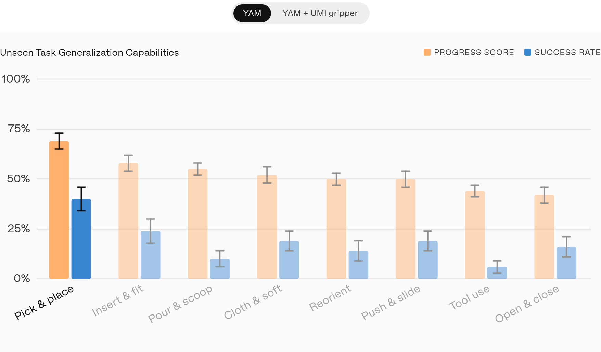
*Chart "Unseen Task Generalization Capabilities"（YAM 视图）：橙色为 Progress score，蓝色为 Success rate，误差条为页面给出的 se。*

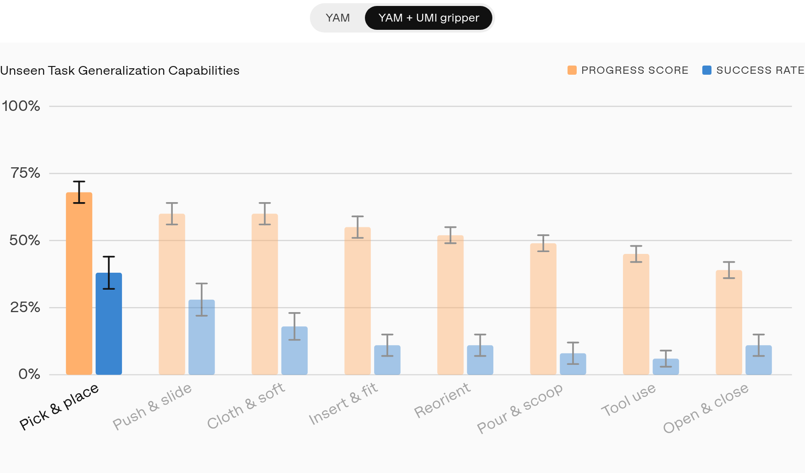
*同一图的 YAM + UMI gripper 视图。类别顺序按 Progress 重新排列。*

| 类别 | YAM Progress | YAM Success | YAM+UMI Progress | YAM+UMI Success | rollouts |
|---|---:|---:|---:|---:|---:|
| Pick & place | 69 ± 4 | 40 ± 6 | 68 ± 4 | 38 ± 6 | 60 |
| Insert & fit | 58 ± 4 | 24 ± 6 | 55 ± 4 | 11 ± 4 | 55 |
| Pour & scoop | 55 ± 3 | 10 ± 4 | 49 ± 3 | 8 ± 4 | 52 |
| Cloth & soft | 52 ± 4 | 19 ± 5 | 60 ± 4 | 18 ± 5 | 57 |
| Reorient | 50 ± 3 | 14 ± 5 | 52 ± 3 | 11 ± 4 | 57 |
| Push & slide | 50 ± 4 | 19 ± 5 | 60 ± 4 | 28 ± 6 | 58 |
| Tool use | 44 ± 3 | 6 ± 3 | 45 ± 3 | 6 ± 3 | 54 |
| Open & close | 42 ± 4 | 16 ± 5 | 39 ± 3 | 11 ± 4 | 57 |
| **类别平均【计算】** | **52.5** | **18.5** | **53.5** | **16.4** | — |
| **按嵌入 rollout 汇总【计算】** | 52.6 | 18.7 | 54.1 | 16.5 | 449 / 448 |

Progress 和 Success 之间差约 34 个百分点，说明模型大多"做对一部分"。工具使用（6%）和开合（11%–16%）最弱。〔上下文：DreamZero 在 AgiBot 未见任务上的平均进度是 39.5%，DROID 未见任务是 49% 进度 / 22.5% 成功率，和这里属于同一量级。两者定义和平台不同，不能直接横比。〕

有一点和本体图对不上：在仿真本体图里，YAM + UMI gripper 只有 YAM 的 58.7%；在这张未见任务图里，YAM + UMI 和 YAM 的 Progress 几乎相同（53.5 对 52.5）。页面没有说明 UMI 变体是否参与了训练，也没有说明这两张图的平台和 checkpoint 是否一致。

### 第三方评测：Robocurve RoboDojo-RC Tier 1

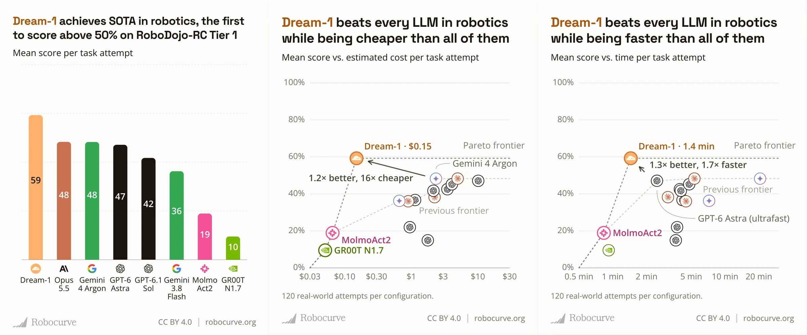
*页面内嵌的 Robocurve 报告图（原始素材 `assets/robocurve.webp`，CC BY 4.0）：Dream-1 59，Opus 5.5 / Gemini 4 Argon 48，每次尝试 $0.15、1.4 min。*

页面的说法："It scores above the next best models, Opus 5.5 and Gemini 4 Argon, at 16x lower cost per task attempt than Gemini 4 Argon and 1.7x faster than the fastest LLM, GPT-6 Astra."

〔上下文：非 Dream-1 页面。下面的数字来自 Robocurve 公开数据。〕

- Robocurve 规格页（2026-10-21 抓取）：RoboDojo-RC Tier 1 的平台是 **"Bimanual I2RT YAM arms with parallel-jaw grippers"**，观测为顶部加左右腕三路相机加机器人状态，LLM 通过工具输出绝对 EEF 位姿。
- runs.json：Dream-1 共 120 次（6 任务 × 20 次），全部在 2026-10-18 运行，control = end-effector，平均分 59.25%，31 次完全完成，87 次部分完成，2 次零分；平均每次 1.45 min、$0.15。评分方式为 100 次 "Autograded"、20 次 "re-graded, old rubric"。分任务：Stack Bowls 95.0、Store In Safe 70.0、Sort Objects 60.8、Stand Up Bottles 55.0、Pack And Pour Fruit 43.0、Cap Pen 31.8。
- 对照组：VLA 只有 GR00T N1.7（9.5%）和 MolmoAct2（18.9%，模型 id 为 `molmoact2-yam`），都是 joint-position 控制；其余是"LLM 当控制器"（每次最多 40 次模型调用）。

**这项评测的含义要收窄理解：**
1. 平台就是 Dream-1 的训练本体 YAM，所以 59% **不能作为跨本体证据**，只能说明 YAM 上的任务能力。
2. Robocurve 同时出现在 Dream-1 的 beta 合作方墙上。它那段视频的字幕依次是 "Stand all three bottles upright / Place all the objects into the safe, then close the safe / Classify the two types of objects… into the two baskets / Stack the bowls on the table"，和 Tier 1 的四个任务名（Stand Up Bottles、Store In Safe、Sort Objects、Stack Bowls）一一对应。页面把这些视频标为 unseen tasks，我也没有证据表明发生了数据泄漏，但评测方和合作方是同一家机构，这一点应该写明。
3. 对照组的数字取决于配置和时间点。页面图里 Opus 5.5 是 48；Robocurve 主页写的是 "38 Opus 5.5 (high)"；runs.json 的 capability 子集是 99 次、40.0%。"16× cheaper / 1.7× faster" 是相对某个特定配置（例如图中的 "GPT-6 Astra (ultrafast)"）算出来的，不是所有配置下都成立。

### 一次适配（FaaS）：缩小差距，但不是每台都有效

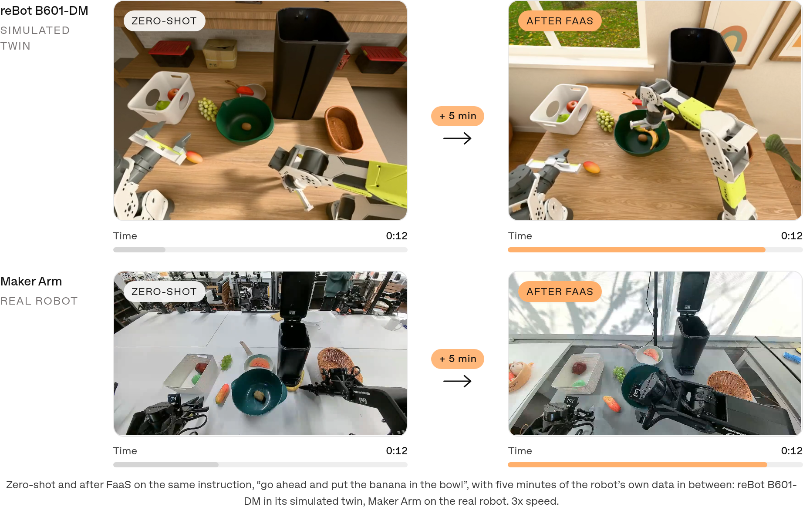
*同一指令"go ahead and put the banana in the bowl"：reBot B601-DM（仿真孪生）和 Maker Arm（真机）各加 5 分钟自身数据后的对比，3 倍速。只有定性对比。*

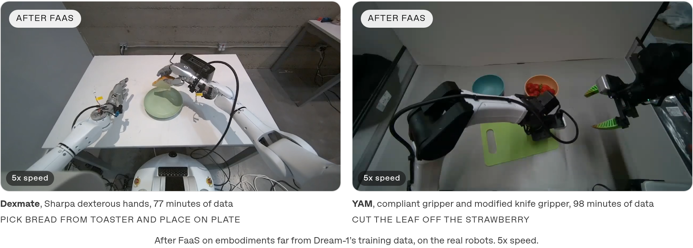
*远离训练分布的本体：Dexmate + Sharpa 灵巧手用了 77 分钟数据；YAM 换装柔顺夹爪和改装刀具夹爪用了 98 分钟数据。均为 FaaS 后的真机结果，5 倍速。*

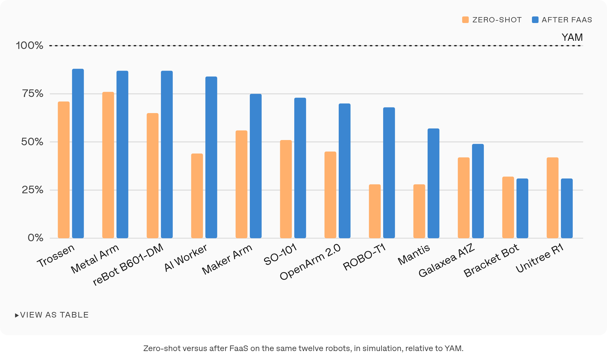
*Chart：12 个 FaaS beta 机器人在仿真中的零样本 vs FaaS 后得分（相对 YAM）。页面正文称 "lifts the language-following score on ten of them"。*

| 机器人 | 零样本 | FaaS 后 | 同名机器人在主图（仿真）中的零样本 |
|---|---:|---:|---:|
| Trossen | 71 | 88 | 82.8（Trossen Workbench，是否同一台未说明） |
| Metal Arm | 76 | 87 | 80.5 |
| reBot B601-DM | 65 | 87 | 66.1 |
| AI Worker | 44 | 84 | 57.0 |
| Maker Arm | 56 | 75 | 63.1 |
| SO-101 | 51 | 73 | 54.2 |
| OpenArm 2.0 | 45 | 70 | 53.9 |
| ROBO-T1 | 28 | 68 | 不在 27 个之列 |
| Mantis | 28 | 57 | 45.8 |
| Galaxea A1Z | 42 | 49 | 54.1 |
| Bracket Bot | 32 | **31** | 36.6 |
| Unitree R1 | 42 | **31** | 63.9 |
| **平均【计算】** | 48.3 | 66.7 | — |

FaaS 后平均从 48.3 升到 66.7，但 Bracket Bot 和 Unitree R1 下降。页面没有给出每台机器人的 FaaS 数据量（文字只举了 5、77、98 分钟三个例子）。

### 消融到底说明了什么

**页面没有任何消融。** 没有 EEF 对关节、有无头部相机、有无视频预测、数据规模、骨干规模、Dream-1 对 flash 的对比。唯一接近"对照"的是零样本对 FaaS，它说明本体自身的数据仍然有用（"One-shot adaptation still outperforms zero-shot, so a gap remains"），但说明不了零样本能力从哪里来。〔上下文：DreamZero 论文里有数据多样性（50% 对 33%）、5B 对 14B（21% 对 50%）、AR 对 BD 的消融，但那是另一个模型、另一个本体、另一个数据集。〕

## 深度分析

### 真正贡献是什么

最实在的贡献是**一个规模化的"同族零样本跨本体"展示**：27 个仿真本体，每个 300 次 rollout，覆盖从 PR2 到 SO-101 的多种运动学；4 台真机；还有一个公开可调用的 API，任何有双臂夹爪机器人的人都能自己验证。页面把它放在两类先例之后：LAP（脚注 4，页面只说它展示了跨本体泛化的 "signs of life"）和 UMI（脚注 5，页面称它要求夹爪硬件一致、只依赖腕部相机）。页面没有和它们做任何定量对比，所以"覆盖面更大"只能从本体数量上说，不能说效果更好。

范式层面的贡献是**把"统一动作空间"和"统一观测表征"拆成两件事讲清楚**：EEF + IK 统一了"怎么下命令"，视频预测统一了"怎么理解不同的身体"。这个分解对设计开源同类模型很有用。但页面只把它当作解释，没有用实验验证。

工程和产品层面：每次调用返回 1.6 s 动作，按小时计价，FaaS 闭环，这把 WAM 做成了一个可用的 System 1 服务。这是贡献，但不是研究证据。

### 为什么结果成立（以及哪部分可能不是因为 WAM）

页面的解释是：视频是所有本体共享的表征，WAM 先想象"这台机器人完成任务的样子"，再从想象中反推动作。我认为至少有三个因素和 WAM 无关、但同样可能撑起结果，而且页面没有把它们分开：

1. **EEF + IK 本身就消掉了大部分运动学差异。** 平行夹爪、桌面任务、头部俯视相机，这三个条件下，"夹爪到哪儿、开还是合"已经是一个近乎本体无关的描述。页面说它"不够"，但没有给出不够多少。
2. **腕部相机不变性（UMI 效应）。** 页面自己承认，同款夹爪时腕部视角几乎一样。YAM + UMI、YAM + Enpire 这类变体，以及多数平行夹爪，腕部视角都很接近。
3. **评测分布的选择。** 只评双臂平行夹爪，仿真资产和任务由 Dream Labs 自己选定，展示视频是 "picked rollouts"。

视频先验可能真的起了作用：仿真中 PR2、Baxter 这类外观差异大的本体还能达到 YAM 的约 59%–74%（Baxter 58.7、PR2 73.8）。但在没有同数据非 WAM 基线的情况下，**"零样本靠的是 WAM"仍然是一个合理但未经证实的假设**。〔上下文：DreamZero 对 YAM 30 分钟适配效率的解释里，第一条就是 "visual similarity of AgiBot G1 and YAM"，说明团队自己也把"外观相似"列为重要因素。〕

### 容易误读的地方

- **"相对 YAM 63%"不等于 63% 成功率。** YAM 自身的绝对分在本体图里没有给出。如果套用未见任务图中 YAM 约 18.7% 的完全成功率，未见本体上的完全成功率可能更低。但两张图的任务集和指标不同，这只是一个量级提醒，不能直接相乘。
- **本体图的"零样本"混合了两种任务。** 仿真每个本体 300 次 rollout，150 次语言跟随（50 个任务），150 次未见任务（150 个任务）。图上只有一个汇总数，看不出两部分各自的表现。
- **真机结果用的是"earlier checkpoints"。** 和页面上正在发布的 Dream-1 不是同一个模型。
- **"Unseen task"没有定义，也没有训练任务清单。** 外部无法核实"未见"。
- **FaaS 图和主图的零样本数字不一致。** 9 台同名机器人的 FaaS 图零样本分都更低（例如 Unitree R1 是 42 对 63.9，AI Worker 是 44 对 57.0）。【推断】一种解释是 FaaS 图只统计语言跟随分（正文写的是 "language-following score"），而主图混合了语言跟随和未见任务；另一种是 checkpoint 不同。页面没有说明。
- **"Robocurve independent report"测的是训练本体。** 它证明不了零样本跨本体。
- **价格口径不一致。** 页面写 Dream-1-flash 是 $2/h；〔上下文：Forbes 报道的描述写的是 "$3 an hour… Or 75 cents, if you're okay with a slightly less capable physical AI model"〕。两者对不上，以官方页面为准。

### 复现注意点

如果 roy 要做开源同类模型，从页面能拿到的信息和必须自己补的部分：

1. **页面给出的设计约束（可直接复用）：** 三路相机（头部 + 双腕）；双臂平行夹爪；动作接口同时保留原生关节头和 EEF 位姿 + 夹爪开合头；视频 token 和动作 token 联合去噪；1.6 s 动作块；执行后用真实帧回填。
2. **必须自己定的部分：** EEF 坐标系约定（基座坐标系还是相机坐标系、双臂基座的相对位姿怎么表达）；IK 求解器的选择和公开（页面明确说零样本表现部分取决于 IK）；夹爪开合的归一化。
3. **起点〔上下文〕：** DreamZero 论文称已开源模型权重和推理代码（github.com/dreamzero0/dreamzero），AgiBot 数据集计划后续开放。论文披露了 Wan2.1-I2V-14B 骨干、K=2 个 latent 帧 / chunk、M=4 块、视频 5 FPS、多视角拼成单帧、relative joint positions 等细节。
4. **评测协议（Dream-1 最大的缺口，也是开源项目最值得补的部分）：** 报告**绝对**成功率而不是相对训练本体的百分比；语言跟随和未见任务分开报告；公开训练任务清单和"未见"的判定规则；真机报告 rollout 数量和置信区间；仿真资产和 IK 实现一起公开；至少做 EEF vs 关节、有无头部相机、有无视频目标三个消融，回答"零样本到底来自哪里"。
5. **FaaS 对照：** 报告 0 / 5 / 30 / 90 分钟数据下的曲线，并且报告下降的案例（Dream-1 页面就有 2/12 下降）。

## 局限

1. **不是论文。** 没有方法细节、没有消融、没有训练数据和算力信息，结论只能停留在"厂商自报结果"这一级。
2. **全部是相对指标。** 本体图和 FaaS 图都以 YAM = 100 归一化，YAM 的绝对分没有给出。
3. **仿真不透明。** 模拟器、机器人模型来源、任务清单和初始条件都没有公开；最远的那些本体只有仿真定量结果。
4. **真机样本少，而且是旧 checkpoint。** 4 台都是低成本桌面双臂，rollout 次数没有披露。
5. **训练本体上的未见任务成功率仍然低。** 完全成功率在 6%–40% 之间，按 rollout 汇总约 18.7%。工具使用 6%。
6. **适用范围窄。** 只覆盖双臂平行夹爪的操作；灵巧手和特殊末端需要 77–98 分钟数据。页面自己也说移动操作和灵巧手是后续方向。
7. **内部不一致。** FaaS 图和主图的零样本数字对不上；YAM+UMI 在两张图里的相对位置矛盾；Trossen 和 Trossen Workbench 是否同一台没有说明。
8. **第三方评测存在利益关联，而且测的是训练本体。** Robocurve 同时是 beta 合作方，beta 视频任务和 Tier 1 任务名一致。
9. **展示视频是挑选过的、加速播放的。** 1:59 的发布视频和各段 rollout 视频本笔记都没有逐帧观看（只看了静帧、字幕和指令文本）。
10. **安全。** 页面自己声明这是 research beta，没有经过安全关键场景的验证。

## 我的笔记

- **零样本的主要驱动力，我的判断是"EEF + IK 吃掉运动学，腕部相机吃掉近场外观，视频先验负责剩下的全局对齐"。** 三者在页面里缠在一起。YAM-7 只有 38、PR2 有 73.8，这种不单调性说明 IK 和运动学可能才是一阶因素，外观相似度不是。做开源版本时，第一个要做的实验应该是：**同数据、同骨干，EEF 头 vs 关节头 × 有无视频目标 × 有无头部相机**，在 ≥3 台留出真机上测绝对成功率。
- **"zero-shot"的实际范围 = 本体专属数据为零 + 同族形态（双臂、平行夹爪、相似相机布局）+ 用户提供的 IK。** 不等于"任意机器人"，也不等于"没见过的动作"（训练任务清单没有公开）。
- **最值得借鉴的不是数字，而是产品接口：** 一次调用返回 1.6 s 动作块，EEF 输出，本地 IK。这让"零样本"可以由第三方在自己的机器人上验证。开源模型如果也给出同样的接口，加上公开的 IK 参考实现，社区就能独立复核零样本能力。
- **评测上最大的教训：** 相对分和展示视频说服力很强，但几乎不可证伪。我们自己的版本应该一开始就预注册：绝对成功率 + Clopper-Pearson CI，语言跟随和未见任务分开，公开全部 rollout。
- **在本地研究地图中：** Dream-1 是 DreamZero（WAM 作为零样本策略）在"跨本体"维度上的工程延伸，和页面引用的 LAP（脚注 4）、UMI（同夹爪 + 腕部相机，脚注 5）一起，可以看作同一个问题的不同接口方案。和 ImageWAM 那类"是否需要视频"的追问正好相反：Dream-1 押注的恰恰是"视频是共享表征"。如果有一天能证明，同样的跨本体能力不需要视频生成也能得到，Dream-1 的核心论点就会被削弱。

## 引用

Dream Labs. *Zero-Shot to New Robots: Introducing Dream-1*. Dream Labs Research Blog, October 2026. https://dreamlabs.ai/research/dream-1

```bibtex
@misc{dreamlabs2026dream1,
  title = {Zero-Shot to New Robots: Introducing Dream-1},
  author = {Dream Labs},
  year = {2026},
  url = {https://dreamlabs.ai/research/dream-1}
}
```

上下文参考（非 Dream-1 页面）：Ye, S. et al. *World Action Models are Zero-shot Policies*. arXiv:2602.15922 (2026)；Robocurve, *RoboDojo-RC Tier 1* 规格页与 all-runs 数据（CC BY 4.0）。
