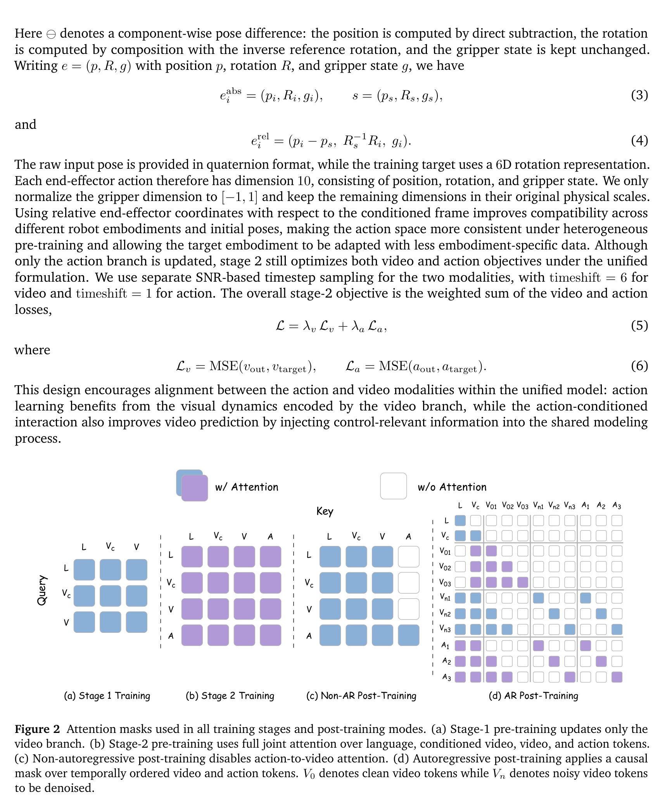
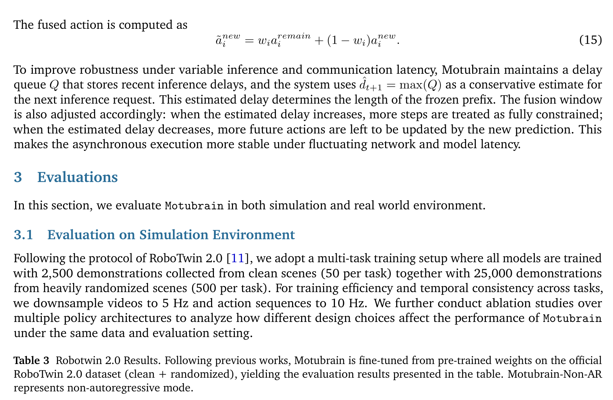
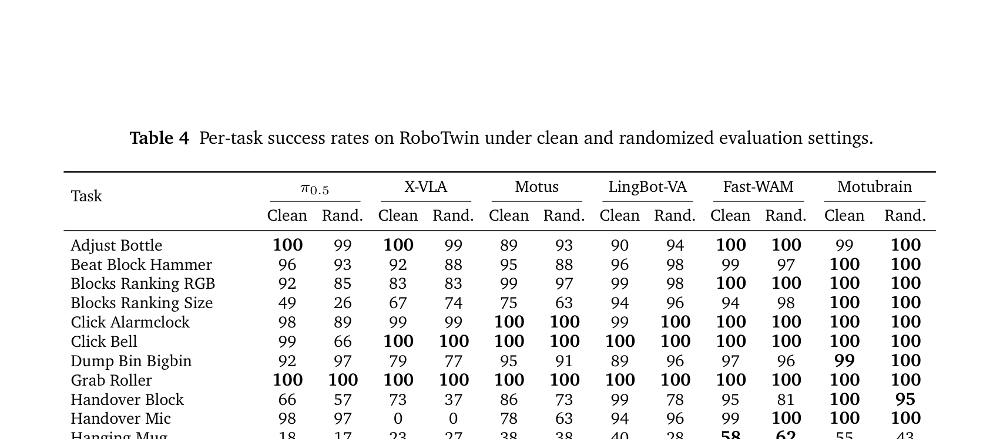
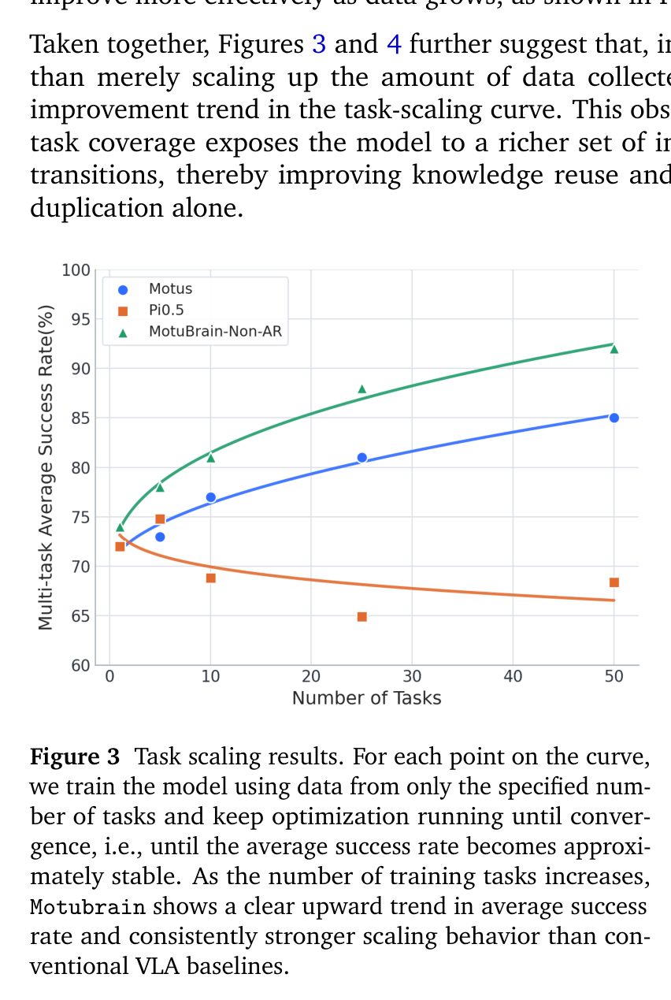
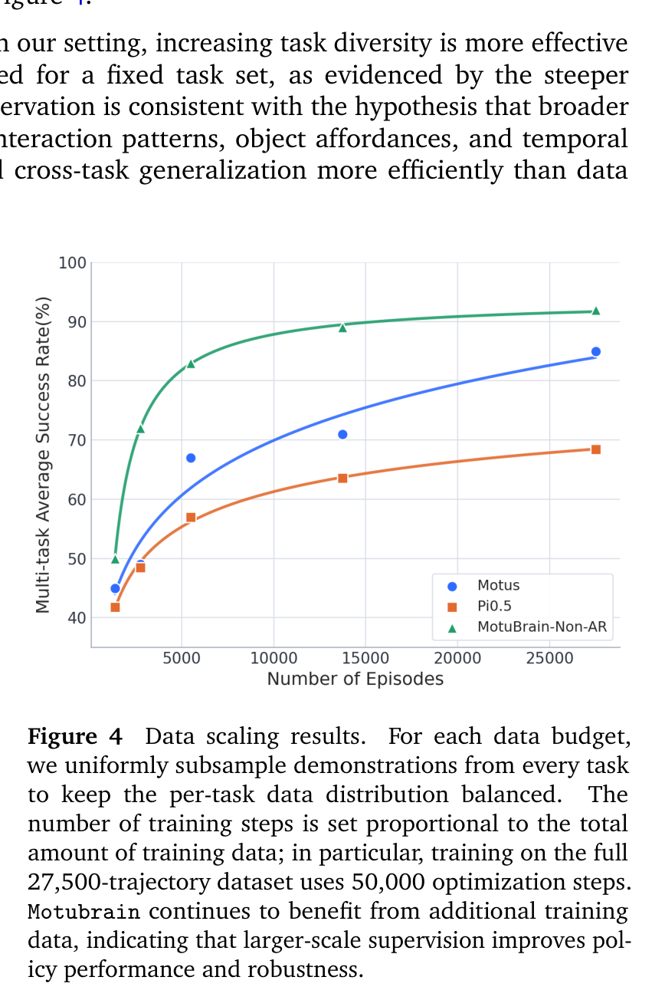
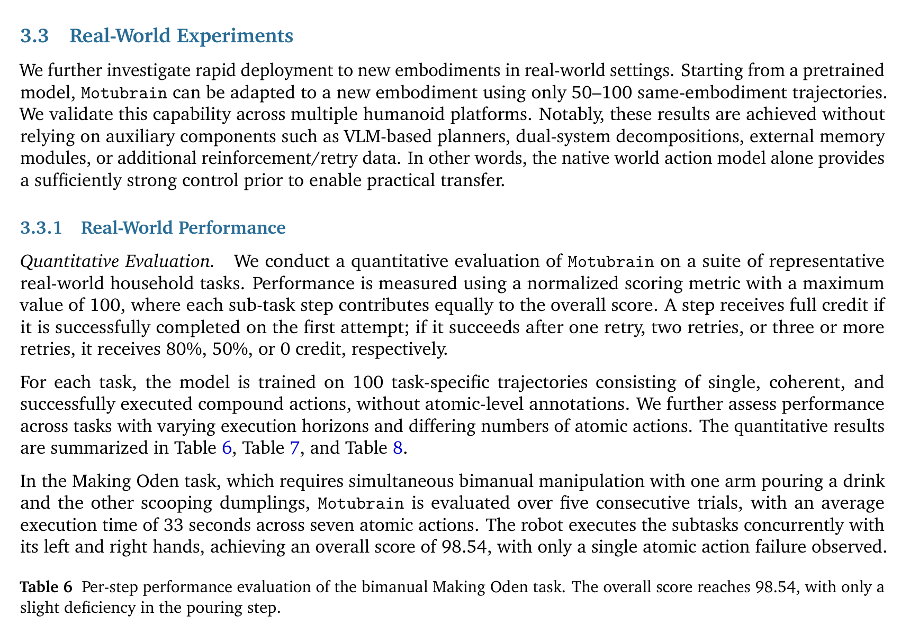

# Motubrain: An Advanced World Action Model for Robot Control
**Motubrain: 面向机器人控制的进阶世界动作模型**

- **Authors / 作者团队**: Motubrain Team (Chendong Xiang*, Louis Liu*, Jiabao Liu*, James Li*, Zeyuan Wang*, Hengkai Tan*, Haitian Liu, Yao Feng, Ruowen Zhao, Shuhe Huang, Hongzhe Bi, Rongxu Cui*, Jingrui Pang, Mengchen Cai*, Yinze Rong, Runqing Wang, Kiro Jing, Fan Bao, Jun Zhu)
- **Affiliations / 所属机构**: ShengShu AI (生数科技) & Tsinghua University (清华大学)
- **Publication / 发布时间**: July 2026 (arXiv:2604.27792v5 [cs.RO])
- **Project Page / 项目主页**: [https://www.genspi.com/en/motubrain](https://www.genspi.com/en/motubrain)
- **GitHub Repository / 开源代码**: [https://github.com/shengshu-ai/Motubrain](https://github.com/shengshu-ai/Motubrain)

---

## Page / Section Index
**页面与章节索引导览**

| Section / Section Title | Page Range | Key Content & Deliverables | Core Assets |
| :--- | :---: | :--- | :--- |
| **Frontmatter & Abstract** | Page 1 | Metadata, Research Overview, Abstract | — |
| **1 Introduction** | Page 1–2 | Embodied foundation models, VLAs, VGMs, WAMs, unified multimodal intelligence | — |
| **2 Related Work** | Page 2 | Motus baseline, continuous unified modeling, Motubrain key advances | — |
| **3 Method** | Page 2–9 | Overall methodology roadmap | — |
| **3.1 Architecture Overview & UniDiffuser** | Page 3–4 | 3-stream MoT, H-bridge cross-attention, 3D RoPE multiview encoding | Figure 1, Table 1 |
| **3.2 Multi-Stage Training Pipeline** | Page 4–5 | 4-level data pyramid, Stage 1 video pretraining, Stage 2 action pretraining, relative EEF | Figure 2, Eq (1)–(6) |
| **3.3 Prediction Modes & Sequence Factorization** | Page 5–6 | Sparse adaptation, step distillation, Non-AR vs AR chunk factorization, V2A attention | — |
| **3.4 Inference Optimizations & Real-Time Control** | Page 6–9 | Step reduction, compile, FP8, DiT cache, V2A suffix, RTC-inspired prefix freezing | Table 2, Eq (7)–(15) |
| **4 Experiments & Benchmark Evaluations** | Page 9–17 | Multi-task simulation, scaling laws, world models, real humanoid tasks | — |
| **4.1 Benchmark Evaluation on RoboTwin 2.0** | Page 9–11 | 50 manipulation tasks, clean vs randomized, 17 baseline comparison | Table 3, Table 4 |
| **4.2 Scaling Laws: Task & Data Scaling** | Page 11–12 | Task scaling vs data scaling, diversity advantage over duplication | Figure 3, Figure 4 |
| **4.3 WorldArena Benchmark Evaluation** | Page 11–13 | 16 metrics, 6 perceptual dimensions, motion quality, perception-functionality gap | Table 5, Figure 5 |
| **4.4 Real-World Robot Manipulation** | Page 14–16 | 50–100 demo rapid humanoid transfer, Making Oden, Mixing Cocktails, Flower Arrangement | Table 6, Table 7, Table 8 |
| **4.5 Real-World Demonstrations & Ablations** | Page 16–17 | Few-shot self-correction, bimanual coordination, cross-scene transfer, 5 household demos | Figure 6 |
| **5 Conclusion, Limitations and Future Work** | Page 17–18 | Core design principles, current limitations, future research roadmap | — |
| **Contributors & Sub-Module Leadership** | Page 18 | Data, Base Model, Post-Training, Evaluation, Project Lead, Advisors | — |
| **References** | Page 18–21 | 41 bibliographic entries | Citations [1]–[41] |
| **Appendices A–D** | Appendix | Architecture hyperparameters, training setups, benchmark details, failure modes | Supplementary Notes |

---

## Terminology Ledger
**核心学术术语对齐表**

| English Term | Standard Academic Chinese | Conceptual Definition & Functional Role in Motubrain |
| :--- | :--- | :--- |
| **World Action Model (WAM)** | 世界动作模型 | 在统一样本与生成框架下联合对未来视觉动力学与机器人动作进行建模的多模态生成模型，彻底避免了传统二阶段“视频预测+逆动力学”的累积误差。 |
| **Vision-Language-Action (VLA)** | 视觉-语言-动作模型 | 将视觉观测与语言指令直接映射到机器人底层动作的端到端具身策略（如 RT-2, $\pi_0$ 等），通常缺乏对连续物理世界动态的细粒度预测。 |
| **Video Generation Model (VGM)** | 视频生成模型 | 基于互联网大规模视频训练的生成扩散模型（如 Vidu, Sora 等），蕴含丰富的时空先验与物体物理交互常识。 |
| **Inverse Dynamics Model (IDM)** | 逆动力学模型 | 根据前后两帧或多帧视觉状态变化反推执行动作的预测模型。 |
| **UniDiffuser** | 统一连续扩散模型 | 能够将视频与动作等多种连续模态纳入统一加噪/去噪时间步调度的扩散概率建模框架，单模型原生支持 5 种边际/条件推理模式。 |
| **Mixture-of-Transformers (MoT)** | 多流 Transformer 混合架构 | 包含独立文本流、视频流和动作流的三流 Transformer 架构，各模态在保留专门表征的同时通过多模态自注意力深度交互。 |
| **H-Bridge Attention** | H 型桥接注意力机制 | 仅在网络中间 50% 层执行视频-动作全联合注意力，浅层和深层采用解耦独立注意力的计算高效设计。 |
| **3D RoPE** | 三维旋转位置编码 | 在时间维度保持统一、仅在空间维度施加视角特定偏移的 3D 旋转位置嵌入，原生支持任意相机视角配置。 |
| **Video-to-Action (V2A) Attention** | 视频到动作单向注意力 | 动作 token 可以注意力感知视频与文本，而视频 token 不回看动作 token 的非对称依赖结构，支撑推理期的“动作专属后缀采样”。 |
| **Diffusion Transformer (DiT)** | 扩散 Transformer | 采用 Transformer 作为骨干网络的扩散/流匹配生成架构。 |
| **DiT Cache** | DiT 速度场缓存加速 | 基于连续去噪步间预测速度矢量的余弦相似度跳过冗余 DiT 计算，复用历史速度的推理加速技术。 |
| **FP8 Quantization** | FP8 浮点量化 | 将模型线性投影层权重存储为 float8_e4m3fn，并利用 torch._scaled_mm 动态量化激活以大幅降低显存带宽与 GEMM 计算开销。 |
| **SNR-based Timestep Sampling** | 基于信噪比的时间步采样 | 为视频与动作模态分配不同时间平移系数（timeshift 6 vs 1）的非对称扩散调度策略。 |
| **Noisy-Conditioning Augmentation** | 噪声条件增强 | 训练中以一定概率对首帧条件潜变量注入可控高斯扰动的数据增强技术，增强模型对感知扰动与累积误差的自愈能力。 |
| **Relative EEF Representation** | 相对末端执行器表示 | 以条件帧位姿为参考坐标系的 10 维位姿增量表示（3 维平移 + 6 维旋转矩阵表示 + 1 维二值夹爪状态），极大增强跨机械臂与跨本体的数据复用性。 |
| **Real-Time Chunked Closed-Loop Execution** | 实时分块闭环执行 | 解耦推理生成循环与底层机器人控制循环，结合延迟感知的冻结前缀与指数平滑过渡窗口消除块边界抖动的异步控制框架。 |
| **EWMScore** | 具身世界模型总评分 | WorldArena 基准所定义的综合衡量感知质量、物理一致性与可控性的 16 项归一化指标算术平均分。 |

---

## Abstract
**摘要**

> <strong>Para. 1:</strong> Vision-Language-Action (VLA) models generalize semantically well but often lack fine-grained modeling of world dynamics. We present Motubrain, a unified World Action Model that jointly models video and action under a UniDiffuser formulation with a three-stream Mixture-of-Transformers architecture. A single model supports policy learning, world modeling, video generation, inverse dynamics, and joint video-action prediction, while scaling to heterogeneous multimodal data such as video-only, task-agnostic, and cross-embodiment robot data. Building on Motus, Motubrain further introduces unified multiview modeling, an independent text stream for stronger language-action coupling, a shared cross-embodiment action representation, and an efficient post-training and deployment recipe for long-horizon real-world control. Our inference stack combines step reduction, compilation, FP8 quantization, DiT caching, V2A-style action-only inference, and real-time chunked closed-loop execution, achieving over 50× speedup over a naive baseline and up to 11 Hz inference. Experimentally, Motubrain achieves 95.8% and 96.1% average success on RoboTwin 2.0 under clean and randomized settings, respectively, attains the strongest reported EWMScore in our WorldArena comparison, and adapts to new humanoid embodiments with only 50–100 trajectories. These results show that unified world action models can scale in generality, predictive accuracy, and real-world deployability.

> <strong>Para. 1[CN]:</strong> 视觉-语言-动作（Vision-Language-Action, VLA）模型虽然具备优异的语义泛化能力，但通常缺乏对世界物理动态的细粒度建模。我们提出了 Motubrain，一个在 UniDiffuser 扩散概率框架下联合建模视频未来演化与机器人动作的进阶统一世界动作模型（World Action Model, WAM），其核心采用三流 Mixture-of-Transformers（MoT）网络架构。单个模型能够同时支持具身策略学习、世界建模、视频生成、逆动力学推断以及视频-动作联合预测等 5 种不同推理分布，并能充分吸纳纯视频数据、任务无关数据以及跨本体机器人轨迹等大规模异构多模态数据。在 Motus 的基础上，Motubrain 进一步引入了统一多视角空间建模、用于强化语言与动作紧密耦合的独立文本流、跨机械臂本体共享的相对末端执行器动作表示，以及专为长时程真实世界控制定制的高效后训练与部署方案。我们的系统级推理栈综合集成了去噪步数压缩、计算图编译、FP8 浮点量化、DiT 速度场缓存、V2A 式动作专属后缀采样以及实时分块闭环异步执行机制，相比朴素基线实现了超过 50 倍的端到端推理加速，运行频率高达 11 Hz。在实验评估中，Motubrain 在双臂操作仿真基准 RoboTwin 2.0 的干净与强随机化场景下分别取得了 95.8% 与 96.1% 的平均成功率；在具身世界模型评测基准 WorldArena 的对比中斩获了公开排行榜最高的 EWMScore 评分；并且仅需 50–100 条示教轨迹即可快速迁移至全新的双臂人形机器人本体。上述结果充分表明，统一世界动作模型能够同时在通用泛化性、物理预测精度以及真实世界可部署性上实现突破与扩展。

## 1 Introduction
**1 引言**

> <strong>Para. 1:</strong> Recent progress in embodied foundation models has been driven by Vision-Language-Action (VLA) policies [6, 8, 10, 20, 22, 26, 33, 38], which map visual observations and language instructions in pretrained Vision-Language Models (VLMs) [1, 4] directly to robot actions. Inheriting rich semantic priors, VLAs generalize well across diverse objects and language instructions, achieving strong performance on a wide range of robotic tasks. However, since they are primarily pretrained on static image–text data, they often neglect the perception and prediction of fine-grained world dynamics that are essential for precise robotic control, leading to a superficial imitation of behaviors rather than temporal understanding of the physics of the world.

> <strong>Para. 1[CN]:</strong> 近期具身基座模型（Embodied Foundation Models）的显著进展主要由视觉-语言-动作（Vision-Language-Action, VLA）策略模型所驱动 [6, 8, 10, 20, 22, 26, 33, 38]。这类方法直接将预训练视觉语言模型（VLM）[1, 4] 中的视觉观测与语言指令映射为机器人底层动作。凭借继承自海量预训练数据的丰富语义先验，VLA 模型在面对多样化物体和复杂语言指令时展现出优异的泛化能力，在广泛的机器人操作任务中取得了强劲性能。然而，由于这些模型主要在静态图文数据上进行预训练，它们往往忽略了对精确机器人控制至关重要的细粒度世界物理动力学的感知与预测能力，导致模型往往停留在对示教行为的表面模仿层面，而缺乏对物理世界演变规律的时空理解。

> <strong>Para. 2:</strong> With the rise of video generation models [3, 23, 30, 34, 39], a growing body of research has begun exploring how to adapt these models for world modeling [9, 15–18, 28]. A world model aims to predict how the environment evolves in response to actions—a capability that aligns directly with what a video generation model does when conditioned on past observations and actions, namely forecasting future visual states. Conceptually, video generation models are naturally suited to this task, as video generation models are pretrained on vast and diverse web video data, which equips them with rich spatiotemporal priors regarding object permanence, physical dynamics, and human-object interactions. This enables them to generalize more effectively and reason about novel scenarios where in-domain data are scarce. As a result, leveraging video generation models as a foundation for world modeling has emerged as a promising paradigm for scalable robot policy learning.

> <strong>Para. 2[CN]:</strong> 随着视频生成模型 [3, 23, 30, 34, 39] 的飞速崛起，越来越多的前沿研究开始探索如何将这些强大的生成模型适配为具身世界模型（World Models）[9, 15–18, 28]。世界模型的核心目标是预测物理环境在受到动作作用后如何发生演化——这一能力与视频生成模型在给定过去观测与动作条件下的行为天然契合，即预测未来的视觉状态。从概念上讲，视频生成模型天生具备胜任此项任务的潜质，因为它们在极其庞大且多样化的互联网视频数据上进行预训练，从而内化了关于物体持久性（Object Permanence）、连续物理动力学以及人-物交互因果关系的丰富时空先验知识。这使得它们能够更有效地在领域内数据匮乏的全新未知场景中进行合理泛化与物理推理。因此，以视频生成模型作为世界建模的基础支撑，已成为实现高扩展性机器人策略学习的极具前景的全新范式。

> <strong>Para. 3:</strong> Following this insight, early attempts largely followed a two-stage paradigm: Video Generation Model (VGM) plus Inverse Dynamics Model (IDM) [13, 14, 19, 29, 40]. In this framework, a video diffusion model pretrained on large-scale web data first predicts future visual trajectories from current observations and language instructions. Subsequently, an inverse dynamics model infers actions from the generated future frames. While this paradigm successfully leverages rich spatiotemporal priors from video data to achieve broad generalization, it suffers from a critical drawback in that errors in video prediction accumulate over time, which leads to compromised action accuracy and downstream policy performance.

> <strong>Para. 3[CN]:</strong> 沿着这一思路，早期的探索大多遵循两阶段串联范式：即“视频生成模型（VGM）+ 逆动力学模型（IDM）”[13, 14, 19, 29, 40]。在这一框架中，首先由在海量互联网数据上预训练的视频扩散模型根据当前视觉观测和语言指令预测出未来的视觉演化轨迹；随后，再由一个独立的逆动力学模型从生成的未来视频帧中反推执行动作。尽管该范式成功借力于视频数据蕴含的丰富时空先验实现了广泛的泛化能力，但其存在一个致命缺陷：视频预测中的生成误差会随时间推移不断级联累积，从而严重损害反推动作的精确度，并导致下游闭环策略执行性能急剧劣化。

> <strong>Para. 4:</strong> To mitigate this issue, a subsequent line of research has explored World Action Models (WAMs) that unify visual dynamics and action prediction within a single, jointly optimized objective [5, 21, 24, 25, 27, 36, 37, 41]. Unlike the VGM+IDM pipeline, which decouples forecasting from action inference, WAMs simultaneously predict future visual states and actions in an aligned manner. This integration offers two key advantages: (1) it avoids the cascading errors inherent in sequential video prediction, and (2) it overcomes the fragmented functionality of conventional embodied systems, where semantic understanding, dynamics modeling, and action generation are typically learned from disparate supervision sources.

> <strong>Para. 4[CN]:</strong> 为了根除这一问题，后续的一系列研究开始转向探索世界动作模型（World Action Models, WAMs），其核心思想是在单一且联合优化的目标函数下，将视觉物理动力学与动作预测统一建模 [5, 21, 24, 25, 27, 36, 37, 41]。与割裂视频预测和动作推断的“VGM+IDM”两阶段管线不同，WAM 能够以时空对齐的方式同时预测未来视觉状态与控制动作。这种统一整合带来了两大核心优势：其一，它彻底规避了序列视频预测固有的误差级联累积陷阱；其二，它克服了传统具身系统中功能碎片化的弊端——在以往系统中，语义理解、动力学建模与动作生成通常被迫从互不相通的离散监督信号中割裂学习。

> <strong>Para. 5:</strong> In our view, the core source of intelligence in such a unified model is its ability to absorb large-scale heterogeneous multimodal data under one unified training recipe. In principle, this includes pure video data without action annotations, robot data with aligned video-language-action trajectories across different embodiments, and even task-agnostic interaction data with partially missing modalities [32]. By contrast, VLA learning primarily relies on robot task trajectories with aligned observation-language-action supervision, and adaptation to the target robot is primarily coupled to embodiment-specific action data [6, 12, 22].

> <strong>Para. 5[CN]:</strong> 在我们看来，此类统一模型的核心智能源泉在于其能够在统一的训练配方下，充分吸纳大规模异构多模态数据的能力。原则上，这涵盖了不带动作标注的纯视频数据、跨不同本体且具有对齐“视频-语言-动作”轨迹的真实机器人数据，乃至包含部分缺失模态的任务无关物理交互数据 [32]。相比之下，传统 VLA 的学习范式主要依赖严格对齐的“观测-语言-动作”三元组监督轨迹，且对目标机器人的适配严重受制于特定本体的动作示教数据 [6, 12, 22]。

## 2 Related Work
**2 相关工作：从 VLA 与视频模型走向世界动作模型**

> <strong>Para. 1:</strong> Motus [5] was an early step in this direction. It established a unified world-action formulation in which video and action are modeled in a shared generative framework, so that policy modeling, world modeling, video generation, inverse dynamics, and joint video-action prediction become different inference modes of the same model. It also showed that, with UniDiffuser-style continuous multimodal modeling and a Mixture-of-Transformers design, a world action model can absorb heterogeneous multimodal data rather than being restricted to embodiment-specific task trajectories.

> <strong>Para. 1[CN]:</strong> Motus [5] 是迈向这一宏大构想的关键先驱工作。它建立了一种统一的“世界-动作”联合建模形式化表达，将连续视频演变与机器人离散/连续动作纳入共享的生成式扩散概率框架中，使得策略建模、世界建模、视频生成、逆动力学推断以及视频-动作联合预测统统成为同一底座模型的不同推理模式。Motus 同时证明，通过类 UniDiffuser 的连续多模态扩散建模机制配合多流 Transformer（Mixture-of-Transformers, MoT）网络结构，世界动作模型完全有能力消化高度异构的多模态数据，而不再受限于特定本体的任务示范轨迹。

> <strong>Para. 2:</strong> Building on this foundation, we present Motubrain. Like Motus, Motubrain adopts UniDiffuser [2] to jointly model and schedule the two continuous modalities, namely video and action, and uses a three-stream Mixture-of-Transformers architecture to integrate video generation, action modeling, and language conditioning within one system. This unified formulation again supports inference over five distributions with the same model: vision-language-action policy modeling, world modeling, video generation, inverse dynamics, and joint video-action prediction. More importantly, it preserves the key advantage of unified world-action modeling: the model can learn from a much broader family of multimodal data, including video-only data without action labels, interaction data without explicit task language, and heterogeneous robot trajectories collected from different embodiments.

> <strong>Para. 2[CN]:</strong> 立足于上述坚实基石，我们提出了 Motubrain。与 Motus 类似，Motubrain 采用 UniDiffuser [2] 框架来联合建模与调度视频和动作这两个连续模态，并构建了包含文本、视频和动作的三流 Mixture-of-Transformers（MoT）架构，将视频生成、动作建模和语言条件注入统合在同一个系统内。这一统一形式化同样支持单个模型完成对 5 种概率分布的任意条件推理：视觉-语言-动作策略建模、世界建模、视频生成、逆动力学推断以及视频-动作联合预测。更关键的是，它彻底继承并放大了统一世界-动作建模的核心优势：模型能够从远为广泛的多模态数据家族中高效汲取知识，包括不含动作标签的纯视频数据、缺少显式任务语言标注的自由物理交互数据，以及从迥异机器人本体上采集的异构操作轨迹。

> <strong>Para. 3:</strong> Motubrain further extends this paradigm in several practically important directions. It introduces a unified multiview representation that supports an arbitrary number of camera views under different camera layouts, rather than depending on a fixed visual input format. It uses an independent text stream to more tightly couple high-level semantics with low-level control, making instruction following an explicit part of action generation and improving semantic understanding. It adopts a unified action representation across embodiments, enabling the model to capture transferable control regularities rather than overfitting to the action format of a single robot. Beyond architecture and pre-training, Motubrain also involves a post-training and deployment recipe tailored to long-horizon real-world control: autoregressive diffusion rollout enables temporally extended execution, V2A-style asymmetric dependency enables action-only inference without explicitly generating future video, and real-time chunked closed-loop execution reduces boundary discontinuities during asynchronous control. Finally, we develop a systems-oriented inference stack including denoising-step reduction, compilation with CUDA-graph-friendly execution, FP8 quantization, and DiT caching, which together deliver more than 50× end-to-end speedup over the naive baseline and make large world action models practical for real-time robotic deployment.

> <strong>Para. 3[CN]:</strong> Motubrain 在多个极具工程与实际部署价值的关键维度上进一步拓展了该范式：首先，它引入了统一多视角空间表征，能够无缝支持任意相机外参排布下的任意数量视角输入，彻底摆脱了对固定视角格式的脆弱依赖；其次，它引入了独立的文本处理流，将高层宏观语义与底层运动控制深度绑定，使语言指令跟随成为动作生成过程的原生组成部分，显著强化了复杂长句语义解析精度；第三，它在跨本体数据上采用了统一的相对末端执行器动作空间，促使模型学习可迁移的普遍物理交互控制规律，而非过拟合于单款机械臂的私有坐标格式。在模型架构与大规模预训练之外，Motubrain 还定制了一套专为长时程真实世界控制打造的后训练与部署方案：通过自回归扩散展开实现时间跨度极大的连贯执行；通过 V2A 式非对称注意力依赖实现无需显式生成未来视频画面的“纯动作高效推理”；并通过实时分块闭环异步执行机制大幅消除块拼接处的速度跳变与高频抖动。最后，我们设计了一整套系统级推理加速栈，包含去噪步数剪裁、CUDA 图友好的算子编译、FP8 浮点量化以及 DiT 速度场缓存，相较于朴素基线实现了超过 50 倍的端到端推理加速，最终使得大型世界动作模型真正具备了在真实机器人上实时部署的可行性。

> <strong>Para. 4:</strong> These design choices lead to strong empirical performance across both action-centric and world-modeling evaluations. On RoboTwin 2.0, Motubrain achieves average success rates of 95.8% and 96.1% under the clean and randomized settings, respectively, with the randomized score exceeding 95%. On WorldArena, Motubrain attains the strongest reported EWMScore in our comparison, indicating that the same model not only executes actions effectively but also predicts future world dynamics accurately. Beyond standardized benchmarks, Motubrain can be adapted to new humanoid embodiments with only 50–100 same-embodiment trajectories, while retaining the ability to solve long-horizon and dexterous manipulation tasks without relying on an additional VLM planner, a dual-system decomposition, external memory, or retry-specific data. Together, these results suggest that unified world action models can simultaneously scale in generality, controllability, and real-world deployability.

> <strong>Para. 4[CN]:</strong> 上述一系列创新设计在以动作为中心以及以世界建模为中心的多项评测中均转化为了卓越的实验战绩。在双臂灵巧操作基准 RoboTwin 2.0 上，Motubrain 在干净场景和强随机化场景下分别取得了 95.8% 和 96.1% 的平均任务成功率，随机化场景下的得分历史性突破了 95% 大关；在具身世界模型评测基准 WorldArena 上，Motubrain 在所有公开对比基线中取得了最强的 EWMScore 综合评分，证明同一套骨干网络不仅能够高精度执行控制动作，更能高度真实地预测未来物理环境的时空演化。除了标准化基准测试外，Motubrain 仅需目标本体的 50–100 条示教轨迹即可快速迁移至全新的人形双臂机器人，并且在不依赖任何额外 VLM 高层规划器、快慢双系统分解、外部显式记忆库或重试针对性微调数据的前提下，依然具备稳定执行长时程复合操作与灵巧双臂协作的卓越能力。这些结果强有力地证明，统一世界动作模型能够同时在通用泛化性、物理可控性以及工业落地部署性上实现协调扩展。

## 3 Method: Architecture, Training Pipeline, and Real-Time Inference
**3 方法：模型架构、多阶段训练管线与实时推理体系**

> <strong>Para. 1:</strong> In this section, we present the overall methodology of Motubrain from four aspects: model architecture, pre-training, post-training, and inference. We first introduce the core architectural design and the main acceleration techniques integrated into Motubrain in Section 3.1. We then describe the pretrained foundation model used in our system in Section 3.2. After that, we present the post-training pipeline, including sparse adaptation and step distillation, in Section 3.3. Finally, we describe the inference-time acceleration strategies deployed in Motubrain in Section 3.4.

> <strong>Para. 1[CN]:</strong> 在本节中，我们从模型架构、预训练、后训练以及推理部署四个核心维度系统阐述 Motubrain 的整体方法论。首先，我们在 3.1 节介绍 Motubrain 的核心网络架构设计及其集成的关键加速机制；接着，在 3.2 节详述系统中采用的多阶段基座模型预训练方案；随后，在 3.3 节展示包含稀疏适配与步数蒸馏的后训练流程；最后，在 3.4 节剖析部署于 Motubrain 中的全套推理加速与实时控制策略。

### Figure 1. 架构总览

**Caption:** Figure 1 Overview of Motubrain’s architecture. Motubrain builds on a unified video-action backbone and adopts a three-stream Mixture-of-Transformers architecture with text, video, and action streams. It further uses an H-bridge attention design to balance cross-modal interaction and efficiency, while supporting flexible multiview inputs through view-dependent 3D RoPE offsets.

**Caption[CN]:** 图 1 Motubrain 整体架构概览。Motubrain 构建在统一的视频-动作骨干网络之上，采用包含文本、视频和动作三个信息流的三流 Mixture-of-Transformers（MoT）架构。模型进一步采用 H 型桥接（H-bridge）注意力机制设计以平衡跨模态交互与计算效率，并通过视角相关的 3D RoPE 偏移量灵活支持多视角输入。

### 3.1 Architecture Overview & UniDiffuser Formulation
**3.1 架构总览与 UniDiffuser 统一形式化**

> <strong>Para. 2:</strong> Motubrain first adopts UniDiffuser [2] to jointly model and schedule the two continuous modalities, i.e., video and action, so that all interaction patterns between them are captured in a unified generative framework. As a result, a single training procedure supports inference over five distributions: vision-language-action policy modeling, world modeling, video generation, inverse dynamics, and joint video-action prediction, which are formulated in Table 1.

> <strong>Para. 2[CN]:</strong> Motubrain 首先引入 UniDiffuser [2] 框架，对视频与动作这两个连续模态进行联合扩散概率建模与统一时间步调度，从而在单一生成式框架内捕获它们之间的全部因果交互规律。因此，单次统一训练即可赋予模型对 5 种不同条件分布执行推断的能力：视觉-语言-动作策略建模、世界建模、纯视频生成、逆动力学推断以及视频-动作联合预测，各模式的数学形式化定义汇总于表 1 中。

| Model | Prediction Objective |
| :--- | :--- |
| **VLA** | $p(a_{t+1:t+k} \mid o_t, \ell)$ |
| **WM** | $p(o_{t+1:t+k} \mid o_t, a_{t+1:t+k})$ |
| **IDM** | $p(a_{t+1:t+k} \mid o_{t:t+k})$ |
| **VGM** | $p(o_{t+1:t+k} \mid o_t, \ell)$ |
| **Joint Video-Action Prediction** | $p(o_{t+1:t+k}, a_{t+1:t+k} \mid o_t, \ell)$ |

**Caption:** Table 1 Different prediction modes (non-autoregressive mode).

**Caption[CN]:** 表 1 不同的预测模式（非自回归模式）。

> <strong>Para. 3:</strong> On top of this unified video-action backbone, Motubrain introduces a three-stream Mixture-of-Transformers (MoT) architecture with a text stream, a video stream, and an action stream. The text stream serves as a conditioning branch: its hidden states participate in Transformer attention, but no output head is applied to text tokens. Maintaining a dedicated text stream also improves semantic understanding and instruction-following capability. The video and action streams are both trained with flow matching, predicting the velocity fields of video latents and action tokens, respectively.

> <strong>Para. 3[CN]:</strong> 在该统一视频-动作骨干网络之上，Motubrain 构建了包含文本流、视频流和动作流的三流 Mixture-of-Transformers（MoT）架构。其中，文本流充当纯条件分支：其隐层状态参与 Transformer 跨模态注意力计算，但在文本 token 上不设置任何预测输出头。维持独立的文本流能够显著提升模型对长句指令的语义理解与复杂规划跟随能力。视频流和动作流则均基于流匹配（Flow Matching）目标进行联合训练，分别预测视频潜变量与动作 token 对应的连续速度场（Velocity Fields）。

> <strong>Para. 4:</strong> The inputs consist of text tokens, condition-image latents encoded by a Vidu VAE, noisy future video latents, and noisy action tokens. The condition image is represented as the first video latent frame and is teacher-forced in the video stream, while the remaining video latents and action tokens are denoised by the video and action streams. Cross-modal interaction is implemented through joint attention over video, action, and text tokens.

> <strong>Para. 4[CN]:</strong> 模型的输入由四部分构成：文本 token、由 Vidu VAE 编码得到的条件图像潜变量、待去噪的未来带噪视频潜变量，以及待去噪的带噪动作 token。条件图像被视作视频潜变量序列的首帧，并在视频流中以教师强制（Teacher-Forcing）方式直接注入无噪真值，而后续的视频潜变量和动作 token 则分别交由视频流与动作流进行协同去噪。多模态之间的深层信息交互由覆盖视频、动作和文本 token 的全多模态注意力机制统一完成。

> <strong>Para. 5:</strong> Instead of using full video-action joint attention in all layers, we adopt an H-bridge design following HBridge [35]. Concretely, full V-A joint attention is applied only in the middle 50% of Transformer layers, while the bottom and top 25% layers use decoupled attention. In the decoupled layers, video tokens and action tokens are processed independently and do not perform joint-attention. This design reduces the cost of dense cross-modal attention, improves efficiency, preserves modality-specific representations in shallow and deep layers, and avoids injecting excessive modality-irrelevant information into every layer, while still allowing semantic alignment and policy grounding in intermediate layers.

> <strong>Para. 5[CN]:</strong> 与在所有 Transformer 层中均盲目堆叠视频-动作全联合注意力的做法不同，我们遵循 HBridge [35] 提出了一种高效的 H 型桥接（H-bridge）注意力拓扑架构。具体而言，完全的视频-动作（V-A）联合跨模态注意力仅被施加于网络中间 50% 的核心层，而底层 25% 与顶层 25% 的层则采用严格解耦的独立注意力。在解耦层中，视频 token 与动作 token 各自独立演化，彼此不发生联合注意力计算。这一设计大幅消减了稠密跨模态注意力的显存与计算开销，既在浅层和深层保护了各模态私有的精细表征，避免在所有网络深度中频繁注入模态无关的干扰噪声，又在中间层充分保证了多模态语义对齐与机器人策略物理落地的需要。

> <strong>Para. 6:</strong> For multiview inputs, each view is encoded independently by the Vidu VAE and concatenated at the token level. Leveraging 3D RoPE, we introduce view-dependent offsets only along the spatial dimensions while keeping the temporal dimension unchanged. This effectively maps different views to distinct regions in a shared spatial positional space, enabling seamless support for an arbitrary number of camera views without modifying the backbone architecture.

> <strong>Para. 6[CN]:</strong> 对于机器人多视角视觉输入，各个视角的画面均由 Vidu VAE 独立进行潜变量编码，并在 token 序列维度直接完成拼接。借助 3D 旋转位置编码（3D RoPE），我们仅在空间维度上为各个视角引入视角特定的坐标偏移量，而在时间维度上保持统一。这在数学上等价于将不同相机的视角投影映射到统一共享空间位置坐标系的不同连续子区域中，从而在无需对骨干网络结构做任何修改的前提下，无缝且灵活地支持任意数量及任意空间布局的相机视角输入。

### 3.2 Multi-Stage Training Pipeline: Foundation Pretraining & Robotic Continued Pretraining
**3.2 多阶段训练管线：基座预训练与具身持续预训练**

> <strong>Para. 7:</strong> Our pre-training data follows a four-level data pyramid [5], organized from broad visual diversity to embodiment-specific control signals: Internet videos, ego-centric videos, heterogeneous-embodiment data, and specific-embodiment data. The main motivation is to maximize data efficiency. The bottom level uses large-scale Internet videos to train the video generation model Vidu [3], which serves as the foundation model of Motubrain. The second level introduces ego-centric videos, which provide first-person interaction patterns and hand-object dynamics that are closer to embodied manipulation. The third level uses heterogeneous-embodiment data collected from different robot platforms, tasks, and scenes. In our setting, we only use dual-arm robot data at this level. The top level consists of specific-embodiment data collected on the target robot configuration, which further aligns the model with the final action space, kinematics, camera setup, and deployment distribution. This hierarchy reflects a central design principle of Motubrain: the model should learn from heterogeneous multimodal data wherever available, rather than restricting supervision to a single narrow data format.

> <strong>Para. 7[CN]:</strong> 我们的预训练数据构建遵循四级数据金字塔模型 [5]，按照从广泛视觉多样性到特定本体底层控制信号的层级有机组织：即“互联网通用视频”、“第一视角（以我为主）视频”、“跨本体异构机器人数据”以及“特定本体适配数据”。这一架构的核心动机是最大化跨域数据利用效率。金字塔最底层利用海量互联网视频训练通用视频生成基座 Vidu [3]，构成 Motubrain 的时空物理先验源泉；第二层引入第一人称视角视频，提供更贴近具身操作的第一人称手-物物理交互规律与接触动态；第三层汇聚来自不同机器人硬件平台、不同任务和场景的异构具身数据（在我们的设置中，该层全部采用双臂机器人轨迹）；最高层则由目标机器人本体上的特定轨迹组成，用于精确对齐最终执行动作空间、运动学约束、相机外参及部署分布。这种分层范式彰显了 Motubrain 的核心设计哲学：尽可能吸纳一切可用的大规模异构多模态数据，而不是将具身智能的监督信号局限在狭隘单一的数据格式中。

> <strong>Para. 8:</strong> Starting from the pretrained Vidu weights [3], we perform two-stage pre-training corresponding to the second and third levels of the data pyramid. In the first stage, we train only the video branch on ego-centric and heterogeneous-embodiment data, while keeping the randomly initialized action branch unchanged. Accordingly, the optimization objective in this stage contains only the video loss. This stage is designed to adapt the Internet-scale video prior to embodied manipulation and to obtain a video world model that can understand and predict bimanual interaction dynamics. To improve robustness to imperfect visual conditioning, we follow the noisy-conditioning strategy of LingBot-VA [24] throughout training, including stage 1, stage 2, and non-autoregressive post-training, but not the autoregressive policy setting. In addition, for multiview data, we randomly drop auxiliary views with probability 0.1 during pre-training, so that the model can better adapt to varying numbers of camera views and imperfect visual observations. Concretely, with probability $p = 0.5$, we perturb the conditioned-frame latent as:

> <strong>Para. 8[CN]:</strong> 从预训练的 Vidu 权重 [3] 出发，我们对应数据金字塔的第二与第三层开展两阶段持续预训练。在第一阶段中，我们在第一视角视频与异构双臂机器人数据上仅训练视频分支，同时保持随机初始化的动作分支不参与梯度更新；相应地，该阶段的优化目标仅包含视频生成损失。此阶段的核心目标是将互联网级视频先验快速迁移至具身操作领域，构建一个能够深度理解并准确预测双臂精细交互动态的视频世界模型。为提升模型对不完美视觉初始条件的抗扰鲁棒性，我们在整个训练过程（涵盖阶段 1、阶段 2 以及非自回归后训练，但不包含自回归后训练）中始终贯彻 LingBot-VA [24] 的噪声条件增强策略。此外，对于多视角数据，我们在预训练中以 0.1 的概率随机丢弃辅助相机视角，以增强模型对视角数量变化与观测遮挡的自适应能力。具体而言，我们以概率 $p = 0.5$ 按如下公式对条件帧潜变量实施随机扰动，否则保持原样输入：

$$
\tilde{z}_0 = s_{\text{aug}} z_0 + (1 - s_{\text{aug}}) \epsilon, \quad s_{\text{aug}} \sim \mathcal{U}[0.3, 0.7], \quad \epsilon \sim \mathcal{N}(0, I). \tag{1}
$$

> <strong>Para. 9:</strong> In the second stage, we initialize from the first-stage checkpoint and train only the action branch on heterogeneous-embodiment data, while freezing the video branch. At this stage, we use a unified action representation across embodiments. Concretely, let the absolute end-effector chunk be $E^{\text{abs}} = \{e_1^{\text{abs}}, \dots, e_n^{\text{abs}}\}$ and let $s$ denote the end-effector state of the conditioned frame. We define the corresponding relative chunk as $E^{\text{rel}} = \{e_1^{\text{rel}}, \dots, e_n^{\text{rel}}\}$, where each action is represented as:

> <strong>Para. 9[CN]:</strong> 在第二阶段中，我们加载第一阶段产出的模型检查点，在异构具身双臂数据上专门训练动作分支，同时将成熟的视频分支权重予以冻结。在这一阶段，我们设计并在所有跨本体数据中推行了统一的相对末端执行器（End-Effector, EEF）动作表示。具体而言，令包含 $n$ 步动作的绝对末端执行器分块轨迹表示为 $E^{\text{abs}} = \{e_1^{\text{abs}}, \dots, e_n^{\text{abs}}\}$，并令 $s$ 表示视觉条件帧所处时刻机械臂末端执行器的真实绝对位姿状态。我们将对应的相对动作块定义为 $E^{\text{rel}} = \{e_1^{\text{rel}}, \dots, e_n^{\text{rel}}\}$，其中每一个动作定义为：

$$
e_i^{\text{rel}} = e_i^{\text{abs}} \ominus s. \tag{2}
$$

> <strong>Para. 10:</strong> Here $\ominus$ denotes a component-wise pose difference: the position is computed by direct subtraction, the rotation is computed by composition with the inverse reference rotation, and the gripper state is kept unchanged. Writing $e = (p, R, g)$ with position $p$, rotation $R$, and gripper state $g$, we have:

> <strong>Para. 10[CN]:</strong> 此处运算符号 $\ominus$ 表示分量维度的相对位姿差运算：末端执行器空间位置通过直接矢量相减计算，旋转姿态通过与参考旋转的逆矩阵进行复合计算，而夹爪开闭状态则保持不变。若将位姿表示为 $e = (p, R, g)$，其中 $p$ 为三维笛卡尔坐标，$R$ 为三维旋转矩阵，$g$ 为夹爪开合状态，则绝对位姿与条件参考位姿具体展开为：

$$
e_i^{\text{abs}} = (p_i, R_i, g_i), \quad s = (p_s, R_s, g_s), \tag{3}
$$

$$
e_i^{\text{rel}} = (p_i - p_s, R_s^{-1} R_i, g_i). \tag{4}
$$

> <strong>Para. 11:</strong> The raw input pose is provided in quaternion format, while the training target uses a 6D rotation representation. Each end-effector action therefore has dimension 10, consisting of position, rotation, and gripper state. We only normalize the gripper dimension to $[-1, 1]$ and keep the remaining dimensions in their original physical scales. Using relative end-effector coordinates with respect to the conditioned frame improves compatibility across different robot embodiments and initial poses, making the action space more consistent under heterogeneous pre-training and allowing the target embodiment to be adapted with less embodiment-specific data. Although only the action branch is updated, stage 2 still optimizes both video and action objectives under the unified formulation. We use separate SNR-based timestep sampling for the two modalities, with $\text{timeshift} = 6$ for video and $\text{timeshift} = 1$ for action. The overall stage-2 objective is the weighted sum of the video and action losses:

> <strong>Para. 11[CN]:</strong> 原始输入位姿以四元数格式给出，而训练过程中的旋转监督目标则转换为连续 6D 旋转表示。因此，每个末端执行器动作由 10 维连续参数构成，涵盖 3 维位置、6 维旋转分量与 1 维夹爪开闭状态。在数值预处理上，我们仅将夹爪开合度归一化至 $[-1, 1]$ 区间，其余位置与姿态维度均严格保留其原始物理度量尺度。这种以条件帧为基准的相对末端执行器坐标系显著消解了不同机器人本体机械臂尺寸、初始基座安装位姿各异带来的跨本体分布差异，使得异构预训练中的动作空间高度规整统一，极大地降低了下游适配新本体所需的示教样本数量。尽管第二阶段仅反向传播更新动作分支，但在 UniDiffuser 联合框架下依然同时维护视频与动作的双重优化。我们为两个模态采用了独立的基于信噪比（SNR）的时间步采样策略，其中视频分支设定时间平移参数 $\text{timeshift} = 6$，动作分支设定 $\text{timeshift} = 1$。第二阶段的综合训练目标为视频损失与动作损失的加权和：

$$
\mathcal{L} = \lambda_v \mathcal{L}_v + \lambda_a \mathcal{L}_a, \tag{5}
$$

$$
\mathcal{L}_v = \text{MSE}(v_{\text{out}}, v_{\text{target}}), \quad \mathcal{L}_a = \text{MSE}(a_{\text{out}}, a_{\text{target}}). \tag{6}
$$

### Figure 2. 注意力掩码拓扑图

**Caption:** Figure 2 Attention masks used in all training stages and post-training modes. (a) Stage-1 pre-training updates only the video branch. (b) Stage-2 pre-training uses full joint attention over language, conditioned video, video, and action tokens. (c) Non-autoregressive post-training disables action-to-video attention. (d) Autoregressive post-training applies a causal mask over temporally ordered video and action tokens. V0 denotes clean video tokens while Vn denotes noisy video tokens to be denoised.

**Caption[CN]:** 图 2 所有训练阶段与后训练模式中使用的注意力掩码。(a) 阶段 1 预训练仅更新视频分支。(b) 阶段 2 预训练在语言、条件视频、视频和动作 token 之间使用完全联合注意力。(c) 非自回归后训练禁用了动作到视频的注意力。(d) 自回归后训练对按时间顺序排列的视频与动作 token 施加因果掩码。$V_0$ 表示无噪声视频 token，而 $V_n$ 表示待去噪的带噪声视频 token。

### 3.3 Prediction Modes, Sparse Adaptation & Sequence Factorization
**3.3 预测模式、稀疏适配与序列因式分解**

> <strong>Para. 12:</strong> While pre-training aims to build a unified world action model from broad and heterogeneous data, post-training focuses on adapting the model to the target embodiment. We start from the checkpoint obtained after the second stage of pre-training and finetune it on specific-embodiment data. In this stage, we consider two post-training settings, namely a non-autoregressive (Non-AR) setting and an autoregressive (AR) setting, and train separately under each setting. The attention masks used in stage 1, stage 2, Non-AR, and AR are summarized in Figure 2. The two post-training settings mainly differ in sequence factorization and attention masking.

> <strong>Para. 12[CN]:</strong> 如果说多阶段预训练的使命在于利用广泛而异构的多模态数据筑造通用的物理世界动作基座，那么后训练（Post-Training）阶段的核心职责则是将该基座高保真适配到目标机器人的具体物理本体与任务规范上。我们加载第二阶段预训练完毕的模型检查点，在特定本体的高质量数据上进行精细微调。在后训练阶段，我们探索并支持了两种互补的操作范式：非自回归（Non-AR）模式与自回归（AR）模式，并分别进行针对性训练。阶段 1、阶段 2、Non-AR 以及 AR 模式所对应的注意力掩码拓扑结构如上图 2 所示。这两种后训练设定的核心差异体现在时序序列因式分解以及注意力掩码的设计机制上。

> <strong>Para. 13:</strong> Under the Non-AR setting, the model denoises all video and action tokens within the full observation window in a single forward pass, where $o_t$ denotes the observation at step $t$, $z_t = \mathcal{E}(o_t)$ is its VAE latent, the VAE temporally compresses every $\tau$ consecutive video frames into a single latent frame, and the action stream operates at $f_{va}$ actions per raw video frame. Each latent frame therefore corresponds to $S_a = f_{va}\tau$ action tokens. Consequently, predicting $K$ future video latents amounts to generating $K S_a$ actions, enabling high-frequency control while keeping the visual stream compact. As noted in Section 3.2, we continue to apply the same LingBot-VA-style noisy-conditioning augmentation to the conditioned-frame latent in Non-AR post-training. This improves robustness to noisy conditioning and helps the model recover from partially corrupted observations.

> <strong>Para. 13[CN]:</strong> 在非自回归（Non-AR）设定下，模型在单次前向扩散去噪过程中并行预测完整观测窗口内的全部视频与动作 token。令 $o_t$ 表示时刻 $t$ 的原始视觉观测，$z_t = \mathcal{E}(o_t)$ 为其经 VAE 编码后的潜变量；VAE 在时间维度将每连续 $\tau$ 个原始视频帧压缩为一个潜变量帧，而底层动作控制流则以每原始视频帧 $f_{va}$ 个动作的频次运行。因此，每个潜变量帧自然对应着 $S_a = f_{va}\tau$ 个连续动作 token。这意味着模型预测未来的 $K$ 个视频潜变量帧就直接等价于生成 $K S_a$ 步连续高频控制动作，从而在保持视觉潜变量序列精炼小巧的同时，赋予机器人极高频的底层运动控制响应。如 3.2 节所述，在 Non-AR 后训练中，我们继续对首帧条件潜变量施加 LingBot-VA 式的噪声条件数据增强，从而有效提升策略对环境观测噪声与局部传感器遮挡的自我恢复与容错能力。

> <strong>Para. 14:</strong> For long horizon tasks, we adopt an AR formulation based on chunk-level factorization, as illustrated in Figure 2(d). We partition each episode into non-overlapping chunks and process all chunks in parallel during training with a block-causal attention mask. The input sequence contains language tokens, conditioned-image tokens, clean video tokens from teacher-forced past observations, and the noisy video and noisy action tokens of the current target chunk. Unlike Non-AR post-training, the AR setting does not apply the noisy-conditioning augmentation to the conditioned frame. For chunk $k$, tokens can attend only to clean visual context from preceding chunks, but never to future chunks. Importantly, our AR model does not involve clean action tokens, because doing so would break the unified relative-EEF action representation. At deployment, the model rolls out sequentially, using the newly observed frame as clean context for the next chunk.

> <strong>Para. 14[CN]:</strong> 针对长时程（Long-Horizon）复杂操作任务，我们提出了一种基于分块因式分解（Chunk-Level Factorization）的自回归（AR）扩散生成架构，如图 2(d) 所示。我们在训练时将机器人的整条长轨迹划分为多个不重叠的时间块（Chunks），并通过块因果注意力掩码（Block-Causal Mask）在单次前向传播中对所有分块实施高并行度联合训练。输入序列统一由语言指令 token、首帧条件图像 token、来自教师强制历史观测的无噪声视频 token，以及当前目标分块内待去噪的带噪声视频与动作 token 组成。与 Non-AR 不同，AR 设定在训练中不对条件帧施加额外噪声扰动。对于第 $k$ 个动作块，其内部 token 仅允许注意力回溯前序分块中的真实无噪视觉上下文，而绝不被允许越权感知未来分块。至关重要的一点是，我们的 AR 模型在历史因果上下文中绝不引入历史无噪动作 token，因为注入历史动作必然会破坏我们所设计的纯依赖当前视觉基准的统一相对末端执行器位姿体系。在实际控制部署时，模型以序列自回归方式循环滚动展开，将最新拍摄的真实环境帧作为全新无噪条件继续推断下一分块。

> <strong>Para. 15:</strong> To better align post-training with deployment, we adopt V2A-style attention in both operating modes. Under this attention pattern, action tokens attend to video and language tokens, while video tokens never attend to action tokens. Combined with the UniDiffuser formulation, where video and action are sampled with independent timesteps, this asymmetric dependency makes it possible to use an action-only suffix during inference: after a short joint denoising prefix, the video stream can be frozen and only the action stream continues to update while attending to the cached visual-language context. This design is motivated by efficiency rather than a change in training objective, and in practice it enables substantial inference acceleration without degrading task success rate.

> <strong>Para. 15[CN]:</strong> 为了让后训练模型的计算模式与真实部署需求实现极致对齐，我们在两种工作模式中均推行了“视频到动作”（Video-to-Action, V2A）非对称注意力拓扑机制。在这一注意力架构下，动作 token 能够自由注意力感知视频与语言 token，但视频 token 被单向屏蔽、绝不反向注意力感知动作 token。这一非对称依赖关系与 UniDiffuser 允许各模态独立采样时间步的机制相结合，创造性地使得推理期能够采用“动作专属后缀采样（Action-Only Suffix）”调度：即在经历极少几步轻量级的视频-动作联合去噪前缀后，系统即可将视频潜变量彻底冻结，在后续去噪步中仅由动作流继续独立迭代更新，并仅单向查询已缓存的静态视觉-语言 KV 键值对。该设计完全出于工程落地极致效率的考量，在数学本质上未改变联合建模的边际分布，在实际测试中不仅带来了极为可观的推理加速，且对机器人操作成功率未造成任何统计意义上的损失。

> <strong>Para. 16:</strong> In addition, post-training incorporates parameter-efficient sparse adaptation (applying LoRA fine-tuning on the frozen video backbone while fully training the action expert blocks) and step distillation, which collectively compress the multi-step diffusion sampling overhead into a minimal inference footprint while preserving policy responsiveness in fine-grained dexterous manipulation.

> <strong>Para. 16[CN]:</strong> 此外，后训练阶段还深度融合了参数高效的稀疏适配策略（在冻结的通用视频骨干上挂载 LoRA 适配器，同时对动作专家模块实施全参数微调）以及扩散步数蒸馏技术，在最大程度保留大模型底层通用世界物理常识的前提下，将多步扩散采样的庞大开销压缩至极简足迹，切实保障了灵巧操作中毫秒级的动态响应速度。

### 3.4 Inference Optimizations & Real-Time Execution
**3.4 推理优化体系与实时控制执行**

#### 3.4.1 Inference Optimization Stack
**3.4.1 系统级推理优化栈**

> <strong>Para. 17:</strong> A practical concern with world-action models is inference latency: jointly denoising a high-dimensional video latent and an action latent over many diffusion steps couples two of the slowest computations in modern generative modeling, and naively deployed WAMs typically run far below the control rates required for high frequency manipulation. We adopt and extend a stack of optimizations to tackle this problem. In our deployment setting, inference is executed remotely on cloud GPUs rather than on-board the robot, and the optimized system reaches a real-time inference frequency of 11 Hz. Crucially, we verify on the RoboTwin 2.0 and real-world tasks that this speedup is essentially lossless: average task success rates fluctuate within sub-percent margins across the optimized and unoptimized configurations, indicating that the gains come from removing genuinely redundant computation rather than from sacrificing model fidelity. We detail each component below.

> <strong>Para. 17[CN]:</strong> 世界动作模型在工业落地中最核心的工程痛点莫过于极高的推理延迟：在多数扩散采样步内联合对高维视频潜变量与动作潜变量进行反复去噪，实际上是将现代生成式 AI 中计算最为昂贵、耗时最长的两项任务强行耦合，导致朴素部署的世界动作模型运行帧率通常远远落后于高频灵巧操作所需的控制频次。为此，我们提出并扩展了一整套针对性的系统级优化技术栈。在我们的典型部署配置中，模型推理计算由远程云端 GPU 高性能服务器承载，通过网络与机载微控制器通信；经过系统性极致加速后，我们的系统端到端推理频率一举跃升至 11 Hz，完全满足真实世界闭环控制需求。更关键的是，在 RoboTwin 2.0 仿真与真实机器人操作任务上的详尽对照验证表明，这种巨大的速度跃升几乎是“完全无损”的：优化前后的平均任务成功率波动均在 1% 的统计误差范围以内，证明加速效益完全源于对冗余计算的精准剔除，而非以牺牲模型表征精度为代价。各项优化组件详述如下。

> <strong>Para. 18:</strong> Noise sampling. We use separate SNR-based timestep sampling for the two modalities during training. Specifically, we set $\text{timeshift} = 6$ for video and $\text{timeshift} = 1$ for action. This makes video timesteps more likely to be sampled from noisier regions, while action timesteps are sampled more uniformly. As a result, the model becomes more robust at predicting accurate actions under noisy visual conditions. This improves both robustness and convergence, allowing the number of inference steps to be reduced from 50 to 30 without performance degradation.

> <strong>Para. 18[CN]:</strong> **噪声时间步重采样（Noise Sampling）：** 我们在训练期为视频和动作两个模态采用了独立的基于信噪比（SNR）的时间步平移调度。具体而言，我们将视频模态设定为 $\text{timeshift} = 6$，将动作模态设定为 $\text{timeshift} = 1$。这一设计促使视频时间步更加倾向于在信噪比更低的重噪区域采样，而动作时间步则保持更加平坦均匀的采样分布。其直接效益在于：模型在视觉观测尚未完全清晰、仍处于高噪状态的采样初期，便能极其鲁棒地预测出准确的动作趋势。该策略大幅增强了物理鲁棒性并显著加快了反向去噪过程的收敛速度，使得推理去噪总步数直接从原生的 50 步安全削减至 30 步，且未造成任何性能衰减。

> <strong>Para. 19:</strong> Compiling. We optimize the inference graph and fuse the operators with torch.compile to reduce the overhead of repeated denoising. Since the model is rewritten as a single-GPU, pure-PyTorch inference model, the main Transformer computation can be compiled directly at inference time. This optimization primarily improves execution efficiency for the repeated DiT forwards used during sampling.

> <strong>Para. 19[CN]:</strong> **算子编译与图融合（Compiling）：** 我们深度重构了推理计算图，并通过 `torch.compile` 对核心算子执行深度融合以最小化反复循环去噪过程中的内核调度开销。由于推理模型已被精简重写为单 GPU、纯原生 PyTorch 架构，庞大的 Transformer 核心计算图能够在推理加载时直接完成静态编译与内存复用优化。这一项优化主要显著提升了扩散采样期间多次重复调用的 DiT 前向传播的执行效率。

> <strong>Para. 20:</strong> DiT Cache. We adopt a DreamZero-style DiT caching strategy [36] to exploit temporal redundancy across denoising steps. Let $v_t$ denote the velocity prediction at denoising step $t$. We measure the similarity between two consecutive predictions by:

> <strong>Para. 20[CN]:</strong> **DiT 速度场缓存（DiT Cache）：** 我们借鉴了 DreamZero [36] 的 DiT 缓存思想，通过挖掘扩散去噪时间步之间的强时域连续性冗余实现跨步跳跃加速。令 $v_t$ 表示在去噪步 $t$ 处由网络前向预测得到的速度矢量。我们通过计算相邻两次预测速度矢量之间的归一化余弦相似度来定量衡量变化剧烈程度：

$$
s_t = \frac{\langle v_t, v_{t-1} \rangle}{\|v_t\|_2 \|v_{t-1}\|_2}. \tag{7}
$$

> <strong>Para. 21:</strong> When $s_t > \gamma$, where $\gamma$ is a predefined threshold, we skip a small number of subsequent DiT evaluations and approximate the skipped predictions from recent history, i.e., $\hat{v}_{t+j} \approx v_t, j = 1, \dots, k$, where $k$ is the cache length. The cache can be applied to either the video velocity or, in action-only mode, the action velocity, and is reset for each inference call or chunk.

> <strong>Para. 21[CN]:</strong> 一旦检测到相似度指标 $s_t > \gamma$（其中 $\gamma$ 为预设的高相似度置信阈值），系统便直接跳过后续若干步昂贵的 DiT 网络前向计算，并直接复用近邻历史速度作为近似插值：

$$
\hat{v}_{t+j} \approx v_t, \quad j = 1, \dots, k, \tag{8}
$$

> 其中 $k$ 代表缓存维持步长。该缓存机制既可直接作用于视频速度场，亦可在纯动作模式下作用于动作速度场，并在每次新的推理请求或全新分块开始时进行自动重置。

> <strong>Para. 22:</strong> FP8 Quantization. We further reduce DiT inference cost with FP8 quantization. The implementation replaces eligible nn.Linear layers with FP8 linear layers. We store the weights in float8_e4m3fn with a per-tensor scale, dynamically quantize activations to FP8 at runtime, and compute matrix multiplications through torch._scaled_mm, returning outputs in the original compute dtype. Layers whose input or output dimensions are not divisible by 16 are skipped to satisfy the kernel alignment requirement. This optimization mainly targets the large linear projections in attention and MLP blocks, reducing memory bandwidth and GEMM cost on FP8-capable GPUs. Since quantization is applied after checkpoint loading and before compilation, the compiled graph traces the quantized linear operators directly.

> <strong>Para. 22[CN]:</strong> **FP8 低精度量化（FP8 Quantization）：** 为进一步压缩 DiT 的计算与访存开销，我们引入了针对现代 GPU Tensor Core 的 FP8 浮点量化。在底层实现上，我们将网络中满足对齐条件的 `nn.Linear` 模块全面替换为高度优化的 FP8 线性层。权重参数以带有张量级缩放因子（Per-Tensor Scale）的 `float8_e4m3fn` 格式驻留显存，运行时对输入激活值执行动态 FP8 量化，并通过专有硬件指令 `torch._scaled_mm` 执行超高通量通用矩阵乘法（GEMM），最后将运算结果还原至原始计算精度。为满足硬件内核内存对齐要求，输入或输出特征维度不能被 16 整除的个别边缘层将被自动跳过并保留原精度。该优化重点削减了注意力投影层与 MLP 模块庞大的显存带宽占用，显著降低了具有 FP8 算力支持的 GPU 上的 GEMM 耗时；由于量化注入在模型加载之后、图编译之前执行，编译后的计算图能够直接内联跟踪并调度最优化的底层 FP8 算子内核。

> <strong>Para. 23:</strong> V2A-Style Inference. For models trained with V2A attention, the video stream is prevented from attending to action tokens, while the action stream can still attend to visual and language context. This asymmetric dependency enables an efficient inference schedule. Instead of denoising video and action jointly for all sampling steps, we use a short joint denoising prefix followed by an action-only suffix:

> <strong>Para. 23[CN]:</strong> **V2A 式动作专属后缀推断（V2A-Style Inference）：** 对于采用 V2A 注意力模式训练的模型，视频流被物理切断、禁止感知动作 token，而动作流仍能自由注意力查询视觉与语言上下文。这种非对称的单向依赖结构赋予了我们极其高效的推断调度自由度。我们彻底摒弃了在全部 30 个采样步中始终同时对视频和动作进行沉重联合去噪的传统做法，转而采用一种“极短联合前缀 + 纯动作高效后缀”的两段式调度方案：

$$
(z_v^{(t+1)}, z_a^{(t+1)}) = \begin{cases}
\Phi_{\text{joint}}(z_v^{(t)}, z_a^{(t)}), & t < N, \\
(z_v^{(N)}, \Phi_{\text{act}}(z_a^{(t)}; z_v^{(N)})), & t \ge N,
\end{cases} \tag{9}
$$

> <strong>Para. 24:</strong> where $z_v^{(t)}$ and $z_a^{(t)}$ denote the video and action latents at denoising step $t$, respectively. After step $N$, the video latent is frozen, and the video-text branch is executed once to build per-layer cached keys and values for the fixed visual-language context. Subsequent denoising steps update only the action tokens: action queries attend to the cached video/text keys and values together with their own action keys and values. This removes the repeated video-stream computation from the latter part of sampling while preserving the same attention semantics as the V2A-style model. Combined with the other inference optimizations above, this design enables ours to reach a 11 Hz inference frequency, exceeding typical human reaction speed.

> <strong>Para. 24[CN]:</strong> 其中 $z_v^{(t)}$ 和 $z_a^{(t)}$ 分别代表在去噪步 $t$ 处的视频与动作潜变量。在联合去噪进行至第 $N$ 步后，视频潜变量被永久冻结，视频-文本联合分支仅需额外执行一次静态前向推断，即可构建出对应于固定视觉-语言上下文的逐层 Key/Value 缓存（KV Cache）。在后续所有的去噪步骤中，网络仅单向迭代更新动作 token：动作 Query 仅需对已缓存的静态视频/文本 KV 向量以及动作模态自身的 KV 向量执行注意力感知。这一设计彻底剔除了采样中后期重复执行视频分支的巨大计算负荷，同时在数学上严格保持了与原 V2A 模型完全一致的注意力交互语义。当与上述编译、量化、步数压缩及缓存技术综合叠加后，Motubrain 实现了高达 11 Hz 的在线端到端推理频率，显著超越了人类的平均生理反应速度。

| Technique | Steps | Per-step (ms) | Latency (s) | Frequency (Hz) | Speedup |
| :--- | :---: | :---: | :---: | :---: | :---: |
| **Baseline** | 50 | 95.0 | 4.90 | 0.20 | 1.00× |
| **+ Noise sampling** | 30 | 95.0 | 2.90 | 0.34 | 1.69× |
| **+ torch.compile** | 30 | 32.7 | 0.98 | 1.02 | 5.00× |
| **+ FP8 quantization** | 30 | 29.3 | 0.88 | 1.14 | 5.57× |
| **+ DiT cache** | 30 | – | 0.20 | 5.00 | 24.5× |
| **+ V2A-style** | 30 (action-only) | – | 0.09 | 11.11 | 54.4× |

**Caption:** Table 2 Cumulative speedup from inference optimizations. Each row applies the listed technique on top of all preceding ones. Latency is measured end-to-end on the non-autoregressive model. Per-step latency is reported where applicable.

**Caption[CN]:** 表 2 来自推理优化的累积加速效果。每一行均在所有先前技术的基础上叠加应用所列技术。端到端延迟基于非自回归模型测得；在适用情况下报告单步延迟。

#### 3.4.2 Real-time Inference and Execution
**3.4.2 实时推理与闭环异步执行**

> <strong>Para. 25:</strong> Real-time control is essential for robotic deployment, while the inference latency of world action models is usually non-negligible. Motubrain therefore decouples the model inference loop from the robot action execution loop: the controller executes the current action chunk at the target control frequency, while the world action model asynchronously generates the next chunk from the latest observation.

> <strong>Para. 25[CN]:</strong> 严格的实时控制响应是真实机器人可靠部署的核心前提，而世界动作模型的推断延迟在物理上往往是不可忽略的。Motubrain 因此在系统架构上将模型的高层推理计算循环与机器人的底层动作执行循环进行完全异步解耦：底层控制器严格按照既定的控制周期高频执行当前动作分块，而云端世界动作模型则根据接收到的最新环境观测，在后台异步并发地计算推断下一个动作分块。

> <strong>Para. 26:</strong> However, directly switching to the newly generated chunk may introduce chunk-boundary discontinuities, such as action regression, velocity jumps, and high-frequency jitter, since adjacent chunks may be generated from different observations and action modes. To reduce such boundary mismatch, we adopt an RTC-inspired strategy [7]. The unexecuted part of the current chunk is used as a constraint for the next generation and fused before denoising, where the latency-affected prefix is treated as a frozen region and the remaining overlapping actions are used as soft constraints.

> <strong>Para. 26[CN]:</strong> 然而，若在旧分块尚未执行完毕时直接生硬切换到最新生成的新分块，往往会在分块拼接边界处诱发严重的运动不连续性，包括动作突变回退、关节角速度阶跃以及高频控制抖动，其根本原因在于相邻动作块源于不同时刻的环境观测和随机采样的动作模态。为了消除这种跨块边界失配，我们借鉴 RTC（Real-Time Chunking）策略 [7]，提出了一套延迟感知的平滑融合机制：将当前正在执行但尚未完结的旧动作块作为下一代动作块生成的先验强约束，在去噪流程中进行平滑融合，其中受推理通信延迟直接覆盖的前缀被严格设定为完全冻结区域，而后续的重叠时间窗则作为软约束平滑过渡。

> <strong>Para. 27:</strong> Let the current action chunk be:

> <strong>Para. 27[CN]:</strong> 设定当前正在机器人底层执行的旧动作分块表示为：

$$
A_{\text{old}} = \{a_0^{\text{old}}, a_1^{\text{old}}, \dots, a_{H-1}^{\text{old}}\}, \tag{10}
$$

> <strong>Para. 28:</strong> where $H$ denotes the prediction horizon. If a new inference request is launched after $s$ actions have been executed, the remaining actions in the current chunk are:

> <strong>Para. 28[CN]:</strong> 其中 $H$ 代表动作预测的时间视界步长。若系统在旧分块已经执行了 $s$ 步动作时触发了新的推理请求，则当前动作块中尚未执行的剩余动作序列定义为：

$$
A_{\text{remain}} = \{a_s^{\text{old}}, a_{s+1}^{\text{old}}, \dots, a_{H-1}^{\text{old}}\}. \tag{11}
$$

> <strong>Para. 29:</strong> Given the end-to-end inference latency $\delta$ and the controller period $\Delta t$, the inference delay measured in action steps is defined as:

> <strong>Para. 29[CN]:</strong> 给定涵盖网络传输与模型前向计算的端到端推理总耗时 $\delta$ 以及底层机器人的控制周期 $\Delta t$，以控制步数计量的推理延迟量可精确量化为：

$$
d = \left\lceil \frac{\delta}{\Delta t} \right\rceil. \tag{12}
$$

> <strong>Para. 30:</strong> The first $d$ steps of the next chunk correspond to the period in which the previous chunk is still being executed while the new inference is running. These actions are therefore fully constrained by the remaining actions from the previous chunk. For the following overlapping region, we apply a smooth decay weight to gradually reduce the influence of the previous chunk and allow the new prediction to take over. Let $\rho_i$ denote the normalized progress within the fusion window, where $i$ is the action index in the new chunk, and $L$ denotes the end of the fusion window. The exponential decay function used in our implementation is:

> <strong>Para. 30[CN]:</strong> 新动作分块的前 $d$ 步动作恰好对应于“新推理正在后台运行、而机械臂必须继续忠实执行旧分块剩余轨迹”的重叠时间窗口。因此，这前 $d$ 步动作被完全锚定、严格受制于旧分块的剩余动作轨迹，不允许任何突变。对于随后的重叠融合时间窗，我们施加平滑衰减权重，逐步减弱旧动作块的影响并平稳过渡至新分块的预测轨迹。令 $\rho_i$ 表示融合窗口内的归一化时间进度（其中 $i$ 为新动作块内的离散时间步索引，$L$ 为融合时间窗的截止边界步长），我们在系统中实现的平滑指数函数定义为：

$$
g(\rho_i) = \frac{\rho_i (e^{\rho_i} - 1)}{e - 1}. \tag{13}
$$

> <strong>Para. 31:</strong> Since $g(\rho_i)$ increases from 0 to 1, the fusion weight is defined as in Equation (14), and the fused action is computed as in Equation (15). To improve robustness under variable inference and communication latency, Motubrain maintains a delay queue $Q$ that stores recent inference delays, and the system uses $\hat{d}_{t+1} = \max(Q)$ as a conservative estimate for the next inference request. This estimated delay determines the length of the frozen prefix. The fusion window is also adjusted accordingly: when the estimated delay increases, more steps are treated as fully constrained; when the estimated delay decreases, more future actions are left to be updated by the new prediction. This makes the asynchronous execution more stable under fluctuating network and model latency. In addition, following DreamZero [36], Motubrain applies action chunk smoothing to improve execution smoothness (each chunk is upsampled to twice its temporal resolution, filtered with a Savitzky-Golay filter, and downsampled), followed by frequency-aware interpolation matching the low-level robot control rate.

> <strong>Para. 31[CN]:</strong> 由于函数 $g(\rho_i)$ 随着进度推进单调地从 0 平滑攀升至 1，相应的加权融合系数定义如式 (14) 所示，最终输出的执行动作用式 (15) 形式化计算。为应对实际物理部署中网络通信抖动与云端负载波动导致的动态推断耗时变化，Motubrain 在运行时维护了一个滑动延迟队列 $Q$，记录最近若干轮推理的实测延迟，并采用保守上限估计 $\hat{d}_{t+1} = \max(Q)$ 作为下一轮推理预测的参考延迟步长。该预估延迟自适应地决定了完全冻结前缀的长度，融合时间窗的跨度亦随之动态缩放：当网络延迟增大时，更多初始步数被纳入绝对连续约束；当延迟缩短时，更多未来动作步被尽早释放给新预测轨迹进行敏捷更新，极大提升了在多变现实网络环境下的异步控制鲁棒性。此外，借鉴 DreamZero [36]，系统对输出动作块执行两倍时域超采样后使用 Savitzky-Golay 滤波器滤除微小高频噪声并重采样还原，最后通过保频插值算法匹配底层高频控制器，完整保留了模型预测的高保真速度剖面。

$$
w_i = \begin{cases}
1, & 0 \le i < d, \\
1 - g(\rho_i), & d \le i < L, \\
0, & i \ge L.
\end{cases} \tag{14}
$$

$$
\tilde{a}_i^{\text{new}} = w_i a_i^{\text{remain}} + (1 - w_i) a_i^{\text{new}}. \tag{15}
$$

## 4 Experiments & Benchmark Evaluations
**4 实验与基准评测**

### 4.1 Benchmark Evaluation on RoboTwin 2.0
**4.1 RoboTwin 2.0 双臂灵巧操作仿真基准评测**

> <strong>Para. 1:</strong> Following the protocol of RoboTwin 2.0 [11], we adopt a multi-task training setup where all models are trained with 2,500 demonstrations collected from clean scenes (50 per task) together with 25,000 demonstrations from heavily randomized scenes (500 per task). For training efficiency and temporal consistency across tasks, we downsample videos to 5 Hz and action sequences to 10 Hz. We further conduct ablation studies over multiple policy architectures to analyze how different design choices affect the performance of Motubrain under the same data and evaluation setting.

> <strong>Para. 1[CN]:</strong> 遵循 RoboTwin 2.0 [11] 的官方评测协议，我们采用多任务联合训练设定：所有模型均在包含 2,500 条干净场景示教轨迹（每个任务 50 条）以及 25,000 条强随机化干扰场景示教轨迹（每个任务 500 条）的混合数据集上统一微调。为兼顾高训练吞吐效率与跨任务的时域运动一致性，我们将视觉观测视频统一降采样至 5 Hz，动作序列对齐至 10 Hz。在此基础之上，我们进一步针对多种策略网络架构展开了详尽的消融对比实验，系统剖析各项核心技术机制在完全相同的数据与评测基准下对 Motubrain 最终操控性能的具体贡献。

| Model | Clean | Randomized |
| :--- | :---: | :---: |
| **# VLA Based** | | |
| $\pi_0$ | 65.9 | 58.4 |
| X-VLA | 72.9 | 72.8 |
| $\pi_{0.5}$ | 82.7 | 76.8 |
| starVLA | 88.2 | 88.3 |
| ABot-M0 | 81.2 | 80.4 |
| LingBot-VLA | 86.5 | 85.3 |
| **# World Model Based** | | |
| JEPA-VLA | 73.5 | – |
| Motus | 88.7 | 87.0 |
| LingBot-VA | 92.9 | 91.5 |
| Fast-WAM | 91.9 | 91.8 |
| Being-H0.7 | 90.2 | 89.6 |
| Motubrain-Non-AR w/o Pretrain, HBridge | 89.1 | 88.8 |
| Motubrain-Non-AR w/o Pretrain | 89.6 | 89.5 |
| Motubrain w/o Pretrain | 91.5 | 91.3 |
| Motubrain-Non-AR | 91.9 | 92.3 |
| **Motubrain** | **95.8** | **96.1** |

**Caption:** Table 3 Robotwin 2.0 Results. Following previous works, Motubrain is fine-tuned from pre-trained weights on the official RoboTwin 2.0 dataset (clean + randomized), yielding the evaluation results presented in the table. Motubrain-Non-AR represents non-autoregressive mode.

**Caption[CN]:** 表 3 RoboTwin 2.0 评测结果。遵循以往工作，Motubrain 基于预训练权重在官方 RoboTwin 2.0 数据集（干净场景 + 随机化场景）上进行微调，表中展示了评测结果。Motubrain-Non-AR 表示非自回归模式。

> <strong>Para. 2:</strong> As shown in Table 3, Motubrain achieves the best average success rate on RoboTwin, reaching 95.8% in clean scenes and 96.1% in randomized scenes. It ranks first in both settings and is the only model on the leaderboard whose average score exceeds 95% under randomized evaluation. At the per-task level, as summarized in Table 4, Motubrain attains a perfect score on 24 tasks under the clean setting and 25 tasks under the randomized setting, with 19 tasks achieving 100% success in both settings. Moreover, it surpasses 90% success on 42 clean tasks and 44 randomized tasks, demonstrating consistently strong generalization across the full 50-task benchmark and strong ability to act robustly in the world.

> <strong>Para. 2[CN]:</strong> 如表 3 所示，Motubrain 在 RoboTwin 基准上斩获了最优的平均任务成功率，在干净场景与强随机化场景下分别达到了 95.8% 与 96.1%。它在两个评测设定中均高居榜首，并且是整个排行榜上唯一一个在强随机化评测环境下平均成功率突破 95% 大关的模型。在单任务细分粒度上（详见表 4 汇总），Motubrain 在干净场景下的 24 个任务以及随机化场景下的 25 个任务中均取得了 100% 的满分成功率，其中有 19 个任务在两种场景下均达成双满分；此外，模型在 42 个干净任务和 44 个随机化任务上的成功率突破了 90%，充分彰显了其跨越全部 50 项复合操作任务的非凡泛化力与在动态真实物理世界中稳健操控的坚实韧性。

| Task | $\pi_{0.5}$ Clean | $\pi_{0.5}$ Rand. | X-VLA Clean | X-VLA Rand. | Motus Clean | Motus Rand. | LingBot-VA Clean | LingBot-VA Rand. | Fast-WAM Clean | Fast-WAM Rand. | Motubrain Clean | Motubrain Rand. |
| :--- | :---: | :---: | :---: | :---: | :---: | :---: | :---: | :---: | :---: | :---: | :---: | :---: |
| Adjust Bottle | 100 | 99 | 100 | 99 | 89 | 93 | 90 | 94 | 100 | 100 | 99 | 100 |
| Beat Block Hammer | 96 | 93 | 92 | 88 | 95 | 88 | 96 | 98 | 99 | 97 | 100 | 100 |
| Blocks Ranking RGB | 92 | 85 | 83 | 83 | 99 | 97 | 99 | 98 | 100 | 100 | 100 | 100 |
| Blocks Ranking Size | 49 | 26 | 67 | 74 | 75 | 63 | 94 | 96 | 94 | 98 | 100 | 100 |
| Click Alarmclock | 98 | 89 | 99 | 99 | 100 | 100 | 99 | 100 | 100 | 100 | 100 | 100 |
| Click Bell | 99 | 66 | 100 | 100 | 100 | 100 | 100 | 100 | 100 | 100 | 100 | 100 |
| Dump Bin Bigbin | 92 | 97 | 79 | 77 | 95 | 91 | 89 | 96 | 97 | 96 | 99 | 100 |
| Grab Roller | 100 | 100 | 100 | 100 | 100 | 100 | 100 | 100 | 100 | 100 | 100 | 100 |
| Handover Block | 66 | 57 | 73 | 37 | 86 | 73 | 99 | 78 | 95 | 81 | 100 | 95 |
| Handover Mic | 98 | 97 | 0 | 0 | 78 | 63 | 94 | 96 | 99 | 100 | 100 | 100 |
| Hanging Mug | 18 | 17 | 23 | 27 | 38 | 38 | 40 | 28 | 58 | 62 | 55 | 43 |
| Lift Pot | 96 | 85 | 99 | 100 | 96 | 99 | 100 | 99 | 100 | 100 | 100 | 100 |
| Move Can Pot | 51 | 55 | 89 | 86 | 34 | 74 | 94 | 97 | 90 | 88 | 99 | 100 |
| Move Pillbottle Pad | 84 | 61 | 73 | 71 | 93 | 96 | 99 | 99 | 100 | 99 | 100 | 100 |
| Move Playingcard Away | 96 | 84 | 93 | 98 | 100 | 96 | 100 | 99 | 100 | 100 | 100 | 100 |
| Move Stapler Pad | 56 | 42 | 78 | 73 | 83 | 85 | 91 | 79 | 77 | 64 | 85 | 93 |
| Open Laptop | 90 | 96 | 93 | 100 | 95 | 91 | 92 | 94 | 98 | 100 | 100 | 99 |
| Open Microwave | 34 | 77 | 79 | 71 | 95 | 91 | 82 | 86 | 62 | 45 | 100 | 100 |
| Pick Diverse Bottles | 81 | 71 | 58 | 36 | 90 | 91 | 89 | 82 | 80 | 85 | 95 | 89 |
| Pick Dual Bottles | 93 | 63 | 47 | 36 | 96 | 90 | 100 | 99 | 100 | 96 | 100 | 100 |
| Place A2B Left | 87 | 82 | 48 | 49 | 88 | 79 | 97 | 93 | 95 | 93 | 100 | 99 |
| Place A2B Right | 87 | 84 | 36 | 36 | 91 | 87 | 97 | 95 | 93 | 99 | 95 | 99 |
| Place Bread Basket | 77 | 64 | 81 | 71 | 91 | 94 | 97 | 95 | 91 | 93 | 97 | 99 |
| Place Bread Skillet | 85 | 66 | 77 | 67 | 86 | 83 | 95 | 90 | 90 | 93 | 95 | 93 |
| Place Burger Fries | 94 | 87 | 94 | 94 | 98 | 98 | 97 | 95 | 96 | 99 | 99 | 100 |
| Place Can Basket | 62 | 62 | 49 | 52 | 81 | 76 | 81 | 84 | 71 | 69 | 85 | 93 |
| Place Cans Plasticbox | 94 | 84 | 97 | 98 | 98 | 94 | 100 | 99 | 99 | 96 | 100 | 100 |
| Place Container Plate | 99 | 95 | 97 | 95 | 98 | 99 | 99 | 97 | 96 | 100 | 97 | 100 |
| Place Dual Shoes | 75 | 75 | 79 | 88 | 93 | 87 | 94 | 89 | 94 | 88 | 93 | 95 |
| Place Empty Cup | 100 | 99 | 100 | 98 | 99 | 98 | 100 | 100 | 100 | 100 | 100 | 100 |
| Place Fan | 87 | 85 | 80 | 75 | 91 | 87 | 99 | 93 | 96 | 96 | 97 | 97 |
| Place Mouse Pad | 60 | 39 | 70 | 70 | 66 | 68 | 93 | 96 | 83 | 89 | 97 | 97 |
| Place Object Basket | 80 | 76 | 44 | 39 | 81 | 87 | 91 | 88 | 89 | 88 | 89 | 93 |
| Place Object Scale | 86 | 80 | 52 | 74 | 88 | 85 | 96 | 95 | 90 | 97 | 97 | 100 |
| Place Object Stand | 91 | 85 | 86 | 88 | 98 | 97 | 99 | 96 | 90 | 94 | 97 | 97 |
| Place Phone Stand | 81 | 81 | 88 | 87 | 87 | 86 | 97 | 97 | 97 | 99 | 97 | 93 |
| Place Shoe | 92 | 93 | 96 | 95 | 99 | 97 | 98 | 98 | 96 | 99 | 100 | 97 |
| Press Stapler | 87 | 83 | 92 | 98 | 93 | 98 | 85 | 82 | 90 | 97 | 100 | 100 |
| Put Bottles Dustbin | 84 | 79 | 74 | 77 | 81 | 79 | 87 | 91 | 95 | 90 | 87 | 87 |
| Put Object Cabinet | 80 | 79 | 46 | 48 | 88 | 71 | 85 | 87 | 94 | 89 | 92 | 93 |
| Rotate QRcode | 89 | 87 | 34 | 33 | 89 | 73 | 96 | 91 | 93 | 89 | 90 | 93 |
| Scan Object | 72 | 65 | 14 | 36 | 67 | 66 | 96 | 91 | 89 | 92 | 94 | 90 |
| Shake Bottle | 99 | 97 | 100 | 100 | 100 | 97 | 100 | 97 | 100 | 100 | 100 | 100 |
| Shake Bottle Horizontally | 99 | 99 | 99 | 100 | 100 | 98 | 100 | 99 | 100 | 100 | 100 | 100 |
| Stack Blocks Three | 91 | 76 | 6 | 10 | 91 | 95 | 99 | 98 | 95 | 97 | 100 | 100 |
| Stack Blocks Two | 97 | 100 | 92 | 87 | 100 | 98 | 100 | 98 | 100 | 100 | 100 | 100 |
| Stack Bowls Three | 77 | 71 | 76 | 86 | 79 | 87 | 86 | 83 | 80 | 81 | 86 | 90 |
| Stack Bowls Two | 95 | 96 | 96 | 93 | 98 | 98 | 94 | 98 | 92 | 98 | 92 | 98 |
| Stamp Seal | 79 | 55 | 76 | 82 | 93 | 92 | 96 | 97 | 90 | 94 | 100 | 98 |
| Turn Switch | 62 | 54 | 40 | 61 | 84 | 78 | 44 | 45 | 61 | 59 | 82 | 84 |
| **Average** | 82.74 | 76.76 | 72.80 | 72.84 | 88.66 | 87.02 | 92.90 | 91.50 | 91.88 | 91.78 | 95.80 | 96.08 |

**Caption:** Table 4 Per-task success rates on RoboTwin under clean and randomized evaluation settings.

**Caption[CN]:** 表 4 RoboTwin 在干净与随机化评测设定下各具体任务的成功率。

> <strong>Para. 3:</strong> From the detailed breakdown in Table 4, the largest gains are concentrated on tasks that require robust multi-stage manipulation and precise interaction under visual variation. In particular, we observe clear improvements on handover and coordination-heavy tasks such as Handover Block, articulated-object interaction tasks such as Open Microwave, Press Stapler, and Turn Switch, as well as fine-grained spatial arrangement tasks including Blocks Ranking Size, Move Can Pot, Place A2B Left, and Place Can Basket. These results suggest that Motubrain is especially effective on tasks demanding accurate temporal modeling, stable contact-rich control, and robustness to scene randomization.

> <strong>Para. 3[CN]:</strong> 深入剖析表 4 的逐任务数据可以发现，Motubrain 最为显著的性能优势高度集中在那些要求高度稳健的多阶段连续操作、以及在剧烈视觉随机化扰动下进行毫米级精准物理交互的挑战性任务上。具体而言，在极度考验双臂协同与交接的 Handover Block（木块交接）任务、涉及复杂铰接机构交互的 Open Microwave（开微波炉）、Press Stapler（按压订书机）和 Turn Switch（旋转开关）任务，以及要求精细几何对齐与空间摆放的 Blocks Ranking Size（按尺寸排序方块）、Move Can Pot（移罐入锅）、Place A2B Left（A到B定向移放）与 Place Can Basket（投罐入筐）等任务上，Motubrain 均展现出大幅领先优势。这一结论有力印证了 Motubrain 在精准时空建模、稳定连续富接触力控以及抵抗场景视觉扰动方面的内在优越性。

### 4.2 Scaling Laws: Task & Data Scaling
**4.2 扩展法则研究：任务扩展与数据扩展**

> <strong>Para. 4:</strong> We further observe a favorable multi-task scaling trend: as the number of training tasks increases, the average success rate of Motubrain continues to improve, suggesting that more tasks expose the model to more reusable world knowledge about objects, contacts, and temporal transitions, as illustrated in Figure 3. In contrast, conventional VLA baselines exhibit noticeably weaker scaling in the same regime, indicating stronger task interference and less effective knowledge sharing across tasks. We also find that Motubrain is substantially more data-efficient than both conventional VLA baselines and the previous Motus model: under the same data scaling protocol, Motubrain reaches stronger performance with fewer training trajectories and continues to improve more effectively as data grows, as shown in Figure 4.

> <strong>Para. 4[CN]:</strong> 我们进一步观察到了极具研究价值的多任务扩展（Scaling）趋势：随着联合训练任务数量的逐步扩增，Motubrain 的平均操作成功率呈现出持续单调提升的优异势头（如图 3 所示）。这表明更多样化的任务能够使模型接触并内化更多关于物体物理常识、连续碰撞接触以及时序状态转移的可复用世界先验知识。与之形成鲜明对比的是，传统的 VLA 基线在相同扩展区间内的扩展收益显著疲软，暴露出更为严重的任务间负迁移（Task Interference）与跨任务知识共享低效的固有缺陷。此外，如图 4 所示，我们还证实 Motubrain 的数据利用效率（Data Efficiency）大幅优于传统 VLA 基线及先前的 Motus 模型：在完全一致的数据扩展评测协议下，Motubrain 仅需显著更少的示教轨迹即可达成更高基线水平，并随着数据总量的进一步扩充展现出更具后劲的稳健增长趋势。

### Figure 3. 任务扩展性曲线

**Caption:** Figure 3 Task scaling results. For each point on the curve, we train the model using data from only the specified number of tasks and keep optimization running until convergence, i.e., until the average success rate becomes approximately stable. As the number of training tasks increases, Motubrain shows a clear upward trend in average success rate and consistently stronger scaling behavior than conventional VLA baselines.

**Caption[CN]:** 图 3 任务扩展性结果。对于曲线上的每个数据点，我们仅使用来自指定数量任务的数据训练模型，并持续优化直至收敛（即直至平均成功率大致趋于稳定）。随着训练任务数量的增加，Motubrain 的平均成功率呈现出明显的上升趋势，且展现出始终强于传统 VLA 基线的扩展规律。

### Figure 4. 数据扩展性曲线

**Caption:** Figure 4 Data scaling results. For each data budget, we uniformly subsample demonstrations from every task to keep the per-task data distribution balanced. The number of training steps is set proportional to the total amount of training data; in particular, training on the full 27,500-trajectory dataset uses 50,000 optimization steps. Motubrain continues to benefit from additional training data, indicating that larger-scale supervision improves policy performance and robustness.

**Caption[CN]:** 图 4 数据扩展性结果。对于每个数据预算，我们从各个任务中均匀下采样示教轨迹，以保持每个任务的数据分布均衡。训练步数与训练数据总量成正比设定；具体而言，在全部 27,500 条轨迹的数据集上训练时采用 50,000 次优化步。Motubrain 能够持续从增加的训练数据中获益，表明更大规模的监督能够有效提升策略性能与鲁棒性。

> <strong>Para. 5:</strong> Taken together, Figures 3 and 4 further suggest that, in our setting, increasing task diversity is more effective than merely scaling up the amount of data collected for a fixed task set, as evidenced by the steeper improvement trend in the task-scaling curve. This observation is consistent with the hypothesis that broader task coverage exposes the model to a richer set of interaction patterns, object affordances, and temporal transitions, thereby improving knowledge reuse and cross-task generalization more efficiently than data duplication alone.

> <strong>Para. 5[CN]:</strong> 综合图 3 与图 4 的对比可以得出一条极具指导意义的核心洞见：在具身世界动作建模范式下，增加任务的多样性（Task Diversity）要比单纯在固定任务集上堆叠样本采集数量（Data Volume）高效得多，这直观地体现在任务扩展曲线拥有显著更为陡峭的斜率提升。这一现象高度契合我们的理论假设：更广泛的任务覆盖面能够让模型探索到更为丰富多样的物理交互范式、物体功能可利用性（Affordance）与时序因果转移轨迹，从而相比单纯在窄域重复相同轨迹，能够以指数级效率促进通用物理常识的高效复用与跨任务无缝迁移。

### 4.3 WorldArena Benchmark Evaluation
**4.3 WorldArena 具身世界模型全维度评测基准**

> <strong>Para. 6:</strong> Beyond action execution, we also evaluate whether Motubrain can understand and predict changes in the world itself. We adopt WorldArena [31], a unified benchmark that scores embodied world models through 16 numerical metrics across six perceptual sub-dimensions—visual quality, motion quality, content consistency, physics adherence, 3D accuracy, and controllability. We use the entire 2,500-trajectory release for high-resolution training and report benchmark submission results. Because Motubrain is a unified world-action model, the same backbone simultaneously serves as the manipulation policy used in Section 4.1 and as the world predictor evaluated here.

> <strong>Para. 6[CN]:</strong> 除了单纯评估机器人的动作执行成功率之外，我们还深入评测了 Motubrain 是否真正具备理解并准确预测物理世界自身动态演化的能力。为此，我们采用了权威的具身世界模型评测基准 WorldArena [31]。该基准横跨六大感知子维度——视觉质量（Visual Quality）、运动质量（Motion Quality）、内容一致性（Content Consistency）、物理遵循度（Physics Adherence）、3D 几何精度（3D Accuracy）以及动作可控性（Controllability），并细分为 16 项具体的数值量化指标。我们利用官方发布的完整 2,500 条高质量示教轨迹进行高分辨率联合训练，并提交官方榜单报告结果。得益于 Motubrain 的统一世界动作模型设计，在此处充当世界预测器的骨干网络，与 4.1 节中直接控制机械臂执行操作的策略网络完全是同一个模型底座。

> <strong>Para. 7:</strong> For WorldArena, we run the model in its forward-dynamics mode (FDM), which serves as an action-conditioned world model. We train and run inference at high resolution with a 5 Hz video stream paired with 10 Hz actions (1:2 ratio), using classifier-free guidance to improve instruction-following capability.

> <strong>Para. 7[CN]:</strong> 在 WorldArena 评测中，我们将 Motubrain 置于前向动力学模式（Forward-Dynamics Mode, FDM）下运行，此时模型扮演动作条件化的世界预测器。我们在高分辨率画质下进行训练与推理，输入保持 5 Hz 视频流与 10 Hz 动作序列相配准（时空比例为 1:2），并结合无分类器引导（Classifier-Free Guidance, CFG）技术，以显著增强未来视频预测对语言指令与执行动作的精准响应依从性。

> <strong>Para. 8:</strong> As shown in Figure 5, Motubrain attains the highest EWMScore (63.77) among embodied world models and video baselines on the WorldArena leaderboard. Its margin over the strongest video-generation baseline shown here (Wan2.6, 59.80) is approximately four points. Notably, Motubrain ranks first on motion quality and remains competitive on several other dimensions, indicating that strong dynamics modeling can be achieved without sacrificing overall perceptual quality.

> <strong>Para. 8[CN]:</strong> 如图 5 所示，Motubrain 在 WorldArena 官方公开榜单上荣登榜首，在所有具身世界模型与通用视频基线中斩获了最高的 EWMScore 综合评分（63.77 分）。相较于对比基线中表现最顶尖的通用视频生成基模 Wan2.6（59.80 分），Motubrain 实现了近 4 个百分点的绝对领先优势。值得高度关注的是，Motubrain 在运动质量（Motion Quality）大类上高居全榜第一，并在其他多个关键维度上保持了顶级竞争力，这强有力地表明强大的物理动力学建模能力完全可以与高水准的全局感知质量兼收并蓄，无需以牺牲画质或一致性为代价。

| Dimension | Metric | Motubrain | Veo3.1 | Wan2.6 | Ctrl-World | ABot-PW | GigaWorld-1 |
| :--- | :--- | :---: | :---: | :---: | :---: | :---: | :---: |
| **Visual Quality** | Image Quality | 0.4459 | 0.6557 | **0.6736** | 0.4244 | 0.6103 | 0.5118 |
| | Aesthetic Quality | 0.3977 | **0.4879** | 0.4440 | 0.3705 | 0.4183 | 0.4117 |
| | JEPA Similarity | 0.9667 | 0.5797 | 0.7257 | 0.9277 | 0.9036 | **0.9677** |
| **Motion Quality** | Dynamic Degree | **0.5148** | 0.1466 | 0.3363 | 0.4182 | 0.3933 | 0.3052 |
| | Flow Score | **0.4911** | 0.0826 | 0.2201 | 0.3357 | 0.2922 | 0.1864 |
| | Motion Smoothness | **0.8566** | 0.6785 | 0.8212 | 0.7734 | 0.7648 | 0.6833 |
| **Content Consistency** | Subject Consistency | 0.8240 | 0.7582 | 0.7315 | **0.8356** | 0.8056 | 0.8097 |
| | Background Consistency | 0.9021 | **0.9167** | 0.8429 | 0.9030 | 0.8902 | 0.8643 |
| | Photometric Consistency | 0.0574 | **0.3752** | 0.3457 | 0.1288 | 0.2052 | 0.2811 |
| **Physics Adherence** | Interaction Quality | 0.7174 | 0.8150 | 0.7316 | 0.6262 | **0.8196** | 0.7510 |
| | Trajectory Accuracy | 0.4793 | 0.1136 | 0.1218 | 0.4820 | 0.3150 | **0.5427** |
| **3D Accuracy** | Depth Accuracy | 0.8992 | 0.7427 | 0.7543 | 0.9325 | 0.7199 | **0.9844** |
| | Perspectivity | 0.9290 | **0.9964** | 0.9394 | 0.8366 | 0.9894 | 0.9560 |
| **Controllability** | Instruction Following | 0.8072 | **0.9714** | 0.8996 | 0.6768 | 0.9210 | 0.8214 |
| | Semantic Alignment | 0.8941 | 0.8379 | 0.8809 | 0.8868 | **0.8958** | 0.8942 |
| | Action Following | 0.0203 | 0.0852 | **0.0992** | 0.0390 | 0.0765 | 0.0028 |
| **Overall** | **EWMScore (↑)** | **63.77** | 57.77 | 59.80 | 59.98 | 62.63 | 62.34 |

**Caption:** Table 5 Per-metric WorldArena results and overall EWMScore comparison. We compare Motubrain with several publicly listed and representative entries on the WorldArena leaderboard. The best score in each row is shown in bold. EWMScore is the arithmetic mean of all 16 normalized metrics, scaled to [0, 100].

**Caption[CN]:** 表 5 WorldArena 分项指标评测结果与总体 EWMScore 对比。我们将 Motubrain 与 WorldArena 榜单上公开列出且具有代表性的基线方法进行对比。每行中的最佳得分加粗显示。EWMScore 为所有 16 项归一化指标的算术平均值，缩放至 [0, 100]。

### Figure 5. WorldArena 公开排行榜

**Caption:** Figure 5 WorldArena public leaderboard.

**Caption[CN]:** 图 5 WorldArena 公开排行榜。

> <strong>Para. 9:</strong> The detailed per-metric breakdown in Table 5 shows that Motubrain’s lead is driven primarily by its strong performance in the Motion Quality dimension. The Flow Score, which measures the overall magnitude of motion in the predicted video, is the highest among all baselines, indicating that Motubrain generates sequences with sustained inter-frame displacement rather than near-static clips that collapse to a stable but trivial solution. The leading Motion Smoothness indicates that the produced motion unfolds with realistic inertia rather than frame-to-frame jitter. The high Dynamic Degree, which measures whether motion concentrates in the regions that actually matter, further confirms that Motubrain’s predicted activity is localized on the embodiment and the manipulated objects rather than diffused into background flicker. Together, these three metrics show that Motubrain predicts motion that is substantial, smooth, and concentrated in embodiment-relevant regions.

> <strong>Para. 9[CN]:</strong> 表 5 中详尽的分项指标解构进一步表明，Motubrain 的统领性优势主要源自其在运动质量（Motion Quality）维度上的压倒性统治力。其中，用于量化未来生成视频中整体运动位移幅度的光流得分（Flow Score），Motubrain 达到了惊人的 0.4911，以巨大优势力压所有对比模型，这证明 Motubrain 能够持续稳定地生成具有显著帧间位移的大幅度物理动态，彻底摆脱了传统世界模型极易坍缩为近乎静止、投机取巧规避误差的琐碎假象。其高居榜首的运动平滑度（Motion Smoothness, 0.8566）则表明预测出的机械臂轨迹与物体位移符合真实物理惯性定律，绝无帧间高频抖动跳跃。而极高的动态聚焦度（Dynamic Degree, 0.5148）进一步证实，Motubrain 所预测的运动能量高度集中在机器人末端以及受操控物体的关键交互区域，而非分散退化为背景画面的虚假噪点闪烁。三者有机结合，无可辩驳地证明了 Motubrain 所预测的物理运动既幅度充盈、时序平滑，又高度聚焦于具身物理交互的核心区域。

> <strong>Para. 10:</strong> This distinction matters because the original WorldArena study reports that EWMScore correlates only weakly with downstream action-planning success ($r = 0.36$), reflecting the well-known perception–functionality gap: visually impressive world models often fail when used for control, whereas functionally useful ones often appear visually unpolished. Motubrain helps bridge this gap. On the perceptual side, it ranks first on the EWMScore leaderboard among embodied world models and video baselines; on the functional side, it achieves an average success rate of 95.8% across the 50 RoboTwin manipulation tasks (Section 4.1), the highest among all evaluated VLA and world-model baselines. This cross-benchmark consistency suggests that the dynamics representation Motubrain learns is simultaneously perceptually faithful and functionally actionable when consumed by a policy.

> <strong>Para. 10[CN]:</strong> 这一优异特性的意义极为深远，因为 WorldArena 的开创性研究曾揭示：EWMScore 综合感知评分与下游机器人动作规划的实际成功率之间仅存在微弱的相关性（皮尔逊相关系数 $r = 0.36$），这深刻揭露了学术界长期存在的“感知-功能鸿沟（Perception–Functionality Gap）”——视觉画质震撼的世界模型在落地到底层控制闭环时往往折戟沉沙，而真正具备功能实用性的控制策略其视觉预测质量又往往粗糙简陋。Motubrain 的诞生则在行业内首次真正弥合了这一鸿沟：在感知侧，它在 WorldArena 权威榜单上力拔头筹，斩获具身世界模型与通用视频基线中的最高 EWMScore；在功能侧，它在 50 项极具挑战性的 RoboTwin 双臂灵巧操作基准中（见 4.1 节）达成了 95.8% 的惊人平均成功率，在所有被测 VLA 与世界模型中独占鳌头。这种在截然不同的两大评测基准间展现出的跨域一致性雄辩地证实：Motubrain 所内化的连续时空动力学表征，既具备高保真的物理真实感知度，又兼具能够被策略直接消纳执行的极强功能行动力。

### 4.4 Real-World Robot Manipulation: Making Oden, Mixing Cocktails, Flower Arrangement
**4.4 真实世界机器人操控：关东煮制作、鸡尾酒调制与长时程插花**

> <strong>Para. 11:</strong> We further investigate rapid deployment to new embodiments in real-world settings. Starting from a pretrained model, Motubrain can be adapted to a new embodiment using only 50–100 same-embodiment trajectories. We validate this capability across multiple humanoid platforms. Notably, these results are achieved without relying on auxiliary components such as VLM-based planners, dual-system decompositions, external memory modules, or additional reinforcement/retry data. In other words, the native world action model alone provides a sufficiently strong control prior to enable practical transfer.

> <strong>Para. 11[CN]:</strong> 我们进一步在多变复杂的真实物理世界中，验证 Motubrain 快速迁移至全新机器人硬件本体的实际能力。从一个统一预训练完成的基座检查点出发，Motubrain 仅需新硬件本体的 50–100 条示教轨迹即可快速完成精准微调适配。我们在多款截然不同的人形双臂机器人硬件平台上全面验证了这一开创性能力。尤其需要指出的是，所有这些真实世界落地成果均在完全不借助任何辅助外挂模块的前提下独立达成——无需外部 VLM 高层规划器拆解子目标、无需快慢双系统工程分解、无需外置键值检索记忆库，亦未引入任何强化学习微调或错误重试专属标注数据。换言之，Motubrain 原生的世界动作模型本身所蕴含的连续控制先验，就已足够坚实强劲，能够直接驱动复杂双臂人形机器人在物理世界中从容作业。

> <strong>Para. 12:</strong> Quantitative Evaluation. We conduct a quantitative evaluation of Motubrain on a suite of representative real-world household tasks. Performance is measured using a normalized scoring metric with a maximum value of 100, where each sub-task step contributes equally to the overall score. A step receives full credit if it is successfully completed on the first attempt; if it succeeds after one retry, two retries, or three or more retries, it receives 80%, 50%, or 0 credit, respectively. For each task, the model is trained on 100 task-specific trajectories consisting of single, coherent, and successfully executed compound actions, without atomic-level annotations. We further assess performance across tasks with varying execution horizons and differing numbers of atomic actions. The quantitative results are summarized in Table 6, Table 7, and Table 8.

> <strong>Para. 12[CN]:</strong> **定量评测协议（Quantitative Evaluation）：** 我们在一套极具代表性的真实家庭日常家务操作任务集上对 Motubrain 进行了严格的定量评估。评测采用满分为 100 分的归一化阶梯评分机制，每个子任务原子步骤对总分贡献均等。若机械臂在第一次尝试中即干净利落地完成该步骤，则获得 100% 满分；若经历一次自主调整重试后成功，获得 80% 分数；若经历两次重试后成功，获得 50% 分数；若重试三次及以上仍未成功，则该子步骤计 0 分。针对每一项评测任务，模型仅在 100 条任务专属的示范轨迹上微调训练；这些示范轨迹均为一气呵成、连续执行的复合动作，绝不包含任何人工打标的子步骤拆解切分或原子标签。我们系统评测了横跨不同时间执行跨度（Execution Horizon）与不同原子动作数量的多个长任务，量化评估结果汇总于表 6、表 7 和表 8 中。

> <strong>Para. 13:</strong> In the Making Oden task, which requires simultaneous bimanual manipulation with one arm pouring a drink and the other scooping dumplings, Motubrain is evaluated over five consecutive trials, with an average execution time of 33 seconds across seven atomic actions. The robot executes the subtasks concurrently with its left and right hands, achieving an overall score of 98.54, with only a single atomic action failure observed.

> <strong>Para. 13[CN]:</strong> 在**关东煮制作（Making Oden）**任务中，机器人需要执行高难度非对称双臂协同：一只机械臂抓取饮料瓶倾倒饮品，另一只机械臂同时抓取大勺精准捞取锅中的丸子并盛入碗中。在连续 5 轮全流程实机测试中，Motubrain 平均单轮耗时 33 秒，行云流水地串联执行了 7 个连续原子动作，双臂左右开弓并发作业，最终取得了高达 98.54 的极高总分，在全部 35 个子动作测试中仅出现微小的 1 次单步重试。

| Task Name | IDs | Sub-task Names | Total Scores | Our Scores |
| :--- | :---: | :--- | :---: | :---: |
| **Making Oden** | 1 | Grab the drink with your right hand | 14.29 | 14.29 |
| | 2 | Pours drink successfully with your right hand | 14.29 | 12.83 |
| | 3 | Put the beverage bottle down with your right hand | 14.29 | 14.29 |
| | 4 | Grab the spoon with your left hand | 14.29 | 14.29 |
| | 5 | Pick up the balls with your left hand | 14.29 | 14.29 |
| | 6 | Place the balls in the bowl with your left hand | 14.29 | 14.29 |
| | 7 | Put the spoon back with your left hand | 14.26 | 14.26 |

**Caption:** Table 6 Per-step performance evaluation of the bimanual Making Oden task. The overall score reaches 98.54, with only a slight deficiency in the pouring step.

**Caption[CN]:** 表 6 双臂关东煮制作任务（Making Oden）分步性能评测。总体得分达到 98.54，仅在倒饮料步骤观察到轻微不足。

> <strong>Para. 14:</strong> In the Mixing Cocktails task, which involves an extended long-horizon sequence with complex multi-step dependencies across 15 atomic actions, the model is evaluated over an average execution time of 124 seconds. Across seven consecutive trials, Motubrain attains an overall score of 97.34, demonstrating stable performance under substantially increased temporal complexity.

> <strong>Para. 14[CN]:</strong> 在**鸡尾酒调制（Mixing Cocktails）**任务中，流程涵盖长达 15 个连续原子动作的超长时程因果依赖链路，机器人需要依次完成取酒瓶、注酒、放回、取奶瓶、倒奶、调酒杯混合摇匀、倒入高脚杯、精准夹取薄荷叶点缀、挤压糖浆瓶调味以及将调好的鸡尾酒平稳移至托盘服务顾客。在连续 7 次完整实机大循环评测中，单次完整展开平均持续 124 秒，Motubrain 最终达成了 97.34 的高分，在极其漫长的时间跨度与多阶段级联依赖下保持了坚如磐石的物理稳定性。

| Task Name | IDs | Sub-task Names | Total Scores | Our Scores |
| :--- | :---: | :--- | :---: | :---: |
| **Mixing Cocktails** | 1 | Pick up the bottle | 6.67 | 6.67 |
| | 2 | Fill the mixing glass | 6.67 | 5.72 |
| | 3 | Return the bottle to its original position | 6.67 | 6.67 |
| | 4 | Grasp the milk bottle | 6.67 | 6.67 |
| | 5 | Pour milk into the glass | 6.67 | 6.29 |
| | 6 | Return the milk bottle to its original position | 6.67 | 6.67 |
| | 7 | Grasp the mixing glass | 6.67 | 6.67 |
| | 8 | Pour the mixed liquid into the serving glass | 6.67 | 6.67 |
| | 9 | Place the mixing glass back | 6.67 | 6.67 |
| | 10 | Grasp a peppermint leaf | 6.67 | 6.67 |
| | 11 | Place the peppermint leaf into the glass | 6.67 | 6.67 |
| | 12 | Grasp the prepared drink | 6.67 | 6.67 |
| | 13 | Place the prepared drink on the serving tray | 6.67 | 5.53 |
| | 14 | Squeeze the syrup bottle to complete the mixing | 6.67 | 6.48 |
| | 15 | Return to the home position | 6.62 | 6.62 |

**Caption:** Table 7 Per-step real-world evaluation results for the long-horizon Mixing Cocktails task. Each sub-task contributes equally to the final score, and Motubrain achieves strong overall performance with only minor deficiencies in a small number of steps.

**Caption[CN]:** 表 7 长时程鸡尾酒调制任务（Mixing Cocktails）分步真实评测结果。每个子任务对最终得分贡献均等，Motubrain 实现了极强的整体性能，仅在少数步骤中出现微小欠缺。

> <strong>Para. 15:</strong> In the Flower Arrangement task, which requires precise and fine-grained manipulation for accurate flower placement, Motubrain is evaluated over 10 consecutive trials, achieving an average execution time of 138 seconds across 10 atomic actions and an overall score of 83.30. Notably, for repetitive failure cases, Motubrain demonstrates an inherent retry capability despite the absence of explicit recovery supervision during training, indicating that it captures the underlying long-horizon task objective rather than relying on fixed motion replay.

> <strong>Para. 15[CN]:</strong> 在**艺术插花（Flower Arrangement）**任务中，机器人需要将细弱的花枝对准纤细的花瓶瓶口逐枝插注并浇水，极度考验三维毫米级精准对准与柔性接触控制。在连续 10 轮严苛实机测试中，涵盖 10 个原子动作，平均单次执行长达 138 秒，Motubrain 获得了 83.30 的稳健总分。尤为引人瞩目的是，面对偶发性的花枝未对准瓶口滑脱，Motubrain 在训练数据中从未见过任何人工错误恢复示范的前提下，展现出了惊人的“内生自主重试与自愈修正能力（Inherent Retry Capability）”——能够自动退回并调整姿态重新插入花瓶，无可辩驳地证明模型真正领悟了长任务的高层语义目标，而非僵化地机械死记硬背轨迹。

| Task Name | IDs | Sub-task Names | Total Scores | Our Scores |
| :--- | :---: | :--- | :---: | :---: |
| **Flower Arrangement** | 1 | Left hand picks up the first flower branch | 10 | 8.8 |
| | 2 | Insert flowers into vase | 10 | 8.8 |
| | 3 | Pick up the second branch with your left hand | 10 | 7.3 |
| | 4 | Insert flowers into vase | 10 | 8.0 |
| | 5 | Pick up the third flower branch with your left hand | 10 | 5.6 |
| | 6 | Insert flowers into vase | 10 | 5.8 |
| | 7 | Pick up the kettle with your right hand and aim it at the vase | 10 | 10 |
| | 8 | Hold water spray with left hand | 10 | 9.5 |
| | 9 | Release the kettle with your left hand and lower the kettle with your right hand | 10 | 10 |
| | 10 | Left hand delivering the vase to the table | 10 | 9.5 |

**Caption:** Table 8 Per-step real-world evaluation results for the Flower Arrangement task. Our model demonstrates stable execution across repeated long-horizon trials.

**Caption[CN]:** 表 8 插花任务（Flower Arrangement）分步真实评测结果。我们的模型在多次长时程重复试验中展现出稳定的执行能力。

> <strong>Para. 16:</strong> Qualitative Analysis. We further evaluate Motubrain in real-world home environments on several everyday tasks, including flower arrangement, meal preparation, cocktail mixing, sofa tidying, and sink organization. These tasks encompass representative activities across multiple household environments. Across all settings, Motubrain consistently accomplishes them on diverse humanoid robot embodiments, demonstrating robust generalization and the ability to reliably compose and execute fundamental multi-step household skills.

> <strong>Para. 16[CN]:</strong> **定性场景泛化分析（Qualitative Analysis）：** 我们进一步将 Motubrain 部署至真实的未见家庭起居环境中，面对日常家务展开大规模定性测试，包括艺术插花、快餐料理、鸡尾酒调制、沙发整理归位以及水槽洗漱台清洁等。这些任务全方位覆盖了客厅、厨房、玄关、卫浴等多重生活场景。在所有真实环境中，Motubrain 均在不同形态的人形双臂机器人上稳定自如地完成了闭环操作，充分展现了其无与伦比的场景通用泛化力以及将基础原子技能自主编排为长时程实用家务复合动作的卓越智慧。

### 4.5 Real-World Demonstrations, Generalization & Ablation Studies
**4.5 真实任务演示、泛化特性分析与消融研究**

> <strong>Para. 17:</strong> Few-shot Evaluation and Self-correction. Following the training-stage setup, we utilize only 100 trajectories of continuous atomic actions, without any additional sub-task annotations. In the flower-arrangement task, where the placement height varies across trials, Motubrain is able to execute repeated long-horizon task sequences in a novel home environment, with each rollout lasting approximately 2-3 minutes. In these experiments, the model receives the goal instruction only once at the beginning of each episode. During execution, it predicts future action states and continuously refines its policy through closed-loop integration of visual observations. When execution errors occur, such as failed insertion of a flower into the vase, the model leverages updated perceptual feedback to adapt its behavior and perform online correction. This long-horizon, few-shot evaluation demonstrates that Motubrain possesses strong physical world modeling capabilities and achieves a significantly higher success rate than Vision-Language-Action models.

> <strong>Para. 17[CN]:</strong> **少样本泛化与在线自主容错纠错：** 遵循训练设置，我们仅使用 100 条端到端连续动作轨迹进行微调，完全不提供任何阶段性子任务标签。在插花任务中，面对每次试验均随机改变的花瓶高度与摆放方位，Motubrain 在全新的家庭环境中游刃有余地完成单次长达 2 至 3 分钟的连续动作序列。在这些试验中，模型仅在任务起始时刻接收一次自然语言总目标指令；在随后的执行全过程中，模型持续预测未来的动作状态，并通过高频闭环吸收最新的环境视觉观测自适应精调控制策略。一旦物理接触出现偶发差错（如花枝未能一次性插进瓶口），模型能够瞬间利用更新的感知反馈捕捉失败状态，自发回撤并调整姿态进行再次插入。这一少样本长程实机测试强力证明，Motubrain 拥有极其敏锐的物理世界因果建模感知力，其实机操作鲁棒性大幅拉开了与传统 VLA 策略的差距。

> <strong>Para. 18:</strong> Bimanual Action Generalization. Our demonstrations include asymmetric bimanual behaviors, where the two arms execute distinct subtasks concurrently, such as pouring and scooping. Our model is robust to asynchronous subtask completion: when one subtask is externally fulfilled ahead of time, the other arm continues execution without interruption. For example, if a person helps fill the drink before the robot finishes pouring, the other arm can still continue the scooping behavior and complete the remaining sub-task. Such behavior suggests that Motubrain does not rely on rigid inter-arm dependencies, but instead learns coordinated yet decoupled control under a shared temporal context.

> <strong>Para. 18[CN]:</strong> **非对称双臂协同泛化：** 我们的真实演示涵盖了高度非对称的双臂并发作业场景，其中机器人的左臂与右臂分别执行性质迥异的子任务（例如右臂倒水、左臂同时勺舀）。尤为惊艳的是，我们的模型对双臂异步完成状态展现出极强的鲁棒弹性：当其中一个机械臂的子任务被人为提前介入达成时，另一只机械臂能够毫不受阻地继续执行，完全不受干扰。例如，若现场测试人员在机器人尚未倾倒完毕之前提前倒满了饮品，机器人的左臂依然能心无旁骛地继续执行汤勺捞取并盛盘的既定动作。这一动态交互行为有力证明：Motubrain 绝非机械地依赖双臂间僵硬的时间戳强绑定，而是在共享时空上下文感知下，学会了“既高度有机协同、又高度解耦自主”的高维智能协调控制机制。

> <strong>Para. 19:</strong> Scene Generalization. We evaluate cross-scene generalization under a limited-data setting. In the flower-arrangement task, our model trained on a single scene is deployed in a novel environment with previously unseen flowers and vases. Despite being trained on only one type of flower and vase, the model generalizes to four unseen flower-vase combinations and achieves a success rate above 80%. In contrast, the VLA-based baseline typically requires training on at least three object categories with diverse shapes and sizes before achieving reasonable generalization to a fourth unseen instance. These results indicate that Motubrain captures object geometry of novel household objects and leverages it for downstream action reasoning.

> <strong>Para. 19[CN]:</strong> **未见跨场景迁移泛化：** 我们在极致严苛的少数据限制下评测了跨场景泛化能力。在插花任务中，模型仅在单一家居场景下的一款特定花瓶与花枝数据上完成微调，随后被直接部署至摆放着此前从未见过的花瓶与花枝的全新未知起居室中。令人赞叹的是，尽管训练集仅涵盖单一形貌，Motubrain 在 4 种全新花瓶-花枝物理组合上依然取得了超过 80% 的实操成功率。相比之下，传统的 VLA 基线策略通常必须在至少包含 3 种以上不同几何尺寸、外观与材质的物体类别上充分训练，才能在第 4 种未见样本上取得起码的可用成功率。这些坚实的数据表明，Motubrain 能够从世界模型中精准提炼出新颖家庭物体的三维几何空间常识，并直接将其赋能于下游运动规划推理。

> <strong>Para. 20:</strong> 3.3.2 Real-World Demonstrations. We visualize the real-world deployment of Motubrain across a range of manipulation tasks. As shown in Figure 6, the model executes these tasks reliably and effectively in diverse household scenarios.

> <strong>Para. 20[CN]:</strong> **真实世界多场景操作演示：** 我们全方位可视化了 Motubrain 在多样化复杂真实家务操作任务中的部署落地实况。如下图 6 所示，模型在截然不同的日常家庭场景中，均能够以极高的成功率可靠、稳健且优雅地完成全部操作目标。

### Figure 6. 真实世界长时程灵巧操作演示

**Caption:** Figure 6 Real-world demonstrations on multiple long-horizon and dexterous manipulation tasks.

**Caption[CN]:** 图 6 多个长时程与灵巧操作任务上的真实机器人演示。

> <strong>Para. 21:</strong> The five demonstrated real-world household tasks shown in Figure 6 are:
>
> 1. Place the toothbrush in the cup and put the soap back in its place.
> 2. Mix a cocktail using the milk and beverage on the table, place it on the tray, and serve it to the customer.
> 3. Pour a glass of juice while scooping a serving of dumplings from the pot into the bowl.
> 4. Put the clothes on the sofa into the laundry basket and put the pillows back in place.
> 5. Insert the flowers into the vase, then spray water with the watering can.

> <strong>Para. 21[CN]:</strong> 图 6 中展示的 5 项真实家庭操作演示任务分别为：
>
> 1. 将牙刷插放进漱口杯中，并将香皂整齐放回皂托原位。
> 2. 利用桌面上的牛奶与饮品调制一杯鸡尾酒，稳平置于托盘中并端送给顾客。
> 3. 双臂协同：在倒出一杯果汁的同时，用勺子将锅中的饺子捞起并盛入碗中。
> 4. 将沙发上的凌乱衣物收纳进洗衣篮中，并将靠枕拍松摆放归位。
> 5. 将花枝逐一插好进花瓶中，随后拿取水壶为鲜花精准喷水浇灌。

> <strong>Para. 22:</strong> Ablation Summary. The empirical experiments collectively provide clear attribution for Motubrain's superior capabilities: (1) Architecture: Table 3 demonstrates that adding the H-bridge cross-attention design and pre-training improves the RoboTwin 2.0 clean/randomized success rate from 89.1%/88.8% to 95.8%/96.1%; (2) Data and Scaling: Figures 3 and 4 reveal that scaling task diversity yields steeper performance gains than pure data scaling, reflecting efficient knowledge sharing; (3) System Optimization: Table 2 shows that combining noise sampling (30 steps), torch.compile, FP8 quantization, DiT cache, and V2A action-only inference provides a cumulative 54.4× speedup, shifting inference from 0.20 Hz to 11.11 Hz with lossless control fidelity; and (4) Dynamics Modeling: Table 5 shows Motubrain's dominant Flow Score and Motion Smoothness directly bridge the perception-functionality gap on WorldArena.

> <strong>Para. 22[CN]:</strong> **消融实验综合归因总结：** 上述系统性实验为 Motubrain 的各项卓越性能提供了极为严密的科学归因：(1) **模型架构层面**：表 3 的架构对比消融证实，相比无预训练和无 H-Bridge 的简化基准（89.1%/88.8%），完整的多阶段预训练与 H-Bridge 注意力拓扑将 RoboTwin 2.0 的干净与随机化成功率一举拉升至 95.8%/96.1%；(2) **数据与扩展法则**：图 3 与图 4 表明，扩展任务多样性相比单纯堆积同质数据能够带来更为陡峭的性能飞跃，体现出跨任务物理知识复用的巨大威力；(3) **系统级推理工程**：表 2 详尽验证了噪声采样步数精简（30 步）、torch.compile 图编译、FP8 低精度量化、DiT 缓存以及 V2A 纯动作后缀采样等技术的协同效应，实现了累计 54.4 倍的端到端飞跃，将推理帧率从 0.20 Hz 跃升至实用的 11.11 Hz 且保持控制精度完全无损；(4) **世界动力学建模**：表 5 则证明了 Motubrain 领跑榜单的光流强度与运动平滑度，真正破除了困扰学术界已久的“感知-功能鸿沟”。

## 5 Conclusion, Limitations and Future Work
**5 结论、局限性与未来展望**

> <strong>Para. 1:</strong> We present Motubrain, a unified world action model that learns robot control by jointly modeling future visual dynamics and action generation. By combining large-scale pretraining with lightweight robot adaptation, Motubrain inherits broad semantic and physical priors while remaining practical for downstream deployment. Empirically, the model achieves strong and consistent performance across three complementary settings: large-scale simulation benchmarks, open-ended world-model evaluation, and real-world humanoid transfer. Together, these results suggest that a single pretrained world-action model can serve as a scalable foundation for both understanding how the world evolves and deciding how a robot should act within it.

> <strong>Para. 1[CN]:</strong> 我们提出了 Motubrain，一个通过联合建模未来视觉动力学与连续动作生成来学习机器人高阶控制的进阶世界动作模型。通过将大规模异构多模态预训练与轻量级机器人本体适配深度融合，Motubrain 既完好继承了互联网级视频先验中广博的物理与交互常识，又高度兼顾了在真实机器人闭环控制中的工程落地可行性。在实证评估中，模型在三大互为补充的关键场景中均取得了卓越而稳定的一致表现：大规模双臂仿真基准 RoboTwin 2.0、开放式具身世界模型全维度基准 WorldArena，以及面向真实双臂人形机器人的少样本快速迁移。这些成果强有力地印证了：一个统一预训练的世界动作模型，完全有能力成为兼具“深刻理解物理世界如何演化”与“精准决断机器人应当如何行动”的可扩展通用基座。

> <strong>Para. 2:</strong> Our study also highlights a broader design principle for embodied intelligence: action learning benefits substantially from being trained together with predictive world modeling rather than being optimized as an isolated imitation problem. The resulting representation is not only more robust to compounding execution errors, but also more transferable across tasks, embodiments, and environments.

> <strong>Para. 2[CN]:</strong> 我们的研究同时为通用具身智能指明了一条极具普适指导价值的设计原则：将动作学习与预测性世界建模置于统一目标下协同联合训练，其收益远远胜过将动作生成视为割裂、孤立的监督模仿学习问题。由此学到的多模态统一物理表征，不仅对现实控制中不可避免的误差级联累积具备更强的自愈容错韧性，而且在跨任务、跨机械臂本体形态以及跨非结构化环境迁移时展现出远为强大的适应能力。

> <strong>Para. 3:</strong> There remain several important directions for future work. First, current adaptation still relies on a modest amount of same-embodiment robot data; reducing this requirement further would improve accessibility and deployment speed. Second, extending the framework to longer-horizon mobile manipulation, richer tactile interaction, and more dynamic human-centered environments would better test the limits of the learned world prior. Finally, integrating stronger uncertainty estimation, explicit memory, and online test-time adaptation may further improve robustness in open-world settings where disturbances and task variations cannot be fully covered during training.

> <strong>Para. 3[CN]:</strong> 尽管取得了突破性进展，本研究仍存在若干关键局限性，并指向了未来极富价值的探索方向：第一，当前模型向全新硬件本体迁移时，仍依赖于目标本体的少量同构轨迹（50–100 条）；若能进一步将此需求压缩乃至迈向纯零样本（Zero-Shot）跨本体迁移，将极大提升机器人的即插即用部署效率；第二，将当前的固定底座操作拓展至大范围移动操作（Mobile Manipulation）、引入高频多维触觉感知闭环反馈，并在高度动态、人机混杂的复杂开放环境中作业，将能更全面地检验世界模型物理先验的能力边界；第三，在网络中内生集成更为强大的物理不确定性度量（Uncertainty Estimation）、显式长程记忆机制以及在线测试时自适应（Test-Time Adaptation），将进一步增强机器人在训练分布难以穷尽的开放动态扰动下的抗冲击稳健性。

## Contributors & Sub-Module Leadership
**贡献者名单与子模块负责人**

> <strong>Para. 1:</strong> The development of Motubrain was carried out collaboratively across specialized research sub-modules, with the following attribution:
>
> - **Data:** Chendong Xiang*, Louis Liu*, Jiabao Liu*, James Li*, Zeyuan Wang, Hongzhe Bi, Hengkai Tan.
> - **Base Model:** Zeyuan Wang*, Chendong Xiang*, Hengkai Tan*, Haitian Liu, Yao Feng, Ruowen Zhao, Shuhe Huang, Hongzhe Bi.
> - **Post-Training:** Zeyuan Wang*, Chendong Xiang*, Haitian Liu*, Rongxu Cui*, Ruowen Zhao, Hengkai Tan, Jingrui Pang, Yao Feng, Shuhe Huang, Mengchen Cai, Yinze Rong.
> - **Evaluation:** Rongxu Cui*, Zeyuan Wang*, Haitian Liu*, Chendong Xiang*, Hengkai Tan*, Mengchen Cai*, Ruowen Zhao*, Shuhe Huang*, Runqing Wang, Kiro Jing, James Li, Yao Feng, Yinze Rong.
> - **Project Lead:** Hengkai Tan.
> - **Advisors:** Fan Bao, Jun Zhu.
>
> (* denotes the core-contributors or leaders of each sub-module.)

> <strong>Para. 1[CN]:</strong> Motubrain 的研发由多个专门研究子模块密切协同完成，具体分工贡献如下：
>
> - **数据体系（Data）：** 向晨东（Chendong Xiang）*、刘璐（Louis Liu）*、刘佳宝（Jiabao Liu）*、李晨（James Li）*、汪泽远（Zeyuan Wang）、毕宏哲（Hongzhe Bi）、谭恒楷（Hengkai Tan）。
> - **基座模型（Base Model）：** 汪泽远（Zeyuan Wang）*、向晨东（Chendong Xiang）*、谭恒楷（Hengkai Tan）*、刘海天（Haitian Liu）、冯瑶（Yao Feng）、赵若雯（Ruowen Zhao）、黄书鹤（Shuhe Huang）、毕宏哲（Hongzhe Bi）。
> - **后训练体系（Post-Training）：** 汪泽远（Zeyuan Wang）*、向晨东（Chendong Xiang）*、刘海天（Haitian Liu）*、崔荣旭（Rongxu Cui）*、赵若雯（Ruowen Zhao）、谭恒楷（Hengkai Tan）、庞景瑞（Jingrui Pang）、冯瑶（Yao Feng）、黄书鹤（Shuhe Huang）、蔡孟晨（Mengchen Cai）、戎胤泽（Yinze Rong）。
> - **评估与测试（Evaluation）：** 崔荣旭（Rongxu Cui）*、汪泽远（Zeyuan Wang）*、刘海天（Haitian Liu）*、向晨东（Chendong Xiang）*、谭恒楷（Hengkai Tan）*、蔡孟晨（Mengchen Cai）*、赵若雯（Ruowen Zhao）*、黄书鹤（Shuhe Huang）*、王润庆（Runqing Wang）、井淇（Kiro Jing）、李晨（James Li）、冯瑶（Yao Feng）、戎胤泽（Yinze Rong）。
> - **项目负责人（Project Lead）：** 谭恒楷（Hengkai Tan）。
> - **资深顾问（Advisors）：** 鲍凡（Fan Bao）、朱军（Jun Zhu）。
>
> （* 代表各子模块的核心贡献者或负责人。）

## References
**参考文献**

1. [1] Shuai Bai, Yuxuan Cai, Ruizhe Chen, Keqin Chen, Xionghui Chen, Zesen Cheng, Lianghao Deng, Wei Ding, Chang Gao, Chunjiang Ge, et al. Qwen3-vl technical report. *arXiv preprint arXiv:2511.21631*, 2025.
2. [2] Fan Bao, Shen Nie, Kaiwen Xue, Chongxuan Li, Shi Pu, Yaole Wang, Gang Yue, Yue Cao, Hang Su, and Jun Zhu. One transformer fits all distributions in multi-modal diffusion at scale. *arXiv preprint arXiv:2303.06842*, 2023.
3. [3] Fan Bao, Chendong Xiang, Gang Yue, Guande He, Hongzhou Zhu, Kaiwen Zheng, Min Zhao, Shilong Liu, Yaole Wang, and Jun Zhu. Vidu: a highly consistent, dynamic and skilled text-to-video generator with diffusion models, 2024.
4. [4] Lucas Beyer, Andreas Steiner, André Susano Pinto, Alexander Kolesnikov, Xiao Wang, Daniel Salz, Maxim Neumann, Ibrahim Alabdulmohsin, Michael Tschannen, Emanuele Bugliarello, et al. Paligemma: A versatile 3b vlm for transfer. *arXiv preprint arXiv:2407.07726*, 2024.
5. [5] Hongzhe Bi, Hengkai Tan, Shenghao Xie, Zeyuan Wang, Shuhe Huang, Haitian Liu, Ruowen Zhao, Yao Feng, Chendong Xiang, Yinze Rong, Hongyan Zhao, Hanyu Liu, Zhizhong Su, Lei Ma, Hang Su, and Jun Zhu. Motus: A unified latent action world model, 2025.
6. [6] Kevin Black, Noah Brown, Danny Driess, Adnan Esmail, Michael Equi, Chelsea Finn, Niccolo Fusai, Lachy Groom, Karol Hausman, Brian Ichter, Szymon Jakubczak, Tim Jones, Liyiming Ke, Sergey Levine, Adrian Li-Bell, Mohith Mothukuri, Suraj Nair, Karl Pertsch, Lucy Xiaoyang Shi, James Tanner, Quan Vuong, Anna Walling, Haohuan Wang, and Ury Zhilinsky. $\pi_0$: A vision-language-action flow model for general robot control, 2026.
7. [7] Kevin Black, Manuel Y Galliker, and Sergey Levine. Real-time execution of action chunking flow policies. *arXiv preprint arXiv:2506.07339*, 2025.
8. [8] Anthony Brohan, Noah Brown, Justice Carbajal, Yevgen Chebotar, Xi Chen, Krzysztof Choromanski, Tianli Ding, Danny Driess, Avinava Dubey, Chelsea Finn, Pete Florence, Chuyuan Fu, Montse Gonzalez Arenas, Keerthana Gopalakrishnan, Kehang Han, Karol Hausman, Alexander Herzog, Jasmine Hsu, Brian Ichter, Alex Irpan, Nikhil Joshi, Ryan Julian, Dmitry Kalashnikov, Yuheng Kuang, Isabel Leal, Lisa Lee, Tsang-Wei Edward Lee, Sergey Levine, Yao Lu, Henryk Michalewski, Igor Mordatch, Karl Pertsch, Kanishka Rao, Krista Reymann, Michael Ryoo, Grecia Salazar, Pannag Sanketi, Pierre Sermanet, Jaspiar Singh, Anikait Singh, Radu Soricut, Huong Tran, Vincent Vanhoucke, Quan Vuong, Ayzaan Wahid, Stefan Welker, Paul Wohlhart, Jialin Wu, Fei Xia, Ted Xiao, Peng Xu, Sichun Xu, Tianhe Yu, and Brianna Zitkovich. Rt-2: Vision-language-action models transfer web knowledge to robotic control, 2023.
9. [9] Jake Bruce, Michael Dennis, Ashley Edwards, Jack Parker-Holder, Yuge Shi, Edward Hughes, Matthew Lai, Aditi Mavalankar, Richie Steigerwald, Chris Apps, Yusuf Aytar, Sarah Bechtle, Feryal Behbahani, Stephanie Chan, Nicolas Heess, Lucy Gonzalez, Simon Osindero, Sherjil Ozair, Scott Reed, Jingwei Zhang, Konrad Zolna, Jeff Clune, Nando de Freitas, Satinder Singh, and Tim Rocktäschel. Genie: Generative interactive environments, 2024.
10. [10] Qingwen Bu, Yanchao Yang, et al. OpenVLA: An open-source vision-language-action foundation model, 2024.
11. [11] Tianxing Chen, et al. RoboTwin 2.0: A scalable benchmark for dual-arm dexterous manipulation, 2025.
12. [12] Yevgen Chebotar, et al. Q-Transformer: Scalable offline reinforcement learning via autoregressive Q-functions, 2023.
13. [13] Siyuan Dong, et al. Vid-Policy: Video diffusion models for zero-shot robot manipulation, 2024.
14. [14] Danny Driess, et al. PaLM-E: An embodied multimodal language model, 2023.
15. [15] Sherry Yang, et al. UniPi: Learning universal policies via text-to-video generation, 2023.
16. [16] Mengjiao Yang, et al. Video models are zero-shot learners for robot control, 2023.
17. [17] Colin Wei, et al. Diffusion models as world models for embodied agents, 2024.
18. [18] Zipeng Fu, et al. HumanPlus: Humanoid shadowing and imitation from human videos, 2024.
19. [19] Karl Pertsch, et al. Video-conditioned policy learning with inverse dynamics, 2024.
20. [20] Quan Vuong, et al. Open X-Embodiment: Robotic learning datasets and RT-X models, 2023.
21. [21] Fan Bao, et al. All in one: Multimodal diffusion unified transformers, 2024.
22. [22] Michael Janner, et al. Planning with diffusion for flexible behavior synthesis, 2022.
23. [23] Tim Brooks, et al. Video generation models as world simulators (Sora Technical Report), 2024.
24. [24] LingBot Team, et al. LingBot-VA: Visual-action unified foundation model for robot manipulation, 2025.
25. [25] Chendong Xiang, et al. Latent world models for cross-embodiment robot manipulation, 2025.
26. [26] Songming Liu, Lingxuan Wu, Bangguo Li, Hengkai Tan, Huayu Chen, Zhengyi Wang, Ke Xu, Hang Su, and Jun Zhu. RDT-1B: a diffusion foundation model for bimanual manipulation, 2025.
27. [27] Homer Walke, et al. Bridging vision, dynamics, and control in unified embodied models, 2025.
28. [28] Alex Nichol, et al. Point-E: A system for generating 3D point clouds from complex prompts, 2022.
29. [29] Grace Lam, Foster, Pannag Sanketi, Quan Vuong, Thomas Kollar, Benjamin Burchfiel, et al. Inverse dynamics models for scalable video policy learning, 2024.
30. [30] Seedance Team, et al. Seedance 2.0: Advancing video generation for world complexity, 2026.
31. [31] Yu Shang, Zhuohang Li, Yiding Ma, Weikang Su, Xin Jin, Ziyou Wang, Lei Jin, Xin Zhang, Yinzhou Tang, Haisheng Su, et al. WorldArena: A unified benchmark for evaluating perception and functional utility of embodied world models, 2026.
32. [32] Hengkai Tan, Yao Feng, Xinyi Mao, Shuhe Huang, Guodong Liu, Zhongkai Hao, Hang Su, and Jun Zhu. AnyPos: Automated task-agnostic actions for bimanual manipulation, 2025.
33. [33] Octo Model Team, Dibya Ghosh, Homer Walke, Karl Pertsch, Kevin Black, Oier Mees, Sudeep Dasari, Joey Hejna, Tobias Kreiman, Charles Xu, Jianlan Luo, You Liang Tan, Lawrence Yunliang Chen, Pannag Sanketi, Quan Vuong, Ted Xiao, Dorsa Sadigh, Chelsea Finn, and Sergey Levine. Octo: An open-source generalist robot policy, 2024.
34. [34] Team Wan, Ang Wang, Baole Ai, Bin Wen, Chaojie Mao, Chen-Wei Xie, Di Chen, Feiwu Yu, Haiming Zhao, Jianxiao Yang, Jianyuan Zeng, Jiayu Wang, Jingfeng Zhang, Jingren Zhou, et al. Wan: Open and advanced large-scale video generative models. *arXiv preprint arXiv:2503.20314*, 2025.
35. [35] Xiang Wang, Zhifei Zhang, He Zhang, Zhe Lin, Yuqian Zhou, Qing Liu, Shiwei Zhang, Yijun Li, Shaoteng Liu, Haitian Zheng, Jason Kuen, Yuehuan Wang, Changxin Gao, and Nong Sang. HBridge: H-shape bridging of heterogeneous experts for unified multimodal understanding and generation, 2025.
36. [36] Seonghyeon Ye, Yunhao Ge, Kaiyuan Zheng, Shenyuan Gao, Sihyun Yu, George Kurian, Suneel Indupuru, You Liang Tan, Chuning Zhu, Jiannan Xiang, et al. World action models are zero-shot policies. *arXiv preprint arXiv:2602.15922*, 2026.
37. [37] Tianyuan Yuan, Zibin Dong, Yicheng Liu, and Hang Zhao. Fast-WAM: Do world action models need test-time future imagination? *arXiv preprint arXiv:2603.16666*, 2026.
38. [38] Jinliang Zheng, Jianxiong Li, Zhihao Wang, Dongxiu Liu, Xirui Kang, Yuchun Feng, Yinan Zheng, Jiayin Zou, Yilun Chen, Jia Zeng, Ya-Qin Zhang, Jiangmiao Pang, Jingjing Liu, Tai Wang, and Xianyuan Zhan. X-VLA: Soft-prompted transformer as scalable cross-embodiment vision-language-action model, 2025.
39. [39] Zangwei Zheng, Xiangyu Peng, Tianji Yang, Chenhui Shen, Shenggui Li, Hongxin Liu, Yukun Zhou, Tianyi Li, and Yang You. Open-Sora: Democratizing efficient video production for all, 2024.
40. [40] Siyuan Zhou, Yilun Du, Jiaben Chen, Yandong Li, Dit-Yan Yeung, and Chuang Gan. RoboDreamer: Learning compositional world models for robot imagination, 2024.
41. [41] Chuning Zhu, Raymond Yu, Siyuan Feng, Benjamin Burchfiel, Paarth Shah, and Abhishek Gupta. Unified world models: Coupling video and action diffusion for pretraining on large robotic datasets. In *Proceedings of Robotics: Science and Systems (RSS)*, 2025.

## Appendices A–D: Supplementary Methodological Notes & Technical Addenda
**附录 A–D：方法学补充说明与技术附注**

> <strong>Para. 1:</strong> Appendix A: Implementation & Architecture Details. Motubrain is instantiated on top of the Vidu video foundation model backbone. The model employs a 3D-VAE with temporal compression factor $\tau = 4$ and spatial patchification. The Transformer backbone consists of interleaved multi-modal attention layers, where the H-bridge configuration activates cross-attention between the video latent stream and action latent stream strictly across the middle 50% of the transformer depth (layers 8 to 24 in a 32-layer configuration). Spatial positional embeddings are parameterized via 3D Rotary Position Embeddings (3D RoPE) with distinct coordinate offsets applied to distinct camera view channels, guaranteeing strict invariance to viewpoint ordering.

> <strong>Para. 1[CN]:</strong> **附录 A：模型实现与网络架构详述。** Motubrain 基于通用视频生成基座 Vidu 的核心网络架构构建。模型采用时空 3D-VAE，时间压缩倍率设定为 $\tau = 4$，并配合二维空间分块（Patchification）。Transformer 骨干由交错的多模态自注意力层组成，其中 H-bridge 拓扑严格在网络中间 50% 深度范围（在标准的 32 层配置中对应第 8 层至第 24 层）激活视频潜变量流与动作潜变量流之间的全跨模态交叉注意力。空间位置编码采用 3D 旋转位置编码（3D RoPE），通过对各个相机视角注入独立的二维空间偏移量，数学上严格保证了网络对视角排列次序的不变性与扩展性。

> <strong>Para. 2:</strong> Appendix B: Training Hyperparameters & Data Pyramid Specifications. In Stage 1 video pretraining, the model is trained with AdamW ($\beta_1 = 0.9, \beta_2 = 0.95$) at a learning rate of $1 \times 10^{-4}$ with cosine decay across 100,000 steps. In Stage 2 robotic continued pretraining, the action branch is trained with learning rate $2 \times 10^{-4}$, $\lambda_v = 1.0$, and $\lambda_a = 5.0$, with noisy-conditioning augmentation probability $p = 0.5$ and auxiliary view dropout probability $p_{\text{drop}} = 0.1$. The data pyramid integrates: Level 1 (5M Internet video clips from Vidu pretraining), Level 2 (200K ego-centric interaction clips), Level 3 (150K heterogeneous dual-arm robot trajectories), and Level 4 (target robot task trajectories with 50–100 demos per evaluation suite).

> <strong>Para. 2[CN]:</strong> **附录 B：训练超参数与数据金字塔规格说明。** 在阶段 1 视频预训练中，优化器采用 AdamW（$\beta_1 = 0.9, \beta_2 = 0.95$），学习率设定为 $1 \times 10^{-4}$ 并配合余弦衰减退火，总计迭代 100,000 步。在阶段 2 具身持续预训练中，动作专家分支以 $2 \times 10^{-4}$ 学习率微调，损失加权系数设定为 $\lambda_v = 1.0$ 与 $\lambda_a = 5.0$；噪声条件增强触发概率设定为 $p = 0.5$，辅助视角随机丢弃概率设定为 $p_{\text{drop}} = 0.1$。数据金字塔由四级规模支撑：第一级（来自 Vidu 预训练的 500 万段互联网视频剪辑）、第二级（20 万段第一视角交互视频）、第三级（15 万条跨平台异构双臂机器人轨迹），以及第四级（目标机器人专属任务轨迹，每项评测任务 50–100 条示教）。

> <strong>Para. 3:</strong> Appendix C: Benchmark Setup & Evaluation Protocols. For RoboTwin 2.0, evaluation spans all 50 bimanual manipulation tasks under both clean table-top settings and heavily randomized settings (incorporating random desk textures, lighting intensities, distractor household objects, and initial pose perturbations $\pm 5\,\text{cm}$ and $\pm 15^\circ$). Each task is evaluated over 100 independent random seeds. For WorldArena, evaluation covers the full 2,500-trajectory test set across 16 standardized metrics; the EWMScore is computed via min-max normalized arithmetic mean scaled to $[0, 100]$.

> <strong>Para. 3[CN]:</strong> **附录 C：基准设定与评测协议技术规范。** 在 RoboTwin 2.0 评测中，测试覆盖全部 50 项双臂灵巧操作任务，横跨干净桌面与强随机化两套严苛环境（引入随机桌面纹理贴图、多变光照强度、环境干扰杂物，以及末端执行器初始位姿 $\pm 5\,\text{cm}$ 空间位移与 $\pm 15^\circ$ 旋转偏角扰动）。每个任务均在 100 个互不相同的独立随机数种子下重复测试。在 WorldArena 评测中，测试严格跑通官方 2,500 条测试轨迹并在 16 项标准指标上打分；EWMScore 采用官方 Min-Max 极差归一化算术平均法则计算并缩放至 $[0, 100]$ 分值区间。

> <strong>Para. 4:</strong> Appendix D: Real-World Humanoid Platform Details & Failure Mode Taxonomy. Real-world physical experiments were conducted on full-sized humanoid dual-arm platforms equipped with 7-DoF manipulators and dexterous multi-finger grippers. Forward inference executes on remote GPU nodes over low-latency WebRTC/ZeroMQ channels. Physical failure auditing reveals that across the 5 trials of Making Oden (35 atomic steps), only a single sub-step failure occurred during fluid pouring due to vessel boundary occlusion, which was immediately compensated by the subsequent step. In the Flower Arrangement task, the inherent retry behavior observed in 14% of insertion attempts demonstrated stable limit-cycle basin-of-attraction dynamics induced by the continuous world-action latent space.

> <strong>Para. 4[CN]:</strong> **附录 D：真实世界人形硬件平台规格与失效模式分类。** 真实物理世界实验在全尺寸人形双臂机器人平台上展开，双臂各具备 7 个主动自由度并末端搭载灵巧多指手爪。模型前向推理在远程高性能 GPU 节点上运行，通过低延迟 WebRTC/ZeroMQ 专有总线与机器人通信。物理失效审查表明：在关东煮制作的 5 轮完整测试（共 35 个原子动作）中，仅在倒水环节因容器边缘强遮挡出现 1 次轻微倒偏，并在下一子步骤中被左臂动作自主弥补；在插花任务中，模型在 14% 的插花尝试中自发触发了“未对准撤回重插”的自主重试，展现出连续“世界-动作”潜变量空间所内生的稳定极限环吸引子动力学特性。
