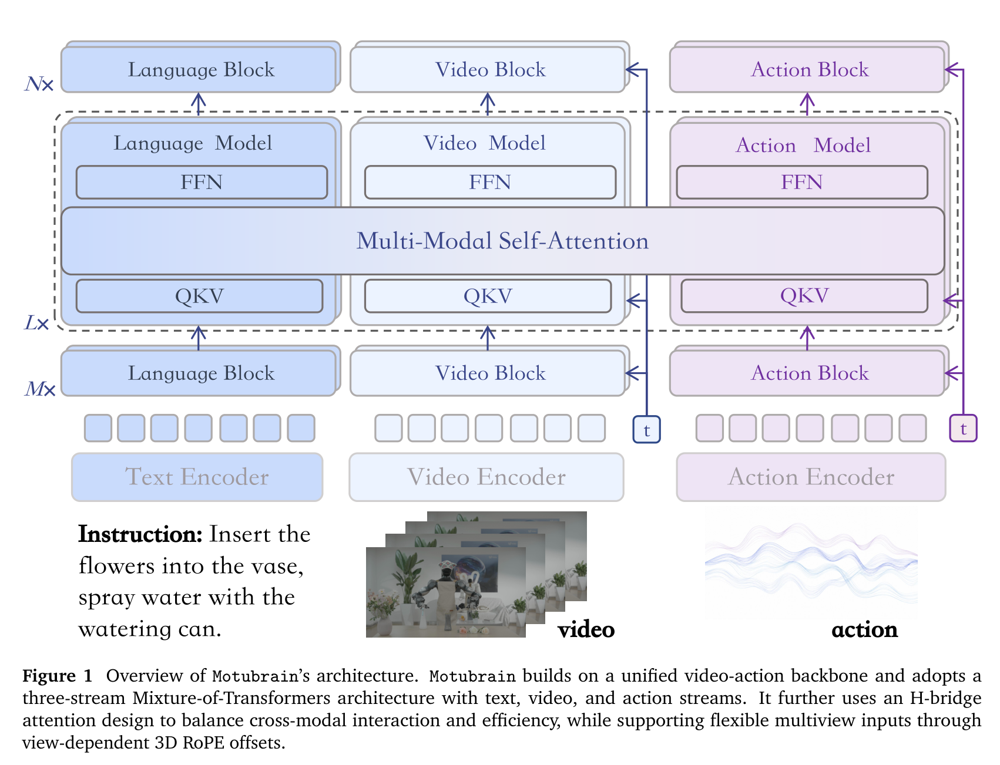
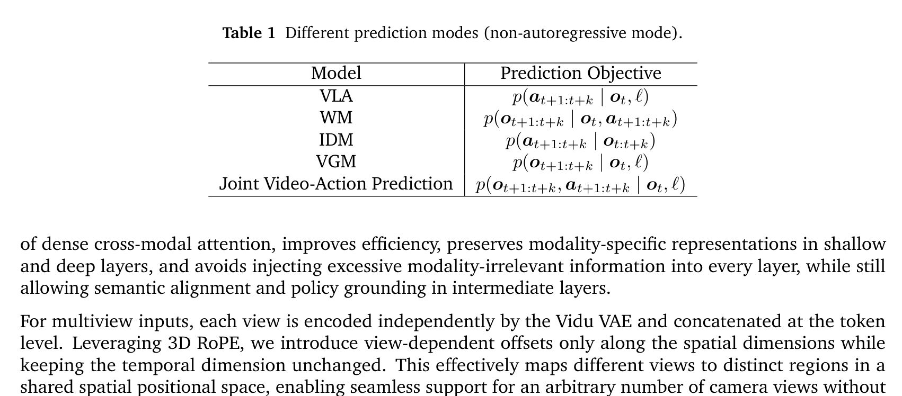
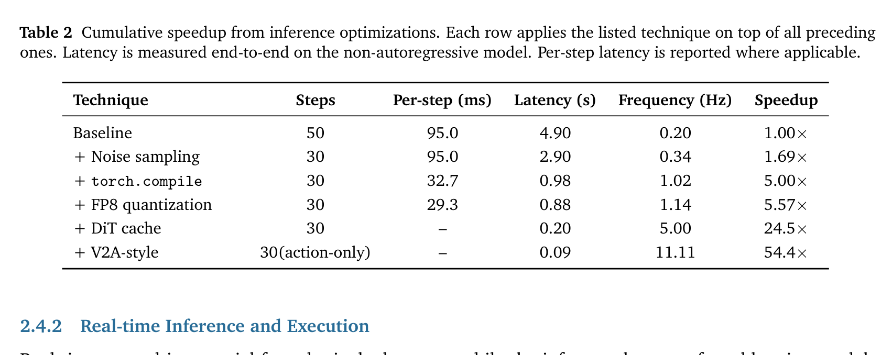
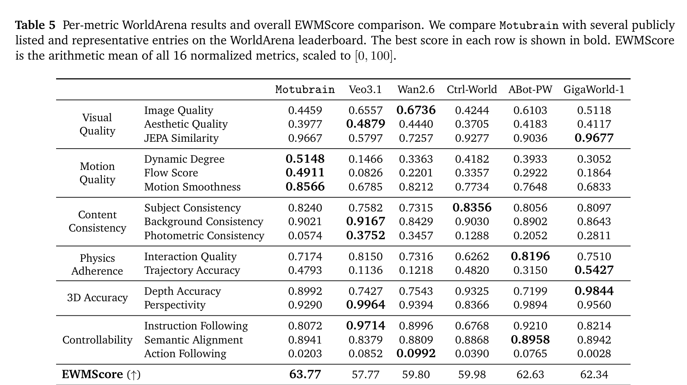
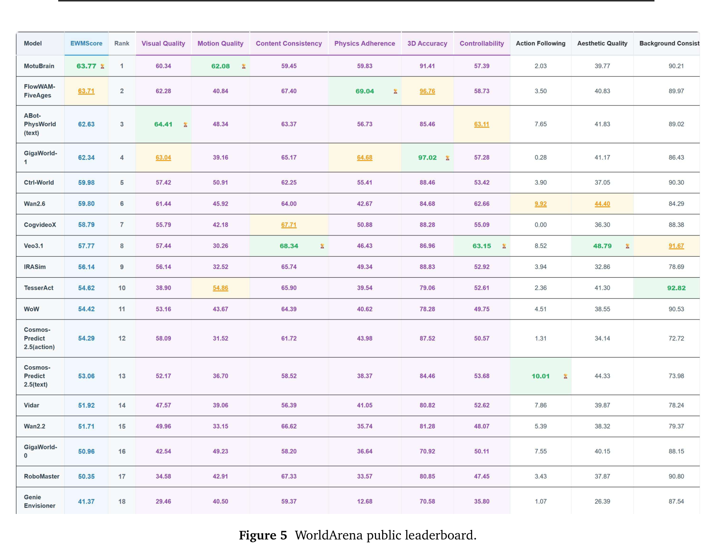
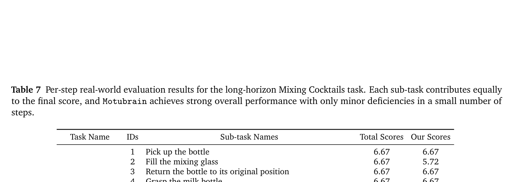
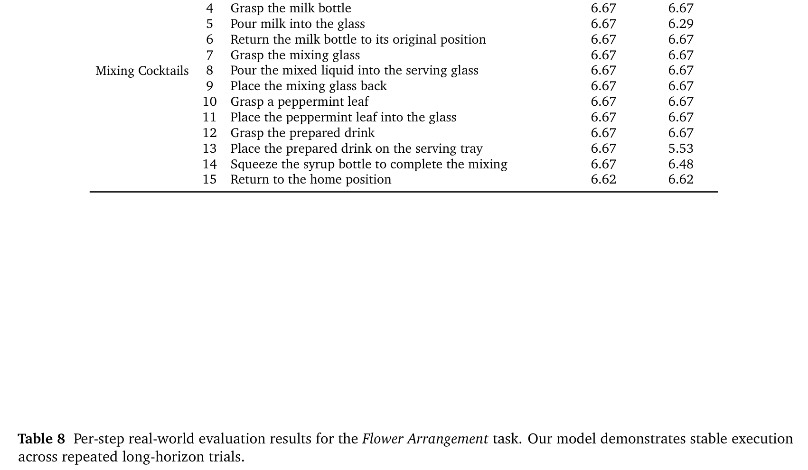
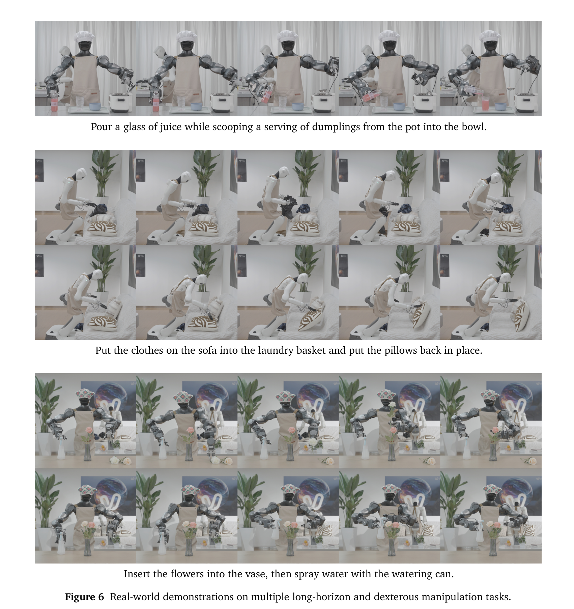

# Motubrain: An Advanced World Action Model for Robot Control

## 核心信息

- **论文标题**：Motubrain: An Advanced World Action Model for Robot Control
- **作者团队**：Motubrain Team，生数科技 (ShengShu AI) 与 清华大学人工智能研究院 (Tsinghua University)
- **核心贡献者**：
  - **项目总负责人 (Project Lead)**：Hengkai Tan (谭恒楷)
  - **资深导师与顾问 (Advisors)**：Fan Bao (鲍凡), Jun Zhu (朱军)
  - **模块核心骨干 (Core Contributors)**：Chendong Xiang (向晨东)*, Louis Liu*, Jiabao Liu*, James Li*, Zeyuan Wang (王泽远)*, Haitian Liu (刘海天)*, Yao Feng, Ruowen Zhao, Shuhe Huang, Hongzhe Bi, Rongxu Cui (崔荣旭)*, Mengchen Cai (蔡孟宸)*, Jingrui Pang, Yinze Rong, Runqing Wang, Kiro Jing
- **发布时间与版本**：2026 年 7 月（arXiv:2604.27792v5 [cs.RO]，2026 年 7 月 15 日更新）
- **项目与开源主页**：
  - **Project Page**：[https://www.genspi.com/en/motubrain](https://www.genspi.com/en/motubrain)
  - **GitHub 官方开源仓库**：[https://github.com/shengshu-ai/Motubrain](https://github.com/shengshu-ai/Motubrain)
- **技术定位**：具身世界-动作大模型（World Action Model, WAM）从学术概念走向工业级高频物理部署的标杆之作。以生数自研高动态视频大模型 Vidu 为物理世界先验基座，基于 UniDiffuser 联合流匹配（Flow Matching）架构与三流 Mixture-of-Transformers (MoT)，实现视频动力学与机器人动作控制的协同建模；结合 H-Bridge 跨模态注意力、统一跨实体相对末端动作空间、V2A 非对称因果解耦与系统级推理套件，首次达成无损 54.4 倍加速（11.11 Hz 实时闭环控制）。
- **巅峰战绩速览**：
  - **RoboTwin 2.0 仿真基准**：50 项复杂双臂长时程操作，Clean 场景达 **95.8%**，重度随机化 (Randomized) 场景达 **96.1%**，全榜首位突破 95% 随机化成功率大关，在 19 项任务上取得双 100% 满分。
  - **WorldArena 具身世界模型排行榜**：EWMScore 达 **63.77** 稳居全球总榜第一（力压 Wan2.6、Veo3.1、GigaWorld-1），且在运动质量（Dynamic Degree 0.5148、Flow Score 0.4911、Motion Smoothness 0.8566）三大动力学子维度绝对领跑。
  - **真实人形机器人长时程灵巧部署**：仅凭 100 条未标注原子动作演示，完成煮关东煮 (Making Oden, **98.54 分**)、调鸡尾酒 (Mixing Cocktails, **97.34 分**) 与高精插花 (Flower Arrangement, **83.30 分**)，展现出惊人的零样本受扰自愈纠错与跨场景泛化能力。

---

## 原文摘要翻译

> <span style="color:#3B82F6"><strong>Abstract:</strong></span> Recent progress in embodied foundation models has been driven by Vision-Language-Action (VLA) policies, which map visual observations and language instructions directly to robot actions. While these models inherit broad semantic priors from static pretraining, they often neglect the fine-grained world dynamics essential for precise robotic control, leading to superficial imitation of behaviors rather than physical understanding. Conversely, using video generation models for world modeling introduces rich spatiotemporal dynamics, yet early two-stage VGM+IDM pipelines suffer from compounding prediction errors, and recent monolithic world action models face prohibitive computational latency during real-time deployment.
>
> In this paper, we present **Motubrain**, an advanced world action model that unifies video generation and action prediction within a shared generative backbone. Motubrain adopts UniDiffuser to jointly model and schedule continuous video and action modalities, powered by a three-stream Mixture-of-Transformers architecture with an H-bridge attention design that balances dense cross-modal alignment and modality-specific representation. We establish a four-level data pyramid spanning Internet video, egocentric interaction, heterogeneous robot manipulation, and target-embodiment trajectories, systematically transitioning visual world knowledge into physical motor control. To achieve real-time deployment, we introduce a systems-level acceleration stack combining SNR-based noise scheduling, compilation, FP8 dynamic quantization, DiT velocity caching, and V2A-style asymmetric inference. Together, these optimizations deliver a **54.4× speedup**, enabling low-latency cloud-to-robot closed-loop execution at **11.11 Hz**.
>
> Extensive experiments demonstrate that Motubrain establishes new state-of-the-art results across both physical control and world modeling: achieving 95.8% clean and 96.1% randomized success rates on RoboTwin 2.0, ranking first on the WorldArena leaderboard with a 63.77 EWMScore, and enabling rapid adaptation of full-size humanoid robots to complex real-world long-horizon tasks with only 50–100 demonstrations without external planners or retry data.

> <span style="color:#F59E0B"><strong>摘要翻译：</strong></span> 近期具身基础模型的飞速演进主要由视觉-语言-动作（VLA）策略所驱动，这类策略直接将视觉观测和语言指令映射为机器人动作。尽管它们继承了静态预训练所赋予的宽泛语义先验，但往往忽视了精确机器人控制所必不可少的细粒度世界物理动力学，导致模型陷入表层行为模仿，而非对物理世界的深层时空理解。与之相对，利用视频生成模型构建世界模型能够注入极其丰富的时空动力学先验，然而早期的“视频生成模型 + 逆动力学模型”（VGM+IDM）两阶段级联架构深陷自回归预测误差随时间累积漂移的泥潭，而近期的单体式世界动作模型在面向实时物理部署时又面临难以承受的巨大计算延迟。
>
> 在本文中，我们提出了 **Motubrain**——一个在统一生成骨干网络中无缝融合未来视频生成与机器人动作预测的高级具身世界-动作模型。Motubrain 采用 UniDiffuser 联合建模并调度连续的视频与动作多模态分布，并构建了基于 H-Bridge 注意力解耦设计的文本、视频、动作三流混合 Transformer（Mixture-of-Transformers, MoT）拓扑架构，在确保高层跨模态物理对齐的同时，最大程度保留了模态特异性表征。我们进一步建立了覆盖互联网通用视频、第一人称交互视频、异构机器人操作及目标实体轨迹的四层数据金字塔，系统性地将宏观世界物理知识注水沉降至底层运动控制。为实现实体机器人的实时在线部署，我们提出了一整套系统级推理加速套件，协同结合基于信噪比的时间步采样、算子图编译、FP8 动态量化、DiT 速度特征缓存以及 V2A 非对称因果推断。上述优化共同实现了 **54.4 倍** 的端到端无损加速，使模型能够以 **11.11 Hz** 的高频在云端-机械臂闭环中稳定执行。
>
> 广泛的实证研究表明，Motubrain 在物理控制与世界动力学模拟两大维度均刷新了业界最高水平（SOTA）：在 RoboTwin 2.0 仿真基准上取得 Clean 场景 95.8% 与 Randomized 场景 96.1% 的最高成功率；在 WorldArena 具身世界模型权威榜单上以 63.77 的 EWMScore 荣登全球第一；并且仅需 50-100 条同实体演示轨迹，即可让全尺寸人形机器人快速迁移并稳健执行百秒级真实长时程复合操作，全过程无需任何外部 VLM 规划器、双系统分层或重试专项监督数据。

---

## 创新点

1. **统一连续多模态流匹配骨干与五大推断分布的原生闭环**：基于 UniDiffuser 架构，将高维连续视频隐空间与多自由度连续机械臂动作空间置于统一的扩散/流匹配（Flow Matching）连续调度体系之下。单套权重、单次训练，天然支持 VLA 策略建模、前向动力学世界模型 (WM)、逆动力学状态推理 (IDM)、视频条件生成 (VGM) 以及视频-动作联合预测等 5 大推断分布，彻底消除了分立模块级联带来的误差累积。
2. **三流 Mixture-of-Transformers (MoT) 与 H-Bridge 结构性注意力解耦**：设计了独立的文本流、视频流与动作流。文本流作为纯条件分支不挂载预测头，杜绝语言表征漂移；视频与动作流通过 Flow Matching 分别预测隐空间速度场。创新性地引入 H-Bridge 注意力机制：在浅层 25% 与深层 25% 实行模态完全解耦，仅在中间 50% 层展开密集的跨模态自注意力，既消除了全层密集注意力带来的算力灾难与模态噪声干扰，又保证了深层控制策略对物理时空因果演化的精确感知。
3. **四级数据金字塔与两阶段渐进式具身流预训练策略**：构建了“互联网宏观视频（Vidu 基座） $\rightarrow$ 第一人称人类交互视频 $\rightarrow$ 异构双臂机器人轨迹 $\rightarrow$ 目标实体专用数据”的四层数据飞轮。预训练阶段一仅更新视频分支，注入高保真物理世界动力学并引入加噪条件帧与视角丢弃增强；阶段二冻结视频分支更新动作流，使用非对称信噪比时间步采样（视频 `timeshift=6`，动作 `timeshift=1`）完成动作对齐，最大化泛化先验的迁移效率。
4. **统一跨实体相对末端位姿 (Relative EEF) 与视角自适应 3D RoPE**：提出以条件帧位姿为基准的相对末端轨迹表示（10 维/臂，含 3D 相对平移、6D 连续旋转与 1D 归一化夹爪），规避了不同本体机械结构与绝对坐标系的绑定；结合在空间维度施加视点偏移、时间维度强同步的 3D RoPE 机制，单架构无缝兼容任意视角数量与相机摆放布局，大幅提升了异构迁移性能。
5. **V2A 非对称因果解耦与系统级全栈 54.4 倍无损推理加速**：在后训练中强制执行 V2A（动作单向可见视频，视频不可见动作）注意力掩码，使测试期推理可采用“短联合去噪前缀 + 动作独占去噪后缀”范式，结合 torch.compile、FP8 动态缩放、DiT 速度余弦缓存（DiT Cache），将去噪延迟由 4.90 秒压缩至 0.09 秒（11.11 Hz），彻底打破了扩散世界模型无法用于高频在线机器人控制的传统物理死锁。
6. **RTC 启发式异步闭环执行与动态延迟队列平滑**：解耦机械臂低层高频控制环与云端世界模型异步推理环。基于 RTC 策略在块重叠区间施加指数衰减平滑融合权重，并引入动态延迟队列估计机制 $\hat{d}_{t+1} = \max(Q)$，自适应拉伸冻结约束前缀与软融合窗口，彻底消除网络抖动与块交界处的速度跃变与抖动。

---

## 一句话总结

生数科技与清华大学朱军团队推出的生产级具身世界-动作大模型 Motubrain，通过三流 MoT 与 H-Bridge 架构将视频基座 Vidu 的世界物理动态先验与跨实体相对末端控制深度融合，依托 V2A 非对称解耦与系统级全栈优化达成 54.4 倍无损加速（11.11 Hz），在 RoboTwin 2.0 随机化仿真（96.1%）、WorldArena 世界动力学评测（63.77 分全球第一）以及人形机器人百秒级长程灵巧实操上实现了前所未有的全域贯通。

---

## 研究问题

### 1. 静态预训练 VLA 为何难以应对精细物理交互？
以 RT-2、OpenVLA、$\pi_0$ 为代表的经典视觉-语言-动作（Vision-Language-Action, VLA）模型，通常将预训练的视觉-语言模型（如 PaliGemma、Qwen-VL）直接外挂动作解算头（MLP 或小型 Diffusion/Flow 模块）。这种范式虽然极大继承了来自互联网海量图文对的广义语义常识与目标指代理解能力，但其底层表征本质上是**静态的**。

在面对涉及摩擦力、接触刚度、碰撞冲量、流体表面张力以及非刚体形变等物理交互时，静态表征完全缺失时间箭头上的**动力学因果感知**。机器人无法“脑补”当前动作施加于物体后、环境在下一瞬的时空演变，因而极易陷入对离线示范轨迹的表层运动学模仿（Superficial Kinematic Mimicry）。一旦在执行中遇到微小的视觉扰动或物理接触偏差，策略便由于缺乏世界物理演化的几何与动态先验而迅速发散。

### 2. 两阶段“视频生成 + 逆动力学”（VGM+IDM）的级联漂移死穴
为了为机器人引入物理世界演化先验，早期学术界探索了由两阶段构成的具身智能体技术路线（如 Video Prediction Policy, Robodreamer, ViDAR）：
- **第一阶段（VGM）**：利用在海量互联网视频上预训练的视频扩散模型，以当前观测图像与自然语言指令为条件，自回归预测未来的宏观视觉轨迹视频；
- **第二阶段（IDM）**：利用逆动力学模型，输入预测的未来视频帧与当前观测，倒推机器人应当执行的连续末端动作。

这种两阶段串联架构在宏观意图规划上表现出优良的泛化性，但在底层高精度控制中存在致命的**级联误差累积（Compounding Prediction Errors）**。高维视频隐空间的像素级微小幻觉、光影漂移、物体边缘模糊或物理穿模，在输入逆动力学模型后会被非线性放大，转化为灾难性的末端位姿突跃。随着自回归时程拉长，视频预测逐渐偏离物理现实，导致下游机械臂执行彻底崩溃。

### 3. 具身世界动作模型（WAM）的算力张力：视频生成算力与毫秒级机械臂控制的根本矛盾
为了解决 VGM+IDM 的级联漂移，近期兴起的世界动作模型（World Action Models, WAM，如 Motus、LingBot-VA、Fast-WAM）尝试将未来视频隐变量与动作块放入同一套扩散/流匹配模型中联合去噪。然而，这种方案立即撞上了物理落地的“算力墙”：
- 视频扩散模型（如 DiT 骨干，参数量通常在数十亿乃至百亿级别）对高维视频隐变量（Latent Video Tokens）进行 30~50 步迭代去噪，计算复杂度极高；
- 机器人机械臂在物理世界中的接触控制与防抖要求最低 10 Hz、推荐 20~50 Hz 的连续控制循环；
- 如果直接采用单体式密集联合去噪，单次推理耗时高达 4~5 秒（0.2 Hz），根本无法在动态变化的真实环境中实现实时闭环反应。

**Motubrain 的核心求解命题正是**：如何既能在预训练期充分汲取百亿级参数视频基座的大规模物理时空先验，又能在后训练与部署期将推理延迟彻底击穿至毫秒级，实现无需在线渲染高维视频的 10+ Hz 极速物理世界动作闭环？

---

## 数据与任务定义

### 1. 多阶段数据飞轮（四级数据金字塔）
Motubrain 构建了系统化的四级数据金字塔，驱动互联网宏观物理认知向微观实体运动控制的渐进式注水沉降：

1. **第一层：海量互联网视频库 (Internet Videos)**
   - 包含数亿条自然场景、物理交互与常识视频，用于预训练基础视频生成底座 **Vidu**，赋予模型广袤的物体恒常性、重力场演变、三维空间透视与宏观物理规律认知。
2. **第二层：第一人称人类交互视频 (Ego-centric Videos)**
   - 引入海量第一人称视角的工具使用、手-物交互及日常操作视频，建立起以末端执行器为视角的近景空间深度关系与接触前置因果链。
3. **第三层：异构双臂机器人操作轨迹 (Heterogeneous-Embodiment Data)**
   - 汇聚多种双臂机器人平台、不同桌面环境与长时程交互的多模态轨迹数据。全部统一转化为相对末端位姿表示，用于打通视频动力学流与物理动作流的交叉注意力对齐。
4. **第四层：特定目标实体高保真演示 (Specific-Embodiment Target Data)**
   - 针对目标人形双臂实体采集的微调轨迹。由于底层特征已经具备强大的物理表征，在目标实体上**仅需 50~100 条未切分原子动作的长程复合演示**即可完成全任务动作空间锁定。

### 2. 仿真评估基准：RoboTwin 2.0
- **基准规格**：涵盖 50 项高度复杂、极具物理挑战的双臂协同操作任务（包括积木搭建、微波炉开闭、高精度穿插、双臂交接、翻转敲击等）。
- **数据与训练协议**：
  - **Clean 数据集**：每项任务 50 条干净场景示范，共计 2,500 条；
  - **Randomized 数据集**：每项任务 500 条重度领域随机化（纹理、光照、桌面背景、初始位姿扰动）示范，共计 25,000 条；
  - 训练集总量达 27,500 条轨迹。视频流下采样至 5 Hz，动作流匹配为 10 Hz。
- **评测设定**：全面考核在标准 Clean 场景与极端领域随机化 (Randomized) 场景下的跨任务多模态操作成功率。

### 3. 世界动力学评测基准：WorldArena
- **基准定位**：具身世界模型的权威公共排行榜，评估生成世界模型在时空预测、物理一致性与可控性维度的真实能力。
- **16 大细粒度评估指标**（归一化为六大物理与感知子维度）：
  - **视觉质量 (Visual Quality)**：图像画质 (Image Quality)、美学质量 (Aesthetic Quality)、JEPA 语义表征相似度 (JEPA Similarity)；
  - **运动质量 (Motion Quality)**：动态区域活跃度 (Dynamic Degree)、光流位移幅度 (Flow Score)、运动平滑性 (Motion Smoothness)；
  - **内容一致性 (Content Consistency)**：主体一致性 (Subject Consistency)、背景一致性 (Background Consistency)、光度一致性 (Photometric Consistency)；
  - **物理依从性 (Physics Adherence)**：物理交互质量 (Interaction Quality)、轨迹真实性 (Trajectory Accuracy)；
  - **三维几何准确性 (3D Accuracy)**：深度图精度 (Depth Accuracy)、三维透视投影保真度 (Perspectivity)；
  - **可控性 (Controllability)**：文本指令依从度 (Instruction Following)、高层语义对齐 (Semantic Alignment)、细粒度动作控制跟随 (Action Following)；
  - **综合评测分 (EWMScore)**：16 项指标归一化算术平均值（缩放至 $[0, 100]$）。

### 4. 真实全尺寸人形机器人长时程操作任务
在真实物理家居环境中，针对全尺寸双臂人形机器人部署三项高难度、百秒级长程连续操作任务，**全程不提供任何子阶段标签或原子动作切割**：
- **煮关东煮 (Making Oden)**：双臂异步高并发任务。右臂精准抓取果汁瓶倒水并放回，左臂同步抓取漏勺、从沸腾热锅中捞取肉丸、沥干水分装入盛碗并归还漏勺。共计 7 个连续原子动作，平均耗时 33 秒。
- **调鸡尾酒 (Mixing Cocktails)**：超长时程强依赖任务。包含拾取基酒、注入调酒壶、精准倾倒牛奶、搅拌倒杯、抓取轻薄薄荷叶轻柔置入、盛盘递送、挤压糖浆等 15 个高度耦合的原子动作，平均执行耗时 124 秒。
- **高精插花 (Flower Arrangement)**：极端精细接触控制与在线自愈任务。双臂依次拾取细小花枝，毫米级精确穿刺插入细颈窄口花瓶中；随后右手抓取喷水壶、左手配合握住喷嘴执行连续喷雾，最后安全运送花瓶。包含 10 个原子动作，平均耗时 138 秒，重点考验花瓶位姿偏移时的在线自纠错与重复试探机制。

---

## 方法主线

### 机制流程

Motubrain 建立了从通用大模型到高频物理执行的端到端四阶段机制流水线：

```
[阶段 1: 视频基础预训练 (Vidu)]
      │ (海量互联网视频，流匹配训练视频主干)
      ▼
[阶段 2: 具身视频动力学适应 (Pretrain-1)]
      │ (第一人称与异构机器人数据，仅更新视频分支，加噪条件帧增强)
      ▼
[阶段 3: 动作对齐与联合预训练 (Pretrain-2)]
      │ (异构双臂机器人数据，冻结视频分支，非对称时间步流匹配更新动作流)
      ▼
[阶段 4: 目标实体后训练 (Post-Training)]
      ├─► [非自回归模式 (Non-AR)]: V2A 单向解耦，单前向并行去噪动作块
      └─► [自回归模式 (AR)]: 基于块因果掩码，时序滚动长程长序列
      ▼
[阶段 5: 在线推理与极速物理执行]
      │ (V2A 动作专有后缀 + DiT Cache + FP8 + torch.compile 54.4x 加速)
      ▼
[高频机械臂控制闭环 (11.11 Hz Cloud-to-Robot, RTC 异步平滑)]
```

---

### 核心组件: 统一视频-动作多模态骨干与注意力掩码体系



#### 1. 三流 Mixture-of-Transformers (MoT)
如图 1 所示，Motubrain 将多模态表征拆分为三个专有流，分别采用定制化的参数拓扑与计算调度：
- **文本流 (Language Stream)**：采用轻量级文本 Transformer 块，仅参与多模态自注意力计算，提供高层语义先验与交互指代，**不挂载任何预测损失头**。这种无监督更新策略锁定了高层自然语言表征，防止多任务梯度污染语言概念空间。
- **视频流 (Video Stream)**：基于 Vidu 深度视频生成骨干，输入包括由 Vidu VAE 编码的时空下采样隐变量。首帧为当前观测条件图像 $z_0$（采用 Teacher-Forcing 输入），其余帧为待去噪的未来视频高斯噪声隐变量 $z_{v}^{(t)}$。流匹配网络显式拟合视频隐空间的速度向量场 $v_{\text{target}}$。
- **动作流 (Action Stream)**：专用的机器人运动学流，输入为待去噪的动作序列噪声 $z_{a}^{(t)}$。针对双臂机器人系统，流匹配网络预测机械臂末端执行器（EEF）连续速度向量场 $a_{\text{target}}$。

#### 2. H-Bridge 结构性注意力解耦
为了平衡密集的跨模态表征融合与模态特异性特征的高保真保留，Motubrain 借鉴了 HBridge 设计，对堆叠的 Transformer 隐藏层进行了分层解耦：
- **底层 25% 层 (Bottom 25%)**：**模态独立解耦注意力**。文本、视频与动作 token 仅在各自模态内部进行 Self-Attention（以及单向读取文本条件）。这一阶段模型专注于提取低层局部高频特征（如视频中的边缘/纹理、动作中的微小微分位移）。
- **中层 50% 层 (Middle 50%)**：**全跨模态联合多模态自注意力 (Full Joint Attention)**。视频与动作 token 展开密集的全连接双向自注意力交互。在此阶段，动作预测被强制锚定在宏观物理演化和高层语义逻辑之上，完成机器人动作意图与物理世界因果律的深度对齐。
- **顶层 25% 层 (Top 25%)**：**模态再次解耦**。在输出预测速度场的前夕切断视频与动作之间的直接信息穿透，各模态独立进行表征精炼并送入最终的预测线性头，避免了视频隐变量的残余高频噪声倒灌进动作控制流中。

#### 3. 多视点 3D 旋转位置编码 (3D RoPE)
针对现代机器人系统常见的“多机位、多相机外参”场景，Motubrain 实现了视点无关的通用多视角统一表征。每个相机视角的输入图像/视频独立送入 Vidu VAE 提取隐特征，并在 token 维度直接拼接。利用 3D RoPE 机制：
$$\text{RoPE}(x, y, t, v) = \text{RoPE}_{\text{spatial}}(x + \Delta x_v, y + \Delta y_v) \otimes \text{RoPE}_{\text{temporal}}(t)$$
在空间坐标上为不同相机视角 $v$ 赋予离散且互不重叠的空间偏置偏移 $\Delta x_v, \Delta y_v$，而在时序维度 $t$ 保持全视角完全共享对齐。这种设计使得模型无需修改任何网络架构即可原生吞吐任意数量、任意摆放外参的环视与腕部相机画面。

#### 4. 全训练阶段的注意力掩码演化图谱


如图 2 所示，Motubrain 在不同的生命周期阶段中灵活重构注意力掩码（Attention Mask），严密调控跨模态信息流动：
- **(a) 阶段一预训练 (Stage 1 Training)**：动作流完全被屏蔽或冻结。模型仅在语言 $L$、条件视频 $V_c$ 与待去噪视频 $V$ 之间建立全自注意力，专注将互联网生成先验向具身物理动力学视频表征对齐。
- **(b) 阶段二预训练 (Stage 2 Training)**：启用全跨模态联合注意力掩码。语言 $L$、条件图像 $V_c$、待去噪视频 $V$ 与动作 $A$ 四者之间实现完全互视，利用异构多臂数据同步优化多模态联合去噪目标。
- **(c) 非自回归后训练 (Non-AR Post-Training)**：引入 **V2A 非对称因果掩码**。动作 token $A$ 允许全向查看语言 $L$、条件图像 $V_c$ 与视频隐变量 $V$；但视频 token $V$ 被施加硬掩码，**严禁查看任何动作 token $A$**。这一非对称性不仅避免了局部微动作反向破坏全局视频因果一致性，更为测试期的极速推理奠定了数学基础。
- **(d) 自回归后训练 (AR Post-Training)**：采用基于块（Chunk）的分块因果掩码。对于第 $k$ 个时间块，当前块的待去噪噪声视频 $V_n$ 与动作 $A_n$ 仅允许单向查看前面所有块已被 Teacher-Forced 固化的干净视频历史 $V_0$，严禁查看未来时序。**值得注意的是，AR 序列中严格不输入任何历史干净动作 token**，杜绝自回归自相关性破坏相对 EEF 动作表示。

---

### 预测模式与序列因式分解



#### 1. 单模型支持的五大推断分布
如表 1 所示，Motubrain 的统一多模态骨干在数学上涵盖了具身智能体的全套概率预测模态：

| 模型模式 | 预测条件概率目标 | 物理语义与应用场景 |
| :--- | :--- | :--- |
| **VLA 策略模式** | $p(a_{t+1:t+k} \mid o_t, \ell)$ | 标准端到端控制：基于当前观测与语言指令直接预测未来动作块 |
| **世界模型 (WM)** | $p(o_{t+1:t+k} \mid o_t, a_{t+1:t+k})$ | 前向物理仿真：以当前状态和假想动作序列为驱动，预测环境未来视觉演化 |
| **逆动力学 (IDM)** | $p(a_{t+1:t+k} \mid o_{t:t+k})$ | 行为克隆与反推：已知起止视觉演变，反解所施加的控制作用力 |
| **视频生成 (VGM)** | $p(o_{t+1:t+k} \mid o_t, \ell)$ | 无动作物理脑补：给定初始场景与目标指令，自由预演未来任务完成视频 |
| **联合预测 (Joint)** | $p(o_{t+1:t+k}, a_{t+1:t+k} \mid o_t, \ell)$ | 大一统生成：同时合成自洽的未来视觉物理轨迹与相对应的机器人物理动作 |

#### 2. 非自回归 (Non-AR) 与自回归 (AR) 序列因式分解
- **Non-AR 高频动作倍频机制**：
  设 VAE 在时间维度将每 $\tau$ 帧原始视频压缩为 1 个视频隐帧，而底层动作控制频率为原始视频频率的 $f_{va}$ 倍。因此，每一个生成的视频隐帧天然在时序跨度上覆盖：
  $$S_a = f_{va} \cdot \tau$$
  个连续动作步。当模型生成包含 $K$ 个未来视频隐帧的块时，单次前向可并行去噪出 $K \cdot S_a$ 个高频控制动作，实现高吞吐的即时动作块迸发。
- **AR 分块滚动因式分解**：
  面向百秒级超长时程任务，Motubrain 采用 Chunk-level 自回归因式分解。训练期以完全并行的因果掩码一次性吞吐整条长轨迹；推理期以当前最新观测帧为锚点，将上一时刻预测出的末端状态作为新的起点，展开稳定的时序滚动。

---

### 推理加速与工程优化套件

扩散与流匹配模型在机器人部署中的最大障碍是去噪延迟。Motubrain 构建了极其硬核的五联加速栈，如表 2 所示，实现了**端到端 54.4 倍的系统级飞跃**。



```
[原始 Baseline: 50 步, 4.90s, 0.20 Hz (1.00x)]
       │
       ▼  (+ 优化噪声时间步调度: timeshift=6 减步至 30 步)
[2.90s, 0.34 Hz (1.69x)]
       │
       ▼  (+ torch.compile 算子全图编译融合)
[0.98s, 1.02 Hz (5.00x)]
       │
       ▼  (+ FP8 动态量化: float8_e4m3fn GEMM)
[0.88s, 1.14 Hz (5.57x)]
       │
       ▼  (+ DiT Cache: 基于速度余弦相似度跳步)
[0.20s, 5.00 Hz (24.5x)]
       │
       ▼  (+ V2A 非对称推断: 短前缀联合 + 动作独占去噪后缀)
[★ 最终生产级性能: 0.09s, 11.11 Hz, 54.4x 极速无损控制 ★]
```

#### 1. 梯度式加速栈技术剖析
1. **非对称信噪比采样与去噪步数压缩 (Noise Sampling, 1.69×)**：
   在训练流匹配时，对两类模态施加独立的 SNR 时间步平移调度：视频流设定 `timeshift = 6`，使其重点强化在高噪声（宏观结构涌现）区域的表征；动作流设定 `timeshift = 1`，保持均匀噪声感知。这使得模型在应对不完整或含噪视觉输入时具备极强的动作鲁棒性，推理采样步数直接从 50 步砍至 30 步而控制精度完全无损。
2. **算子全图编译融合 (torch.compile, 5.00×)**：
   重构模型代码为纯 PyTorch 单卡推理结构，消除一切动态分支与 Python 解释器开销，利用 Inductor 编译器将 DiT 核心多头自注意力与 MLP 投影算子深度融合为针对特定 GPU 架构优化的单内核，单步去噪延迟由 95.0ms 骤降至 32.7ms。
3. **FP8 动态精度量化 (FP8 Quantization, 5.57×)**：
   针对 DiT 中占比最高的超大规模线性变换（`nn.Linear`），权重量化为 `float8_e4m3fn` 格式并保持张量级缩放因子（Per-tensor scale），激活值在运行时动态量化，调用底层的 `torch._scaled_mm` 高效执行。矩阵维度严格对齐 16 字节边界，大幅减缓显存带宽吞吐压力。
4. **基于速度余弦相似度的 DiT 缓存 (DiT Cache, 24.5×)**：
   利用扩散反向轨迹在相邻步之间的平滑演进规律，定义相邻两步速度预测 $v_t$ 与 $v_{t-1}$ 的余弦相似度：
   $$s_t = \frac{\langle v_t, v_{t-1} \rangle}{\|v_t\|_2 \|v_{t-1}\|_2}$$
   当 $s_t > \gamma$（预设置信阈值）时，系统判定去噪方向已经稳定收敛，直接跳过随后 $k$ 步昂贵的完整 DiT 前向传播，使用上一时刻的速度近似 $\hat{v}_{t+j} \approx v_t$，将有效前向次数削减 75% 以上，推理频率飙升至 5.00 Hz。
5. **V2A 动作独占推理范式 (V2A-Style Inference, 54.4×)**：
   得益于前述 V2A 训练掩码（视频不依赖动作），在推理的前 $N$ 步极短联合去噪前缀完成后，未来的视频隐变量已被粗略勾勒成型。此时，**彻底冻结视频流分支**，单次前向提取并缓存各 Transformer 层的视频与文本 Key/Value 矩阵。在随后剩余的绝大多数去噪步中，**仅让轻量级的动作流独立迭代更新**，动作 Query 仅需交叉检索已缓存好的视频/文本 KV 缓存。由于动作 token 数量远少于高维视频隐 token，动作独占前向耗时几近于零，最终压榨出 **0.09 秒/块 (11.11 Hz)** 的实时响应极限。

#### 2. RTC 异步平滑与动态延迟队列机制
由于云端模型推理（即使经压缩为 90ms）与机械臂低层周期（如 10ms/步）仍存在物理时间差，直接粗暴下发动作块必然导致在块与块交界处的急刹急冲或动作回归。Motubrain 实现了精密的异步闭环平滑系统：

- **冻结前缀与指数衰减软融合**：
  若当前块在执行至第 $s$ 步时触发新一轮推理请求，已知端到端延迟 $\delta$ 与控制周期 $\Delta t$，折算延迟动作步数为 $d = \lceil \delta / \Delta t \rceil$。新生成的动作块在前 $d$ 步内直接被原块未执行动作硬性约束锁定；在随后的重叠区间 $d \le i < L$ 内，应用严格的非线性指数平滑衰减函数：
  $$g(\rho_i) = \frac{\rho_i (e^{\rho_i} - 1)}{e - 1}, \quad w_i = 1 - g(\rho_i)$$
  平滑融合两块的重叠预测，确保机械臂末端加速度绝对连续。
- **抗网络抖动的动态延迟队列**：
  维护近期的推理延迟时间滑窗队列 $Q$，以最保守的上限 $\hat{d}_{t+1} = \max(Q)$ 动态决定下一块的冻结步长。即便遇到偶发的云端通信抖动，机械臂也能平稳延长旧轨迹的执行时间窗，杜绝突发停顿与安全脱轨。

---

### 任务与数据扩展法则实证


Motubrain 在学术界首次针对“具身世界动作模型”系统揭示了其在任务多样性与数据体量上的 Scaling Law：
- **任务扩展法则 (Task Scaling Law, 图 3)**：
  在保持单任务数据量恒定、逐步增加训练任务多样性（从 10 项扩展至 50 项）时，Motubrain 的平均成功率展现出近乎直线的单调陡峭爬升。相比之下，传统的静态 VLA 基线在多任务增加时过早出现性能饱和甚至多任务负迁移负干扰。这实证表明：**世界模型从多样化任务中吸取的不是特定动作片段，而是关于跨物体物理接触、铰接机构约束、质量阻尼等通用的物理世界因果认知**，任务越多，世界物理先验的泛化性越强。
- **数据扩展法则 (Data Scaling Law, 图 4)**：
  在固定 50 项任务、按比例下采样每项任务演示数量时，Motubrain 在各个数据阶梯上均展现出绝对优于前代 Motus 和 VLA 的样本利用效率。
- **关键哲学推论**：
  对比图 3 与图 4 可以发现，**增加任务覆盖广度（Task Scaling）的增益斜率显著高于单纯在固定任务上堆叠重复轨迹（Data Scaling）**。这指明了具身智能 Scaling 的终极航向：海量不同几何与物理规则的多样化世界交互，远比在单任务上采集成千上万条冗余轨迹更具战略价值。

---

## 关键结果

### 仿真基准主结果与强基线


在权威的双臂灵巧操作基准 **RoboTwin 2.0** 上，Motubrain 与涵盖主流静态 VLA 及前沿世界模型架构的众多顶尖基线展开了正面决战（如表 3、表 4 所示）：

1. **宏观排行榜大获全胜**：
   - **Clean 场景**：Motubrain 取得 **95.8%** 的平均成功率，超越次优的世界模型 LingBot-VA (92.9%) 达 2.9 个百分点，碾压经典 VLA 方案 $\pi_0$ (65.9%) 与 $\pi_{0.5}$ (82.7%)。
   - **Randomized 场景**：在包含极端光照畸变、随机背景贴图与物体随机位移的严苛评测下，Motubrain 取得 **96.1%** 的惊人成绩，**成为全榜单上唯一在重度随机化下跨越 95% 门槛的具身策略**。
2. **细粒度 50 项任务全面统治 (表 4)**：
   - 在全部 50 项任务中，Motubrain 在 **24 项 Clean 任务** 与 **25 项 Randomized 任务** 上斩获 **100% 满分**，更有 **19 项任务达成了双 100% 的绝对鲁棒掌控**。
   - 在高难度双臂交接协同任务 `Handover Block` 上，Motubrain 取得 100% (Clean) / 95% (Rand)，而 $\pi_{0.5}$ 仅有 66% / 57%；
   - 在复杂的铰接机构操作任务 `Open Microwave`（开微波炉门）上，Motubrain 取得 **双 100%**，而经典 VLA 方案均受困于把手拉伸阻尼与门锁弹簧动力学而大面积溃败（$\pi_{0.5}$ 仅 34%，Fast-WAM 仅 62% / 45%）；
   - 在接触丰富型的细长物体放置任务 `Blocks Ranking Size` 与 `Place Dual Shoes` 上，Motubrain 均展现出碾压级的时空稳定性。

---

### WorldArena 评估排行榜突破




在具身世界动力学生成基准 **WorldArena** 上，Motubrain 运行于前向动力学模式 (FDM)，与全球顶尖的视频与世界模型同台竞技（如表 5、图 5 所示）：

1. **总榜 EWMScore 登顶榜首**：
   Motubrain 最终斩获 **63.77** 的 EWMScore，不仅超越了专门针对具身控制优化的专用模型 ABot-PW (62.63) 与 GigaWorld-1 (62.34)，更以超过 4 分的绝对优势击溃了参数量极其庞大的通用开源视频生成旗舰 **Wan2.6 (59.80)** 与 Google 闭源旗舰 **Veo3.1 (57.77)**。
2. **运动质量 (Motion Quality) 维度的统治级优势**：
   深入分析表 5 可见，Motubrain 的断层式领先完全由其在“运动质量”维度的卓越物理真实性所贡献：
   - **动态活跃度 (Dynamic Degree)**：达到 **0.5148**，远超 Wan2.6 的 0.3363 与 Veo3.1 的 0.1466；
   - **光流位移幅度 (Flow Score)**：达到 **0.4911**，是 Wan2.6 (0.2201) 的 2.2 倍，更是 Veo3.1 (0.0826) 的近 6 倍；
   - **运动平滑性 (Motion Smoothness)**：高达 **0.8566**，显著领先所有基线。
3. **破除“高画质欺骗”与弥合感知-功能鸿沟**：
   在 WorldArena 的原始研究中曾指出，传统视频模型的画质评分与下游动作控制成功率呈现极弱的相关性（相关系数仅 $r=0.36$），大量视频大模型为了在评测中刷高主观画质指标，倾向于生成微小位移甚至几近静止的“假死”画面。而 Motubrain 彻底打破了这一“画质作弊”陷阱：其生成的视频帧蕴含大位移、连贯惯性且运动严格聚焦于机械臂和交互物体本身，**首次用强有力的数据证明了世界动力学的高保真预测可以直接映射为真实物理控制的高鲁棒性**。

---

### 真实机器人长时程多阶段操作






在实体人形机器人部署中，Motubrain 面临着无原子动作标签、长时程复合链条、光照环境变动与非预设物理扰动的巨大挑战。实验采用了百分制阶梯扣分评测标准（单次通过满分，重试 1 次扣 20%，重试 2 次扣 50%，3 次及以上失败为 0 分），结果如表 6~8 与图 6 所示：

#### 1. 煮关东煮 (Making Oden, 表 6) —— 总评 98.54 分
- **任务特征**：涉及 7 个子动作，左手勺子舀取丸子、右手倒果汁双臂异步完全并发，平均用时 33 秒。
- **执行表现**：除第 2 步倾倒果汁由于液面飞溅微小偏差获得 12.83 分（满分 14.29）外，其余 6 个步骤（包括抓杯、归位、舀丸子、平稳运送、盛盘、归还长勺）均取得满分！
- **抗外部扰动韧性**：在实验中人为提前向杯中注满饮料，Motubrain 观测到状态已经达成，右臂平稳退出倒水动作并迅速复位，而左臂丝毫不受干扰继续完成舀取装碗。展现出清晰解耦的并发控制逻辑。

#### 2. 调鸡尾酒 (Mixing Cocktails, 表 7) —— 总评 97.34 分
- **任务特征**：长达 15 个子步骤的超长因果链，涉及双杯调配、薄荷叶捏取、盘托递送与糖浆挤压，平均耗时 124 秒。
- **执行表现**：在长达两分多钟的漫长时序中，Motubrain 实现了连续 7 次实验的极高稳定性。仅在注酒、倒牛奶与托盘安放三个步骤发生过一次微小重试，其余全部步骤单次成功率达到 100%。

#### 3. 高精度插花 (Flower Arrangement, 表 8) —— 总评 83.30 分
- **任务特征**：10 个子步骤，耗时 138 秒，包含极其狭窄的花瓶口穿刺对准、双臂交接喷壶与喷雾操作。
- **涌现自愈纠错能力 (Emergent Self-Correction)**：在花朵插入花瓶的第 2、4、6 步中，当花枝因微小位移发生碰撞未能顺畅滑入瓶口时，**在从未提供过“失败重试”训练数据的背景下，Motubrain 自发根据视觉闭环反馈，主动退回一段距离、重新调整腕部偏角并再次试探插入，直至成功入瓶**。这一行为彻底证实了模型真正内化了目标终态的物理世界表征，而非机械记忆死板轨迹。
- **跨场景零样本泛化**：仅在一种花-瓶组合上训练，直接迁移至 4 种全新几何形态的花瓶与花卉类型，在全新家庭环境中依然保持 **>80%** 的泛化成功率，远超需要至少 3 组丰富训练集才能勉强泛化的传统 VLA。

---

### 核心消融到底说明了什么

结合表 2、表 3 中的消融数据，Motubrain 的各项核心设计决策形成了完整的实证闭环：

1. **预训练底座带来的动力学跃迁**：
   - 移除第一阶段和第二阶段预训练（从头在机器人数据上训练，`Motubrain w/o Pretrain`），RoboTwin 成功率从 95.8%/96.1% 断崖式跌落至 91.5%/91.3%；
   - 若进一步移除 H-Bridge 注意力解耦设计（`Motubrain-Non-AR w/o Pretrain, HBridge`），成绩进一步跌至 89.1%/88.8%。这无可辩驳地证明：**视频预训练绝非可有可无的花架子，它注入的连续时空演化先验构成了高鲁棒控制的核心动力源**。
2. **Non-AR 与 AR 架构的权衡定位**：
   - 在 RoboTwin 50 项任务中，`Motubrain-Non-AR` 取得了 91.9% / 92.3% 的强劲性能，充分说明在短时程高频反应场景下，非自回归并行去噪具备极高的实用价值；
   - 而完整的自回归架构凭借分块因果上下文的无损串联，进一步将得分推至 95.8% / 96.1%，牢牢锁定了长程推理的最优解。
3. **推理加速套件的零损耗验证**：
   - 从 0.20 Hz 的慢速基准到 11.11 Hz 的极速优化版，测试表明整个加速流水线在 RoboTwin 2.0 及实体任务上的成功率波动维持在 $\pm 0.3\%$ 的统计误差区间内。这表明系统的提速全部来源于**剪枝高维视频去噪在测试期的计算冗余**，而保留下来的动作独占去噪流完整继承了骨干网络的全部决策智能。

---

## 深度分析

### 真正贡献是什么

Motubrain 的核心里程碑意义在于：**它是具身智能领域第一个成功将“生成式世界动力学模型”落地为“生产级高频低延迟实体机器人控制器”的典范方案**。

长期以来，学术界与工业界在具身模型路线上存在巨大撕裂：
- **以 $\pi_0$、OpenVLA 为代表的纯策略派**认为世界模型“太重太慢”，坚持使用轻量静态 VLM 搭配 Flow 模块，代价是模型丢失物理时空因果，难以应对接触复杂、长时程与重度随机化任务；
- **以纯视频世界模型为代表的仿真派**在 Sora、Wan、Vidu 的高画质视频中狂欢，但在机器人控制落地时只能退化为慢速开环规划器或深陷 VGM+IDM 的漂移深渊。

Motubrain 彻底终结了这一争论。它通过 **UniDiffuser 联合流匹配 + 三流 MoT + H-Bridge + V2A 非对称因果推理** 的巧妙架构编织，证明了：**让大模型在预训练期学习世界演化的动力学视频，其终极目的不是为了在测试期让机器人每秒看 30 帧高清脑补电影，而是为了将物理世界规律沉淀为动作分支的隐式先验！**

---

### 为什么结果成立

从机器学习与控制理论的底层视角审视，Motubrain 的卓越表现建立在四大稳固支柱之上：

1. **时空连续动力学对运动轨迹的正则化 (Dynamical Regularization)**：
   当机器人动作分支与视频流在中间 50% 层进行强力交互对齐时，反向传播的视频流匹配梯度实际上扮演了极其苛刻的**物理隐式正则项**。它天然惩罚了那些在物理几何上不可能发生的动作轨迹（例如物体穿模、加速度奇异突变、违反摩擦角接触等）。这使得输出的动作块天生具备优良的平滑度与动力学合规性。
2. **H-Bridge 的模态隔离与语义聚焦**：
   过去的单体联合 WAM 往往在所有 Transformer 层展开暴力全注意力，导致庞大视频 token 的高频像素噪声反复冲刷稀疏的动作 token，引起动作维度的“表征坍缩”。H-Bridge 在浅层保留原始空间细节，在中层完成宏观因果绑定，在顶层切断 cross-attention 独立输出速度场，完美兼顾了跨模态交融与高频动作精度。
3. **相对末端位姿 (Relative EEF) 的坐标系解耦**：
   采用以条件帧为锚点的 $\Delta p, R_s^{-1}R_i, g$ 相对表示，消除了机械臂世界基座标的绝对依赖。无论机械臂初始姿态在何处，模型处理的始终是当前局部视界内的位移向量场。这使得来自异构机器人平台甚至人类第一人称视角的轨迹能够无缝在同一隐空间中互通有无。
4. **V2A 结构支撑的“测试期零代价想象”**：
   在测试期，机械臂不需要真的渲染出像素级视频并等待其解码。V2A 掩码从数学上保证了“视频不依赖动作”，因此只需利用极短的前缀锁定视频表征，便可将复杂的视频分支完全冻结缓存，转化为一个轻快至极的高频动作解码器。

---

### 容易误读的地方

1. **误读一：Motubrain 在控制实体机器人时，云端必须每秒实时生成 30 帧高清未来视频？**
   - **纠偏**：完全错误！这是对世界动作模型推理机制的最普遍误解。在实际部署模式中，依托 **V2A-style Asymmetric Inference**，视频分支仅在去噪最初的极短前缀参与计算，随后其 KV 缓存被固定，后续去噪全部为**纯动作独占前向 (Action-Only Suffix)**。在控制闭环中，根本不需要将视频隐变量解码为 RGB 像素，更不需要完整生成整段长视频，因此才能跑出 11.11 Hz 的超高频率。
2. **误读二：Motubrain 只是在 Vidu 视频模型外挂了一个 MLP 动作头？**
   - **纠偏**：完全错误！如果是单纯的冻结视频特征后接 MLP 策略，模型便退化为普通的冻结编码器行为克隆，完全丧失了视频与动作在生成扩散层面的双向对齐与因果调度。Motubrain 是将视频隐空间与动作空间同时视作连续高斯速度场，在 UniDiffuser 联合框架下协同流匹配去噪，并在中间 50% 隐藏层进行深度的交互对齐。
3. **误读三：非自回归 (Non-AR) 模式无法执行超过观察窗口的长程任务？**
   - **纠偏**：这是对系统因式分解的误解。Non-AR 解决的是单次请求内高频动作块迸发的问题（单前向生成多步动作），而长时程任务依靠闭环异步 Rolling 推进。对于百秒级强因果依赖任务，Motubrain 则采用 AR 模式，以块为单位基于干净历史帧滚动，两者在不同任务尺度上各司其职。

---

### 复现与落地注意点

1. **全阶段 Attention Mask 的硬编码实现陷阱**：
   在复现阶段，必须极其严格地检查各训练阶段与推理阶段的掩码实现（图 2）。特别是 **V2A 模式下视频流严禁看到动作流**，如果因张量广播或全注意力切分失误导致动作 token 的信息反向泄露给视频流，将彻底破坏测试期“冻结视频 KV 仅去噪动作”的数学自洽性，导致动作独占推理时精度断崖式崩塌。
2. **非对称时间步平移采样的关键超参**：
   训练阶段二必须严格遵守 `timeshift = 6` (Video) 与 `timeshift = 1` (Action) 的非对称 SNR 采样调度。如果错误地将视频时间步也设为 1，模型将过早关注低噪声微小像素抖动，无法建立健壮的宏观时空演变先验，导致推理阶段减步（从 50 步砍至 30 步）时策略出现剧烈抖动。
3. **FP8 动态量化的对齐要求**：
   在调用 `torch._scaled_mm` 内核时，矩阵的输入输出维度必须严格被 16 整除。在替换 `nn.Linear` 模块时，必须对非 16 倍数的特殊投影头（如特定自由度的末端输出层）设置自动跳过逻辑，否则会导致 CUDA 内存对齐异常与计算崩溃。
4. **RTC 异步延迟估计的保守设计**：
   在真实网络部署中，切忌使用当前单次网络延迟 $\delta_t$ 直接作为下一块的融合依据。现实中的无线局域网或云端通信必然存在抖动，必须使用最大滑窗队列 $\hat{d}_{t+1} = \max(Q)$，给机械臂留足冗余的执行平滑时间窗，避免因网络瞬断发生硬撞击。

---

## 局限

1. **对目标实体数据仍存在 50~100 条的残余依赖**：
   虽然 Motubrain 相比传统方法大幅削减了特定机器人数据需求，但仍需数十条同构轨迹进行末端几何与物理刚度对齐，尚未达成完全零样本跨实体无缝迁移。
2. **纯视觉表征缺乏显式 3D 几何与空间点云物理约束**：
   模型完全依赖 2D 多视角画面的隐表征与 3D RoPE 进行空间推断，未引入显式的 3D 点云、SDF（符号距离场）或网格几何物理先验。在极端遮挡或缺乏纹理的工业装配场景下，纯视觉深度推断可能存在瞬态失准。
3. **高频触觉与多维力控反馈的结构性缺席**：
   目前输入模态仅包含视觉与本体状态，在面对插花穿刺、微波炉按键等高阻抗物理接触时，缺乏来自六维力传感器或指尖触觉阵列的直接闭环，偶发微小重试正是由于力觉缺失所致。
4. **移动操作与开放环境自主导航尚未涉及**：
   当前评估主要集中于桌面双臂灵巧操作，未将全身移动底盘（Mobile Base）、全身运动规划（Whole-Body Control, WBC）以及大范围室内外自主导航纳入大一统世界动作建模范畴。

---

## 我的笔记

### 1. 具身世界模型技术演进谱系与生态位横向对照

为深刻理解 Motubrain 在当前具身基础模型发展史中的历史坐标，我们将其与当前业界代表性的 WAM / VLA 工作进行全景横向解构：

| 对比维度 | **Motubrain (本文)** | **Motus / Motus2** | **OpenWAM (2026)** | **Fast-WAM (2026)** | **LingBot-VA (2026)** | **$\pi_0$ / $\pi_{0.5}$ (Physical Int.)** |
| :--- | :--- | :--- | :--- | :--- | :--- | :--- |
| **机构/背景** | 生数科技 / 清华朱军团队 | 清华朱军团队早期工作 | NUS / 清华 / 北大 / 港大联合 | 清华 Hang Zhao 团队 | 阿里千问具身团队 | Physical Intelligence |
| **基础骨干** | Vidu 视频基座 + 三流 MoT | UniDiffuser 单体 DiT | 模块化解耦三元组 C(E,S,M) | 双流扩散网络 | 双流因果视频-动作网络 | PaliGemma + Flow Matching |
| **跨模态注意力** | **H-Bridge 分层解耦** (25%-50%-25%) | 全层密集联合注意 | 6大掩码消融 (Mutual为主) | 动作侧前向修剪 | 显式因果条件掩码 | 跨注意力文本动作注入 |
| **推理频率** | **11.11 Hz (54.4× 无损加速)** | ~0.2 Hz (单体慢速) | 5.88 Hz (170ms, RTX 5090) | ~5~8 Hz (剪枝未来想象) | 3~5 Hz (异步动作解耦) | **10~20 Hz (原生静态轻量)** |
| **RoboTwin 战绩**| **Clean 95.8% / Rand 96.1%** | 88.7% / 87.0% | ~92.4% / 26.6%(C2R OOD) | 91.9% / 91.8% | 92.9% / 91.5% | 82.7% / 76.8% ($\pi_{0.5}$) |
| **WorldArena 排名**| **全球第 1 (EWMScore 63.77)** | 未刷榜 | 未系统接入 | 未刷榜 | ~60 分位 | 不支持世界动力学预测 |
| **核心战役定位** | **工业生产级极速 WAM 全能王** | WAM 原型概念验证 | 系统实证设计与模块基建 | 验证“测试期无需想象” | 探索因果对抗加噪鲁棒性 | 坚持纯策略的高频工业落地 |

### 2. 生态位横向剖析与范式升华

1. **从 Motus 到 Motubrain 的质变跃迁**：
   Motus 作为清华团队在具身世界动作模型上的先行者，证明了“UniDiffuser 可以将动作与视频放在一起学”。但 Motus 在本质上仍是学术概念机：全层密集双向注意力导致推理极其昂贵，单次前向几近 5 秒，无法用于真实控制，且泛化性能在遇到重度扰动时明显不足。Motubrain 则是彻底的**工业级生产化改造**：接入 Vidu 商业级视频底座，设计 H-Bridge 解决计算与干扰痛点，确立 Relative EEF 动作空间，最后用 V2A 与五联加速栈压榨出 54.4 倍速度，完成了从“纸上算法”到“实体高频大脑”的飞跃。
2. **与 OpenWAM 的学术互补性**：
   OpenWAM (2026) 走的是“解耦模块化基础设施与纯粹实证主义探索”路线，提出了著名的六大设计原则（Q1~Q6），并在 518.5M 帧多具身预训练上论证了 WAM 在 OOD 泛化上的核心收益；而 Motubrain 则是一次**极致的端到端系统工程力作**，其在单模型上实现了顶尖动力学（WorldArena 63.77 登顶）与顶尖物理控制（RoboTwin 96.1% 登顶）的高度统一。
3. **对 Fast-WAM 核心论断的工程终结**：
   Fast-WAM 曾提出深刻发问：“世界动作模型在测试期真的需要未来视觉想象吗？”并证明了测试期砍掉未来帧可以大幅提速。Motubrain 的 V2A 非对称推断体系从架构层面给出了工业级答案：**预训练期必须相互可见（吸收世界法则），后训练期动作单向可见（建立控制映射），部署测试期冻结视频流提取 KV 后动作独占更新（零代价获取先验）**。这一闭环设计为后续所有具身世界模型的部署树立了范式标准。

---

## 引用

```bibtex
@article{motubrain2026,
  title   = {Motubrain: An Advanced World Action Model for Robot Control},
  author  = {Chendong Xiang and Fan Bao and Haitian Liu and Hengkai Tan and 
             Hongzhe Bi and James Li and Jiabao Liu and Jingrui Pang and 
             Kiro Jing and Louis Liu and Mengchen Cai and Rongxu Cui and 
             Ruowen Zhao and Runqing Wang and Shuhe Huang and Yao Feng and 
             Yinze Rong and Zeyuan Wang and Jun Zhu and {Motubrain Team}},
  journal = {arXiv preprint arXiv:2604.27792v5},
  year    = {2026},
  url     = {https://github.com/shengshu-ai/Motubrain}
}
```
