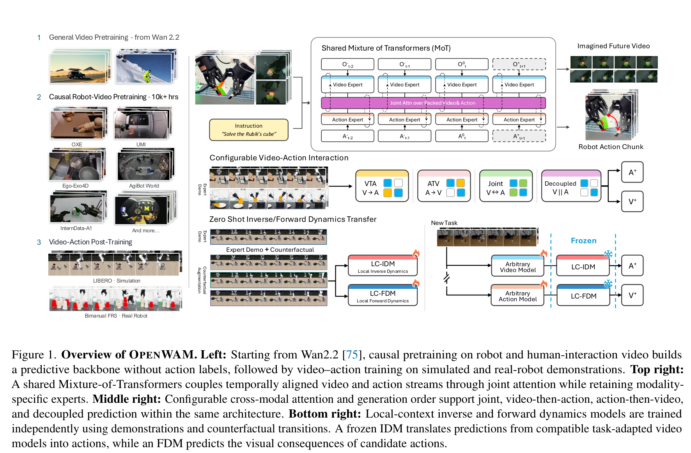
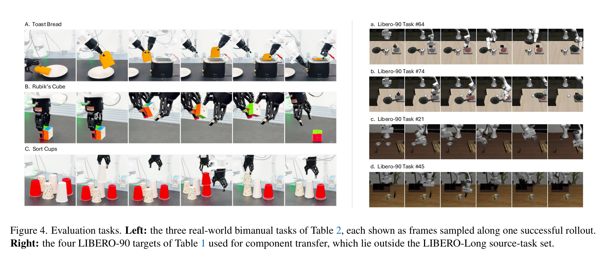
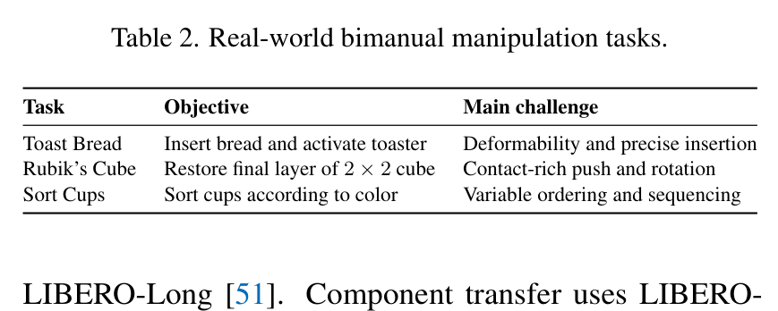
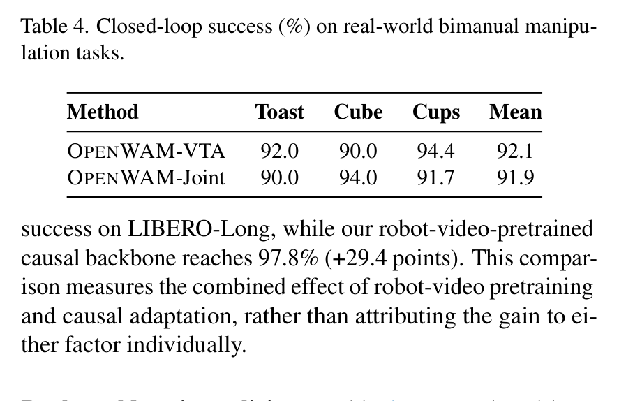
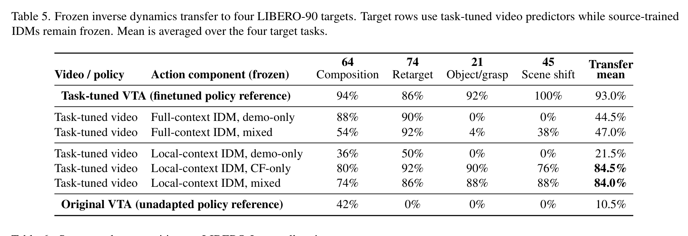
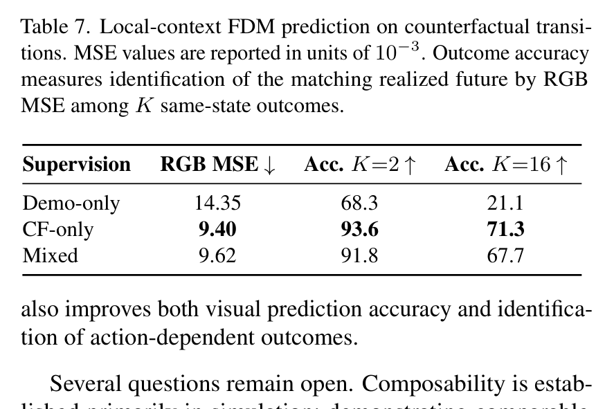
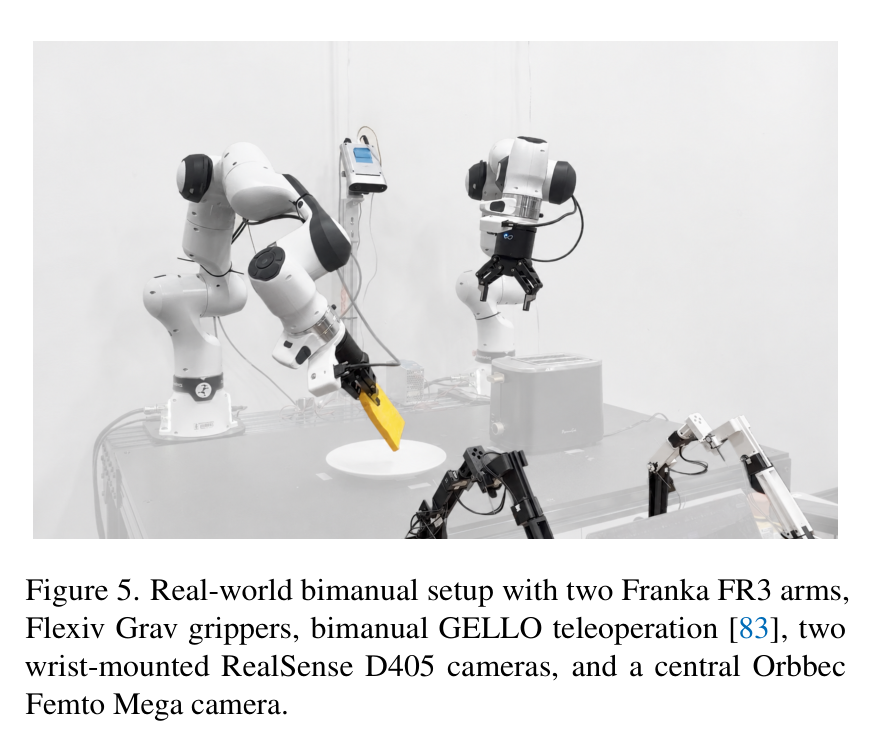
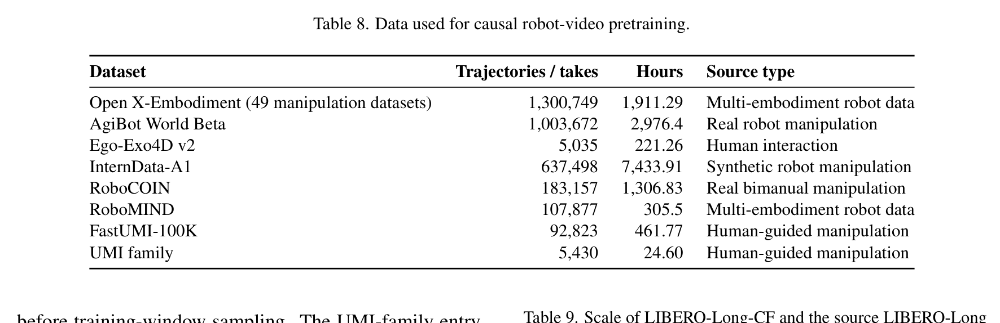
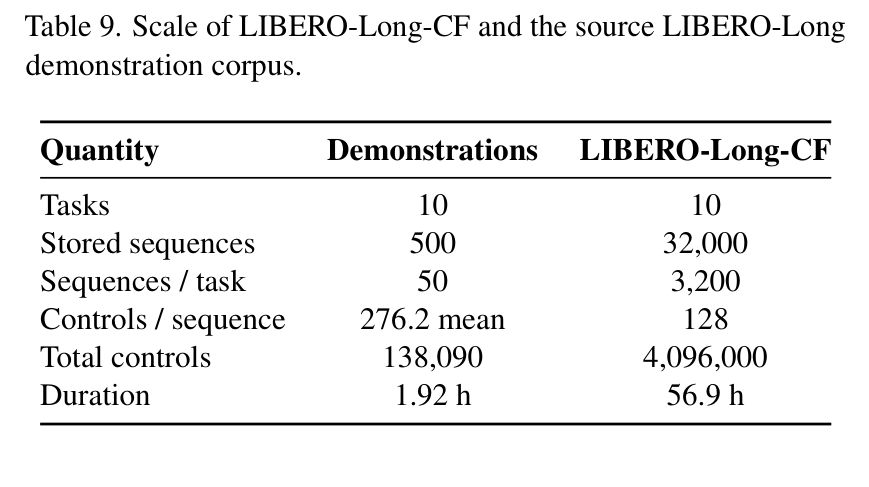
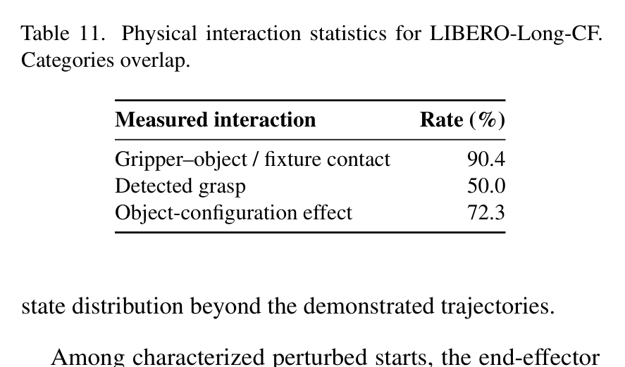

# OPENWAM: An Open Framework for Composable World-Action Models
# OPENWAM：可组合世界动作模型的开源框架

> **Authors / 论文作者：** Heng Yu*, David D. Yuan*, Juze Zhang*, Changan Chen, Yao Feng, Michelle Baldonado, Steve Cousins, Li Fei-Fei, Jiajun Wu, Ehsan Adeli (*Equal contribution / 同等贡献)  
> **Affiliation / 作者机构：** Stanford University (斯坦福大学)  
> **Release Date / 发布日期：** June 4, 2026 (Project & Code) / October 6, 2026 (Paper, arXiv:2610.07922v1 [cs.RO])  
> **Project Page / 项目主页：** [https://openwam.stanford.edu](https://openwam.stanford.edu)  
> **Code Repository / 开源代码：** [https://github.com/OpenWAM/OpenWAM](https://github.com/OpenWAM/OpenWAM)  
> **Canonical PDF / 权威文献载体：** `PICQTU9H/Yu 等 - 2026 - OpenWAM An Open Framework for Composable World-Action Models.pdf` (18 pages, selectable text)

---

## Page / Section Index / 页面与章节导引

- **Abstract / 摘要** (Page 1)
- **1. Introduction / 引言** (Pages 1–2)
  - Figure 1: Overview of OPENWAM / OPENWAM 框架总览 (Page 2)
- **2. Related Work / 相关工作** (Pages 2–3)
  - 2.1 Visuomotor Policies and Predictive Control / 视觉运动策略与预测控制 (Pages 2–3)
  - 2.2 Video Foundations and World–Action Architectures / 视频基座与世界动作架构 (Pages 3–4)
  - 2.3 Dynamics Learning Beyond Successful Demonstrations / 成功演示之外的动力学学习 (Pages 3–4)
- **3. Methodology / 方法论** (Pages 3–7)
  - 3.1 World–Action Modeling Formulation / 世界动作建模形式化 (Page 4)
  - 3.2 An Open Causal Robot-Video Backbone / 开源因果机器人视频骨干网络 (Page 4)
  - 3.3 Configurable Video–Action Interaction Programs / 可配置视频—动作交互程序 (Pages 4–5)
    - Figure 2: Shared MoT Architecture / 共享 MoT 架构 (Page 5)
    - Figure 3: Attention Masks for Interaction and Dynamics Programs / 交互与动力学注意力掩码 (Page 5)
    - Table 1: LIBERO-90 Targets for Component-Transfer Evaluation / LIBERO-90 组件迁移目标任务 (Page 5)
  - 3.4 Counterfactual Learning of Local-Context Dynamics Interfaces / 局部上下文动力学接口的反事实学习 (Pages 5–7)
    - Figure 4: Evaluation Tasks (Real-World Bimanual & LIBERO-90) / 评测任务 (Page 6)
- **4. Experiments / 实验评估** (Pages 7–8)
  - 4.1 Experimental Setup / 实验设置 (Pages 7–8)
    - Table 2: Real-World Bimanual Manipulation Tasks / 真实世界双臂操作任务 (Page 7)
  - 4.2 Native Policy Performance / 原生策略性能 (Page 8)
    - Table 3: Closed-Loop Success (%) on Four LIBERO Suites / LIBERO 四大套件闭环成功率 (Page 8)
    - Table 4: Closed-Loop Success (%) on Real-World Bimanual Tasks / 真实双臂操作闭环成功率 (Page 8)
  - 4.3 Component Composability / 组件可组合性 (Pages 8–9)
    - Table 5: Frozen Inverse Dynamics Transfer to Four LIBERO-90 Targets / 冻结逆动力学迁移结果 (Page 9)
    - Table 6: Source-Task Composition on LIBERO-Long / LIBERO-Long 源任务组合效果 (Page 9)
  - 4.4 Action-Conditioned Forward Dynamics / 动作条件化前向动力学 (Pages 8–9)
    - Table 7: Local-Context FDM Prediction on Counterfactual Transitions / 反事实转移前向动力学评估 (Page 9)
- **5. Discussion and Conclusion / 讨论与结论** (Pages 8–9)
- **References / 参考文献** (Pages 9–13, Entries [1]–[108])
- **Appendix / 附录** (Pages 14–18)
  - A. Implementation Details / 实施细节 (Pages 14–15)
    - A.1 Model Architecture and Representation / 模型架构与表征 (Page 14)
    - A.2 Downstream Training / 下游训练 (Page 14)
    - A.3 Video–Action Interaction Programs / 视频—动作交互程序 (Pages 14–15)
    - A.4 Inference and Closed-Loop Evaluation / 推理与闭环评测 (Page 15)
    - Figure 5: Real-World Bimanual Setup / 真实世界双臂硬件平台 (Page 15)
    - A.5 Real Robot Setup / 实体机器人设置 (Page 15)
  - B. Robot-Video Pretraining / 机器人视频预训练 (Pages 15–16)
    - B.1 Pretraining Corpus / 预训练语料库 (Pages 15–16)
      - Table 8: Data Used for Causal Robot-Video Pretraining / 预训练数据集统计 (Page 16)
    - B.2 Causal Adaptation / 因果适应机制 (Page 16)
    - B.3 Training Compute / 训练算力消耗 (Page 16)
  - C. LIBERO-Long-CF: Counterfactual Dynamics Data / 反事实动力学数据集 (Pages 16–17)
    - Table 9: Scale of LIBERO-Long-CF and Source Corpus / 数据集规模对比 (Page 16)
    - C.1 Scale and Intervention Coverage / 规模与干预覆盖度 (Page 16)
      - Table 10: Intervention Composition / 干预类型构成 (Page 17)
    - C.2 State and Interaction Coverage / 状态与物理交互覆盖度 (Pages 16–17)
      - Table 11: Physical Interaction Statistics / 物理交互统计指标 (Page 17)
    - C.3 Representation for Local Dynamics Learning / 局部动力学学习表征 (Page 17)
  - D. Ablations / 消融实验 (Pages 17–18)
    - D.1 Effect of Video-Backbone Initialization / 视频骨干网络初始化的影响 (Pages 17–18)
      - Table 12: Effect of Video-Backbone Initialization on LIBERO-Long / 骨干初始化消融 (Page 17)
    - D.2 Effect of Mixture-of-Transformers Architecture / 多专家 Transformer 架构的影响 (Pages 17–18)
      - Table 13: Effect of MoT Architecture on LIBERO-Long / MoT 架构消融 (Page 17)
  - E. External Dynamics Comparison / 外部动力学模型对比 (Page 18)
    - Table 14: Policy and Dynamics Accuracy on LIBERO-Long (vs. UVA) / 与 UVA 全面对比 (Page 18)
    - E.1 Independent Dynamics Components / 独立动力学专家组件 (Page 18)
    - E.2 Unified Policy and Dynamics Modeling / 统一策略与动力学建模 (Page 18)

---

## Terminology Ledger / 核心术语对照表

| English Term | 规范中文翻译 | 概念定义与技术内涵 |
| :--- | :--- | :--- |
| World-Action Model (WAM) | 世界动作模型 | 将环境未来观测演化预测与智能体动作控制统一建模的具身基座系统 |
| Mixture-of-Transformers (MoT) | 多专家 Transformer 架构 | 具有模态专属分支（视频专家与动作专家）并通过跨模态注意力进行交互的解耦 Transformer 架构 |
| Video-then-Action (VTA) | 视频先导动作 | 先自回归或扩散生成未来视觉轨迹，再以生成视频为条件解码动作序列的两阶段范式 |
| Action-then-Video (ATV) | 动作先导视频 | 先根据当前上下文预测动作轨迹，再以候选动作为条件预测未来视觉后果的因果演化范式 |
| Joint Denoising | 联合去噪生成 | 视频潜在 token 与动作 token 打包输入，在各去噪时间步中通过双向自注意力同步去噪 |
| Decoupled Denoising | 解耦去噪生成 | 视频与动作分支各自独立去噪，彼此在未来预测步不进行跨模态注意力交互 |
| Causal Robot-Video Pretraining | 因果机器人视频预训练 | 在海量无动作标注机器人及人类视频上，施加时间单向因果掩码进行的表征预训练 |
| Chunk-Causal Prediction | 块因果预测 | 跨帧块（chunk）保持严格时间单向因果可见性，而单个帧块内部 token 允许双向全注意力的混合机制 |
| Local-Context IDM (LC-IDM) | 局部上下文逆动力学模型 | 仅以当前观测 $O^0$、本体感受 $q$ 及目标视觉轨迹 $O^+$ 为条件推断动作 $A^+$，剥离语言与长历史的模块 |
| Local-Context FDM (LC-FDM) | 局部上下文前向动力学模型 | 仅以当前观测 $O^0$、本体感受 $q$ 及给定动作序列 $A^+$ 为条件预测未来视觉后果 $O^+$ 的局部物理预测器 |
| Counterfactual Transitions | 反事实状态转移 | 从同一系统物理起点分支执行非专家动作序列所诱导产生的状态—动作—结果轨迹对 |
| Outcome Identification | 结果辨识度 / 结局识别率 | 衡量前向动力学模型是否能将生成的未来准确对应至执行特定分支动作所产生真实结局的度量 |
| Flow Matching / Rectified Flow | 流匹配 / 整流流 | 基于连续正规化流的最优传输常微分方程生成建模技术 |
| Teacher Forcing | 教师强制 | 在序列去噪训练中，第二阶段直接以地面真值轨迹而非第一阶段采样样本作为条件输入的训练策略 |
| Delta-OSC Controls | 增量操作空间控制 | 末端执行器 Cartesian 空间下的位置与轴角旋转增量控制量 |
| Classifier-Free Guidance (CFG) | 无分类器引导 | 在扩散/流生成模型中通过在条件与无条件预测间插值以提升生成质量的技术 |

---

## Abstract / 摘要

> <strong>Para. 1:</strong> World–action models (WAMs) couple future prediction with robot control, yet existing systems often vary the video backbone, interaction structure, supervision, and inference procedure simultaneously, making their design choices difficult to compare. We introduce OPENWAM, an open world–action modeling framework built around a common causal robot-video foundation and configurable video–action interaction. Starting from Wan2.2-5B, we perform causal robot-video pretraining on over 10,000 hours of video, then integrate an action expert through a shared Mixture-of-Transformers architecture that supports joint, video-then-action, action-then-video, and decoupled generation. OPENWAM achieves high success rates on four LIBERO suites and real-world bimanual tasks; robot-video training with causal adaptation improves VTA success on LIBERO-Long from 68.4% to 97.8%. The same configurable architecture naturally extends to inverse and forward dynamics, allowing us to study how counterfactual transitions improve independently trained dynamics models beyond demonstrations alone. When only the video predictor is adapted to a new task, a frozen local-context inverse dynamics model trained on counterfactual data and demonstrations achieves 84.0% mean success across four held-out LIBERO-90 tasks, compared with 47.0% for a full-context inverse model and 21.5% for a local-context model trained only on demonstrations. For forward dynamics, counterfactual supervision reduces RGB prediction error by 34.5% and raises outcome identification from 21.1% to 71.3% among 16 same-state outcomes. OPENWAM provides a common testbed for comparing WAM interaction designs and for studying dynamics learning from video data beyond successful demonstrations.

> <strong>Para. 1[CN]:</strong> 世界动作模型（World–Action Models, WAM）将未来环境预测与机器人控制紧密耦合；然而，现有系统往往同时在视频骨干网络、交互结构、监督范式以及推理流程上存在多重差异，使得各自的设计决策难以进行受控的横向对比。我们提出了 OPENWAM，一个围绕通用因果机器人视频基座与可配置视频—动作交互构建的开源世界动作模型框架。以 Wan2.2-5B 为基础，我们在超过 10,000 小时的视频数据上执行因果机器人视频预训练，随后通过共享的多专家 Transformer（Mixture-of-Transformers, MoT）架构集成动作专家，原生支持联合生成（Joint）、视频先导动作（VTA）、动作先导视频（ATV）以及解耦生成（Decoupled）四种交互机制。OPENWAM 在四个 LIBERO 仿真基准套件以及实体双臂操作任务上均取得了优异的成功率；在 LIBERO-Long 任务中，结合因果适应的机器人视频预训练将 VTA 策略的成功率从 68.4% 大幅提升至 97.8%。该可配置架构还自然地扩展至逆动力学与前向动力学建模，使我们得以系统探索反事实状态转移（counterfactual transitions）如何在仅包含成功轨迹的专家演示之外，显著提升独立训练动力学模型的物理表征能力。当仅对视频预测器进行新任务微调适应时，在反事实数据与演示数据上联合训练的冻结局部上下文逆动力学模型在四个留出（held-out）LIBERO-90 目标任务上取得了 84.0% 的平均成功率，相比之下全上下文逆动力学模型仅取得 47.0%，而仅基于演示训练的局部上下文模型仅达 21.5%。在前向动力学方面，反事实监督将 RGB 预测误差降低了 34.5%，并在由相同初始状态派生出的 16 个不同动作结局中，将结果辨识准确率从 21.1% 飞跃提升至 71.3%。OPENWAM 为系统比较世界动作模型的交互设计、以及探索从超越成功演示的丰富视频数据中学习物理动力学提供了通用的基准实验平台。

---

## 1. Introduction / 引言

> <strong>Para. 1:</strong> World-action models (WAMs) integrate future-observation prediction with robot control. Recent systems such as DreamZero [90], DVA [71] and LingBot-VA [43, 97] use pretrained video models to couple future-observation prediction with robot action generation. However, differences in their backbones, training data, objectives, and inference procedures make it difficult to isolate the effect of video–action interaction.

> <strong>Para. 1[CN]:</strong> 世界动作模型（World-action models, WAM）将未来观测预测与机器人动作控制有机融合。近期代表性系统如 DreamZero [90]、DVA [71] 以及 LingBot-VA [43, 97] 均借助预训练视频生成模型，将未来环境演化预测与机器人动作输出紧密耦合。然而，这些系统在骨干网络架构、预训练数据分布、优化目标函数以及推理生成流程等方面存在显著差异，导致研究人员极难剥离混杂变量，单独探究“视频—动作交互机制”本身的真实效用。

> <strong>Para. 2:</strong> Two challenges arise when studying these systems systematically. First, video–action interaction spans multiple choices: video and actions can be generated jointly, sequentially, or through restricted cross-modal connections. A shared architecture and evaluation protocol would allow these interaction patterns and generation orders to be compared under controlled conditions. Second, successful demonstrations cover only a limited subset of possible action–outcome relationships. Other interactions, including failures, exploratory behavior, and counterfactual rollouts, can provide additional supervision about local dynamics. However, it remains unclear whether such data can improve the reuse of an action-grounding component when the visual predictor is adapted to a new task. We study this question by independently training local-context dynamics models and evaluating their transfer across adapted video predictors.

> <strong>Para. 2[CN]:</strong> 系统性研究此类架构面临两大核心挑战。第一，视频与动作的跨模态交互存在多种拓扑选择：视频与动作可以联合并发生成、依序序贯生成，或通过受限的跨模态连接进行信息交换。唯有依托统一的底层架构和评测协议，才能在受控实验条件下公正比较不同的交互模式与生成次序。第二，专家演示数据仅覆盖了潜在“动作—物理结局”关系空间中极狭窄的局部子集。包含失败尝试、自主探索以及反事实推演在内的其他交互形态，能够为局部物理动力学提供丰富的额外监督信号。然而，当视觉预测器迁移适应至新任务时，此类非示范数据是否能够真正增强下游动作落地组件的跨任务可复用性，此前尚无定论。我们通过独立训练局部上下文动力学模型并评估其在微调视频预测器间的迁移效果，对这一核心问题展开了深入探究。

> <strong>Para. 3:</strong> To this end, we introduce OPENWAM, an open framework and model series for controlled world–action modeling, summarized in Figure 1. Starting from a pretrained general-purpose video model, we adapt its visual prior through causal robot-video training without action labels, then introduce an action branch through a Mixture-of-Transformers (MoT) architecture [49]. The resulting model supports joint, sequential, and restricted video–action interaction. These configurations share the video initialization, representations, and evaluation pipeline, allowing us to compare how their interaction patterns affect the control performance.

> <strong>Para. 3[CN]:</strong> 为此，我们推出了 OPENWAM——一个用于受控世界动作建模的开源框架与模型系列，其技术全景如图 1 所示。以通用的预训练视频大模型为起点，我们首先在无需动作标注的海量机器人及人机交互视频上开展因果视频预训练以迁移视觉先验；随后，通过多专家 Transformer（Mixture-of-Transformers, MoT）架构 [49] 引入专用的动作专家分支。由此构建的模型原生支持联合式、序贯式以及受限式的多模态交互程序。所有配置共享完全相同的视频初始化权重、潜在表征空间与评测管线，从而使我们能够严格归因不同交互模式对闭环控制性能的独立影响。

### Figure 1. OPENWAM 架构全景与组件交互模式

**Caption:** Figure 1. Overview of OPENWAM. Left: Starting from Wan2.2 [75], causal pretraining on robot and human-interaction video builds a predictive backbone without action labels, followed by video–action training on simulated and real-robot demonstrations. Top right: A shared Mixture-of-Transformers couples temporally aligned video and action streams through joint attention while retaining modality-specific experts. Middle right: Configurable cross-modal attention and generation order support joint, video-then-action, action-then-video, and decoupled prediction within the same architecture. Bottom right: Local-context inverse and forward dynamics models are trained independently using demonstrations and counterfactual transitions. A frozen IDM translates predictions from compatible task-adapted video models into actions, while an FDM predicts the visual consequences of candidate actions.

**Caption[CN]:** 图 1. OPENWAM 框架总览。左图：以 Wan2.2 [75] 基础视频模型为底座，在无需动作标注的机器人与人机交互视频上进行因果预训练，构建物理预测骨干网络；随后在仿真及真实机器人演示数据上开展视频—动作联合微调。右上：共享的多专家 Transformer（MoT）架构在保留各模态专属专家的同时，通过跨模态联合注意力将时间对齐的视频流与动作流紧密耦合。右中：高度可配置的跨模态注意力掩码与生成次序，使得单一架构能无缝支持联合生成（Joint）、视频先导动作（VTA）、动作先导视频（ATV）以及完全解耦（Decoupled）四种预测程序。右下：利用成功演示与反事实转移数据独立训练局部上下文逆动力学与前向动力学模型。在组件迁移时，冻结的逆动力学模型（IDM）可直接将新任务适配视频模型生成的视觉预测转化为可执行动作，而前向动力学模型（FDM）则可预测候选动作诱导的视觉物理演变后果。

> <strong>Para. 4:</strong> Furthermore, OPENWAM trains local-context inverse and forward models independently. The inverse model predicts actions from the current observation and a future visual trajectory, while the forward model predicts that trajectory from supplied actions. In simulation, we broaden their training data by executing alternative action sequences from the same initial state. This local-transition formulation is also compatible with failed and exploratory interactions, because it does not require a successful task outcome or a success label. Each recorded transition supplies dynamics supervision regardless of whether it completes the task. At inference, a video predictor can propose a visual trajectory and a separately trained inverse model can translate it into executable actions.

> <strong>Para. 4[CN]:</strong> 此外，OPENWAM 还独立训练局部上下文逆动力学与前向动力学模型。逆动力学模型根据当前瞬时观测与给定的未来视觉轨迹推断执行动作；前向动力学模型则根据输入的候选动作序列预测相应的未来视觉演化。在仿真环境中，我们通过从相同初始环境物理状态出发、分支执行多种替代动作序列，大幅拓宽了动力学训练数据的广度与多样性。这种基于局部状态转移的形式化方法天然兼容失败尝试与随机探索交互，因为它完全不需要全局任务成功标签或成功的终端状态。无论单次执行是否最终完成任务，每一段记录下的转移轨迹都能提供确凿的局部物理因果动力学监督信号。在推理阶段，高层视频预测器负责提出规划的视觉演化轨迹，而独立训练的底层逆动力学模型则将其精准解算为可执行的底层动作。

> <strong>Para. 5:</strong> We evaluate robot-video pretraining, closed-loop policy success across video–action interaction modes and dynamics-component reuse. In transfer experiments, task-adapted video predictors are paired with frozen inverse models to compare demonstration-only with counterfactual-augmented supervision and local-context with full-context conditioning. We additionally evaluate forward prediction under alternative actions from the same initial state.

> <strong>Para. 5[CN]:</strong> 我们系统评测了机器人视频预训练的有效性、不同视频—动作交互模式下的闭环策略成功率、以及物理动力学组件的跨任务可组合复用性。在迁移实验中，我们将针对新任务微调后的视频预测器与预训练后完全冻结的逆动力学模型进行即插即用式组装，系统对比了“纯演示数据”与“反事实增强数据”、以及“局部上下文调节”与“全上下文长程调节”的性能差异。此外，我们还在从同一物理初始状态分叉的不同动作执行条件下，定量评估了前向动力学模型的因果物理预测与分支辨识能力。

> <strong>Para. 6:</strong> This work makes three contributions:
>
> - A controlled WAM framework. OPENWAM combines a causal video backbone with configurable video–action models under shared training and evaluation protocols.
> - Local-context dynamics interfaces. We independently train inverse- and forward-dynamics models from demonstrations and broader local transitions and evaluate their composition with separately trained predictors.
> - Controlled empirical analysis. We measure the effects of robot-video pretraining, interaction design, transition coverage, and conditioning context on policy performance and component reuse.

> <strong>Para. 6[CN]:</strong> 本文的核心贡献总结如下：
>
> - 受控的通用 WAM 研发框架。OPENWAM 在完全统一的训练与评测基准体系下，将因果视频生成底座与高度可配置的多模态视频—动作交互模型深度融合。
> - 模块化局部上下文动力学接口。我们基于成功演示与更广泛的局部转移数据，独立训练了逆动力学与前向动力学模型，并系统验证了其与独立微调的高层预测器之间的跨任务模块化组合能力。
> - 严谨受控的实证剖析。我们定量测定了领域因果视频预训练、多模态交互拓扑、物理状态转移覆盖广度以及条件调节上下文范围对闭环控制策略性能与动力学组件复用率的关键影响。

---

## 2. Related Work / 相关工作

### 2.1. Visuomotor Policies and Predictive Control / 视觉运动策略与预测控制

> <strong>Para. 1:</strong> Behavior cloning provides the standard supervised formulation for visuomotor policy learning, mapping observations and task context directly to demonstrated actions. Action chunking and generative action prediction have become effective control primitives [13, 101], while large-scale vision–language–action models extend this paradigm through language conditioning, pretraining, and cross-task or cross-embodiment learning [6–8, 33, 36, 58, 70].

> <strong>Para. 1[CN]:</strong> 行为克隆（Behavior cloning）构成了视觉运动策略学习的经典有监督范式，它直接建立起由多模态观测和任务上下文到专家演示动作的确定性或概率映射。动作分块（Action chunking）与生成式动作扩散/流预测已成为极具代表性的有效控制基元 [13, 101]；而大规模视觉—语言—动作（Vision–Language–Action, VLA）模型则借助自然语言指令调节、网络规模多模态预训练以及跨任务/跨机器人形态泛化学习，进一步极大地拓展了该范式的应用边界 [6–8, 33, 36, 58, 70]。

> <strong>Para. 2:</strong> Predictive control introduces an additional interface by explicitly modeling future observations or latent states. Early visual-foresight methods combined action-conditioned video prediction with model-predictive control for robotic manipulation [16, 17]. Subsequent work learns latent or visual dynamics to support policy learning, planning, and imagined rollouts [11, 24, 25, 80, 82, 107]. Predictive rollouts have also been used to evaluate policy behavior [22, 47].

> <strong>Para. 2[CN]:</strong> 预测控制（Predictive control）通过显式建立未来环境观测或潜在状态的预测演化模型，为机器人决策引入了全新的交互接口。早期的视觉预见（visual-foresight）方法将基于动作条件的视频预测与模型预测控制（MPC）相结合，用于指导机械臂操作规划 [16, 17]。后续研究进一步学习潜在特征动力学或高保真视觉动力学，以支撑下游策略优化、图搜索规划以及基于想象的离线轨迹展开（imagined rollouts）[11, 24, 25, 80, 82, 107]。此外，基于前向预测的模型展开也被广泛用于离线评估或监控已学成策略的潜在行为表现 [22, 47]。

> <strong>Para. 3:</strong> Action-conditioned world models provide a complementary perspective by predicting how an environment evolves under supplied or candidate actions. Recent methods use such predictions for simulation, candidate evaluation, proposal refinement, and self-verifying planning [31, 61, 95, 106]. Together, these lines show that predictive models can support action generation, simulation, planning, and evaluation. However, action-conditioned prediction and video–action policy generation are often developed as separate components, leaving open how explicit prediction–action interfaces affect component reuse across tasks.

> <strong>Para. 3[CN]:</strong> 动作条件化世界模型（Action-conditioned world models）提供了一个互补的研究视角，其核心是推演环境在执行特定候选动作序列下的确定性或随机性演变轨迹。近期诸多方法将此类前向预测广泛应用于神经仿真模拟、动作候选采样评估、策略提议迭代优化以及自验证式规划系统 [31, 61, 95, 106]。这些技术脉络共同证实：预测性模型能够强力支撑动作解码、仿真演练、轨迹规划与策略质检。然而，动作条件化预测器与端到端视频—动作控制策略以往往往作为割裂的独立体系分别演进，对于显式解耦的“预测—动作”交互接口如何影响子模块在未知任务中的跨域复用性，业界仍缺乏系统性探索。

### 2.2. Video Foundations and World–Action Architectures / 视频基座与世界动作架构

> <strong>Para. 1:</strong> Recent world–action models connect predictive video representations with robot control through several forms of video–action coupling. Joint generation models predict future visual content and actions together [1, 21, 66, 90], while causal video-first formulations generate or represent visual futures before action prediction [43, 71]. Other architectures use specialized video and action pathways with explicit cross-modal exchange [87, 96], or leverage egocentric and large-scale video priors for robot grounding and generalization [41, 62, 85, 105].

> <strong>Para. 1[CN]:</strong> 近期涌现的世界动作模型通过多种形式的视频—动作耦合机制，将高表现力的预测性视频表征与机器人底层动作控制有机连接。联合生成模型（Joint generation models）致力于在一个统一生成空间中并发联合去噪未来视觉帧与动作序列 [1, 21, 66, 90]；而因果视频先导方案（causal video-first formulations）则遵循在生成动作之前优先构建或显式表征未来视觉演化状态的序贯范式 [43, 71]。另有架构设计了模态专属的视频与动作并行通路，并通过精心设计的跨模态交叉注意力进行显式特征交互 [87, 96]；亦有学者利用第一人称视角（egocentric）视频及网络级泛化先验来增强机器人系统的视觉具身接地与开集泛化能力 [41, 62, 85, 105]。

> <strong>Para. 2:</strong> A closely related line studies the interface between predictive visual information and executable actions. Predicted visual states or representations can condition inverse dynamics [26, 46, 72], while other approaches translate generated futures through dense correspondence, pseudo-action labeling, intermediate denoising features, or latent representation alignment [34, 39, 55, 74]. These methods differ in where and how predictive visual information enters the action-generation pathway.

> <strong>Para. 2[CN]:</strong> 一条紧密相关的研究主线聚焦于预测性视觉信息与底层可执行动作之间的连接界面。预测出的未来视觉状态或隐空间表征可作为强先验直接驱动逆动力学模型（inverse dynamics）推断动作 [26, 46, 72]；而其他流派则探索通过时空密集对应追踪（dense correspondence）、伪动作标注反演、扩散中间去噪特征注入或潜在表征空间流形对齐等机制，将想象的未来转化为驱动物理世界的控制指令 [34, 39, 55, 74]。这些方案的核心差异体现在：预测性视觉先验究竟介入动作生成通路的哪个抽象层级以及通过何种运算方式注入。

> <strong>Para. 3:</strong> Unified formulations instead expose multiple predictive and control modes within a shared system. UWM and UVA [44, 108] support combinations of policy, inverse-dynamics, forward-dynamics, and video prediction objectives, while related systems combine action generation with world prediction, simulation, planning, or evaluation [4, 10, 20, 38, 68].

> <strong>Para. 3[CN]:</strong> 统一化建模方案则倾向于在单一模型权重中集成多种预测与控制工作模式。例如 UWM 与 UVA [44, 108] 能够通过灵活的条件掩码同时支持闭环策略执行、逆动力学反解、前向动力学模拟以及纯视频生成等多种复合目标；相关前沿系统亦尝试将低层动作生成与高层世界预测、环境仿真推演、多步规划搜索或质量评估裁决深度统合 [4, 10, 20, 38, 68]。

> <strong>Para. 4:</strong> Recent work further isolates particular choices in the WAM design space. Predictive computation can be reduced, sparsified, reordered, or scheduled asynchronously [28, 29, 48, 59, 69, 77, 89, 94]. Alternative work studies the representation through which world prediction interacts with control [35, 53, 63, 67, 76, 92, 99], or augments world–action learning with structural, geometric, and tactile supervision [18, 56, 104]. Temporal abstraction, data and model scaling, humanoid control, and long-horizon memory provide additional design axes [45, 52, 100, 103]; recent surveys summarize the rapidly expanding landscape [54, 78].

> <strong>Para. 4[CN]:</strong> 近期文献还进一步对世界动作模型庞大设计空间中的特定维度进行了隔离解构。针对推理开销，若干研究提出了预测算力的精简压缩、稀疏化采样、时序重排或异步解耦调度策略 [28, 29, 48, 59, 69, 77, 89, 94]。另有研究深入探索了世界演化表征介入控制流的具体接口形态 [35, 53, 63, 67, 76, 92, 99]，或在世界动作模型训练中引入显式三维结构几何约束与触觉模态监督信号 [18, 56, 104]。此外，多层次时间抽象、模型与数据规模定律（scaling laws）、人形双足/多指灵巧手全身控制以及长时程记忆回溯机制等，也构成了快速演进的核心设计轴线 [45, 52, 100, 103]；多篇前沿综述全面梳理了这一蓬勃发展的技术图谱 [54, 78]。

> <strong>Para. 5:</strong> Concurrent work, also named OpenWAM [79], develops a modular framework for systematic WAM pretraining and design studies. Our focus is complementary: OPENWAM fixes a common causal robot-video foundation and training interface while explicitly varying generation order and future cross-modal visibility, enabling joint, video-then-action, action-then-video, and decoupled interaction to be compared under a shared evaluation protocol. We further study the reuse of independently trained inverse- and forward-dynamics components through explicit trajectory interfaces.

> <strong>Para. 5[CN]:</strong> 一项同样命名为 OpenWAM [79] 的同期工作构建了一套用于系统化预训练与架构消融的模块化世界动作模型库。我们的研究聚焦点与其形成高度互补：本文提出的 OPENWAM 严格固定了统一的因果机器人视频底座与下游训练接口，在此受控基线之上显式调控多模态生成次序与未来跨模态注意力的可见性拓扑，从而首次在完全一致的评测基准下公平度量联合式、视频先导动作、动作先导视频与解耦式四种主流范式的优劣；更进一步，我们着重揭示了利用显式轨迹接口实现独立训练逆/前向动力学专家组件跨任务零样本/少样本即插即用复用的深层机制。

### 2.3. Dynamics Learning Beyond Successful Demonstrations / 成功演示之外的动力学学习

> <strong>Para. 1:</strong> Successful demonstrations provide valid transitions, but they cover only the action–outcome relationships selected by the demonstrating policy. A complementary analysis shows that observational demonstrations alone may not identify the consequences of unsupported actions [93]. Classical imitation-learning methods address the resulting distribution shift by collecting supervision on learner-visited states, perturbing expert trajectories, or soliciting corrective interventions [27, 32, 40, 65]. These approaches broaden state coverage beyond clean expert rollouts and improve robustness to execution errors.

> <strong>Para. 1[CN]:</strong> 成功专家演示虽然能够提供高价值的行为状态转移样本，但它们严格受限于专家策略所青睐的极少数狭窄路径，仅覆盖了全局物理空间中极其有限的“动作—结局”因果对应关系。相关的理论分析表明，仅凭纯观测性的成功演示数据，模型在数学上无法辨识那些未被专家支持的非流行动作所诱导的真实物理后果 [93]。经典模仿学习算法通过收集智能体实际访问状态下的交互监督、向专家轨迹注入探索扰动或引入人类协同干预修正来缓解由状态分布偏移（distribution shift）带来的鲁棒性挑战 [27, 32, 40, 65]。这些方法在干净的专家轨迹之外有效拓展了状态流形覆盖范围，从而提升了执行容错能力。

> <strong>Para. 2:</strong> More recent work expands supervision through synthetic failures, counterfactual augmentation, autonomous experience, and other non-successful interactions [2, 4, 15, 42, 60, 88, 91, 98]. Such data have been used for recovery, policy improvement, failure understanding, and predictive modeling. Particularly related to our setting, Fail2Progress [30] targets data collection toward observed failures to improve skill-effect models, while UniPi [14] decouples video planning from inverse dynamics and allows the inverse model to learn from a separate, potentially suboptimal dataset.

> <strong>Para. 2[CN]:</strong> 近年来的最新进展进一步利用合成失败案例、反事实数据合成、自主强化试错交互以及其他非成功形态的交互样本来扩充监督信息 [2, 4, 15, 42, 60, 88, 91, 98]。此类多样化数据已被广泛应用于故障自动恢复、策略迭代强化、错误归因诊断以及高保真物理预测建模。与本设定尤为契合的是，Fail2Progress [30] 针对系统观测到的执行失败有针对性地收集重试样本以优化技能效应模型；而 UniPi [14] 则开创性地将高层视频规划与底层逆动力学执行完全解耦，使底层逆模型能够从完全独立的、甚至是高度次优的大规模混合数据集中充分汲取物理操控经验。

> <strong>Para. 3:</strong> OPENWAM focuses on a different question: how transition coverage and conditioning scope affect the reuse of independently trained dynamics components after visual task adaptation. We branch alternative action continuations from task-relevant simulator states and use the resulting state–action–outcome transitions as local dynamics supervision.

> <strong>Para. 3[CN]:</strong> OPENWAM 聚焦于一个全新且至关重要的科学命题：在针对未知下游任务进行视觉预测器微调适应后，转移数据的流形覆盖范围与推理条件的作用域范围究竟如何决定独立训练的底层动力学专家组件的跨任务可复用性。我们在仿真环境中从具有任务代表性的物理初始状态出发，主动分叉派生出多样化的替代动作分支序列，并将由此产生的“状态—动作—物理结局”转移全景数据作为无任务偏见的纯净局部物理动力学监督源。

---

## 3. Methodology / 方法论

> <strong>Para. 1:</strong> We develop OPENWAM as an open framework for composing world prediction and action generation. It combines three ingredients: a causal video backbone pretrained on robot video without action labels, a common video–action architecture whose cross-modal interaction can be reconfigured, and separately trained inverse and forward dynamics components operating through local trajectory interfaces.

> <strong>Para. 1[CN]:</strong> 我们构建了 OPENWAM，作为用于解耦与组合世界未来预测与机器人动作生成的开源模块化框架。该系统主要由三大支柱要素熔铸而成：其一，在海量无动作标注机器人视频上进行预训练的因果视频生成底座；其二，拓扑结构高度可重构的统一多模态视频—动作骨干架构；其三，基于标准化局部时空轨迹接口运行、且独立训练的前向与逆向物理动力学专家组件。

> <strong>Para. 2:</strong> The design supports two forms of composition. At the architectural level, we vary how future observation and action streams interact while retaining a common backbone and objective family. At the component level, we connect independently trained predictors through explicit future-observation and action-trajectory interfaces. The latter motivates local-context dynamics models that do not require the language and nonlocal history used by a task-conditioned generator.

> <strong>Para. 2[CN]:</strong> 这一系统设计支持双重维度的灵活组合能力。在架构层面（architectural level），我们在保持完全相同的骨干网络权重与优化目标函数族的前提下，灵活调控未来视觉观测流与动作流之间的跨模态注意力拓扑与生成时序；在组件层面（component level），我们通过标准化的未来视觉表征与动作轨迹接口，将独立训练的高层语义预测器与底层动力学模型进行即插即用式对接。后一种组件化思想进一步启发我们设计了“局部上下文动力学模型”——该类模型彻底剥离了全局任务语言指令以及非局部的漫长历史时序依赖，从而具备极强的跨任务动力学通用性。

### 3.1. World–Action Modeling Formulation / 世界动作建模形式化

> <strong>Para. 1:</strong> Let $o_t \in \mathcal{O}$, $a_t \in \mathcal{A}$, $q_t \in \mathcal{Q}$, and $\ell \in \mathcal{L}$ denote the visual observation, action, proprioceptive state, and language instruction at time $t$. For fixed observation- and action-history lengths $K_o \in \mathbb{N}$ and $K_a \in \mathbb{N}$, respectively, we define

> <strong>Para. 1[CN]:</strong> 令 $o_t \in \mathcal{O}$、$a_t \in \mathcal{A}$、$q_t \in \mathcal{Q}$ 与 $\ell \in \mathcal{L}$ 分别表示在时间步 $t$ 下的视觉观测、控制动作、机器人本体感受状态以及自然语言任务指令。对于固定的观测历史长度 $K_o \in \mathbb{N}$ 与动作历史长度 $K_a \in \mathbb{N}$，我们形式化定义：

$$
O_t^- = (o_{t-K_o}, \dots, o_{t-1}), \quad A_t^- = (a_{t-K_a}, \dots, a_{t-1}), \quad O_t^0 = o_t.
$$

> <strong>Para. 2:</strong> Let $H \in \mathbb{N}_{>0}$ denote the prediction horizon. The future action and observation trajectories are defined as

> <strong>Para. 2[CN]:</strong> 设预测时间步长为 $H \in \mathbb{N}_{>0}$。未来的动作轨迹 $A_t^+$ 与视觉观测轨迹 $O_t^+$ 定义如下：

$$
A_t^+ = (a_t, \dots, a_{t+H-1}), \quad O_t^+ = (o_{t+1}, \dots, o_{t+H}).
$$

> <strong>Para. 3:</strong> We collect the information available before predicting the future into the task context $C_t = (O_t^-, O_t^0, A_t^-, q_t, \ell)$. Recorded future trajectories are denoted without hats, whereas generated trajectories are denoted by $\hat{O}_t^+$ and $\hat{A}_t^+$. We omit the time index $t$ when it is unambiguous.

> <strong>Para. 3[CN]:</strong> 我们将做出未来预测之前所能获取的全部历史与指令信息统合为任务上下文：$C_t = (O_t^-, O_t^0, A_t^-, q_t, \ell)$。环境中真实记录的未来轨迹不带上标符号，而由模型推断生成的预测轨迹则记为 $\hat{O}_t^+$ 与 $\hat{A}_t^+$。在语境明确的情况下，我们将省略时间步下标 $t$。

> <strong>Para. 4:</strong> OPENWAM models future observations and actions jointly. For a reference joint distribution, the two chain-rule factorizations are

> <strong>Para. 4[CN]:</strong> OPENWAM 对未来的视觉演变与机器人动作进行联合建模。对于参考联合概率分布 $p_{\mathrm{WAM}}(O_t^+, A_t^+ \mid C_t)$，依据概率链式法则存在两种对称且互补的因子分解路径：

$$
\begin{aligned}
p_{\mathrm{WAM}}(O_t^+, A_t^+ \mid C_t) &= \underbrace{p(O_t^+ \mid C_t)}_{\mathrm{CVP}} \underbrace{p(A_t^+ \mid O_t^+, C_t)}_{\mathrm{IDM}} \\\\
&= \underbrace{p(A_t^+ \mid C_t)}_{\mathrm{VLA}} \underbrace{p(O_t^+ \mid A_t^+, C_t)}_{\mathrm{FDM}}.
\end{aligned}
$$

> <strong>Para. 5:</strong> Causal video prediction (CVP) proposes future observations, a direct vision–language–action (VLA) policy proposes actions, inverse dynamics (IDM) grounds a supplied visual transition into actions, and forward dynamics (FDM) predicts the visual consequence of supplied actions.

> <strong>Para. 5[CN]:</strong> 在该分解式中，因果视频预测器（Causal Video Prediction, CVP）负责构想未来的视觉演进过程；直接端到端的视觉—语言—动作策略（VLA）直接预测控制动作；逆动力学模型（Inverse Dynamics Model, IDM）将输入的目标视觉演化轨迹扎根反解为具体的控制动作；而前向动力学模型（Forward Dynamics Model, FDM）则负责推演给定动作序列在物理环境中诱导产生的具体视觉物理后果。

> <strong>Para. 6:</strong> These roles give three primary generation routes. Joint generation produces future observations and actions concurrently. Video-then-action (VTA) first generates a visual future and then conditions action generation on that trajectory. Action-then-video (ATV) first proposes actions and then predicts their visual consequences. These factorizations specify modeling interfaces; they do not require all factors to share one trained parameterization or final checkpoint.

> <strong>Para. 6[CN]:</strong> 上述角色定义衍生出了三条主流的生成工作流：联合生成（Joint）并行并发地去噪生成未来观测与动作轨迹；视频先导动作（VTA）首先推演视觉未来，继而以完整的生成视觉轨迹为强条件指导动作生成；动作先导视频（ATV）则率先提出候选动作指令，再以前瞻视角仿真预测其视觉后果。这几种分解方式严格界定了各个模块的功能接口定义，但在具体实现上并不强求所有因子必须共享同一组网络参数或打包于同一个模型权重中。

### 3.2. An Open Causal Robot-Video Backbone / 开源因果机器人视频骨干网络

> <strong>Para. 1:</strong> We initialize the video backbone from Wan2.2-5B [75] and continue pretraining it on heterogeneous robot-manipulation and interaction videos without action supervision. This stage adapts a general-purpose video prior to robot-centric motion and interaction while preserving a standalone video-prediction interface. The resulting checkpoint is shared across all downstream OPENWAM variants, allowing different video–action interaction strategies to be compared under a common visual initialization. Dataset composition and optimization details are summarized in Sec. 4.1.

> <strong>Para. 1[CN]:</strong> 我们选用 Wan2.2-5B [75] 作为视频骨干网络的初始权重，并在完全无需动作监督标签的多源异构机器人操作与人机交互视频数据集上持续开展自监督预训练。这一阶段使通用网络视频先验充分适应机器人特有的本体运动模式、末端工具位姿变换以及丰富的物体物理接触规律，同时完好保留了作为独立因果视频预测器的对外服务接口。由此产出的预训练模型权重被作为下游所有 OPENWAM 变体的统一初始底座，确保了在后续评估不同视频—动作交互机制时，所有策略变体均具备完全均质、公平的初始视觉物理先验。相关预训练数据集配比与训练超参数详见 4.1 节。

> <strong>Para. 2:</strong> Because the original video model is not temporally causal, we introduce chunk-causal prediction during robot-video pretraining. A future chunk may attend to the current and preceding observations and previously generated chunks, but not to later chunks; tokens within a chunk are processed jointly. This provides the temporal direction needed for sequential prediction while retaining within-chunk denoising.

> <strong>Para. 2[CN]:</strong> 由于原始视频生成大模型在时间维度上不具备因果方向性，我们在机器人视频预训练过程中独创性地引入了块因果预测（chunk-causal prediction）机制。具体而言，模型在预测未来的某一个时序帧块（chunk）时，仅被允许单向回溯注意当前观测、历史观测以及所有此前已生成的更早帧块，严禁窥探任何未来时序块的信息；而在同一个帧块内部，各个潜变量 token 之间依然保留双向自注意力以进行高效的并发去噪。这种精巧的设计既赋予了自回归长程序贯流式预测所需的时间因果单向约束，又最大化保留了扩散生成模型在局域时间块内的高保真并发去噪优势。

> <strong>Para. 3:</strong> Temporal causality and cross-modal interaction are separate design dimensions. Chunk causality determines which times are visible, while the interaction programs in Sec. 3.3 determine which observation and action streams communicate. The pretrained causal backbone can therefore be used directly as a video predictor or coupled to an action branch without changing its basic predictive interface.

> <strong>Para. 3[CN]:</strong> 必须明确的是，时间因果性（Temporal causality）与跨模态交互拓扑（Cross-modal interaction）在系统设计上属于彼此正交的两个独立维度。块因果性严格规约了在时序轴上哪些历史时间跨度具有信息可见性；而 3.3 节所述的交互程序则裁决在同一时间切片内观测流与动作流之间是否建立交互信道。因此，预训练完成的因果视频底座既可以直接作为一个独立的高性能流式视频预测器对外输出，也可以无缝接入外挂的动作专家分支，而无需对原本的预测接口与潜在流空间做任何改动。

### 3.3. Configurable Video–Action Interaction Programs / 可配置视频—动作交互程序

> <strong>Para. 1:</strong> Shared architecture. We couple the pretrained video backbone to a separate action transformer using a Mixture-of-Transformers (MoT) architecture [49]. Video and action trajectories are encoded into temporally aligned streams and processed by modality-specific transformer branches. Interleaved cross-modal attention determines how information flows between them. The backbone, tokenization, and objective family are shared across configurations; future cross-modal visibility and generation order are the principal variables. Figure 2 summarizes the architecture, and Figure 3 the attention masks of four interaction programs together with the two local-context dynamics programs.

> <strong>Para. 1[CN]:</strong> 共享架构设计。我们通过多专家 Transformer（Mixture-of-Transformers, MoT）架构 [49]，将预训练因果视频骨干网络与专用的动作 Transformer 专家进行深度耦合。视频流与动作轨迹被编码为严格时间对齐的并行序列，并分别送入模态专属的 Transformer 网络分支进行运算。层间交织的跨模态注意力掩码决定了信息在两模态之间的流向。在所有的实验配置中，骨干网络尺寸、Token 离散化方案与训练目标函数完全保持统一；未来跨模态注意力的可见性掩码以及两者的采样生成次序构成了核心自变量。图 2 总结了 MoT 的宏观架构，图 3 则详尽展示了四种主流交互程序以及两种局部动力学程序的具体注意力掩码设计。

### Figure 2. 共享多专家 Transformer（MoT）宏观架构

**Caption:** Figure 2. Shared MoT architecture. Two modality-specific branches keep their own normalization, projection and feed-forward parameters and meet in a single attention over the packed video and action tokens; a separate cross-attention consumes the task text. Noisy future tokens enter at the bottom and the preceding chunks sit behind as history context.

**Caption[CN]:** 图 2. 共享 MoT 架构细节。视频专家（5B 参数）与动作专家（2B 参数）两个模态专属分支各自保留独立的层归一化（LayerNorm）、QKV 线性投影以及前馈网络（FFN）参数，并在打包后的视频与动作 Token 上执行统一的联合注意力运算；由独立的交叉注意力层负责注入任务文本自然语言指令。带噪的未来预测 Token 从底部进入网络，而前序时间帧块则作为历史上下文置于后方提供条件线索。

### Figure 3. 四种交互程序与两种局部动力学程序的注意力掩码矩阵

**Caption:** Figure 3. Attention masks the shared architecture exposes: four interaction programs (A–D) and the two local-context dynamics programs (E–F). Columns are the streams a row may condition on, cell colour gives what it attends to there, and the numeral marks the generation pass. E and F carry one row each because each predicts a single stream: the inverse model produces actions, the forward model observations.

**Caption[CN]:** 图 3. 统一共享架构所暴露出的注意力掩码模式：四种核心多模态交互程序（A–D）与两种局部动力学程序（E–F）。矩阵各列代表当前行所能访问条件化的模态流，单元格颜色代表其注意力访问权限属性，右上角数字标识具体的采样生成轮次（pass）。程序 E 与 F 各自仅包含单行注意力，这是因为两者均只负责预测单向模态流：局部逆动力学模型专注于生成底层动作序列，而局部前向动力学模型专注于预测未来视觉观测。

> <strong>Para. 2:</strong> Interaction programs. We study four video–action interaction programs under a shared Mixture-of-Transformers backbone. Joint denoises future video and action streams concurrently, with bidirectional attention between their noisy future tokens. VTA first predicts future video without access to future actions, then predicts the action conditioned on the completed visual trajectory. ATV reverses this order: it first predicts the action, then conditions video prediction on the completed action trajectory. Decoupled predicts both modalities without future cross-modal attention. All four programs use the same backbone, tokenization, and training objective; they differ only in generation order and future cross-modal attention.

> <strong>Para. 2[CN]:</strong> 交互程序分类。我们在完全一致的 MoT 骨干网络下，深入探究了四种各具特色的视频—动作交互程序。联合去噪模式（Joint）同时并发地对未来视频帧与动作轨迹进行扩散去噪，两者的带噪 Token 之间具备完全对称的双向自注意力。视频先导动作模式（VTA）首先独立预测未来视觉演变（在此阶段完全屏蔽未来动作信息），随后以完全生成的整段未来视频为显式上下文条件，解码推断动作轨迹。动作先导视频模式（ATV）则反转这一时序逻辑：先基于当前观测直接规划动作，进而以生成的动作序列为硬性物理驱动条件去渲染预测未来视频。解耦模式（Decoupled）则在去噪未来视频与动作时完全阻断彼此之间的跨模态注意力，实现两者的并行独立预测。四种模式共享相同的网络参数、Token 结构与损失函数，唯一的变数在于生成次序与未来注意力掩码。

### Table 1. 用于组件迁移评估的 LIBERO-90 目标任务

| Task | Target behavior | Transfer challenge |
| :--- | :--- | :--- |
| 64 | Stack bowls; place stack in tray | Novel skill composition |
| 74 | Book into caddy's left compartment | Retarget familiar manipulation |
| 21 | Turn on stove; place frying pan on it | Object and grasp change |
| 45 | Same objective as Task 21 | Additional scene and layout shift |

**Caption:** Table 1. LIBERO-90 targets used for component-transfer evaluation.

**Caption[CN]:** 表 1. 用于动力学组件跨任务迁移能力评测的 LIBERO-90 目标任务。包含四项极具挑战性的迁移场景：任务 64（叠放碗具并放入托盘，测试新型复合技能组合）、任务 74（将书本插入收纳箱左侧格，测试针对已知操作目标的重定向）、任务 21（打开炉灶并将平底锅置于其上，测试操作物体与抓取模式突变）以及任务 45（与任务 21 目标相同，但在全新视觉场景与物体空间布局下执行）。

> <strong>Para. 3:</strong> Shared flow-matching objective. All programs use the same latent flow-matching [50] construction. For target modality $P \in \\{O, A\\}$, let $Z_P^\star$ be its clean target latent. With $\tau \sim \mathcal{U}[0, 1]$ and $\epsilon_P \sim \mathcal{N}(0, I)$,

> <strong>Para. 3[CN]:</strong> 共享流匹配优化目标。所有交互程序均统一采用连续隐空间流匹配（Flow Matching）[50] 框架。针对目标模态 $P \in \\{O, A\\}$，令 $Z_P^\star$ 代表无噪的真实潜在目标表征。采样插值时间戳 $\tau \sim \mathcal{U}[0, 1]$ 以及标准高斯白噪声 $\epsilon_P \sim \mathcal{N}(0, I)$，构建直线最优传输概率流路径：

$$
Z_{P,\tau} = (1 - \tau)\epsilon_P + \tau Z_P^\star, \quad u_P = Z_P^\star - \epsilon_P.
$$

> <strong>Para. 4:</strong> An active prediction stage minimizes

> <strong>Para. 4[CN]:</strong> 在前向训练中，网络参数通过最小化沿流轨迹的速度场均方回归误差进行优化：

$$
\mathcal{L}_P = \mathbb{E}\left[\|v_{\theta,P}(Z_{P,\tau} \mid c_P, \tau) - u_P\|_2^2\right],
$$

> <strong>Para. 5:</strong> where $c_P$ denotes the history, side information, and cross-modal trajectory made visible by the interaction program. Programs with multiple targets sum the corresponding losses. Observation and action trajectories used as conditioning are processed through their respective modality encoders.

> <strong>Para. 5[CN]:</strong> 其中 $c_P$ 囊括了当前交互程序所允许显式访问的历史观测、侧边多模态线索以及跨模态条件轨迹。当模型配置包含多个并发预测目标时（例如 Joint 与 Decoupled 模式），总损失函数即为各目标项的等权求和。任何被作为条件输入的视觉观测与动作序列均通过其专属模态编码器进行规范化投影。

> <strong>Para. 6:</strong> During training, a sequential program uses teacher forcing: the second generation pass conditions on the recorded cross-modal trajectory rather than on an output sampled by the first pass. At inference, it conditions on the completed trajectory generated by the first pass. The same interaction program and temporal alignment are used during training and inference; the source of the conditioning trajectory changes from recorded to generated.

> <strong>Para. 6[CN]:</strong> 在模型训练期间，序贯式生成程序（VTA 与 ATV）默认采用教师强制（teacher forcing）策略：第二阶段的去噪预测直接以数据集中记录的地面真值跨模态轨迹作为输入条件，而非第一阶段带有采样随机性的模型猜测。而在推理阶段，第二阶段则严谨地以第一阶段完整采样出的生成轨迹为条件。训练与推理环节保持完全一致的交互网络结构与时空对齐拓扑；唯一的区别仅在于条件轨迹的数据来源由“离线真实记录”切换为了“在线模型生成”。

### 3.4. Counterfactual Learning of Local-Context Dynamics Interfaces / 局部上下文动力学接口的反事实学习

> <strong>Para. 1:</strong> Local-context dynamics interfaces. Architectural composition controls communication within a model, but reusing a separately trained component requires an explicit conditioning boundary. A task-conditioned generator may use language and nonlocal history to specify behavior; a reusable local dynamics component instead relates a supplied transition to its actions, or supplied actions to their consequences. We therefore define

> <strong>Para. 1[CN]:</strong> 局部上下文动力学接口定义。架构层面的拓扑调整控制了单个模型内部的信息流通，但若要实现独立训练组件的跨任务模块化复用，则必须确立清晰、解耦的条件作用域边界。全局任务条件生成器通常需要依赖语义语言指令与全局漫长的历史观测来刻画整体任务意图；相反，一个具备高可复用性的局部物理动力学组件，其核心职能仅仅是精准映射一段局域物理演变与诱发它的动作序列之间的物理因果关系。为此，我们将局部上下文动力学形式化定义为：

$$
p_{\mathrm{IDM}}^{\mathrm{local}} := p(A_t^+ \mid O_t^+, O_t^0, q_t), \quad p_{\mathrm{FDM}}^{\mathrm{local}} := p(O_t^+ \mid A_t^+, O_t^0, q_t).
$$

> <strong>Para. 2:</strong> Local-context IDM grounds a supplied visual trajectory into an action sequence, while local-context FDM predicts the visual consequence of a supplied action sequence. Neither receives language, past actions, or observations preceding $t$.

> <strong>Para. 2[CN]:</strong> 局部上下文逆动力学模型（LC-IDM）致力于将给定的局部未来视觉演变轨迹落地解算为具体的底层执行动作序列；而局部上下文前向动力学模型（LC-FDM）则负责仿真预测输入动作序列所诱导产生的未来视觉后果。两者均被严格剥离了自然语言任务指令、过往历史动作以及早于当前时刻 $t$ 的历史视觉观测。

### Figure 4. 实验评估任务：实体双臂操作与 LIBERO-90 跨任务迁移目标

**Caption:** Figure 4. Evaluation tasks. Left: the three real-world bimanual tasks of Table 2, each shown as frames sampled along one successful rollout. Right: the four LIBERO-90 targets of Table 1 used for component transfer, which lie outside the LIBERO-Long source-task set.

**Caption[CN]:** 图 4. 评估任务设置。左图：表 2 所示的三项真实世界双臂实体操作任务（烤面包 Toast Bread、复原魔方 Rubik's Cube、按颜色分类水杯 Sort Cups），每个任务均展示了一次成功执行轨迹中的代表性采样帧。右图：表 1 所列出的四个用于动力学组件迁移能力评测的 LIBERO-90 目标任务（任务 64、74、21、45），这些任务完全独立于源任务训练集 LIBERO-Long。

> <strong>Para. 3:</strong> Importantly, conditioning scope and transition supervision are separate design choices. The local-context restriction specifies which variables the dynamics component may consume; it does not determine which transitions are used for learning. Conversely, broader transition supervision can also be applied to a full-context dynamics model. Sec. 4.3 therefore compares full-context and local-context IDMs under matched demonstration-only and mixed supervision.

> <strong>Para. 3[CN]:</strong> 尤为重要的一点是：条件作用域的截断（conditioning scope）与状态转移训练数据的丰富度（transition supervision）在系统设计上属于两个解耦的维度。局部上下文约束仅仅限制了动力学模型在推理时能够访问哪些变量输入，但它并不限定我们在训练时应当投喂何种性质的数据集；反之，更广泛的多样化转移数据同样可以用来训练一个包含全局长历史的全上下文动力学模型。因此，4.3 节将在完全对齐的“仅专家演示”与“反事实混合数据”监督下，公正对比全上下文与局部上下文逆动力学模型的真实泛化差异。

> <strong>Para. 4:</strong> Local-context conditioning restricts the variables available to the dynamics component; it does not assume universal local sufficiency. Its adequacy depends on whether the information needed for local action–outcome inference is observable from the current observation, proprioceptive state, and supplied transition. We evaluate this interface through local prediction and composed control.

> <strong>Para. 4[CN]:</strong> 局部上下文条件设定虽然精简了动力学组件所能接收的变量，但这一设计并不盲目预设所有环境均具备严格的局域马尔可夫充分性。该接口的有效性在本质上取决于：进行局部“动作—结局”双向物理推断所需的全部关键信息，是否能够充分显式地从当前时刻观测、本体感受以及给定的局部转移片段中完整被察觉。我们通过孤立的局域物理预测指标与端到端组合闭环控制成功率，对这一接口进行了全面验证。

> <strong>Para. 5:</strong> Broader local-transition supervision. A task trajectory induces a local transition $z = (O^0_t, q_t, A^+_t, O^+_t)$. Let $\mathcal{D}_{\mathrm{task}}^{\mathrm{loc}}$ denote the distribution of such transitions obtained from demonstrations. Demonstrations provide valid transitions but contain only the action continuations selected by the policy.

> <strong>Para. 5[CN]:</strong> 拓宽局部转移监督流形。任意一条完整的任务执行轨迹均可自然诱导出一组局域物理状态转移样本 $z = (O^0_t, q_t, A^+_t, O^+_t)$。令 $\mathcal{D}_{\mathrm{task}}^{\mathrm{loc}}$ 表示从干净的专家演示中采集得到的局部转移样本经验分布。显而易见，专家演示虽然能够给出完全合法的状态转移，但其仅包含了严格被专家策略选中的极其狭隘的单一动作流向。

> <strong>Para. 6:</strong> To broaden local supervision, we restore selected simulator states and execute alternative future action sequences. For branch $b$, this produces $z^{(b)} = (O^0_t, q_t, A^{+,(b)}_t, O^{+,(b)}_t)$, where the initial condition is shared and each future observation trajectory results from executing its corresponding action sequence. These alternatives include interactions outside the demonstrated continuation and need not complete the task. The simulator state is used only to control data collection and is not provided to the model.

> <strong>Para. 6[CN]:</strong> 为实质性拓宽局部动力学监督的分布广度，我们在物理仿真引擎中精确重置并冻结特定的关键环境状态，进而分叉执行多种经过系统性扰动或随机生成的备选动作序列。针对第 $b$ 条分支，此过程采集得到转移样本 $z^{(b)} = (O^0_t, q_t, A^{+,(b)}_t, O^{+,(b)}_t)$；其中各分支严格共享完全相同的起始物理条件，而各条未来视觉轨迹均系执行相应备选动作序列诱导出的真实物理响应。这些备选动作包含了大量专家轨迹之外的激烈物理碰撞与交互，且完全不以完成任务为前提。值得强调的是，仿真器的内部特权状态仅用于辅助高保真数据采集控制，在模型训练和推理中绝不向网络泄露。

> <strong>Para. 7:</strong> The paired collection protocol controls the starting state, while the learning objective operates on individual transition records rather than using an explicit paired-branch loss. Let $\mathcal{D}_{\mathrm{cf}}$ denote the resulting counterfactual transitions. Dynamics models are trained from

> <strong>Para. 7[CN]:</strong> 配对采集协议精确控制了物理起始点的一致性，而在下游模型训练阶段，优化目标直接作用于每一条独立的状态转移样本记录，无需施加复杂的显式跨分支对比约束损失。令 $\mathcal{D}_{\mathrm{cf}}$ 代表采集得到的反事实状态转移分布。动力学模型基于如下混合数据流进行联合优化：

$$
\mathcal{D}_{\mathrm{dyn}} = (1 - \eta)\mathcal{D}_{\mathrm{task}}^{\mathrm{loc}} + \eta \mathcal{D}_{\mathrm{cf}}, \quad \eta \in [0, 1].
$$

> <strong>Para. 8:</strong> This supports demonstration-only, counterfactual-only, and mixed supervision without changing the conditioning interface. The experimental mixture and collection details are given in Sec. 4.1. The same interface can be applied to failed or exploratory physical-robot transitions when such data are collected.

> <strong>Para. 8[CN]:</strong> 这一数学形式使得我们可以在完全不修改模型条件输入接口的前提下，无缝覆盖纯演示数据（$\eta=0$）、纯反事实数据（$\eta=1$）以及按特定比例混合的数据机制（$0 < \eta < 1$）。具体的混合比例参数与采集规范详见 4.1 节。当在实体机器人上收集到包含操作失误、自主探索或随机扰动的硬件交互日志时，该接口同样可即插即用式直接迁移部署。

> <strong>Para. 9:</strong> Local dynamics learning. Using the flow construction in Eq. 4, local-context IDM denoises the action target while conditioning on the observed future, whereas local-context FDM denoises the future observation target while conditioning on the executed action sequence:

> <strong>Para. 9[CN]:</strong> 局部动力学流匹配学习。应用公式 (4) 中的连续概率流插值构建，局部逆动力学模型（LC-IDM）在以输入的未来视觉演变轨迹为条件的前提下对动作潜在空间进行去噪学习；而局部前向动力学模型（LC-FDM）则在以执行的动作序列为条件的前提下对未来视觉观测潜在空间进行去噪生成：

$$
\begin{aligned}
\mathcal{L}_{\mathrm{LC-IDM}} &= \mathbb{E}\left[\|v_{\theta_{\mathrm{ID}}}(Z_{A,\tau} \mid O^0, q_t, O^+, \tau) - u_A\|_2^2\right], \\
\mathcal{L}_{\mathrm{LC-FDM}} &= \mathbb{E}\left[\|v_{\theta_{\mathrm{FD}}}(Z_{O,\tau} \mid O^0, q_t, A^+, \tau) - u_O\|_2^2\right].
\end{aligned}
$$

> <strong>Para. 10:</strong> Ground-truth future observations condition IDM training but are not video denoising targets; analogously, executed actions condition FDM training.

> <strong>Para. 10[CN]:</strong> 在此训练中，真实的未来观测充当 IDM 的强引导条件，但自身并不作为视频去噪的重建目标；对偶地，真实执行的动作序列仅作为 FDM 的动力学驱动条件，并不作为动作去噪目标。

> <strong>Para. 11:</strong> Inference and component composition. For video-to-action composition, the video predictor passes future variational autoencoder (VAE) video latents to the receiving IDM; transformer hidden states and caches are not transferred across components. The receiving IDM processes the transferred latents through the same modality-conditioning pathway used for recorded conditioning.

> <strong>Para. 11[CN]:</strong> 推理与组件化复合组装机制。在“视频先导动作”（VTA）式的组件级模块化流水线中，高层视频预测器仅将生成的未来视觉变分自编码器（VAE）隐空间潜在 Token 传递给下游接收的逆动力学模型（IDM）；两者之间坚决不发生任何 Transformer 隐层特征激活值或 KV 缓存的跨组件泄露。下游 IDM 直接将传入的生成潜变量当作标准视觉条件输入，完全复用训练时处理真实观测特征的标准编码通道。

> <strong>Para. 12:</strong> At inference, a task-conditioned visual predictor can be paired with an independently trained local-context IDM:

> <strong>Para. 12[CN]:</strong> 在在线闭环推理控制中，一个经任务微调适应的视觉预测器可直接与一个跨任务独立预训练且完全冻结的局部逆动力学模型拼装运行：

$$
\hat{O}_t^+ \sim p_\phi^{\mathrm{CVP}}(\cdot \mid C_t), \quad \hat{A}_t^+ \sim p_{\theta_{\mathrm{ID}}}^{\mathrm{LC-IDM}}(\cdot \mid \hat{O}_t^+, O_t^0, q_t).
$$

> <strong>Para. 13:</strong> Task context determines the desired future through the visual predictor, while the receiving IDM receives only the generated future trajectory and the current local inputs.

> <strong>Para. 13[CN]:</strong> 全局任务上下文仅通过高层视觉预测器来定义智能体期望达成的长远物理未来，而底层的执行逆动力学模型仅接收生成的未来视觉轨迹以及当前的瞬时局部输入，实现了高层任务认知与底层物理操作的彻底解耦。

> <strong>Para. 14:</strong> The complementary composition pairs an action generator with local-context FDM:

> <strong>Para. 14[CN]:</strong> 与此对偶的互补组装范式则是将任意高层动作生成策略与局部前向动力学模型进行复合：

$$
\hat{A}_t^+ \sim p_\psi^{\mathrm{VLA}}(\cdot \mid C_t), \quad \hat{O}_t^+ \sim p_{\theta_{\mathrm{FD}}}^{\mathrm{LC-FDM}}(\cdot \mid \hat{A}_t^+, O_t^0, q_t).
$$

> <strong>Para. 15:</strong> The action sequence may equivalently be supplied by an external policy. These are learned compositions: separately trained components need not recover factors of one identical learned joint distribution. Their common trajectory interfaces instead make the components explicitly replaceable, and Sec. 4.3 evaluates when such replacement succeeds.

> <strong>Para. 15[CN]:</strong> 此处候选动作序列不仅可由自身动作分支提出，亦可等价地源于任何外部异构策略网络或人类遥操作指令。这是一种纯粹基于学习的模块化组装：各个独立训练的组件在数学上并不强求精准逼近同一个预设联合概率分布的解析因子。相反，凭借标准化、无歧义的通用物理时空轨迹接口，各个组件获得了极强的互换替代性；4.3 节将深入评估这种组件即插即用式替换在何种条件下能够取得卓越的控制效果。

---

## 4. Experiments / 实验评估

> <strong>Para. 1:</strong> We evaluate OPENWAM along three dimensions: native policy performance, component composability, and local dynamics modeling. We test whether the shared robot-video foundation supports different video–action interaction programs, whether independently trained action components remain useful when paired with adapted visual predictors, and whether local-context forward dynamics models action-dependent visual outcomes.

> <strong>Para. 1[CN]:</strong> 我们从三个核心维度对 OPENWAM 展开了深入系统的实证评测：原生策略控制性能、动力学组件的跨任务可组合性、以及局部动力学因果建模精度。我们重点检验：其一，统一的机器人因果视频底座是否能够通用于不同的视频—动作交互程序；其二，独立训练的动作落地逆动力学组件在与新任务微调适应的视觉预测器跨域组合时，是否依然具备强大的执行效能；其三，局部上下文前向动力学模型能否精准推断出动作强相关的真实视觉物理后果。

### 4.1. Experimental Setup / 实验设置

> <strong>Para. 1:</strong> Robot-video pretraining and simulation. We initialize the visual backbone from Wan2.2-5B [75] and further pretrain it without action supervision on heterogeneous robot and human-interaction video, including UMI/MV-UMI [12, 64], AgiBot World [9], RoboMIND [81], InternData-A1 [73], RoboCOIN [84], FastUMI [102], Ego-Exo4D [19], and Open X-Embodiment [58]. Unless otherwise stated, downstream OPENWAM variants use this common initialization.

> <strong>Para. 1[CN]:</strong> 机器人视频预训练与仿真平台。我们以开源的 Wan2.2-5B [75] 视频模型为底座，在无任何动作标注监督的前提下，在海量多源异构的人类与机器人实体操作视频上展开因果持续预训练，数据集涵盖 UMI/MV-UMI [12, 64]、AgiBot World [9]、RoboMIND [81]、InternData-A1 [73]、RoboCOIN [84]、FastUMI [102]、Ego-Exo4D [19] 以及 Open X-Embodiment [58]。若无特殊说明，所有下游 OPENWAM 策略变体均严格从这一通用的因果预训练检查点出发进行微调。

> <strong>Para. 2:</strong> The four interaction programs share the same dual-stream MoT backbone and downstream training recipe; they differ in generation order and future cross-modal attention. Video is processed in four-frame latent chunks, each predicting a 16-step action chunk, with proprioception provided as a per-chunk conditioning signal. Actions consist of end-effector position, axis-angle rotation, and a gripper command. We use a two-stage training procedure: causal robot-video pretraining followed by joint video–action training on the target suite.

> <strong>Para. 2[CN]:</strong> 四种交互程序完全共享相同的双流 MoT 骨干网络结构与下游训练优化超参数；唯一的变量仅为采样生成时序与未来跨模态注意力掩码。视觉视频以 4 帧潜在图像块为一个时序单位输入，对应同步预测 16 步的高频机械臂动作块，且每个时间块均接收实时的机械臂本体感受状态向量作为基础条件输入。动作空间严格规约为主臂末端执行器的 3 维笛卡尔位置增量、3 维轴角旋转增量以及 1 维二值化夹爪开闭指令（共 7 维）。整体遵循“无动作视频因果预训练 $\rightarrow$ 下游任务目标域视频—动作联合微调”的两阶段标准流程。

> <strong>Para. 3:</strong> We evaluate Joint, VTA, ATV, and Decoupled on LIBERO-Object, LIBERO-Goal, LIBERO-Spatial, and LIBERO-Long [51]. Component transfer uses LIBERO-Long as the downstream source distribution and four LIBERO-90 targets (Table 1) chosen to represent qualitatively different forms of transfer. These targets are outside the LIBERO-Long source-task set; robot-video pretraining is treated as a separate stage.

> <strong>Para. 3[CN]:</strong> 我们在 LIBERO 基准评测集的四大经典子套件上全面测试了 Joint、VTA、ATV 与 Decoupled 四种模型：包含面向物体几何变换的 LIBERO-Object、面向长程目标规划的 LIBERO-Goal、测试空间位姿关系的 LIBERO-Spatial、以及高度复杂的长时程连续任务 LIBERO-Long [51]。在组件跨任务迁移实验中，我们将包含 10 项长程任务的 LIBERO-Long 作为源域训练数据，并挑选了表 1 所示的四个截然不同的 LIBERO-90 目标任务用于评测泛化极限。这些目标任务在物体、背景与技能维度上完全独立于源任务集；而机器人视频预训练则作为通用的底层特征阶段与下游任务彻底隔离。

### Table 2. 实体机器人双臂协同操作评测任务

| Task | Objective | Main challenge |
| :--- | :--- | :--- |
| Toast Bread | Insert bread and activate toaster | Deformability and precise insertion |
| Rubik's Cube | Restore final layer of $2 \times 2$ cube | Contact-rich push and rotation |
| Sort Cups | Sort cups according to color | Variable ordering and sequencing |

**Caption:** Table 2. Real-world bimanual manipulation tasks.

**Caption[CN]:** 表 2. 真实世界双臂协同操作评测任务定义与技术难点。包括：烤面包（Toast Bread，抓取可变形面包片并精准对准插入狭窄烤槽，随后下压启动开关，重点考验物体变形顺应与厘米级插拔精度）；复原魔方（Rubik's Cube，复原 $2 \times 2$ 魔方的最后一层顶面，高度依赖丰富的双臂摩擦力接触、转动与姿态锁定控制）；水杯分类（Sort Cups，根据杯身颜色将其准确分拣归类至指定托盘，测试可变执行次序与动态长程时序编排能力）。

> <strong>Para. 4:</strong> Real-world tasks. We evaluate on a bimanual platform comprising two Franka Research 3 arms with parallel-jaw grippers and three RGB views: two wrist-mounted cameras and one centered third-person camera. The three task definitions are listed in Table 2. Figure 4 shows the real-world tasks and the LIBERO-90 transfer targets.

> <strong>Para. 4[CN]:</strong> 实体硬件平台。真实世界机器人系统搭载两台 Franka Research 3（FR3）七自由度机械臂，末端配备 Flexiv Grav 电动平行夹爪，并配置三路高帧率 RGB 视觉流：包括安装于两臂腕部的两台 RealSense 腕部视角相机，以及架设于正前上方中央的 Orbbec Femto Mega 全局第三人称俯角相机。表 2 详细列出了三项评测任务的操作目标与核心挑战。图 4 展示了实体双臂操作环境与 LIBERO-90 仿真迁移任务的实景视点。

> <strong>Para. 5:</strong> Dynamics supervision. Native task models are trained from task demonstrations. For local dynamics, we additionally construct LIBERO-Long-CF by executing alternative action continuations from states encountered in LIBERO-Long demonstrations. Branches sharing an initial state remain in the same train, validation, or test partition. IDM and FDM experiments use demonstration-only, counterfactual-only (CF-only), or mixed supervision. Mixed supervision samples 60% of transitions from $\mathcal{D}_{\mathrm{cf}}$ and 40% from $\mathcal{D}_{\mathrm{task}}^{\mathrm{loc}}$, corresponding to $\eta = 0.6$ in Eq. 7.

> <strong>Para. 5[CN]:</strong> 动力学数据监督机制。原生单任务控制策略完全基于任务自带的标准专家演示进行训练。针对局部物理动力学学习，我们构建了专用的 LIBERO-Long-CF 数据集：在 LIBERO-Long 专家演示所访问过的物理状态节点上实施仿真快照重置，分叉执行多种经过设计的扰动与备选动作序列。凡是由同一物理起始节点派生出的全部反事实分支，均被严格划入同一个训练集、验证集或测试集划分块中，杜绝数据泄露。动力学模型评测涵盖“仅演示数据”（Demo-only）、“仅反事实数据”（CF-only）以及“动静态混合数据”（Mixed）三种机制。在混合监督模式下，60% 的样本采样自反事实分布 $\mathcal{D}_{\mathrm{cf}}$，40% 采样自演示数据 $\mathcal{D}_{\mathrm{task}}^{\mathrm{loc}}$，严格对应公式 (7) 中 $\eta=0.6$ 的配比设定。

> <strong>Para. 6:</strong> Evaluation. Closed-loop task success is the primary policy and composition metric. For forward dynamics, we report visual prediction error and outcome identification accuracy. Given $K$ realized futures from the same state, the metric tests whether the prediction is closest in RGB MSE to its matching outcome. We report both pairwise identification ($K = 2$) and identification among all 16 action branches ($K = 16$).

> <strong>Para. 6[CN]:</strong> 评测指标定义。端到端闭环物理任务成功率（Closed-loop task success）作为衡量策略性能与组件可复用性的核心基准。在前向动力学评估方面，我们报告像素级视觉预测均方误差（RGB MSE）以及动作结局辨识度（outcome identification accuracy）。给定从同一个物理初始状态由不同动作分支诱导出的 $K$ 条真实未来轨迹，该指标严格检验模型针对某特定动作生成的预测画面，在 RGB 均方误差上是否能够以最小距离精准命中其对应的真实物理结局。我们分别测试了最基础的双候选辨识（$K=2$）以及对全部 16 条并行分叉动作结局的大规模精确检索辨识（$K=16$）。

### 4.2. Native Policy Performance / 原生策略性能

> <strong>Para. 1:</strong> Broad LIBERO evaluation. We compare the four interaction programs across the LIBERO suites and report the average success rate over three random seeds in Table 3. The principal OPENWAM configurations achieve strong performance across all four suites, establishing that the shared foundation supports multiple world–action generation orders.

> <strong>Para. 1[CN]:</strong> 广泛的 LIBERO 仿真性能对比。我们在四大 LIBERO 基准子集上对四种多模态交互程序进行了详尽评估，并在表 3 中汇总展示了基于 3 个独立随机训练种子运行的平均成功率及标准差。实验结果表明，OPENWAM 的各个核心配置在全部四个基准套件中均取得了极其强劲的控制表现，无可辩驳地证明了我们统一的因果机器人视频底座具备极高的通用性与包容度，能够强力支撑多种不同次序的世界—动作生成范式。

### Table 3. LIBERO 四大子套件闭环控制成功率 (%)

| Method | Object | Goal | Spatial | Long | Mean |
| :--- | :---: | :---: | :---: | :---: | :---: |
| OpenVLA [36] | 88.4 | 79.2 | 84.7 | 53.7 | 76.5 |
| OpenVLA-OFT [37] | 98.4 | 97.9 | 97.6 | 94.5 | 97.1 |
| $\pi_0$ [6] | 98.8 | 95.8 | 96.8 | 85.2 | 94.1 |
| $\pi_{0.5}$ [33] | 98.2 | 98.0 | 98.8 | 92.4 | 96.9 |
| GR00T-N1 [5] | 97.6 | 93.0 | 94.4 | 90.6 | 93.9 |
| Motus [3] | 99.8 | 96.6 | 96.8 | 97.6 | 97.7 |
| Fast-WAM [94] | 100.0 | 97.0 | 98.2 | 95.2 | 97.6 |
| LingBot-VA [43] | 99.6 | 97.2 | 98.5 | 98.5 | 98.5 |
| OPENWAM-VTA | 99.4 ± 0.3 | 98.4 ± 0.5 | 98.6 ± 0.2 | 97.8 ± 0.4 | 98.6 |
| OPENWAM-ATV | 98.0 ± 0.4 | 97.2 ± 0.2 | 96.6 ± 0.6 | 95.4 ± 0.3 | 96.8 |
| OPENWAM-Joint | 98.2 ± 0.2 | 97.8 ± 0.4 | 97.6 ± 0.3 | 96.6 ± 0.5 | 97.6 |
| OPENWAM-Decoupled | 99.0 ± 0.3 | 98.0 ± 0.2 | 97.8 ± 0.5 | 97.0 ± 0.4 | 98.0 |

**Caption:** Table 3. Closed-loop success (%) on four LIBERO suites. Baselines are previously reported results.

**Caption[CN]:** 表 3. 四大 LIBERO 基准套件上的闭环控制成功率 (%)。各基准对比模型的指标均来自原论文公开报告的权威数据。OPENWAM 的各交互模式均展现出了顶尖的控制成功率，其中 OPENWAM-VTA 取得了 98.6% 的最高平均得分，并在极具挑战性的长时程套件 LIBERO-Long 上录得 97.8% 的优异成绩。

### Table 4. 真实世界双臂协同操作任务闭环成功率 (%)

| Method | Toast | Cube | Cups | Mean |
| :--- | :---: | :---: | :---: | :---: |
| OPENWAM-VTA | 92.0 | 90.0 | 94.4 | 92.1 |
| OPENWAM-Joint | 90.0 | 94.0 | 91.7 | 91.9 |

**Caption:** Table 4. Closed-loop success (%) on real-world bimanual manipulation tasks.

**Caption[CN]:** 表 4. 实体机器人双臂协同操作任务上的闭环执行成功率 (%)。评测包含烤面包（Toast）、复原魔方（Cube）以及分类水杯（Cups）三项复杂日常操作任务。OPENWAM-VTA 与 OPENWAM-Joint 分别达成了 92.1% 与 91.9% 的总体平均成功率，验证了统一架构在物理硬件系统上的卓越控制稳定性。

> <strong>Para. 2:</strong> Backbone initialization ablation. Holding the VTA architecture, task supervision, and downstream training procedure fixed, the original Wan2.2-5B initialization reaches 68.4% success on LIBERO-Long, while our robot-video-pretrained causal backbone reaches 97.8% (+29.4 points). This comparison measures the combined effect of robot-video pretraining and causal adaptation, rather than attributing the gain to either factor individually.

> <strong>Para. 2[CN]:</strong> 视频骨干网络预训练消融分析。在严格固定 VTA 架构、下游监督数据与微调优化流程的前提下，直接基于原始 Wan2.2-5B 开源权重初始化的模型在 LIBERO-Long 长程任务上仅能取得 68.4% 的成功率；而采用经海量机器人视频持续预训练且融入因果单向约束的骨干底座后，成功率直接飙升至 97.8%（净提升达 29.4 个百分点）。这一巨大的性能差距无可辩驳地展示了机器人专属领域视频预训练与块因果时间适应相结合所赋予的决定性增益。

> <strong>Para. 3:</strong> Real-world native policies. Table 4 reports closed-loop success for VTA and Joint on the three bimanual tasks of Table 2, which test the same framework under multi-view, deformable, contact-rich, and multi-object manipulation.

> <strong>Para. 3[CN]:</strong> 真实机器人原生策略验证。表 4 汇总了 VTA 与 Joint 交互模式在表 2 所述三项真实实体双臂操作任务中的闭环执行指标。这三项任务全面覆盖了多视角图像对齐、软体物体形变接触、富接触摩擦副自锁转动以及多物体动态分类等极端现实挑战，充分印证了该框架在严苛真实环境中的落地部署鲁棒性。

### 4.3. Component Composability / 组件可组合性

> <strong>Para. 1:</strong> We next study whether action-grounding components remain useful when the visual predictor changes. Full-context and local-context IDMs are evaluated under transition-supervision regimes, separating the effects of broader local-transition data from the restriction of task-level context.

> <strong>Para. 1[CN]:</strong> 我们接下来深入探究：当高层视觉预测模型发生跨任务域迁移切换时，底层动作落地组件（IDM）是否依然能够稳定发挥效用。我们在不同的状态转移数据监督制度下，系统评测了“全上下文 IDM”与“局部上下文 IDM”的迁移泛化表现，从而在实证层面彻底剥离“更宽广的局部状态转移数据流形”与“任务级长上下文约束”各自的独立贡献。

> <strong>Para. 2:</strong> Frozen action-component reuse. For each LIBERO-90 target, the visual producer is taken from a task-tuned VTA model while source-trained action components remain frozen. Thus, the experiment measures reuse of an action component after visual-task adaptation, rather than target-task learning without action supervision. All reused executors are evaluated with the same target predictor and rollout protocol. Table 6 reports source-task composition on LIBERO-Long.

> <strong>Para. 2[CN]:</strong> 冻结动作执行组件的跨任务复用机制。针对表 1 中的每一项 LIBERO-90 目标任务，高层视觉生成器均直接取自针对该目标任务完成微调微调的 VTA 视频预测分支，而源域（LIBERO-Long）训练的动作落地执行组件在整个过程中被完全冻结（权重绝不针对新任务更新）。因此，该评测严格测算的是：高层视觉预测器在适应全新环境任务之后，底层底层通用动作组件的即插即用复用能力，而非目标任务零动作标签下的端到端少样本学习。所有被复用的动作执行器均在完全一致的目标视频预测流与执行协议下展开评估。表 6 补充展示了各类动作组件在源任务 LIBERO-Long 上的基准保留性能。

### Table 5. 冻结逆动力学组件向四个 LIBERO-90 目标任务的迁移成功率 (%)

| Video / policy | Action component (frozen) | Task 64 (Composition) | Task 74 (Retarget) | Task 21 (Object/grasp) | Task 45 (Scene shift) | Transfer mean |
| :--- | :--- | :---: | :---: | :---: | :---: | :---: |
| Task-tuned VTA (finetuned policy reference) | — | 94% | 86% | 92% | 100% | 93.0% |
| Task-tuned video | Full-context IDM, demo-only | 88% | 90% | 0% | 0% | 44.5% |
| Task-tuned video | Full-context IDM, mixed | 54% | 92% | 4% | 38% | 47.0% |
| Task-tuned video | Local-context IDM, demo-only | 36% | 50% | 0% | 0% | 21.5% |
| Task-tuned video | Local-context IDM, CF-only | 80% | 92% | 90% | 76% | 84.5% |
| Task-tuned video | Local-context IDM, mixed | 74% | 86% | 88% | 88% | 84.0% |
| Original VTA (unadapted policy reference) | — | 42% | 0% | 0% | 0% | 10.5% |

**Caption:** Table 5. Frozen inverse dynamics transfer to four LIBERO-90 targets. Target rows use task-tuned video predictors while source-trained IDMs remain frozen. Mean is averaged over the four target tasks.

**Caption[CN]:** 表 5. 冻结逆动力学组件在四个 LIBERO-90 目标任务上的迁移执行成功率。评测中各行的目标任务视觉生成器均采用针对该任务专门微调的视频模型，而动作解算组件（IDM）严格保持源域训练权重完全冻结。末列平均值为四个目标任务的总体平均成功率。

### Table 6. LIBERO-Long 源任务上的组件组合保留性能

| Action component | Supervision | Success (%) |
| :--- | :--- | :---: |
| Full-context IDM | Demo-only (Native VTA) | 97.8 |
| Full-context IDM | Mixed | 92.2 |
| Local-context IDM | Demo-only | 25.8 |
| Local-context IDM | CF-only | 90.6 |
| Local-context IDM | Mixed | 94.4 |

**Caption:** Table 6. Source-task composition on LIBERO-Long, all action components evaluated with LIBERO-Long video predictor.

**Caption[CN]:** 表 6. LIBERO-Long 源任务上的组件组合保留性能。所有动作解算组件均搭配 LIBERO-Long 原始任务视频预测器进行端到端闭环评测。结果表明，融入反事实监督的局部逆动力学模型在源任务上依然能够稳定保留高达 94.4% 的优秀执行成功率。

> <strong>Para. 3:</strong> Conditioning scope and supervision interact strongly (Tables 6 and 5). Mixed supervision raises mean target success from 21.5% to 84.0% for local-context IDMs, compared with 44.5% to 47.0% for full-context IDMs. Under matched mixed supervision, local conditioning improves target success by 37.0 percentage points while retaining 94.4% source-task success. Counterfactual-only and mixed supervision both substantially improve local-context IDM transfer, achieving comparable mean success of 84.5% and 84.0%, respectively, across the four LIBERO-90 targets. These results show that broader transition coverage supports the reuse of local-context dynamics components after visual task adaptation.

> <strong>Para. 3[CN]:</strong> 条件作用域（Conditioning scope）与数据监督机制（Supervision）之间展现出极其强烈的非线性交互效应（详见表 6 与表 5）。对于局部上下文 IDM，引入反事实混合监督将四个目标任务的平均迁移成功率从灾难性的 21.5% 跃升至惊人的 84.0%；而对于全上下文 IDM，混合监督仅仅将其成功率从 44.5% 微弱拉升至 47.0%。在完全对等的混合数据监督下，剥离全局历史的局部上下文设定使目标任务成功率净增 37.0 个百分点，同时在源任务上依旧稳健保留了 94.4% 的成功率。此外，纯反事实监督（CF-only）与混合监督（Mixed）在局部 IDM 迁移中均表现出了极佳的效果，分别录得 84.5% 与 84.0% 的高平均成功率。这些坚实的数据表明：唯有当广袤的非演示物理转移流形与高度聚焦的局部因果接口相结合时，才能真正释放物理动力学组件跨越新视觉场景的通用复用潜力。

> <strong>Para. 4:</strong> The per-task results also reveal uneven transfer. The demonstration-only full-context IDM performs well on Tasks 64 and 74 but obtains 0% success on Tasks 21 and 45, whereas CF-only and mixed local-context IDMs remain effective across all four targets. This contrast highlights their more consistent reuse across the evaluated task changes.

> <strong>Para. 4[CN]:</strong> 各单项任务的详细表现亦揭示出不同模型在应对环境突变时的显著鲁棒性差异。仅基于演示数据训练的全上下文 IDM 虽然在技能重组类的任务 64（88%）与重定向类的任务 74（90%）上表现尚可，但在涉及操作对象突变的任务 21 与涉及剧烈场景布局迁移的任务 45 上直接彻底失效（成功率均为 0%）；与此形成鲜明对照的是，经过反事实强化训练的局部上下文 IDM 在全部四项极其迥异的目标任务上均维持着极高水准的平稳输出（各任务成功率均稳定在 74% 至 92% 之间）。这一鲜明反差深刻印证了局部反事实动力学模型在跨越严苛物理与视觉鸿沟时无可比拟的稳定性与泛化韧性。

### 4.4. Action-Conditioned Forward Dynamics / 动作条件化前向动力学

> <strong>Para. 1:</strong> We evaluate local-context FDMs on 2,560 counterfactual futures from 160 contexts across ten LIBERO tasks, with 16 action branches per context. Models share the same initial observations, actions, and realized futures. In addition to RGB prediction error, we measure whether the predicted future preserves the identity of its conditioning action through outcome identification at $K = 2$ and $K = 16$.

> <strong>Para. 1[CN]:</strong> 我们在源自 10 个 LIBERO 任务、涵盖 160 种独立物理上下文的 2,560 个反事实未来测试集上系统评估了局部前向动力学模型（LC-FDM），每个上下文均包含从完全相同物理起始点分叉出的 16 条不同动作执行分支。所有被测模型均接收完全相同的初始观测、候选动作以及对应的真实演变结局。除传统的像素级 RGB 预测均方误差外，我们重点引入了动作结局辨识度（outcome identification）指标，在 $K=2$ 与 $K=16$ 候选规模下，精确检验模型生成的预测画面能否忠实保留并辨识出诱发它的底层动作的唯一因果身份。

### Table 7. 局部前向动力学模型在反事实状态转移上的预测性能评估

| Supervision | RGB MSE ↓ ($\times 10^{-3}$) | Acc. K=2 ↑ (%) | Acc. K=16 ↑ (%) |
| :--- | :---: | :---: | :---: |
| Demo-only | 14.35 | 68.3 | 21.1 |
| CF-only | 9.40 | 93.6 | 71.3 |
| Mixed | 9.62 | 91.8 | 67.7 |

**Caption:** Table 7. Local-context FDM prediction on counterfactual transitions. MSE values are reported in units of 10−3. Outcome accuracy measures identification of the matching realized future by RGB MSE among K same-state outcomes.

**Caption[CN]:** 表 7. 局部前向动力学模型在反事实物理转移上的量化预测表现。RGB MSE 均方误差单位为 $10^{-3}$（越低越好）。结局识别准确率（Acc.）度量了在源于相同物理初始状态的 $K$ 个不同真实动作结局中，通过像素 MSE 距离将模型生成的预测画面正确匹配检索到其对应物理真值的百分比（越高越好）。

> <strong>Para. 2:</strong> As shown in Table 7, CF-only and mixed supervision reduce RGB MSE by 34.5% and 33.0%, respectively, relative to demonstration-only training. CF-only supervision raises outcome accuracy from 68.3% to 93.6% for $K = 2$, and from 21.1% to 71.3% for $K = 16$. Mixed supervision shows a similar improvement, reaching 91.8% and 67.7%, respectively. These results show that broader transition supervision improves both visual prediction accuracy and the ability to distinguish action-dependent futures.

> <strong>Para. 2[CN]:</strong> 如表 7 所示，相较于纯演示数据训练，采用纯反事实数据与混合数据监督分别将前向视觉预测误差（RGB MSE）大幅削减了 34.5% 与 33.0%。更为震撼的是在动作因果辨识度指标上：纯反事实监督将两两判别准确率（$K=2$）从 68.3% 显著拉升至 93.6%；而在包含 16 条细微动作分歧的高难度多选辨识（$K=16$）中，更是将识别准确率从近乎随机猜测的 21.1% 强劲提升至 71.3%。混合监督同样表现优异，分别达成了 91.8% 与 67.7% 的极高水准。这一组决定性实验充分证实：超越纯成功演示、引入更宽广的反事实状态转移监督，不仅能大幅提升物理视觉推演的画面绝对保真度，更能从根本上赋予世界模型精确解构并分辨动作诱导下的细粒度物理因果效应的能力。

---

## 5. Discussion and Conclusion / 讨论与结论

> <strong>Para. 1:</strong> We presented OPENWAM, an open framework and pretrained foundation spanning video prediction, robot control, and local dynamics modeling. Its shared causal backbone supports joint, sequential, and decoupled video–action generation within a common training and evaluation stack. Strong performance across four LIBERO suites and real-world bimanual tasks demonstrates the framework’s control capabilities, while the initialization ablation establishes the substantial benefit of robot-video pretraining. OPENWAM thus supports multiple effective modeling configurations rather than a single specialized policy.

> <strong>Para. 1[CN]:</strong> 本文提出了 OPENWAM，一个横跨因果视频生成预测、具身闭环机器人控制与局部物理动力学建模的通用开源框架与预训练底座。其共享的因果视频骨干网络通过高度模块化的多专家 Transformer（MoT）架构，在统一的代码基座与评测协议下全面兼容了联合式、序贯式（VTA/ATV）以及解耦式等多种主流视频—动作交互范式。在四个 LIBERO 仿真子套件以及实体双臂协同操作平台上的优异闭环表现充分证明了该架构强大的控制性能，而严格的初始化消融实验则雄辩地确立了领域机器人视频预训练与块因果时间适应带来的巨大价值。OPENWAM 证实了统一底层框架能够繁衍出多种高度强劲的模型配置，而非仅仅局限于某一种单一孤立的特化策略。

> <strong>Para. 2:</strong> Beyond native control, the framework supports independently trained inverse and forward dynamics components. In the transfer study, counterfactual-only and mixed supervision both substantially improve the reuse of local-context IDMs after visual task adaptation, while retaining strong source-task performance. Counterfactual FDM supervision also improves both visual prediction accuracy and identification of action-dependent outcomes.

> <strong>Para. 2[CN]:</strong> 在原生闭环控制之外，本框架原生支持独立训练的逆向与前向动力学专家组件的高效复用。在跨任务组件迁移实验中，纯反事实监督与混合数据监督均能在极大保留源任务基础能力的同时，大幅提升局部逆动力学模型在未见新任务上的零样本/即插即用复用成功率（由基线的 21.5% 跃升至 84.0% 以上）。同样，反事实物理监督显著增强了前向动力学模型的物理演变推演精度，并在从相同状态分叉的大规模备选动作分支中赋予了模型极高的动作结局物理辨识度。

> <strong>Para. 3:</strong> Several questions remain open. Composability is established primarily in simulation; demonstrating comparable reuse on real robots will require more data-efficient physical dynamics supervision. Our target-task experiments adapt the video predictor and therefore do not establish zero-shot transfer of the complete video–action model. Appendix E shows that policy, IDM, and FDM objectives can be trained jointly in one checkpoint, but we have not yet shown that a single multi-objective model can match the strongest specialized OPENWAM variants across all modes. The present FDM study also focuses on local, short-horizon prediction, leaving long-horizon planning and physical deployment as natural extensions.

> <strong>Para. 3[CN]:</strong> 本工作仍有若干关键开放性课题有待后续深入探索。首先，目前的组件跨任务可复用性结论主要建立在物理仿真基准之上；要在真实实体机器人硬件上复现相当水平的模块化复用，仍有赖于探索样本利用效率更高、成本更低的物理交互动力学采集机制。其次，我们当前的目标任务迁移范式仍需要对高层视频预测器进行少样本微调，因此尚未达成完整端到端“视频—动作”系统的真正绝对零样本跨域迁移。再者，附录 E 虽然证明了策略生成、逆动力学与前向动力学多重目标可以在单一网络权重中联合多任务训练，但该全能多目标检查点在某些特定维度上尚未能完全抗衡高度特化的单一专家模型。最后，当前的前向动力学研究主要聚焦于局部短时程的确定性预测，将其拓展至长时程模型预测规划与物理真机在线部署将是极具前景的下一步方向。

> <strong>Para. 4:</strong> OPENWAM brings these capabilities into one open foundation: strong policies, configurable prediction–action interaction, and independently reusable dynamics. It provides both capable world–action models and a common basis for building, comparing, and composing the next generation.

> <strong>Para. 4[CN]:</strong> OPENWAM 将顶尖的闭环策略控制、高度可配置的“预测—动作”交互流、以及可独立复用的局部物理动力学接口统合于一个开放的坚实底座之中。它不仅交付了极具实用价值的高性能世界动作模型，更为具身智能社区构建、公平对比并灵活组合下一代世界动作模型体系奠定了稳固而通用的技术基石。

---

## References / 参考文献

> **Reference policy / 参考文献策略：** The 108 entries are retained in searchable original bibliographic form. Titles and author names are not translated so identifiers and citation matching remain exact. / 以下 108 条文献保留为可检索的原始书目形式；不翻译标题与作者名，以保持标识符和引文匹配准确。

1. [1] Niket Agarwal, Arslan Ali, Jon Allen, Martin Antolini, Adeline Aubame, Alisson Azzolini, Junjie Bai, Maciej Bala, Yogesh Balaji, Josh Bapst, et al. Cosmos 3: Omnimodal world models for physical ai. arXiv preprint arXiv:2606.02800, 2026.

2. [2] Ezra Ameperosa, Jeremy A Collins, Mrinal Jain, and Animesh Garg. Rocoda: Counterfactual data augmentation for data-efficient robot learning from demonstrations. In 2025 IEEE International Conference on Robotics and Automation (ICRA), pages 13250–13256. IEEE, 2025.

3. [3] Hongzhe Bi, Hengkai Tan, Shenghao Xie, Zeyuan Wang, Shuhe Huang, Haitian Liu, Ruowen Zhao, Yao Feng, Chendong Xiang, Yinze Rong, et al. Motus: A unified latent action world model. In Proceedings of the IEEE/CVF Conference on Computer Vision and Pattern Recognition, pages 35101–35113, 2026.

4. [4] Hongzhe Bi, Zihao Zhou, Yihang Tang, Jingrui Pang, Shuhe Huang, Haitian Liu, Runqing Wang, Shuai Huang, Yichen Wang, Yiming Cheng, et al. Motus2: A self-evolving general world model for dexterous manipulation. arXiv preprint arXiv:2608.30237, 2026.

5. [5] Johan Bjorck, Fernando Casta˜neda, Nikita Cherniadev, Xingye Da, Runyu Ding, Linxi Fan, Yu Fang, Dieter Fox, Fengyuan Hu, Spencer Huang, et al. Gr00t n1: An open foundation model for generalist humanoid robots. arXiv preprint arXiv:2503.14734, 2025.

6. [6] Kevin Black, Noah Brown, Danny Driess, Adnan Esmail, Michael Equi, Chelsea Finn, Niccolo Fusai, Lachy Groom, Karol Hausman, Brian Ichter, et al. π0: A vision-languageaction flow model for general robot control. arXiv preprint arXiv:2410.24164, 2024. 2,

7. [7] Anthony Brohan, Noah Brown, Justice Carbajal, Yevgen Chebotar, Joseph Dabis, Chelsea Finn, Keerthana Gopalakrishnan, Karol Hausman, Alex Herzog, Jasmine Hsu, et al. Rt-1: Robotics transformer for real-world control at scale. arXiv preprint arXiv:2212.06817, 2022.

8. [8] Anthony Brohan, Noah Brown, Justice Carbajal, Yevgen Chebotar, Xi Chen, Krzysztof Choromanski, Tianli Ding, Danny Driess, Avinava Dubey, Chelsea Finn, et al. Rt-2: Vision-language-action models transfer web knowledge to robotic control. arXiv preprint arXiv:2307.15818, 2023.

9. [9] Qingwen Bu, Jisong Cai, Li Chen, Xiuqi Cui, Yan Ding, Siyuan Feng, Shenyuan Gao, Xindong He, Xuan Hu, Xu Huang, et al. Agibot world colosseo: A large-scale manipulation platform for scalable and intelligent embodied systems. arXiv preprint arXiv:2503.06669, 2025.

10. [10] Jun Cen, Chaohui Yu, Hangjie Yuan, Yuming Jiang, Siteng Huang, Jiayan Guo, Xin Li, Yibing Song, Hao Luo, Fan Wang, et al. Worldvla: Towards autoregressive action world model. arXiv preprint arXiv:2506.21539, 2025.

11. [11] Chi-Lam Cheang, Guangzeng Chen, Ya Jing, Tao Kong, Hang Li, Yifeng Li, Yuxiao Liu, Hongtao Wu, Jiafeng Xu, Yichu Yang, et al. Gr-2: A generative video-language-action model with web-scale knowledge for robot manipulation. arXiv preprint arXiv:2410.06158, 2024.

12. [12] Cheng Chi, Zhenjia Xu, Chuer Pan, Eric Cousineau, Benjamin Burchfiel, Siyuan Feng, Russ Tedrake, and Shuran Song. Universal manipulation interface: In-the-wild robot teaching without in-the-wild robots. arXiv preprint arXiv:2402.10329, 2024.

13. [13] Cheng Chi, Zhenjia Xu, Siyuan Feng, Eric Cousineau, Yilun Du, Benjamin Burchfiel, Russ Tedrake, and Shuran Song. Diffusion policy: Visuomotor policy learning via action diffusion. The International Journal of Robotics Research, 44(10-11):1684–1704, 2025.

14. [14] Yilun Du, Sherry Yang, Bo Dai, Hanjun Dai, Ofir Nachum, Josh Tenenbaum, Dale Schuurmans, and Pieter Abbeel. Learning universal policies via text-guided video generation. Advances in neural information processing systems, 36:9156–9172, 2023.

15. [15] Jiafei Duan, Wilbert Pumacay, Nishanth Kumar, Yi Ru Wang, Shulin Tian, Wentao Yuan, Ranjay Krishna, Dieter Fox, Ajay Mandlekar, and Yijie Guo. Aha: A visionlanguage-model for detecting and reasoning over failures in robotic manipulation. arXiv preprint arXiv:2410.00371, 2024.

16. [16] Frederik Ebert, Chelsea Finn, Sudeep Dasari, Annie Xie, Alex Lee, and Sergey Levine. Visual foresight: Modelbased deep reinforcement learning for vision-based robotic control. arXiv preprint arXiv:1812.00568, 2018.

17. [17] Chelsea Finn and Sergey Levine. Deep visual foresight for planning robot motion. In 2017 IEEE international conference on robotics and automation (ICRA), pages 2786– 2793. IEEE, 2017.

18. [18] Javier Alejandro Lopetegui Gonzalez, Paul Pacaud, and Cordelia Schmid. Spatially aware world action model via geometric latent diffusion. arXiv preprint arXiv:2609.02531, 2026.

19. [19] Kristen Grauman, Andrew Westbury, Lorenzo Torresani, Kris Kitani, Jitendra Malik, Triantafyllos Afouras, Kumar Ashutosh, Vijay Baiyya, Siddhant Bansal, Bikram Boote, et al. Ego-exo4d: Understanding skilled human activity from first-and third-person perspectives. In Proceedings of the IEEE/CVF conference on computer vision and pattern recognition, pages 19383–19400, 2024.

20. [20] Jun Guo, Qiwei Li, Peiyan Li, Zilong Chen, Nan Sun, Yifei Su, Heyun Wang, Yuan Zhang, Xinghang Li, and Huaping Liu. Unified 4d world action modeling from video priors with asynchronous denoising. arXiv preprint arXiv:2604.26694, 2026.

21. [21] Yanjiang Guo, Yucheng Hu, Jianke Zhang, Yen-Jen Wang, Xiaoyu Chen, Chaochao Lu, and Jianyu Chen. Prediction with action: Visual policy learning via joint denoising process. Advances in Neural Information Processing Systems, 37:112386–112410, 2024.

22. [22] Yanjiang Guo, Lucy Shi, Jianyu Chen, and Chelsea Finn. Ctrl-world: A controllable generative world model for robot manipulation. In International Conference on Learning Representations, pages 6121–6138, 2026.

23. [23] Huy Ha, Yihuai Gao, Zipeng Fu, Jie Tan, and Shuran Song. UMI on legs: Making manipulation policies mobile with manipulation-centric whole-body controllers. In Proceedings of the 2024 Conference on Robot Learning, 2024.

24. [24] Danijar Hafner, Timothy Lillicrap, Jimmy Ba, and Mohammad Norouzi. Dream to control: Learning behaviors by latent imagination. arXiv preprint arXiv:1912.01603, 2019.

25. [25] Danijar Hafner, Jurgis Pasukonis, Jimmy Ba, and Timothy Lillicrap. Mastering diverse domains through world models. arXiv preprint arXiv:2301.04104, 2023.

26. [26] Yucheng Hu, Yanjiang Guo, Pengchao Wang, Xiaoyu Chen, Yen-Jen Wang, Jianke Zhang, Koushil Sreenath, Chaochao Lu, and Jianyu Chen. Video prediction policy: A generalist robot policy with predictive visual representations. arXiv preprint arXiv:2412.14803, 2024.

27. [27] Zheyuan Hu, Robyn Wu, Naveen Enock, Jasmine Li, Riya Kadakia, Zackory Erickson, and Aviral Kumar. Rac: Robot learning for long-horizon tasks by scaling recovery and correction. IEEE Transactions on Robotics, 2026.

28. [28] Wen Huang, Haoran Sun, Yongjian Guo, Yunxuan Ma, Haoran Li, Jing Long, Zhouying Mo, Zhong Guan, Yucheng Guo, Shuai Di, et al. Noisegate: Learning per-latent timestep schedules as information gating in world action models. arXiv preprint arXiv:2605.07794, 2026.

29. [29] Xuyao Huang, Yixuan Wang, Zengyao Ye, Boyuan Zhao, Chenyang Yu, Haoran Wen, and Zhijie Deng. Streaming-wam: Action-conditioned world-action model for asynchronous robot manipulation. arXiv preprint arXiv:2609.28927, 2026.

30. [30] Yixuan Huang, Novella Alvina, Mohanraj Devendran Shanthi, and Tucker Hermans. Fail2progress: Learning from real-world robot failures with stein variational inference. arXiv preprint arXiv:2509.01746, 2025.

31. [31] Ze Huang, Jiahui Zhang, Hairuo Liu, Chenxi Zhang, Ran Cheng, and Li Zhang. Learning transferable dynamics priors from action to world modeling. arXiv preprint arXiv:2606.29501, 2026.

32. [32] Physical Intelligence, Ali Amin, Raichelle Aniceto, Ashwin Balakrishna, Kevin Black, Ken Conley, Grace Connors, James Darpinian, Karan Dhabalia, Jared DiCarlo, et al. π∗ 0.6: a vla that learns from experience. arXiv preprint arXiv:2511.14759, 2025.

33. [33] Physical Intelligence, Kevin Black, Noah Brown, James Darpinian, Karan Dhabalia, Danny Driess, Adnan Esmail, Michael Equi, Chelsea Finn, Niccolo Fusai, et al. π0.5: A vision-language-action model with open-world generalization. arXiv preprint arXiv:2504.16054, 2025. 2,

34. [34] Joel Jang, Seonghyeon Ye, Zongyu Lin, Jiannan Xiang, Johan Bjorck, Yu Fang, Fengyuan Hu, Spencer Huang, Kaushil Kundalia, Yen-Chen Lin, et al. Dreamgen: Unlocking generalization in robot learning through video world models. arXiv preprint arXiv:2505.12705, 2025.

35. [35] Haoyi Jiang, Liu Liu, Xinjiang Wang, Zhihao Sun, Zequn Chen, Sen Wang, Xinjie Wang, Xia Chen, Jingfeng Yao, Weiheng Zhao, et al. Rethinking representations for worldaction modeling. arXiv preprint arXiv:2609.38163, 2026.

36. [36] Moo Jin Kim, Karl Pertsch, Siddharth Karamcheti, Ted Xiao, Ashwin Balakrishna, Suraj Nair, Rafael Rafailov, Ethan Foster, Grace Lam, Pannag Sanketi, et al. Openvla: An open-source vision-language-action model. arXiv preprint arXiv:2406.09246, 2024. 2,

37. [37] Moo Jin Kim, Chelsea Finn, and Percy Liang. Fine-tuning vision-language-action models: Optimizing speed and success. arXiv preprint arXiv:2502.19645, 2025.

38. [38] Moo Jin Kim, Yihuai Gao, Tsung-Yi Lin, Yen-Chen Lin, Yunhao Ge, Grace Lam, Percy Liang, Shuran Song, MingYu Liu, Chelsea Finn, et al. Cosmos policy: Fine-tuning video models for visuomotor control and planning. arXiv preprint arXiv:2601.16163, 2026.

39. [39] Po-Chen Ko, Jiayuan Mao, Yilun Du, Shao-Hua Sun, and Joshua B Tenenbaum. Learning to act from actionless videos through dense correspondences. In International Conference on Learning Representations, pages 40938–40958, 2024.

40. [40] Michael Laskey, Jonathan Lee, Roy Fox, Anca Dragan, and Ken Goldberg. Dart: Noise injection for robust imitation learning. In Conference on robot learning, pages 143–156. PMLR, 2017.

41. [41] Baoyu Li, Xinchen Yin, Mengying Lin, Yixin Zhang, and Danfei Xu. Egowam: World action models beyond pixels with in-the-wild egocentric human data. In Robot World Models, 2026.

42. [42] Dayou Li, Jiuzhou Lei, Hao Wang, Lulin Liu, Yunhao Yang, Zihan Wang, Bangya Liu, Minghui Zheng, and Zhiwen Fan. Learning actionable manipulation recovery via counterfactual failure synthesis. arXiv preprint arXiv:2603.13528, 2026.

43. [43] Lin Li, Qihang Zhang, Yiming Luo, Shuai Yang, Ruilin Wang, Fei Han, Mingrui Yu, Zelin Gao, Nan Xue, Xing Zhu, et al. Causal world modeling for robot control. arXiv preprint arXiv:2601.21998, 2026. 1, 3,

44. [44] Shuang Li, Yihuai Gao, Dorsa Sadigh, and Shuran Song. Unified video action model, 2025. arXiv preprint arXiv:2503.00200. 3,

45. [45] Shalfun Li, Victor Yao, Charles Yang, Truth Qu, Regis Cheng, Ryan Yu, Howard Lu, Newton Von, Vincent Chen, Yohann Tang, et al. Wall-wm: Carving world action modeling at the event joints. arXiv preprint arXiv:2606.01955, 2026.

46. [46] Sizhe Lester Li, Evan Kim, Xingjian Bai, Tong Zhao, Tao Pang, Max Simchowitz, and Vincent Sitzmann. Turning video models into generalist robot policies. 2026.

47. [47] Yaxuan Li, Yichen Zhu, Junjie Wen, Chaomin Shen, and Yi Xu. Worldeval: World model as real-world robot policies evaluator. arXiv preprint arXiv:2505.19017, 2025.

48. [48] Ziang Li, Dongzhou Cheng, Yibin Wang, Shiyue Wang, Xiaoyang Xu, Lingxuan Weng, Juan Wang, and Jiaqi Wang. Light-wam: Efficient world action models with state-fusion action decoding. arXiv preprint arXiv:2606.08242, 2026.

49. [49] Weixin Liang, Lili Yu, Liang Luo, Srinivasan Iyer, Ning Dong, Chunting Zhou, Gargi Ghosh, Mike Lewis, Wen-tau Yih, Luke Zettlemoyer, et al. Mixture-of-transformers: A sparse and scalable architecture for multi-modal foundation models. arXiv preprint arXiv:2411.04996, 2024. 1,

50. [50] Yaron Lipman, Ricky TQ Chen, Heli Ben-Hamu, Maximilian Nickel, and Matt Le. Flow matching for generative modeling. arXiv preprint arXiv:2210.02747, 2022.

51. [51] Bo Liu, Yifeng Zhu, Chongkai Gao, Yihao Feng, Qiang Liu, Yuke Zhu, and Peter Stone. Libero: Benchmarking knowledge transfer for lifelong robot learning. Advances in Neural Information Processing Systems, 36:44776–44791, 2023.

52. [52] Renhang Liu, Wenzhi Zhao, Zhuo Yang, Liliang Chen, Pengfei Zhou, Shengcong Chen, Guanghui Ren, Youlun Peng, Rongjun Jin, Nan Wang, et al. Ge-act 2.0: Pretraining and scaling a world-action model for robotic manipulation. arXiv preprint arXiv:2609.05588, 2026.

53. [53] Yushan Liu, Peibo Sun, Shoujie Li, Yifan Xie, Lingfeng Zhang, Xintao Chao, Shiyuan Dong, Fang Chen, Xiao-Ping Zhang, and Wenbo Ding. Oa-wam: Object-addressable world action model for robust robot manipulation. arXiv preprint arXiv:2605.06481, 2026.

54. [54] Zuxing Lu, Hongjia Zhai, Guanzhi Wang, Huajian Zeng, Jiaqi Yang, Jingyu Liu, Lei Cheng, Yuantai Zhang, Yuheng Qiu, Zezhou Cheng, et al. World-action models for robot learning and control: A survey. arXiv preprint arXiv:2609.16074, 2026.

55. [55] Teli Ma, Jia Zheng, Zifan Wang, Chunli Jiang, Andy Cui, Junwei Liang, and Shuo Yang. Dit4dit: Jointly modeling video dynamics and actions for generalizable robot control. arXiv preprint arXiv:2603.10448, 2026.

56. [56] Zipei Ma, Xiaofei Wei, Junzhe Jiang, Shunlin Lu, and Li Zhang. Tacpac: Tactile prediction and real-time action correction in world-action models for contact-rich manipulation. arXiv preprint arXiv:2609.05266, 2026.

57. [57] Ajay Mandlekar, Danfei Xu, Roberto Mart´ın-Mart´ın, Yuke Zhu, Li Fei-Fei, and Silvio Savarese. Human-in-the-loop imitation learning using remote teleoperation. arXiv preprint arXiv:2012.06733, 2020.

58. [58] Abby O’Neill, Abdul Rehman, Abhiram Maddukuri, Abhishek Gupta, Abhishek Padalkar, Abraham Lee, Acorn Pooley, Agrim Gupta, Ajay Mandlekar, Ajinkya Jain, et al. Open x-embodiment: Robotic learning datasets and rt-x models: Open x-embodiment collaboration 0. In 2024 IEEE International Conference on Robotics and Automation (ICRA), pages 6892–6903. IEEE, 2024. 2,

59. [59] Bikang Pan, Fan Liu, Haotao Lu, Jingya Wang, and Ye Shi. Selfwam: A self-grounded unified world action model for fast robot control. arXiv preprint arXiv:2608.00725, 2026.

60. [60] Quanquan Peng, Yutong Liang, Rui Yan, Nicklas Hansen, and Xiaolong Wang. Fact: Failure-aware causal training for world-action models. arXiv preprint arXiv:2608.10232, 2026.

61. [61] Han Qi, Haocheng Yin, Aris Zhu, Yilun Du, and Heng Yang. Inference-time enhancement of generative robot policies via predictive world modeling. IEEE Robotics and Automation Letters, 2026.

62. [62] Chenhao Qiu, Ruixiang Wang, Runyi Zhao, Sixu Lin, Songen Gu, Shufeng Nan, Guiliang Liu, Kui Jia, Yanwei Fu, and Simo Wu. Vid2wam: Distilling video diffusion priors into world action models. arXiv preprint arXiv:2608.08558, 2026.

63. [63] Lu Qiu, Yizhuo Li, Yi Chen, Yuying Ge, Yixiao Ge, and Xihui Liu. Making foresight actionable: Repurposing representation alignment in world action models. arXiv preprint arXiv:2606.12217, 2026.

64. [64] Omar Rayyan, John Abanes, Mahmoud Hafez, Anthony Tzes, and Fares Abu-Dakka. Mv-umi: A scalable multiview interface for cross-embodiment learning. IEEE Access, 2026.

65. [65] St´ephane Ross, Geoffrey Gordon, and Drew Bagnell. A reduction of imitation learning and structured prediction to no-regret online learning. In Proceedings of the fourteenth international conference on artificial intelligence and statistics, pages 627–635. JMLR Workshop and Conference Proceedings, 2011.

66. [66] Yichao Shen, Fangyun Wei, Zhiying Du, Yaobo Liang, Yan Lu, Jiaolong Yang, Nanning Zheng, and Baining Guo. Videovla: Video generators can be generalizable robot manipulators. Advances in neural information processing systems, 38:95597–95621, 2026.

67. [67] Zhenhao Shen, Jiaqi Liang, Jasper Lu, Feng Jiang, Yuran Wang, Chuanbo Wei, Jiayi Liu, Jianchun Yang, Qize Yu, Jiadi You, et al. Ld4wam: Learning latent dynamics from human videos for world action models. arXiv preprint arXiv:2608.22403, 2026.

68. [68] Haofeng Sun, Jiangbo Pei, Fei Kang, Zexiang Liu, Yaokun Li, Boyi Jiang, Hua Xue, Cindy Zhou, Wei Li, Yichen Wei, et al. Riemann-1.0: An embodied world action model for physical ai. arXiv preprint arXiv:2608.27033, 2026.

69. [69] Qu Tang, Benhui Zhuang, Bo Yuan, Xue Yu, Longteng Guo, and Junlan Feng. World tokens: Enhancing embodied policies with training-time world modeling. arXiv preprint arXiv:2608.09730, 2026.

70. [70] Octo Model Team, Dibya Ghosh, Homer Walke, Karl Pertsch, Kevin Black, Oier Mees, Sudeep Dasari, Joey Hejna, Tobias Kreiman, Charles Xu, et al. Octo: An open-source generalist robot policy. arXiv preprint arXiv:2405.12213, 2024.

71. [71] Rhoda AI Team. Causal video models are data-efficient robot policy learners. Rhoda AI Blog, 2026. 1,

72. [72] Yang Tian, Sizhe Yang, Jia Zeng, Ping Wang, Dahua Lin, Hao Dong, and Jiangmiao Pang. Predictive inverse dynamics models are scalable learners for robotic manipulation. In International Conference on Learning Representations, pages 92033–92052, 2025.

73. [73] Yang Tian, Yuyin Yang, Yiman Xie, Zetao Cai, Xu Shi, Ning Gao, Hangxu Liu, Xuekun Jiang, Zherui Qiu, Feng Yuan, et al. Interndata-a1: Pioneering high-fidelity synthetic data for pre-training generalist policy. In Proceedings of the IEEE/CVF Conference on Computer Vision and Pattern Recognition, pages 976–985, 2026.

74. [74] An Dinh Vuong, Tuan Van Vo, Abdullah Sohail, Haoran Ding, Liang Ma, Xiaodan Liang, Anqing Duan, Ivan Laptev, and Ian Reid. World2act: Latent action post-training from world model dynamics. arXiv preprint arXiv:2603.10422, 2026.

75. [75] Team Wan, Ang Wang, Baole Ai, Bin Wen, Chaojie Mao, Chen-Wei Xie, Di Chen, Feiwu Yu, Haiming Zhao, Jianxiao Yang, et al. Wan: Open and advanced large-scale video generative models. arXiv preprint arXiv:2503.20314, 2025. 2, 4,

76. [76] Junke Wang, Qihang Zhang, Shuai Yang, Yiming Luo, Yujun Shen, Zuxuan Wu, Yu-Gang Jiang, and Yinghao Xu. Repwam: World action modeling with representation visualaction tokenizers. arXiv preprint arXiv:2606.13674, 2026.

77. [77] Linhan Wang, Zijian An, Mingyuan Zhang, Chen Dai, Yi Xu, Can Cui, Zichong Yang, Yinlin Chen, Lifeng Zhou, and Chang-Tien Lu. Glancewam: Sparse test-time imagination for world-action models. arXiv preprint arXiv:2608.23927, 2026.

78. [78] Siyin Wang, Junhao Shi, Zhaoyang Fu, Xinzhe He, Feihong Liu, Chenchen Yang, Yikang Zhou, Zhaoye Fei, Jingjing Gong, Jinlan Fu, et al. World action models: The next frontier in embodied ai. arXiv preprint arXiv:2605.12090, 2026.

79. [79] Yuran Wang, Siqiao Huang, Mingleyang Li, Chenhao Zhang, Jiaqi Liang, Weiyang Jin, Yue Chen, Xuemin Chi, Donghao Zhou, Qize Yu, et al. Openwam: An open, modular exploration towards systematic world-action model pretraining. arXiv preprint arXiv:2609.07398, 2026.

80. [80] Hongtao Wu, Ya Jing, Chilam Cheang, Guangzeng Chen, Jiafeng Xu, Xinghang Li, Minghuan Liu, Hang Li, and Tao Kong. Unleashing large-scale video generative pre-training for visual robot manipulation. In International Conference on Learning Representations, pages 10641–10662, 2024.

81. [81] Kun Wu, Chengkai Hou, Jiaming Liu, Zhengping Che, Xiaozhu Ju, Zhuqin Yang, Meng Li, Yinuo Zhao, Zhiyuan Xu, Guang Yang, et al. Robomind: Benchmark on multiembodiment intelligence normative data for robot manipulation. arXiv preprint arXiv:2412.13877, 2024.

82. [82] Philipp Wu, Alejandro Escontrela, Danijar Hafner, Pieter Abbeel, and Ken Goldberg. Daydreamer: World models for physical robot learning. In Conference on robot learning, pages 2226–2240. PMLR, 2023.

83. [83] Philipp Wu, Yide Shentu, Zhongke Yi, Xingyu Lin, and Pieter Abbeel. Gello: A general, low-cost, and intuitive teleoperation framework for robot manipulators. In 2024 IEEE/RSJ International Conference on Intelligent Robots and Systems (IROS), pages 12156–12163. IEEE, 2024.

84. [84] Shihan Wu, Xuecheng Liu, Shaoxuan Xie, Pengwei Wang, Xinghang Li, Bowen Yang, Zhe Li, Kai Zhu, Hongyu Wu, Yiheng Liu, et al. Robocoin: An open-sourced bimanual robotic data collection for integrated manipulation. arXiv preprint arXiv:2511.17441, 2025.

85. [85] Xionghao Wu, Yijun Yang, Shiyang Zhou, Haoze Sun, Jianhui Liu, Songsong Yu, Jiyao Zhang, Wenbo Li, Bo Wang, Guoqing Ma, et al. Zimablue: Evolving generalizable world action models through scalable video pre-training. arXiv preprint arXiv:2609.00188, 2026.

86. [86] Mengda Xu, Han Zhang, Yifan Hou, Zhenjia Xu, Linxi Fan, Manuela Veloso, and Shuran Song. Dexumi: Using human hand as the universal manipulation interface for dexterous manipulation. In Conference on Robot Learning, pages 437–459. PMLR, 2025.

87. [87] Liudi Yang, Yang Bai, George Eskandar, Fengyi Shen, Mohammad Altillawi, Dong Chen, Ziyuan Liu, and Abhinav Valada. Covar: Co-generation of video and action for robotic manipulation via multi-modal diffusion. In 2026 IEEE International Conference on Robotics and Automation (ICRA), pages 17785–17792. IEEE, 2026.

88. [88] Liuhaichen Yang, Zhuang Jiang, Chenchao Sheng, and Zezhi Tang. Wam-opd: On-policy distillation for world action models. arXiv preprint arXiv:2608.22364, 2026.

89. [89] Angen Ye, Boyuan Wang, Chaojun Ni, Guan Huang, Guosheng Zhao, Hao Li, Hengtao Li, Jie Li, Jindi Lv, Jingyu Liu, et al. Gigaworld-policy: An efficient actioncentered world–action model, 2026. URL https://arxiv. org/abs/2603.17240.

90. [90] Seonghyeon Ye, Yunhao Ge, Kaiyuan Zheng, Shenyuan Gao, Sihyun Yu, George Kurian, Suneel Indupuru, You Liang Tan, Chuning Zhu, Jiannan Xiang, et al. World action models are zero-shot policies. arXiv preprint arXiv:2602.15922, 2026. 1,

91. [91] Tenny Yin, Zhiting Mei, Zhonghe Zheng, Miyu Yamane, David Wang, Jade Sceats, Samuel M Bateman, Lihan Zha, Apurva Badithela, Ola Shorinwa, et al. Playworld: Learning robot world models from autonomous play. arXiv preprint arXiv:2603.09030, 2026.

92. [92] Jiadi You, Qize Yu, Yue Chen, Minghong Cai, Zhide Zhong, Yuran Wang, Bowen Ping, Jiaqi Liang, Zhenhao Shen, Haodong Yan, et al. Affordancewam: Affordance-aware joint world-action modeling for robot manipulation. arXiv preprint arXiv:2609.22332, 2026.

93. [93] Yang Yu. On the capability separation between world-model policy learning and imitated world-action models. arXiv preprint arXiv:2608.22197, 2026.

94. [94] Tianyuan Yuan, Zibin Dong, Yicheng Liu, and Hang Zhao. Fast-wam: Do world action models need test-time future imagination? arXiv preprint arXiv:2603.16666, 2026. 3,

95. [95] Chuhan Zhang, Seiji Ito, Kenta Hoshino, Satoshi Ikehata, and Ikuro Sato. World-coherent decoding: Self-verifying test-time planning for world action models. arXiv preprint arXiv:2609.02159, 2026.

96. [96] Mengqi Zhang, Sahil Khose, Simar Kareer, Yuchen Song, Unnat Jain, and Judy Hoffman. Deva: Decoupled videoaction model with physical guidance for robot policy learning. arXiv preprint arXiv:2607.24159, 2026.

97. [97] Qihang Zhang, Lin Li, Luyao Zhang, Shuai Yang, Yiming Luo, Shuaiting Li, Ruilin Wang, Junke Wang, Jiahao Shao, Gangwei Xu, et al. Native video-action pretraining for generalizable robot control. arXiv preprint arXiv:2607.08639, 2026.

98. [98] Ganlong Zhao, Zijia Tang, Xingping Chen, Zhanghui Kuang, Ye Tian, and Guanbin Li. Flare: A failure-aware framework for autonomous correction and recovery in visual-language robotic manipulation. In Proceedings of the IEEE/CVF Conference on Computer Vision and Pattern Recognition, pages 22391–22401, 2026.

99. [99] Ruiteng Zhao, Zhengshen Zhang, Yue Su, Wenshuo Wang, Jiahui Li, Zhiyuan Yang, Francis EH Tay, Marcelo H Ang Jr, and Haiyue Zhu. Sg-wam: Self-guided world modeling in geometry-aware policy space. arXiv preprint arXiv:2608.01397, 2026.

100. [100] Sizhe Zhao, Haozhe Xie, Weiyu Zhao, Chenchu Zhang, Huan Wang, Chenyang Wang, Qinglin Liu, and Shengping Zhang. Memory as plans: World-action modeling with memory-grounded planning. arXiv preprint arXiv:2609.11561, 2026.

101. [101] Tony Z Zhao, Vikash Kumar, Sergey Levine, and Chelsea Finn. Learning fine-grained bimanual manipulation with low-cost hardware. arXiv preprint arXiv:2304.13705, 2023.

102. [102] Zhaxizhuom Zhaxizhuoma, Kehui Liu, Chuyue Guan, Zhongjie Jia, Ziniu Wu, Xin Liu, Tianyu Wang, Shuai Liang, Pengan Chen, Pingrui Zhang, et al. Fastumi: A scalable and hardware-independent universal manipulation interface with dataset. In Conference on Robot Learning, pages 3069–3093. PMLR, 2025.

103. [103] Jia Zheng, Teli Ma, Yudong Fan, Zifan Wang, Shuo Yang, and Junwei Liang. Motionwam: Towards foundation world action models for real-time humanoid loco-manipulation. arXiv preprint arXiv:2606.09215, 2026.

104. [104] Yupeng Zheng, Xiang Li, Songen Gu, Yuhang Zheng, Shuai Tian, Weize Li, Linbo Wang, Chaoyue Li, Qichao Zhang, Haoran Li, et al. Gift: Guided intermediate feature training via action-oriented structural supervision for robotic manipulation. arXiv preprint arXiv:2609.04193, 2026.

105. [105] Jiaming Zhou, Qihang Zhang, Gangwei Xu, Cunxin Fan, Yujie Zhao, Ruilin Wang, Yiming Luo, Shuai Yang, Xing Zhu, Yujun Shen, et al. Zero-wam: In-context world-action modeling from human videos for open-ended task generalization. arXiv preprint arXiv:2608.26103, 2026.

106. [106] Pengfei Zhou, Shengcong Chen, Di Chen, Jiaxu Wang, Rongjun Jin, Bingwen Zhu, Yike Pan, Songen Gu, Kuanning Wang, Shufeng Nan, et al. τ0-WM: A unified videoaction world model for robotic manipulation. arXiv preprint arXiv:2606.01027, 2026.

107. [107] Siyuan Zhou, Yilun Du, Jiaben Chen, Yandong Li, Dit-Yan Yeung, and Chuang Gan. Robodreamer: Learning compositional world models for robot imagination. arXiv preprint arXiv:2404.12377, 2024.

108. [108] Chuning Zhu, Raymond Yu, Siyuan Feng, Benjamin Burchfiel, Paarth Shah, and Abhishek Gupta. Unified world models: Coupling video and action diffusion for pretraining on large robotic datasets. arXiv preprint arXiv:2504.02792, 2025.

---

## Appendix / 附录

### A. Implementation Details / 实施细节

> <strong>Para. 1:</strong> This section provides implementation and evaluation details for the four video–action interaction programs studied in the main paper, including model architecture, downstream training, generation, and closed-loop evaluation.

> <strong>Para. 1[CN]:</strong> 本节系统阐述正文中重点探究的四种视频—动作交互程序的具体工程实现与评测规范细节，包括网络模型微观架构、下游微调超参数设定、自回归采样生成机制以及仿真环境闭环控制评测协议。

#### A.1. Model Architecture and Representation / 模型架构与表征

> <strong>Para. 1:</strong> Dual-stream backbone. We use a 30-layer dual-stream Mixture-of-Transformers (MoT) architecture with modality-specific video and action experts. The video expert has a hidden dimension of 3072, 24 attention heads with a head dimension of 128, and an FFN dimension of 14336. The action expert has a hidden dimension of 2048 and an FFN dimension of 8192, while retaining the same attention configuration of 24 heads with a head dimension of 128. Consequently, its query, key, and value projections each map the 2048-dimensional hidden state to 3072 dimensions, and the attention output is projected back to 2048 dimensions. Cross-modal information exchange is controlled by the future cross-modal attention pattern associated with each interaction program. Task text conditions both streams through a separate cross-attention layer.

> <strong>Para. 1[CN]:</strong> 双流骨干网络架构。我们构建了一个包含 30 层的双流多专家 Transformer（MoT）主干网络，内嵌模态专属的视频专家与动作专家分支。视频专家的隐层特征维度为 3072，包含 24 个多头注意力头（单头特征维度为 128），前馈网络（FFN）中间隐藏层维度为 14336。动作专家的隐层特征维度设定为 2048，FFN 中间层维度为 8192，同时严格对齐注意力配置，同样保持 24 个单头维度为 128 的注意力头。因此，动作专家的查询（Query）、键（Key）与值（Value）线性投影层各自将 2048 维隐层表征映射至 3072 维的多模态联合注意力空间，并在联合注意力运算结束后通过线性投影无损映射回 2048 维。两模态间的信息流动严格由各个交互程序专属的跨模态注意力掩码裁决。任务自然语言文本指令则通过独立的交叉注意力机制同步向两个模态流注入。

> <strong>Para. 2:</strong> Visual observations. Each observation contains an agent-view image and a wrist-camera image, both at 128 × 128 resolution. The two views are encoded independently into 8 × 8 × 48 VAE latents and concatenated along the spatial width dimension to form an 8 × 16 × 48 latent canvas. Using a 1 × 2 × 2 temporal-spatial patch size, each latent frame contains 32 video tokens. The video VAE temporally compresses every four environment steps into one latent video frame. Each generation chunk spans four future latent frames, corresponding to 16 environment steps.

> <strong>Para. 2[CN]:</strong> 视觉观测表征格式。智能体在每个观测步接收一路全局第三人称视角图像与一路机械臂手腕视角图像，两路画面分辨率均标准化为 $128 \times 128$ 像素。两路视角的 RGB 画面分别独立通过视频 VAE 编码为 $8 \times 8 \times 48$ 维度的连续潜在张量，并在空间宽度维度上进行直接拼接，构成一块 $8 \times 16 \times 48$ 的复合潜在视布（latent canvas）。采用 $1 \times 2 \times 2$ 的时空 Patch 切分粒度，每个潜在视频帧被精确切分为 32 个视频 Token。视频 VAE 在时间轴上实现了 4 倍时间压缩率，即每 4 个仿真环境步被高度紧凑压缩为 1 帧潜在视频帧。每个模型前向预测的时间帧块（chunk）跨越 4 帧未来潜在视频帧，精确对应 16 个真实物理仿真控制步。

> <strong>Para. 3:</strong> Actions and proprioception. The policy predicts a 16-step action chunk aligned with the same temporal horizon, with four action steps corresponding to each latent video frame. Each action has seven dimensions: three for end-effector position, three for axis-angle rotation, and one for the gripper command. Each chunk is conditioned on an eight-dimensional proprioceptive state comprising the 3D end-effector position, a 3D axis-angle orientation converted from the simulator quaternion, and two gripper joint positions. The proprioceptive state is projected to the corresponding hidden dimension of each stream and added to its hidden representation rather than appended as a sequence token.

> <strong>Para. 3[CN]:</strong> 动作输出与本体感受输入。策略网络以前瞻视界同步预测一个包含 16 步物理动作的动作块，与未来视觉潜帧在时间跨度上保持微秒级对齐（每 1 帧潜在视频帧严格对应 4 个动作控制步）。每个时间步的控制动作由 7 维向量构成：3 维末端执行器笛卡尔坐标位移、3 维轴角旋转矢量、以及 1 维连续/二值夹爪开闭信号。每个预测帧块均接收一个 8 维的机械臂瞬时本体感受状态向量作为基准条件，包含 3 维末端执行器绝对空间位姿、由仿真器原生四元数转换而来的 3 维轴角姿态、以及两个指尖夹爪关节开度。本体感受向量被分别线性投影至视频专家与动作专家的隐层维度，并以残差相加（residual addition）的形式直接注入隐层激活值中，而非作为独立 Sequence Token 拼接在序列后方。

#### A.2. Downstream Training / 下游训练

> <strong>Para. 1:</strong> The four interaction programs start from the same robot-video-pretrained causal backbone. The action expert is initialized from width-adapted copies of the corresponding pretrained video-expert layers, while action-specific input/output and conditioning layers are initialized separately. The video and action experts are then jointly optimized during downstream training. All programs use the same data, optimization settings, and flow-matching objective; they differ only in generation order and future cross-modal attention.

> <strong>Para. 1[CN]:</strong> 四种视频—动作交互程序均严格从同一个经过因果预训练的机器人视频基座模型出发。动作专家分支的初始权重源自对预训练视频专家对应层进行宽度适配投影（width-adapted projection）复制，而动作模态专属的输入输出线性头与本体感受投影层则随机初始化。在下游微调阶段，视频专家与动作专家的全部权重被端到端联合优化。所有交互程序遵循完全对齐的下游数据集、优化器超参数与流匹配损失函数，唯一的控制变量仅为生成时序与跨模态注意力掩码矩阵。

> <strong>Para. 2:</strong> For the downstream runs examined here, training uses AdamW with $\beta_1 = 0.9$, $\beta_2 = 0.95$, weight decay 0.1, a learning rate of $10^{-5}$, with 10 warmup steps followed by a constant learning-rate schedule. We use a per-device batch size of 1 and accumulate gradients over 10 steps, yielding an effective batch size of 10. Gradient norms are clipped at 2.0, and training uses bf16 mixed precision. We train all downstream models for 10,000 optimization steps.

> <strong>Para. 2[CN]:</strong> 在本节涉及的所有下游训练任务中，模型均采用 AdamW 优化器进行参数更新，超参数设定为 $\beta_1 = 0.9$、$\beta_2 = 0.95$、权重衰减率（weight decay）为 0.1，基础学习率设置为 $10^{-5}$，在前 10 步线性 Warmup 结束后保持恒定学习率调度。训练采用单卡 Batch Size 为 1，并通过 10 步梯度累积（gradient accumulation）达成等效为 10 的全局 Batch Size。梯度范数裁剪阈值设为 2.0，全流程采用 bfloat16 混合精度加速。所有下游模型均统一微调 10,000 个优化步（optimization steps）。

> <strong>Para. 3:</strong> Flow-matching objective. Both streams are trained with the rectified-flow objective in Eq. (4). For implementation, we parameterize the noise level as $\sigma = 1 - \tau$, such that $\sigma = 0$ denotes clean data and $\sigma = 1$ denotes pure noise. We uniformly sample from a 1,000-level base noise grid and apply the modality-specific shift

> <strong>Para. 3[CN]:</strong> 流匹配优化目标函数与模态时间步偏置。视频流与动作流均采用公式 (4) 中定义的整流流（Rectified Flow）目标函数进行训练。在工程实现中，我们将连续噪声强度参数化为 $\sigma = 1 - \tau$，使得 $\sigma = 0$ 精确指代无噪的真实数据分布，而 $\sigma = 1$ 代表纯高斯白噪声。我们从 1,000 级的离散基础噪声网格中进行均匀采样，随后针对不同模态施加专属的时间步时间扭曲偏置映射（Time-step schedule shift）：

$$
S_s(\sigma) = \frac{s\sigma}{1 + (s - 1)\sigma}, \quad s_V = 5.0, \quad s_A = 1.0,
$$

> <strong>Para. 4:</strong> for video and action, respectively. We additionally apply timestep-dependent loss weighting,

> <strong>Para. 4[CN]:</strong> 其中视频模态偏置因子设为 $s_V = 5.0$（更侧重高噪声区域的学习以构建全局拓扑），而动作模态设为 $s_A = 1.0$（保持标准的线性时间流动）。此外，我们还引入了依赖于时间步的非均匀损失加权函数：

$$
w_P(\sigma) \propto \exp\left[-2\left(\sigma - \frac{1}{2}\right)^2\right] - e^{-1/2},
$$

> <strong>Para. 5:</strong> where the weights are normalized to have unit mean over the corresponding timestep grid. This emphasizes intermediate noise levels while assigning zero weight to the pure-noise endpoint. The flow-matching loss is applied only to predicted future video latents and valid action entries. Video losses are normalized over the supervised latent elements, while action losses are averaged over the action horizon after masking invalid action dimensions. The two modality losses are combined with equal weight,

> <strong>Para. 5[CN]:</strong> 其中权重函数在离散时间步网格上被标准化为均值为 1。这种高斯型加权函数重点放大了中间去噪难度最大区域的梯度回传，同时在纯噪声极端边界处（$\sigma=1$）赋予精确为 0 的损失权重以维持稳定性。流匹配回归损失严格仅计算在被预测的未来视觉潜在 Token 以及有效的动作控制维度上。视频分支的损失按监督的潜在张量元素总数进行均一化，动作损失则在剔除无效填充维度后在预测时间步长内求平均。两模态的损失项以 1:1 的等权重直接相加：

$$
\mathcal{L} = \mathcal{L}_V + \mathcal{L}_A.
$$

#### A.3. Video–Action Interaction Programs / 视频—动作交互程序

> <strong>Para. 1:</strong> The four programs differ in how predicted video and action trajectories interact within a generation chunk. Each program also receives the observed history and task instruction.

> <strong>Para. 1[CN]:</strong> 四种交互程序的核心本质区别在于：在单个前向预测时间块内，被预测的未来视频流与动作轨迹究竟如何进行跨模态信息交互。所有程序均完全共享相同的历史时序上下文与任务语言指令。

> <strong>Para. 2:</strong> Joint. Video and action trajectories are denoised concurrently. During generation, each stream can attend to the other stream’s evolving prediction, allowing bidirectional interaction before either trajectory is complete.

> <strong>Para. 2[CN]:</strong> 联合去噪范式（Joint）。未来视觉轨迹与动作轨迹处于完全并发的联合去噪进程中。在每一个扩散求解步内，视觉分支与动作分支均能够实时感知并注意对方当前处于半成品的中间带噪激活态，在两段轨迹完全收敛成型之前便实现了深度的双向实时反馈与协同耦合。

> <strong>Para. 3:</strong> Video-to-action (VTA). The model first generates the future video trajectory without conditioning on future actions. It then generates the action trajectory conditioned on the generated video trajectory.

> <strong>Para. 3[CN]:</strong> 视频先导动作范式（Video-to-action, VTA）。该模型采用经典的两阶段序贯式生成管线：第一阶段完全屏蔽未来的动作先验，仅基于历史观测与语言任务指令推演生成未来的视频演变轨迹；第二阶段则以第一阶段完整生成的高保真视觉轨迹为刚性条件，解码推断出驱动该视觉演化所需的机器人动作序列。

> <strong>Para. 4:</strong> Action-to-video (ATV). The model first generates the future action trajectory without conditioning on future video. It then generates the video trajectory conditioned on the generated action trajectory.

> <strong>Para. 4[CN]:</strong> 动作先导视频范式（Action-to-video, ATV）。此模式严格反转了 VTA 的因果生成链条：第一阶段首先直接规划推断未来的机器人动作执行轨迹；第二阶段则以生成的这一系列动作为确凿物理输入条件，前向渲染并预测环境在承受该动作后所展现出的未来视觉物理后果。

> <strong>Para. 5:</strong> Decoupled. Video and action trajectories are generated concurrently, without cross-modal interaction between their future predictions. Both streams can still use the observed history and task instruction.

> <strong>Para. 5[CN]:</strong> 完全解耦范式（Decoupled）。视频流与动作流在时间轴上同步并发去噪，但在各自的未来预测空间之间彻底阻断了任何跨模态交叉注意力。两个分支各自独立地吸收共享的历史观测与自然语言指令，互不干涉地平行输出各自的预测结果。

> <strong>Para. 6:</strong> During training, the second stage of VTA and ATV conditions on the ground-truth trajectory of the first modality. At inference time, this ground-truth trajectory is replaced by the trajectory generated in the first stage. Joint and Decoupled jointly denoise both modalities in a single generation stage, whereas VTA and ATV use two sequential generation stages.

> <strong>Para. 6[CN]:</strong> 在下游有监督微调阶段，VTA 与 ATV 的第二阶段去噪均采用教师强制策略，即直接以第一模态的真实无噪轨迹作为前置条件；而在在线推理测试阶段，该真实条件被第一阶段实际采样生成的模型轨迹完全替换。Joint 与 Decoupled 模式均在单次迭代求解阶段中完成两模态的联合去噪，而 VTA 与 ATV 则需要经历两个前后相继的序贯生成轮次。

#### A.4. Inference and Closed-Loop Evaluation / 推理与闭环评测

> <strong>Para. 1:</strong> Sampling. We use 20 denoising steps for each modality, with the same modality-specific timestep schedules as in training. Video generation uses classifier-free guidance with scale 5.0, while no classifier-free guidance is applied to actions. Key–value caching is enabled during inference. The history window spans 15 generation chunks, corresponding to 60 latent video frames and the temporally aligned action history.

> <strong>Para. 1[CN]:</strong> 连续流求解采样。在闭环推理阶段，每个模态均统一采用 20 步欧拉数值积分去噪步，其时间步插值步长完全继承自训练时的专属偏置曲线。视频分支启用无分类器引导（Classifier-Free Guidance, CFG），引导缩放因子设为 5.0；而动作专家分支则严格不启用任何 CFG 引导以避免引入非自然的机械臂抖动。推理时全量开启跨时间步 Key-Value 缓存（KV Caching）加速。历史观测滑窗跨越 15 个生成时序块，对应于 60 帧潜在视频帧以及时间上完全对齐的完整历史动作轨迹。

> <strong>Para. 2:</strong> Action execution. After resetting to the episode’s initial state, the simulator is advanced for five zero-action steps to settle, and the policy is initialized from the final observation. The first generation chunk conditions on this single observation; the same startup convention is used during training, so no additional history frames are required before the first prediction. The policy executes each 16-step action chunk before replanning. Episodes terminate upon task success, after 800 environment steps (including the five initialization steps), or after 50 action chunks, whichever comes first.

> <strong>Para. 2[CN]:</strong> 动作开环执行与步进。在物理环境重置至初始状态后，仿真引擎首先静止执行 5 个零动作控制步以允许场景内的物理刚体沉降平衡，随后策略网络以此沉降后的最新瞬时观测作为起始帧进行冷启动。首个预测帧块仅依赖这单一一帧初始观测进行前向推断；由于模型在训练阶段同样遵循了完全对齐的单帧冷启动填充协议，因此在首帧决策前无需任何多余的历史观测垫底。策略在每次推断后直接向物理引擎连续开环执行完整的 16 步动作块，随后接收最新反馈进行下一轮重规划。当且仅当满足以下任一条件时评测幕次强制终止：环境触发任务成功判定谓词、全局运行总步数达到 800 步（含初始 5 步沉降步）、或模型累计执行满 50 个动作块。

> <strong>Para. 3:</strong> Evaluation protocol. For each interaction program, we evaluate three independently trained seeds. Each checkpoint is evaluated on 10 tasks with 50 closed-loop episodes per task, for 500 episodes per seed. Within each task, all interaction programs use the same 50 environment seeds and therefore share the same set of initial conditions. An episode is counted as successful if the simulator’s task-success predicate is satisfied at any environment step, at which point the rollout terminates. We report the mean and standard deviation of the success rate across the three seeds.

> <strong>Para. 3[CN]:</strong> 评测统计规范。针对每一种交互程序变体，我们均基于 3 个独立随机训练种子分别训练 3 个完全独立的模型权重。每个模型检查点在对应基准套件下的全部 10 项具体子任务上分别开展 50 次闭环推演测试，即单模型单随机种子累计评测 500 个独立幕次。在各项子任务内部，所有被测模型变体均严格锁定并共享完全相同的 50 个环境随机种子，从而确保其所面临的初始物体位姿与物理扰动绝对同质。只要在某一幕次的任意环境时间步触发了仿真器的任务成功布尔判定，该幕次即被记录为成功并立即终止推演。最终报告 3 个独立随机种子评测成功率的均值与标准差。

### Figure 5. 实体机器人双臂操作硬件平台细节

**Caption:** Figure 5. Real-world bimanual setup with two Franka FR3 arms, Flexiv Grav grippers, bimanual GELLO teleoperation [83], two wrist-mounted RealSense D405 cameras, and a central Orbbec Femto Mega camera.

**Caption[CN]:** 图 5. 真实实体双臂操作硬件实验环境。系统包含两台 Franka FR3 七自由度机械臂、Flexiv Grav 工业级高精度电动夹爪、配套的双臂 GELLO 外骨骼遥操作数据采集工作站 [83]、两台安装于腕部的 RealSense D405 高清近景相机、以及一台架设于操作台中央正前方的 Orbbec Femto Mega 全局工业级深度彩色相机。

#### A.5. Real Robot Setup / 实体机器人设置

> <strong>Para. 1:</strong> The real-robot setup, as shown in Figure 5, consists of two Franka FR3 arms with Flexiv Grav grippers. We collect demonstrations through bimanual GELLO teleoperation. Two wrist-mounted RealSense D405 cameras record at 1280 × 720 pixels, and a central Orbbec Femto Mega records at 1920 × 1080 pixels, all at 30 fps. Joint positions, end-effector poses, gripper widths, and control commands are recorded with timestamps at 30 Hz. In the chunk-relative formulation, each arm’s target poses are expressed relative to its observed pose at the start of the chunk, while gripper widths remain absolute. Each action contains 20 values: three position coordinates, six values representing orientation, and one gripper width for each arm.

> <strong>Para. 1[CN]:</strong> 实体硬件系统与传感器架构。如图 5 所示，实体双臂实验平台由两台 Franka FR3 机械臂与 Flexiv Grav 夹爪构成。专家操作演示通过双臂仿生外骨骼 GELLO 遥操作手柄实时示教采集。双腕部 RealSense D405 相机以 $1280 \times 720$ 分辨率录制近身接触细节，中央 Orbbec Femto Mega 相机以 $1920 \times 1080$ 分辨率捕捉全局工作台，全部视频流帧率严格锁定为 30 fps。机械臂各关节弧度、末端执行器 6 自由度位姿、夹爪开度以及发送的底层控制指令均以 30 Hz 采样率携带微秒级硬件时间戳持久化存储。在块相对（chunk-relative）控制表征下，单臂的目标期望位姿均严格换算为相对于该时间块起始瞬时位姿的局部相对偏移量，而夹爪开合度则保留为绝对物理量。由此，单个时间步的双臂复合动作向量共包含 20 维数值：每条机械臂各自占据 3 维笛卡尔相对位移、基于 6D 连续旋转表征的 6 维姿态增量、以及 1 维绝对夹爪宽度（$(3+6+1) \times 2 = 20$ 维）。

> <strong>Para. 2:</strong> For the real-robot experiments, we collect 200 demonstrations each for Toast Bread and Rubik’s Cube, and 180 demonstrations for Sort Cups. Each demonstration is 30 s long. We evaluate the learned policies over 50 closed-loop episodes for Toast Bread and Rubik’s Cube, and 36 episodes for Sort Cups.

> <strong>Para. 2[CN]:</strong> 实体数据集规模与部署评测。在实体数据采集阶段，我们针对烤面包（Toast Bread）与复原魔方（Rubik's Cube）分别采集了 200 条高质量双臂示教演示，针对水杯分类（Sort Cups）采集了 180 条完整演示，每条轨迹时长固定录制 30 秒。在真机闭环评测时，烤面包与复原魔方分别接受了连续 50 次真实的闭环硬件实机检验，水杯分类任务接受了连续 36 次独立物理评测，每次测试均对桌面上物体的初始落点位置、朝向以及魔方打乱程度进行随机洗牌。

### B. Robot-Video Pretraining / 机器人视频预训练

> <strong>Para. 1:</strong> We adapt the Wan2.2-5B video backbone to robot-centric motion and physical interaction before introducing action prediction. The pretraining corpus combines robot demonstrations, human manipulation video, and synthetic robot trajectories across a broad range of embodiments, viewpoints, objects, and interaction patterns. No action labels are used during this stage.

> <strong>Para. 1[CN]:</strong> 在接入任何动作解码分支之前，我们优先将开源的 Wan2.2-5B 视频扩散骨干底座全面迁移适应至以机器人为中心的运动先验与复杂物理交互规律中。预训练语料库极具广度地统合了多形态实体机器人演示、人类日常灵巧操作视频以及大规模高保真仿真合成机器人轨迹，广泛跨越了机械臂构型、摄像机视点、交互物体类别以及接触力学模式。整个预训练阶段完全不使用任何机器人底层动作标签。

#### B.1. Pretraining Corpus / 预训练语料库

> <strong>Para. 1:</strong> Our robot-video pretraining corpus combines large-scale real-robot manipulation, human interaction video, and synthetic robot trajectories. Table 8 summarizes the source data before training-window sampling. The UMI-family entry aggregates UMI, DexUMI [86], UMI on Legs [23], and MV-UMI.

> <strong>Para. 1[CN]:</strong> 我们的因果视频预训练语料库由大规模真实实体机器人操作、以人为中心的高清日常交互以及海量物理仿真合成轨迹三大支柱有机筑成。表 8 详尽统计了在执行时序采样窗口切分之前各个核心数据源的基础规模指标。其中，UMI-family 条目聚合了通用手持夹爪套件 UMI、灵巧手双手套件 DexUMI [86]、四足移动操作平台 UMI on Legs [23] 以及多视角套件 MV-UMI 的全量原始数据。

### Table 8. 用于因果机器人视频预训练的大规模多源数据集统计

| Dataset | Trajectories / takes | Hours | Source type |
| :--- | :---: | :---: | :--- |
| Open X-Embodiment (49 manipulation datasets) | 1,300,749 | 1,911.29 | Multi-embodiment robot data |
| AgiBot World Beta | 1,003,672 | 2,976.40 | Real robot manipulation |
| Ego-Exo4D v2 | 5,035 | 221.26 | Human interaction |
| InternData-A1 | 637,498 | 7,433.91 | Synthetic robot manipulation |
| RoboCOIN | 183,157 | 1,306.83 | Real bimanual manipulation |
| RoboMIND | 107,877 | 305.50 | Multi-embodiment robot data |
| FastUMI-100K | 92,823 | 461.77 | Human-guided manipulation |
| UMI family | 5,430 | 24.60 | Human-guided manipulation |

**Caption:** Table 8. Data used for causal robot-video pretraining.

**Caption[CN]:** 表 8. 用于因果机器人视频预训练的核心多源数据集清单。全面涵盖了多本体跨形态机械臂数据（Open X-Embodiment、RoboMIND）、大规模实体人形与轮式双臂机器人实操数据（AgiBot World Beta、RoboCOIN）、第一人称与外景人类交互视频（Ego-Exo4D v2）、超大规模具身仿真合成数据（InternData-A1）、以及基于手持末端的人类引导操作数据（FastUMI-100K、UMI family）。

> <strong>Para. 2:</strong> The corpus contains approximately 3.34 million trajectory or take units and 14.64k nominal hours, spanning heterogeneous robot embodiments, collection interfaces, viewpoints, human-object interactions, and synthetic manipulation at scale, providing the visual and interaction prior used by all downstream OPENWAM models.

> <strong>Para. 2[CN]:</strong> 该预训练语料库累计汇聚了约 334 万条独立的轨迹或录制单元，折合名义视频总时长达 14,640 小时（超 1.4 万小时），极为丰富地跨越了异构机器人机械本体、多样化遥操作示教接口、多机位摄像机拍摄视角、真实人手对物体物理属性的灵巧操控、以及物理模拟器中的高密度合成作业，为后续所有下游 OPENWAM 模型的稳健落地提供了取之不尽的泛化视觉物理动力学先验。

#### B.2. Causal Adaptation / 因果适应机制

> <strong>Para. 1:</strong> Pretraining starts from the Wan2.2-5B checkpoint. We retain the pretrained video representation and optimize the model on the corpus above using the chunk-causal prediction objective described in Sec. 3. Future chunks may attend to the current observation, preceding observations, and previously generated chunks, but not to later chunks. Tokens within each chunk are denoised jointly.

> <strong>Para. 1[CN]:</strong> 预训练直接以 Wan2.2-5B 的基础开源模型检查点作为底座初始化。我们深度继承其优秀的潜在视频空间表征，并在上述超大规模语料库上采用第 3 节详述的块因果预测（chunk-causal prediction）目标函数进行全参数持续预训练。时序网络被严格限制为：当前正在生成的未来时序块仅能单向注意当前观测、历史过往观测以及在此之前已经完整生成的较早时序块，绝对不允许窥探任何未来未生成块的信息；而单个时序块内部的 Token 之间保持并发的双向注意力以执行高效联合去噪。

> <strong>Para. 2:</strong> This stage uses video alone. Robot actions, proprioception, and task-specific policy targets are not supplied to the model. The resulting checkpoint serves both as a standalone causal video predictor and as the common visual initialization for the downstream OPENWAM interaction programs.

> <strong>Para. 2[CN]:</strong> 在此预训练阶段，模型完全且纯粹地仅接收视频帧像素流作为输入。机器人的底层控制动作向量、关节本体感受状态以及任何任务专用的高层策略目标在此阶段均完全不予提供。最终产出的预训练模型权重既可直接独立作为一个具备出色物理推演保真度的自回归因果视频预测器对外服务，更作为下游所有 OPENWAM 策略交互模式最核心、最稳固的通用视觉初始底座。

#### B.3. Training Compute / 训练算力消耗

> <strong>Para. 1:</strong> Causal robot-video pretraining is performed on 32 NVIDIA B200 GPUs for 14 days. All downstream OPENWAM variants in the main experiments start from the resulting checkpoint unless otherwise specified.

> <strong>Para. 1[CN]:</strong> 大规模因果机器人视频预训练是在包含 32 张顶级 NVIDIA B200 GPU 的高性能算力集群上连续全天候分布式并行训练了 14 天完成。除极个别特殊标注的消融实验外，本文正文所有主要实验涉及的下游 OPENWAM 模型变体均完全基于该预训练最终检查点开始下游微调。

### C. LIBERO-Long-CF: Counterfactual Dynamics Data / 反事实动力学数据集

> <strong>Para. 1:</strong> LIBERO demonstrations contain task-directed behavior and cover only a small fraction of the local state–action–outcome distribution. From each visited state, they provide essentially one successful action continuation. This is well suited to imitation learning but provides limited supervision for inverse and forward dynamics, which must model how alternative actions correspond to alternative physical outcomes.

> <strong>Para. 1[CN]:</strong> 原始 LIBERO 基准中提供的专家演示数据在本质上高度受制于狭窄的任务目标导向性，其所访问的状态—动作轨迹仅覆盖了全局局部物理因果流形中极微小的一个局部切片。从智能体所经历的每一个物理环境状态出发，演示数据实质上仅能提供单一一条通往任务成功的确定性动作走向。这种数据分布虽然极其契合传统的模仿学习克隆，但对于需要精准捕捉“备选替代动作究竟如何诱导产生迥异物理后果”的通用前向与逆向动力学模型而言，所能提供的物理因果监督信息极其贫乏且充满偏见。

### Table 9. LIBERO-Long-CF 反事实数据集与原始专家演示数据规模对比

| Quantity | Demonstrations | LIBERO-Long-CF |
| :--- | :---: | :---: |
| Tasks | 10 | 10 |
| Stored sequences | 500 | 32,000 |
| Sequences / task | 50 | 3,200 |
| Controls / sequence | 276.2 mean | 128 |
| Total controls | 138,090 | 4,096,000 |
| Duration | 1.92 h | 56.9 h |

**Caption:** Table 9. Scale of LIBERO-Long-CF and the source LIBERO-Long demonstration corpus.

**Caption[CN]:** 表 9. LIBERO-Long-CF 反事实数据集与源域 LIBERO-Long 原始专家演示语料库的基础规模指标对比。反事实数据集将存储的轨迹序列条数从 500 条指数级扩充至 32,000 条，物理控制步样本点数突破 400 万点，控制时长由 1.92 小时跃升至 56.9 小时（监督数据量提升达 29.7 倍）。

> <strong>Para. 2:</strong> We construct LIBERO-Long-CF by branching from task-relevant states in the ten LIBERO-Long tasks and executing modified future action sequences. The dataset contains 32,000 counterfactual segments, balanced across tasks. Each segment contains 128 future controls and 129 synchronized two-view observations. The original tasks, assets, and simulator physics are preserved.

> <strong>Para. 2[CN]:</strong> 为此，我们精心构建了 LIBERO-Long-CF 数据集：在 LIBERO-Long 全部 10 项长程任务的专家执行轨迹中所访问的关键物理状态节点上实施快照恢复，并以此为起点分支执行系统化设计的扰动替代动作序列。整个数据集包含 32,000 段高质量反事实交互片段，在全部 10 项任务间保持均匀分布（每项任务 3,200 段）。每个片段包含连续 128 步高频控制动作以及时间上精准同步采样的 129 帧双视角高清观测图像。所有原始任务的场景三维模型、刚体物理属性与仿真物理引擎底层参数均被严格完好保留。

#### C.1. Scale and Intervention Coverage / 规模与干预覆盖度

> <strong>Para. 1:</strong> LIBERO-Long-CF contains 4.10 million control records, compared with 138,090 controls in the 500 source demonstrations, increasing local transition supervision by approximately 29.7×. At 20 Hz, these correspond to 56.9 and 1.92 control-equivalent hours, respectively.

> <strong>Para. 1[CN]:</strong> 规模量化指标。LIBERO-Long-CF 累计包含了 410 万条独立的控制步物理交互记录，而原始 500 条专家演示仅包含 138,090 步控制记录，将局部物理状态转移的直接监督数据体量实质性提升了约 29.7 倍。在仿真器标准 20 Hz 控制频率下，两者分别折合为 56.9 小时与 1.92 小时的等效持续物理交互时长。

### Table 10. LIBERO-Long-CF 反事实动作干预生成的物理策略配比

| Intervention family | Fraction (%) |
| :--- | :---: |
| Stop / rescale arm motion | 9.4 |
| Reverse / redirect translation | 6.3 |
| Axis biases and pulses | 12.5 |
| Dedicated yaw perturbation | 3.1 |
| Noise / randomized arm controls | 12.5 |
| Dedicated gripper interventions | 31.3 |
| Random-duration arm / gripper interventions | 25.0 |

**Caption:** Table 10. Intervention composition of LIBERO-Long-CF. Categories denote generation recipes and may induce overlapping physical effects.

**Caption[CN]:** 表 10. LIBERO-Long-CF 数据集中反事实生成策略的干预类别与占比分布。分类体现了具体的数据生成控制配方；各类干预在实际物理世界中会诱导产生叠加的复合运动效应。

> <strong>Para. 2:</strong> The branch generator modifies motion magnitude, direction, temporal structure, individual action axes, stochastic arm motion, and gripper behavior. Table 10 summarizes the intervention distribution.

> <strong>Para. 2[CN]:</strong> 反事实动作分支生成引擎系统性地改变了机械臂末端的运动速度幅度、行进矢量方向、时序加减速结构、特定独立自由度轴向分量、随机布朗运动扰动、以及末端夹爪的开闭时序。表 10 详细总结了各项干预配方的具体数值占比。

> <strong>Para. 3:</strong> Interventions include stopped and rescaled motion, reversed or redirected translation, translational and rotational pulses, structured control noise, piecewise-random commands, and changes to gripper state and timing. All commands are within LIBERO’s normalized controller range.

> <strong>Para. 3[CN]:</strong> 具体干预手段包括：突然急停或按比例缩放运动幅度、原地反向倒退或强制改变笛卡尔前进方向、注入脉冲式的剧烈平移与角位移冲击、施加结构化高斯彩色控制噪声、执行分段常数随机控制指令、以及在非传统时刻主动改变夹爪状态与捏合时序。所有生成的底层动作指令均被严格截断并限制在 LIBERO 原生控制器的合法物理安全归一化范围内。

#### C.2. State and Interaction Coverage / 状态与物理交互覆盖度

> <strong>Para. 1:</strong> Within the dataset, 75% of segments begin from demonstration-prefix states. The remaining 25% begin after an additional executed perturbation, extending the starting-state distribution beyond the demonstrated trajectories.

> <strong>Para. 1[CN]:</strong> 物理起始状态分布。在该数据集中，75% 的反事实轨迹分支严格从专家演示轨迹本身所经历的合法前缀状态出发；而剩余 25% 的分支则在专家状态基础上额外执行了一段随机物理探索扰动后再行分叉，从而主动将起始物理状态流形强力推向了专家示范轨迹以外的未知外围区域。

### Table 11. LIBERO-Long-CF 物理接触交互量化统计指标

| Measured interaction | Rate (%) |
| :--- | :---: |
| Gripper–object / fixture contact | 90.4 |
| Detected grasp | 50.0 |
| Object-configuration effect | 72.3 |

**Caption:** Table 11. Physical interaction statistics for LIBERO-Long-CF. Categories overlap.

**Caption[CN]:** 表 11. LIBERO-Long-CF 反事实数据集中真实物理交互事件的量化统计比例（各类交互在单条轨迹中可同时重叠发生）。包括末端夹爪与物体或场景夹具发生硬接触碰撞的比例（90.4%）、成功捕获有效抓取力闭合的比例（50.0%）、以及引起物体空间位姿或形态发生实质性永久改变的比例（72.3%）。

> <strong>Para. 2:</strong> Among characterized perturbed starts, the end-effector state is on average 3.34 cm from the nearest point on the corresponding demonstrated path (median 1.90 cm). Under thresholds of 1 cm translation, 5◦rotation, or 5% articulated-joint travel, 61.6% also contain object configurations outside the corresponding demonstrated configurations.

> <strong>Para. 2[CN]:</strong> 在带有扰动偏移的起始状态统计中，机械臂末端执行器的物理空间位置距离其对应专家演示路径上最近点的平均欧氏几何距离为 3.34 cm（中位数为 1.90 cm）。若以 1 cm 空间位移、5° 姿态偏角、或 5% 关节连杆自由度位移为有效位姿变化阈值进行统计，其中 61.6% 的状态片段还伴随有工作台上各类操作物体相对于演示常态的剧烈空间位姿漂移。

> <strong>Para. 3:</strong> The corpus contains substantial physical interaction. As shown in Table 11, 90.4% of characterized segments contain gripper contact with an object or fixture, 50.0% contain a detected grasp, and 72.3% alter object configuration relative to the same-start reference continuation.

> <strong>Para. 3[CN]:</strong> 该数据集蕴含着极其丰富高密度的真实物理接触交互。如表 11 所详尽呈现，高达 90.4% 的记录片段包含机械臂夹爪与目标物体、桌面上固定夹具或容器壁之间的显式刚体接触碰撞；50.0% 的片段检测到了力闭合意义上的有效抓取与捏合锁定事件；且有 72.3% 的分支相较于从同一物理点出发的标准参考延续轨迹，从根本上永久改变了物体的空间几何拓扑或静止位姿状态。

#### C.3. Representation for Local Dynamics Learning / 局部动力学学习表征

> <strong>Para. 1:</strong> Each segment contains two synchronized 128 × 128 RGB streams, 128 seven-dimensional delta-OSC controls, and 129 proprioceptive states. Actions contain three translation channels, three rotation channels, and one gripper command. Both camera streams are encoded with the OPENWAM video VAE. The encoded sequence contains one boundary observation and 32 future latent frames, with four controls aligned to each future latent frame.

> <strong>Para. 1[CN]:</strong> 局部动力学的数据表征与潜在对齐。数据集中每一个反事实转移样本均打包包含两路严格时间同步的 $128 \times 128$ 分辨率 RGB 视觉流、128 个连续的 7 维增量操作空间控制（delta-OSC）底层动作、以及 129 个完整的机械臂瞬时本体感受状态向量。动作空间具体由 3 维笛卡尔平移增量、3 维旋转增量与 1 维夹爪开度指令构成。两路相机流统一送入 OPENWAM 预训练好的视频 VAE 进行隐空间编码。编码完成的时序潜张量序列包含 1 帧用于锚定当前物理边界的基准观测帧以及 32 帧连续的未来潜在视频帧，其中每 1 帧未来潜在视频帧在物理时间线上严格与 4 个底层动作控制步保持一一对应。

> <strong>Para. 2:</strong> Local-context IDM conditions on the boundary observation, proprioception, and future visual trajectory to predict the action sequence. Local-context FDM conditions on the boundary observation, proprioception, and action sequence to predict the future visual trajectory. Both objectives exclude task language and pre-start history.

> <strong>Para. 2[CN]:</strong> 局部上下文逆动力学模型（LC-IDM）严格仅以起始边界观测帧、瞬时本体感受向量、以及输入的未来视觉潜在演化轨迹为条件，去噪预测完整的动作序列；对偶地，局部上下文前向动力学模型（LC-FDM）严格仅以起始边界观测帧、本体感受向量、以及输入的执行动作序列为条件，前向推演生成未来的完整潜在视觉轨迹。两种动力学训练目标均彻底排除了自然语言任务指令以及在起始点之前发生的一切历史观测。

### D. Ablations / 消融实验

#### D.1. Transferability of Causal Initialization / 骨干网络初始化的影响

> <strong>Para. 1:</strong> We further examine whether the benefit of robot-video pretraining is specific to VTA or persists across interaction programs. Under otherwise matched downstream training, we initialize the video backbone either randomly, from the original Wan2.2 checkpoint, or from our robot-video-pretrained causal checkpoint. Table 12 shows a consistent ordering for both VTA and Joint. Relative to Wan2.2 initialization, robot-video pretraining improves success by 29.4 percentage points for VTA and 34.4 points for Joint, reaching 97.8% and 96.6%, respectively. Random initialization performs substantially worse for both programs. These results indicate that the benefit of the robot-video-pretrained backbone transfers across distinct video–action interaction structures.

> <strong>Para. 1[CN]:</strong> 我们进一步探究机器人因果视频预训练所带来的显著性能红利，究竟仅仅是特异性利好 VTA 这一特定生成范式，还是能够普适地赋能多种不同的多模态交互程序。在下游训练超参数与数据流完全保持对齐的条件下，我们将视频骨干网络分别设为三种不同的初始化策略：从零完全随机初始化（Random initialization）、直接加载开源通用的原始 Wan2.2 视频底座、以及加载经过我们大规模因果机器人视频预训练的检查点。表 12 呈现了极其清晰且高度一致的性能阶梯：在 VTA 与 Joint 两种截然不同的交互范式下，因果视频预训练相较于原始 Wan2.2 底座，分别带来了 29.4 与 34.4 个百分点的巨大成功率跃升，最终分别达到 97.8% 与 96.6% 的顶尖成功率；而随机初始化在两种模式下均遭遇毁灭性溃败（仅取得 20.0% 与 27.2%）。这组消融实验确凿地证明：因果机器人视频预训练所沉淀的视觉物理与时间因果先验，具备跨越异构多模态交互结构的极高迁移通用性。

### Table 12. 视频骨干网络初始化策略对 LIBERO-Long 闭环成功率的影响 (%)

| Video initialization | VTA (%) | Joint (%) |
| :--- | :---: | :---: |
| Random initialization | 20.0 | 27.2 |
| Original Wan2.2 | 68.4 | 62.2 |
| Robot-video pretrained | 97.8 | 96.6 |

**Caption:** Table 12. Effect of video-backbone initialization on closed-loop LIBERO-Long success. Downstream architecture and training are held fixed within each interaction program.

**Caption[CN]:** 表 12. 视频骨干网络不同初始化策略在 LIBERO-Long 长程任务上的闭环控制成功率对比 (%)。在每个交互模式内，下游 MoT 网络架构、训练数据与优化超参数完全保持锁定。

#### D.2. Effect of the Mixture-of-Transformers Architecture / 多专家 Transformer 架构的影响

> <strong>Para. 1:</strong> We isolate the effect of the Mixture-of-Transformers (MoT) parameterization while keeping the pretrained visual foundation fixed. Both variants start from the same robot-video-pretrained video checkpoint and use the same downstream data and training procedure. In the non-MoT variant, video and action tokens are processed by the same pretrained DiT; the MoT variant retains the pretrained video expert and introduces a separate action expert initialized from width-adapted copies of the corresponding video-expert layers. As shown in Table 13, the shared-DiT model already achieves strong performance, reaching 92.8% for VTA and 93.6% for Joint. MoT further improves success to 97.8% and 96.6%, corresponding to gains of 5.0 and 3.0 percentage points, respectively.

> <strong>Para. 1[CN]:</strong> 在牢固锁定因果视频预训练底座的前提下，我们单独隔离并评估了多专家 Transformer（MoT）参数化解耦架构本身的结构性贡献。两种消融变体严格从完全相同的机器人因果视频预训练模型检查点出发，并共享相同的下游训练数据与优化流程。在非 MoT 的朴素基线架构中，视频潜在 Token 与动作 Token 被无差别地投喂给同一个共享权重的扩散 Transformer（DiT）进行处理；而在我们的 MoT 架构中，网络保留了专属的 5B 视频专家，并引入了专用的 2B 动作专家分支（其权重通过对视频专家层进行宽度适配复制初始化）。如表 13 所揭示，共享单体 DiT 架构凭借强大的预训练底座已经展现出了出色的控制性能（VTA 达到 92.8%，Joint 达到 93.6%）；而引入解耦的 MoT 专家架构后，两者的控制成功率被进一步强力推高至 97.8% 与 96.6%，分别取得了 5.0 与 3.0 个百分点的关键净增益，充分证明了模态参数解耦与特征专用化处理的优越性。

### Table 13. 多专家 Transformer（MoT）架构对 LIBERO-Long 成功率的影响 (%)

| Architecture | VTA (%) | Joint (%) |
| :--- | :---: | :---: |
| Non-MoT | 92.8 | 93.6 |
| MoT | 97.8 | 96.6 |

**Caption:** Table 13. Effect of the Mixture-of-Transformers architecture on closed-loop LIBERO-Long success. All variants use robot-video-pretrained initialization.

**Caption[CN]:** 表 13. 多专家 Transformer（MoT）架构对 LIBERO-Long 任务闭环控制成功率的影响对比 (%)。所有消融模型变体均严格从相同的机器人因果视频预训练权重出发微调。

### E. External Dynamics Comparison / 外部动力学模型对比

> <strong>Para. 1:</strong> We compare OPENWAM with UVA [44], the closest released LIBERO system in our related work that exposes policy, inverse-dynamics, and forward-dynamics objectives within one model. Table 14 covers two settings: independently trained local-context dynamics components and a single multi-objective checkpoint trained jointly across policy, IDM, and FDM objectives.

> <strong>Para. 1[CN]:</strong> 我们将 OPENWAM 与文献中公开的近邻系统 UVA [44] 进行了全方位的基准对比。UVA 是相关工作中最具代表性且开源发布的 LIBERO 统一世界模型系统，其在单一模型内部同时兼顾了策略控制、逆动力学反解以及前向动力学推演三大目标。表 14 深入评估了两种核心架构设置：独立训练的局部上下文动力学专家组件（Specialist），以及在单一模型权重中端到端联合训练策略、IDM 与 FDM 三重目标的统一多任务检查点（Unified Multi-objective）。

### Table 14. LIBERO-Long 上控制策略与物理动力学预测精度的全面对比 (vs. UVA)

| Model | Policy Succ. (%) ↑ | Real Demo FDM MSE ↓ | Real Demo FDM SSIM ↑ | Real Demo IDM pos. (cm) ↓ | Real Demo IDM rot. (°) ↓ | CF Trans. FDM MSE ↓ | CF Trans. FDM SSIM ↑ | CF Trans. IDM pos. (cm) ↓ | CF Trans. IDM rot. (°) ↓ |
| :--- | :---: | :---: | :---: | :---: | :---: | :---: | :---: | :---: | :---: |
| OPENWAM, LC-IDM, CF-only | — | — | — | 1.76 | 2.39 | — | — | 1.17 | 3.60 |
| OPENWAM, LC-IDM, mixed | — | — | — | 0.44 | 1.21 | — | — | 1.22 | 3.68 |
| OPENWAM, LC-FDM, CF-only | — | 0.00734 | 0.9126 | — | — | 0.00940 | 0.8889 | — | — |
| OPENWAM, LC-FDM, mixed | — | 0.00186 | 0.9776 | — | — | 0.00962 | 0.8859 | — | — |
| OPENWAM, multi-objective | 92.8 | 0.00058 | 0.9934 | 0.43 | 1.10 | 0.01416 | 0.8398 | 1.73 | 3.55 |
| UVA | 88.0 | 0.00279 | 0.9645 | 2.03 | 1.60 | 0.01514 | 0.8134 | 3.57 | 12.99 |

**Caption:** Table 14. Policy and dynamics accuracy on LIBERO-Long. LC-IDM and LC-FDM are independently trained specialist checkpoints; the multi-objective model trains policy, IDM, and FDM within a single checkpoint. Lower is better for MSE and IDM error; higher is better for success and SSIM.

**Caption[CN]:** 表 14. LIBERO-Long 任务上的策略控制成功率与双向动力学建模精度量化对比。LC-IDM 与 LC-FDM 为独立训练的高度特化专家模型检查点；multi-objective 模型则是在单一权重中联合多任务训练策略、IDM 与 FDM。对于 MSE 预测均方误差与 IDM 位姿误差，数值越低越优（↓）；对于策略成功率与结构相似性度量 SSIM，数值越高越优（↑）。

> <strong>Para. 2:</strong> For FDM, we report RGB prediction error in a common agent-view image space. For IDM, the two systems use different action parameterizations, so we compare the resulting end-effector trajectory error after executing the predicted actions from the same simulator state.

> <strong>Para. 2[CN]:</strong> 评测度量准则与对齐方法。在前向动力学（FDM）评估中，我们统一在标准化的全局第三人称视角 RGB 图像空间中测试像素级均方误差（MSE）与结构相似度（SSIM）。在逆动力学（IDM）评估中，由于 OPENWAM 与 UVA 两套系统采用了不同的底层动作空间参数化定义，为了实现绝对公平的物理对齐，我们统一在仿真引擎中从完全相同的初始物理状态出发开环执行两模型各自预测推断的动作序列，随后精确测算由此在物理空间中诱发产生的末端执行器真实笛卡尔三维空间位置误差（cm）与轴角姿态旋转误差（°）。

#### E.1. Independent Dynamics Components / 独立动力学专家组件

> <strong>Para. 1:</strong> The LC-IDM and LC-FDM specialists are trained either on counterfactual transitions only or on a 60/40 mixture of counterfactual and demonstration transitions. CF-only specialists are strongest on the held-out counterfactual distribution, while mixed supervision substantially improves fidelity on real demonstrations. Both remain well ahead of UVA on the counterfactual dynamics metrics.

> <strong>Para. 1[CN]:</strong> 专职独立的 LC-IDM 与 LC-FDM 专家模型分别在纯反事实转移数据（CF-only）或 60/40 配比的反事实与真实演示混合数据（Mixed）上展开训练。实证数据表明，纯反事实专家模型在留出的非演示反事实测试分布上展现出最顶级的物理还原精度；而引入 40% 的演示数据混合监督，则在几乎不损伤反事实泛化力的前提下，极大增强了模型在真实专家演示路径上的拟合保真度（例如真实演示上的 IDM 位置误差由 1.76 cm 锐减至 0.44 cm）。无论采用何种监督机制，OPENWAM 的两类独立专家在各项反事实动力学指标上均全方位大幅碾压 UVA 基线（例如反事实旋转误差由 UVA 的 12.99° 骤降至 3.60°~3.68°）。

#### E.2. Unified Policy and Dynamics Modeling / 统一策略与动力学建模

> <strong>Para. 1:</strong> UVA trains policy generation, inverse dynamics, and forward dynamics within a single model. We therefore also evaluate one OPENWAM checkpoint trained with 60% real joint video–action supervision, 20% local-context IDM supervision, and 20% local-context FDM supervision; the IDM and FDM portions are each split equally between demonstration and counterfactual transitions.

> <strong>Para. 1[CN]:</strong> 由于 UVA 在设计理念上主张将端到端策略控制、逆动力学反解以及前向物理仿真统合进单一模型权重中，为了展开最严格的同构对抗测试，我们亦精心训练并评测了一个全功能统一版 OPENWAM 模型检查点：训练总数据流中 60% 为真实的端到端双向视频—动作联合去噪监督，20% 为局部上下文 IDM 监督，剩余 20% 为局部上下文 FDM 监督；其中 IDM 与 FDM 监督样本内部均严格由真实演示与反事实转移数据各占一半均衡构成。

> <strong>Para. 2:</strong> The unified OPENWAM checkpoint outperforms UVA on policy success and on the evaluated IDM and FDM metrics. Its counterfactual dynamics accuracy is weaker than that of the dedicated specialists, showing the expected tradeoff between multi-objective training and specialization. The unified OPENWAM checkpoint also gives the lowest IDM and FDM errors on real demonstrations. These numbers measure fit to the demonstration distribution, not held-out generalization, because some of the same demonstrations may also be seen by the policy objective during training. Its policy score is also lower than the policy-specialized OPENWAM models as only 60% of training updates optimize the policy objective.

> <strong>Para. 2[CN]:</strong> 评测结果清晰表明：即使在多任务联合训练的统一权重设定下，OPENWAM 检查点在闭环端到端策略成功率（92.8% vs. 88.0%）以及所有评测的 IDM 与 FDM 动力学误差指标上，依然全方位显著超越了 UVA。尽管由于多任务目标梯度的相互牵制，其在未见反事实分布上的极限动力学精度略低于独立特化的专家模型（符合多任务泛化与极致特化之间的经典 Pareto 权衡规律），但该多功能检查点在真实演示分布上刷出了全场最低的 IDM 与 FDM 拟合误差（演示位置误差仅 0.43 cm，FDM MSE 仅 0.00058）。需要客观说明的是，该项极高的演示指标主要反映了模型对已知演示流形的极致拟合记忆深度，而非留出开集泛化，因为部分演示轨迹在训练过程中已被高层策略分支反复学习。此外，由于在训练轮次中仅有 60% 的梯度更新专门用于优化策略分支，其 92.8% 的控制得分略低于纯粹针对策略控制微调的特化 OPENWAM 模型（97.8%），完全契合计算资源分配预期。

---
