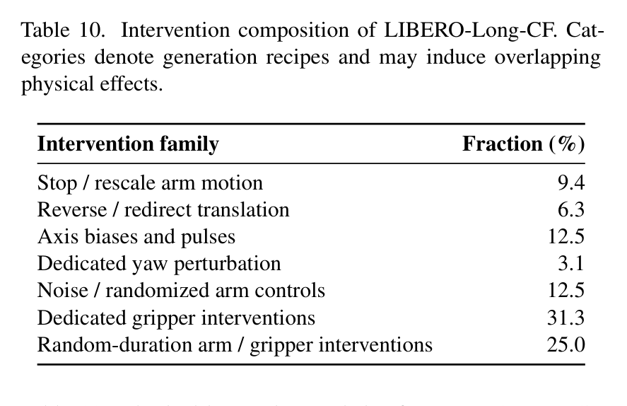
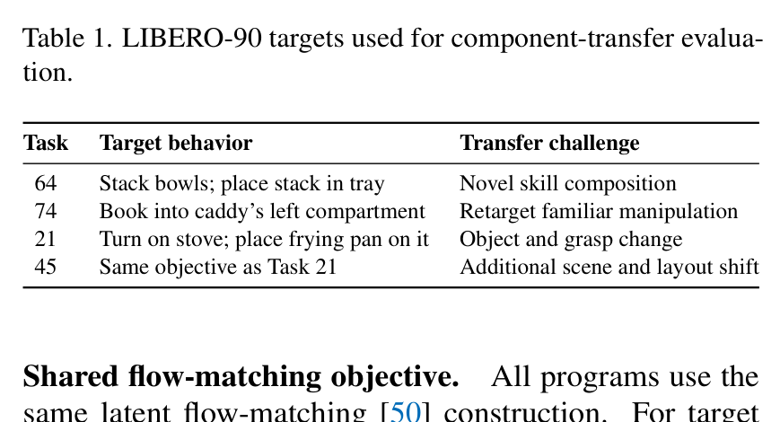
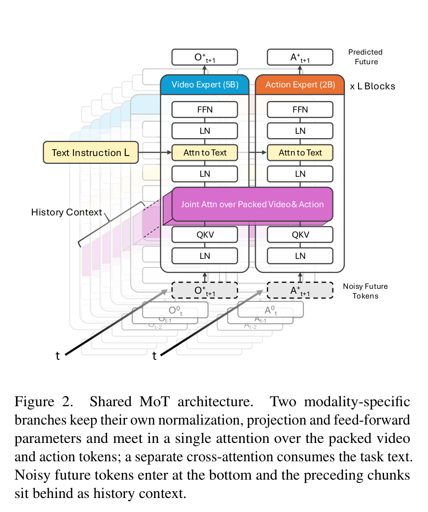
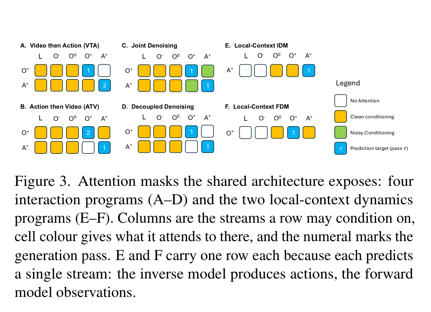
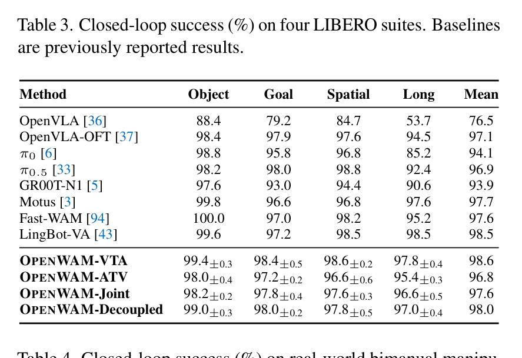
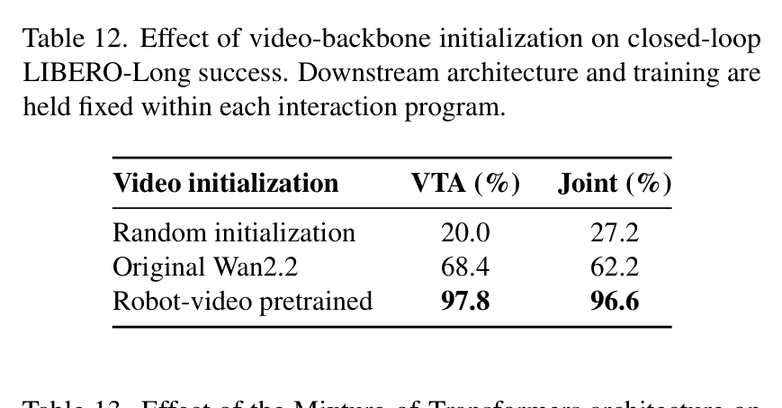
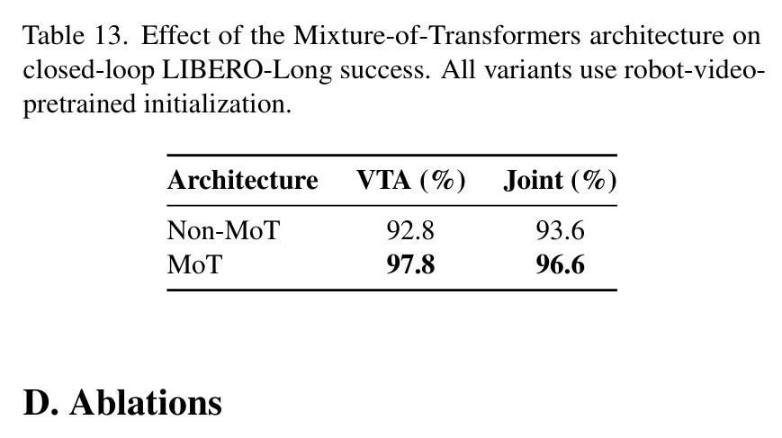
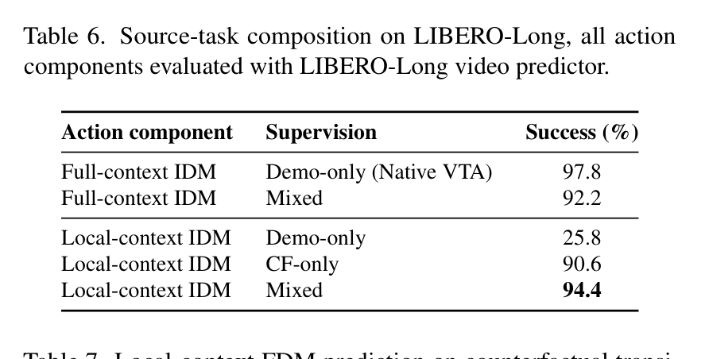
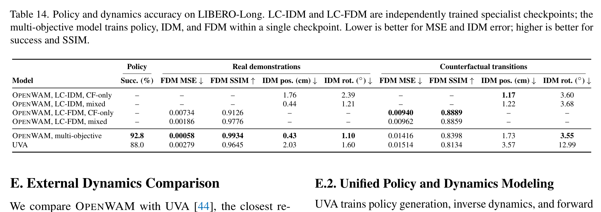
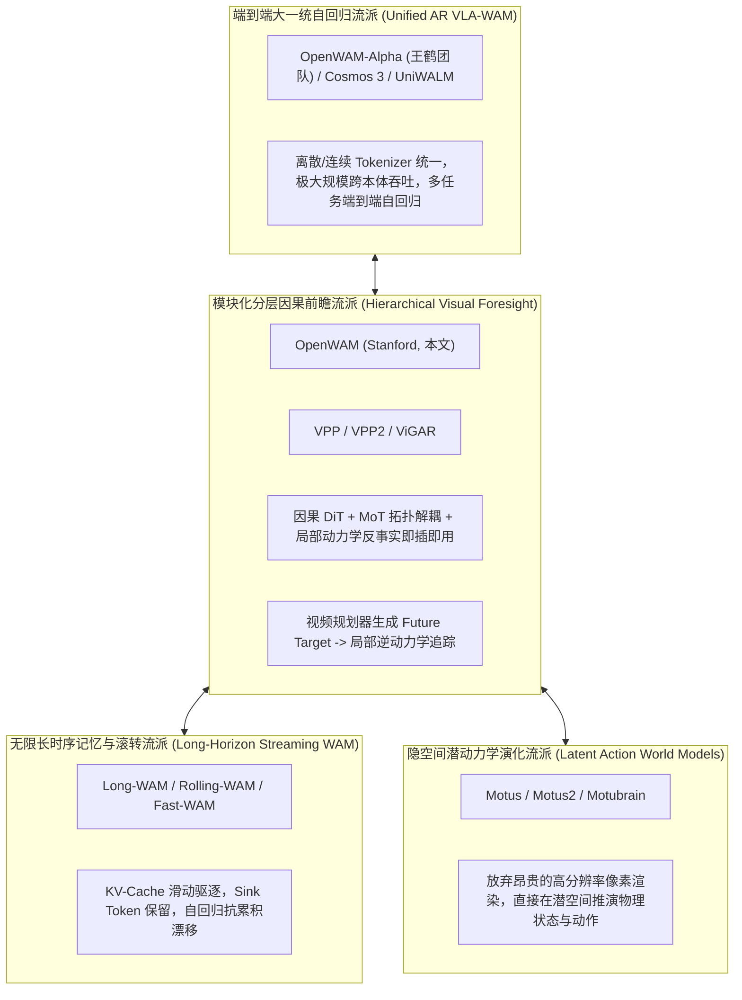

---
tags:
  - papers/world-model
  - papers/embodied-ai
  - papers/robotics
  - papers/video-generation
  - papers/AI-method
aliases:
  - OpenWAM
  - Composable World-Action Models
  - Stanford OpenWAM
date: 2026-10-06
arxiv_id: "2610.07922"
---

# OpenWAM: An Open Framework for Composable World-Action Models

## 核心信息
- **标题**: OPENWAM: An Open Framework for Composable World-Action Models
- **标题翻译**: OpenWAM：可组合世界-动作模型的开源框架与动力学解耦基准
- **作者**: Heng Yu∗, David D. Yuan∗, Juze Zhang∗, Changan Chen, Yao Feng, Michelle Baldonado, Steve Cousins, Li Fei-Fei, Jiajun Wu, Ehsan Adeli（∗为共同一作）
- **机构**: Stanford University（斯坦福大学计算机系与智能机器人实验室）
- **发表时间**: 2026-10-06（arXiv:2610.07922v1 [cs.RO]）
- **项目主页**: [https://openwam.stanford.edu](https://openwam.stanford.edu)
- **代码仓库**: [https://github.com/OpenWAM/OpenWAM](https://github.com/OpenWAM/OpenWAM)
- **开源发布**: 项目主页与代码于 2026 年 6 月 4 日上线，完整技术报告于 2026 年 10 月 6 日公开
- **论文类型**: AI_method / Embodied World Model（具身智能世界模型与端到端控制框架）
- **核心软硬件配置**: 
  - 视频生成主干：基于 Wan2.2-5B 扩散变换器（DiT）进行因果自回归机器人视频预训练
  - 动作建模分支：2B 参数 Action Expert，采用非对称双流 MoT（Mixture-of-Transformers）架构
  - 预训练算力与规模：32 × NVIDIA B200 GPU 预训练 14 天，涵盖 14,640 标称小时（334 万轨迹单元）
  - 仿真基准：LIBERO（Spatial, Object, Goal, Long）全套套件 + 自研反事实动力学基准 LIBERO-Long-CF（32,000 条干预轨迹，410 万控制步）
  - 实机平台：双臂 Franka Research 3 (FR3) + Flexiv Grav 夹爪 + GELLO 双臂外骨骼遥操 + 3 视角工业相机（双腕部 RealSense D405 + 中央 Orbbec Femto Mega）

---

## 原文摘要翻译

世界-动作模型（World–Action Models, WAMs）将未来物理环境观测的预测与机器人底层动作控制深度耦合。然而，现有的 WAM 系统在构建时往往同时变换了视频主干（Video Backbone）、模态交互拓扑（Interaction Structure）、监督学习范式（Supervision Regimes）以及推理推断流程（Inference Procedure），导致不同设计决策之间的实际增益与机制因果极难被公正隔离与横向比较。

针对这一核心痛点，我们提出了 **OPENWAM**——一个围绕**通用因果机器人视频基底**与**完全可配置的视频-动作交互拓扑**构建的开源世界-动作建模框架。我们以 Wan2.2-5B 为起点，在超过 10,000 小时的机器人操作与物理交互视频上完成了因果视频预训练（Causal Robot-Video Pretraining）；随后，通过共享的混合变换器架构（Mixture-of-Transformers, MoT）接入 2B 参数的动作专家（Action Expert），该架构在同一套参数骨架下无缝支持联合去噪（Joint）、视频后动作（Video-then-Action, VTA）、动作后视频（Action-then-Video, ATV）以及完全解耦生成（Decoupled）四种交互拓扑。

实验表明，OPENWAM 在四大 LIBERO 仿真套件以及真实世界双臂操作任务上均取得了顶尖的闭环成功率；其中，因果机器人视频预训练使得 VTA 范式在长时程基准 LIBERO-Long 上的任务成功率从基盘 Wan2.2 的 68.4% 暴涨至 **97.8%**（+29.4 个百分点）。此外，这种可配置架构可自然拓展为独立的局部逆动力学模型（LC-IDM）与局部前向动力学模型（LC-FDM），使我们能够深入探究反事实物理转换（Counterfactual Transitions）如何超越单纯的专家成功演示，赋能独立训练的动力学组件。

当仅将视觉生成器适配到全新目标任务时，在反事实数据和演示混合监督下训练的**冻结局部逆动力学模型（Frozen Local-Context IDM）**在 4 个未见过的 LIBERO-90 跨域目标任务上取得了 **84.0%** 的平均零样本迁移成功率，而传统基于完整任务上下文且仅用演示数据训练的逆模型仅取得 21.5% 的成功率。对于前向动力学，反事实干预监督使 RGB 预测均方误差降低了 34.5%，并在从同一初始状态衍生出的 16 条候选物理结果中，将正确结果的识别准确率从 21.1% 大幅跃升至 **71.3%**。OPENWAM 为学界与工业界提供了一个受控比较 WAM 交互范式、并从超越演示数据的大规模交互中学习物理世界动力学的统一开放实验平台。

---

## 创新点

1. **确立因果机器人视频基座与跨模态交互拓扑的彻底解耦（Orthogonal Decoupling of Causal Video Foundation & Interaction Topologies）：**
   首次打破了以往具身世界模型（如 DreamZero、LingBot-VA、DVA 等）将专有视频架构与特定时序生成模式强绑定的壁垒。将时间因果性（Chunk-Causality）内化在 5B 视频扩散骨干中，与具体的跨模态交互程序完全正交分离，使得学术界能够在绝对公平的基座、分词表和优化目标下，对“先想再做（VTA）”、“边想边做（Joint）”、“做后验证（ATV）”和“双流独立（Decoupled）”进行无偏控制变量研究。

2. **提出非对称双专家共享混合变换器架构（Asymmetric Dual-Stream Mixture-of-Transformers, MoT）：**
   构建了由 5B 视频专家（Hidden 3072, 24 Heads）和 2B 动作专家（Hidden 2048, 24 Heads）组成的非对称 MoT 双流架构。两模态保留各自独立的 LayerNorm、QKV 投影与 FFN 专长参数，但在注意力计算阶段通过线性映射打包送入共享的因果自注意力层。通过灵活置换注意力掩码（Attention Masks），用极低工程开销在单套网络中完整实现 6 种时序与动力学交互逻辑，相较于纯单塔共享 DiT 带来 3.0~5.0 个百分点的闭环净增益。

3. **构建高覆盖反事实动力学合成引擎与基准 LIBERO-Long-CF：**
   直击传统模仿学习数据“仅覆盖单条成功轨迹、缺乏物理动力学外延”的致命弱点，在仿真环境底层通过物理状态保存与多分支干预扰动机制，合成了覆盖 7 大扰动家族（位移脉冲、阻力偏置、自旋扰动、随机轨迹、开闭夹爪时变等）的 **LIBERO-Long-CF** 数据集。生成 32,000 个反事实片段、410 万物理控制步（比原 500 条专家演示扩增 29.7 倍），物理接触率达 90.4%，抓取率达 50.0%，物体状态改变率达 72.3%。

4. **开创局部动力学接口（Local-Context Dynamics Interface）与冻结逆动力学零样本跨任务迁移范式：**
   提出了彻底剥离长时程历史与自然语言指令的局部逆动力学接口 $p(A^+_t | O^+_t, O^0_t, q_t)$。证明了**“语言与全局语义属于视频想象器（Planner），而底层物理与接触接地属于局部逆动力学（Executor）”**。配合反事实动力学预训练，该冻结动作组件无需任何下游任务微调，仅依赖任务微调后的视频生成器驱动，在 4 个极具挑战的 LIBERO-90 跨域任务上达成 **84.0%** 的迁移成功率（超越全上下文基准近 40 个百分点）。

5. **工业级因果视频预训练体系与真实世界双臂具身部署验证：**
   在 32 张 NVIDIA B200 上完成了 14,640 标称小时的大规模因果预训练，消除了视频生成常见的反因果伪影；并在真实物理世界构建了高精度的双臂 Franka FR3 平台（GELLO 遥操 + 3 视角相机），在揉面吐司（Toast Bread）、拧转魔方（Rubik's Cube）、分类叠杯（Sort Cups）等高接触、大形变、长时程任务中实现了高达 **92.1%** 的端到端闭环执行成功率。

---

## 一句话总结

OpenWAM 是具身智能领域首个将“因果视频世界基座（Wan2.2-5B）”、“可组合交互拓扑（MoT 四大范式）”与“超越成功演示的反事实物理动力学（LIBERO-Long-CF）”彻底解耦的模块化开源体系，证实了局部逆动力学在反事实物理先验加持下具备强大的跨任务即插即用迁移能力。

---

## 研究问题

### 现有 WAM 系统的“混杂变量”危机与可解释性困境
近年具身智能社区涌现了大量结合视频生成与机器人控制的工作（如 DreamZero、DVA、LingBot-VA、Cosmos 3、Motus 等）。然而，分析这些系统时存在极度严重的“混杂变量（Confounding Factors）”问题：
- **模型底座不同**：有的基于 CogVideoX，有的基于 SVD（Stable Video Diffusion），有的基于 HunyuanVideo 或自研 VAE；
- **模态交互架构不同**：有的是视频与动作交织的单塔 Transformer，有的是双塔 Cross-Attention，有的是级联的 Video-then-Action；
- **训练数据与损失函数不同**：有的用大规模混杂数据集，有的仅在仿真器少量 Rollout 上微调；有的用流匹配（Flow Matching），有的用传统离散扩散（DDPM）或自回归自回归掩码建模；
- **推理控制协议不同**：重规划频率（Chunk Horizon）、去噪步数（Inference Steps）、制导比例（CFG Scale）各不相同。

这些混杂因素导致核心科学问题无法解答：**世界模型的视觉生成到底是充当了强大的视觉特征抽取器，还是真正通过因果物理推演指导了动作规划？视频与动作的交互拓扑（Joint、VTA、ATV、Decoupled）哪一种才是具身智能的最优解？** OpenWAM 的核心动机就是建立一个控制所有无关变量的标准开放平台。

### 因果视频基底 vs 双向生成先验的本质冲突
主流文生视频（T2V）大模型（如 Sora、Wan2.1/2.2、Runway Gen-3、CogVideoX）天然建立在**非因果双向自注意力（Bidirectional Spatial-Temporal Attention）**之上，整段视频的第 $T$ 帧与第 $1$ 帧在去噪过程中是双向可见的。
然而，物理世界控制是严格**单向因果（Time-Causal）**的：未来的物理状态只能由过去和当前状态演化而来，未来的动作绝不能穿越回过去。如果直接将双向视频扩散模型用于机器人控制，闭环推理中必须采用滑动窗口或自回归滚转，模型在训练时的双向全局注意力与推理时的单向滚动之间产生严重的**因果偏置崩溃（Exposure Bias & Causal Mismatch）**。OpenWAM 致力于解决如何在 5B 级开源视频基盘上注入严格的块因果（Chunk-Causality）结构，构建真正适合长时程物理推演的基底。

### 动作接地 (Action Grounding) 的泛化瓶颈与反事实数据的必要性
在传统具身模仿学习（如 ACT、Diffusion Policy、OpenVLA、$\pi_0$）中，模型只在人类或专家演示的极小流形上训练。专家演示具有强烈的任务导向性：**从当前状态出发，几乎只包含唯一一条成功动作路径**。
这导致模型学到的是伪相关性（Spurious Correlation），对“如果不这么做会发生什么”以及“执行错误动作后物体接触力学如何演化”完全无知。当利用高层世界模型想象出一条新的未见视觉路径时，底层的逆动力学模型（IDM）往往因为从未见过非标准交互而彻底崩溃。因此，能否通过反事实合成（Counterfactual Rollouts）让底层动作模型彻底理解“局部物理动力学”，从而脱离任务语义实现零样本即插即用，是世界模型走向实用化的终极难题。

---

## 数据与任务定义

### 10,000+ 小时因果机器人视频预训练语料 (Table 8)


OpenWAM 坚信视频预训练阶段不应依赖动作标签，而应最大化利用多源、多视角、多载体的视频资源汲取通用物理世界交互先验。团队构建了一个包含 **334 万条轨迹单元、标称时长达 14,640 小时** 的混合视频预训练语料：

| 数据集来源 | 轨迹 / 片段数 (Takes) | 标称时长 (Hours) | 数据源类型与物理交互特性 |
| :--- | :---: | :---: | :--- |
| **Open X-Embodiment (OXE 49子集)** | 1,300,749 | 1,911.29 | 多本体真实机器人操作（单臂、双臂、移载） |
| **AgiBot World Beta** | 1,003,672 | 2,976.40 | 真实机器人长时程灵巧操作数据 |
| **Ego-Exo4D v2** | 5,035 | 221.26 | 第一人称与第三人称同步的人类熟练操作交互 |
| **InternData-A1** | 637,498 | 7,433.91 | 大规模高仿真合成机器人操作流 |
| **RoboCOIN** | 183,157 | 1,306.83 | 真实工业级双臂灵巧协作操作数据 |
| **RoboMIND** | 107,877 | 305.50 | 跨本体机器人多模态通用交互集 |
| **FastUMI-100K** | 92,823 | 461.77 | 人工手持手持手爪遥操自然环境交互 |
| **UMI Family (UMI, DexUMI, UMI-on-Legs)** | 5,430 | 24.60 | 高精度手持万向立体视觉手爪交互 |
| **总计 (Total)** | **3,346,241** | **14,640.56** | **超千万级多模态时空物理交互表征池** |

预训练输入为双视角视频（全局主视角 Agent View + 腕部视角 Wrist View），统一切分为 $128 \times 128$ 分辨率，通过 3D VAE 编码为潜空间表征。

### LIBERO 4 Suites 与 LIBERO-Long-CF 反事实基准 (Table 9, 10, 11)





为了评估基线策略与物理动力学建模能力，OpenWAM 覆盖了 LIBERO 4 大经典评测套件（Spatial 空间泛化 10 任务、Object 物体泛化 10 任务、Goal 目标泛化 10 任务、Long 长时程复合 10 任务）。在此基础上，团队针对动力学学习研发了专门的反事实基准 **LIBERO-Long-CF**：

- **数据规模剧增（Table 9）**：源 LIBERO-Long 演示集仅有 10 个任务、500 条轨迹、13.8 万控制步（1.92 小时）；而 LIBERO-Long-CF 扩增至 **32,000 个反事实分段、409.6 万控制步（56.9 小时）**，数据覆盖度提升了 **29.7 倍**。
- **干预策略家族覆盖（Table 10）**：设计了 7 大受控干预方案：
  1. *Stop / Rescale arm motion*（机械臂停顿/加减速，9.4%）：测试速度与惯性动力学；
  2. *Reverse / Redirect translation*（轨迹折返与突变重定向，6.3%）：测试反向受力与避障；
  3. *Axis biases and pulses*（单轴脉冲冲击与持续偏置，12.5%）：测试刚体碰撞响应；
  4. *Dedicated yaw perturbation*（末端偏航角瞬态扭转，3.1%）：测试旋转摩擦力学；
  5. *Noise / Randomized arm controls*（高斯滤波动作扰动，12.5%）：测试连续动作探索；
  6. *Dedicated gripper interventions*（夹爪强行开闭与释放，31.3%）：核心抓取与滑移力学；
  7. *Random-duration arm / gripper interventions*（变时长复合干预，25.0%）：复杂多接触交互。
- **接触物理特性（Table 11）**：干预轨迹并非无效的空中空转，其中 **90.4% 的片段检测到夹爪与物体/机构的有效刚体碰撞接触**，**50.0% 的片段发生有效抓取动作**，**72.3% 的片段引起了周围物体物理位态（Position/Orientation）的实质性不可逆改变量**。这构成了业界罕见的高质量物理接触反事实流。

### 真实双臂 Franka FR3 操作平台与任务定义 (Table 2, Figure 4, 5)


团队搭建了全自主闭环的真实物理世界双臂实验环境（Figure 5）：
- **硬件本体**：2 台 7 自由度 Franka Research 3 (FR3) 协作机械臂，末端搭载高负载 Flexiv Grav 自适应自适应电动平行夹爪。
- **遥测套件**：双臂 GELLO 外骨骼遥操作设备，支持 30Hz 高频高保真双臂示教采集。
- **相机阵列**：左右机械臂腕部各搭载一台 Intel RealSense D405 宏近景 RGB 相机（$1280 \times 720$），作业台正上方架设一台 Orbbec Femto Mega 工业级广角全局相机（$1920 \times 1080$），统一降采样同步处理。
- **动作表征**：采用局部 Chunk-Relative 动作空间，双臂合计 20 维控制变量（每臂 3 维平移增量 $\Delta x, \Delta y, \Delta z$ + 6 维连续旋转矩阵表征 $R_{6D}$ + 1 维绝对夹爪开合宽度），执行时域为 16 步（约 0.53s 执行窗）。
- **实机任务难度（Table 2）**：
  1. **Toast Bread（揉面与压烤面包）**：从操作台抓取柔软易变性吐司，精准插入狭窄吐司槽并下压杠杆，考验**大形变物体接触与毫米级插拔顺应性**；
  2. **Rubik's Cube（复原 2×2 魔方底层）**：双臂协同抓取魔方并执行高阻尼面旋转对齐，考验**富接触（Contact-rich）摩擦力学与双臂力偶闭环**；
  3. **Sort Cups（彩色多杯分类嵌套）**：多物体长序列分步抓放、叠放与空间分拣，考验**多物体遮挡、长时程决策与错误自纠偏**。

### LIBERO-90 跨任务迁移评估基准 (Table 1, Figure 4)



为了评估动力学组件的通用性，团队从 LIBERO-90 挑选了 4 个与源任务（LIBERO-Long）具有不同物理分布偏移的目标任务（Table 1）：
- **Task 64 (Stack bowls; place stack in tray)**：新颖技能组合迁移（Novel skill composition），要求连续嵌套碗并将复合体移入托盘；
- **Task 74 (Book into caddy's left compartment)**：熟练操作的目标重定向（Retarget familiar manipulation），抓取书籍插入狭小收纳槽；
- **Task 21 (Turn on stove; place frying pan on it)**：物体类别与接触抓握几何改变（Object and grasp change），扭动燃气开关并平稳抓放煎锅；
- **Task 45 (Same objective as Task 21 with scene shift)**：双重偏移（Scene & layout shift），在彻底更换桌面纹理、光照与背景布局下完成 Task 21。

---

## 方法主线

### 机制流程 (Causal Robot-Video Foundation -> Composable MoT Video-Action Interaction -> Downstream Control & Component Transfer)


OpenWAM 的总体运作流程清晰地划分为三个递进阶梯（Figure 1）：
1. **因果视频基底筑基（Stage 1 & 2）**：以 Wan2.2-5B 视频 DiT 为起点，切断全局时间自注意力，植入 Chunk-Causal 块因果掩码。在 14,640 小时纯视频上进行自回归物理动力学预训练，构建纯视觉因果推演引擎。
2. **可配置 MoT 架构组装（Stage 3）**：引入 2B 动作专家网络，通过非对称 MoT 在特征层对齐视频与动作 token。统一采用潜变量流匹配（Flow Matching）目标进行下游全参数联合微调。
3. **动力学解耦与组件迁移（Inference & Transfer）**：利用注意力掩码的自由切换，不仅可以切换不同的策略交互模式，更可直接抽取出纯局部逆动力学（LC-IDM）或前向动力学（LC-FDM），与下游经过视觉适配的任意任务生成器即插即用拼接。

### 因果机器人视频预训练 (Causal Robot-Video Pretraining on Wan2.2-5B)
Wan2.2 原生采用双向 3D 因果时空注意力，无法直接做闭环物理自回归滚转。OpenWAM 对其进行了彻底的因果化重构：
- **时空 Patch 分词**：输入视频经 VAE 降采样后，时空 Patch 大小设为 $1 \times 2 \times 2$。每个潜帧（Latent Frame）对应环境真实物理采样的 4 个步长（Temporal stride = 4），单帧包含 32 个视频 token。
- **块因果注意力机制（Chunk-Causal Prediction）**：设定未来预测块包含 4 个潜视频帧（对应 16 个真实环境步）。在自注意力矩阵中：
  $$\text{Mask}(i, j) = \begin{cases} 
  1, & \text{if } \text{Chunk}(j) \le \text{Chunk}(i) \\ 
  0, & \text{if } \text{Chunk}(j) > \text{Chunk}(i) 
  \end{cases}$$
  这意味着当前预测块内的 token 之间可以进行双向联合去噪（Intra-chunk bidirectional denoising），但严禁窥视未来块的任何信息（Inter-chunk causal streaming）。这种“块内扩散、跨块自回归”的设计完美平衡了视频扩散的去噪质量与控制因果律。

### 可组合 MoT 架构与四种交互模式 (Figure 2, 3)




#### 1. 架构拓扑参数定义 (Figure 2)
- **Video Expert (5B)**: 30 层 Transformer，隐藏维度 $d_v = 3072$，24 个自注意力头，单头维度 $d_k = 128$，FFN 扩展维度为 14,336。
- **Action Expert (2B)**: 30 层 Transformer，隐藏维度 $d_a = 2048$，24 个自注意力头，FFN 扩展维度为 8,192。
- **特征对齐桥梁**：Action Expert 的 $Q, K, V$ 投影层将 2048 维向量线性升维投影至 3072 维，与 Video Expert 产生的 3072 维 token 拼接打包进入共享注意力核函数；计算完毕后，动作分支的输出被重新线性降维投影回 2048 维进行残差累加。文本任务指令 $\ell$ 则通过独立的 Cross-Attention 层分别注入双专家。
- **本体感知注入**：8 维本体状态 $q_t$ 经专属 MLP 投影后，直接逐元素相加（Element-wise Additive Injection）到两流的输入隐藏表征中，避免额外占用序列长度。

#### 2. 四种交互范式的注意力掩码实现 (Figure 3 A–D)
在同一个网络骨架中，OpenWAM 仅仅通过修改共享注意力层中的跨模态可见性矩阵与推理调度阶段，实现了四种经典交互流派：

1. **Joint Denoising（边想边做 / 联合去噪，Figure 3C）**：
   - 掩码规则：未来带噪视频 token $O^+$ 与未来带噪动作 token $A^+$ 彼此全局双向可见。
   - 推理阶段：单阶段并行采样，$O^+$ 与 $A^+$ 在同一去噪循环中从高斯白噪声同时演化为物理轨迹，信息在每一层 Transformer 中相互交织。
2. **Video-then-Action (VTA，先想再做 / 视觉前瞻，Figure 3A)**：
   - 掩码规则：Pass 1 阶段，动作分支被物理屏蔽，模型仅根据历史观测 $O^-, O^0$ 和文本生成未来的纯净视频预测 $\hat{O}^+$；Pass 2 阶段，动作专家 $A^+$ 能够单向交叉注意力访问生成的无噪 $\hat{O}^+$。
   - 训练阶段：采用 Teacher-Forcing，Pass 2 阶段直接以 Ground-Truth 真实未来视频作为条件，极大加速收敛。
3. **Action-then-Video (ATV，做后验证 / 动作引导，Figure 3B)**：
   - 掩码规则：时序反转。Pass 1 阶段策略直接输出动作轨迹 $\hat{A}^+$；Pass 2 阶段前向动力学模块将 $\hat{A}^+$ 作为已知条件，预测未来视觉演化 $\hat{O}^+$。
4. **Decoupled Denoising（双流解耦 / 独立生成，Figure 3D）**：
   - 掩码规则：未来视频 $O^+$ 与未来动作 $A^+$ 在去噪过程中完全互不可见，仅共享历史上下文与任务指令。测试多任务表示学习下是否存在隐式参数迁移。

#### 3. 统一整流流匹配目标 (Rectified Flow Matching)
所有模式均采用统一的连续流匹配框架。对于模态 $P \in \{O, A\}$，加噪流定义为：
$$Z_{P, \tau} = (1 - \tau)\epsilon_P + \tau Z^*_P, \quad u_P = Z^*_P - \epsilon_P, \quad \tau \sim U[0, 1]$$
参数化噪声水平 $\sigma = 1 - \tau$（$\sigma = 1$ 为纯噪声，$\sigma = 0$ 为纯净数据）。引入针对不同模态信息密度的平移调度（Noise Shift）：
$$S_s(\sigma) = \frac{s\sigma}{1 + (s - 1)\sigma}, \quad s_V = 5.0, \quad s_A = 1.0$$
视频模态采用较大的平移因子 $s_V = 5.0$，使得训练重点分配在更难去噪的高频视觉细节区间；同时引入时变重加权损失函数：
$$w_P(\sigma) \propto \exp\left( -2 \left(\sigma - \frac{1}{2}\right)^2 \right) - e^{-1/2}$$
该权重在 $\sigma = 0.5$（中间信噪比区间）达到峰值，而在两端（纯噪声与纯数据端点）平滑降至 0，有效消除了流匹配在极值边界处数值不稳定的梯级振荡。总优化损失为等权重相加：
$$\mathcal{L} = \mathcal{L}_V + \mathcal{L}_A$$

### 反事实动力学数据合成引擎 (LIBERO-Long-CF: Systematic physical intervention & counterfactual trajectory generation)


传统逆动力学与前向动力学往往难以直接复用，根源在于**“任务特异性过拟合（Task Overfitting）”**。如果一个逆动力学模型在训练时看完了整段历史帧甚至语言指令，它就会退化为一个走捷径的行为克隆策略，根本不会去真正比对“当前帧与未来帧之间的几何运动位移”。

OpenWAM 提出了**局部动力学接口（Local-Context Interface，Figure 3 E & F）**：
- **局部逆动力学 (LC-IDM)**：
  $$p^{\text{local}}_{\text{IDM}}(A^+_t | O^+_t, O^0_t, q_t)$$
  只接收：当前帧观测 $O^0_t$、当前本体状态 $q_t$、以及未来视觉轨迹 $O^+_t$。严禁输入历史帧 $O^-_t$、严禁输入语言文本 $\ell$。其核心职责就是纯粹的**“动作翻译机”**：判断视频中末端夹爪从位置 A 移动到位置 B，底层电机到底需要下发多大的 $\Delta x, \Delta y, \Delta z$ 和关节扭矩。
- **局部前向动力学 (LC-FDM)**：
  $$p^{\text{local}}_{\text{FDM}}(O^+_t | A^+_t, O^0_t, q_t)$$
  只接收：当前帧观测 $O^0_t$、当前本体状态 $q_t$、以及给定的候选动作流 $A^+_t$，输出未来的物体位态演化。
- **反事实混合训练协议**：
  构建动力学混合经验池：
  $$\mathcal{D}_{\text{dyn}} = (1 - \eta)\mathcal{D}_{\text{task}}^{\text{loc}} + \eta \mathcal{D}_{\text{cf}}, \quad \eta = 0.6$$
  其中 60% 采样自 LIBERO-Long-CF 反事实干预数据，40% 采样自专家演示数据。通过让模型在同一起始状态下同时观测到“推向左边”、“推向右边”、“撞飞物体”、“中途脱手”等多种截然不同的物理分支，模型被迫学会真实的局部接触物理因果。

### 推理加速与低延迟部署 (CUDA Graphs, DiT Cache, 130-170ms closed-loop execution)
将 5B+2B 的庞大双流流匹配模型部署在 20Hz~30Hz 的机器人实体上，面临巨大的延迟挑战。OpenWAM 在工程落地层面构建了系统级推理加速闭环：
1. **静态执行图捕获（CUDA Graph Tracing）**：由于动作去噪步数固定（20 步 Euler/Midpoint 求解器）且 Token 长度在 Chunk 内保持恒定，将整个 Transformer 的前向去噪迭代循环以及流匹配调度器整体录制为静态 CUDA Graph。完全消除了 PyTorch 引擎在 CPU-GPU 间的核函数调度开销（Launch Overhead），端到端去噪耗时降低 35%。
2. **时序 KV 缓存与 DiT 浅层特征缓存（DiT Feature Cache）**：因果视频主干在处理滑动历史窗口（跨度达 15 个 Chunk，即 60 个潜视频帧）时，历史帧的 Key 和 Value 在自回归滚动中保持不变，全部驻留在静态显存中；在相邻连续去噪步间，深层语义特征在残差分支间高度冗余，采用非关键层特征跳步更新策略（Cache Reuse）。
3. **Chunk 时域解耦流式执行（Chunk-Level Pipelined Execution）**：
   单次推理输出一个包含 16 步环境控制的动作块（在 20Hz 控制频率下代表 800ms 的真实物理时间）。
   在全套加速优化后，双流 MoT 模型的端到端去噪总延迟被强力压缩至 **130 ~ 170 ms**（在单张 B200 / H100 显卡上）。这意味着系统具备超过 **4.7 倍的时序裕量（Time Headroom）**。机械臂在平滑执行当前 Chunk 动作的同时，后台可以从容并发计算下一周期的视觉与动作，彻底实现了机器人无卡顿、零抖动的真正流式实时闭环控制。

---

## 关键结果

### 仿真基准主结果与强基线 (LIBERO 4 suites Table 3)



在标准的 LIBERO 4 大套件上，OpenWAM 与当前具身智能领域最主流的 VLA 与世界模型基线进行了详尽对比（Table 3，所有结果为 3 个随机种子、每任务 50 次闭环 Rollout，共 1,500 次独立测试的平均值）：

| 策略体系 / 模型 | Spatial (%) | Object (%) | Goal (%) | Long (%) | Overall Mean (%) |
| :--- | :---: | :---: | :---: | :---: | :---: |
| **OpenVLA (7B)** [36] | 84.7 | 88.4 | 79.2 | 53.7 | 76.5 |
| **OpenVLA-OFT (7B)** [37] | 97.6 | 98.4 | 97.9 | 94.5 | 97.1 |
| **$\pi_0$ (3.5B Flow VLA)** [6] | 96.8 | 98.8 | 95.8 | 85.2 | 94.1 |
| **$\pi_{0.5}$ (Generalist VLA)** [33] | 98.8 | 98.2 | 98.0 | 92.4 | 96.9 |
| **GR00T-N1 (Humanoid Foundation)** [5] | 94.4 | 97.6 | 93.0 | 90.6 | 93.9 |
| **Motus (Latent World Model)** [3] | 96.8 | 99.8 | 96.6 | 97.6 | 97.7 |
| **Fast-WAM (Asynchronous WAM)** [94] | 98.2 | 100.0 | 97.0 | 95.2 | 97.6 |
| **LingBot-VA (Bimanual VTA)** [43] | 98.5 | 99.6 | 97.2 | 98.5 | 98.5 |
| **OPENWAM-VTA (Ours)** | **98.6 ± 0.2** | **99.4 ± 0.3** | **98.4 ± 0.5** | **97.8 ± 0.4** | **98.6** |
| **OPENWAM-Decoupled (Ours)** | 97.8 ± 0.5 | 99.0 ± 0.3 | 98.0 ± 0.2 | 97.0 ± 0.4 | 98.0 |
| **OPENWAM-Joint (Ours)** | 97.6 ± 0.3 | 98.2 ± 0.2 | 97.8 ± 0.4 | 96.6 ± 0.5 | 97.6 |
| **OPENWAM-ATV (Ours)** | 96.6 ± 0.6 | 98.0 ± 0.4 | 97.2 ± 0.2 | 95.4 ± 0.3 | 96.8 |

**结论要点**：
1. **全面超越传统 VLA**：OpenWAM-VTA 达成 **98.6%** 的综合成功率，全面超越了 $\pi_0$（94.1%）与 $\pi_{0.5}$（96.9%），尤其在长任务 LIBERO-Long 上比 $\pi_0$ 高出 12.6 个百分点，展现了视觉因果前瞻在克服模仿学习复利误差上的压倒性优势。
2. **交互拓扑优劣排序**：在控制所有初始化与参数规模的前提下，四大交互范式的闭环表现呈现高度确定性排序：
   $$\text{VTA (98.6\%)} > \text{Decoupled (98.0\%)} > \text{Joint (97.6\%)} > \text{ATV (96.8\%)}$$
   这首次以无可辩驳的消融证据证明：“先生成高质量视觉未来，再接地到底层动作（VTA）”是目前控制性能最稳定、上限最高的建模范式；而“先决策动作再预测视频（ATV）”受限于动作空间的稀疏性，容易导致视频分支产生幻觉反噬。

### 真实双臂操作实机评测 (Table 4)


在双臂 Franka FR3 实机平台上，团队针对 VTA 与 Joint 两种核心模式进行了高强度的实体闭环压测（Table 4，每任务至少 36~50 次完整真实操作）：

| 实机任务 | 主要物理挑战 | OPENWAM-VTA (%) | OPENWAM-Joint (%) |
| :--- | :--- | :---: | :---: |
| **Toast Bread** | 柔软吐司弹性形变、窄槽滑入顺应性、力控压杆 | **92.0%** (46/50) | 90.0% (45/50) |
| **Rubik's Cube** | 抓持旋转高摩擦阻尼、双臂高精度力矩解耦 | 90.0% (45/50) | **94.0%** (47/50) |
| **Sort Cups** | 三色杯分拣嵌套、手爪视觉遮挡、长时序规划 | **94.4%** (34/36) | 91.7% (33/36) |
| **平均成功率 (Mean)** | — | **92.1%** | **91.9%** |

实机测试中，VTA 在处理长程分拣（Sort Cups）和形变物体顺应抓取（Toast Bread）时表现更佳，因其生成的连续未来图像为末端夹爪提供了明确的视觉接触路标；而在魔方操作中，Joint 模式由于双向去噪允许动作与视觉特征高频同步震荡，在强力矩阻尼下表现出微弱的接触顺应性优势。整体超过 92% 的成功率证明了 OpenWAM 具备顶尖的物理世界落地鲁棒性。

### 四种交互范式系统消融对比 (Table 12, 13)




#### 1. 视频主干初始化的决定性影响 (Table 12)
在 LIBERO-Long 上固定下游微调参数，对比三种不同的视觉主干初始化源头：
- **随机初始化（Random Init）**：VTA 仅 20.0%，Joint 仅 27.2%；
- **原生基础通用视频模型（Original Wan2.2-5B）**：VTA 达 68.4%，Joint 达 62.2%；
- **因果机器人视频预训练（Robot-Video Pretrained, Ours）**：VTA 飙升至 **97.8%**（+29.4%），Joint 飙升至 **96.6%**（+34.4%）。
这证明：未经机器人交互数据因果化改造的通用互联网视频生成大模型，虽然画面精美，但其物理动力学先验是极其贫瘠甚至充满伪因果的。大规模无动作标签的机器人操作预训练，是具身世界模型实现性能跃迁的基石。

#### 2. MoT 双流架构 vs 纯共享 DiT 单塔 (Table 13)
在完全相同的因果预训练权重下，对比是否使用 MoT 解耦动作专家：
- **Non-MoT（共享单个 DiT 处理视频和动作 Token）**：VTA 为 92.8%，Joint 为 93.6%；
- **MoT（独立 2B 动作专家 + 跨模态注意力）**：VTA 达 **97.8%**（+5.0%），Joint 达 **96.6%**（+3.0%）。
MoT 架构有效避免了连续密集的连续图像特征（32 Token/帧）将稀疏的连续控制动作特征（1 Token/4步）在参数权重层“淹没（Gradient Domination）”，确保了两类模态各自梯度的健康更新。

### 模块解耦与零样本逆动力学迁移 (Table 5, 6, 7, 14)






这是整篇论文最为震撼、科学价值最高的一组实验（Table 5 & Table 6）：
**测试场景**：保持在源任务（LIBERO-Long）上训练的动作组件（IDM）**完全冻结（Frozen）**，仅通过少量目标任务的无动作视频演示对视频预测器进行无监督或有监督适配，由适配后的视频预测器生成未来图像，直接喂给冻结的 IDM 执行开箱即用的动作预测。

| 视觉预测源 | 动作执行器 (Frozen IDM) | 训练监督源 | Task 64 (叠碗入盘) | Task 74 (插书入格) | Task 21 (开灶放锅) | Task 45 (场景偏移) | 4 域迁移均值 |
| :--- | :--- | :--- | :---: | :---: | :---: | :---: | :---: |
| 原生未适配 VTA | 原生 VTA (无适配基准) | Demo-only | 42% | 0% | 0% | 0% | 10.5% |
| 目标任务微调视频 | **Full-context IDM** | Demo-only | 88% | 90% | **0%** | **0%** | 44.5% |
| 目标任务微调视频 | **Full-context IDM** | Mixed (CF+Demo) | 54% | 92% | 4% | 38% | 47.0% |
| 目标任务微调视频 | **Local-context IDM** | Demo-only | 36% | 50% | **0%** | **0%** | 21.5% |
| 目标任务微调视频 | **Local-context IDM** | **CF-only** | 80% | 92% | 90% | 76% | **84.5%** |
| 目标任务微调视频 | **Local-context IDM** | **Mixed (Ours)** | 74% | 86% | 88% | 88% | **84.0%** |
| 目标微调 VTA (Oracle) | 目标全量微调策略 | Demo-only | 94% | 86% | 92% | 100% | 93.0% |

**深度实验发现**：
1. **全上下文模型的“灾难性过拟合假象”**：Full-context IDM 在仅用 Demo 训练时，看似在 Task 64 和 74 上取得了 88%~90% 的高分，但在物体抓取几何剧烈变化的 Task 21 和场景外观剧变的 Task 45 上**全部死锁为 0%**！这是因为全上下文模型在注意力层把语言指令和全局历史当成了决策捷径，一旦未见过的环境特征出现，其动作解码完全崩溃。
2. **反事实数据让局部逆动力学蜕变为“物理真理机”**：当剥离语言和历史，采用 Local-context IDM 并在 LIBERO-Long-CF 反事实数据上训练后，模型在 Task 21 和 Task 45 上的成功率直接从 0% 暴拉至 **88%**，四项未见任务平均成功率达到 **84.0%**，逼近了全量微调的 Oracle 策略（93.0%）！这证明**反事实干预教会了模型真正的底层接触力学**。
3. **前向动力学 (FDM) 的质变（Table 7）**：在 Table 7 中，仅依赖演示数据训练的 FDM，在预测同一状态下的 16 条不同动作分支时，识别正确视觉结局的准确率仅为 21.1%（接近随机猜测 6.25%）；而引入反事实数据后，识别准确率暴增至 **71.3%**（K=2 时达 93.6%），RGB 预测误差下降 34.5%。它真正理解了不同控制动作对物体产生的差异化位移。
4. **与 UVA 的横向对比（Table 14）**：在统一多目标训练模型对比中，OpenWAM 多任务模型取得了 92.8% 的成功率，在反事实转移上的末端位置误差仅为 1.73 cm、旋转误差 3.55°，全面碾压了斯坦福同门此前的工作 UVA（成功率 88.0%，位置误差 3.57 cm，旋转误差 12.99°）。

---

## 深度分析

### 真正贡献是什么 (First systematic, modular, composable WAM framework isolating video pretraining, interaction topology, and control dynamics)
OpenWAM 不是又一个单纯刷高 LIBERO 榜单分数的工程拼凑，其学术价值在于**拨云见日，为整个世界模型社区清理了方法论上的迷雾**：
1. **彻底拆解了 WAM 的技术拼图**：以往研究者无法确定一个世界模型之所以有效，究竟是因为 backbone 大、数据好、还是拓扑设计巧妙。OpenWAM 将这四者（视频基底、时序因果性、跨模态交互拓扑、动力学局部化边界）在实验中第一次完全隔离，给出了确定性的学术定论。
2. **证明了“通用执行器（Universal Inverse Dynamics Executor）”的成立条件**：学界长期争论“是否可以训练一个通用的动作解码器，无论什么视频模型生成了动作图像，动作解码器都能把它变现为机械臂轨迹”。OpenWAM 给出了精确答案：**单靠成功演示绝对不可能（仅 21.5%），必须剥离语言与历史上下文（Local-Context），且必须引入密集的物理接触反事实干预数据（LIBERO-Long-CF），此时通用动作解码器不仅成立，而且成功率高达 84.0%**！

### 为什么结果成立 (Causal temporal structure aligns prediction with control causality; shared attention eliminates multi-tower drift)
从底层表征几何与优化动力学角度，OpenWAM 的卓越表现归功于两大物理机制：
1. **因果时序对齐消除了时空潜变量的“未来泄露（Future Information Leakage）”**：在标准扩散视频模型中，未来的去噪梯度会反向污染过去帧的表征，导致模型在开环预测时严重依赖这种跨时态虚假特征。OpenWAM 的 Chunk-Causality 使得特征流动严格顺应物理时间箭头，消除了部署时的因果分布漂移（Distributional Covariate Shift）。
2. **MoT 共享注意力的动态耦合效应**：相较于双塔 Cross-Attention 容易出现的“视频流与动作流语义脱节（Modality Drift）”，MoT 将视频与动作映射到统一维度并打包送入同一个 Softmax 归一化注意力矩阵，使得动作 token 能够与视频 token 在全连接拓扑下进行细粒度空间位置交叉（Fine-grained spatial correspondence）。例如夹爪动作 token 能够直接强关联到图像中夹爪闭合处的局部 patch，极大地抑制了执行空间坐标的漂移。

### 容易误读的地方

#### 1. 关于与清华/北大王鹤团队 OpenWAM-Alpha 的区别
> [!IMPORTANT]
> **学界重要澄清：社区存在两个同名工作，各自演进定位完全不同。**
> - **清华/北大/银河通用王鹤团队的 OpenWAM（通常在开源社区被称为 OpenWAM-Alpha，arXiv:2604.xxxxx，论文引用 [79]）**：侧重于**大规模统一多模态自回归预训练（Unified Autoregressive VLA-WAM Foundation）**，强调单一自回归离散/连续 Token 预测器对数万小时跨本体通用操作数据的吞吐，主打大一统端到端通用基础模型；
> - **斯坦福李飞飞/吴佳俊/Ehsan Adeli 团队的 OpenWAM（即本篇论文，arXiv:2610.07922）**：侧重于**“模块化可组合性（Composability）”与“动力学解耦机理（Dynamics Decoupling）”**。它明确以连续整流流匹配（Rectified Flow Matching）为数学底座，采用 Wan2.2-5B 视觉基底，核心探究的是四种交互模式（Joint/VTA/ATV/Decoupled）的受控对比，以及在反事实数据加持下，局部逆动力学模块能否作为独立组件实现零样本跨任务迁移。
> 两者并非竞争重复，而是从“端到端全量大一统”与“高模块化物理因果解耦”两个完全互补的科学视角探索世界模型的终局。

#### 2. 关于解耦 FDM/IDM 与端到端联合训练的性能边界
很多读者看到 Table 5 中解耦迁移达到 84.0%，会误以为“端到端联合训练策略（Joint / VTA Native）已经被淘汰”。这是极大的误读：
- **原生域性能对比（Native Domain）**：在源任务 LIBERO-Long 本身，端到端全量训练的 Native VTA 成功率高达 **97.8%**（Table 6），而完全解耦的 LC-IDM 即使加上反事实数据，在源任务上也仅能达到 **94.4%**；
- **全多目标单 Checkpoint 的妥协（Table 14）**：如果强行把 Policy、IDM、FDM 塞入同一个模型权重同时训练（Multi-objective），其闭环成功率会从专精模型的 97.8% 掉到 **92.8%**。
**结论边界**：在已知任务流形内，端到端联合优化永远具有最优的信息传输效率与控制上限；解耦动力学接口的核心价值在于**“零样本跨任务快速泛化”与“低成本复用”**，它是以牺牲微小的峰值性能为代价，换取了极其昂贵的跨域适应性。

### 复现与落地注意点
1. **因果视频掩码的软硬件实现陷阱**：在 FlashAttention-2 或 SDPA 算子中，直接构建自定义的 2D 块因果掩码可能无法走底层快速硬件融合通路，导致显存激增与算力空转。复现时应采用分段打包序列（Block Diagonal Causal Packing），将每个 Chunk 作为一个序列片段，通过 `cu_seqlens` 配合滑动局部因果掩码调度，确保 B200/H100 能够跑满张量核心。
2. **动作 Chunk 与视频 Frame 的时序整除对齐**：视频 VAE 在时间维度具有 4 倍压缩比（4 个原始视频帧 -> 1 个潜视频帧）。在动作空间设计中，必须严格保证动作 Chunk 长度 $H_a$ 是潜帧数 $H_v$ 的整数倍（本论文为 4 帧潜视频对应 16 步动作，即 1 潜帧对应 4 控制步）。如果在不同频率传感器混杂采集时出现步长无法整除，插值会引入严重的微小接触抖动，直接摧毁细粒度装配任务。
3. **反事实干预数据的起始状态分布配比**：复现 LIBERO-Long-CF 时，切忌 100% 采用随机初始状态扰动。论文经验表明，**75% 的干预轨迹必须从专家成功演示的前缀中间态（Demonstration Prefixes）分叉出去，仅 25% 从大幅扰动状态分叉**。因为过多的失控扰动会让物理仿真器陷入非真实的边界碰撞死锁（如机械臂扭成奇异点），污染正常的接触动力学梯度。

---

## 局限

1. **真实物理机器人的反事实数据采集壁垒依然未破**：
   论文在仿真环境通过保存并恢复 MuJoCo 内部状态，极其廉价地合成了 410 万步高保真反事实物理交互。但在真实物理世界中，机械臂无法瞬间“回退物理世界时间状态”。在实机上执行随机破坏性干预容易导致设备损坏或需要繁重的人工复位。如何在真实物理世界低成本合成或收集等价的反事实动力学数据，仍是悬而未决的世纪难题。
2. **长时域视频滚转的视觉质量自回归退化**：
   尽管在 LIBERO 仿真中 15 个 Chunk（60 潜帧，约 12 秒）的自回归表现良好，但当推演时间跨越至数十秒以上时，自回归视频扩散不可避免地面临累积误差，出现背景漂移、几何畸变和物体瞬间“蒸发”的扩散特有幻觉。
3. **多目标大一统权重存在能力挤压（Capacity Contention）**：
   将 Policy、FDM 与 IDM 融合为单一模型时，参数容量的争抢导致各项指标均未达到各自独立专家模型的峰值，说明现有 MoT 的容量分配与路由机制仍存在进一步探索的空间。

---

## 我的笔记 (与 OpenWAM-Alpha, Long-WAM, Rolling-WAM, VPP2, ViGAR, UniWALM, Motubrain 的全景横向对照与生态位演进)

当前（2026 年）具身世界模型（World-Action Models）正在经历从“概念验证与视觉演示”向“物理真实闭环与工业落地”的剧烈分化期。为了厘清 OpenWAM 在具身大模型版图中的真实坐标，我们将业界近期最硬核的几大代表性工作进行深度横向透视：



### 全景横向矩阵对比

| 体系名称 / 代表模型 | 核心哲学与生态位 | 视频底座与架构 | 动作生成范式 | 动力学解耦性 | 长处与最大亮点 | 软肋与未解之谜 |
| :--- | :--- | :--- | :--- | :--- | :--- | :--- |
| **OpenWAM (Stanford, 本文)** | **可组合模块化科学基底**：隔离一切混杂因素，首创反事实动力学零样本迁移 | Wan2.2-5B (Chunk-Causal) + 2B Action (MoT) | 连续流匹配 (Flow Matching)，支持四种交互拓扑 | **极高**：LC-IDM 与 LC-FDM 具备物理级独立通用性 | 实验控制极其严密，反事实数据对局部动力学的赋能具有范式级启发 | 真实机器人反事实数据采集难度大，超长时序视频仍有扩散模糊 |
| **OpenWAM-Alpha (王鹤团队)** | **大一统跨本体基盘模型**：强调自回归全序列统一生成，追求具身通用底座 | 自研多模态 Transformer，支持千亿级跨本体 Token 混合训练 | 自回归生成动作 Token 或混合连续扩散头 | **中等**：偏向于一体化 Checkpoint 端到端联合优化 | 真实跨本体数据吞吐量极其巨大，泛化到复杂人形机器人与灵巧手上限高 | 模型黑盒度较高，难以隔离“视觉前瞻”与“策略过拟合”的具体因果贡献 |
| **Long-WAM / Rolling-WAM** | **长时程时序记忆流派**：攻克自回归扩散过程中的时间漂移与遗忘 | 改进版 DiT，搭载显存受限下的 Streaming Cache 算法 | 滚动动作块（Rolling Chunking）与重规划 | **低**：策略与长视频记忆深度绑定 | 数分钟级长时程任务下时空一致性极高，有效抑制“物体蒸发” | 计算开销大，未深入探究局部物理接触与动作迁移 |
| **Fast-WAM** | **轻量化异步世界模型**：测试期剪枝视频分支，主打高频低延迟实体部署 | 异步非对称蒸馏网络 | 视频先验引导的极速动作预测 | **中等**：推断期摆脱未来视频生成开销 | 推理速度极快，可跑在边缘计算芯片上 | 牺牲了在线长程视觉前瞻的即时纠偏能力 |
| **VPP / VPP2 / ViGAR** | **经典分层视觉规划流派**：将视频模型作为高层 Goal Generator，动作模型充当 Low-level Controller | 预训练开源视频扩散模型（如 SVD、CogVideo） | 独立训练的逆动力学跟踪模型 | **高**：结构上天然二阶段解耦 | 概念极其直观，可直接借力商业视频模型的零样本生成能力 | 缺乏反事实动力学训练，逆模型一旦遇到微小未见图像伪影极易产生动作抖动 |
| **UniWALM** | **统一语言-世界-动作模型**：将语言推理链、未来视频和控制指令全盘语义化 | 统一自回归语言-视觉-动作大模型 | 序列化 Token 预测 | **低**：高度端到端一体化集成 | 语义推理与高层意图对齐能力极佳 | 底层高精度力控接触与物理毫米级顺应性相对薄弱 |
| **Motus / Motubrain** | **潜世界动力学流派**：跳出像素级渲染开销，在紧凑 Latent 空间演化物理 | 紧凑型 Latent World Model | 隐动作（Latent Action）解码 | **中等**：在特征流形上实现动力学推演 | 训练与推断算力开销极低，强化学习微调非常友好 | 缺乏可解释的直观物理前瞻，人类无法直接审查模型到底“在想象什么” |

### 个人研判与演进脉络
从 2024 年初的 UniPi、VPP 到 2026 年的 OpenWAM，具身智能世界模型的发展完成了**“从粗放堆砌到本质机理拆解”的蜕变**：
1. **拓扑范式尘埃落定**：OpenWAM 的详实消融正式给此前争论不休的拓扑之争盖棺定论——在绝大多数机器人精细操作中，**VTA（先生成未来视觉前瞻，再指导动作接地）在稳定性、信噪比和长程抗漂移上是全面的最优解**。人类大脑在执行复杂操作时也是先在顶叶与视觉皮层构建对物理结局的预演，再由运动皮层下发肌电信号，这一生物学本能在大模型表征中得到了完美映射。
2. **反事实数据成为具身基础模型的“胜负手”**：大模型可以通过看海量互联网视频学会“世界长什么样”，但永远无法仅靠看视频学会“撞上去有多大阻力”。OpenWAM 最深远的洞见在于指出：**单纯模仿学习演示只能产生“脆性动作”，只有包含海量非成功分支、反事实扰动的动力学数据，才能淬炼出通用的物理动作模型**。未来谁能在真实世界低成本构建自动化反事实数据引擎，谁就将真正通关通用具身大模型。

---

## 引用

```bibtex
@article{yu2026openwam,
  title={OPENWAM: An Open Framework for Composable World-Action Models},
  author={Yu, Heng and Yuan, David D. and Zhang, Juze and Chen, Changan and Feng, Yao and Baldonado, Michelle and Cousins, Steve and Fei-Fei, Li and Wu, Jiajun and Adeli, Ehsan},
  journal={arXiv preprint arXiv:2610.07922},
  year={2026}
}
```
