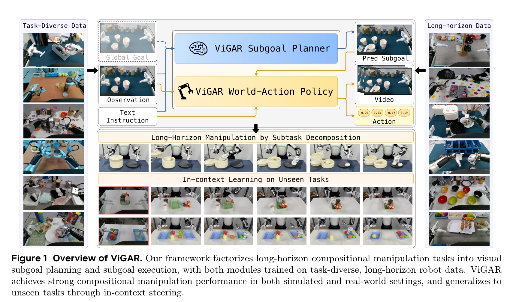
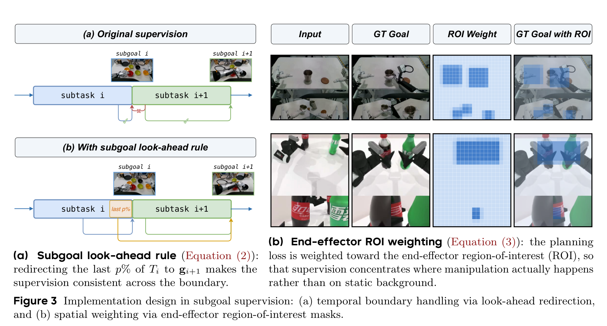
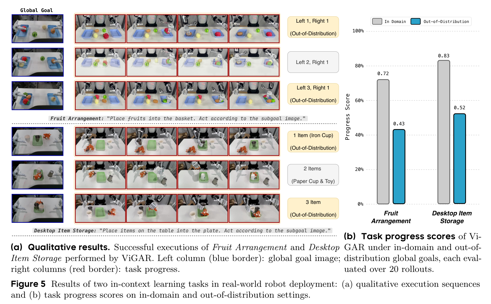
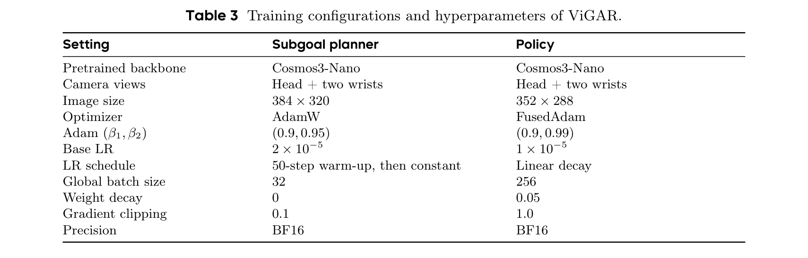
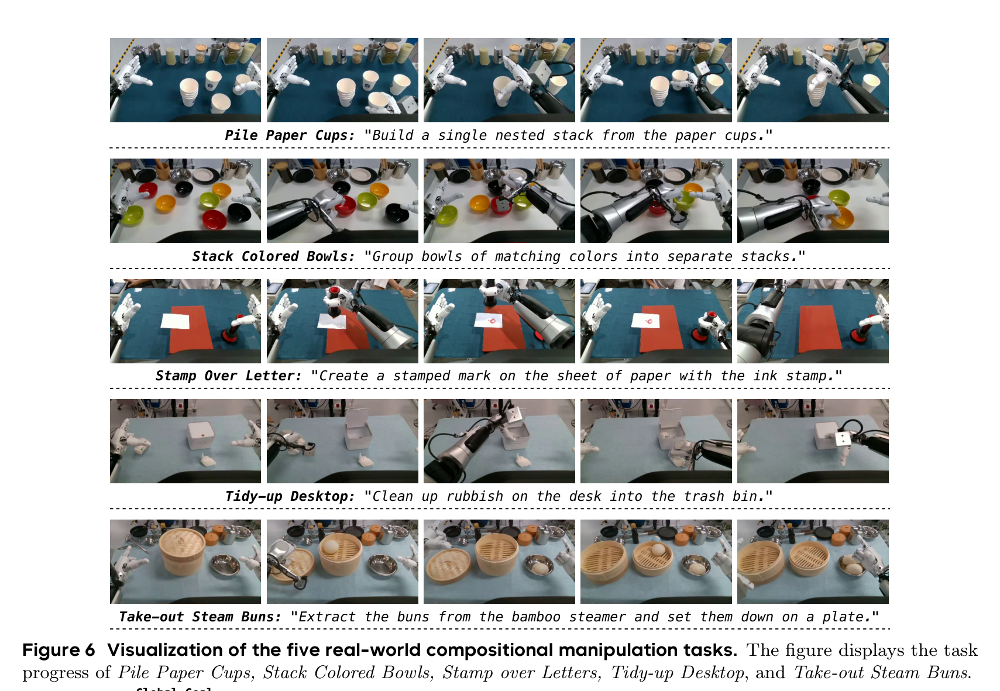
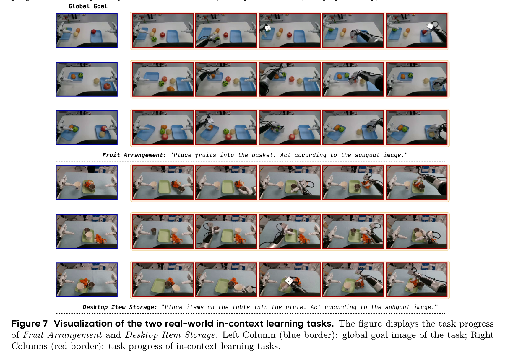
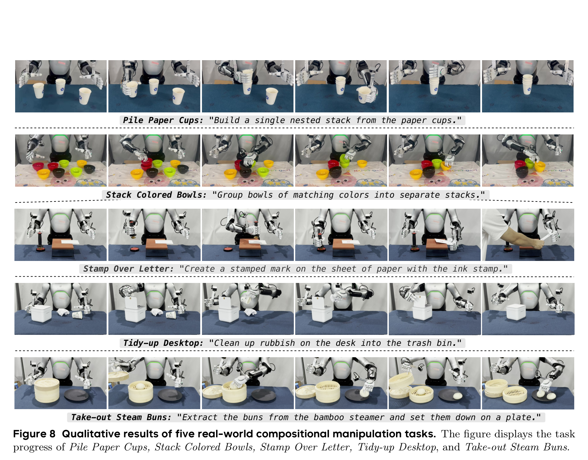
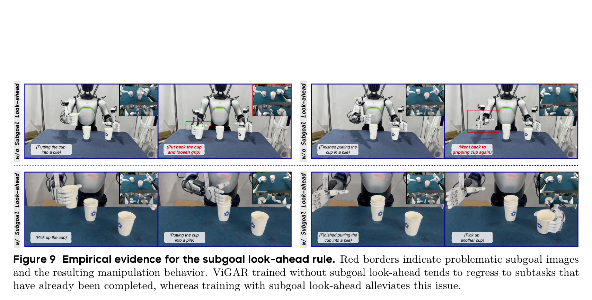
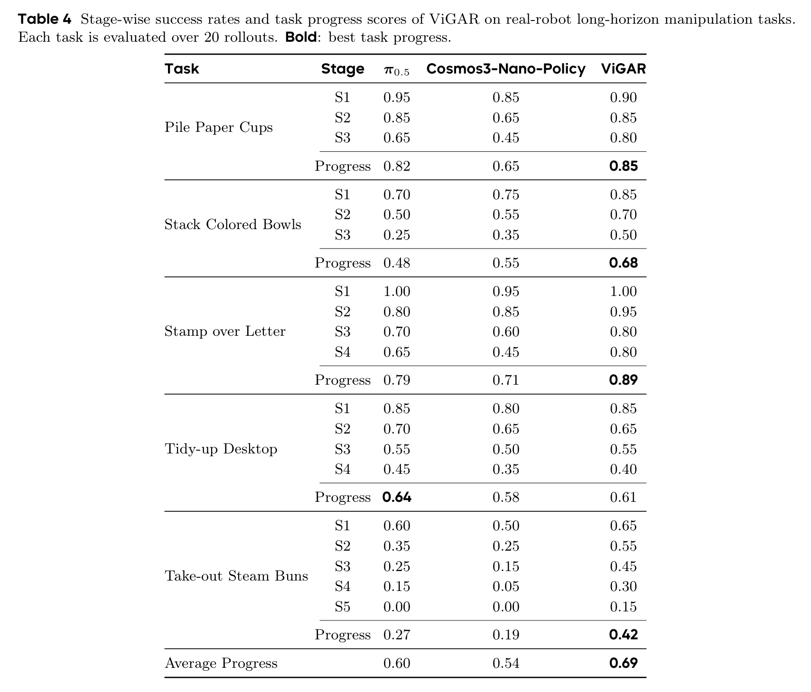

# Rethinking World-Action Model for Compositional and In-Context Robotic Manipulation

**Authors:** Shukai Gong$^{1*}$, Xuanran Zhai$^{2*}$, Yintianrun Zhang$^{1*}$, Ruopeng Cui$^2$, Ye Huang$^1$, Yiyang Fu$^1$, Dexuan Lyu$^2$, Chaojie Li$^2$, Xinyi Song$^2$, Peiwen Lin$^2$, Chuang Wang$^2$, Mingyuan Jia$^3$, Yufan Deng$^1$, Jiaxin Fang$^3$, Bo Liang$^1$, Jiaxin Li$^1$, Yuxiang Gao$^{3\dagger}$, Hao Liu$^{2\dagger}$, Daquan Zhou$^{1\dagger}$  
**Affiliations:** $^1$Peking University, $^2$AgiBot, $^3$CocoMatrix ($^*$Equal contribution, $^\dagger$Corresponding author)  
**Source:** `/Users/roywangj/journey_wj/research/papers4zotero/zotero1/storage/C3KRZVED/Gong 等 - 2026 - Rethinking World-Action Model for Compositional and In-Context Robotic Manipulation.pdf`  
**Detected source format:** selectable-text PDF (`pdf-text`), 19 pages  
**Reader type:** complete paragraph-level English–Chinese detailed reader (`nature-reader-detail-wj`).  
**Project Page:** https://dagroup-pku.github.io/ViGAR  
**GitHub:** https://github.com/DAGroup-PKU/ViGAR  
**Hugging Face:** https://huggingface.co/DAGroup-PKU/ViGAR  
**arXiv:** 2610.02368v1 [cs.RO] 1 Oct 2026  

## Page / Section Index

| Source Location | Section | Key Topics & Artifacts |
|---|---|---|
| p. 1 | Title, Authors, Abstract, §1 Introduction (start) | Problem statement of compositional manipulation; WAM limitations; ViGAR core concept |
| p. 2 | §1 Introduction (cont.); Figure 1 | Figure 1 (ViGAR framework overview); Long-term future selection vs short-term future realization; In-context robotic manipulation |
| p. 3 | §1 Contributions; §2 Related Works; §3 Preliminaries (start) | Three contributions; Related work on VLAs, World Models, In-Context Learning; §3.1 VLA and WAM formulation |
| p. 4 | §3.2 Problem Formulation; §3.3 In-Context Task Specification; §4 Method (overview) | Formal definition of compositional subtasks $(T_1, \dots, T_n)$; Eq. (1) ICL formulation; Cosmos3 dual-branch backbone |
| p. 5 | §4.1 Subgoal Planner $G_\theta$; Figure 2 | Figure 2 (Dual-branch architecture); Image-editing formulation; Look-ahead rule Eq. (2); EEF ROI projection |
| p. 6 | §4.1 Loss Eq. (3); Figure 3; §4.2 Subgoal-guided WAM $\pi^\text{WAM}_\phi$ | Figure 3 (Look-ahead redirection & ROI mask); Loss $\mathcal{L}_\text{Plan}$; Policy loss $\mathcal{L}_\text{WAM}$; Semantic vs geometric route |
| p. 7 | §4.3 In-Context Task Specification; §5 Experiments; §5.1 Setup; §5.2 Simulation | Eq. (1) context instantiated as global goal $G$; Loss $\mathcal{L}_\text{Plan-ICL}$; RoboTwin Clean2Random; Baselines |
| p. 8 | Table 1; §5.3 Real-World Robot Deployment | Table 1 (Simulation success & visual subgoal quality); AgiBot A2 dual-arm setup; 5 long-horizon tasks |
| p. 9 | Figure 4; §5.4 In-Context Real-Robot Manipulation; §5.5 Ablation Studies | Figure 4 (5 real-world task progress scores); Fruit Arrangement & Desktop Item Storage; Route & supervision ablations |
| p. 10 | Figure 5; Table 2; §6 Conclusion | Figure 5 (ICL qualitative & quantitative results); Table 2 (Ablations on injection routes & supervision); Future outlook |
| p. 11–13 | References | 40 bibliographic references retained in searchable English form |
| p. 14 | Appendix A Dataset; Appendix B Implementation Details (start) | 2,500 RoboTwin Clean rollouts (19 multi-stage, 31 single-stage); 900h AgiBot A2 dataset; $G_\theta$ adaptation |
| p. 15 | Appendix B (cont.); Table 3; §B Optimization; §C Overview | Table 3 (Hyperparameters); Training recipes; CUDA graph, batched CFG, TeaCache (2.5× policy, 11.2× planner speedup) |
| p. 16 | Appendix C.1 Visualization; Figures 6 & 7 | Figure 6 (5 long-horizon task workflows); Figure 7 (2 in-context task workflows) |
| p. 17 | Appendix C.2 Subgoal Metrics; Appendix C.3 Real-Robot Metrics | LPIPS, DINO-cos, $\Delta\text{IoU}$, RetAcc definitions; Stage-wise success rate Eq. (4); Task progress score Eq. (5) |
| p. 18 | Figures 8 & 9 | Figure 8 (Execution rollout sequences); Figure 9 (Empirical evidence for look-ahead rule eliminating regression loops) |
| p. 19 | Tables 4 & 5 | Table 4 (Stage-wise success & progress across 5 real tasks); Table 5 (In-domain & OOD in-context stage-wise success) |

## Terminology Ledger

| English Term | Chinese Translation | Technical Context & Definition |
|---|---|---|
| ViGAR | ViGAR (基于视觉目标条件化动作推理) | Visual Goal-conditioned Action Reasoning，本文提出的层次化框架 |
| WAM / WAMs | 世界-动作模型 (World-Action Model) | 联合预测未来视觉状态与动作轨迹的生成式基座模型范式 |
| VLA / VLAs | 视觉-语言-动作模型 (Vision-Language-Action) | 将视觉观测与语言直接映射为连续控制动作的具身策略模型 |
| Visual Subgoal Planner ($G_\theta$) | 视觉子目标规划器 | 基于图像编辑范式、从当前观测与全局指令预测下一阶段视觉终态的规划器 |
| Subgoal Executor ($\pi^\text{WAM}_\phi$) | 子目标执行器 / 世界-动作策略 | 以预测子目标为几何条件，联合生成未来视频帧与动作块的下层策略 |
| Compositional Manipulation | 复合操作 / 组合式操作 | 包含多个时序协调子任务的长程复杂操作任务 |
| In-Context Robotic Manipulation | 上下文机器人操作 | 无需更新模型参数，仅在推理时输入全局目标图像即可引导策略重组动作序列 |
| Subgoal Look-Ahead Rule | 子目标前瞻规则 | 将子任务最后 $p\%$ 帧的监督目标提前重定向到下一子目标 $g_{i+1}$ 的时序边界平滑机制 |
| End-Effector ROI Weighting | 末端执行器 ROI 加权 | 将流匹配训练损失聚焦在双臂夹爪投影及其邻域的自适应空间掩码机制 |
| Action Chunk ($A_{t+1}$) | 动作块 / 动作分块 | 每次推理同时预测的未来动作序列切片（本文设为 $H_a = 48$ 步） |
| Semantic Route vs. Geometric Route | 语义注入路径 vs. 几何注入路径 | 目标图像经视觉编码器进入 Reasoner（语义）或经 VAE 潜变量进入 Generator（几何） |
| Receding-Horizon Control | 滚动时域控制 | 每次控制周期重新预测子目标与动作块的无外部子任务探测器的闭环执行机制 |
| Clean2Random Benchmark | Clean2Random 仿真基准 | RoboTwin 提供的在无干扰环境训练、在强域随机化场景测试的泛化基准 |
| AgiBot A2 | 远征 A2 机器人 | 智元机器人双臂具身操作平台，含 2×7-DoF 机械臂及头部与双腕相机 |
| Cosmos3-Nano | Cosmos3-Nano | 英伟达开源的 16B-A8B 双分支 Transformer 世界模型基座 |
| TeaCache | TeaCache | 基于时间步残差变化率相对 $L_1$ 阈值跳过 Transformer 计算的扩散推理加速算法 |
| Task Progress Score (TPS) | 任务进度得分 | 衡量长程操作任务完成阶段占比的综合评估指标 |
| Stage-wise Success Rate (SR) | 分阶段成功率 | 仅在完成所有前置阶段的试验中评估当前阶段达成率的条件概率指标 |
| Change-IoU ($\Delta\text{IoU}$) | 变化区域交并比 | 预测子目标与真值子目标相对于输入观测变化区域的交并比 |
| Retrieval Accuracy (RetAcc) | 检索准确率 | 利用 DINOv2 特征在全候选子任务终点图像集中检索对应正确子任务的准确率 |

## Abstract

> <strong>Para. 1:</strong> Long-horizon compositional manipulation has become increasingly important for real-world robot deployment, where a single task involves multiple coordinated subtasks. Existing world-action models (WAMs) jointly predict short-horizon visual futures and actions, but typically lack explicit subtask-level reasoning. We propose Visual Goal-conditioned Action Reasoning (ViGAR), a hierarchical framework that factorizes manipulation into a visual subgoal planner and a subgoal executor. Given the current observation and global instruction, the subgoal planner predicts a visual subgoal for the next subtask. The subgoal executor then jointly generates future visual trajectories and actions conditioned on the predicted subgoal. Both components share a pretrained world-model representation, enabling task-level planning and action generation to benefit from common physical knowledge. Moreover, our framework naturally supports in-context learning: using a global goal image as context can induce different subtask decompositions and behaviors without parameter updates. On the RoboTwin Clean2Random benchmark, ViGAR achieves 82.00% and 67.02% success rates under the Clean and Random settings, respectively, surpassing the strongest baseline by 12.86 percentage points in average success rate. Real-world robot experiments on five compositional and two in-context learning tasks further confirm the effectiveness of ViGAR.

> <strong>Para. 1[CN]:</strong> 长程复合操作在真实机器人部署中日益重要，在这类场景中单个任务包含多个相互协调的子任务。现有的世界-动作模型（WAM）通过联合预测短程视觉未来与动作，但通常缺乏显式的子任务级推理能力。为此，我们提出了基于视觉目标条件化动作推理（Visual Goal-conditioned Action Reasoning, ViGAR）的层次化框架，将操作任务解耦为视觉子目标规划器与子目标执行器。给定当前观测与全局语言指令，子目标规划器首先预测下一子任务的视觉子目标；随后，子目标执行器以所预测的子目标为条件，联合生成未来视觉轨迹与机器人动作。两个组件共享预训练世界模型的表征，使得任务级规划与动作生成能够共同受益于通用的物理世界先验知识。此外，我们的框架天然支持上下文学习（in-context learning）：仅使用一张全局目标图像作为上下文，即可在无需更新模型参数的情况下诱导出不同的子任务分解与执行行为。在 RoboTwin Clean2Random 基准测试中，ViGAR 在 Clean 和 Random 设定下分别取得了 82.00% 与 67.02% 的成功率，平均成功率超过最强基线 12.86 个百分点。在五项复合任务及两项上下文学习任务上的真实机器人实验，进一步验证了 ViGAR 的有效性。

## 1 Introduction

> <strong>Para. 1:</strong> Robots in production and service settings increasingly face compositional manipulation tasks that involve multiple coordinated subtasks. Such tasks require policies to maintain progress across subtask transitions while generalizing to unseen scenes, objects, and spatial layouts, rather than replaying a fixed sequence from training. Policies for real-world deployment therefore need both embodied generalization and mechanisms for organizing behavior over extended task horizons. World-Action Models (WAMs) offer an appealing paradigm for this goal. By jointly predicting future visual states and actions, WAMs learn physically grounded action dynamics from dense video supervision and have demonstrated strong generalization across tasks, environments, embodiments, and visual distribution shifts [1, 9, 19, 34].

> <strong>Para. 1[CN]:</strong> 在生产与服务环境中，机器人日益需要应对涉及多个相互协调子任务的复合操作任务。此类任务要求策略在子任务转换过程中持续保持任务推进，同时能够泛化到未见过的场景、物体以及空间布局，而非仅仅机械复现训练中的固定动作序列。因此，面向真实部署的策略既需要具备具身泛化能力，又需要拥有在长程时域内组织行为的机制。世界-动作模型（WAM）为此目标提供了一种极具吸引力的范式。通过联合预测未来视觉状态与动作，WAM 从稠密的视频监督中学习具备物理接地的动作动力学，并已在跨任务、跨环境、跨本体以及视觉分布偏移下展现出了强大的泛化能力 [1, 9, 19, 34]。

### Figure 1. ViGAR 框架总体概述

**Caption:** Figure 1 Overview of ViGAR. Our framework factorizes long-horizon compositional manipulation tasks into visual subgoal planning and subgoal execution, with both modules trained on task-diverse, long-horizon robot data. ViGAR achieves strong compositional manipulation performance in both simulated and real-world settings, and generalizes to unseen tasks through in-context steering.

**Caption[CN]:** 图 1 ViGAR 框架概述。我们的框架将长程复合操作任务解耦为视觉子目标规划与子目标执行两个阶段，两个模块均在任务多样、长时程的机器人数据上进行训练。ViGAR 在仿真与真实世界环境中均取得了强大的复合操作性能，并通过上下文引导（in-context steering）泛化到未见任务。

> <strong>Para. 2:</strong> Despite these strengths, existing WAMs are not explicitly designed for long-horizon compositional manipulation. WAM formulations typically provide a useful local control signal by modeling what is likely to happen next, but do not explicitly organize behavior across a sequence of subtasks or expose a task-level interface through which the desired progression can be specified. Recent studies [4, 16, 40] reveal that long-horizon task progression requires more than supervision on short-term evolution of the physical world, and further demonstrate the value of predicting semantic subtasks for open-world long-horizon manipulation and generalization. The core challenge is therefore to endow WAMs with explicit task-level decision making while preserving their strong world-centric prediction and physical generalization.

> <strong>Para. 2[CN]:</strong> 尽管具备上述优势，现有的 WAM 并非专为长程复合操作而设计。WAM 的公式化表达通常通过建模“接下来最可能发生什么”来提供有效的局部控制信号，但并未显式地跨子任务序列组织行为，也未暴露可用于指定期望任务进度的任务级接口。近期的研究 [4, 16, 40] 表明，长程任务推进仅靠对物理世界短期演变的监督是远远不够的，并进一步证实了预测语义子任务对于开放世界长程操作与泛化的核心价值。因此，关键挑战在于：如何在赋予 WAM 显式任务级决策能力的同时，保留其强大的以世界为中心的预测与物理泛化优势。

> <strong>Para. 3:</strong> One line of work externalizes this decision making to a language planner that exploits VLMs to decompose a task into linguistic subtasks for a policy to execute. However, language subtask descriptions often underspecify precise spatial outcome without ambiguity, whereas visual subgoals impose stronger constraints on the desired scene configuration [17]. Our key insight is that compositional manipulation can be factorized into long-term future selection and short-term future realization. World-action modeling for long-horizon tasks should first make explicit the target state robot intends to realize, and then generate the actions that will bring it about.

> <strong>Para. 3[CN]:</strong> 一类工作将这种决策外置于语言规划器，利用视觉语言模型（VLM）将任务分解为语言子任务供下游策略执行。然而，语言形式的子任务描述往往无法无歧义地精确指定空间结果，而视觉子目标则能对期望的场景构型施加更强的物理几何约束 [17]。我们的核心见解在于：复合操作可以解耦为“长程未来状态选择”与“短程未来状态实现”两个过程。面向长程任务的世界-动作建模应当首先明确机器人意图实现的终态目标，进而生成能够促成该状态达成的具体动作。

> <strong>Para. 4:</strong> To this end, we propose Visual Goal-conditioned Action Reasoning (ViGAR), which treats subgoal images as explicit decision variable linking task-level reasoning to physical action generation. Given the current observation and the global task instruction, ViGAR first performs visual goal reasoning to predict the desired subtask goal image. Then, conditioned on the current observation, global task instruction and predicted subgoal image, it jointly predicts future visual trajectories and corresponding robot actions leading to the subgoal. Both task-level decision and physical realization are learned in one shared generative world-model representation, so that the model can leverage the same physical knowledge for both stages.

> <strong>Para. 4[CN]:</strong> 为此，我们提出了基于视觉目标条件化动作推理（Visual Goal-conditioned Action Reasoning, ViGAR）框架，将子目标图像视为连接任务级推理与物理动作生成的显式决策变量。给定当前观测与全局任务指令，ViGAR 首先执行视觉目标推理，预测期望的子任务目标图像；随后，以当前观测、全局任务指令以及所预测的子目标图像为条件，联合预测通向该子目标的未来视觉轨迹与对应的机器人动作。任务级决策与物理动作实现均在同一共享的生成式世界模型表征中学习，从而使模型在这两个阶段均能充分利用相同的物理世界先验知识。

> <strong>Para. 5:</strong> Moreover, our framework naturally supports in-context learning: with the scene and instruction held fixed, changing only the global goal induces a different composition of behaviors, forcing the policy to reorganize its action sequence rather than default to the most likely training trajectory. We term this in-context robotic manipulation: the global goal image serves as context for inferring a subtask decomposition, so an out-of-distribution global goal elicits a task composition unseen in training, with no parameter update.

> <strong>Para. 5[CN]:</strong> 此外，我们的框架天然支持上下文学习：在初始场景与语言指令保持固定的情况下，仅改变全局目标图像即可诱导出不同的行为组合，促使策略重新组织其动作序列，而非默认执行训练中最常见的轨迹。我们将此称为“上下文机器人操作”（in-context robotic manipulation）：全局目标图像充当推断子任务分解的上下文，因此分布外的全局目标能够在无需任何参数更新的情况下，激发出训练中未曾出现过的任务组合。

> <strong>Para. 6:</strong> Experiments on both simulation benchmark and real-robot compositional tasks validate the effectiveness of ViGAR. On the RoboTwin Clean2Random benchmark [11], ViGAR achieves success rates of 82.00% and 67.02% under the Clean and Random settings, respectively, surpassing the strongest baseline [32] by 12.86 percentage points in average success rate. In real-robot experiments, ViGAR outperforms strong VLA and Cosmos3-Nano-Policy baselines on five compositional tasks, and exhibits in-context learning ability on unseen global goals, confirming the validity of our method. Our contributions are summarized as follows:

> <strong>Para. 6[CN]:</strong> 在仿真基准与真实机器人复合任务上的实验充分验证了 ViGAR 的有效性。在 RoboTwin Clean2Random 基准测试 [11] 中，ViGAR 在 Clean 和 Random 设定下分别取得了 82.00% 和 67.02% 的成功率，平均成功率超过最强基线 [32] 达 12.86 个百分点。在真实机器人实验中，ViGAR 在五项复合任务上超越了强大的 VLA 与 Cosmos3-Nano-Policy 基线，并在未见全局目标上展现出了上下文学习能力，有力证实了我们方法的有效性。我们的主要贡献总结如下：

> <strong>Para. 7:</strong> • We factorize compositional manipulation into long-term future selection and short-term future realization, and propose ViGAR, a hierarchical framework that predicts the next subgoal as an explicit decision variable and conditions joint video-action generation on it.
> • We identify in-context robotic manipulation as a capability that emerges from explicit goal conditioning. With the scene and instruction held fixed, a new global goal image elicits a different subtask decomposition and a correspondingly reorganized action sequence, specifying out-of-distribution task compositions at deployment without any parameter update.
> • ViGAR outperforms strong baselines on both simulation benchmark and real-robot compositional manipulation tasks, and exhibits strong in-context learning ability on unseen global goals, confirming the validity of our approach.

> <strong>Para. 7[CN]:</strong> • 我们将复合操作任务分解为“长程未来状态选择”与“短程未来状态实现”两阶段，并提出了 ViGAR 层次化框架；该框架将下一子目标预测作为显式决策变量，并在此基础上联合生成视频与动作序列。
> • 我们指出，上下文机器人操作（in-context robotic manipulation）是显式目标条件化所涌现出的独特能力。在初始场景与语言指令保持不变的前提下，输入新的全局目标图像即可诱导出不同的子任务分解与相应重组的动作序列，从而在部署阶段无需任何参数更新即可指定训练集中未见过的复合任务组合。
> • ViGAR 在仿真基准与真实机器人复合操作任务上均显著优于强基线模型，并在未见全局目标上展现出强大的上下文学习能力，充分验证了所提方法的有效性。

## 2 Related Work

### VLAs for Compositional Robotic Manipulation

> <strong>Para. 1:</strong> Vision-language-action (VLA) models map visual observations and language instructions to continuous action trajectories, and have demonstrated strong generalizability across objects, scenes, and tasks [3, 5, 13, 14, 16, 25, 27, 37]. For compositional manipulation, however, a direct instruction-to-action mapping is often insufficient due to increased complexity, and recent systems introduce subtask information as an explicit planning interface, where a VLM or a pretrained world model synthesizes subtask information that conditions a VLA policy [8, 16, 17, 22].

> <strong>Para. 1[CN]:</strong> 视觉-语言-动作（VLA）模型将视觉观测与语言指令映射为连续动作轨迹，并在跨物体、跨场景与跨任务上展现出了强大的泛化能力 [3, 5, 13, 14, 16, 25, 27, 37]。然而对于复合操作而言，由于任务复杂度剧增，直接建立“指令到动作”的端到端映射往往力不从心。近期的系统开始引入子任务信息作为显式规划接口，利用 VLM 或预训练世界模型合成子任务信息来对 VLA 策略进行条件引导 [8, 16, 17, 22]。

### World Models for Robotic Manipulation

> <strong>Para. 2:</strong> World models learn the structure and evolution of physical environments by predicting future states, and world-action models (WAMs) extend this paradigm by jointly modeling future observations and actions. Recent studies have demonstrated that WAMs exhibit strong generalizability beyond the training domain, owing to their explicit modeling of geometric and temporal transitions [1, 19, 23, 34]. However, WAMs typically focus on local action generation and lack a mechanism for reasoning about the plan a compositional task requires. BagelVLA [15] and RxBrain [20] generate interleaved subtask text and subgoal images within a unified model, but these predictions either guide action generation implicitly through intermediate features or serve primarily as planning outputs, rather than acting as explicit subgoal conditions for the downstream policy.

> <strong>Para. 2[CN]:</strong> 世界模型通过预测未来状态来学习物理环境的结构与演变规律，而世界-动作模型（WAM）则通过联合建模未来视觉观测与动作进一步扩展了该范式。近期的研究表明，得益于对几何与时序转换的显式建模，WAM 展现出了超越训练领域的极强泛化性 [1, 19, 23, 34]。然而，现有的 WAM 通常侧重于局部动作生成，缺乏对复合任务所需规划方案进行长程推理的机制。BagelVLA [15] 与 RxBrain [20] 在统一模型中交织生成子任务文本与子目标图像，但这些预测要么仅通过中间特征隐式指导动作生成，要么主要作为规划输出存在，并未作为下游策略的显式子目标条件输入。

### In-Context Learning for Robotic Manipulation

> <strong>Para. 3:</strong> In large language models, a novel task can be performed simply by specifying it in the context without any parameter update, termed in-context learning (ICL) [6, 29, 30]. Carried into robotic manipulation, this moves the acquisition of a new task out of training-time imitation and into inference time, bypassing the need for costly data collection and model fine-tuning. Zero-WAM [39] performs ICL by prompting a causal video-action model with human demonstration videos; HOST [10] acquires a new skill from a single human video by predicting the robot’s own future observations along the demonstrated progression; Skild S1 [2] and GEN-1.5 [26] likewise condition on a demonstration video or a short sensorimotor trajectory. In each case the context conveys how a task is performed, and the policy re-executes it under its own embodiment. We instead specify a task by its terminal world state: a global goal image constrains only what the scene should become, leaving the subtask decomposition to the model.

> <strong>Para. 3[CN]:</strong> 在大型语言模型中，无需任何参数更新、仅通过在上下文中指定即可执行全新任务，这被称为上下文学习（ICL）[6, 29, 30]。将这一范式迁移至机器人操作，使得新任务的获取从训练期的模仿学习转变为推理期自适应，从而绕过了昂贵的数据采集与模型微调过程。Zero-WAM [39] 通过使用人类示范视频作为因果视频-动作模型的提示来执行 ICL；HOST [10] 则通过沿着人类视频示范进程预测机器人自身的未来观测，从而从单段人类视频中获取新技能；Skild S1 [2] 与 GEN-1.5 [26] 同样以示范视频或简短的感知运动轨迹为条件。在上述各项工作中，上下文传达的均为任务“如何被执行”（即具体操作流程），策略则在其自身本体下复现该过程。与此不同，我们通过终态物理世界状态来指定任务：全局目标图像仅约束场景最终应当变成什么样子，而将具体的子任务分解与执行方案完全交由模型自主推断。

## 3 ViGAR: Visual Goal-conditioned Action Reasoning

### 3.1 Problem Formulation & Preliminaries

> <strong>Para. 1:</strong> Consider a robot task specified by a language instruction $\ell$. At inference step $t$, a VLA policy $\pi^\text{VLA}_\theta$ with parameters $\theta$ predicts an $H_a$-step action chunk $A_{t+1} := a_{t+1:t+H_a} \in \mathbb{R}^{H_a \times d_a}$ conditioned on the current multi-view observation $o_t = \{o^v_t\}_{v=1}^V$, proprioceptive state $s_t \in \mathbb{R}^{d_s}$, and textual metadata $\mu$ specifying the embodiment, camera resolution, and control mode:

> <strong>Para. 1[CN]:</strong> 考虑由语言指令 $\ell$ 指定的机器人任务。在推理步 $t$，具有参数 $\theta$ 的 VLA 策略 $\pi^\text{VLA}_\theta$ 以当前多视角观测 $o_t = \{o^v_t\}_{v=1}^V$、本体感知状态 $s_t \in \mathbb{R}^{d_s}$ 以及指定机器人本体、相机分辨率和控制模式的文本元数据 $\mu$ 为条件，预测一个 $H_a$ 步的动作块 $A_{t+1} := a_{t+1:t+H_a} \in \mathbb{R}^{H_a \times d_a}$：

$$
A_{t+1} \sim \pi^\text{VLA}_\theta(A_{t+1} \mid o_t, s_t, \ell, \mu),
$$

> <strong>Para. 2:</strong> where $H_a$ denotes the action chunk size. A WAM policy $\pi^\text{WAM}_\psi$ with parameters $\psi$ is similarly conditioned on $o_t, s_t, \ell, \mu$, but instead parameterizes a joint conditional distribution over a short visual future $O_{t+1} := o_{t+1:t+H_v}$ and an action chunk $A_{t+1}$:

> <strong>Para. 2[CN]:</strong> 其中 $H_a$ 表示动作块大小。参数为 $\psi$ 的世界-动作模型（WAM）策略 $\pi^\text{WAM}_\psi$ 同样以 $o_t, s_t, \ell, \mu$ 为条件，但不同之处在于它参数化了关于短期视觉未来 $O_{t+1} := o_{t+1:t+H_v}$ 与动作块 $A_{t+1}$ 的联合条件概率分布：

$$
(O_{t+1}, A_{t+1}) \sim \pi^\text{WAM}_\psi(O_{t+1}, A_{t+1} \mid o_t, s_t, \ell, \mu).
$$

> <strong>Para. 3:</strong> Let $T \in \mathcal{T}$ denote a compositional robot task specified by a global instruction $\ell \in \mathcal{L}$, where $\mathcal{T}$ and $\mathcal{L}$ denote the space of language-conditioned robot tasks and the space of free-form text instructions, respectively. To address the challenge of compositional manipulation, instead of modeling a policy $\pi(\cdot \mid o_t, s_t, \ell, \mu)$ that generates action based on the global instruction $\ell$, we decompose $T$ into $n$ intermediate subtasks $T_i \in \mathcal{T}$, such that $T = (T_1, \dots, T_n)$. For each subtask $T_i$ at stage $i$, we specify a subtask instruction $\ell_i$ describing the subtask goal in text, and a subgoal image $g_i \in \mathcal{I}$ specifying the visual target state the robot should reach, where $\mathcal{I}$ is the space of images. The objective is then to train a robot policy $\pi$ that leverages the subtask information $(\ell_i, g_i)$ to predict the action trajectory for subtask $T_i$:

> <strong>Para. 3[CN]:</strong> 设 $T \in \mathcal{T}$ 表示由全局指令 $\ell \in \mathcal{L}$ 指定的复合机器人操作任务，其中 $\mathcal{T}$ 与 $\mathcal{L}$ 分别表示由语言条件化的机器人任务空间与自由文本指令空间。为了应对复合操作的挑战，我们不再直接建模基于全局指令 $\ell$ 生成动作的策略 $\pi(\cdot \mid o_t, s_t, \ell, \mu)$，而是将 $T$ 分解为 $n$ 个中间子任务 $T_i \in \mathcal{T}$，即 $T = (T_1, \dots, T_n)$。对于处于阶段 $i$ 的每个子任务 $T_i$，我们指定一条以文本形式描述子任务目标的指令 $\ell_i$，以及一张指定机器人应当达到的视觉目标状态的子目标图像 $g_i \in \mathcal{I}$，其中 $\mathcal{I}$ 为图像空间。此时的训练目标是构建一个机器人策略 $\pi$，利用子任务信息 $(\ell_i, g_i)$ 预测子任务 $T_i$ 的动作轨迹：

$$
A^{T_i}_{t+1} \sim \pi(\cdot \mid o_t, s_t, \ell_i, g_i, \mu), \quad i = 1, \dots, n,
$$

> <strong>Para. 4:</strong> where $t$ denotes the current timestep. The robot executes $A^{T_i}_{t+1}$ until the current subtask is completed, at which point the subtask instruction and subgoal image are advanced to $\ell_{i+1}$ and $g_{i+1}$, respectively. In the following part, we use ‘subgoal’ to term $(\ell_i, g_i)$, $i = 1, \dots, n$.

> <strong>Para. 4[CN]:</strong> 其中 $t$ 表示当前时间步。机器人持续执行 $A^{T_i}_{t+1}$ 直至当前子任务完成；此时，子任务指令与子目标图像分别推进至 $\ell_{i+1}$ 与 $g_{i+1}$。在下文中，我们统一使用“子目标”（subgoal）指代元组 $(\ell_i, g_i)$，$i = 1, \dots, n$。

> <strong>Para. 5:</strong> In-context learning (ICL) performs a task specified at deployment rather than acquired during training. In addition to language instruction $\ell$, let $\mathcal{C}$ denote an optional context supplied at inference time. A policy $\pi$ with parameters $\phi$ performs in-context manipulation if a new task is realized by changing $\ell$ or $\mathcal{C}$ alone without the update of $\phi$:

> <strong>Para. 5[CN]:</strong> 上下文学习（ICL）指的是执行在部署阶段指定、而非在训练阶段固化获取的任务。除语言指令 $\ell$ 外，设 $\mathcal{C}$ 表示在推理阶段提供的可选上下文。若一个参数为 $\phi$ 的策略 $\pi$ 仅通过更改 $\ell$ 或 $\mathcal{C}$（而无需更新参数 $\phi$）即可实现全新任务，则称其具备上下文操作能力：

$$
A_{t+1} \sim \pi_\phi(\cdot \mid o_t, s_t, \ell, \mathcal{C}, \mu). \tag{1}
$$

> <strong>Para. 6:</strong> Recent work [2, 10, 26, 39] on robotic in-context learning often instantiates $\mathcal{C}$ as a demonstration video, such as a human operation video $V := v_{1:K}$, which prescribes the procedure the robot should reproduce.

> <strong>Para. 6[CN]:</strong> 近期关于机器人上下文学习的研究工作 [2, 10, 26, 39] 通常将上下文 $\mathcal{C}$ 实例化为示范视频，例如人类操作视频 $V := v_{1:K}$，用以规定机器人应当复现的具体操作过程。

> <strong>Para. 7:</strong> In this section, we describe the two essential parts of ViGAR: a subgoal planner and a subgoal-guided world-action model. We divide each compositional manipulation task into multiple subtasks, where each subtask contains an atom action and a subgoal $(\ell_i, g_i)$. Our subgoal planner generates a subgoal for each subtask, as illustrated in Section 4.1. Then, our world-action policy predicts the action chunk from the current observation, proprioceptive state and generated subgoal, as detailed in Section 4.2. Finally, we show in Section 4.3 that by specifying a global goal as an inference-time context, the subgoal planner can generate a subtask decomposition consistent with the global goal, allowing a new task composition to be specified at deployment without any parameter updates. Both the subgoal planner and the downstream policy are initialized from the same pretrained world model [1]. This backbone follows a dual-branch design, with a reasoner branch processing language and semantic visual tokens, and a generator branch generating image or video via flow matching. The two branches interact through a shared multimodal attention layer.

> <strong>Para. 7[CN]:</strong> 在本节中，我们将详细介绍 ViGAR 的两个核心组成部分：视觉子目标规划器与受子目标引导的世界-动作模型。我们将每个复合操作任务分解为多个子任务，其中每个子任务包含一个原子动作与一个子目标 $(\ell_i, g_i)$。如第 3.2 节所示，我们的子目标规划器为每个子任务生成子目标；随后，如第 3.3 节所述，世界-动作策略根据当前观测、本体感知状态及生成的子目标预测动作块。最后，在第 3.5 节中，我们展示了通过在推理阶段指定全局目标作为上下文，子目标规划器能够生成与该全局目标一致的子任务分解，从而在无需任何参数更新的情况下于部署时指定全新的任务组合。子目标规划器与下游执行策略均初始化自相同的预训练世界模型 [1]。该基座采用双分支架构设计，其中推理分支（Reasoner branch）处理语言与语义视觉 token，生成分支（Generator branch）通过流匹配（flow matching）生成图像或视频，两个分支通过共享的多模态注意力层进行交互。

### Figure 2. ViGAR 模型架构设计

**Caption:** Figure 2 Model architecture of ViGAR: (1) the subgoal planner Gθ generates the next subgoal image from the task instruction and current observation, optionally conditioned on a global goal image for in-context learning (ICL); (2) the policy πWAM ϕ takes in the predicted subgoal and jointly predicts the future frames and the action chunk.

**Caption[CN]:** 图 2 ViGAR 模型架构：(1) 子目标规划器 $G_\theta$ 根据任务指令与当前观测生成下一子目标图像，在上下文学习（ICL）模式下可选择性地以全局目标图像为条件；(2) 策略 $\pi^\text{WAM}_\phi$ 接收所预测的子目标，并联合预测未来视频帧与动作块。

### 3.2 Visual Subgoal Planner $G_\theta$

> <strong>Para. 8:</strong> In subgoal planning, we fix $\ell_i = \ell$ for all $i$, rather than decomposing the global instruction into stage-specific subtask text, as the subgoal image $g_i$ already provides precise grounding of the target state, and retaining $\ell$ serves as a consistent semantic anchor for the overall task. This also alleviates potential error accumulation that subtask text generation could introduce to the downstream policy.

> <strong>Para. 8[CN]:</strong> 在子目标规划中，我们对所有阶段固定令 $\ell_i = \ell$，而非将全局指令分解为各阶段特异性的子任务文本。这是因为子目标图像 $g_i$ 已经为目标状态提供了精确的物理落地约束，保留全局指令 $\ell$ 则能为整个任务提供一致的语义锚点。这一设计还避免了子任务文本生成可能向下游策略引入的潜在误差累积。

> <strong>Para. 9:</strong> Guided by this design, we cast subgoal planning as an image-editing problem: given a reference frame $o_t$ within subtask $T_i$ and the global instruction $\ell$, the subgoal planner $G_\theta$ predicts a subgoal image $g_i$ useful for executing $T_i$ and continuing the global task $T$.

> <strong>Para. 9[CN]:</strong> 基于该设计，我们将子目标规划形式化为一个图像编辑问题：给定子任务 $T_i$ 内的参考帧观测 $o_t$ 以及全局指令 $\ell$，子目标规划器 $G_\theta$ 预测出一张有助于执行 $T_i$ 并推进全局任务 $T$ 的子目标图像 $g_i$。

### 3.3 Implementation Details: Subgoal Supervision, Temporal Boundary Handling & Look-Ahead Rule

> <strong>Para. 10:</strong> Notably, as shown in Fig. 3a, frame $o_t$ at the end of $T_i$ can be visually similar to early frames of $T_{i+1}$, while the two are assigned different targets, $g_i$ and $g_{i+1}$. Without correction, the planner tends to confuse them at inference time, regenerating $g_i$ once the robot has entered $T_{i+1}$ and driving the plan back to a subtask already completed. To keep supervision consistent for visually similar inputs, we redirect such $o_t$ to target $g_{i+1}$ by the following subgoal look-ahead rule:

> <strong>Para. 10[CN]:</strong> 值得注意的是，如图 3a 所示，$T_i$ 末尾的帧 $o_t$ 在视觉上与 $T_{i+1}$ 初期的帧高度相似，但二者在原始监督中却被分配了完全不同的目标 $g_i$ 与 $g_{i+1}$。若不加校正，规划器在推理时极易混淆这两者，导致机器人在进入 $T_{i+1}$ 后重新生成 $g_i$，从而使执行方案倒退回已经完成的子任务。为了在视觉相似的输入下保持监督信号的一致性，我们通过如下的子目标前瞻规则（subgoal look-ahead rule）将此类 $o_t$ 重定向至下一个目标 $g_{i+1}$：

$$
\text{target}(o_t) = \begin{cases} g_{i+1}, & o_t \in \text{last } p\% \text{ of } T_i, \; i < n \\ g_i, & \text{otherwise}. \end{cases} \tag{2}
$$

> <strong>Para. 11:</strong> For notation simplicity, we still denote $g_i$ as the target assigned to $o_t$ after this subgoal look-ahead rule. Training pairs $(o_t, \ell, g_i)$ are constructed from subtask-segmented robot demonstrations, with each subtask corresponding to a demonstration segment ending at its target frame.

> <strong>Para. 11[CN]:</strong> 为表述简便，在应用该子目标前瞻规则后，我们仍将分配给 $o_t$ 的目标记为 $g_i$。训练样本对 $(o_t, \ell, g_i)$ 构建自分段的机器人示范数据，每个子任务对应一段以其目标帧为终点的示范片段。

> <strong>Para. 12:</strong> Formally, we train $G_\theta$ with a flow-matching objective. Let $x^g_0 = E_v(g_i)$ denote the target latent and $z_t = E_v(o_t)$ denote the reference latent, where $E_v$ is the VAE encoder. We construct a noisy latent $x^g_\tau = (1 - \tau)x^g_0 + \tau \epsilon$, where $\tau \sim \mathcal{U}[0, 1]$, $\epsilon \sim \mathcal{N}(0, I)$, and define the flow-matching target $v_\text{plan} = \epsilon - x^g_0$.

> <strong>Para. 12[CN]:</strong> 形式上，我们采用流匹配（flow matching）目标来训练 $G_\theta$。设 $x^g_0 = E_v(g_i)$ 表示目标潜变量，$z_t = E_v(o_t)$ 表示参考潜变量，其中 $E_v$ 为 VAE 编码器。我们构造加噪潜变量 $x^g_\tau = (1 - \tau)x^g_0 + \tau \epsilon$，其中 $\tau \sim \mathcal{U}[0, 1]$，$\epsilon \sim \mathcal{N}(0, I)$，并定义流匹配目标为 $v_\text{plan} = \epsilon - x^g_0$。

> <strong>Para. 13:</strong> Because manipulation-related changes are concentrated near the end effector, we construct an end-effector-centered mask to emphasize these regions during training. As shown in Fig. 3b, we project the corresponding expert end-effector positions through the calibrated cameras and take the union of fixed-size windows around visible projections to form a binary mask $m_i$, and further area-pool it to $\tilde{m}_i$ under latent resolution. For each target latent token $u$, we define its weight as:

> <strong>Para. 13[CN]:</strong> 由于与操作相关的场景变化主要集中在末端执行器附近，我们在训练期间构建了一个以末端执行器为中心的掩码以突出这些关键区域。如图 3b 所示，我们通过标定相机投影专家的末端执行器位置，并对可见投影点周围固定尺寸窗口求并集以形成二值掩码 $m_i$，随后在潜变量分辨率下通过面积池化得到 $\tilde{m}_i$。对于每个目标潜变量 token $u$，其权重定义为：

$$
w_i(u) = \frac{1 + \lambda \tilde{m}_i(u)}{\frac{1}{|\Omega|} \sum_{u^\prime \in \Omega} (1 + \lambda \tilde{m}_i(u^\prime))}, \quad \frac{1}{|\Omega|} \sum_{u \in \Omega} w_i(u) = 1. \tag{3}
$$

> <strong>Para. 14:</strong> The subgoal planner is then optimized with the following weighted flow-matching loss:

> <strong>Para. 14[CN]:</strong> 子目标规划器随后通过以下加权流匹配损失进行优化：

$$
\mathcal{L}_\text{Plan} = \mathbb{E}_{(o_t, \ell, g_i), \tau, \epsilon} \left[ \left\| \sqrt{w_i} \odot (G_\theta(x^g_\tau, \tau \mid z_t, \ell) - v_\text{plan}) \right\|_2^2 \right],
$$

> <strong>Para. 15:</strong> where $w_i$ collects the weights $w_i(u)$. The predicted subgoal $(\ell, \hat{g}_i)$ serves as a task-level reasoning proxy for the downstream action policy to complete $T_i$.

> <strong>Para. 15[CN]:</strong> 其中 $w_i$ 汇集了各位置权重 $w_i(u)$。预测出的子目标 $(\ell, \hat{g}_i)$ 充当下游动作策略完成 $T_i$ 的任务级推理代理。

### Figure 3. 子目标监督的实现设计

**Caption:** Figure 3 Implementation design in subgoal supervision: (a) temporal boundary handling via look-ahead redirection, and (b) spatial weighting via end-effector region-of-interest masks.

**Caption[CN]:** 图 3 子目标监督的实现设计：(a) 通过前瞻重定向处理时序边界；(b) 通过末端执行器感兴趣区域（ROI）掩码实施空间加权。

### 3.4 Subgoal Executor $\pi^\text{WAM}_\phi$ (World-Action Model)

> <strong>Para. 16:</strong> The policy $\pi^\text{WAM}_\phi$ predicts a short visual future $O_{t+1}$ and an action chunk $A_{t+1}$ conditioned on the current observation $o_t$, proprioceptive state $s_t$, and the predicted subgoal $(\ell, \hat{g}_i)$ of the active subtask $T_i$. It is trained with a joint flow-matching objective over the visual future and the action chunk. Let $x^v_0 = E_v(O_{t+1})$ and $x^a_0 = A_{t+1}$ denote the visual and action targets, and $z_t = E_v(o_t)$ denote the reference latent. We construct noisy targets $x^v_\tau = (1 - \tau)x^v_0 + \tau \epsilon^v$ and $x^a_\tau = (1 - \tau)x^a_0 + \tau \epsilon^a$, with $\epsilon^v, \epsilon^a \sim \mathcal{N}(0, I)$, and define the flow-matching targets $v_\text{vid} = \epsilon^v - x^v_0$ and $v_\text{act} = \epsilon^a - x^a_0$. Conditioned on $z_t, s_t, \ell, \hat{g}_i, \mu$, the policy $\pi^\text{WAM}_\phi$ jointly predicts $(\hat{v}^v_\phi, \hat{v}^a_\phi) = \pi^\text{WAM}_\phi(x^v_\tau, x^a_\tau, \tau \mid z_t, s_t, \ell, \hat{g}_i, \mu)$ and is optimized by minimizing:

> <strong>Para. 16[CN]:</strong> 策略 $\pi^\text{WAM}_\phi$ 以当前观测 $o_t$、本体感知状态 $s_t$ 以及当前活跃子任务 $T_i$ 的预测子目标 $(\ell, \hat{g}_i)$ 为条件，预测短期视觉未来 $O_{t+1}$ 与动作块 $A_{t+1}$。该策略基于视觉未来与动作块上的联合流匹配目标进行训练。令 $x^v_0 = E_v(O_{t+1})$ 与 $x^a_0 = A_{t+1}$ 分别表示视觉与动作目标，并令 $z_t = E_v(o_t)$ 表示参考潜变量。我们构建加噪目标 $x^v_\tau = (1 - \tau)x^v_0 + \tau \epsilon^v$ 与 $x^a_\tau = (1 - \tau)x^a_0 + \tau \epsilon^a$（其中 $\epsilon^v, \epsilon^a \sim \mathcal{N}(0, I)$），并定义流匹配目标为 $v_\text{vid} = \epsilon^v - x^v_0$ 以及 $v_\text{act} = \epsilon^a - x^a_0$。以 $z_t, s_t, \ell, \hat{g}_i, \mu$ 为条件，策略 $\pi^\text{WAM}_\phi$ 联合预测 $(\hat{v}^v_\phi, \hat{v}^a_\phi) = \pi^\text{WAM}_\phi(x^v_\tau, x^a_\tau, \tau \mid z_t, s_t, \ell, \hat{g}_i, \mu)$，并通过最小化下述损失进行优化：

$$
\mathcal{L}_\text{WAM} = \mathbb{E}_{(o_t, \ell, \hat{g}_i), \tau, \epsilon^v, \epsilon^a} \left[ \|\hat{v}^v_\phi - v_\text{vid}\|_2^2 + \|\hat{v}^a_\phi - v_\text{act}\|_2^2 \right].
$$

> <strong>Para. 17:</strong> Notably, the predicted subgoal image $\hat{g}_i$ can be injected into $\pi^\text{WAM}_\phi$ via a semantic route, where $\hat{g}_i$ is tokenized by the vision encoder and consumed by the reasoner branch, or a geometric route, where $\hat{g}_i$ is VAE-encoded into a clean latent and fed directly to the generator branch alongside the reference latent $z_t$. We adopt the geometric route as it grounds the subgoal at the pixel level rather than through a coarser semantic embedding (see Section 5.5 for elaboration). $\hat{g}_i$ is therefore encoded into $z^g_i = E_v(\hat{g}_i)$ with the same VAE encoder $E_v$ used for $o_t$, while the instruction $\ell$ continues to condition the policy through the reasoner branch. We also add $z^g_i$ with a zero-initialized learnable embedding to distinguish it from other latent tokens in the generator branch.

> <strong>Para. 17[CN]:</strong> 值得注意的是，预测的子目标图像 $\hat{g}_i$ 可以通过两种路径注入到 $\pi^\text{WAM}_\phi$ 中：一种是语义路径（semantic route），其中 $\hat{g}_i$ 由视觉编码器分词并输入到推理分支；另一种是几何路径（geometric route），其中 $\hat{g}_i$ 被 VAE 编码为无噪潜变量，并与参考潜变量 $z_t$ 并行直接输入到生成分支。我们采用了几何路径，因为它在像素级别对子目标进行了物理接地，而非仅依赖较粗粒度的语义嵌入（详见第 5.4 节消融分析）。因此，$\hat{g}_i$ 使用与 $o_t$ 相同的 VAE 编码器 $E_v$ 编码为 $z^g_i = E_v(\hat{g}_i)$，而任务指令 $\ell$ 则继续通过推理分支对策略进行条件化。我们还为 $z^g_i$ 加上了一个零初始化的可学习嵌入向量，以将其与生成分支中的其他潜变量 token 区分开来。

### 3.5 In-Context Task Specification via a Global Goal

> <strong>Para. 18:</strong> We instantiate the inference-time context $\mathcal{C}$ in Equation (1) as a global goal image $G \in \mathcal{I}$, the terminal world state that the compositional task $T$ should produce. As shown in Fig. 2, the context enters the subgoal planner alone, which predicts $\hat{g}_i \sim G_\theta(\cdot \mid z_t, \ell, G)$ at subtask $T_i$ where $z_t = E_v(o_t)$ denotes the reference latent. During training, $G$ is the terminal frame of each demonstration trajectory, and the planning objective for $G_\theta$ can be written as:

> <strong>Para. 18[CN]:</strong> 我们将公式 (1) 中的推理期上下文 $\mathcal{C}$ 实例化为一张全局目标图像 $G \in \mathcal{I}$，即复合任务 $T$ 应当达成的终端物理世界状态。如图 2 所示，该上下文仅输入到子目标规划器中，规划器在子任务 $T_i$ 处预测 $\hat{g}_i \sim G_\theta(\cdot \mid z_t, \ell, G)$，其中 $z_t = E_v(o_t)$ 表示参考潜变量。在训练期间，$G$ 为每条示范轨迹的终端帧，此时 $G_\theta$ 的规划优化目标可写作：

$$
\mathcal{L}_\text{Plan-ICL} = \mathbb{E}_{(o_t, \ell, g_i, G), \tau, \epsilon} \left[ \left\| \sqrt{w_i} \odot (G_\theta(x^g_\tau, \tau \mid z_t, \ell, G) - v_\text{plan}) \right\|_2^2 \right],
$$

> <strong>Para. 19:</strong> where $w_i$ is the end-effector ROI weight defined in Equation (3). At inference, $G$ is replaced by the user-specified global goal image. The downstream policy $\pi^\text{WAM}_\phi(\cdot \mid z_t, s_t, \ell, \hat{g}_i, \mu)$ remains unchanged as it conditions only on $\hat{g}_i$, through which the effect of $G$ is already mediated. Therefore, under our framework, a global goal image unseen during training can induce a task decomposition $(T_1, \dots, T_n)$ that was never demonstrated, with $\theta$ and $\phi$ left unchanged.

> <strong>Para. 19[CN]:</strong> 其中 $w_i$ 为公式 (3) 中定义的末端执行器 ROI 权重。在推理时，$G$ 被替换为用户指定的全局目标图像。下游策略 $\pi^\text{WAM}_\phi(\cdot \mid z_t, s_t, \ell, \hat{g}_i, \mu)$ 保持完全不变，因为它仅以 $\hat{g}_i$ 为条件，而 $G$ 的调控作用已经完全由 $\hat{g}_i$ 间接传导。因此在我们的框架下，即使是一张训练期间从未见过的全局目标图像，也能在参数 $\theta$ 与 $\phi$ 完全保持不变的前提下，诱导出从未被示范过的子任务分解方案 $(T_1, \dots, T_n)$。

## 4 Simulation Experiments

### 4.1 Benchmark & Tasks on RoboTwin Clean2Random

> <strong>Para. 1:</strong> We evaluate the compositional manipulation ability of ViGAR on the RoboTwin Clean2Random benchmark [11] using the Aloha AgileX dual-arm embodiment. We adopt a multi-task training setup where the policy is trained exclusively on 2500 Clean expert demonstrations [35]. All models are evaluated on 100 rollouts per task under both Clean and Random conditions.

> <strong>Para. 1[CN]:</strong> 我们在 RoboTwin Clean2Random 基准测试 [11] 上使用 Aloha AgileX 双臂本体评估 ViGAR 的复合操作能力。我们采用多任务训练设定，策略仅在 2500 条 Clean 专家示范轨迹 [35] 上进行训练。所有模型在 Clean 和 Random 两种评测条件下分别针对每个任务进行 100 次独立测试。

> <strong>Para. 2:</strong> For visual subgoal prediction quality, we benchmark against VISTA [22] and RxBrain [20]. For policy performance, we compare ViGAR against strong baselines spanning two categories. For VLA baselines, we evaluate against StarVLA [12], Abot-M0 [33], X-VLA [38], and $\pi_{0.5}$ [16]. For WAM baselines, we evaluate against Fast-WAM [36], LingBot-VA [19], and 4D-WAM [32]. We further include a controlled baseline, Cosmos3-Nano-RoboTwin, obtained by post-training Cosmos3-Nano on the same 2500 Clean RoboTwin trajectories with the same recipe as $\pi^\text{WAM}_\phi$ but without subgoal guidance, thereby isolating the contribution of subgoal guidance from that of the pretrained backbone.

> <strong>Para. 2[CN]:</strong> 在视觉子目标预测质量方面，我们将 ViGAR 与 VISTA [22] 和 RxBrain [20] 进行基准对比。在策略操作性能方面，我们选取了涵盖两大范式的强基线模型进行对比。对于 VLA 基线，我们对比了 StarVLA [12]、Abot-M0 [33]、X-VLA [38] 以及 $\pi_{0.5}$ [16]。对于 WAM 基线，我们对比了 Fast-WAM [36]、LingBot-VA [19] 以及 4D-WAM [32]。我们还进一步引入了一个受控基线 Cosmos3-Nano-RoboTwin，该模型使用与 $\pi^\text{WAM}_\phi$ 相同的配方在相同的 2500 条 Clean RoboTwin 轨迹上后训练得到，但移除了显式子目标引导，从而将子目标引导的贡献与预训练基座本身的贡献严格隔离开来。

### 4.2 Main Results on Clean & Random Settings

> <strong>Para. 3:</strong> Before evaluating manipulation success rate, we assess the quality of the visual subgoals generated by $G_\theta$ on RoboTwin. We compare the generated subgoals with their ground-truth targets using LPIPS, DINO cosine similarity (DINO-cos), Change of IoU ($\Delta\text{IoU}$), and retrieval correctness (RetAcc). Detailed definitions of these metrics are provided in Section C.2. As shown in Table 1b, ViGAR achieves the best performance across all metrics on both RoboTwin and real-robot experiments. These results show that ViGAR generates visually faithful, semantically aligned, and subtask-correct intermediate targets.

> <strong>Para. 3[CN]:</strong> 在评估操作成功率之前，我们首先在 RoboTwin 上评估 $G_\theta$ 所生成的视觉子目标质量。我们将生成的子目标与真值目标在 LPIPS、DINO 余弦相似度（DINO-cos）、变化区域交并比（$\Delta\text{IoU}$）以及检索正确率（RetAcc）等指标上进行对比（详细定义见附录 C.2 节）。如表 1b 所示，ViGAR 在 RoboTwin 和真实机器人实验的所有指标上均取得了最佳性能。这些结果表明，ViGAR 能够生成在视觉上逼真保真、在语义上对齐且在子任务层级正确的中间目标。

> <strong>Para. 4:</strong> As shown in Table 1a, ViGAR achieves the highest success rates among the compared methods under both the Clean (82.00%) and Random (67.02%) settings. The performance boost mostly comes from the Random setting, whereas Clean performance is largely saturated across WAMs. The benefit of explicit subgoal selection therefore materializes precisely when the scene layout can no longer be memorized from demonstrations. Notably, Cosmos3-Nano-RoboTwin, which follows the same policy adaptation recipe as ViGAR but omits explicit subgoal guidance, reaches only 22.46% under Random setting. The performance gap suggests that ViGAR benefits from predicting visual subgoals and conditioning action generation on them, validating the effectiveness of our method.

> <strong>Para. 4[CN]:</strong> 如表 1a 所示，ViGAR 在 Clean（82.00%）和 Random（67.02%）两种设定下均取得了对比方法中的最高成功率。性能提升主要源于 Random 设定，而在 Clean 设定下各类 WAM 的性能已基本趋于饱和。因此，显式子目标选择的优势恰恰在场景布局无法再通过死记示范数据来解决时得以充分体现。值得注意的是，采用了与 ViGAR 相同策略适应配方但省略了显式子目标引导的 Cosmos3-Nano-RoboTwin，在 Random 设定下仅取得 22.46% 的成功率。这一显著的性能差距表明，ViGAR 确实受益于视觉子目标的预测以及将动作生成条件化在子目标之上的机制，充分验证了所提方法的有效性。

### Table 1. 模拟环境操作性能与视觉子目标预测质量

| Type | Model | Clean (%) | Random (%) | Avg. (%) |
|---|---|---|---|---|
| VLA | StarVLA | 46.50 | 3.20 | 24.85 |
| VLA | Abot-M0 | 57.40 | 30.40 | 43.90 |
| VLA | X-VLA | 68.00 | 20.90 | 44.45 |
| VLA | $\pi_{0.5}$ | 70.70 | 46.00 | 58.35 |
| WAM | Fast-WAM | 77.80 | 1.90 | 39.85 |
| WAM | LingBot-VA | 80.70 | 34.60 | 57.65 |
| WAM | 4D-WAM | 81.50 | 41.80 | 61.65 |
| WAM | Cosmos3-Nano-RoboTwin | 77.06 | 22.46 | 49.76 |
| WAM | **ViGAR** | **82.00** | **67.02** | **74.51** |

| Benchmark | Model | LPIPS ($\downarrow$) | DINO-cos ($\uparrow$) | $\Delta$IoU ($\uparrow$) | RetAcc ($\uparrow$) |
|---|---|---|---|---|---|
| RoboTwin | VISTA | 0.38 | 0.54 | 0.22 | 0.82 |
| RoboTwin | RxBrain | 0.73 | 0.19 | 0.18 | 0.79 |
| RoboTwin | **ViGAR $G_\theta$** | **0.13** | **0.80** | **0.65** | **0.94** |
| Real Robot | VISTA | 0.38 | 0.61 | 0.24 | 0.31 |
| Real Robot | RxBrain | 0.60 | 0.29 | 0.18 | 0.22 |
| Real Robot | **ViGAR $G_\theta$** | **0.11** | **0.81** | **0.66** | **0.76** |

**Caption:** Table 1 Simulation manipulation performance and visual subgoal prediction quality of ViGAR. Bold: best, Underline: second best. (a) Success rate (%) on the RoboTwin Clean2Random benchmark. Methods are grouped by policy paradigm. (b) Quality of visual subgoal prediction on the RoboTwin Clean2Random and real-world robot benchmark.

**Caption[CN]:** 表 1 ViGAR 的模拟环境操作性能与视觉子目标预测质量。加粗：最佳，下划线：次优。(a) RoboTwin Clean2Random 基准上的成功率（%）。各方法按策略范式分组。(b) RoboTwin Clean2Random 与真实机器人基准上的视觉子目标预测质量。

## 5 Real-World Robot Deployment

### 5.1 Setup & Embodiments

> <strong>Para. 1:</strong> We conduct real-robot experiments on an AgiBot A2 robot, using its two 7-DoF arms, two wrist cameras, and one front-facing camera. For this setting, ViGAR is first mid-trained on $\sim$900 hours of teleoperation data collected from the same embodiment, and then post-trained on task-specific real-robot demonstrations. We evaluate ViGAR on five long-horizon compositional manipulation tasks. Each task consists of multiple subtasks that must be completed sequentially. The tasks are as follows:
>
> - Pile Paper Cups: pick up paper cups and stack them into one pile. This task contains three subtasks.
> - Stack Colored Bowls: organize bowls of multiple colors into separate stacks, with bowls of the same color grouped together. This task contains three subtasks.
> - Stamp Over Letters: stamp a letter and hand it to a person. This task contains four subtasks.
> - Tidy-up Desktop: collect the scattered trash and objects from the desktop and place them in a trash bin. This task contains four subtasks.
> - Take-out Steam Buns: retrieve one steamed bun from each tier of a two-tier bamboo steamer and place the buns on a plate. This task contains five subtasks.

> <strong>Para. 1[CN]:</strong> 我们在智元远征 A2 机器人（AgiBot A2）上开展真实机器人实验，使用其两条 7 自由度机械臂、两个腕部相机以及一个前向头部相机。在此设定下，ViGAR 首先在从相同机器人本体采集的约 900 小时遥操作数据上进行中期训练（mid-training），随后在特定任务的真实机器人示范数据上进行后训练。我们在五项长程复合操作任务上评估 ViGAR。每个任务包含必须按顺序依次完成的多个子任务。任务清单如下：
>
> - 叠放纸杯（Pile Paper Cups）：抓取散落的纸杯并将其堆叠为一个整齐的纸杯堆。该任务包含 3 个子任务。
> - 堆叠彩色碗（Stack Colored Bowls）：将多种颜色的碗分类整理为独立的堆垛，相同颜色的碗叠放在一起。该任务包含 3 个子任务。
> - 盖章送信（Stamp Over Letters）：在信件上盖印章并将盖章信件递交给操作人员。该任务包含 4 个子任务。
> - 桌面清理（Tidy-up Desktop）：收集散落在桌面上的垃圾与杂物并将其投入垃圾桶中。该任务包含 4 个子任务。
> - 取出蒸包（Take-out Steam Buns）：从双层竹蒸笼的每一层分别取出一个热包子并平稳放置在盘子中。该任务包含 5 个子任务。

> <strong>Para. 2:</strong> A visualization of the task processes is provided in Fig. 6. Each task is evaluated on 20 rollouts, and we report average task progress for each task to evaluate models’ performances. We compare ViGAR with two baselines: the VLA policy $\pi_{0.5}$ and Cosmos3-Nano-Policy. Cosmos3-Nano-Policy is trained using the same real-robot data and policy adaptation recipe as ViGAR, but without explicit subgoal guidance. This comparison allows us to examine the contribution of visual subgoal planning under the same real-robot training setting.

> <strong>Para. 2[CN]:</strong> 任务执行过程的可视化如图 6 所示。每个任务在 20 次测试中进行评测，我们汇报平均任务进度得分以评估各模型的表现。我们将 ViGAR 与两个基线进行对比：VLA 策略 $\pi_{0.5}$ 与 Cosmos3-Nano-Policy。Cosmos3-Nano-Policy 采用与 ViGAR 完全相同的真实机器人数据和策略适应配方进行训练，但去除了显式子目标引导。该对比使我们能够在相同的真实机器人训练设定下严格考察视觉子目标规划的独立贡献。

### 5.2 Five Long-Horizon Compositional Tasks

> <strong>Para. 3:</strong> We similarly assess the visual subgoals generated from real-robot observations using the same metrics and baselines as in Section 4.2. As shown in Table 1b, ViGAR achieves the best performance across all metrics, consistent with its results on RoboTwin.

> <strong>Para. 3[CN]:</strong> 我们同样采用与第 4.2 节相同的评测指标与基线模型，对从真实机器人观测中生成的视觉子目标质量进行评估。如表 1b 所示，ViGAR 在所有指标上均取得了最佳性能，这与在 RoboTwin 仿真中的评测表现高度一致。

> <strong>Para. 4:</strong> As shown in Fig. 4, ViGAR achieves the best overall performance across the five real-robot tasks, outperforming both baseline policies in task progress score. The results suggest that explicit visual subgoals provide useful task-level guidance for executing long-horizon manipulation sequences in the physical world. The comparison with Cosmos3-Nano-Policy further indicates that the improvement is associated with subgoal-guided action generation, beyond the effect of the pretrained world-model backbone.

> <strong>Para. 4[CN]:</strong> 如图 4 所示，ViGAR 在五项真实机器人任务上均取得了最佳综合性能，在任务进度得分上显著超越了两个基线策略。实验结果表明，显式视觉子目标能够为物理世界中执行长程操作序列提供极具价值的任务级指导。与 Cosmos3-Nano-Policy 的对比进一步证实，性能提升确实源于受子目标引导的动作生成机制，而非仅仅归功于预训练世界模型基座本身的能力。

### Figure 4. 真实机器人部署结果

**Caption:** Figure 4 Real-world deployment results. We evaluate ViGAR on five long-horizon compositional manipulation tasks. Our method outperforms all baselines on the averaged task progress score.

**Caption[CN]:** 图 4 真实世界部署结果。我们在五项长程复合操作任务上评估 ViGAR。在平均任务进度得分上，我们的方法显著优于所有基线。

### 5.3 In-Context Learning Tasks with Global Goal Images

> <strong>Para. 5:</strong> To examine whether a global goal image can steer ViGAR toward task compositions observed or not observed during training, we have designed two tasks to test this capability:
>
> - Fruit Arrangement: the robot is required to place a set of fruits into two trays, with the type and the number of fruits in each tray specified by a global goal image.
> - Desktop Item Storage: the robot is required to place a set of desktop items into one storage box, with the type of items in the box specified by a global goal image.
>
> The training demonstrations cover only a restricted set of placement patterns, while the test-time global goal image may provide an unseen pattern. We hold fixed the initial scene and language instruction, and provide a global goal image to specify the desired task composition. This visual context is provided to the subgoal planner $G_\theta$, whose predictions guide the downstream policy $\pi^\text{WAM}_\phi$.

> <strong>Para. 5[CN]:</strong> 为检验全局目标图像是否能够引导 ViGAR 完成训练中见过的或未曾见过的任务组合，我们设计了两项测试该能力的任务：
>
> - 水果摆放（Fruit Arrangement）：要求机器人将一组水果分别放入两个托盘中，每个托盘中摆放的水果种类与数量均由一张全局目标图像指定。
> - 桌面物品收纳（Desktop Item Storage）：要求机器人将桌面上一组物品收纳进一个收纳盒中，盒内收纳的物品种类完全由全局目标图像指定。
>
> 训练示范仅涵盖受限的摆放模式组合，而测试期的全局目标图像则提供未见过的全新摆放模式。我们固定初始场景布局与语言指令，仅提供一张全局目标图像来指定期望的任务组合。该视觉上下文输入至子目标规划器 $G_\theta$，其预测的子目标进而引导下游策略 $\pi^\text{WAM}_\phi$ 执行动作。

> <strong>Para. 6:</strong> As shown in Figs. 5a and 5b, ViGAR executes the placements specified by the global goal, achieving average task progress score of 77.5% (in-domain) and 47.5% (OOD). This shows that visual context can guide subtask selection and composition, validating that learned manipulation skills can be composed into a new task through an inference-time specification of the desired terminal state.

> <strong>Para. 6[CN]:</strong> 如图 5a 和 5b 所示，ViGAR 成功执行了全局目标所指定的摆放操作，在域内（in-domain）与分布外（OOD）设定下分别取得了 77.5% 与 47.5% 的平均任务进度得分。这表明视觉上下文能够有效引导子任务的选择与编排，充分证实了通过在推理时指定期望的终态世界状态，已习得的操作技能可以被灵活组合为全新的复合任务。

### Figure 5. 真实机器人部署中的两项上下文学习任务结果

**Caption:** Figure 5 Results of two in-context learning tasks in real-world robot deployment: (a) qualitative execution sequences and (b) task progress scores on in-domain and out-of-distribution settings.

**Caption[CN]:** 图 5 真实机器人部署中两项上下文学习任务的结果：(a) 定性执行序列；(b) 域内与分布外设定下的任务进度得分。

### 5.4 Ablation Studies: Goal Injection Route, Subgoal Look-Ahead Rule, Reasoner vs Generator

> <strong>Para. 7:</strong> Effectiveness of Implementation Design. We investigate the effectiveness of leveraging subgoal look-ahead rule (Equation (2)) in training $G_\theta$ and $\pi^\text{WAM}_\phi$, and end-effector ROI-weighted flow matching loss (Equation (3)) in training $G_\theta$. As shown in Table 2b, removing either component degrades performance under both Clean and Random settings, validating the effectiveness of our implementation design. Specifically, end-effector ROI weighting contributes most to the performance gain, as it concentrates supervision more on manipulation-related regions than on the static background. Subgoal look-ahead also brings improvement by preventing regressing back to subtasks that have already been completed.

> <strong>Para. 7[CN]:</strong> 实现设计的有效性。我们研究了在训练 $G_\theta$ 与 $\pi^\text{WAM}_\phi$ 时引入子目标前瞻规则（公式 (2)），以及在训练 $G_\theta$ 时引入末端执行器 ROI 加权流匹配损失（公式 (3)）的有效性。如表 2b 所示，移除其中任何一个组件均会导致模型在 Clean 和 Random 设定下的性能明显下降，这证实了我们实现设计的有效性。具体而言，末端执行器 ROI 加权带来了最为显著的性能提升，因为它将模型监督重点聚焦在与操作紧密相关的动态交互区域，而非静态背景上；子目标前瞻规则同样带来了稳步提升，因为它有效防止了策略倒退回已经完成的子任务中。

> <strong>Para. 8:</strong> Goal Injection Route. To isolate the effect of the injection route, we use ground-truth goal images in this controlled ablation rather than predicted ones. Alongside a baseline without goal guidance, we compare three injection schemes: vision-encoder tokens provided to the reasoner (semantic route), VAE latents provided to the generator (geometric route), and both routes combined. For a fair comparison, all variants are trained for 30k steps on the same 2500 RoboTwin Clean trajectories.

> <strong>Para. 8[CN]:</strong> 目标注入路径。为了严格隔离注入路径的影响，我们在该对照消融实验中使用真值目标图像，而非预测图像。除不带目标引导的基线外，我们对比了三种注入方案：通过视觉编码器 token 输入至推理分支（语义路径）、通过 VAE 潜变量输入至生成分支（几何路径），以及双路径联合注入。为确保公平对比，所有变体均在相同的 2500 条 RoboTwin Clean 轨迹上训练 30k 步。

> <strong>Para. 9:</strong> As shown in Table 2a, generator-only injection achieves the highest average success rate. Adding the reasoner route improves performance on Clean but reduces robustness under Random conditions. These results motivate the geometric route as the goal injection mechanism used in ViGAR.

> <strong>Para. 9[CN]:</strong> 如表 2a 所示，仅向生成分支注入（Generator-only）取得了最高的平均成功率。额外引入推理分支路径虽然在 Clean 设定下略有提升，但在 Random 随机化条件下的鲁棒性却显著下降。这些消融实验结果充分证明了几何路径作为 ViGAR 核心目标注入机制的合理性与优越性。

### Table 2. ViGAR 实现设计的消融实验分析

| Goal Injection Route | Clean (%) | Random (%) | Avg. (%) |
|---|---|---|---|
| None | 76.58 | 21.78 | 49.18 |
| Reasoner | 78.42 | 23.52 | 50.97 |
| Generator | 78.92 | 45.42 | **62.17** |
| Generator + Reasoner | **82.16** | 41.28 | 61.72 |

| Subgoal Supervision | Clean (%) | Random (%) | Avg. (%) |
|---|---|---|---|
| **ViGAR** | **82.00** | **67.02** | **74.51** |
| w/o subgoal look-ahead | 79.80 | 65.92 | 72.86 |
| w/o EEF ROI weighting | 79.28 | 65.64 | 72.46 |
| w/o both | 72.68 | 52.40 | 62.54 |

**Caption:** Table 2 Ablation studies on the implementation of ViGAR. Success rates (%) over 50 RoboTwin tasks; Bold: best. (a) Ablation on the choice of goal injection routes using ground-truth goal images. (b) Ablation on the effectiveness of subgoal look-ahead rule and end-effector ROI-weighted training.

**Caption[CN]:** 表 2 ViGAR 实现细节的消融实验。在 50 个 RoboTwin 任务上的成功率（%）；加粗：最佳。(a) 使用真值目标图像对目标注入路径选择的消融实验。(b) 对子目标前瞻规则与末端执行器 ROI 加权训练有效性的消融实验。

## 6 Conclusion and Limitations

> <strong>Para. 1:</strong> In this work, we addressed the gap between short-horizon world-action prediction and task-level planning for compositional manipulation. We introduced ViGAR, which factorizes manipulation into visual subgoal planning and subgoal-conditioned joint video-action generation. By representing intermediate targets as images, ViGAR connects task-level decisions with the physical dynamics modeled by world-action models. Experiments on RoboTwin and five real-robot tasks support the effectiveness of this design. Furthermore, a global goal image provides an interface for inference-time steering, enabling ViGAR to compose learned manipulation behaviors into tasks absent from the training demonstrations without parameter updates. These findings suggest that explicit visual goals offer a useful connection between planning and action generation, providing a promising direction for compositional and steerable robotic manipulation.

> <strong>Para. 1[CN]:</strong> 在本工作中，我们解决了短程世界-动作预测与复合操作长程任务级规划之间的断层问题。我们提出了 ViGAR 框架，将复合操作解耦为视觉子目标规划以及以子目标为条件的联合视频-动作生成。通过将中间目标显式表示为图像，ViGAR 将高层任务决策与世界-动作模型所刻画的物理动力学紧密联结在一起。在 RoboTwin 仿真及五项真实机器人任务上的广泛实验有力支持了该设计的有效性。此外，全局目标图像提供了一个推理期控制接口，使得 ViGAR 能够在无需任何参数更新的情况下，将已学习的操作技能灵活重组为示范数据中未曾出现过的全新任务。这些发现表明，显式视觉目标为高层规划与底层动作生成之间架起了一座高效桥梁，为实现高度可组合、可引导的通用机器人操作指明了前景广阔的方向。

> <strong>Para. 2:</strong> Limitations and Future Work. While ViGAR demonstrates strong performance, several limitations warrant future exploration. First, the framework relies on demonstration trajectories annotated with subtask boundaries to train the subgoal planner, which requires human effort or automated segmentation pipelines. Second, joint diffusion-based visual imagination and action generation introduces computational overhead, though inference accelerations such as TeaCache and CUDA graphs mitigate latency. Future work includes exploring self-supervised subtask discovery, end-to-end joint distillation for real-time control, and scaling ViGAR to broader open-world manipulation settings with dexterous hands.

> <strong>Para. 2[CN]:</strong> 局限性与未来工作。尽管 ViGAR 展现出了强劲的性能，仍存在若干局限性有待后续探索。首先，该框架训练子目标规划器依赖带有子任务边界标注的示范轨迹，这需要人工标注或自动化分割流程的支持。其次，基于扩散模型的视觉未来想象与动作联合生成带来了额外的计算开销，尽管 TeaCache 与 CUDA 图等推理优化缓解了延迟，但在高频实时控制中仍需进一步压缩开销。未来的工作包括探索自监督子任务发现机制、用于超低延迟控制的端到端联合蒸馏算法，以及将 ViGAR 扩展到搭载灵巧手且更广泛的开放世界操作场景中。

## References

> <strong>Para. 1:</strong> The references are retained in their original English bibliographic format to preserve exact citation strings, author lists, venue titles, and searchability.

> <strong>Para. 1[CN]:</strong> 参考文献保留原始英文书目格式，以维持准确的引文检索、作者列表与会议/期刊出版物名称。

1. Niket Agarwal, Arslan Ali, Jon Allen, Martin Antolini, Adeline Aubame, Alisson Azzolini, Junjie Bai, Maciej
Balazy, Kevin Black, Noah Brown, et al. Cosmos: Omnimodal world-action foundation models for embodied
ai. arXiv preprint arXiv:2501.03575, 2025.
2. Anurag Ajay, Abhishek Gupta, and Pulkit Agrawal. Skild: Scalable in-context reinforcement learning for
generalist robot policies. arXiv preprint arXiv:2502.04312, 2025.
3. Anthony Brohan, Noah Brown, Justice Carbajal, Yevgen Chebotar, Joseph Dabis, Chelsea Finn, Keerthana
Gopalakrishnan, Karol Hausman, Alex Herzog, Jasmine Hsu, et al. Rt-1: Robotics transformer for real-world
control at scale. arXiv preprint arXiv:2212.06817, 2022.
4. Anthony Brohan, Noah Brown, Justice Carbajal, Yevgen Chebotar, Xi Chen, Krzysztof Choromanski, Tianli
Ding, Danny Driess, Avinava Dubey, Chelsea Finn, et al. Rt-2: Vision-language-action models transfer web
knowledge to robotic control. arXiv preprint arXiv:2307.15818, 2023.
5. Chi-Chiang Chen, Guan-Horng Liu, and Evangelos Theodorou. Language-conditioned imitation learning with
hierarchical trajectory representation. In 2024 IEEE/RSJ International Conference on Intelligent Robots and
Systems (IROS), pages 1184–1191. IEEE, 2024.
6. Guanzhi Chen, Yu Shen, and Lin Shao. In-context reinforcement learning with foundation models for robot
manipulation. arXiv preprint arXiv:2404.14818, 2024.
7. Tianxing Chen, Zanxin Chen, Baijun Chen, Zijian Cai, Yibin Liu, Zixuan Li, Qiwei Liang, Xianliang Lin, Yiheng
Ge, Zhenyu Gu, et al. Robotwin: A scalable simulator and benchmark for bimanual robotic manipulation.
arXiv preprint arXiv:2409.02920, 2024.
8. Tianxing Chen, Zanxin Chen, Baijun Chen, Zijian Cai, Yibin Liu, Zixuan Li, Qiwei Liang, Xianliang Lin, Yiheng
Ge, Zhenyu Gu, et al. Robotwin-vla: Towards multi-task generalist bimanual manipulation policy. arXiv
preprint arXiv:2503.04632, 2025.
9. Yilun Chen, Andrew Wang, Jasmine Hsu, Pieter Abbeel, Russ Tedrake, and Chelsea Finn. World models for
generalizable robotic control. In Conference on Robot Learning (CoRL), pages 1234–1245, 2025.
10. Guangyan Chen, Meiling Wang, Te Cui, Zichen Zhou, Qi Shao, Shalfun Li, Hang Su, Roy Gan, Hao Wang,
Mengyin Fu, et al. Robots acquire manipulation skills in seconds from a single human video. arXiv preprint
arXiv:2607.20033, 2026.
11. Tianxing Chen, Zanxin Chen, Baijun Chen, Zijian Cai, Yibin Liu, Zixuan Li, Qiwei Liang, Xianliang Lin, Yiheng
Ge, Zhenyu Gu, et al. Robotwin 2.0: A scalable data generator and benchmark with strong domain randomization
for robust bimanual robotic manipulation. arXiv preprint arXiv:2506.18088, 2025.
12. StarVLA Community. Starvla: A lego-like codebase for vision-language-action model developing. arXiv preprint
arXiv:2604.05014, 2026.
13. InternVLA-M1 Contributors. Internvla-m1: A spatially guided vision-language-action framework for generalist
robot policy. arXiv preprint arXiv:2510.13778, 2025.
14. Yiyang Fu, Chubin Zhang, Shukai Gong, Yufan Deng, Kaiwei Sun, Qiyang Min, Qibin Hou, Yansong Tang, Jianan
Wang, and Daquan Zhou. Stablevla: Towards robust vision-language-action models without extra data. arXiv
preprint arXiv:2605.18287, 2026.
15. Yucheng Hu, Jianke Zhang, Yuanfei Luo, Yanjiang Guo, Xiaoyu Chen, Xinshu Sun, Kun Feng, Qingzhou Lu, Sheng
Chen, Yangang Zhang, et al. Bagelvla: Enhancing long-horizon manipulation via interleaved vision-language-action
generation. arXiv preprint arXiv:2602.09849, 2026.
16. Physical Intelligence, Kevin Black, Noah Brown, James Darpinian, Karan Dhabalia, Danny Driess, Adnan
Esmail, Michael Equi, Chelsea Finn, Niccolo Fusai, et al. π0.5: a vision-language-action model with open-world
generalization. arXiv preprint arXiv:2504.16054, 2025.
17. Physical Intelligence, Bo Ai, Ali Amin, Raichelle Aniceto, Ashwin Balakrishna, Greg Balke, Kevin Black, George
Bokinsky, Shihao Cao, Thomas Charbonnier, et al. π0.7: a steerable generalist robotic foundation model with
emergent capabilities. arXiv preprint arXiv:2604.15483, 2026.
18. Alexander Khazatsky, Karl Pertsch, Suraj Nair, Ashwin Balakrishna, Sudeep Dasari, Siddharth Karamcheti,
Soroush Nasiriany, Mohan Kumar Srirama, Lawrence Yunliang Chen, Kirsty Ellis, et al. Droid: A large-scale
in-the-wild robot manipulation dataset. arXiv preprint arXiv:2403.12945, 2024.
19. Lin Li, Qihang Zhang, Yiming Luo, Shuai Yang, Ruilin Wang, Fei Han, Mingrui Yu, Zelin Gao, Nan Xue, Xing
Zhu, et al. Causal world modeling for robot control. arXiv preprint arXiv:2601.21998, 2026.
20. Haotian Liang, Mingkang Chen, Yufei Huang, Yuchun Guo, Xiaomeng Zhu, Xiangli Shi, Kaixuan Wang, Yunxuan
Mao, Weijie Zhou, Ling Chen, et al. Rxbrain: Embodied cognition foundation model with joint language-visual
reasoning and imagination. arXiv preprint arXiv:2607.14187, 2026.
21. Feng Liu, Shiwei Zhang, Xiaofeng Wang, Yujie Wei, Haonan Qiu, Yuzhong Zhao, Yingya Zhang, Qixiang
Ye, and Fang Wan. Timestep embedding tells: It’s time to cache for video diffusion model, 2025. URL
https://arxiv.org/abs/2411.19108.
22. Qian Long, Yueze Wang, Jiaxi Song, Junbo Zhang, Peiyan Li, Wenxuan Wang, Yuqi Wang, Haoyang Li, Shaoxuan
Xie, Guocai Yao, et al. Scaling world model for hierarchical manipulation policies. arXiv preprint arXiv:2602.10983,
2026.
23. Juncheng Ma, Jianxin Bi, Yufan Deng, Xuanran Zhai, Kewei Zhang, Ye Huang, Bo Liang, Shukai Gong, Jiankai
Tu, Xiaotian Tang, Jiaxin Li, Kaiqi Chen, Duomin Wang, Yuqi Wang, Bingyi Kang, Eric Huang, Zhiyang Dou,
Zhen Dong, Enze Xie, Wojciech Matusik, Tat-Seng Chua, and Daquan Zhou. Humanscale: Egocentric human
video can outperform real-robot data for embodied pretraining, 2026. URL https://arxiv.org/abs/2606.20521.
24. Abby O’Neill, Abdul Rehman, Abhiram Maddukuri, Abhishek Gupta, Abhishek Padalkar, Abraham Lee, Acorn
Pooley, Agrim Gupta, Ajay Mandlekar, Ajinkya Jain, et al. Open x-embodiment: Robotic learning datasets
and rt-x models: Open x-embodiment collaboration 0. In 2024 IEEE International Conference on Robotics and
Automation (ICRA), pages 6892–6903. IEEE, 2024.
25. Delin Qu, Haoming Song, Qizhi Chen, Yuanqi Yao, Xinyi Ye, Yan Ding, Zhigang Wang, JiaYuan Gu, Bin Zhao,
Dong Wang, et al. Spatialvla: Exploring spatial representations for visual-language-action model. arXiv preprint
arXiv:2501.15830, 2025.
26. Generalist Team. Gen-1.5: Embodied foundation models are one-shot learners. Generalist AI Blog, 2026. URL
https://generalistai.com/blog/gen-1.5.
27. RDT Team. Rdt2: Enabling zero-shot cross-embodiment generalization by scaling up umi data, September 2025.
URL https://github.com/thu-ml/RDT2.
28. Yang Tian, Yuyin Yang, Yiman Xie, Zetao Cai, Xu Shi, Ning Gao, Hangxu Liu, Xuekun Jiang, Zherui Qiu, Feng
Yuan, et al. Interndata-a1: Pioneering high-fidelity synthetic data for pre-training generalist policy. In Proceedings
of the IEEE/CVF Conference on Computer Vision and Pattern Recognition, pages 976–985, 2026.
29. J Wei. Emergent abilities of large language models. arXiv preprint arXiv:2206.07682, 2022.
30. Jason Wei, Xuezhi Wang, Dale Schuurmans, Maarten Bosma, Fei Xia, Ed Chi, Quoc V Le, Denny Zhou, et al.
Chain-of-thought prompting elicits reasoning in large language models. Advances in neural information processing
systems, 35:24824–24837, 2022.
31. Shihan Wu, Xuecheng Liu, Shaoxuan Xie, Pengwei Wang, Xinghang Li, Bowen Yang, Zhe Li, Kai Zhu, Hongyu
Wu, Yiheng Liu, et al. Robocoin: An open-sourced bimanual robotic data collection for integrated manipulation.
arXiv preprint arXiv:2511.17441, 2025.
32. Lishan Yang, Wenxuan Song, Xi Wang, Pingyue Sheng, Zheng Fang, Ziyang Zhou, Junjie He, Haodong Yan, Jiayi
Chen, Nan Sun, et al. 4d-wam: Infusing spatiotemporal awareness into world action models through trajectory
fields. arXiv preprint arXiv:2608.08023, 2026.
33. Yandan Yang, Shuang Zeng, Tong Lin, Xinyuan Chang, Dekang Qi, Junjin Xiao, Haoyun Liu, Ronghan Chen,
Yuzhi Chen, Dongjie Huo, et al. Abot-m0: Vla foundation model for robotic manipulation with action manifold
learning. arXiv preprint arXiv:2602.11236, 2026.
34. Seonghyeon Ye, Yunhao Ge, Kaiyuan Zheng, Shenyuan Gao, Sihyun Yu, George Kurian, Suneel Indupuru,
You Liang Tan, Chuning Zhu, Jiannan Xiang, et al. World action models are zero-shot policies. arXiv preprint
arXiv:2602.15922, 2026.
35. Haoqi Yuan, Zhixuan Liang, Anzhe Chen, Ye Wang, Haoyang Li, Pei Lin, Yiyang Huang, Zixing Lei, Tong Zhang,
Jiazhao Zhang, et al. Qwen-robotmanip technical report: Alignment unlocks scale for robotic manipulation
foundation models. arXiv preprint arXiv:2606.17846, 2026.
36. Tianyuan Yuan, Zibin Dong, Yicheng Liu, and Hang Zhao. Fast-wam: Do world action models need test-time
future imagination? arXiv preprint arXiv:2603.16666, 2026.
37. Xuanran Zhai, Zekai Huang, Longyan Wu, Qianyou Zhao, Qiaojun Yu, Jieji Ren, Ce Hao, and Harold Soh.
SkillVLA: Tackling Combinatorial Diversity in Dual-Arm Manipulation via Skill Reuse. In Proceedings of Robotics:
Science and Systems, Sydney, Australia, July 2026. doi: 10.15607/RSS.2026.XXII.082.
38. Jinliang Zheng, Jianxiong Li, Zhihao Wang, Dongxiu Liu, Xirui Kang, Yuchun Feng, Yinan Zheng, Jiayin Zou,
Yilun Chen, Jia Zeng, et al. X-vla: Soft-prompted transformer as scalable cross-embodiment vision-language-action
model. In International Conference on Learning Representations, volume 2026, pages 60580–60606, 2026.
39. Jiaming Zhou, Qihang Zhang, Gangwei Xu, Cunxin Fan, Yujie Zhao, Ruilin Wang, Yiming Luo, Shuai Yang,
Xing Zhu, Yujun Shen, et al. Zero-wam: In-context world-action modeling from human videos for open-ended
task generalization. arXiv preprint arXiv:2608.26103, 2026.
40. Jian Zhu, Jianjun Zhang, Taiyi Su, Tianbin Liu, Zhangyuan Wang, Kai Xie, Zitai Huang, Chong Ma, Youzhang He,
Tianjian Wang, et al. Dswam: A dual-system world action foundation model for fine-grained robot manipulation.
arXiv preprint arXiv:2607.04927, 2026.

## Appendices

### Appendix A: Task Details & Dataset

> <strong>Para. 1:</strong> Simulation Data. For simulation experiments, each demonstration is divided into annotated stages, where an input observation is paired with the expert image at the end of its target stage (i.e., subgoal image), the corresponding instruction, proprioceptive state and action trajectories. We construct subtask annotations for the 2,500 clean expert rollouts provided by RoboTwin [11] according to the compositional structure of each task. The following 19 tasks are treated as long-horizon and segmented into multiple subtasks: beat block hammer, blocks ranking rgb, blocks ranking size, dump bin bigbin, handover mic, hanging mug, move playingcard away, open laptop, place bread basket, place can basket, place cans plasticbox, place dual shoes, place phone stand, put bottles dustbin, put object cabinet, stack blocks three, stack blocks two, stack bowls three, stamp seal.

> <strong>Para. 1[CN]:</strong> 仿真数据。在仿真实验中，每条示范轨迹均被划分为带有标注的阶段：输入的视觉观测与目标阶段结束时的专家图像（即子目标图像）、相应语言指令、本体感知状态以及动作轨迹成对配准。我们根据各任务的复合结构，为 RoboTwin [11] 提供的 2,500 条干净专家示范轨迹构建了子任务标注。以下 19 个任务被视为长程复合任务并被细分为多个子任务：用锤子击打木块（beat block hammer）、按 RGB 顺序排列木块（blocks ranking rgb）、按大小排列木块（blocks ranking size）、将小垃圾桶倒入大桶（dump bin bigbin）、交接麦克风（handover mic）、悬挂马克杯（hanging mug）、移开扑克牌（move playingcard away）、打开笔记本电脑（open laptop）、将面包放入篮子（place bread basket）、将易拉罐放入篮子（place can basket）、将易拉罐放入塑料盒（place cans plasticbox）、摆放双鞋（place dual shoes）、将手机放到支架上（place phone stand）、将瓶子放入垃圾桶（put bottles dustbin）、将物品放入橱柜（put object cabinet）、堆叠三块积木（stack blocks three）、堆叠两块积木（stack blocks two）、堆叠三个碗（stack bowls three）、盖印章（stamp seal）。

> <strong>Para. 2:</strong> For these tasks, the endpoint frame of each subtask is used as its ground-truth subgoal image. The remaining 31 tasks are identified as single-stage tasks with one subgoal image, namely the terminal frame of the trajectory. This preprocessing provides subtask-level supervision without changing the original expert rollouts.

> <strong>Para. 2[CN]:</strong> 对于这些任务，每个子任务的终点帧被用作其真值子目标图像。其余 31 个任务被识别为仅含单阶段的任务，仅分配一张子目标图像（即整条轨迹的最终帧）。这一预处理流程在完全不改变原始专家轨迹的前提下提供了子任务级的细粒度监督信号。

> <strong>Para. 3:</strong> Real-Robot Data. Our real-robot dataset comprises approximately 900 hours of teleoperated demonstrations collected using the AgiBot A2 platform. It covers 752 tasks involving more than 200 distinct objects across over 10 diverse backgrounds. All episodes are annotated through a human-in-the-loop pipeline, in which each trajectory is manually segmented into subtasks corresponding to atomic robotic skills and aligned with the semantic structure of the overall task.

> <strong>Para. 3[CN]:</strong> 真实机器人数据。我们的真实机器人数据集包含使用智元远征 A2 机器人平台采集的约 900 小时遥操作示范数据。数据涵盖超过 10 种多样化背景、200 余种不同物体以及 752 项具体操作任务。所有轨迹片段均通过人机协同（human-in-the-loop）流水线进行标注：每条轨迹被人工细致分割为与原子机器人操作技能相对应的子任务，并与整个长程任务的高层语义结构严格对齐。

### Appendix B: Architecture, Hyperparameters & Infrastructure Optimization

> <strong>Para. 4:</strong> Implementation of Subgoal Planner $G_\theta$. Cosmos3 has no native support for image editing, so we adapt its image-to-video capability to image editing as follows: the current observation $o_t$ is encoded as a single clean conditioning latent frame $z_t$, while the target subgoal image $g_i$ is replicated four times before VAE encoding, yielding a single target latent frame. Multi-view observations and subgoal images are concatenated along the frame dimension prior to VAE encoding. During training of $G_\theta$, we freeze the reasoner branch and update only the generator-side parameters.

> <strong>Para. 4[CN]:</strong> 子目标规划器 $G_\theta$ 的实现。Cosmos3 原生并不支持图像编辑任务，因此我们将其图像生成视频（image-to-video）能力改造适配为图像编辑：将当前观测 $o_t$ 编码为单帧无噪条件潜变量 $z_t$；而目标子目标图像 $g_i$ 在送入 VAE 编码前重复复制 4 次，从而生成单帧目标潜变量帧。多视角观测与子目标图像在进入 VAE 编码前沿帧维度进行拼接。在训练 $G_\theta$ 期间，我们完全冻结推理分支，仅更新生成分支的相关参数。

> <strong>Para. 5:</strong> We use two planner variants, termed Base and ROI, both initialized from Cosmos3-Nano and trained for 100k steps on a large corpus of robot manipulation data spanning single-arm and bimanual embodiments [7, 18, 24, 28, 31]. Base uses the standard flow-matching objective for image-editing training throughout, whereas ROI uses the standard objective for the first 30k steps, followed by 70k steps with end-effector region-of-interest weighting. The latter emphasizes the regions around the projected end-effectors in the target image, using a foreground-to-background weight ratio of 4:1. Both variants use AdamW with a learning rate of $2 \times 10^{-5}$ (50-step warm-up, then constant) and a global batch size of 32. The generator branch and its visual projections are trainable, while the reasoner branch and visual tokenizer remain frozen.

> <strong>Para. 5[CN]:</strong> 我们构建了两个规划器变体，分别命名为 Base 与 ROI。二者均初始化自 Cosmos3-Nano，并在涵盖单臂与双臂机器人本体的大规模机器人操作语料库 [7, 18, 24, 28, 31] 上训练 100k 步。Base 变体全程采用标准流匹配目标进行图像编辑训练；而 ROI 变体在前 30k 步采用标准目标，后 70k 步引入末端执行器感兴趣区域（ROI）加权训练。后者突出目标图像中投影末端执行器周围的关键区域，采用 4:1 的前景对背景权重比。两个变体均采用 AdamW 优化器，学习率为 $2 \times 10^{-5}$（经过 50 步预热后保持恒定），全局批次大小为 32。生成分支及其视觉投影层处于可训练状态，而推理分支与视觉分词器保持冻结。

> <strong>Para. 6:</strong> Implementation of World-Action Model $\pi^\text{WAM}_\phi$. $\pi^\text{WAM}_\phi$ is adapted from the same Cosmos3-Nano backbone following the Cosmos3 robot-policy post-training recipe [1, 34]: an action encoder $E_a$, an action decoder $D_a$, and an action-modality embedding are introduced and zero-initialized for the target embodiment, along with the zero-initialized goal-role embedding used to tag subgoal latents (Section 3.4). Multi-view observations and subgoal images follow the same concatenation scheme as in $G_\theta$. We set the action chunk horizon $H_a = 48$ and video horizon $H_v = 48$ with a video downsample rate of 4, so that $\pi^\text{WAM}_\phi$ jointly predicts a chunk of 48 actions and 12 video frames for each control query. To alleviate the train-test mismatch, we apply the trained $G_\theta$ to the demonstrations used to train $\pi^\text{WAM}_\phi$ and obtain predicted subgoals $\hat{g}_i$. Predictions that are semantically inconsistent or visually distorted are replaced by the corresponding ground-truth subgoals $g_i$, and $\pi^\text{WAM}_\phi$ is trained on the resulting mixture of predicted and ground-truth subgoals.

> <strong>Para. 6[CN]:</strong> 世界-动作模型 $\pi^\text{WAM}_\phi$ 的实现。$\pi^\text{WAM}_\phi$ 遵循 Cosmos3 机器人策略后训练配方 [1, 34] 改编自相同的 Cosmos3-Nano 基座：为目标机器人本体引入了动作编码器 $E_a$、动作解码器 $D_a$ 以及动作模态嵌入（均零初始化），同时引入了用于标记子目标潜变量的零初始化目标角色嵌入（第 3.4 节）。多视角观测与子目标图像遵循与 $G_\theta$ 完全相同的拼接方案。我们将动作块时域设为 $H_a = 48$，视频时域设为 $H_v = 48$（降采样率为 4），从而使得 $\pi^\text{WAM}_\phi$ 在每次控制查询时联合预测 48 步动作块与 12 帧视频未来。为缓解训练-测试之间的分布不一致（train-test mismatch），我们将已训练好的 $G_\theta$ 应用于用于训练 $\pi^\text{WAM}_\phi$ 的示范轨迹以获取预测子目标 $\hat{g}_i$；对于语义不一致或视觉畸变的预测替换为真值子目标 $g_i$，并在预测与真值子目标的混合集上训练 $\pi^\text{WAM}_\phi$。

> <strong>Para. 7:</strong> During training, the reasoner branch remains frozen, while the generator branch, modality embedding, action projections, and goal-role embedding are trainable. Our policy is trained for 50k steps with a global batch size of 256. We use a base learning rate of $1 \times 10^{-5}$, with 10× learning rates for the action projections and action embedding and 5× for the goal embedding. All learning rates follow a linear schedule over a 100k-step cycle without warm-up. We also apply ColorJitter during policy training with brightness, contrast, and saturation strengths of $B = 0.3, C = 0.4$, and $S = 0.5$, respectively. Augmentation is disabled at inference.

> <strong>Para. 7[CN]:</strong> 在训练期间，推理分支保持冻结，生成分支、模态嵌入、动作投影层以及目标角色嵌入层均处于可训练状态。我们的策略在全局批次大小 256 下训练 50k 步。基准学习率设为 $1 \times 10^{-5}$，动作投影层与动作嵌入层采用 10 倍学习率，目标嵌入层采用 5 倍学习率。所有学习率在 100k 步周期内遵循线性衰减调度且无预热。在策略训练期间我们还应用了色彩抖动（ColorJitter）数据增强，亮度、对比度与饱和度强度分别设为 $B = 0.3, C = 0.4$ 与 $S = 0.5$；在推理阶段关闭数据增强。

> <strong>Para. 8:</strong> Subtask transition of ViGAR. At deployment, ViGAR runs in a receding-horizon loop: at each control query, $G_\theta$ recomputes $\hat{g}_i$ from the current observation (and optional $G$), then $\pi^\text{WAM}_\phi$ predicts one action chunk. This implicitly advances the subtask as the scene evolves, with no external detector of subtask completion.

> <strong>Para. 8[CN]:</strong> ViGAR 的子任务推进机制。在部署阶段，ViGAR 运行在一个滚动时域（receding-horizon）闭环中：在每次控制查询时，$G_\theta$ 根据当前观测（及可选的全局目标 $G$）重新计算 $\hat{g}_i$；随后，$\pi^\text{WAM}_\phi$ 预测一个动作块。随着物理场景的实时演变，这一闭环机制能够隐式地推动子任务向下一阶段演进，完全无需额外的外部子任务完成探测器。

### Table 3. ViGAR 训练配置与超参数详情

| Setting | Subgoal Planner $G_\theta$ | Policy $\pi^\text{WAM}_\phi$ |
|---|---|---|
| Pretrained backbone | Cosmos3-Nano | Cosmos3-Nano |
| Camera views | Head + two wrists | Head + two wrists |
| Image size | $384 \times 320$ | $352 \times 288$ |
| Optimizer | AdamW | FusedAdam |
| Adam $(\beta_1, \beta_2)$ | $(0.9, 0.95)$ | $(0.9, 0.99)$ |
| Base LR | $2 \times 10^{-5}$ | $1 \times 10^{-5}$ |
| LR schedule | 50-step warm-up, then constant | Linear decay |
| Global batch size | 32 | 256 |
| Weight decay | 0 | 0.05 |
| Gradient clipping | 0.1 | 1.0 |
| Precision | BF16 | BF16 |

**Caption:** Table 3 Training configurations and hyperparameters of ViGAR.

**Caption[CN]:** 表 3 ViGAR 的训练配置与超参数。

> <strong>Para. 9:</strong> Inference Infrastructure Optimization. For the policy $\pi^\text{WAM}_\phi$, we apply a cascade of numerically lossless optimizations: (i) static compilation with CUDA graph capture over the Transformer region eliminates kernel-launch overhead; (ii) fused QKV and SwiGLU projections reduce per-chunk GEMM dispatches; (iii) batched CFG packs the conditional and unconditional inputs into a single forward pass with independent attention boundaries, halving the number of network evaluations; (iv) exact condition caching reuses the goal-frame latent and text tokens by content hash when the subgoal has not changed. For the subgoal planner $G_\theta$, the same optimization stack adopted for $\pi^\text{WAM}_\phi$ is applied. We additionally adopt TeaCache [21], which skips Transformer evaluations at diffusion steps whose residual change falls below a relative-$\ell_1$ threshold. These optimizations accelerate policy inference and subgoal image generation by 2.5× and 11.2× on a single NVIDIA B20Z GPU, respectively. The inference optimization substantially improves the usability and instantaneity of ViGAR especially in real-world deployment.

> <strong>Para. 9[CN]:</strong> 推理基础设施优化。对于执行策略 $\pi^\text{WAM}_\phi$，我们应用了一套数值无损的高性能工程优化级联：(i) 对 Transformer 区域采用 CUDA 图捕获（CUDA Graph Capture）的静态编译，彻底消除了内核启动开销；(ii) 融合 QKV 与 SwiGLU 投影，减少了每个动作块计算时的 GEMM 调度次数；(iii) 批处理无分类器引导（Batched CFG），将条件与无条件输入打包进单次前向传播并保持独立注意力边界，使网络前向评估次数减半；(iv) 精确条件缓存，在子目标未发生变化时通过内容哈希直接复用目标帧潜变量与文本 token。对于子目标规划器 $G_\theta$，除采用与 $\pi^\text{WAM}_\phi$ 相同的优化栈外，我们还额外引入了 TeaCache [21]：在扩散去噪步中，当残差变化率低于设定的相对 $\ell_1$ 阈值时直接跳过 Transformer 前向计算。在单张 NVIDIA B20Z GPU 上，这些工程优化将策略推理与子目标图像生成的吞吐率分别加速了 2.5 倍与 11.2 倍。推理优化大幅提升了 ViGAR 的实时可用性与即时响应能力，特别是在真实物理机器人部署中效果尤为显著。

### Appendix C: Qualitative Results & Analysis

#### C.1 Visualization of Real-world Robot Task Settings

> <strong>Para. 10:</strong> We visualize the execution workflows for the five real-world compositional manipulation tasks and the two in-context learning tasks. As detailed in the task setup, each task requires coordinated atomic actions across sequential stages.

> <strong>Para. 10[CN]:</strong> 我们可视化了五项真实世界长程复合操作任务与两项上下文学习任务的执行工作流。正如任务设定中所详述，每项任务均需要在连续的时序阶段内协调执行一系列原子操作。

### Figure 6. 五项真实机器人复合操作任务可视化

**Caption:** Figure 6 Visualization of the five real-world compositional manipulation tasks. The figure displays the task progress of Pile Paper Cups, Stack Colored Bowls, Stamp over Letters, Tidy-up Desktop, and Take-out Steam Buns.

**Caption[CN]:** 图 6 五项真实世界复合操作任务可视化。图中展示了叠放纸杯（Pile Paper Cups）、堆叠彩色碗（Stack Colored Bowls）、盖章送信（Stamp over Letters）、桌面清理（Tidy-up Desktop）与取出蒸包（Take-out Steam Buns）的任务进程。

### Figure 7. 两项真实机器人上下文学习任务可视化

**Caption:** Figure 7 Visualization of the two real-world in-context learning tasks. The figure displays the task progress of Fruit Arrangement and Desktop Item Storage. Left Column (blue border): global goal image of the task; Right Columns (red border): task progress of in-context learning tasks.

**Caption[CN]:** 图 7 两项真实世界上下文学习任务可视化。图中展示了水果摆放（Fruit Arrangement）与桌面物品收纳（Desktop Item Storage）的任务进程。左列（蓝框）：任务的全局目标图像；右侧各列（红框）：上下文学习任务的执行推进序列。

#### C.2 Visual Subgoal Prediction Quality

> <strong>Para. 11:</strong> We evaluate the subgoal planner independently of the downstream action policy. For each reference observation $o_t$, the planner predicts a subgoal image $\hat{g}_i$, which is compared with the corresponding ground-truth subgoal $g_i$. All methods use the same reference observations and evaluation targets on both RoboTwin and the real-robot benchmark.

> <strong>Para. 11[CN]:</strong> 我们将子目标规划器独立于下游动作策略进行评估。对于每个参考视觉观测 $o_t$，规划器预测出子目标图像 $\hat{g}_i$，并将其与对应的真值子目标图像 $g_i$ 进行比对。在 RoboTwin 仿真与真实机器人基准测试中，所有对比方法均使用完全相同的参考观测与评估目标。

> <strong>Para. 12:</strong> We use the following metrics:
>
> - LPIPS ($\downarrow$): perceptual distance between the predicted subgoal $\hat{g}_i$ and the ground-truth subgoal $g_i$, computed using the AlexNet-based LPIPS metric. Lower values indicate better perceptual similarity.
> - DINO cosine similarity (DINO-cos, $\uparrow$): cosine similarity between the DINOv2-base CLS features of $\hat{g}_i$ and $g_i$, measuring their semantic alignment. Higher values indicate stronger semantic similarity.
> - Change-IoU ($\Delta\text{IoU}$, $\uparrow$): IoU between the change masks of the predicted and ground-truth subgoals. The change masks are obtained by computing the grayscale difference between each target image and the input observation, followed by blurring and thresholding the difference at 25. Higher values indicate better alignment of the predicted and ground-truth spatial changes.
> - Retrieval accuracy (RetAcc, $\uparrow$): DINOv2 features are used to retrieve the most similar image from the endpoint images of all subtasks in the evaluation set. RetAcc measures the fraction of predictions for which the retrieved endpoint corresponds to the ground-truth target subtask. Higher values indicate more accurate subtask-level prediction.

> <strong>Para. 12[CN]:</strong> 我们采用以下评测指标：
>
> - LPIPS（$\downarrow$）：预测子目标 $\hat{g}_i$ 与真值子目标 $g_i$ 之间的感知距离，采用基于 AlexNet 的 LPIPS 指标计算。数值越低表明感知相似度越高。
> - DINO 余弦相似度（DINO-cos, $\uparrow$）：$\hat{g}_i$ 与 $g_i$ 的 DINOv2-base CLS 特征之间的余弦相似度，衡量二者的语义对齐程度。数值越高表明语义一致性越强。
> - 变化区域交并比（$\Delta\text{IoU}$, $\uparrow$）：预测子目标与真值子目标变化掩码之间的交并比（IoU）。变化掩码通过计算每个目标图像与输入观测之间的灰度差分、随后进行高斯平滑并在阈值 25 处二值化获得。数值越高表明预测空间变化与真值变化的一致性越好。
> - 检索准确率（RetAcc, $\uparrow$）：利用 DINOv2 特征从评测集中所有子任务的终点图像池中检索最相似图像。RetAcc 衡量检索到的终点图像与真值目标子任务相匹配的预测比例。数值越高表明子任务层级的预测越精准。

> <strong>Para. 13:</strong> These metrics evaluate complementary aspects of visual subgoal prediction, including perceptual fidelity, semantic alignment, spatial-change consistency, and subtask-level correctness. The results are reported in Table 1b.

> <strong>Para. 13[CN]:</strong> 上述指标从互补的维度全面评估了视觉子目标预测的质量，涵盖感知逼真度、语义对齐度、空间变化一致性以及子任务层级的正确性。具体评估结果已列于表 1b 中。

#### C.3 Detailed Results on Real-robot Experiments

> <strong>Para. 14:</strong> We quantify the performance of real-robot tasks by two metrics: task progress score and stage-wise success rate. Each long-horizon task is decomposed into $K$ sequential stages, where a stage can only be attempted after all of its preceding stages have been completed. For each task and each method, we conduct $N = 20$ independent trials. Each trial $i$ is associated with a goal requiring $K_i$ sequential stages. For the five long-horizon tasks and the in-domain in-context settings, $K_i \equiv K$; for the out-of-distribution (OOD) in-context settings, the $N = 20$ trials are split evenly between two unseen goal configurations with different $K_i$. We denote by $s_i \in \{0, 1, \dots, K_i\}$ the number of stages completed before the first failure.

> <strong>Para. 14[CN]:</strong> 我们通过两个核心指标量化真实机器人任务的性能：任务进度得分（Task Progress Score, TPS）与分阶段成功率（Stage-wise Success Rate, SR）。每个长程任务被分解为 $K$ 个顺序时序阶段，其中只有在所有前置阶段均成功完成后才能尝试后续阶段。针对每个任务与每种方法，我们进行 $N = 20$ 次独立测试。每个试验 $i$ 对应一个需要 $K_i$ 个顺序阶段的目标。对于五项长程任务以及域内上下文学习设定，均有 $K_i \equiv K$；对于分布外（OOD）上下文学习设定，这 20 次试验被均等分配给两个具有不同 $K_i$ 的未见目标构型。我们用 $s_i \in \{0, 1, \dots, K_i\}$ 表示在发生首次失败前所成功完成的阶段数量。

> <strong>Para. 15:</strong> Stage-wise success rate.

> <strong>Para. 15[CN]:</strong> 分阶段成功率。

$$
\text{SR}_k = \frac{1}{N_k} \sum_{i: K_i \ge k} \mathbf{1}[s_i \ge k], \quad N_k = |\{i: K_i \ge k\}|, \tag{4}
$$

> <strong>Para. 16:</strong> i.e., stage $k$ is evaluated only on trials whose goal contains at least $k$ stages. Task progress score is defined as:

> <strong>Para. 16[CN]:</strong> 即阶段 $k$ 仅在目标包含至少 $k$ 个阶段的试验子集上进行评估。任务进度得分定义为：

$$
\text{TPS} = \frac{1}{N} \sum_{i=1}^N \frac{s_i}{K_i}. \tag{5}
$$

> <strong>Para. 17:</strong> When all trials share the same $K$ (Table 4 and each column of Table 5), $N_k = N$ and this reduces to $\text{TPS} = \frac{1}{K} \sum_{k=1}^K \text{SR}_k$, with $\text{SR}_K$ being the full-task success rate; the OOD avg. entries in Table 5 apply the general form over all 20 OOD trials. The stage-wise success rate and task progress scores of all five long-horizon manipulation tasks and two in-context learning tasks are reported in Table 4 and Table 5. We also provide the qualitative results of five real-world compositional manipulation tasks besides the task progress score illustrated in Fig. 4. The visualization is shown in Fig. 8.

> <strong>Para. 17[CN]:</strong> 当所有试验共享相同的阶段总数 $K$ 时（如表 4 以及表 5 的各分列），$N_k = N$，此时该指标简化为 $\text{TPS} = \frac{1}{K} \sum_{k=1}^K \text{SR}_k$，其中 $\text{SR}_K$ 为整项任务的最终成功率；表 5 中的 OOD 平均值项则在全部 20 次 OOD 试验上应用通用公式计算。所有五项长程复合操作任务与两项上下文学习任务的分阶段成功率与任务进度得分详细记录于表 4 与表 5 中。除图 4 所示的进度得分外，我们还在图 8 中展示了五项真实世界长程任务的定性执行过程。

### Figure 8. 五项真实机器人长程复合任务定性执行结果

**Caption:** Figure 8 Qualitative results of five real-world compositional manipulation tasks. The figure displays the task progress of Pile Paper Cups, Stack Colored Bowls, Stamp Over Letter, Tidy-up Desktop, and Take-out Steam Buns.

**Caption[CN]:** 图 8 五项真实世界复合操作任务的定性结果。图中展示了叠放纸杯（Pile Paper Cups）、堆叠彩色碗（Stack Colored Bowls）、盖章送信（Stamp Over Letter）、桌面清理（Tidy-up Desktop）与取出蒸包（Take-out Steam Buns）的任务推进细节。

### Figure 9. 子目标前瞻规则的实证证据

**Caption:** Figure 9 Empirical evidence for the subgoal look-ahead rule. Red borders indicate problematic subgoal images and the resulting manipulation behavior. ViGAR trained without subgoal look-ahead tends to regress to subtasks that have already been completed, whereas training with subgoal look-ahead alleviates this issue.

**Caption[CN]:** 图 9 子目标前瞻规则的实证依据。红框表示存在问题的子目标图像及导致的操作异常行为。在未采用子目标前瞻训练时，ViGAR 倾向于倒退回已完成的子任务中，而引入子目标前瞻规则有效消除了这一问题。

### Table 4. 真实机器人长程复合操作任务的分阶段成功率与任务进度得分

| Task | Stage | $\pi_{0.5}$ | Cosmos3-Nano-Policy | ViGAR |
|---|---|---|---|---|
| Pile Paper Cups | S1 | 0.95 | 0.85 | 0.90 |
| Pile Paper Cups | S2 | 0.85 | 0.65 | 0.85 |
| Pile Paper Cups | S3 | 0.65 | 0.45 | 0.80 |
| Pile Paper Cups | **Progress** | 0.82 | 0.65 | **0.85** |
| Stack Colored Bowls | S1 | 0.70 | 0.75 | 0.85 |
| Stack Colored Bowls | S2 | 0.50 | 0.55 | 0.70 |
| Stack Colored Bowls | S3 | 0.25 | 0.35 | 0.50 |
| Stack Colored Bowls | **Progress** | 0.48 | 0.55 | **0.68** |
| Stamp over Letter | S1 | 1.00 | 0.95 | 1.00 |
| Stamp over Letter | S2 | 0.80 | 0.85 | 0.95 |
| Stamp over Letter | S3 | 0.70 | 0.60 | 0.80 |
| Stamp over Letter | S4 | 0.65 | 0.45 | 0.80 |
| Stamp over Letter | **Progress** | 0.79 | 0.71 | **0.89** |
| Tidy-up Desktop | S1 | 0.85 | 0.80 | 0.85 |
| Tidy-up Desktop | S2 | 0.70 | 0.65 | 0.65 |
| Tidy-up Desktop | S3 | 0.55 | 0.50 | 0.55 |
| Tidy-up Desktop | S4 | 0.45 | 0.35 | 0.40 |
| Tidy-up Desktop | **Progress** | **0.64** | 0.58 | 0.61 |
| Take-out Steam Buns | S1 | 0.60 | 0.50 | 0.65 |
| Take-out Steam Buns | S2 | 0.35 | 0.25 | 0.55 |
| Take-out Steam Buns | S3 | 0.25 | 0.15 | 0.45 |
| Take-out Steam Buns | S4 | 0.15 | 0.05 | 0.30 |
| Take-out Steam Buns | S5 | 0.00 | 0.00 | 0.15 |
| Take-out Steam Buns | **Progress** | 0.27 | 0.19 | **0.42** |
| **Average Progress** | — | 0.60 | 0.54 | **0.69** |

**Caption:** Table 4 Stage-wise success rates and task progress scores of ViGAR on real-robot long-horizon manipulation tasks. Each task is evaluated over 20 rollouts. Bold: best task progress.

**Caption[CN]:** 表 4 ViGAR 在真实机器人长程复合操作任务上的分阶段成功率与任务进度得分。每个任务在 20 次测试中评测。加粗：最佳任务进度得分。

### Table 5. 真实机器人上下文学习任务的分阶段成功率与任务进度得分

| Task | Stage | In-domain | OOD Setting A | OOD Setting B |
|---|---|---|---|---|
| Fruit Arrangement | S1 | 0.95 | 0.70 | 0.60 |
| Fruit Arrangement | S2 | 0.70 | 0.30 | 0.40 |
| Fruit Arrangement | S3 | 0.50 | – | 0.30 |
| Fruit Arrangement | S4 | – | – | 0.10 |
| Fruit Arrangement | **Progress** | **0.72** | 0.50 | 0.35 |
| Fruit Arrangement | **Progress avg.** | **0.72** | **0.43** | **0.43** |
| Desktop Item Storage | S1 | 0.90 | 0.70 | 0.60 |
| Desktop Item Storage | S2 | 0.75 | – | 0.30 |
| Desktop Item Storage | S3 | – | – | 0.10 |
| Desktop Item Storage | **Progress** | **0.83** | 0.70 | 0.33 |
| Desktop Item Storage | **Progress avg.** | **0.83** | **0.52** | **0.52** |

**Caption:** Table 5 Stage-wise success rates and task progress scores of ViGAR on in-context real-robot tasks. Results are computed over 20 rollouts.

**Caption[CN]:** 表 5 ViGAR 在真实机器人上下文学习任务上的分阶段成功率与任务进度得分。结果基于 20 次独立测试统计得出。
