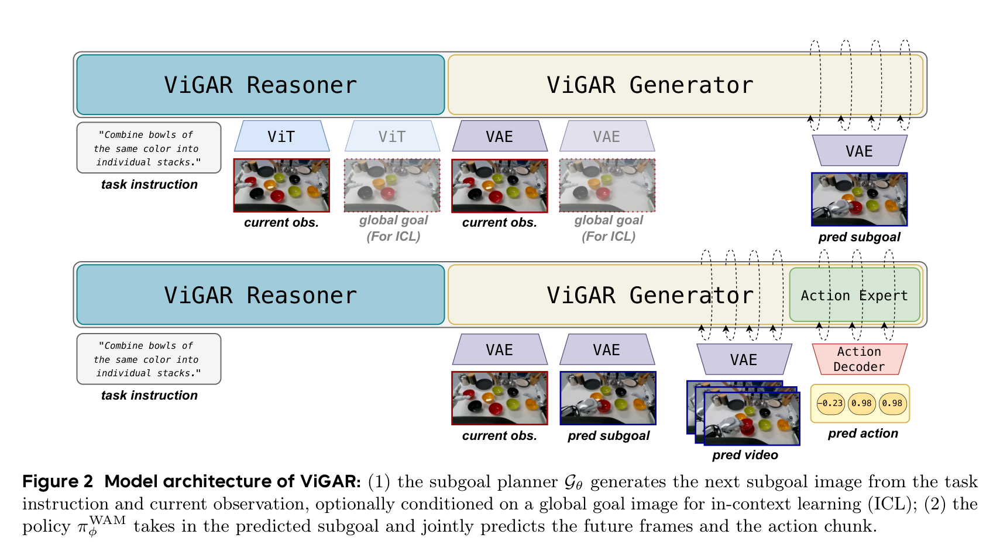
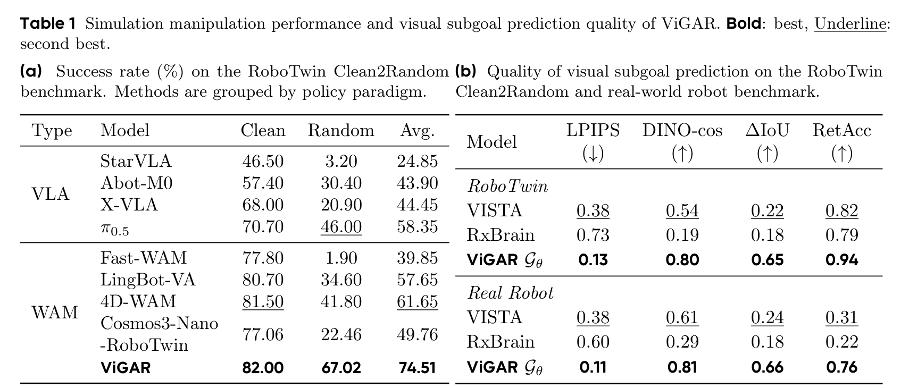
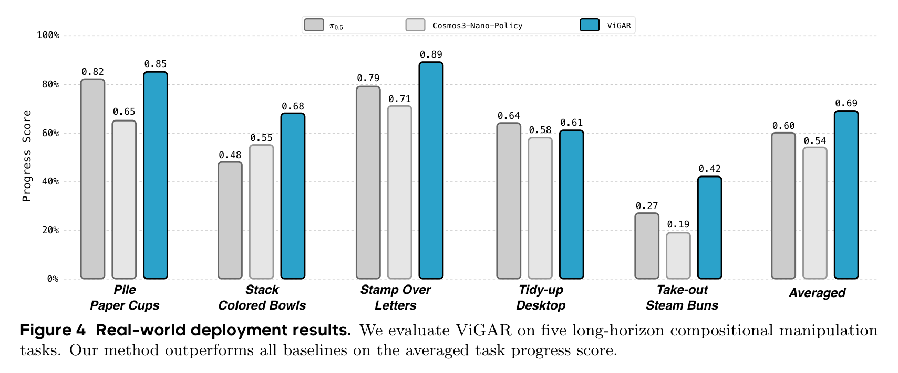
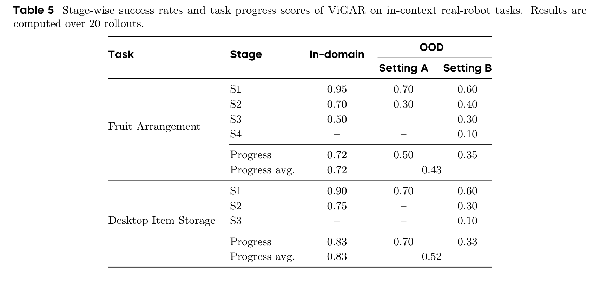
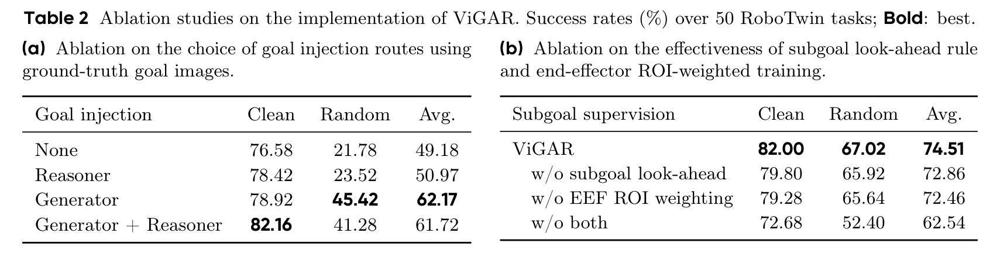

---
tags:
  - papers/world-model
  - papers/robot-learning
  - papers/embodied-ai
aliases:
  - ViGAR
  - Rethinking World-Action Model for Compositional and In-Context Robotic Manipulation
date: 2026-10-01
doi: 10.48550/arXiv.2610.02368
arxiv_id: 2610.02368
---

# Rethinking World-Action Model for Compositional and In-Context Robotic Manipulation (ViGAR)

## 核心信息

- 标题: Rethinking World-Action Model for Compositional and In-Context Robotic Manipulation
- 标题翻译: 重新审视用于组合式与上下文机器人的世界动作模型
- 作者: Shukai Gong, Xuanran Zhai, Yintianrun Zhang, Ruopeng Cui, Ye Huang, Yiyang Fu, Dexuan Lyu, Chaojie Li, Xinyi Song, Peiwen Lin, Chuang Wang, Mingyuan Jia, Yufan Deng, Jiaxin Fang, Bo Liang, Jiaxin Li, Yuxiang Gao, Hao Liu, Daquan Zhou
- 机构: 北京大学 (Peking University)；智元机器人 (AgiBot)；CocoMatrix
- 发表时间: 2026-10-01
- 发表渠道: arXiv 预印本 (arXiv:2610.02368v1 [cs.RO])
- DOI: 10.48550/arXiv.2610.02368
- arXiv: 2610.02368
- 论文链接: https://arxiv.org/abs/2610.02368
- 代码 / 项目: https://dagroup-pku.github.io/ViGAR
- 数据 / 资源: RoboTwin Clean2Random 仿真基准；AgiBot A2 双臂实体机器人约 900 小时真机遥操作数据集
- 论文类型: 具身智能、世界动作模型（WAM）、分层规划与上下文机器人操作

## 原文摘要翻译

长时程组合式操作在真实机器人实际部署中正变得越来越关键，在这类任务中，单个宏观任务通常由多个相互协调的子任务有机组合而成。现有的世界动作模型（WAM）倾向于联合预测短时程的视觉未来与动作序列，但在本质上普遍缺乏显式的子任务级推理机制。为此，我们提出了视觉目标条件动作推理模型 ViGAR。这是一个分层解耦框架，将组合操作分解为视觉子目标规划器与子目标执行器。给定当前视觉观测和全局任务语言指令，子目标规划器首先预测出针对下一个子任务的关键帧视觉子目标；随后，子目标执行器以此生成的子目标为强引导条件，联合生成通向该子目标的未来视觉轨迹与机器人连续动作块。这两个核心模块共享相同的预训练视频世界模型表征，使得高层任务规划与底层动作生成能够充分复用统一的通用物理常识与动力学先验。此外，我们的框架天然原生支持上下文学习：在保持场景与指令不变的前提下，仅仅提供一张全局终态目标图像作为上下文，就能在无需任何参数更新的情况下，诱导出截然不同的子任务时序分解与行为重组。在仿真基准测试中，模型在标称和随机化设定下分别取得了 82.00% 与 67.02% 的成功率，平均成功率较最强基线大幅提升 12.86 个百分点。在涵盖五项复杂长时程组合任务与两项上下文学习任务的实体机器人实验中，该方法进一步充分验证了其卓越的操控性能与泛化有效性。

## 创新点

1. **确立长远未来选择与短期物理实现的分层因式分解范式。** 论文深刻揭示了单体端到端世界动作模型在处理跨阶段、长时程组合任务时的固有缺陷，摒弃了单一模型强行拟合跨尺度因果的传统路线，提出 ViGAR 架构：先通过图像级视觉子目标规划器显式输出下一步达到的物理关键状态，再交由底层世界动作执行器联合生成局部视频与动作。
2. **在统一预训练视频世界模型骨干中共享物理表征与生成先验。** 规划器与执行器并非异构模型的机械拼接，而是全部基于 16B-A8B 级全模态扩散世界模型初始化。规划器将视频生成转化为图像编辑流匹配任务，执行器以纯几何潜变量注入引导动作扩散，让高层离散状态跃迁与底层连续物理动力学共享相同的通用世界物理常识。
3. **设计子目标前瞻重定向规则与末端执行器空间区域加权损失。** 针对子任务交界处视觉状态高度相似引发的规划回退死锁（即反复执行已完成子任务），提出时序边界前瞻规则；并结合标定相机投影的末端执行器关注区，将流匹配梯度聚焦于操作交互前景，从根源上保障了子目标生成的几何空间对齐度与阶段单调推进性。
4. **开创基于全局终态图像的零样本具身上下文操作机制。** 区别于主流依赖昂贵人类全流程演示视频的上下文模仿方法，ViGAR 仅以一张代表最终操作结果的静态目标图像为上下文条件输入规划器，即可零样本诱导全新的子任务分解拓扑与动作组合，实现了真正结果导向的非参数化自适应重组。

## 一句话总结

ViGAR 破除了世界动作模型强行单体化端到端预测的迷思，**通过共享预训练物理世界模型表征的分层解耦框架，将长时程组合操作拆解为视觉子目标生成与局部目标驱动动作执行，并首次实现了仅凭一张终态图片即可零样本编排全新操作序列的上下文具身泛化。**

## 研究问题

### 单体世界动作模型的长时程困境

在具身智能前沿研究中，世界动作模型（WAM）正逐渐成为超越传统策略模型的新一代核心范式。其核心吸引力在于：通过在密集的机器人及跨本体视频数据上进行联合自监督学习，模型能够内生掌握真实物理世界的因果演化、空间几何结构以及接触动力学，从而在面对场景扰动与分布偏移时展现出超越单纯模仿学习的鲁棒性。

然而，现存的主流单体模型在架构形式上大多是短程预测器：

$$
(O_{t+1}, A_{t+1}) \sim \pi_{\psi}^{\mathrm{WAM}}(O_{t+1}, A_{t+1} \mid o_t, s_t, \ell, \mu)
$$

其中模型仅根据当前局部观测、本体状态与全局文本指令，联合去噪预测未来极短视距内的局部物理演化。这种表述形式在单步原子技能上表现优异，但在面对多阶段长时程组合任务时，却遭遇了本质性的结构性瓶颈：

- **缺乏长尺度任务进度的显式决策变量：** 单体模型依赖其局部马尔可夫转移去推演动作。当任务需要按顺序经历多步异构阶段时，单体模型无法在表征空间显式维护当前的子任务跃迁状态，极易在长时间连续动作漂移中遗忘宏观目标。
- **环境随机化下的因果混淆与策略崩塌：** 在仿真基准测试中，当物体的初始空间位姿被强随机化打乱后，单体模型的成功率普遍出现断崖式下跌（例如无子目标引导的模型成功率从 77.06% 暴跌至 22.46%）。这证明单体模型的局部未来生成严重依赖对训练集时序轨迹的记忆；一旦几何初始条件剧变，无法自上而下重新规划中间目标，局部动力学预测便陷入混乱。

### 语义规划的表征局限与空间歧义

针对长时程任务，另一条常见路线是引入视觉语言模型作为高层语义规划器，将全局指令分解为子任务文本序列。然而，纯文本子任务在具身操作中存在不可克服的表征失真：

- 语言可以描述粗粒度语义意图，但无法精确指定空间中毫米级的接触姿态、抓取点深度以及两臂协同的相对朝向。
- 文本指令的生成极易引入幻觉与累积误差，且不同阶段之间的文本切换往往伴随严重的语义离散跳变，无法平滑传递物理环境的连续几何约束。

### 为什么是视觉子目标：长远选择与短期实现的因果解耦

ViGAR 的核心技术洞察在于：**物理组合操作必须在因果上解耦为长远未来选择与短期未来实现。**

- **长远未来选择阶段：** 当前多视角观测、全局任务指令与可选的终态目标输入视觉子目标规划器，规划器生成下一阶段的物理关键状态图像。
- **短期未来实现阶段：** 生成的关键帧图像经由编码器转化为几何潜变量，与当前观测及机械臂状态一同送入动作执行器，执行器联合生成局部动作块与短程视觉演化。

相比于纯文本描述，**图像级视觉子目标** 具有无与伦比的几何确定性：它在像素层面直接锚定了物体达到的终态位置、末端夹爪的空间形态以及物体间的几何堆叠关系。更关键的是，如果让高层规划与底层执行共享预训练视频世界模型的物理先验，那么生成这个视觉子目标的过程就不再是空中楼阁的语义编造，而是基于真实物理演化规律预测出的可行未来场景。

## 数据与任务定义

### RoboTwin Clean2Random 仿真评测规约

论文首先在高保真双臂仿真平台 RoboTwin Clean2Random 上进行标准化基准评测。评测采用双臂构型（共 14 个自由度）。

- **训练与测试切分：** 严格遵循极度苛刻的泛化测试协议，所有模型仅在由 2500 条高质量、无扰动的干净专家演示轨迹（覆盖 50 个双臂操作任务）上进行多任务联合训练。
- **评测条件设置：**
  - **标称场景设定（Clean）：** 物体初始位置、桌面背景及相机视角与训练集保持一致，主要考察模型在标称场景下的记忆与动作重放精度（每任务评测 100 次试验）。
  - **随机扰动设定（Random）：** 对物体的摆放位置、朝向、桌面杂乱干扰物纹理及初始位姿进行大范围强随机化扰动，测试模型在未见过的复杂空间构型下的鲁棒性与组合泛化能力（每任务评测 100 次试验）。
- **长时程子任务标注规范：** 在 50 个基准任务中，作者依据物理逻辑将其中 19 个任务定义为具有明确因果递进关系的复合长时程任务（涵盖三块积木堆叠、颜色排序、鞋子摆放、印章盖印、柜内存放等典型场景），并人工标定每个子任务的切分时间点，将其终态帧作为真值子目标图像；其余 31 个任务作为单阶段任务，其终态关键帧即为唯一的子目标。

### 真实机器人 900 小时具身预训练语料与本体设置

实体机器人实验在双臂人形机器人平台上展开：

- **硬件构型与传感器：** 双臂各 7 个自由度（共 14 自由度关节空间连续控制），配备左右双腕部活动相机与头部前向固定相机，输出多分辨率三视角图像流。
- **具身先验中程预训练数据：** 为赋予模型对机器人平台的感知动力学先验，ViGAR 在正式微调前，先在采集自该实机平台的约 900 小时遥操作示范数据上进行了中程训练。该语料涵盖 752 项异构操作技能、200 余种日常实体道具以及超过 10 种复杂室内背景环境。所有轨迹均由人工在环流程清洗，并细致切分为原子技能片段。

### 五大真实长时程组合任务与两大上下文学习任务

论文在物理现实世界中设计了五项极具挑战性的长时程组合操作任务与两项上下文学习任务（每任务进行 20 次完整的独立实机评测）：

1. **五项长时程组合操作任务：**
   - **叠纸杯（Pile Paper Cups，3 阶段）：** 识别桌面上散乱放置的纸杯，双臂交替拾取并将其单向紧密嵌套成一个单一纸杯堆。
   - **分类叠碗（Stack Colored Bowls，3 阶段）：** 桌面散落多种颜色的塑料碗，机器人需识别颜色并将相同颜色的碗精准分类叠放成独立的几摞。
   - **盖章传递（Stamp Over Letters，4 阶段）：** 先从印泥盒中取出印章，在目标信纸指定区域精准下压盖章，盖完后拾起信纸转交至实验人员手中。
   - **桌面清理（Tidy-up Desktop，4 阶段）：** 逐一清理桌面上散落的零碎垃圾、笔筒与文具，分别稳妥放入废纸篓与收纳区。
   - **蒸笼取包子（Take-out Steam Buns，5 阶段）：** 难度最高的超长程操作：双手揭开两层竹蒸笼的顶盖，夹取上层蒸格中的包子并置于平盘，取下上层空蒸格，再夹取下层蒸格中的包子置于平盘。
2. **两项上下文学习操作任务：**
   - **水果分类摆放（Fruit Arrangement）：** 将散落的水果归类放入左右两个果篮中。果篮内具体放置何种水果、每个篮子放几个，完全不通过语言详述，而是在推理时传入一张全局终态目标图片指定。
   - **桌面物品收纳（Desktop Item Storage）：** 将桌面上的文具、金属杯、玩具按终态图片指定的排列模式统一收纳到托盘中。

## 方法主线

### 机制流程

ViGAR 的整体推演流水线严格围绕视觉子目标规划器与子目标驱动世界动作执行器展开：

*论文原图编号：Figure 1。ViGAR 顶层框架概览：分层规划器与执行器协同工作。*

整体控制机制采用**后退时域闭环控制**：
1. 在当前控制查询步，机器人获取当前三视角观测、本体状态与全局语言指令（以及可选的终态目标图）。
2. 子目标规划器以前向流匹配生成当前活跃子任务应当达到的物理终态视觉图像。
3. 动作执行器将预测出的子目标经由编码器转化为几何潜变量，与当前观测潜变量及动作查询联合输入生成分支，去噪输出未来的短时程视觉视频以及包含 48 步连续关节控制量的动作块。
4. 机器人底层控制器执行该动作块的前部步骤，并在下一个决策周期重新调用规划器；由于场景已经发生物理变化，规划器将自然平滑地输出下一个关键状态，无需外部显式的人工子任务完成检测器。

### 视觉子目标规划器 (Visual Subgoal Planner $G_\theta$)

在很多传统分层方法中，高层规划器往往需要同时生成子任务文本与目标图。ViGAR 作出了一个极其果断的架构简化：**在所有子任务阶段完全固定语言指令为全局指令。** 其依据在于：高精度的子目标图像已经在空间像素层提供了完备的目标锚定，生成子任务文本不仅信息冗余，反而会在多阶段生成中累积幻觉误差；保留全局文本恰好为模型提供了全局长远语义锚点。

因此，子目标规划在数学上被形式化为一个条件图像编辑流匹配问题：

- 输入当前帧参考观测，三视角拼接后经由视频编码器压缩为单帧干净潜变量 $z_t = \mathcal{E}_v(o_t)$。
- 目标子任务关键帧在送入编码器前在时间维度复制四次，经编码后压缩为单帧目标真实潜变量 $x_0^g = \mathcal{E}_v(g_i)$。
- 在流匹配训练过程中，对目标潜变量加噪：

$$
x_\tau^g = (1 - \tau) x_0^g + \tau \epsilon, \quad \tau \sim \mathcal{U}[0, 1], \quad \epsilon \sim \mathcal{N}(0, I)
$$

速度场真值定义为：

$$
v_{\mathrm{plan}} = \epsilon - x_0^g
$$

规划器预测去噪向量场，从而在推理时通过数值积分生成高保真的下一阶段目标图像。

### 共享预训练世界模型表征与物理先验复用

无论是规划器还是策略网络，均并非从零训练，而是全部继承自参数量达 16B-A8B 级的基础世界模型骨干：

*论文原图编号：Figure 2。ViGAR 模型架构与双分支网络拓扑图。*

预训练底座采用了双分支混合 Transformer 架构：
- **推理分支：** 负责消化长文本序列与高层视觉标记，沉淀高维语义交互表征。
- **生成分支：** 负责在连续潜空间通过流匹配去噪生成图像或视频帧潜变量。两分支在每一层通过共享的多模态交叉注意力机制进行高密度双向信息交互。

在微调过程中，作者设计了非常关键的不对称冻结策略：
- 在训练规划器时，**完全冻结推理分支及视觉标记提取器**，仅更新生成分支的参数与视觉投影层。这强迫模型将预训练的世界生成先验用于图像编辑变换，极大抑制了由于机器人小数据微调导致的高层语义表征崩塌。
- 在训练策略网络时，同样冻结推理分支，仅更新生成分支、新引入的动作编解码器、动作模态嵌入以及专用的目标角色嵌入。

### 子目标驱动的动作执行器 (Subgoal Executor $\pi_\phi^{\mathrm{WAM}}$)

执行器旨在解决如何从当前状态平滑过渡到预测子目标的动力学执行问题。给定当前观测、本体状态与预测目标：

- **目标注入路径对比：** 论文对比了语义路径（将目标输入推理分支）与几何路径（将目标经由编码后作为干净潜变量送入生成分支）。ViGAR 坚定采纳几何路径：

$$
z_i^g = \mathcal{E}_v(\hat{g}_i) + e_{\mathrm{goal}}
$$

其中 $e_{\mathrm{goal}}$ 是一个零初始化的可学习角色嵌入向量，用于向生成分支标识该潜变量为引导目标。这种设计让动作去噪过程直接在度量空间感知当前帧与目标帧之间的像素位移差向量。

- **联合流匹配优化目标：** 设定动作预测块长度为 48 步，对应视频未来预测长度为 48 步（下采样后为 12 帧视频潜变量）。构造视频目标潜变量与动作目标向量：

$$
x_0^v = \mathcal{E}_v(O_{t+1}), \quad x_0^a = A_{t+1}
$$

施加联合流匹配加噪与去噪损失优化：

$$
\mathcal{L}_{\mathrm{WAM}} = \mathbb{E}_{(o_t, \ell, \hat{g}_i), \tau, \epsilon_v, \epsilon_a} \left[ \left\| \hat{v}_\phi^v - v_{\mathrm{vid}} \right\|_2^2 + \left\| \hat{v}_\phi^a - v_{\mathrm{act}} \right\|_2^2 \right]
$$

- **训练与测试分布偏移对齐：** 如果策略仅在完美的真值子目标上训练，实机推理时面对规划器生成的微小瑕疵（如轻微模糊或几何形变）就会迅速发散。作者在离线阶段使用已训好的规划器预先对训练轨迹生成伪预测子目标，规则剔除严重崩坏的样本后，将预测子目标与真值子目标按比例混合训练执行器，显著增强了下游动作的容错性。

### 子目标监督设计与前瞻规则

在实现高保真子目标学习时，有两个极具物理洞察的工程创新：

*论文原图编号：Figure 3。子目标监督设计的两项基石：时序边界前瞻重定向规则与末端执行器关注区加权。*

#### 1. 子目标前瞻规则
在传统的多阶段轨迹切分中，当前子任务的末尾帧与下一子任务的起始帧在物理上是连续且视觉高度相似的。然而，在朴素监督下，它们被强行赋予了截然不同的目标：前者学习当前阶段终态，后者学习下一阶段终态。这导致模型在子任务过渡边缘产生极大的预测不确定性。实机部署中极易发生致命缺陷：**当机器人刚完成当前子任务准备进入下一阶段时，微小的视觉相似度使得规划器再次吐出已经完成的旧目标，导致机器人发生回退死锁**，把刚放好的物品又重新拿起来。

为此，ViGAR 提出前瞻重定向规则：

$$
\mathrm{target}(o_t) = \begin{cases}
g_{i+1}, & o_t \in \text{last } p\% \text{ of } T_i, \; i < n \\
g_i, & \text{otherwise}
\end{cases}
$$

将每个子任务最后特定时间段内（经验值取 15%~20%）的参考帧，其监督目标强行提前重定向至下一个阶段的目标。这使得模型在当前子任务即将收尾时，已经具备了提前预判下一步的势能，彻底消除了交界处的退化抖动。

#### 2. 末端执行器空间区域加权损失
在机器人操作中，静态背景占据了图像像素的绝大部分，但真正的物理因果变化全部集中在夹爪与操作物体接触的方寸之间。常规的全局流匹配损失会导致模型过度消耗容量去拟合背景纹理。

作者利用系统标定好的内外参矩阵，将双臂末端执行器的三维轨迹投影至各个相机像素平面，在投影点周围建立局部窗口并取并集，生成二值末端掩码，随后面积池化至潜空间分辨率。定义归一化权重：

$$
w_i(u) = \frac{1 + \lambda \tilde{m}_i(u)}{\frac{1}{|\Omega|} \sum_{u' \in \Omega} (1 + \lambda \tilde{m}_i(u'))}, \quad \frac{1}{|\Omega|} \sum_{u \in \Omega} w_i(u) = 1
$$

论文将前景与背景的权重比设为极其显著的 **4:1**。规划器的最终加权流匹配目标为：

$$
\mathcal{L}_{\mathrm{Plan}} = \mathbb{E}_{(o_t, \ell, g_i), \tau, \epsilon} \left[ \left\| \sqrt{w_i} \odot \left( G_\theta(x_\tau^g, \tau \mid z_t, \ell) - v_{\mathrm{plan}} \right) \right\|_2^2 \right]
$$

这一空间先验迫使梯度完全聚焦于手眼协同的核心区域。

### 上下文学习机制

大语言模型能够通过提供提示词上下文，在不修改网络权重的前提下完成新任务。但在机器人学中，现有的具身上下文学习工作通常要求用户提供包含人类操作全过程的长视频作为上下文。这种方法不仅数据获取极其昂贵，而且受限于人类手臂与机械手臂之间巨大的具身运动学差异。

ViGAR 提出了全新的以终为始的上下文机制：
- 将上下文极度精简为一张代表任务最终理想状态的全局终态目标图像 $G$。
- 这个上下文图像 **仅仅输入给高层的子目标规划器**：

$$
\hat{g}_i \sim G_\theta(\cdot \mid z_t, \ell, G)
$$

训练时，$G$ 取示范轨迹的最后一帧；推理时，$G$ 可直接替换为任意用户指定的期望布局。
- **底层的动作执行器完全感知不到全局终态图像的存在。** 它依旧只负责执行规划器递给它的局部子目标。

因此，当输入一个训练集中从未出现过的全局目标时，规划器会自适应地将其拆解为一系列全新的子目标序列，而底层策略只需忠实执行各个原子过渡，从而在完全不更新任何模型参数的条件下，自发涌现出未曾见过的复杂组合新行为。

## 关键结果

### 仿真基准主结果与强基线

在 RoboTwin Clean2Random 基准上的 50 个双臂任务评测中，ViGAR 展现出统治级的综合表现：

*论文原图编号：Table 1。仿真操作成功率对比与视觉子目标生成质量评测。*

下表完整转录了原论文中主要系统的仿真成功率指标（单位：%）：

| 策略类型 | 评估模型 | 标称场景成功率 (Clean) | 随机扰动成功率 (Random) | 综合平均 (Avg.) |
| :--- | :--- | :---: | :---: | :---: |
| **VLA 范式** | StarVLA | 46.50 | 3.20 | 24.85 |
| | Abot-M0 | 57.40 | 30.40 | 43.90 |
| | X-VLA | 68.00 | 20.90 | 44.45 |
| | $\pi_{0.5}$ | 70.70 | 46.00 | 58.35 |
| **WAM 范式** | Fast-WAM | 77.80 | 1.90 | 39.85 |
| | LingBot-VA | 80.70 | 34.60 | 57.65 |
| | 4D-WAM | 81.50 | 41.80 | 61.65 |
| **同骨干受控** | Cosmos3-Nano-RoboTwin | 77.06 | 22.46 | 49.76 |
| **本文方法** | **ViGAR (Ours)** | **82.00** | **67.02** | **74.51** |

**结果深度剖析：**
1. **标称场景的性能饱和与随机化场景的质的飞跃：** 在 Clean 标称设定下，由于场景分布与训练集一致，各基线性能差距不大。然而一旦切换到 Random 随机化设定，单体模型遭受严重冲击，而 ViGAR 依然保持了高达 **67.02%** 的成功率，领先此前最强基线 4D-WAM 达 **25.22 个百分点**。
2. **严苛的同骨干消融证实子目标的独立价值：** 尤为关键的是对照组 `Cosmos3-Nano-RoboTwin`——它与 ViGAR 使用完全相同的骨干、训练数据及优化超参数，仅仅是去掉了显式视觉子目标规划。结果显示其在随机扰动下仅能达到 22.46%，综合平均仅 49.76%。**ViGAR 相比其净提升高达 24.75 个百分点**，这以无懈可击的数据证明：性能的爆发绝非单纯来源于预训练大模型的底座红利，而是直接归功于分层视觉子目标规划的架构优势。

### 视觉子目标生成质量评测

论文在仿真与真实机器人上对规划器生成的子目标进行了极其严格的客观质量度量：
- **感知距离 LPIPS (越低越好)：** 仿真基准上达到 **0.13**（远胜对照方法的 0.38 与 0.73）；实机上达到 **0.11**。表明图像在感知保真度上极高，无严重模糊伪影。
- **语义相似度 DINO-cos (越高越好)：** 特征余弦相似度在仿真和实机分别达到 **0.80** 与 **0.81**，说明语义类别对齐极度精准。
- **空间变化一致性 $\Delta\mathrm{IoU}$ (越高越好)：** 差分区域变化一致性达到 **0.65**（仿真）与 **0.66**（实机），是传统基准的近三倍，证明手部交互产生的物理位移被极为真实地渲染出来。
- **检索准确率 RetAcc (越高越好)：** 检索准确率达到 **0.94**（仿真），说明规划器在 94% 的情况下都能无误地指向正确的下一个阶段关键帧。

### 真实机器人长时程组合操作实验

在实体双臂机器人上，五大真实长时程任务的定量与定性表现如下：

*论文原图编号：Figure 4。实体机器人在五大长程任务上的平均任务进度得分柱状图。*

下表完整转录了实机长时程任务逐阶段成功率与综合任务进度得分：

| 真实长时程任务 | 评测阶段 | $\pi_{0.5}$ | Cosmos3-Nano-Policy | **ViGAR (Ours)** |
| :--- | :--- | :---: | :---: | :---: |
| **Pile Paper Cups** | Stage 1 | 0.95 | 0.85 | 0.90 |
| (3 阶段：叠纸杯) | Stage 2 | 0.85 | 0.65 | 0.85 |
| | Stage 3 | 0.65 | 0.45 | **0.80** |
| | **Progress** | **0.82** | **0.65** | **0.85** |
| **Stack Colored Bowls** | Stage 1 | 0.70 | 0.75 | 0.85 |
| (3 阶段：分类叠碗) | Stage 2 | 0.50 | 0.55 | 0.70 |
| | Stage 3 | 0.25 | 0.35 | **0.50** |
| | **Progress** | **0.48** | **0.55** | **0.68** |
| **Stamp Over Letters** | Stage 1 | 1.00 | 0.95 | 1.00 |
| (4 阶段：盖章传递) | Stage 2 | 0.80 | 0.85 | 0.95 |
| | Stage 3 | 0.70 | 0.60 | 0.80 |
| | Stage 4 | 0.65 | 0.45 | **0.80** |
| | **Progress** | **0.79** | **0.71** | **0.89** |
| **Tidy-up Desktop** | Stage 1 | 0.85 | 0.80 | 0.85 |
| (4 阶段：桌面清理) | Stage 2 | 0.70 | 0.65 | 0.65 |
| | Stage 3 | 0.55 | 0.50 | 0.55 |
| | Stage 4 | 0.45 | 0.35 | 0.40 |
| | **Progress** | **0.64** | **0.58** | **0.61** |
| **Take-out Steam Buns** | Stage 1 | 0.60 | 0.50 | 0.65 |
| (5 阶段：蒸笼取包子) | Stage 2 | 0.35 | 0.25 | 0.55 |
| | Stage 3 | 0.25 | 0.15 | 0.45 |
| | Stage 4 | 0.15 | 0.05 | 0.30 |
| | Stage 5 | 0.00 | 0.00 | **0.15** |
| | **Progress** | **0.27** | **0.19** | **0.42** |
| **综合平均** | **Average Progress** | **0.60** | **0.54** | **0.69** |

*论文原图编号：Table 4。实机长时程组合任务逐阶段成功率与进度得分汇总。*

实机实验揭示了极其生动的物理现象：
- 在五阶段的蒸笼取包子超复杂任务中，基线策略在第四与第五阶段全军覆没（成功率均为 0%），进度得分惨跌至 0.27 和 0.19；而 ViGAR 在末尾阶段依然维持了 15% 的全通率，总进度达到 **0.42**，展现出分层框架对多步误差累积的极佳缓冲韧性。
- 只有在桌面清理任务中，对比模型略微高出 3 个百分点，这主要是由于该任务中杂物的空间位置分布相对离散且不强调严格的前后时序依赖。而在其余四项强顺序依赖的任务上，ViGAR 全面领先基线。

### 真实机器人上下文学习能力验证

在无需修改网络权重的上下文操作验证中，实机表现如下：

*论文原图编号：Figure 5。真实机器人上下文学习实验的定性执行过程与定量进度得分。*

*论文原图编号：Table 5。上下文学习任务逐阶段成功率及综合进度得分。*

下表完整整理了实机上下文评测详细数据：

| 评估任务 | 阶段划分 | 域内测试 (In-domain) | 分布外测试一 | 分布外测试二 | 分布外平均 |
| :--- | :--- | :---: | :---: | :---: | :---: |
| **Fruit Arrangement** | Stage 1 | 0.95 | 0.70 | 0.60 | – |
| (水果分类摆放) | Stage 2 | 0.70 | 0.30 | 0.40 | – |
| | Stage 3 | 0.50 | – | 0.30 | – |
| | Stage 4 | – | – | 0.10 | – |
| | **Progress** | **0.72** | **0.50** | **0.35** | **0.43** |
| **Desktop Item Storage**| Stage 1 | 0.90 | 0.70 | 0.60 | – |
| (桌面物品收纳) | Stage 2 | 0.75 | – | 0.30 | – |
| | Stage 3 | – | – | 0.10 | – |
| | **Progress** | **0.83** | **0.70** | **0.33** | **0.52** |

当用户在部署时给定一张示教集中从未出现过的终态图：
- 机器人准确识别了终态图中物品的空间分布，通过规划器自动拆解生成了全新的动作过渡流。
- 在分布外严苛挑战下依然达成了 **0.43** 和 **0.52** 的平均进度，充分证明物理终态图像是一种高密度、强泛化、免调参的极优上下文媒介。

### 消融分析：注入路径、前瞻规则与 ROI 权重

论文通过极为严谨的受控实验，剥离出了各项关键机制的独立贡献：

*论文原图编号：Table 2。目标注入路径与子目标监督机制消融实验结果。*

*论文原图编号：Figure 9。子目标前瞻规则消融定性证据：无前瞻规则时机器人将纸杯叠好后发生规划混淆并伸手回退抓取已完成纸杯；加入前瞻规则后顺利推进至下一纸杯。*

1. **几何路径与语义路径的性能对比：**
   - **无目标引导基线:** Clean 76.58%, Random 21.78%, 平均 49.18%。
   - **语义路径输入推理分支:** Clean 78.42%, Random 23.52%, 平均 50.97%（几乎无增益）。
   - **几何路径输入生成分支:** Clean 78.92%, **Random 45.42%**, 平均 **62.17%**（大幅提升近 13 个百分点）。
   - **双路径同时结合:** Clean 82.16%, Random 41.28%, 平均 61.72%。
   - **结论：** 在潜空间直接拼接几何潜变量是提升空间泛化性的关键因素；强行引入高层语义特征不仅计算冗余，反而因为高层语义抽象对空间扰动的过敏，导致随机化场景下成功率倒退 4.14 个百分点。
2. **前瞻规则与末端区域权重的协同价值：**
   - 完整 ViGAR 达成 74.51%（Clean 82.00%, Random 67.02%）。
   - 去掉前瞻规则降至 72.86%；
   - 去掉末端区域权重降至 72.46%；
   - **若同时剥离两项机制，模型平均成功率降至 62.54%**（均值下降近 12 个百分点，随机化场景下降至 52.40%）。
   - 实机对比更是戏剧化地证实：没有前瞻规则时，策略在叠完纸杯松爪的一瞬间，由于视觉状态与抓杯前类似，规划器再度给出抓杯目标，机器人立刻伸爪抓回刚刚放好的杯子，导致循环卡死；前瞻规则彻底终结了这一振荡死锁。

## 深度分析

### 真正贡献是什么：分层视觉因式分解与轻量级目标上下文

在当前学术界对端到端单体模型近乎盲目崇拜的浪潮下，ViGAR 做出了非常冷静且具备深远方法论价值的反思。其真正的核心贡献可以凝练为两点：

1. **破除单体化迷信，确立分层因式分解的合法性与优越性。** 过去很多研究者认为，只要把视频生成模型规模放大，单体模型就能同时内生学会任务规划与底层毫秒级控制。ViGAR 用详实的数据证伪了这一设想：在长时程复合任务中，多尺度时空因果的耦合极其剧烈，强行单体化只会导致模型在空间扰动面前严重退化。通过将其拆解为以图像编辑为数学内核的高层视觉子目标规划，与以目标驱动流匹配为内核的底层动作生成，两阶段各司其职，兼顾了任务级长时程推进力与局域连续物理接触的保真度。
2. **重塑具身上下文学习的媒介定义。** 过去具身上下文学习基本被人类演示视频驱动所垄断。ViGAR 证明，**一张静态的全局终态图片足以承载全新的任务规范**。只要高层规划器具备足够的物理常识推演能力，终态图像所施加的几何边界条件便能通过因果链自动向后传导，衍生出完备的子任务分解。这为未来低成本、免微调、即插即用的机器人人机交互提供了极具实用价值的全新范式。

### 为什么结果成立：解耦高层状态转移与底层物理动力学

从物理与控制理论的底层逻辑审视，ViGAR 的卓越表现之所以成立，根源在于其精准匹配了机器人操作的双重时间尺度特征：

- **高层状态跃迁是离散且拓扑敏感的：** 无论机械臂在搬运过程中微小的电机振动如何，从物体未放置到已放置是一个明确的拓扑相变。子目标规划器的任务本质上是在相空间中跳跃寻找吸引子。通过图像生成直接锚定这个吸引子，直接为底层控制指明了势函数低谷。
- **底层动作执行是连续且局部微分的：** 机器人夹爪的闭环对准与力控调节需要高频响应局域物理反馈。底层执行器在已知目标潜变量的强引导下，流匹配的去噪轨迹被极大收窄在一条连接当前帧与目标帧的高置信度动力学流形上，避免了由于目标不明确而在高维动作空间盲目搜索。

### 容易误读的地方：关于离散关键帧、重规划频率与权重共享

在通读论文与代码时，读者需要警惕以下三处极易产生误解的关键细节：

1. **误区一：子目标是否必须是离散的人工关键帧？**
   *澄清：* 虽然在训练阶段，子目标监督来源于人工切分的示范端点帧，但在实机部署阶段，ViGAR 是以后退时域闭环的方式高频滚动的。每一个控制查询周期，规划器都会基于当前最新视觉重新评估并输出新目标。这意味着如果物理环境遭遇突发碰撞或扰动导致当前动作偏离，规划器会在下一帧动态修正目标图像，具有闭环重规划能力，绝非僵硬执行静态预设步骤。
2. **误区二：规划器与执行器是完全共享一个权重实体吗？**
   *澄清：* 论文标题与摘要中强调共享预训练世界模型表征与物理先验，这指的是**两者在初始化阶段共享基础模型的预训练权重与相同的网络拓扑**。但在最终工程落地中，由于规划器被特化为图像编辑流匹配任务，而执行器挂载了动作专家进行联合视频动作生成，两者在微调后是**两个独立的模型权重文件**。在物理部署时需要分别实例化加载，这一点不可混淆为单一网络单次前向完成全部推理。
3. **误区三：为什么丢弃子任务文本只保留全局文本不会丢失指令信息？**
   *澄清：* 直觉上细粒度的子任务文本似乎更有引导性。但实证表明，高层模型生成的中间文本极易发生代词指代不清或阶段幻觉；而生成的子目标图像已经包含了精确到像素的物体空间位姿。此时保留全局指令，反而为整个系统提供了抵御局部视觉噪声的全局语义下锚点。

### 复现注意点：数据切分前瞻窗口、ROI 掩码标定与推理工程栈

若要在自己的双臂机器人平台上完整复现 ViGAR 体系，必须严格把控以下关键工程环节：

1. **前瞻窗口参数 $p\%$ 的敏感性调优：** $p\%$ 的选取直接决定了防回退与过早过渡之间的平衡点。若比例设得过大，机械臂在当前子任务尚未完成时就提前转向下一目标；若比例设得过小，交界处的视觉重叠无法被覆盖，依然会诱发回退。在实际数据集中，建议结合末端速度变化曲线，将比例严格锚定在夹爪释放前约 0.3~0.5 秒的时间窗口内。
2. **末端空间区域投影矩阵标定的绝对刚性：** 4:1 的空间区域加权高度依赖手眼标定矩阵的精准度。如果相机外参存在 1~2 厘米的系统性漂移，空间掩码可能会精准偏离真实的夹爪交互区，导致流匹配把背景当成了末端进行重点拟合，进而破坏子目标的几何准确性。在实机部署前，必须进行高精度重标定。
3. **重型扩散模型的全栈推理加速不可或缺：** 双模型串联前向推理的原始开销极其显著。原作者在专用硬件上构建了一套完备的优化流水线：
   - **静态计算图捕获：** 消除反复启动底层算子的调度延迟；
   - **批量条件与无条件推理：** 将无条件与有条件推理合并为单次前向评估，将注意力算力消耗砍半；
   - **精确条件哈希缓存：** 当当前子目标与文本未发生突变时，直接复用上一步已编码好的潜变量与文本标记，避免重复调用编码器；
   - **残差步数早停优化：** 在扩散流匹配过程中，监测去噪残差的相对变化量，对平缓步数跳过网络评估。
   这套组合拳使策略推理提速 2.5 倍，规划器图像生成提速 **11.2 倍**，是 ViGAR 能够实机闭环部署的工程底座。

## 局限

尽管 ViGAR 在组合操作与上下文泛化上树立了新的里程碑，但在实际工程与前沿学术视角下，该工作仍暴露出以下客观局限：

1. **双模型级联带来的计算与显存开销沉重：** 规划器与执行器分别实例化为两套大参数量的模型，即使经过了推理加速，其显存占用依然对边缘车载计算单元构成了巨大挑战。无法将两阶段合二为一为单一流式模型，是其工程落地的主要阻碍。
2. **末端子任务的误差累积效应依然存在：** 尽管相较单体基线有显著改善，但在超长时程的五阶段蒸笼取包子实机任务中，最后阶段的成功率依然跌至 15%。这表明随着物理交互步骤的增加，每一次接触引入的微小状态偏差依然在逐渐侵蚀上层规划器的先验有效性。
3. **对人工子任务时序切分标注的高度依赖：** 训练集需要数千条人工标注好子任务边界的数据。这使得 ViGAR 目前难以像纯自监督视频世界模型那样，直接无监督吞入数万小时未清洗的人类互联网日常视频。
4. **终态图像上下文在极端分布外场景下的泛化上限：** 实机实验显示，当给定的全局终态图像包含极端拓扑形变或训练集从未见过的精细接触约束时，分布外任务进度得分依然会从域内的 70%~80% 跌落至 40%~50%，表明单纯靠二维终态图像去零样本引导物理世界，仍存在隐式动力学无法外推的天然物理边界。

## 我的笔记

### WAM 宏观演化谱系与 ViGAR 的生态位定位

回顾具身世界动作模型的演进谱系，整个领域在世界模型究竟该如何赋能机器人控制这一命题上经历了三波深刻的范式演变：

1. **第一代：单体联合视频动作生成范式**
   代表方法包括早期联合流匹配模型。该范式采用单体结构同时预测短程视频与动作，缺陷在于长程时序容易迷失，在强空间扰动下易崩塌。
2. **第二代：训练期隐式正则范式**
   代表方法以 Fast-WAM 为代表。该范式仅将视频预测作为训练期辅助目标，在测试期跳过视频去噪。缺陷在于完全牺牲了显式空间目标，难以胜任复杂的多阶段组合任务。
3. **第三代：分层因式分解与空间物理范式**
   代表方法包括 ViGAR、4D-WAM 与 InternW0-Δ。该范式采用分层视觉子目标规划配合目标驱动的几何动作执行，具备跨长程稳健推进与零样本上下文重组的核心优势。

### 与主流世界动作模型的横向多维对比矩阵

为了全面厘清 ViGAR 在当前具身世界模型全景图谱中的相对技术坐标，下表将其与当代代表性模型进行多维横向解构：

| 对比维度 | 本文 ViGAR | Fast-WAM 模型 | InternW0-Δ 模型 | OpenWAM 模型 | 4D-WAM 模型 | 经典策略基线 |
| :--- | :--- | :--- | :--- | :--- | :--- | :--- |
| **顶层架构范式** | 分层解耦：规划器生成子目标加执行器生成动作 | 单体去耦：训练期联合而推理期仅保留动作 | 单体因果：特征预填充加动作扩散网络 | 模块化解耦：双分支相互注意力机制 | 单体增强：注入连续点轨迹场 | 纯多模态流匹配策略 |
| **测试期未来生成** | 显式生成下一阶段单帧关键图像及短程视频 | 完全跳过未来视频去噪实现零视觉生成延迟 | 零视频生成仅直接采样动作块 | 支持联合生成或独立动作解码 | 生成未来轨迹场与动作 | 无未来视觉预测直接映射动作块 |
| **长时程解耦机制** | 具备时序前瞻规则与图像编辑子目标规划 | 仅单动作块执行依赖外层环境隐式滚动 | 依赖大规模数据覆盖长程流形 | 依赖大模型容量记忆长程关联 | 依赖连续点追踪提供时间一致性 | 依赖语言上下文与高频闭环执行 |
| **上下文泛化形态** | 目标图像驱动：终态图即时诱导全新子任务序列 | 无上下文机制依赖特定语言与固定场景 | 依赖数据微调无轻量上下文 | 依赖通用提示词无显式上下文 | 无显式上下文学习机制 | 依赖语言提示词调整 |
| **目标条件注入路径** | 纯几何路径：潜变量直接输入生成分支 | 不适用 | 不适用 | 可选条件交互 | 轨迹场坐标拼接 | 语义特征输入网络 |
| **随机化场景成功率** | 67.02% (均值 74.51%) | 1.90% (均值 39.85%) | 未在同协议公开 | 26.62% | 41.80% (均值 61.65%) | 46.00% (均值 58.35%) |
| **核心工程优势** | 解决子任务回退死锁并大幅加速规划推理 | 超低单步延迟部署极快 | 延迟极低并消除动作突变跳跃 | 模块化自由插拔与评测基建 | 对相机视角晃动与空间扰动鲁棒 | 通用化程度高生态工具链完备 |

### 对未来具身世界模型架构演化的三点启示

精读 ViGAR 全文及其工程细节，对我们后续探索下一代具身大模型有极其深刻的启发：

1. **几何注入优于语义注入应成为策略设计的铁律。**
   消融实验中几何潜变量注入对语义特征注入的显著优势，给沉迷于在高层语义做跨模态注意力的做法敲响了警钟。对于物理世界的空间接触，高维语义特征会平滑掉最关键的毫米级坐标差。**让目标以编码潜变量的形式直接在物理去噪空间与当前观测对齐，是空间泛化能力的核心保障。**
2. **前瞻重定向是所有多阶段模仿学习的通用处方。**
   无论使用何种策略架构，只要任务被人工切分为阶段，交界处的“回退振荡死循环”就必然存在。将阶段尾部特定比例数据重定向至下一阶段目标的技巧，数学本质是在离散边界处施加了一阶导数平滑，这一技巧应无条件迁移到所有长程具身数据管线中。
3. **具身智能的终极形态是自回归子目标规划配合局域连续流匹配。**
   ViGAR 目前的双模型级联虽然有效，但略显臃肿。未来的终极统一范式，应当是在单个混合模型中：高层状态标记以低频自回归生成未来关键帧潜变量，底层动作流以高频基于该前缀潜变量流匹配去噪输出动作。ViGAR 已经成功探明了这一终极架构的理论可行性与物理边界。

## 引用

Gong, Shukai, Xuanran Zhai, Yintianrun Zhang, Ruopeng Cui, Ye Huang, Yiyang Fu, Dexuan Lyu, Chaojie Li, Xinyi Song, Peiwen Lin, Chuang Wang, Mingyuan Jia, Yufan Deng, Jiaxin Fang, Bo Liang, Jiaxin Li, Yuxiang Gao, Hao Liu, and Daquan Zhou. “Rethinking World-Action Model for Compositional and In-Context Robotic Manipulation.” arXiv preprint arXiv:2610.02368, 2026. https://arxiv.org/abs/2610.02368.

相关对照文献：

- Agarwal et al. “Cosmos 3: Omnimodal World Models for Physical AI.” arXiv:2606.02800, 2026.
- Yuan et al. “Fast-WAM: Do World Action Models Need Test-time Future Imagination?” arXiv:2603.16666, 2026.
- Yang et al. “4D-WAM: Infusing Spatiotemporal Awareness into World Action Models through Trajectory Fields.” arXiv:2608.08023, 2026.
- Long et al. “Scaling World Model for Hierarchical Manipulation Policies (VISTA).” arXiv:2602.10983, 2026.
