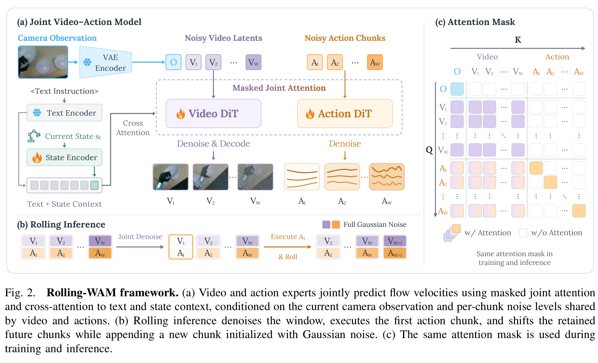
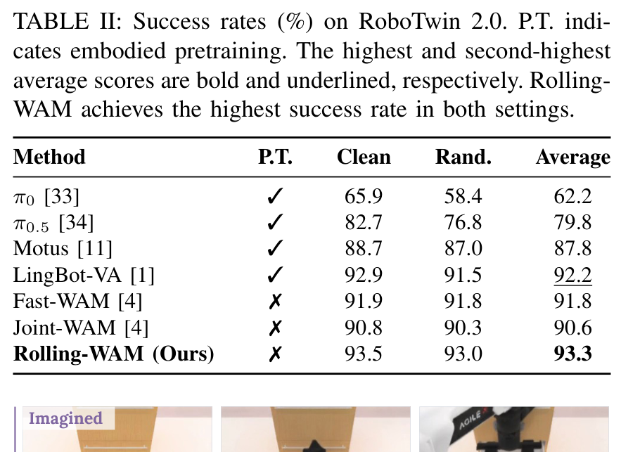
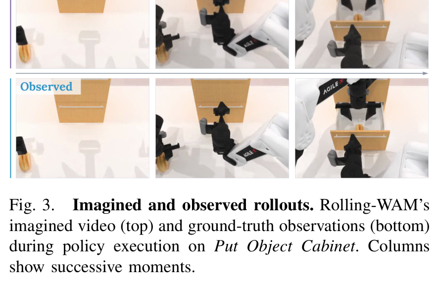
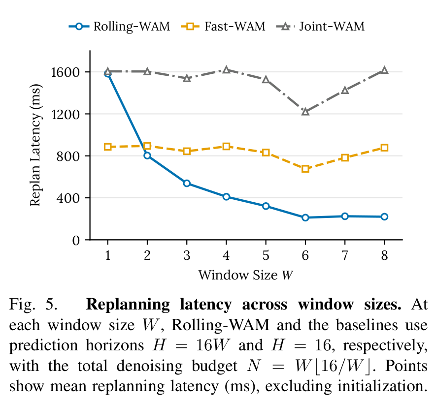
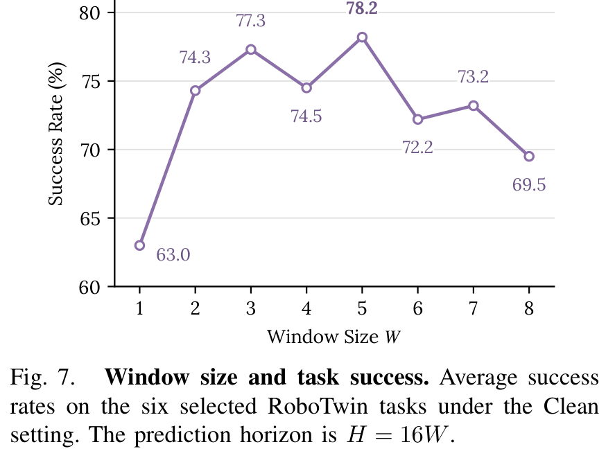
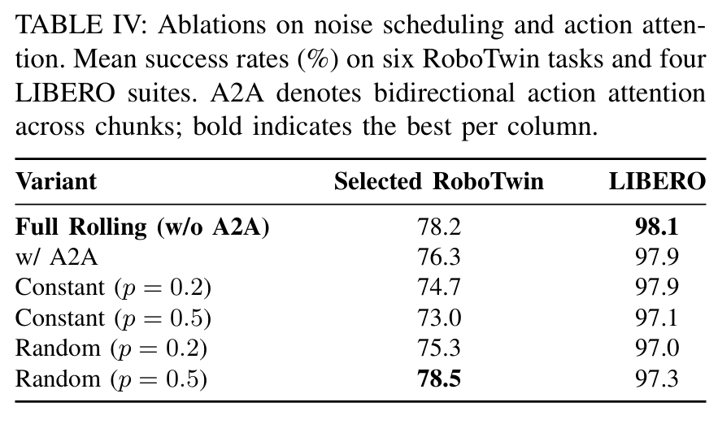
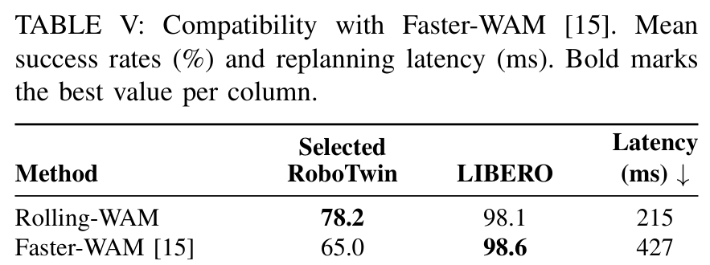
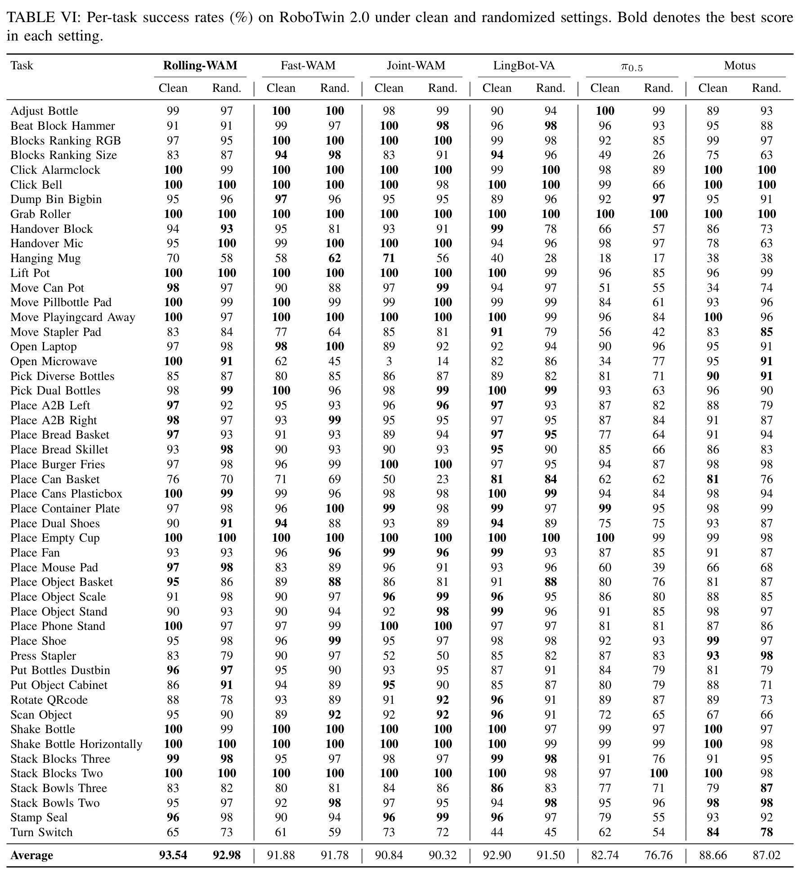

# Rolling-WAM: World Action Models with Rolling Imagination

**Authors:** Yinghua Zhou$^{1,2,*}$, Junjie Ye$^{1,*}$, Yiqi Zhao$^1$, Hao Dong$^1$, Celina Shiyu Wang$^1$, Ruohai Ge$^1$, Tingyi Yang$^{1,3}$, Basile Van Hoorick$^4$, Gaurav Sukhatme$^1$, Vitor Guizilini$^{4,\dagger}$, Yue Wang$^{1,\dagger}$  
**Affiliations:** $^1$University of Southern California, $^2$Brown University, $^3$Fudan University, $^4$Toyota Research Institute  
**Note:** $^*$Equal contribution, $^\dagger$Equal advising  
**Project Page:** [https://rolling-wam.github.io/](https://rolling-wam.github.io/)  
**Source:** `/Users/roywangj/journey_wj/research/papers4zotero/zotero1/storage/PQDH947H/Zhou 等 - 2026 - Rolling-WAM World Action Models with Rolling Imagination.pdf`  
**Version:** arXiv:2609.30247v2 [cs.RO], 5 Oct 2026  
**Detected source format:** selectable-text PDF (`pdf-text`)  
**Reader type:** full-paper Chinese-English bilingual reader with complete figure/table transcriptions.

## Page / Section Index

| PDF Page | Section | Description |
|:---:|:---|:---|
| 1 | Abstract; Section I (Introduction begins); Fig. 1 | 论文标题、作者信息、摘要、引言开篇背景、图 1 滚动去噪与整体性能总览 |
| 2 | Section I (Contributions); Section II (Related Work A, B, C) | 引言核心贡献归纳；相关工作（世界动作模型、高效扩散策略推理、滚动与因果序列生成） |
| 3 | Section III-A, III-B; Fig. 2; Eq. (1)-(3) | 方法总览；联合 WAM 问题形式化与去噪瓶颈；滚动视频-动作去噪核心机制、噪声调度公式与框架图 |
| 4 | Section III-B, III-C, III-D; Eq. (4)-(8) | 初始化模式公式；采样执行与欧拉流更新；MoT 架构、注意力掩码与流匹配训练总目标 |
| 5 | Section IV-A, IV-B, IV-C; Table I, Table II; Fig. 3 | 实验设置（LIBERO、RoboTwin 2.0、Unitree G1 人形平台）；实现细节与基线；仿真成功率评测与质性想象展开图 |
| 6 | Section IV-D; Fig. 4, Fig. 5, Fig. 6 | 推理效率分析（单次稳态重规划延迟基准对比、窗口尺寸扩展性实验）；真实世界人形机器人任务定性展示 |
| 7 | Section IV-E, IV-F; Table III, Table IV, Table V; Fig. 7 | 真实世界 Unitree G1 操控成功率；消融实验（窗口尺寸对成功率影响、训练噪声调度对比、Faster-WAM 兼容性） |
| 8 | Section V (Conclusion & Limitations); Acknowledgments; References [1]-[22] | 结论与局限性探讨（动态滞后与未来异步方向）；致谢；参考文献前半部分 |
| 9 | References [23]-[35]; Appendix (RoboTwin Detailed Results Intro) | 参考文献后半部分；附录引言 |
| 10 | Appendix Table VI | 附录表 VI：RoboTwin 2.0 全部 50 项任务在 Clean 与 Randomized 设定下的逐任务成功率对比 |

## Terminology Ledger

| Canonical Term | 中文规范译名 | 概念内涵与本文语境说明 |
|:---|:---|:---|
| World Action Model (WAM) | 世界动作模型 | 将未来视觉预测与机器人动作生成紧密耦合的具身物理世界模型 |
| Rolling Imagination | 滚动想象 | 在滑动窗口中维持错落噪声水平并随执行推进多轮精炼预测的生成机制 |
| Rolling Window Denoising | 滚动窗口去噪 | 将长时域去噪计算均摊至连续重规划周期的去噪形式化方法 |
| Staggered Noise Levels / Schedule | 错落噪声水平 / 错峰噪声调度 | 窗口内距离当前越远的分块赋予越高的噪声水平，实现平滑时间梯度的噪声分配 |
| Imminent Action Chunk | 即时动作块 | 预测窗口中位于最前端、将在当前重规划周期完全去噪并交付机器人执行的动作分块 |
| Farther-future Chunks | 远期未来块 | 窗口中后续时间步的分块，在当前周期仅进行部分去噪以维持演化的前瞻上下文 |
| Replanning Cycle / Latency | 重规划周期 / 闭环重规划延迟 | 机器人基于最新传感器观测重新计算生成后续动作的时间间隔与耗时 |
| Receding-Horizon Control | 滚动时域控制 | 预测长时域动作序列但仅执行起始片段、随后基于新观测重新规划的控制范式 |
| Mixture-of-Transformers (MoT) | Transformer 混合架构 | 视频专家 DiT 与轻量级动作专家 DiT 通过跨层掩蔽注意力解耦协作的架构 |
| Masked Joint Attention | 掩蔽联合注意力 | 限制动作仅能关注块内动作与全窗口视觉、视频不关注动作的非对称注意力机制 |
| Flow Matching | 流匹配 | 基于连续时间速度场学习从高斯先验到数据分布概率流的生成建模范式 |
| Shifted Noise Schedule | 偏移噪声调度 | 通过缩放因子 $\rho$ 调整时间步信噪比分配的高分辨率扩散生成调度策略 |
| Embodied Pretraining | 具身预训练 | 在互联网视频预训练骨干之上使用大规模机器人特定交互数据进行的二次预训练 |
| SONIC Motion Latent | SONIC 运动隐表征 | 用于人形机器人全身运动追踪与控制的低维流形动作表征（64 维） |
| Action Chunking | 动作分块 | 将连续时间步的多步控制指令打包为一个分块进行并行预测的控制策略 |

## Abstract

> <strong>Para. 1:</strong> World Action Models (WAMs) couple action generation with future visual prediction for robotic manipulation. However, completing the joint video-action denoising process at each replanning cycle incurs substantial latency, delaying action updates and limiting closed-loop responsiveness. We present Rolling-WAM, a formulation that distributes joint denoising across successive replanning cycles. Our method maintains a sliding window of video-action chunks at staggered noise levels. At each step, a rolling noise schedule fully denoises the imminent action chunk for execution, while partially refining farther-future chunks. As the window advances with new camera observations, the retained future chunks continue their denoising process. This distributes the computational cost over time while carrying an evolving visual-action context across chunk boundaries. Evaluations on LIBERO, RoboTwin, and a real-world Unitree G1 humanoid show that Rolling-WAM achieves competitive manipulation performance. By removing the need to denoise the entire prediction horizon from scratch, it delivers a 4.5× steady-state replanning speedup over standard joint WAMs.

> <strong>Para. 1[CN]:</strong> 世界动作模型（World Action Models, WAMs）将动作生成与未来视觉预测紧密耦合，用于机器人操作任务。然而，在每个重规划周期内完成联合视频-动作去噪过程会带来巨大的延迟，导致动作更新滞后，并限制了闭环控制的响应灵敏度。本文提出了 Rolling-WAM，一种将联合去噪计算分摊到连续重规划周期中的全新范式。该方法在错落的噪声水平（staggered noise levels）上维持一个由视频-动作块组成的滑动窗口。在每个控制步，滚动噪声调度将最先执行的即时动作块完全去噪以供机器人执行，同时对更远期的未来块进行部分精细化去噪。随着窗口伴随新相机观测向前推进，保留的未来块继续推进其去噪过程。这在时间维度上分摊了计算开销，同时在分块边界之间传递持续演化的视觉-动作上下文。在 LIBERO、RoboTwin 仿真基准以及真实 Unitree G1 人形机器人上的评估表明，Rolling-WAM 取得了极具竞争力的操作性能。通过消除每次从纯噪声重新去噪整个预测时域的需求，它相比标准联合 WAM 实现了 4.5 倍的稳态重规划加速。

## I. Introduction

> <strong>Para. 1:</strong> World Action Models (WAMs) have recently advanced robotic manipulation by jointly predicting robot actions and future observations [1], [2], [3]. This joint modeling provides visual context for action generation, helping the policy anticipate how the scene will evolve. However, deployment in dynamic environments requires closed-loop control: the robot must repeatedly replan from the latest observations to correct execution errors and respond to environmental changes.

> <strong>Para. 1[CN]:</strong> 世界动作模型（WAM）通过联合预测机器人动作与未来观测，近期在机器人操作领域取得了显著进展 [1], [2], [3]。这种联合建模为动作生成提供了丰富的视觉上下文，有助于策略预判场景的未来演化。然而，在动态环境中部署机器人需要实施闭环控制：机器人必须基于最新的感知观测反复进行重规划，以纠正执行误差并对环境变化做出响应。

> <strong>Para. 2:</strong> Frequent replanning exposes a computational bottleneck in standard WAMs. Joint denoising samplers process the entire prediction horizon from pure noise to clean data at each replanning cycle. Each denoising step processes the entire video-action sequence, making repeated model evaluations computationally expensive. The resulting inference latency delays action updates, limiting closed-loop responsiveness. Some methods achieve faster inference by omitting future-video generation at test time [4], at the cost of losing explicit visual predictions that could inform action generation.

> <strong>Para. 2[CN]:</strong> 高频重规划暴露了标准 WAM 的计算瓶颈。联合去噪采样器在每个重规划周期中，都必须将整个预测时域从纯噪声逐步恢复为干净数据。每一步去噪都要处理完整的视频-动作序列，使得重复的模型前向评估极其昂贵。由此产生的推理延迟推迟了动作更新，严重限制了闭环响应速度。部分方法通过在测试时完全省略未来视频生成来提升推理速度 [4]，但代价是失去了能够指导动作生成的显式视觉预测。

> <strong>Para. 3:</strong> We argue that denoising can be organized more efficiently across replanning cycles. Conventional chunk-based samplers [2], [4] fully denoise a new prediction horizon at each replan, even when receding-horizon control executes only an initial portion. The unexecuted tail can inform current actions but is discarded rather than reused across replans. Retaining and progressively refining future video–action chunks across cycles can preserve predictive context and reuse denoising computation, reducing the sequential steps needed to produce the next executable chunk.

> <strong>Para. 3[CN]:</strong> 我们认为，去噪计算可以在不同的重规划周期之间组织得更加高效。传统的基于分块（chunk-based）的采样器 [2], [4] 在每次重规划时都会完全去噪一个全新的预测时域，哪怕滚动时域控制（receding-horizon control）最终仅执行其中的起始片段。未执行的后半段预测虽能为当前动作提供指引，但在随后的重规划中却被直接丢弃，未能实现跨周期的复用。如果在各周期之间保留并递进式地精细化未来视频-动作块，不仅可以维持预测性上下文，还能复用前序的去噪计算，从而大幅减少生成下一个可执行块所需的连续步数。

> <strong>Para. 4:</strong> We therefore introduce Rolling-WAM, a formulation that inherits this intuition by distributing denoising across successive replanning cycles. Building on the concept of rolling diffusion for sequence generation [5], [6], Rolling-WAM maintains a sliding window of aligned video-action chunks with progressively higher noise levels toward the future (Fig. 1). At each replanning cycle, only the imminent action chunk is fully denoised for execution, while farther-future chunks remain partially denoised. This resembles the intuition behind human planning: near-term actions are concrete, while more distant plans remain provisional and are refined as new observations arrive.

> <strong>Para. 4[CN]:</strong> 为此，我们提出了 Rolling-WAM，这种形式化方法继承了上述直觉，将去噪计算分摊到连续的重规划周期中。基于序列生成中滚动扩散（rolling diffusion）的概念 [5], [6]，Rolling-WAM 维持一个由对齐的视频-动作块组成的滑动窗口，其噪声水平随着向未来延伸而逐步增高（图 1）。在每个重规划周期中，仅有即将执行的即时动作块被完全去噪以供执行，而更远期的未来块则保持部分去噪状态。这非常符合人类规划的直觉：近期行动清晰具体，而长远规划则保持粗略备选，并随着新观测的到来被逐步精细化。

### Figure 1. Rolling-WAM 滚动想象机制与整体性能对比

**Caption:** Fig. 1. Rolling-WAM maintains a rolling window of video-action predictions at staggered noise levels. For simplicity, each frame represents one chunk, and the traces denote actions. After executing the first action chunk, the robot acquires a new camera observation, shifts the window, and denoises the retained future chunks together with a newly appended chunk initialized with Gaussian noise. This approach distributes the denoising cost across control cycles, achieving competitive task performance with substantially faster inference.

**Caption[CN]:** 图 1. Rolling-WAM 在错落的噪声水平上维持一个由视频-动作预测构成的滚动窗口。为便于说明，每个图像帧代表一个分块，运动轨迹代表动作。在执行完第一个动作块后，机器人采集新的相机观测，滑动窗口，并将保留的未来块与一个初始化为高斯噪声的新追加分块一起进行联合去噪。这种方法将去噪计算开销分摊到不同的控制周期中，在显著加快推理速度的同时取得了极具竞争力的操控性能。

> <strong>Para. 5:</strong> After the first action chunk is executed, the window advances, retaining the remaining predictions and appending a new chunk initialized with Gaussian noise. The retained predictions are then jointly refined with the new chunk, conditioned on the newly acquired camera observation. As chunks move through the window, their denoising steps are distributed across replanning cycles. Each steady-state cycle therefore requires only a fraction of the total steps to produce the next executable chunk. We train the model on matching noise profiles, with action tokens attending to partially denoised visual futures across the window.

> <strong>Para. 5[CN]:</strong> 在第一个动作块执行完毕后，窗口向前滑动，保留剩余的预测并追加一个初始化为高斯噪声的新块。随后，以新获取的相机观测为条件，保留的预测与新块一起进行联合精细化去噪。随着各个块在窗口中逐步向前推进，它们的去噪步数被均匀分摊到多个重规划周期中。因此，每个处于稳态的控制周期只需消耗总去噪步数的一小部分，即可生成下一个可执行的动作块。我们在匹配的噪声分布上训练模型，使得动作 token 能够在整个窗口内持续关注部分去噪的未来视觉特征。

> <strong>Para. 6:</strong> We evaluate Rolling-WAM on simulation benchmarks, including LIBERO [7] and RoboTwin [8], as well as three real-world humanoid manipulation tasks on the Unitree G1. Our experiments demonstrate that Rolling-WAM retains the benefits of visual imagination while significantly reducing computational overhead. It achieves a 98.1% average success rate on LIBERO and 93.3% on RoboTwin, remaining competitive with or exceeding state-of-the-art WAMs.

> <strong>Para. 6[CN]:</strong> 我们在包括 LIBERO [7] 和 RoboTwin [8] 在内的仿真基准，以及 Unitree G1 人形机器人上的三项真实世界操作任务中全面评估了 Rolling-WAM。实验表明，Rolling-WAM 在保留视觉想象优势的同时显著降低了计算开销。它在 LIBERO 上取得了 98.1% 的平均成功率，在 RoboTwin 上达到 93.3%，与最先进的 WAM 相比保持了极强的竞争力甚至实现超越。

> <strong>Para. 7:</strong> Our primary contribution is a rolling formulation for joint video-action models that distributes denoising across successive replanning cycles. We demonstrate that this formulation achieves a 4.5× inference speedup over standard WAMs while maintaining competitive manipulation performance.

> <strong>Para. 7[CN]:</strong> 我们的核心贡献在于为联合视频-动作模型提出了一种滚动表述范式，成功将去噪计算分摊至连续的重规划周期。我们证明，该方法在保持顶尖操作性能的同时，相比标准 WAM 实现了 4.5 倍的推理加速。

## II. Related Work

### A. World Action Models for Robotic Manipulation

> <strong>Para. 1:</strong> World Action Models (WAMs) augment action generation with future visual prediction. Early approaches infer actions from language-conditioned video plans [9]. Recent methods integrate visual prediction and action generation using pretrained video models [1], [2], [10], often incorporating multimodal understanding [11], [3] or exploring native causal video-action pretraining [12]. Alternative designs learn predictive latent representations for action generation to avoid iterative future-video denoising at deployment [13], [14]. For joint WAMs, however, iterative video-action denoising remains computationally costly, motivating more efficient model designs and sampling strategies.

> <strong>Para. 1[CN]:</strong> 世界动作模型（WAM）通过未来视觉预测来增强动作生成能力。早期方法从基于语言条件的视频规划中推断动作 [9]。近期方法利用预训练视频模型将视觉预测与动作生成深度融合 [1], [2], [10]，通常进一步融入多模态理解能力 [11], [3] 或探索原生的因果视频-动作预训练 [12]。另一类备选架构则学习用于动作生成的预测性潜在表征，以避免在部署阶段进行迭代式的未来视频去噪 [13], [14]。然而，对于联合式 WAM 而言，迭代式的视频-动作去噪计算代价依然极为沉重，这迫切需要更高效的模型架构设计与采样策略。

### B. Efficient Inference for World Action Models

> <strong>Para. 2:</strong> Accelerating WAM inference typically involves reducing the computational burden of future prediction. Some methods remove future-video generation entirely at deployment [4] or extract future context in a single video-expert pass to cache for action denoising [15]. Other architectural optimizations include reducing model size, visual tokens, and video denoising steps [16], or accelerating sampling through modality-aware consistency distillation [17]. Other strategies focus on context reuse, either by recycling visual features after partial joint denoising [18] or by sharing asynchronously refreshed visual context across action updates [19]. Complementarily, real-time chunking overlaps inference with execution and uses action inpainting to align successive chunks [20], [21]. Instead of removing or caching future predictions, Rolling-WAM distributes the joint video-action denoising process across replanning cycles, progressively refining near-term and future predictions within a sliding window.

> <strong>Para. 2[CN]:</strong> 加速 WAM 推理通常围绕降低未来预测的计算负担展开。部分方法在部署阶段完全移除未来视频生成 [4]，或通过视频专家的单次前向提取未来上下文并缓存用于动作去噪 [15]。其他结构性优化手段包括精简模型规模、减少视觉 token 数量和视频去噪步数 [16]，或利用模态感知的一致性蒸馏加速采样 [17]。还有策略专注于上下文复用，例如在部分联合去噪后循环利用视觉特征 [18]，或在动作更新间共享异步刷新的视觉上下文 [19]。与此互补的实时分块技术（real-time chunking）将推理与执行重叠，并利用动作补全（action inpainting）对齐连续动作块 [20], [21]。Rolling-WAM 既不直接移除也不单纯缓存未来预测，而是将联合视频-动作去噪过程分摊到多个重规划周期中，在滑动窗口内递进式地精炼近期与未来预测。

### C. Rolling Diffusion for Sequence Generation

> <strong>Para. 3:</strong> Rolling Diffusion [5] introduces a sliding denoising window with progressively higher noise levels toward the future. This concept has been extended with independent token noise levels for flexible sampling schedules [22] and bidirectional denoising with rollout-based distillation for autoregressive long-video generation [6]. These works motivate the rolling formulation of Rolling-WAM.

> <strong>Para. 3[CN]:</strong> Rolling Diffusion [5] 引入了一种滑动去噪窗口，其噪声水平向着未来逐渐升高。这一概念随后被进一步拓展：引入独立的 token 噪声水平以实现灵活的采样调度 [22]，以及结合双向去噪与基于展开蒸馏的自回归长视频生成 [6]。这些研究为 Rolling-WAM 的滚动表述提供了直接启发。

> <strong>Para. 4:</strong> In robotic manipulation, Streaming Diffusion Policy [23] and RNR-DP [24] maintain partially denoised action buffers to accelerate action generation. However, these methods focus exclusively on action-only denoising and evaluate on task-specific policies in relatively small-scale settings. We extend this rolling mechanism to couple world modeling with action generation, enabling action tokens to attend to partially denoised visual futures, and evaluate our approach across broader multitask settings.

> <strong>Para. 4[CN]:</strong> 在机器人操作领域，Streaming Diffusion Policy [23] 和 RNR-DP [24] 通过维持部分去噪的动作缓冲区来加速动作生成。然而，这些方法仅仅聚焦于纯动作去噪，且只在相对小规模的特定任务策略上进行了评估。我们将这一滚动机制扩展到世界建模与动作生成的深度耦合中，使动作 token 能够跨越窗口关注部分去噪的未来视觉特征，并在更广泛的多任务场景中对该方法进行了全面验证。

## III. Method: Rolling-WAM

> <strong>Para. 1:</strong> This section presents Rolling-WAM, a joint video-action model for low-latency closed-loop robotic control. We first formulate the visual-action modeling problem and identify the computational bottleneck of standard joint denoising (Sec. III-A). We then introduce a rolling denoising mechanism that maintains a sliding window of predictions at staggered noise levels (Sec. III-B). Next, we describe the sampling and execution process that distributes computation across control cycles (Sec. III-C). Finally, we detail the model architecture and the training objective (Sec. III-D).

> <strong>Para. 1[CN]:</strong> 本节详细介绍 Rolling-WAM，这是一种用于低延迟闭环机器人控制的联合视频-动作模型。我们首先对视觉-动作建模问题进行数学描述，并剖析标准联合去噪的计算瓶颈（第 III-A 节）；接着引入在错落噪声水平上维持滑动预测窗口的滚动去噪机制（第 III-B 节）；随后阐述跨控制周期分摊计算的采样与执行流程（第 III-C 节）；最后详述模型架构与训练目标函数（第 III-D 节）。

### A. Problem Formulation (Preliminaries: Joint WAMs)

> <strong>Para. 2:</strong> We consider language-conditioned robotic manipulation from visual observations and proprioception. At time $t$, the policy receives an observation $o_t$, robot state $s_t$, and language instruction $\ell$. It predicts an action sequence $a_{t:t+H-1}$ over a horizon of $H$ steps. World Action Models (WAMs) augment this action generation with future visual prediction [1], [2]. Let $v_{t+1:t+H}$ denote the future video latents covering the corresponding physical interval at the video sampling rate. The joint visual-action modeling problem is formulated as learning the distribution:

$$
p_\theta(a_{t:t+H-1}, v_{t+1:t+H} \mid c_t), \quad c_t = (o_t, s_t, \ell).
\tag{1}
$$

> <strong>Para. 2[CN]:</strong> 我们考虑基于视觉观测和本体感觉的语言条件机器人操作任务。在时间步 $t$，策略接收当前观测 $o_t$、机器人状态 $s_t$ 以及语言指令 $\ell$。它预测长度为 $H$ 步的动作序列 $a_{t:t+H-1}$。世界动作模型（WAM）通过未来视觉预测来增强动作生成过程 [1], [2]。令 $v_{t+1:t+H}$ 表示在视频采样率下覆盖相应物理时间区间的未来视频潜在变量。联合视觉-动作建模问题形式化为学习如下条件概率分布：

> <strong>Para. 3:</strong> This distribution can be modeled jointly or factorized with action generation conditioned on future visual prediction. Deploying WAMs in a closed loop requires multiple denoising steps within each replanning cycle before an action chunk is executed. This iterative process incurs a high computational cost. It increases inference latency and limits the responsiveness of the controller to new observations.

> <strong>Para. 3[CN]:</strong> 该分布既可以进行联合建模，也可以分解为以未来视觉预测为条件的动作生成过程。在闭环环境中部署 WAM 时，在执行每个动作块之前，都需要在每个重规划周期内完成多步迭代去噪。这一迭代过程消耗大量算力，导致推理延迟急剧增加，极大限制了控制器对新观测的实时响应能力。

> <strong>Para. 4:</strong> As shown in Fig. 2, Rolling-WAM addresses this bottleneck by distributing the denoising computation across successive replanning cycles. It maintains a sliding window that jointly refines the next action chunk and its future continuation. This approach completes near-term predictions while leaving longer-term chunks partially denoised at staggered noise levels. As the window advances with execution, the retained predictions continue to evolve under new observations. This mechanism carries predictive context across chunk boundaries, allowing successive action chunks to be generated with a shared, evolving visual-action future.

> <strong>Para. 4[CN]:</strong> 如图 2 所示，Rolling-WAM 通过将去噪计算分摊至连续的重规划周期来解决这一瓶颈。它维持一个滑动窗口，联合精炼下一个动作块及其未来的时域延续。该策略能够彻底完成近期的预测，同时让更远期的块保持在错落噪声水平上的部分去噪状态。随着窗口伴随执行向前滑动，保留的预测在新的观测条件下持续演化。这种机制跨越分块边界传递了预测性上下文，使得连续生成的各个动作块能够基于一个共享且不断演化的视觉-动作未来。

### Figure 2. Rolling-WAM 模型架构、滚动推理与注意力掩码设计

**Caption:** Fig. 2. Rolling-WAM framework. (a) Video and action experts jointly predict flow velocities using masked joint attention and cross-attention to text and state context, conditioned on the current camera observation and per-chunk noise levels shared by video and actions. (b) Rolling inference denoises the window, executes the first action chunk, and shifts the retained future chunks while appending a new chunk initialized with Gaussian noise. (c) The same attention mask is used during training and inference.

**Caption[CN]:** 图 2. Rolling-WAM 框架。（a）视频与动作专家网络利用掩蔽联合注意力以及对文本和状态上下文的交叉注意力，在以当前相机观测和视频-动作共享的分块噪声水平为条件下，联合预测流匹配速度场。（b）滚动推理去噪整个窗口，执行首个动作块，并滑动保留的未来块，同时追加一个初始化为高斯噪声的新块。（c）在训练和推理过程中使用完全相同的注意力掩码。

### B. Rolling Video-Action Denoising (Rolling Window Formulation)

> <strong>Para. 5:</strong> We partition the prediction window into $W$ temporally aligned chunks $X_{1:W}$, where $X_j = (v^{(j)}, a^{(j)})$ denotes the $j$-th video-action chunk. Each action chunk $a^{(j)} = a_{t+(j-1)K:t+jK-1}$ contains $K$ actions. Its corresponding video chunk $v^{(j)}$ covers the same physical interval at the designed video sampling rate. The total prediction horizon is therefore $H = WK$. Execution advances by one chunk at a time. During each replanning cycle, the window is processed jointly, but only the nearest chunk reaches completion.

> <strong>Para. 5[CN]:</strong> 我们将预测窗口划分为 $W$ 个在时间上严格对齐的分块 $X_{1:W}$，其中 $X_j = (v^{(j)}, a^{(j)})$ 表示第 $j$ 个视频-动作块。每个动作块 $a^{(j)} = a_{t+(j-1)K:t+jK-1}$ 包含 $K$ 个连续动作。其对应的视频块 $v^{(j)}$ 在设定的视频采样率下覆盖相同的物理时间间隔。因此总预测时域为 $H = WK$。物理执行每次向前推进一步（即一个分块）。在每个重规划周期内，窗口内的所有分块被联合处理，但仅有最邻近的当前块达到完全无噪的状态。

> <strong>Para. 6:</strong> Let $\tau \in [0, 1]$ parameterize the denoising phase of a single replanning cycle, decreasing from 1 at the start to 0 at completion. Let $\sigma(\cdot)$ denote a monotonically increasing base noise schedule, with $\sigma(1) = 1$ corresponding to Gaussian noise and $\sigma(0) = 0$ to clean data. We define two operational modes to establish and maintain the rolling window.

> <strong>Para. 6[CN]:</strong> 令 $\tau \in [0, 1]$ 参数化单个重规划周期内的去噪阶段，从开始时的 1 单调递减到完成时的 0。令 $\sigma(\cdot)$ 表示单调递增的基础噪声调度函数，其中 $\sigma(1) = 1$ 对应标准高斯噪声，$\sigma(0) = 0$ 对应无噪的干净数据。我们定义了两种运行模式来建立和维持滚动窗口。

> <strong>Para. 7:</strong> a) Rolling mode: The first chunk must become clean at the end of a replanning cycle. Each remaining chunk must be ready to occupy the preceding position in the window. We assign chunk $j$ the noise level [5]:

$$
\sigma_j^{\text{rolling}}(\tau) = \sigma\left(\frac{j - 1 + \tau}{W}\right), \quad j = 1, \dots, W.
\tag{2}
$$

> <strong>Para. 7[CN]:</strong> a) 滚动模式（Rolling mode）：在重规划周期结束时，第一个块必须彻底变为干净无噪；其余每个块则必须恰好准备好接替其在窗口中的前序位置。我们将分块 $j$ 的噪声水平设定为 [5]：

> <strong>Para. 8:</strong> As $\tau$ decreases from 1 to 0, chunk $j$ moves from noise level $\sigma(j/W)$ to $\sigma((j - 1)/W)$. The first chunk becomes clean, while later chunks remain at progressively higher noise levels. Crucially,

$$
\sigma_{j+1}^{\text{rolling}}(0) = \sigma_j^{\text{rolling}}(1), \quad j = 1, \dots, W - 1.
\tag{3}
$$

> <strong>Para. 8[CN]:</strong> 随着 $\tau$ 从 1 减小到 0，分块 $j$ 的噪声水平从 $\sigma(j/W)$ 降低到 $\sigma((j - 1)/W)$。第一个块变为完全无噪，而后续块则保持在逐步递增的噪声水平上。至关重要的一点是：

> <strong>Para. 9:</strong> After the first chunk is removed, every retained chunk is already at the starting noise level for its new position. We append a new chunk initialized with Gaussian noise at $\sigma = 1$, restoring the configuration for the next replanning cycle.

> <strong>Para. 9[CN]:</strong> 在移除首个动作块后，每一个保留下来的块都已经精确处于其新位置所需的起始噪声水平。此时我们在窗口末端追加一个初始化为纯高斯噪声（$\sigma = 1$）的新分块，从而为下一个重规划周期无缝复原完全相同的窗口噪声配置。

> <strong>Para. 10:</strong> b) Initialization mode: At the beginning of an episode, partially denoised predictions are unavailable. We initialize the entire window from Gaussian noise and use the schedule:

$$
\sigma_j^{\text{init}}(\tau) = \sigma\left(\min\left(1, \frac{\tau + j - 1}{W}\right)\right).
\tag{4}
$$

> <strong>Para. 10[CN]:</strong> b) 初始化模式（Initialization mode）：在每个任务回合（episode）开始时，并不存在预先部分去噪的预测。我们将整个窗口的所有块全部初始化为高斯噪声，并采用如下噪声调度函数：

> <strong>Para. 11:</strong> All chunks start at a noise level $\sigma = 1$. Nearer chunks begin denoising earlier, while more distant chunks remain at pure noise until their refinement begins. At completion, $\sigma_j^{\text{init}}(0) = \sigma_j^{\text{rolling}}(0)$. The first chunk is executable, and the remaining predictions enter rolling mode after the window shifts.

> <strong>Para. 11[CN]:</strong> 所有分块均从噪声水平 $\sigma = 1$ 开始。距离当前较近的块较早开始去噪，而更远的块则保持纯噪声状态，直至轮到它们的精化阶段开始。初始化完成时，$\sigma_j^{\text{init}}(0) = \sigma_j^{\text{rolling}}(0)$。首个分块达到可执行状态，剩余的预测在窗口滑动后平滑转入滚动模式。

> <strong>Para. 12:</strong> Together, these two modes allow each chunk to begin as a distant prediction and receive further refinement as it approaches execution. Video and actions within each chunk share the same denoising steps.

> <strong>Para. 12[CN]:</strong> 这两种模式相辅相成，使得每个分块都能从远期的粗略预测起步，并在逐步逼近执行时间点的过程中经历多轮精化。每个分块内的视频与动作严格共享完全相同的去噪步数。

### C. Sampling and Execution (Staggered Noise Schedule & Rolling Transition)

> <strong>Para. 13:</strong> We allocate $N$ total denoising steps per chunk. We choose $N$ as a multiple of $W$ to ensure an even distribution across rolling cycles. Initialization uses $\Delta\tau = -1/N$ at each denoising step, requiring $N$ steps to reach rolling mode. Subsequent replanning cycles require only $N/W$ steps to produce the next executable action chunk, with $\Delta\tau = -W/N$ at each step.

> <strong>Para. 13[CN]:</strong> 我们为每个分块分配总量为 $N$ 步的去噪计算预算。我们选取 $N$ 为 $W$ 的整数倍，以保证计算量在各个滚动周期之间均匀分配。初始化模式在每个去噪步采用步长 $\Delta\tau = -1/N$，需要完整的 $N$ 步才能到达滚动就绪状态。而在随后的各重规划周期中，每次仅需执行 $N/W$ 步即可产出下一个可执行的动作块，每步的衰减幅度为 $\Delta\tau = -W/N$。

> <strong>Para. 14:</strong> At each denoising step, the model jointly updates the video and action predictions throughout the window. Let $\widetilde{X}_j$ denote the current denoising state of chunk $j$. Given the predicted flow velocity $f_{\theta, j}$, the Euler update is:

$$
\widetilde{X}_j \leftarrow \widetilde{X}_j + \left[\sigma_j(\tau + \Delta\tau) - \sigma_j(\tau)\right] f_{\theta, j}\left(\widetilde{X}_{1:W}, \boldsymbol{\sigma}; c_t\right).
\tag{5}
$$

> <strong>Para. 14[CN]:</strong> 在每一个去噪步，模型联合更新整个窗口内的视频与动作预测。令 $\widetilde{X}_j$ 表示分块 $j$ 当前的去噪状态。给定模型预测的流速度场 $f_{\theta, j}$，欧拉更新公式表示为：

> <strong>Para. 15:</strong> Once the first chunk is clean, the robot executes its $K$ actions. The window then slides over. It removes the executed chunk, retains the remaining predictions, and appends a new chunk initialized with Gaussian noise (Fig. 2b). The robot acquires the latest camera observation and state to condition the next replanning cycle.

> <strong>Para. 15[CN]:</strong> 一旦首个分块去噪为干净数据，机器人立即执行其中的 $K$ 个动作指令。随后窗口向前滑动：移除已执行的块，保留剩余的预测，并在末尾追加一个初始化为纯高斯噪声的新块（图 2b）。机器人随后采集最新的相机图像与本体状态，为下一个重规划周期提供条件输入。

> <strong>Para. 16:</strong> Each chunk traverses all $N$ denoising steps before execution, but its computation is distributed across multiple replanning cycles. This mechanism reduces the number of denoising steps needed to produce the next executable chunk, while preserving an evolving visual-action prediction across chunk boundaries. Consequently, larger windows can lower steady-state inference latency, assuming fixed $N$ and sufficient GPU parallelism to process the extended prediction window. This approach is orthogonal to other efficiency techniques [15], [16] for WAMs and can be combined to further reduce inference latency.

> <strong>Para. 16[CN]:</strong> 每个分块在真正执行之前都经历过完整的 $N$ 次去噪更新，但这些计算被平摊分布在多个连续的重规划周期之中。该机制大幅削减了生成下一个可执行块所需的在线去噪步数，同时保留了跨分块边界演化的连贯视觉-动作预测。因此，在固定总步数 $N$ 且具备足够 GPU 并行能力以处理加长预测窗口的前提下，增大窗口尺寸可以有效降低稳态推理延迟。这一思路与现有的其他 WAM 效率提升技术 [15], [16] 完全正交，能够无缝结合以进一步压缩推理延迟。

### D. Model Architecture and Training (Attention Architecture, Video-Action Conditioning & Training Objective)

> <strong>Para. 17:</strong> As shown in Fig. 2(a), Rolling-WAM pairs a pretrained video Diffusion Transformer [25], [26], whose visual priors transfer well to robot manipulation videos [27], [28], with a lightweight action Transformer in a Mixture-of-Transformers (MoT) architecture [4], [29]. The video expert processes VAE latents of the current observation and noisy future video. The action expert processes projected noisy actions. Masked joint attention couples the experts at each layer, allowing action generation to draw on pretrained visual dynamics. Language and proprioceptive embeddings condition both experts through cross-attention.

> <strong>Para. 17[CN]:</strong> 如图 2(a) 所示，Rolling-WAM 采用 Transformer 混合架构（Mixture-of-Transformers, MoT）[4], [29]，将预训练视频扩散 Transformer [25], [26]（其强大的视觉先验能够极好地迁移到机器人操作视频中 [27], [28]）与一个轻量级动作 Transformer 配对。视频专家负责处理当前观测的 VAE 潜在变量以及加噪的未来视频潜在变量；动作专家则处理投影后的加噪动作。掩蔽联合注意力机制在每一层耦合两个专家网络，使动作生成能够直接吸取预训练的视觉动力学知识。语言指令与本体感觉嵌入通过交叉注意力机制为两个专家提供条件信息。

> <strong>Para. 18:</strong> To support rolling denoising, video and action tokens are modulated by their respective chunk-wise noise levels. This allows predictions at different stages of refinement to be processed jointly. The attention mask (Fig. 2c) allows every action chunk to attend to visual features across the entire prediction window. Direct action-to-action attention is restricted to the same chunk, and video tokens do not attend to action tokens. Each action chunk therefore draws on a shared, evolving visual prediction that extends beyond its own execution interval.

> <strong>Para. 18[CN]:</strong> 为了支持滚动去噪，视频与动作 token 均由其各自所属分块的噪声水平进行调制，从而使得处于不同去噪精化阶段的预测能够被统一联合处理。注意力掩码设计（图 2c）允许每一个动作块关注整个预测窗口内的全部视觉特征；动作之间的直接注意力被严格限制在同一分块内部，而视频 token 则不对动作 token 进行注意力关注。因此，每个动作块都能利用超越自身执行时域的、共享且不断演化的长程视觉预测。

> <strong>Para. 19:</strong> Training objective. We train the joint denoiser with flow matching [30]. For each demonstration window, we sample $\tau \sim \mathcal{U}(0, 1)$ and select rolling or initialization mode with probabilities $\beta$ and $1 - \beta$, respectively.

> <strong>Para. 19[CN]:</strong> 训练目标函数。我们使用流匹配（flow matching）[30] 训练联合去噪模型。针对每个示教样本窗口，我们采样去噪进度 $\tau \sim \mathcal{U}(0, 1)$，并分别以概率 $\beta$ 和 $1 - \beta$ 选取滚动模式或初始化模式。

> <strong>Para. 20:</strong> Let $\sigma_j$ denote the video and action noise levels of chunk $j$ under selected schedule. Let $\boldsymbol{\sigma} = (\sigma_1, \dots, \sigma_W)$ denote the window noise profile. We construct the noisy targets:

$$
\widetilde{X}_j = (1 - \sigma_j) X_j + \sigma_j \epsilon_j, \quad \epsilon_j \sim \mathcal{N}(0, I),
\tag{6}
$$

> <strong>Para. 20[CN]:</strong> 令 $\sigma_j$ 表示在选定调度下分块 $j$ 的视频与动作噪声水平。令 $\boldsymbol{\sigma} = (\sigma_1, \dots, \sigma_W)$ 表示整个窗口的噪声剖面。我们构建加噪目标：

> <strong>Para. 21:</strong> using independent Gaussian samples for video and actions. The network predicts conditional velocities for all chunks, with target $\epsilon_j - X_j$. For modality $q \in \{v, a\}$, the per-chunk flow-matching loss is:

$$
\ell_j^q = \left\| \left[ f_\theta^q\left(\widetilde{X}_{1:W}, \boldsymbol{\sigma}; c_t\right) \right]_j - \left(\epsilon_j^q - X_j^q\right) \right\|_2^2,
\tag{7}
$$

> <strong>Para. 21[CN]:</strong> 其中视频与动作采用独立采样的高斯噪声。网络预测所有分块的条件速度场，其监督目标为 $\epsilon_j - X_j$。对于模态 $q \in \{v, a\}$，分块流匹配损失定义为：

> <strong>Para. 22:</strong> where $[\cdot]_j$ selects the prediction for chunk $j$, $X_j^v = v^{(j)}$, and $X_j^a = a^{(j)}$. The joint training objective is:

$$
\mathcal{L} = \mathbb{E}\left[ \frac{1}{W} \sum_{j=1}^W b_j w(\sigma_j) \left(\lambda_v \ell_j^v + \lambda_a \ell_j^a\right) \right],
\tag{8}
$$

> <strong>Para. 22[CN]:</strong> 其中 $[\cdot]_j$ 提取第 $j$ 个分块的预测结果，$X_j^v = v^{(j)}$ 且 $X_j^a = a^{(j)}$。联合训练总目标函数为：

> <strong>Para. 23:</strong> where $w$ weights the noise levels and $\lambda_v, \lambda_a$ balance the two modalities. The activity mask $b_j$ excludes initialization chunks held at pure noise. Training on both modes equips the same model to initialize the prediction window and continue its refinement during closed-loop execution.

> <strong>Para. 23[CN]:</strong> 其中 $w$ 为不同噪声水平的权重函数，$\lambda_v, \lambda_a$ 用于平衡两个模态的损失比例。激活掩码 $b_j$ 负责排除初始化模式下保持纯高斯噪声的分块。在两种模式上的混合训练，使同一个模型既具备从头建立预测窗口的能力，又具备在闭环执行中持续进行滚动精化的能力。

## IV. Experiments

> <strong>Para. 1:</strong> Our experiments verify whether rolling denoising can accelerate joint video-action prediction while preserving manipulation performance. We compare task success with a broad set of vision-language-action models and world action models on LIBERO, RoboTwin 2.0, and real-world Unitree G1 tasks. Controlled latency measurements quantify the computational savings of rolling denoising. Ablations examine the roles of window size, training noise schedules, and cross-chunk action attention.

> <strong>Para. 1[CN]:</strong> 我们的实验旨在验证滚动去噪能否在保持操作性能的同时显著加速联合视频-动作预测。我们在 LIBERO、RoboTwin 2.0 以及真实 Unitree G1 人形机器人任务上，将任务成功率与一系列视觉-语言-动作模型和世界动作模型进行了广泛对比。受控延迟测试定量评估了滚动去噪带来的计算节省。消融实验则深入探究了窗口大小、训练噪声调度方案以及跨块动作注意力的具体作用。

### A. Experimental Setup

> <strong>Para. 2:</strong> We evaluate Rolling-WAM on the following settings. We report the task success rate (%) as the primary performance metric and measure replanning latency to assess efficiency.

> <strong>Para. 2[CN]:</strong> 我们在以下评测基准上测试 Rolling-WAM。我们以任务成功率（%）作为衡量操控性能的核心指标，并通过测量重规划延迟来评估系统效率。

> <strong>Para. 3:</strong> 1) LIBERO: We evaluate the Spatial, Object, Goal, and Long suites of LIBERO [7], each containing 10 tasks and 500 demonstrations. Observations include external and wrist RGB views. We train one policy across all four suites for 10 epochs with an effective batch size of 128, and evaluate each task with 50 rollouts.

> <strong>Para. 3[CN]:</strong> 1) LIBERO：我们评测了 LIBERO [7] 的全部四个测试集：Spatial、Object、Goal 与 Long，每个套件包含 10 项任务及 500 条示教轨迹。感知输入包括第三人称外置视角与腕部 RGB 图像。我们使用 128 的有效批次大小，在全部 4 个套件上联合训练单一策略 10 个 epoch，并对每项任务执行 50 次评估测试。

> <strong>Para. 4:</strong> 2) RoboTwin 2.0: We evaluate 50 bimanual manipulation tasks in the Clean and Randomized settings of RoboTwin 2.0 [8]. Observations include RGB images from the head and two wrist cameras. We train one policy across 50 tasks using 2,500 clean demonstrations and 25,000 demonstrations from randomized scenes, for 5 epochs with an effective batch size of 1024. Each task is evaluated with 100 rollouts per setting.

> <strong>Para. 4[CN]:</strong> 2) RoboTwin 2.0：我们在 RoboTwin 2.0 [8] 的 Clean（干净基准）与 Randomized（场景重随机化）两种设定下，测试了 50 项具有挑战性的双臂操作任务。输入观测包括头部视角以及双腕相机的三路 RGB 图像。我们在 50 项任务上联合训练单一策略，训练数据包含 2,500 条干净示教和 25,000 条来自重随机化场景的示教，在有效批次大小为 1024 下训练 5 个 epoch。每项任务在每种设定下均独立评测 100 次。

> <strong>Para. 5:</strong> 3) Real-world humanoid manipulation: As shown in Fig. 6, we evaluate three tasks on a Unitree G1 humanoid: Doll Placement (placing a plush dog in a box), Plate Stacking (stacking three plates), and Bead Pouring (transferring beads from a bottle into a glass). The policy receives a $320 \times 224$ egocentric RGB image and a 43-dimensional robot state. It predicts 78-dimensional actions comprising a 64-dimensional SONIC motion latent [31] and 7-dimensional commands for each hand. We train one policy across all three tasks using 50 demonstrations per task, recorded at 10 Hz. Training runs for 7,500 steps with an effective batch size of 192. We execute actions at 10 Hz and evaluate 20 trials per task.

> <strong>Para. 5[CN]:</strong> 3) 真实人形机器人操作：如图 6 所示，我们在 Unitree G1 人形机器人平台上评测了三项代表性任务：玩偶放置（Doll Placement，将毛绒玩具狗放入盒中）、盘子叠放（Plate Stacking，连续叠放三个盘子）与串珠倾倒（Bead Pouring，将瓶子中的珠子倒入玻璃杯）。策略接收分辨率为 $320 \times 224$ 的第一人称自我中心视角 RGB 图像和 43 维机器人本体状态向量，输出 78 维动作指令（包含 64 维 SONIC 运动隐变量 [31] 以及双手各 7 维末端执行器指令）。我们使用每项任务 50 条按 10 Hz 采集的真实示教轨迹联合训练单一策略，在 192 的有效批次大小下训练 7,500 步。机器人以 10 Hz 频率执行动作，每项任务分别评测 20 次实验。

### B. Implementation Details

> <strong>Para. 6:</strong> We initialize the video expert from Wan2.2-TI2V-5B [25] and reuse its pretrained text encoder and VAE. The action expert has 30 layers and hidden dimension $d_a = 1024$ (approximately 1B parameters). Its backbone is initialized by interpolating the video expert's weights [4]. We jointly train both experts and the proprioceptive encoder, while freezing the VAE and text encoder. All training uses benchmark demonstrations without additional embodied pretraining.

> <strong>Para. 6[CN]:</strong> 实现细节。我们将视频专家初始化自 Wan2.2-TI2V-5B [25]，并直接复用其预训练的文本编码器和视频 VAE。动作专家包含 30 层 Transformer，隐藏层维度 $d_a = 1024$（参数量约为 10 亿 / 1B）。其主干网络通过对视频专家的权重进行插值来初始化 [4]。我们在训练中联合优化视频专家、动作专家以及本体感知编码器，同时冻结 VAE 和文本编码器。所有模型的训练仅使用基准自带的示教数据，未引入任何额外的具身预训练。

> <strong>Para. 7:</strong> We use AdamW with learning rate $10^{-4}$, weight decay $10^{-2}$, 5% linear warmup followed by cosine decay, and BF16 mixed precision. Video and action losses are averaged separately, with $\lambda_v = \lambda_a = 1$. Initialization and rolling modes are sampled with probabilities 0.2 and 0.8. Both modalities use the same shifted noise schedule [32], $\sigma(\tau) = \rho\tau / [1 + (\rho - 1)\tau]$ with $\rho = 5$, during training and inference.

> <strong>Para. 7[CN]:</strong> 优化器采用 AdamW，基础学习率为 $10^{-4}$，权重衰减为 $10^{-2}$，前 5% 步数为线性预热（warmup），随后采用余弦退火衰减，并使用 BF16 混合精度训练。视频和动作损失分别计算平均，权重设为 $\lambda_v = \lambda_a = 1$。初始化模式与滚动模式的采样概率分别为 0.2 与 0.8。在训练和推理过程中，两种模态均采用相同的偏移噪声调度 [32]：$\sigma(\tau) = \rho\tau / [1 + (\rho - 1)\tau]$，其中超参数 $\rho = 5$。

> <strong>Para. 8:</strong> Unless otherwise specified, we use $N = 10$ denoising steps per chunk, a window of $W = 5$ chunks, and $K = 16$ actions per chunk. Each steady-state replanning cycle therefore uses $N/W = 2$ denoising steps. The classifier-free guidance scale is 1.

> <strong>Para. 8[CN]:</strong> 除特别指明外，我们默认每个分块的总去噪步数为 $N = 10$，窗口包含 $W = 5$ 个分块，每个动作块包含 $K = 16$ 个步长的动作。因此，在进入稳态后的每个重规划周期内仅需执行 $N/W = 2$ 个去噪步。无分类器引导（CFG）尺度设为 1。

> <strong>Para. 9:</strong> Baselines. We compare with both VLA and WAM policies, including $\pi_0$ [33], $\pi_{0.5}$ [34], GR00T N1.7 [35], Motus [11], LingBot-VA [1], Fast-WAM [4], and Joint-WAM [4]. For controlled WAM comparisons, we reproduce Fast-WAM and Joint-WAM using matched training and evaluation settings wherever applicable. Joint-WAM jointly denoises future video and actions from Gaussian noise at each replanning cycle, while Fast-WAM generates actions without future-video denoising at deployment.

> <strong>Para. 9[CN]:</strong> 对比基线。我们与主流的 VLA 和 WAM 策略进行了全面对比，包括 $\pi_0$ [33]、$\pi_{0.5}$ [34]、GR00T N1.7 [35]、Motus [11]、LingBot-VA [1]、Fast-WAM [4] 以及 Joint-WAM [4]。为了进行严格受控的 WAM 比较，我们在相同的训练与评测环境下复现了 Fast-WAM 和 Joint-WAM。其中 Joint-WAM 在每个重规划周期都从纯高斯噪声重新联合去噪未来视频与动作，而 Fast-WAM 则在测试部署阶段完全跳过未来视频去噪直接预测动作。

### C. Performance on Simulation Benchmarks

> <strong>Para. 10:</strong> We first evaluate whether rolling denoising can deliver competitive manipulation performance with fewer denoising steps per replanning cycle.

> <strong>Para. 10[CN]:</strong> 我们首先评估滚动去噪能否在每个重规划周期大幅削减去噪步数的前提下，依然保持出色的机器人操控成功率。

> <strong>Para. 11:</strong> As shown in Table I, Rolling-WAM achieves an average success rate of 98.1% on LIBERO, within 0.4 percentage points of the joint leaders, LingBot-VA and Joint-WAM (both 98.5%), and above Motus (97.7%) and Fast-WAM (97.6%). Success ranges from 97.8% to 98.2% across the four suites, showing consistently strong performance with rolling inference.

> <strong>Para. 11[CN]:</strong> 如表 I 所示，Rolling-WAM 在 LIBERO 上的平均成功率达到了 98.1%，与联合领先的基线 LingBot-VA 和 Joint-WAM（二者均为 98.5%）的差距仅在 0.4 个百分点之内，并优于 Motus（97.7%）和 Fast-WAM（97.6%）。在四个评测套件中，成功率稳定保持在 97.8% 到 98.2% 之间，展现出滚动推理机制极强且一致的有效性。

### Table I. LIBERO 各套件及平均成功率对比

| Method | P.T. | Spatial | Object | Goal | Long | Average |
| :--- | :---: | :---: | :---: | :---: | :---: | :---: |
| $\pi_0$ [33] | ✓ | 96.8 | 98.8 | 95.8 | 85.2 | 94.1 |
| $\pi_{0.5}$ [34] | ✓ | 98.8 | 98.2 | 98.0 | 92.4 | 96.9 |
| Motus [11] | ✓ | 96.8 | 99.8 | 96.6 | 97.6 | 97.7 |
| LingBot-VA [1] | ✓ | 98.5 | 99.6 | 97.2 | **98.5** | **98.5** |
| Fast-WAM [4] | ✗ | 98.2 | **100.0** | 97.0 | 95.2 | 97.6 |
| Joint-WAM [4] | ✗ | **99.6** | 99.4 | **98.2** | 96.8 | **98.5** |
| Rolling-WAM (Ours) | ✗ | 98.2 | 98.0 | **98.2** | 97.8 | 98.1 |
**Caption:** TABLE I: Success rates (%) on LIBERO. P.T. indicates embodied pretraining. The highest and second-highest average scores are bold and underlined, respectively. Rolling-WAM achieves competitive performance with faster inference.
**Caption[CN]:** 表 I：LIBERO 基准上的成功率（%）。P.T. 表示是否包含具身预训练。平均得分最高与次高者分别以加粗和下划线标出。Rolling-WAM 在实现更快推理的同时保持了极具竞争力的操控性能。

> <strong>Para. 12:</strong> RoboTwin 2.0 further tests bimanual manipulation under scene randomization. As shown in Table II, Rolling-WAM achieves success rates of 93.5% and 93.0% in clean and randomized settings, respectively. Its 93.3% average leads LingBot-VA (92.2%), Fast-WAM (91.8%), and Joint-WAM (90.6%). The high success rate in both settings shows that rolling inference remains effective under the evaluated scene variations, without additional embodied pretraining. See Appendix Table VI for per-task results.

> <strong>Para. 12[CN]:</strong> RoboTwin 2.0 进一步检验了双臂在复杂场景重随机化下的操控能力。如表 II 所示，Rolling-WAM 在 Clean 和 Randomized 两种设定下分别取得了 93.5% 和 93.0% 的高成功率。其 93.3% 的平均总分领先于 LingBot-VA（92.2%）、Fast-WAM（91.8%）和 Joint-WAM（90.6%）。在两种设定下的卓越表现证明，在无需额外具身预训练的情况下，滚动推理对于场景视觉扰动具有强大的鲁棒性。逐任务的详细结果见附录表 VI。

### Table II. RoboTwin 2.0 双臂操作成功率对比

| Method | P.T. | Clean | Rand. | Average |
| :--- | :---: | :---: | :---: | :---: |
| $\pi_0$ [33] | ✓ | 65.9 | 58.4 | 62.2 |
| $\pi_{0.5}$ [34] | ✓ | 82.7 | 76.8 | 79.8 |
| Motus [11] | ✓ | 88.7 | 87.0 | 87.8 |
| LingBot-VA [1] | ✓ | 92.9 | 91.5 | 92.2 |
| Fast-WAM [4] | ✗ | 91.9 | 91.8 | 91.8 |
| Joint-WAM [4] | ✗ | 90.8 | 90.3 | 90.6 |
| Rolling-WAM (Ours) | ✗ | **93.5** | **93.0** | **93.3** |
**Caption:** TABLE II: Success rates (%) on RoboTwin 2.0. P.T. indicates embodied pretraining. The highest and second-highest average scores are bold and underlined, respectively. Rolling-WAM achieves the highest success rate in both settings.
**Caption[CN]:** 表 II：RoboTwin 2.0 上的成功率（%）。P.T. 表示是否包含具身预训练。平均得分最高与次高者分别以加粗和下划线标出。Rolling-WAM 在两种评测设定下均取得了最高成功率。

> <strong>Para. 13:</strong> Rolling-WAM achieves these results with only two denoising steps per replanning cycle, suggesting that co-refining current and future predictions can potentially combine faster replanning with improved manipulation performance.

> <strong>Para. 13[CN]:</strong> 值得强调的是，Rolling-WAM 仅需在每个重规划周期执行两次去噪步即可取得上述优异结果，这充分表明：对当前与未来预测进行联合精细化演化，能够完美兼顾高速在线重规划与更高精度的操控表现。

> <strong>Para. 14:</strong> We also inspect whether the retained visual predictions remain aligned with observations as execution proceeds. Figure 3 compares imagined and observed rollouts on Put Object Cabinet in the RoboTwin 2.0 benchmark. Imagined robot motion and task progression closely follow the observations in this example, providing a qualitative view of the visual context maintained during rolling execution.

> <strong>Para. 14[CN]:</strong> 我们还考察了在执行推进过程中，保留的视觉预测是否能与真实环境观测保持高度一致。图 3 对比了在 RoboTwin 2.0 的 Put Object Cabinet 任务中 Rolling-WAM 的想象视频与真实观测轨迹。在该示例中，模型想象出的机器人手臂动作和任务完成进度与真实观测高度吻合，直观展示了滚动执行机制中所维护的视觉上下文质量。

### Figure 3. 想象视频与真实环境观测的时间序列展开对比

**Caption:** Fig. 3. Imagined and observed rollouts. Rolling-WAM’s imagined video (top) and ground-truth observations (bottom) during policy execution on Put Object Cabinet. Columns show successive moments.

**Caption[CN]:** 图 3. 想象与观测轨迹展开对比。在 Put Object Cabinet 任务执行过程中，Rolling-WAM 的想象视频（上）与真实环境观测（下）的对比。各列展示了连续的时间瞬间。

### D. Inference Efficiency

> <strong>Para. 15:</strong> To formally investigate the inference efficiency gains of rolling denoising, we quantitatively compare Rolling-WAM with the baselines and examine how replanning latency varies with the prediction horizon. We measure steady-state replanning latency on a single NVIDIA A100 GPU under the RoboTwin 2.0 setting at an image resolution of $384 \times 320$. All three methods execute 16 actions per replanning cycle. Timing includes visual encoding and denoising, with CUDA synchronization, and excludes warm-up and initialization.

> <strong>Para. 15[CN]:</strong> 为了严谨探讨滚动去噪带来的推理效率增益，我们对 Rolling-WAM 与各个基线进行了定量对比，并深入分析了重规划延迟随预测时域的变化规律。我们在单张 NVIDIA A100 GPU 上，在 RoboTwin 2.0 设定（图像分辨率 $384 \times 320$）下测量了稳态重规划延迟。三种方法均设定为每个重规划周期执行 16 个动作。测速范围涵盖视觉特征编码与去噪生成全过程，并严格执行 CUDA 线程同步，排除了系统预热与初始化开销。

> <strong>Para. 16:</strong> Default configuration. As shown in Fig. 4, with $N = 10$ and $W = 5$, Rolling-WAM uses two denoising steps per update and takes 215 ms, compared with 978 ms for Joint-WAM and 548 ms for Fast-WAM. These correspond to approximately $4.5\times$ and $2.5\times$ speedups, respectively. The VLA baselines $\pi_{0.5}$ and GR00T N1.7 take 296 ms and 285 ms per update, respectively. Rolling-WAM thus retains future-video generation while taking less time per update than either VLA baseline in this comparison. In the meantime, Rolling-WAM retains an 80-action prediction window, while the baselines predict 16 actions. The reduction in latency is therefore achieved while refining a longer future at each update. These timings use no torch.compile, TensorRT, or custom CUDA kernels.

> <strong>Para. 16[CN]:</strong> 默认配置分析。如图 4 所示，在 $N = 10$ 且 $W = 5$ 的默认配置下，Rolling-WAM 每次更新仅需 2 个去噪步，单次耗时仅 215 ms；而 Joint-WAM 耗时 978 ms，Fast-WAM 耗时 548 ms。这分别对应约 4.5 倍与 2.5 倍的加速比。作为对比，纯动作生成的 VLA 基线 $\pi_{0.5}$ 和 GR00T N1.7 的单次耗时分别为 296 ms 和 285 ms。这意味着 Rolling-WAM 在完整保留未来视频生成的同时，单次重规划更新速度甚至超越了纯动作 VLA 基线。与此同时，Rolling-WAM 在内存中维持着长达 80 步动作的预测窗口，而基线仅预测 16 步动作。因此，这种延迟降低是在每次更新都能维持更长远未来规划的前提下实现的。所有测试均在原生 PyTorch 下运行，未使用任何 torch.compile、TensorRT 或自定义 CUDA 算子优化。

### Figure 4. 稳态重规划延迟对比柱状图

**Caption:** Fig. 4. Replanning latency comparison. Average latency over multiple steady-state replanning cycles, excluding initialization. Lower is better.

**Caption[CN]:** 图 4. 重规划延迟对比。多次稳态重规划周期的平均延迟，不包含初始化阶段。数值越低越好。

> <strong>Para. 17:</strong> Window-size scaling. To examine how distributing denoising over more cycles affects latency, we vary the window size $W$ from 1 to 8. To match execution horizon, Rolling-WAM uses $H = 16W$, while the baselines use $H = 16$. At each $W$, all methods use $N = W\lfloor 16/W \rfloor$ total denoising steps. Rolling inference uses $N/W = \lfloor 16/W \rfloor$ steps per replanning cycle. We set the denoising step as 16 to keep rounding effects small across the tested window sizes.

> <strong>Para. 17[CN]:</strong> 窗口尺寸扩展性分析。为了探究将去噪预算分摊至更多周期对延迟的具体影响，我们将窗口大小 $W$ 从 1 逐步调整至 8。为了对齐执行时域，Rolling-WAM 维持 $H = 16W$ 的预测时域，而基线使用 $H = 16$。在每个 $W$ 设定下，所有方法均使用 $N = W\lfloor 16/W \rfloor$ 的总去噪步数。滚动推理在每个重规划周期仅执行 $N/W = \lfloor 16/W \rfloor$ 步。我们将基础步数选为 16，以最大限度减少取整对不同窗口尺度的影响。

> <strong>Para. 18:</strong> As shown in Fig. 5, at $W = 5$, Rolling-WAM requires only 322 ms, compared with 832 ms for Fast-WAM and 1529 ms for Joint-WAM, yielding $2.58\times$ and $4.75\times$ speedups, respectively. The latency curve flattens for $W = 6\text{--}8$, where the number of rolling denoising steps stays at two per replanning cycle. We use $W = 5$ by default to balance latency and task performance (Sec. IV-F).

> <strong>Para. 18[CN]:</strong> 如图 5 所示，在 $W = 5$ 时，Rolling-WAM 单次重规划仅需 322 ms，相比 Fast-WAM（832 ms）和 Joint-WAM（1529 ms）分别实现了 2.58 倍和 4.75 倍的加速。当 $W = 6\sim 8$ 时，延迟曲线逐渐趋于平缓，这是因为每个周期的滚动去噪步数稳定在 2 步。综合考量推理延迟与操作任务成功率（见第 IV-F 节），我们最终选择 $W = 5$ 作为默认超参数。

### Figure 5. 重规划延迟随预测窗口尺寸 W 的缩放曲线

**Caption:** Fig. 5. Replanning latency across window sizes. At each window size W, Rolling-WAM and the baselines use prediction horizons H = 16W and H = 16, respectively, with the total denoising budget N = W⌊16/W⌋. Points show mean replanning latency (ms), excluding initialization.

**Caption[CN]:** 图 5. 不同窗口尺寸下的重规划延迟。在每个窗口尺寸 W 下，Rolling-WAM 和基线分别采用 H = 16W 和 H = 16 的预测时域，总去噪预算为 N = W⌊16/W⌋。数据点展示了排除初始化阶段后的平均重规划延迟（ms）。

### E. Real-World Humanoid Evaluation

> <strong>Para. 19:</strong> To assess the practical benefits of rolling denoising in physical manipulation, we evaluate Rolling-WAM on real-world humanoid tasks. A trial succeeds when the robot completes the task without human intervention: placing the doll in the box, stacking all three plates, or transferring beads into the glass. Figure 6 shows representative rollouts.

> <strong>Para. 19[CN]:</strong> 真实世界人形机器人评估。为了评估滚动去噪在实体物理操作中的实用价值，我们在真实人形机器人上展开了评测。当机器人无需任何人工干预独立完成指定目标时计为成功：将玩偶放入箱中、叠放全部三个盘子、或将珠子准确倒入玻璃杯。图 6 展示了各任务的代表性执行过程。

### Figure 6. Unitree G1 人形机器人三项真实物理操作任务展示

**Caption:** Fig. 6. Real-world humanoid manipulation tasks. Doll Placement, Plate Stacking, and Bead Pouring (top to bottom), illustrated with qualitative examples from Rolling-WAM rollouts. Each row shows task progression from left to right. Insets show egocentric observations.

**Caption[CN]:** 图 6. 真实世界人形机器人操作任务。从上到下依次为：玩偶放置（Doll Placement）、叠放盘子（Plate Stacking）与串珠倾倒（Bead Pouring），通过 Rolling-WAM 执行轨迹的定性示例进行展示。每一行从左至右展示任务的递进过程，内嵌小图展示了自我中心视角观测。

> <strong>Para. 20:</strong> As shown in Table III, Rolling-WAM achieves the highest average success rate of 85.0% among the five policies, followed by Joint-WAM at 78.3% and Fast-WAM at 75.0%. It matches the strongest baselines on Doll Placement (85%) and Plate Stacking (100%), while achieving the highest success rate on Bead Pouring (70%). These results are obtained with a single policy trained across all three tasks.

> <strong>Para. 20[CN]:</strong> 如表 III 所示，在所测试的五种策略中，Rolling-WAM 取得了最高的平均成功率 85.0%，大幅领先于 Joint-WAM（78.3%）和 Fast-WAM（75.0%）。它在玩偶放置（85%）和叠放盘子（100%）上追平了最强的基准模型，并在精细的串珠倾倒任务上斩获最高的 70% 成功率。值得指出的是，这些成绩均由在三项任务上联合训练的单一通用策略取得。

### Table III. Unitree G1 人形机器人操作任务成功率对比

| Method | Doll Placement | Plate Stacking | Bead Pouring | Avg. (%) |
| :--- | :---: | :---: | :---: | :---: |
| $\pi_{0.5}$ [34] | 55.0 | 70.0 | 60.0 | 61.7 |
| GR00T N1.7 [35] | 75.0 | 65.0 | 60.0 | 66.7 |
| Fast-WAM [4] | **85.0** | 80.0 | 60.0 | 75.0 |
| Joint-WAM [4] | 70.0 | **100.0** | 65.0 | 78.3 |
| Rolling-WAM (Ours) | **85.0** | **100.0** | **70.0** | **85.0** |
**Caption:** TABLE III: Humanoid manipulation on Unitree G1. Each task is evaluated over 20 rollouts per method. Task cells report success rates (%). The highest and second-highest average scores are bold and underlined, respectively.
**Caption[CN]:** 表 III：Unitree G1 人形机器人操作评估。每种方法在每个任务上均独立评测 20 次。单元格报告成功率（%）。平均分最高与次高者分别以加粗和下划线标出。

> <strong>Para. 21:</strong> Qualitatively, we observe more continuous execution across action-chunk boundaries with Rolling-WAM. Pauses are more apparent with Joint-WAM and sometimes interrupt task progress. These observations illustrate the practical importance of replanning latency during physical manipulation.

> <strong>Para. 21[CN]:</strong> 从定性观察来看，Rolling-WAM 在各个动作块衔接边界处表现出更加连贯平滑的运动轨迹。相比之下，Joint-WAM 伴随明显的停顿感，有时甚至导致操作节奏中断。这些现场观察充分凸显了降低重规划延迟在物理世界操作中的关键现实意义。

### F. Ablation Studies

> <strong>Para. 22:</strong> To support our design choices, we examine the prediction window, training noise schedules, and action attention. Table IV reports results on LIBERO and six representative RoboTwin Clean tasks: Lift Pot, Beat Block Hammer, Place Dual Shoes, Stack Bowls Two, Blocks Ranking Size, and Stack Blocks Three.

> <strong>Para. 22[CN]:</strong> 消融实验。为了验证核心设计决策的合理性，我们对预测窗口大小、训练噪声调度方案以及动作注意力机制展开了消融研究。表 IV 给出了在 LIBERO 以及 RoboTwin Clean 设定的六项代表性任务（Lift Pot、Beat Block Hammer、Place Dual Shoes、Stack Bowls Two、Blocks Ranking Size 与 Stack Blocks Three）上的对比数据。

> <strong>Para. 23:</strong> Window size. Increasing $W$ provides a longer predicted future, but its value depends on whether the additional context helps the next action. To test this, we vary $W = 1, \dots, 8$ on the six selected RoboTwin tasks, with $H = 16W$ and $N = W\lfloor 16/W \rfloor$, following the sampling rule in Sec. IV-D. As shown in Fig. 7, success peaks at 78.2% for $W = 5$, versus 77.3% for $W = 3$, and 69.5% for $W = 8$. Larger windows do not consistently improve performance.

> <strong>Para. 23[CN]:</strong> 窗口尺寸的影响。增大 $W$ 能够提供更长远的未来预测，但其价值取决于额外的远期上下文是否真正对当前的即时动作有所裨益。为此，我们在选定的 6 项 RoboTwin 任务上扫描 $W = 1, \dots, 8$，保持 $H = 16W$ 并遵循第 IV-D 节的步数分配规则。如图 7 所示，操作成功率在 $W = 5$ 时达到峰值 78.2%，相比 $W = 3$（77.3%）更高，而在 $W = 8$ 时则衰退至 69.5%。过大的窗口并不能持续提升性能。

### Figure 7. RoboTwin 选定任务成功率随窗口尺寸 W 的变化趋势

**Caption:** Fig. 7. Window size and task success. Average success rates on the six selected RoboTwin tasks under the Clean setting. The prediction horizon is H = 16W.

**Caption[CN]:** 图 7. 窗口尺寸与任务成功率。在 Clean 设定下六项选定 RoboTwin 任务上的平均成功率。预测时域为 H = 16W。

> <strong>Para. 24:</strong> We conjecture that more distant visual predictions are less constrained by the current observation and may offer limited guidance for the imminent action chunk. The best result in this sweep comes from a moderate window, which motivates our choice of $W = 5$ as the default.

> <strong>Para. 24[CN]:</strong> 我们推测，过于久远的未来视觉预测受到当前即时观测的物理约束较弱，因而对当前即将执行的动作块能够提供的实质指引非常有限。适中尺寸的窗口在本次参数扫描中取得了最佳效果，这也成为我们将 $W = 5$ 确定为默认配置的核心依据。

> <strong>Para. 25:</strong> Training noise mixture. Our default training matches the staggered noise profiles used at inference. We test whether exposing the model to a broader mixture improves policy performance. We keep initialization training unchanged and replace a fraction $p$ of rolling-mode samples with alternative noise profiles. Constant uses one shared noise level across chunks; Random samples a separate level for each chunk.

> <strong>Para. 25[CN]:</strong> 训练噪声混合机制消融。默认情况下，我们的训练严格匹配推理阶段使用的错落噪声剖面。我们测试了向模型引入更多样化的噪声混合样本是否能够进一步增强策略表现。保持初始化训练不变，我们将比例为 $p$ 的滚动模式样本替换为备选噪声剖面：Constant 方案在所有分块上使用单一的共享噪声水平；Random 方案则为每个分块独立随机采样噪声水平。

> <strong>Para. 26:</strong> The results are shown in Table IV. The full rolling schedule gives 78.2% success on selected RoboTwin tasks and 98.1% on LIBERO. Random with $p = 0.5$ raises RoboTwin success to 78.5%, but lowers LIBERO to 97.3%. No alternative improves both benchmarks. The full rolling schedule achieves the best LIBERO score and is within 0.3 percentage points of the best RoboTwin variant. We therefore retain the rolling schedule for all non-initialization samples.

> <strong>Para. 26[CN]:</strong> 测试结果如表 IV 所示。完全滚动调度方案在选定的 RoboTwin 任务上取得 78.2% 的成功率，在 LIBERO 上达到 98.1%。当采用 $p = 0.5$ 的 Random 混合时，RoboTwin 成功率微升至 78.5%，但在 LIBERO 上却下滑至 97.3%。没有任何一种备选方案能在两个基准上同时取得收益。完全滚动方案在 LIBERO 上斩获最高分，且与 RoboTwin 最佳变体的差距仅在 0.3 个百分点之内。因此，我们在所有非初始化训练样本中完整保留纯滚动噪声调度。

### Table IV. 训练噪声调度与动作注意力机制消融结果

| Variant | Selected RoboTwin | LIBERO |
| :--- | :---: | :---: |
| Full Rolling (w/o A2A) | 78.2 | **98.1** |
| w/ A2A | 76.3 | 97.9 |
| Constant ($p = 0.2$) | 74.7 | 97.9 |
| Constant ($p = 0.5$) | 73.0 | 97.1 |
| Random ($p = 0.2$) | 75.3 | 97.0 |
| Random ($p = 0.5$) | **78.5** | 97.3 |
**Caption:** TABLE IV: Ablations on noise scheduling and action attention. Mean success rates (%) on six RoboTwin tasks and four LIBERO suites. A2A denotes bidirectional action attention across chunks; bold indicates the best per column.
**Caption[CN]:** 表 IV：噪声调度与动作注意力消融实验。在六项 RoboTwin 任务和四个 LIBERO 套件上的平均成功率（%）。A2A 表示跨块的双向动作自注意力；每列最佳得分加粗标出。

> <strong>Para. 27:</strong> Cross-chunk action attention. Action chunks already receive context from the entire visual window. We test whether adding direct attention between action chunks further improves performance. As shown in Table IV, allowing this attention gives 76.3% success on the selected RoboTwin tasks and 97.9% on LIBERO, compared with 78.2% and 98.1% with within-chunk action attention. These results favor sharing information through the visual window while restricting direct action attention to each chunk.

> <strong>Para. 27[CN]:</strong> 跨分块动作注意力机制消融。由于动作块已经能够从整个视觉窗口中汲取全局上下文，我们测试了在动作块之间开放直接的跨块注意力是否能带来收益。如表 IV 所示，允许跨块动作注意力在 RoboTwin 选定任务和 LIBERO 上的成功率分别为 76.3% 与 97.9%，显著低于仅限制在块内注意力的 78.2% 与 98.1%。这一结果有力支持了我们的设计理念：通过共享视觉窗口进行信息流动，同时将动作自注意力严格限制在各自的分块内部。

> <strong>Para. 28:</strong> Combining with other efficiency methods. To explore the compatibility of Rolling-WAM with other efficiency methods, we further combine it with the Faster-WAM architecture [15], which we denote as Rolling-WAM-Faster. As shown in Table V, under the same measurement protocol as in Sec. IV-D, replanning latency drops to 142 ms, compared with 427 ms for the original Faster-WAM. The combined model also retains strong task performance. These results demonstrate the compatibility of Rolling-WAM with complementary architectural optimizations.

> <strong>Para. 28[CN]:</strong> 与其他高效推理方法的兼容性。为了探索 Rolling-WAM 与其他效率优化手段的正交兼容性，我们将其进一步与 Faster-WAM [15] 架构融合，命名为 Rolling-WAM-Faster。如表 V 所示，在与第 IV-D 节完全相同的延迟测试标准下，重规划延迟骤降至 142 ms，而原版 Faster-WAM 耗时为 427 ms。与此同时，融合模型依然保持了极佳的操控成功率。这一结果充分证明了 Rolling-WAM 与互补性架构加速方案之间卓越的兼容性。

### Table V. 与 Faster-WAM 架构的互补兼容性对比

| Method | Selected RoboTwin | LIBERO | Latency (ms) $\downarrow$ |
| :--- | :---: | :---: | :---: |
| Rolling-WAM | **78.2** | 98.1 | 215 |
| Faster-WAM [15] | 65.0 | **98.6** | 427 |
| Rolling-WAM-Faster | 75.0 | 97.5 | **142** |
**Caption:** TABLE V: Compatibility with Faster-WAM [15]. Mean success rates (%) and replanning latency (ms). Bold marks the best value per column.
**Caption[CN]:** 表 V：与 Faster-WAM [15] 的兼容性实验。平均成功率（%）与重规划延迟（ms）。每列最佳数值加粗标出。

## V. Conclusion and Limitations

> <strong>Para. 1:</strong> In this paper, we presented Rolling-WAM, an efficient World Action Model that jointly refines near-term and future video-action predictions within a sliding window. By distributing denoising across replanning cycles, it reduces the sequential steps needed to produce the next executable action chunk, while using partially denoised visual futures to guide action generation. Experiments show that Rolling-WAM achieves competitive performance on LIBERO and outperforms the compared methods on RoboTwin 2.0 and real-world humanoid manipulation tasks, while delivering substantial speedups in inference over standard joint WAMs. Combining rolling denoising with complementary model and system optimizations offers further opportunities for low-latency robot control.

> <strong>Para. 1[CN]:</strong> 本文提出了 Rolling-WAM，这是一种高效的世界动作模型，能够在滑动窗口内联合精炼近期与未来的视频-动作预测。通过将去噪计算分摊到连续的重规划周期中，它大幅减少了生成下一个可执行动作块所需的串行去噪步数，同时充分利用部分去噪的未来视觉特征指引动作生成。实验结果表明，Rolling-WAM 在 LIBERO 上达到了顶尖性能，在 RoboTwin 2.0 和真实 Unitree G1 人形机器人操作任务上超越了对比方法，并相比标准联合 WAM 实现了显著的推理加速。将滚动去噪与互补的模型级及系统级优化深度结合，为未来的低延迟机器人控制开辟了广阔前景。

### Limitations and Future Work

> <strong>Para. 2:</strong> Limitations and future work. Design choices such as window and chunk sizes warrant further exploration across task settings with different dynamics and control frequencies. Despite observation feedback, retained predictions may lag behind rapid scene changes and misguide action generation, particularly with long windows. Adaptive window management and asynchronous execution offer directions for improving closed-loop responsiveness.

> <strong>Para. 2[CN]:</strong> 局限性与未来工作。窗口大小与分块长度等关键超参数的选择，在具有不同动态特性与控制频率的复杂任务中仍需进一步探索。尽管存在闭环观测反馈，但保留的预测在面对突发的快速环境剧变时仍可能发生滞后，进而对动作生成产生误导，在采用较长预测窗口时该现象尤为明显。未来，引入自适应动态窗口管理机制以及异步执行架构，将是进一步提升系统闭环响应能力的极具潜力的研究方向。

## Acknowledgments

> <strong>Para. 3:</strong> ACKNOWLEDGMENTS. We are grateful to our friends and colleagues, including Songlin Wei, Jiawei Yang, and Hongyi Jing, for their helpful discussions and insightful suggestions. This work was partially supported by the National Science Foundation through NSF CPS #2434460. The USC Physical Superintelligence Lab acknowledges generous support from Toyota Research Institute, Dolby, Google DeepMind, Capital One, Nvidia, Bosch, NSF, and Qualcomm. Yue Wang is also supported by a Powell Research Award.

> <strong>Para. 3[CN]:</strong> 致谢。我们由衷感谢包括 Songlin Wei、Jiawei Yang 以及 Hongyi Jing 在内的朋友与同事提供的宝贵讨论和深刻见解。本研究部分由美国国家科学基金会通过 NSF CPS #2434460 项目提供资助。USC 物理超级智能实验室（Physical Superintelligence Lab）谨向丰田汽车研究院（TRI）、杜比（Dolby）、Google DeepMind、Capital One、Nvidia、博世（Bosch）、NSF 以及高通（Qualcomm）的慷慨资助致以诚挚谢意。Yue Wang 同时获得了 Powell 研究奖（Powell Research Award）的资助。

## References

> <strong>Para. 1:</strong> REFERENCES [1]--[35]: All bibliographic references from the original manuscript are retained in their searchable original publication format.

> <strong>Para. 1[CN]:</strong> 参考文献 [1]--[35]：源论文中的全部 35 条书目文献均完整保留在下方，格式与原稿保持一致，便于检索与学术引证。

1. L. Li, Q. Zhang, Y. Luo, S. Yang, R. Wang, F. Han, M. Yu, Z. Gao, N. Xue, X. Zhu, Y. Shen, and Y. Xu, “Causal World Modeling for Robot Control,” in Proceedings of the Robotics: Science and Systems Conference (RSS), 2026.
2. S. Ye, Y. Ge, K. Zheng, S. Gao, S. Yu, G. Kurian, S. Indupuru, Y. L. Tan, C. Zhu, J. Xiang, A. N. Malik, K. Lee, W. Liang, N. R. Arachchige, J. Gu, Y. Xu, G. Wang, F. Hu, A. Narayan, J. Bjorck, J. Wang, G. Kim, D. Niu, R. Zheng, Y. Xie, J. Wu, Q. Wang, D. Xu, Y. Du, R. Julian, Y. Chebotar, S. Reed, J. Kautz, Y. Zhu, L. Fan, and J. Jang, “World Action Models are Zero-shot Policies,” in Proceedings of the Conference on Robot Learning (CoRL), 2026.
3. NVIDIA, “Cosmos 3: Omnimodal World Models for Physical AI,” arXiv preprint arXiv:2606.02800, 2026.
4. T. Yuan, Z. Dong, Y. Liu, and H. Zhao, “Fast-WAM: Do World Action Models Need Test-time Future Imagination?” arXiv preprint arXiv:2603.16666, 2026.
5. D. Ruhe, J. Heek, T. Salimans, and E. Hoogeboom, “Rolling Diffusion Models,” in Proceedings of the International Conference on Machine Learning (ICML), 2024.
6. K. Liu, W. Hu, J. Xu, Y. Shan, and S. Lu, “Rolling Forcing: Autoregressive Long Video Diffusion in Real Time,” in Proceedings of the International Conference on Learning Representations (ICLR), 2026.
7. B. Liu, Y. Zhu, C. Gao, Y. Feng, Q. Liu, Y. Zhu, and P. Stone, “LIBERO: Benchmarking Knowledge Transfer for Lifelong Robot Learning,” in Proceedings of the Advances in Neural Information Processing Systems (NeurIPS), 2023.
8. T. Chen, Z. Chen, B. Chen, Z. Cai, Y. Liu, Z. Li, Q. Liang, X. Lin, Y. Ge, Z. Gu, W. Deng, Y. Guo, T. Nian, X. Xie, Q. Chen, K. Su, T. Xu, G. Liu, M. Hu, H. ang Gao, K. Wang, Z. Liang, Y. Qin, X. Yang, P. Luo, and Y. Mu, “RoboTwin 2.0: A Scalable Data Generator and Benchmark with Strong Domain Randomization for Robust Bimanual Robotic Manipulation,” in Proceedings of the International Conference on Machine Learning (ICML), 2026.
9. Y. Du, S. Yang, B. Dai, H. Dai, O. Nachum, J. Tenenbaum, D. Schu- urmans, and P. Abbeel, “Learning Universal Policies via Text-Guided Video Generation,” in Proceedings of the Advances in Neural Infor- mation Processing Systems (NeurIPS), 2023.
10. M. J. Kim, Y. Gao, T.-Y. Lin, Y.-C. Lin, Y. Ge, G. Lam, P. Liang, S. Song, M.-Y. Liu, C. Finn, and J. Gu, “Cosmos Policy: Fine-Tuning Video Models for Visuomotor Control and Planning,” in Proceedings of the International Conference on Learning Representations (ICLR), 2026.
11. H. Bi, H. Tan, S. Xie, Z. Wang, S. Huang, H. Liu, R. Zhao, Y. Feng, C. Xiang, Y. Rong, H. Zhao, H. Liu, Z. Su, L. Ma, H. Su, and J. Zhu, “Motus: A Unified Latent Action World Model,” in Proceedings of the IEEE/CVF Conference on Computer Vision and Pattern Recognition (CVPR), 2026.
12. Q. Zhang, L. Li, L. Zhang, S. Yang, Y. Luo, S. Li, R. Wang, J. Wang, J. Shao, G. Xu, J. Zhou, Y. Shen, Y. Jin, F. Xu, S. Ma, J. Liao, G. Lu, Z. Shi, Y. Wen, Y. Zhao, W. Tang, X. Wang, C. Li, J. Zhu, K. L. Cheng, N. Xue, X. Zhu, Y. Shen, and Y. Xu, “Native Video- Action Pretraining for Generalizable Robot Control,” arXiv preprint arXiv:2607.08639, 2026.
13. H. Ma, J. Cai, X. Xu, H. Li, Y. Yang, Y. Tian, J. Cao, H. Zhu, Z. Qiu, Zhaxizhuoma, Y. Yang, J. Peng, X. Wei, Y. Zhu, J. Jiang, X. Gao, H. Wang, F. Yuan, K. Li, X. Zhu, T. Wang, Y. Ding, J. Pang, J. Zeng, J. Zhang, B. Zhou, Y. Mu, C. Shen, and W. Zhang, “InternVLA-A1.5: Unifying Understanding, Latent Foresight, and Action for Composi- tional Generalization,” arXiv preprint arXiv:2607.04988, 2026.
14. Z. Li, Z. Zhang, Y. Wei, W. Zhang, X. Yuan, P. Zhi, G. Li, X. Guo, F. Gao, J. Yang, and S. Zhang, “ω-0: A Latent Predictive World Action Model for Concurrent Humanoid Loco-Manipulation,” arXiv preprint arXiv:2608.06375, 2026.
15. W. Zhao, H. Jiang, X. Shi, L. Liu, F. Huang, Z. Su, W. Sui, and X. Wang, “Faster-WAM: Efficient Inference-Time Future Conditioning for Robust World Action Models,” arXiv preprint arXiv:2608.04404, 2026.
16. J. Li, T. Guo, Y. Ye, R. Zhang, X. Chi, Q. Sun, Y. Li, Y. Lou, Y. Huang, Z. Lu, M. Guo, and S. Zhang, “Efficient-WAM: A 1B- Parameter World-Action Model with Low-Cost Future Imagination,” arXiv preprint arXiv:2606.10040, 2026.
17. A. Akbari, C. Zhang, A. Akbari, L. Zhao, Y. Chen, W. Chen, X. Zhang, G. Yuan, and Y. Wang, “Flash-WAM: Modality-Aware Distillation for World Action Models,” arXiv preprint arXiv:2606.05254, 2026.
18. C. Xiang, F. Bao, H. Liu, H. Tan, H. Bi, J. Li, J. Liu, J. Pang, K. Jing, L. Liu, M. Cai, R. Cui, R. Zhao, R. Wang, S. Huang, Y. Feng, Y. Rong, Z. Wang, and J. Zhu, “Motubrain: An Advanced World Action Model for Robot Control,” arXiv preprint arXiv:2604.27792, 2026.
19. J. Cai, L. Ling, S. Chu, Z. Liu, J. Kang, Z. Liang, W. Xu, Y. Mao, W. Zhang, X. Yang, R. Ying, R. Zheng, and Y. Mu, “AHA-WAM: Asynchronous Horizon-Adaptive World-Action Mod- eling with Observation-Guided Context Routing,” arXiv preprint arXiv:2606.09811, 2026.
20. K. Black, M. Y. Galliker, and S. Levine, “Real-Time Execution of Action Chunking Flow Policies,” in Proceedings of the Advances in Neural Information Processing Systems (NeurIPS), 2025.
21. S. Wei, H. Jing, B. Li, Z. Zhao, J. Mao, Z. Ni, S. He, S. Zang, X. Liu, K. Kang, J. Liu, W. Yuan, M. Pavone, D. Huang, and Y. Wang, “Ψ0: An Open Foundation Model Towards Universal Humanoid Loco- Manipulation,” in Proceedings of Robotics: Science and Systems (RSS), 2026.
22. B. Chen, D. Mart´ı Mons´o, Y. Du, M. Simchowitz, R. Tedrake, and V. Sitzmann, “Diffusion Forcing: Next-token Prediction Meets --- PAGE 9 --- Full-Sequence Diffusion,” in Proceedings of the Advances in Neural Information Processing Systems (NeurIPS), 2024.
23. S. H. Høeg, Y. Du, and O. Egeland, “Streaming Diffusion Policy: Fast Policy Synthesis with Variable Noise Diffusion Models,” in Proceedings of the IEEE International Conference on Robotics and Automation (ICRA), 2025.
24. Z. Chen, X. Yuan, T. Mu, and H. Su, “Responsive Noise-Relaying Diffusion Policy: Responsive and Efficient Visuomotor Control,” Transactions on Machine Learning Research, 2025.
25. Team Wan et al., “Wan: Open and Advanced Large-Scale Video Generative Models,” arXiv preprint arXiv:2503.20314, 2025.
26. W. Peebles and S. Xie, “Scalable Diffusion Models with Transform- ers,” in Proceedings of the IEEE/CVF International Conference on Computer Vision (ICCV), 2023.
27. J. Ye, R. Xue, B. V. Hoorick, R. Li, H. Rajaprakash, P. Tokmakov, M. Z. Irshad, V. Guizilini, and Y. Wang, “RoboDream: Compositional World Models for Scalable Robot Data Synthesis,” in Proceedings of the IEEE/RSJ International Conference on Intelligent Robots and Systems (IROS), 2026.
28. J. Ye, R. Xue, B. V. Hoorick, P. Tokmakov, M. Z. Irshad, Y. Wang, and V. Guizilini, “AnchorDream: Repurposing Video Diffusion for Embodiment-Aware Robot Data Synthesis,” in Proceedings of the IEEE International Conference on Robotics and Automation (ICRA), 2026.
29. W. Liang, L. Yu, L. Luo, S. Iyer, N. Dong, C. Zhou, G. Ghosh, M. Lewis, W.-t. Yih, L. Zettlemoyer, and X. V. Lin, “Mixture-of- Transformers: A Sparse and Scalable Architecture for Multi-Modal Foundation Models,” Transactions on Machine Learning Research, 2025.
30. Y. Lipman, R. T. Q. Chen, H. Ben-Hamu, M. Nickel, and M. Le, “Flow Matching for Generative Modeling,” in Proceedings of the International Conference on Learning Representations (ICLR), 2023.
31. Z. Luo, Y. Yuan, T. Wang, C. Li, F. Casta˜neda, S. Chen, Z.-A. Cao, J. Li, D. Minor, Q. Ben, J. Park, D. Sami, Z. Wang, X. Da, R. Ding, C. Hogg, L. Song, E. Lim, E. Jeong, T. He, H. Xue, W. Xiao, S. Yuen, J. Kautz, Y. Chang, U. Iqbal, L. J. Fan, and Y. Zhu, “SONIC: Supersizing Motion Tracking for Natural Humanoid Whole- Body Control,” Science Robotics, vol. 11, no. 117, 2026.
32. P. Esser, S. Kulal, A. Blattmann, R. Entezari, J. M¨uller, H. Saini, Y. Levi, D. Lorenz, A. Sauer, F. Boesel, D. Podell, T. Dockhorn, Z. English, and R. Rombach, “Scaling Rectified Flow Transformers for High-Resolution Image Synthesis,” in Proceedings of the International Conference on Machine Learning (ICML), 2024.
33. K. Black, N. Brown, D. Driess, A. Esmail, M. Equi, C. Finn, N. Fusai, L. Groom, K. Hausman, B. Ichter, S. Jakubczak, T. Jones, L. Ke, S. Levine, A. Li-Bell, M. Mothukuri, S. Nair, K. Pertsch, L. X. Shi, J. Tanner, Q. Vuong, A. Walling, H. Wang, and U. Zhilinsky, “π0: A Vision-Language-Action Flow Model for General Robot Control,” in Proceedings of the Robotics: Science and Systems Conference (RSS), 2025.
34. K. Black, N. Brown, J. Darpinian, K. Dhabalia, D. Driess, A. Esmail, M. Equi, C. Finn, N. Fusai, M. Y. Galliker, D. Ghosh, L. Groom, K. Hausman, B. Ichter, S. Jakubczak, T. Jones, L. Ke, D. LeBlanc, S. Levine, A. Li-Bell, M. Mothukuri, S. Nair, K. Pertsch, A. Z. Ren, L. X. Shi, L. Smith, J. T. Springenberg, K. Stachowicz, J. Tanner, Q. Vuong, H. Walke, A. Walling, H. Wang, L. Yu, and U. Zhilinsky, “π0.5: A Vision-Language-Action Model with Open-World General- ization,” in Proceedings of the Conference on Robot Learning (CoRL), 2025.
35. J. Bjorck, F. Casta˜neda, N. Cherniadev, X. Da, R. Ding, L. J. Fan, Y. Fang, D. Fox, F. Hu, S. Huang, J. Jang, Z. Jiang, J. Kautz, K. Kundalia, L. Lao, Z. Li, Z. Lin, K. Lin, G. Liu, E. Llontop, L. Magne, A. Mandlekar, A. Narayan, S. Nasiriany, S. Reed, Y. L. Tan, G. Wang, Z. Wang, J. Wang, Q. Wang, J. Xiang, Y. Xie, Y. Xu, Z. Xu, S. Ye, Z. Yu, A. Zhang, H. Zhang, Y. Zhao, R. Zheng, and Y. Zhu, “GR00T N1: An Open Foundation Model for Generalist Humanoid Robots,” arXiv preprint arXiv:2503.14734, 2025.

## Appendix

### Appendix A: RoboTwin Detailed Results (Per-Task Benchmarks)

> <strong>Para. 1:</strong> Table VI presents per-task success rates for Rolling-WAM and the baselines on all 50 RoboTwin 2.0 tasks under clean and randomized evaluation settings.

> <strong>Para. 1[CN]:</strong> 附录表 VI 详细汇报了 Rolling-WAM 与各基线模型在 RoboTwin 2.0 全部 50 项任务中，分别在干净环境（Clean）与随机化环境（Randomized）下的逐任务操控成功率。

### Table VI. RoboTwin 2.0 全部 50 项双臂操作任务逐项详细成功率对比

| Task | Rolling-WAM (Clean) | Rolling-WAM (Rand.) | Fast-WAM (Clean) | Fast-WAM (Rand.) | Joint-WAM (Clean) | Joint-WAM (Rand.) | LingBot-VA (Clean) | LingBot-VA (Rand.) | $\pi_{0.5}$ (Clean) | $\pi_{0.5}$ (Rand.) | Motus (Clean) | Motus (Rand.) |
| :--- | :---: | :---: | :---: | :---: | :---: | :---: | :---: | :---: | :---: | :---: | :---: | :---: |
| Adjust Bottle | 99 | 97 | **100** | **100** | 98 | 99 | 90 | 94 | **100** | 99 | 89 | 93 |
| Beat Block Hammer | 91 | 91 | 99 | 97 | **100** | **98** | 96 | **98** | 96 | 93 | 95 | 88 |
| Blocks Ranking RGB | 97 | 95 | **100** | **100** | **100** | **100** | 99 | 98 | 92 | 85 | 99 | 97 |
| Blocks Ranking Size | 83 | 87 | **94** | **98** | 83 | 91 | **94** | 96 | 49 | 26 | 75 | 63 |
| Click Alarmclock | **100** | 99 | **100** | **100** | **100** | **100** | 99 | **100** | 98 | 89 | **100** | **100** |
| Click Bell | **100** | **100** | **100** | **100** | **100** | 98 | **100** | **100** | 99 | 66 | **100** | **100** |
| Dump Bin Bigbin | 95 | 96 | **97** | 96 | 95 | 95 | 89 | 96 | 92 | **97** | 95 | 91 |
| Grab Roller | **100** | **100** | **100** | **100** | **100** | **100** | **100** | **100** | **100** | **100** | **100** | **100** |
| Handover Block | 94 | **93** | 95 | 81 | 93 | 91 | **99** | 78 | 66 | 57 | 86 | 73 |
| Handover Mic | 95 | **100** | 99 | **100** | **100** | **100** | 94 | 96 | 98 | 97 | 78 | 63 |
| Hanging Mug | 70 | 58 | 58 | **62** | **71** | 56 | 40 | 28 | 18 | 17 | 38 | 38 |
| Lift Pot | **100** | **100** | **100** | **100** | **100** | **100** | **100** | 99 | 96 | 85 | 96 | 99 |
| Move Can Pot | **98** | 97 | 90 | 88 | 97 | **99** | 94 | 97 | 51 | 55 | 34 | 74 |
| Move Pillbottle Pad | **100** | 99 | **100** | 99 | 99 | **100** | 99 | 99 | 84 | 61 | 93 | 96 |
| Move Playingcard Away | **100** | 97 | **100** | **100** | **100** | **100** | **100** | 99 | 96 | 84 | **100** | 96 |
| Move Stapler Pad | 83 | 84 | 77 | 64 | 85 | 81 | **91** | 79 | 56 | 42 | 83 | **85** |
| Open Laptop | 97 | 98 | **98** | **100** | 89 | 92 | 92 | 94 | 90 | 96 | 95 | 91 |
| Open Microwave | **100** | **91** | 62 | 45 | 3 | 14 | 82 | 86 | 34 | 77 | 95 | **91** |
| Pick Diverse Bottles | 85 | 87 | 80 | 85 | 86 | 87 | 89 | 82 | 81 | 71 | **90** | **91** |
| Pick Dual Bottles | 98 | **99** | **100** | 96 | 98 | **99** | **100** | **99** | 93 | 63 | 96 | 90 |
| Place A2B Left | **97** | 92 | 95 | 93 | 96 | **96** | **97** | 93 | 87 | 82 | 88 | 79 |
| Place A2B Right | **98** | 97 | 93 | **99** | 95 | 95 | 97 | 95 | 87 | 84 | 91 | 87 |
| Place Bread Basket | **97** | 93 | 91 | 93 | 89 | 94 | **97** | **95** | 77 | 64 | 91 | 94 |
| Place Bread Skillet | 93 | **98** | 90 | 93 | 90 | 93 | **95** | 90 | 85 | 66 | 86 | 83 |
| Place Burger Fries | 97 | 98 | 96 | 99 | **100** | **100** | 97 | 95 | 94 | 87 | 98 | 98 |
| Place Can Basket | 76 | 70 | 71 | 69 | 50 | 23 | **81** | **84** | 62 | 62 | **81** | 76 |
| Place Cans Plasticbox | **100** | **99** | 99 | 96 | 98 | 98 | **100** | **99** | 94 | 84 | 98 | 94 |
| Place Container Plate | 97 | 98 | 96 | **100** | **99** | 98 | **99** | 97 | **99** | 95 | 98 | 99 |
| Place Dual Shoes | 90 | **91** | **94** | 88 | 93 | 89 | **94** | 89 | 75 | 75 | 93 | 87 |
| Place Empty Cup | **100** | **100** | **100** | **100** | **100** | **100** | **100** | **100** | **100** | 99 | 99 | 98 |
| Place Fan | 93 | 93 | 96 | **96** | **99** | **96** | **99** | 93 | 87 | 85 | 91 | 87 |
| Place Mouse Pad | **97** | **98** | 83 | 89 | 96 | 91 | 93 | 96 | 60 | 39 | 66 | 68 |
| Place Object Basket | **95** | 86 | 89 | **88** | 86 | 81 | 91 | **88** | 80 | 76 | 81 | 87 |
| Place Object Scale | 91 | 98 | 90 | 97 | **96** | **99** | **96** | 95 | 86 | 80 | 88 | 85 |
| Place Object Stand | 90 | 93 | 90 | 94 | 92 | **98** | **99** | 96 | 91 | 85 | 98 | 97 |
| Place Phone Stand | **100** | 97 | 97 | 99 | **100** | **100** | 97 | 97 | 81 | 81 | 87 | 86 |
| Place Shoe | 95 | 98 | 96 | **99** | 95 | 97 | 98 | 98 | 92 | 93 | **99** | 97 |
| Press Stapler | 83 | 79 | 90 | 97 | 52 | 50 | 85 | 82 | 87 | 83 | **93** | **98** |
| Put Bottles Dustbin | **96** | **97** | 95 | 90 | 93 | 95 | 87 | 91 | 84 | 79 | 81 | 79 |
| Put Object Cabinet | 86 | **91** | 94 | 89 | **95** | 90 | 85 | 87 | 80 | 79 | 88 | 71 |
| Rotate QRcode | 88 | 78 | 93 | 89 | 91 | **92** | **96** | 91 | 89 | 87 | 89 | 73 |
| Scan Object | 95 | 90 | 89 | **92** | 92 | **92** | **96** | 91 | 72 | 65 | 67 | 66 |
| Shake Bottle | **100** | 99 | **100** | **100** | **100** | **100** | **100** | 97 | 99 | 97 | **100** | 97 |
| Shake Bottle Horizontally | **100** | **100** | **100** | **100** | **100** | **100** | **100** | 99 | 99 | 99 | **100** | 98 |
| Stack Blocks Three | **99** | **98** | 95 | 97 | 98 | 97 | **99** | **98** | 91 | 76 | 91 | 95 |
| Stack Blocks Two | **100** | **100** | **100** | **100** | **100** | **100** | **100** | 98 | 97 | **100** | **100** | 98 |
| Stack Bowls Three | 83 | 82 | 80 | 81 | 84 | 86 | **86** | 83 | 77 | 71 | 79 | **87** |
| Stack Bowls Two | 95 | 97 | 92 | **98** | 97 | 95 | 94 | **98** | 95 | 96 | **98** | **98** |
| Stamp Seal | **96** | 98 | 90 | 94 | **96** | **99** | **96** | 97 | 79 | 55 | 93 | 92 |
| Turn Switch | 65 | 73 | 61 | 59 | 73 | 72 | 44 | 45 | 62 | 54 | **84** | **78** |
| Average | **93.54** | **92.98** | 91.88 | 91.78 | 90.84 | 90.32 | 92.90 | 91.50 | 82.74 | 76.76 | 88.66 | 87.02 |
**Caption:** TABLE VI: Per-task success rates (%) on RoboTwin 2.0 under clean and randomized settings. Bold denotes the best score in each setting.
**Caption[CN]:** 表 VI：RoboTwin 2.0 在 Clean 与 Randomized 设定下的逐任务成功率（%）。每种设定下的最高得分以加粗标出。

### Appendix B: Hyperparameter & Training Configuration Summary

> <strong>Para. 2:</strong> Summary of training and inference hyperparameters across simulation (LIBERO, RoboTwin 2.0) and real-world Unitree G1 humanoid platforms. All experiments use the Wan2.2-TI2V-5B video backbone and a 1B-parameter action expert initialized via weight interpolation.

> <strong>Para. 2[CN]:</strong> 仿真平台（LIBERO、RoboTwin 2.0）与真实 Unitree G1 人形机器人操作任务的核心训练与推理超参数汇总。所有实验均采用 Wan2.2-TI2V-5B 视频骨干网络以及通过权重插值初始化的 10 亿参数（1B）动作专家模型。

| Hyperparameter Category | Configuration / Parameter Value | Notes & Benchmark Specifics |
|:---|:---|:---|
| Video Expert Backbone | Wan2.2-TI2V-5B (Diffusion Transformer) | Frozen VAE and Text Encoder; 5B parameters |
| Action Expert Backbone | 30 Transformer layers, hidden dimension $d_a = 1024$ | ~1B parameters; initialized via weight interpolation |
| Optimizer & Schedule | AdamW (lr=$10^{-4}$, weight decay=$10^{-2}$) | 5% linear warmup followed by cosine decay; BF16 mixed precision |
| Loss Weights & Balancing | $\lambda_v = 1.0, \lambda_a = 1.0$ | Video and action flow matching losses averaged separately |
| Denoising Noise Schedule | Shifted schedule $\sigma(\tau) = \rho\tau / [1 + (\rho - 1)\tau]$ | Scale factor $\rho = 5$; shared across video and actions |
| Training Mode Sampling | $\beta = 0.8$ (Rolling mode), $1 - \beta = 0.2$ (Init mode) | Enables robust episode start and smooth steady-state rolling |
| Rolling Window & Chunking | $W = 5$ chunks, $K = 16$ actions per chunk | Total horizon $H = WK = 80$; steady-state steps $N/W = 2$ |
| Total Denoising Budget | $N = 10$ steps per chunk (Euler solver) | Shift per replan: $\Delta\tau = -W/N = -0.5$ |
| Classifier-Free Guidance | CFG Scale = 1.0 | Unconditional generation guidance factor |
| LIBERO Benchmark Training | 10 epochs, effective batch size 128 | 4 suites, 40 tasks, 500 demos each; 50 rollouts per task |
| RoboTwin 2.0 Benchmark Training | 5 epochs, effective batch size 1024 | 50 tasks, 2,500 clean + 25,000 rand demos; 100 rollouts per task |
| Unitree G1 Humanoid Training | 7,500 steps, effective batch size 192 | 3 tasks, 50 demos each @ 10 Hz; 20 real-world trials per task |
| Action / State Spaces (G1) | State: 43-dim proprioception; Action: 78-dim | 64-dim SONIC motion latent + $2 \times 7$-dim hand end-effectors |

### Appendix C: Failure Mode & Robustness Analysis

> <strong>Para. 3:</strong> Failure mode analysis and robustness considerations in rolling imagination. Under aggressive window shifts ($W \ge 6$) or rapid non-prehensile contact disruptions, predictive lag in visual latents can lead to compounding execution drift. Maintaining moderate window sizes ($W=5$) and exploring future asynchronous refresh schemes mitigates these failure modes.

> <strong>Para. 3[CN]:</strong> 滚动想象机制下的主要失效模式与鲁棒性分析。在激进的窗口配置（$W \ge 6$）或突发的非抓握接触碰撞扰动下，保留在内存中的视觉潜在变量可能产生动力学滞后，进而引发复合执行漂移。维持适中的窗口尺寸（$W = 5$）并探索未来异步刷新机制能够有效抑制此类失效模式。

