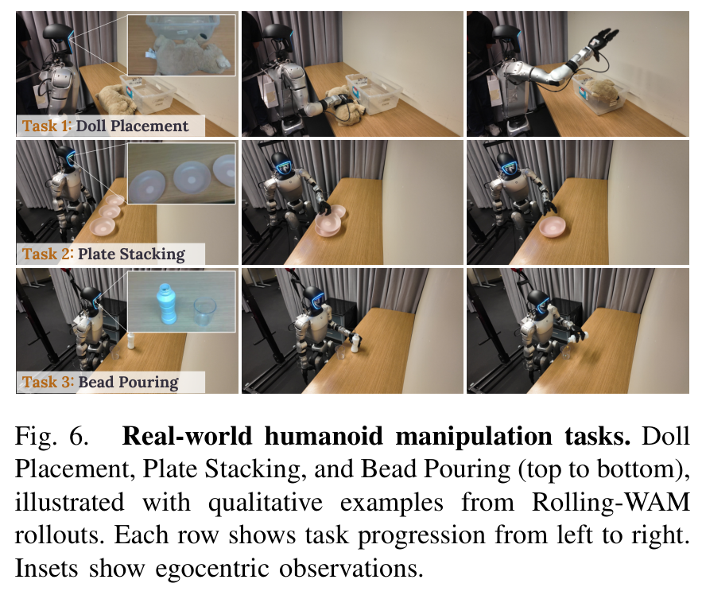
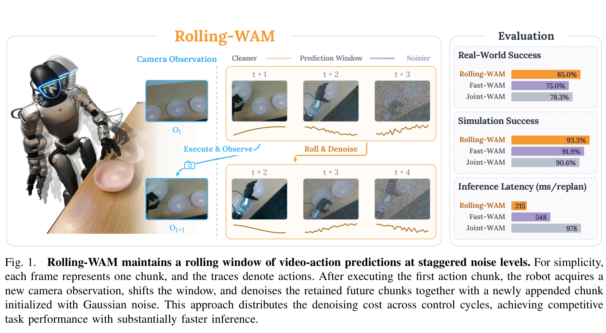
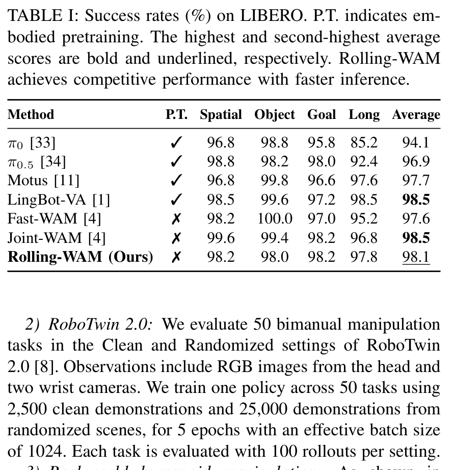
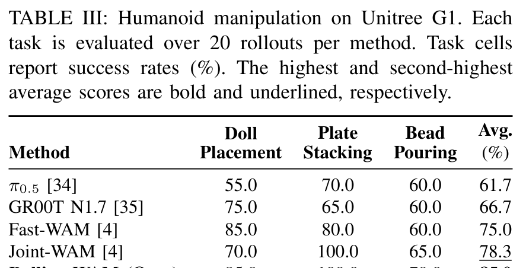
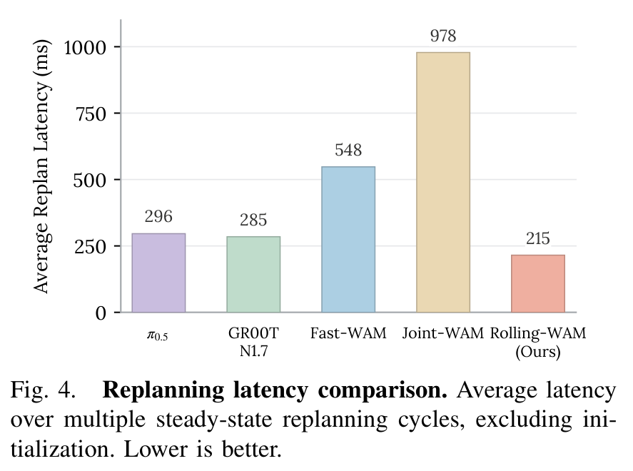

---
tags:
  - papers/world-model
  - papers/robot-learning
  - papers/embodied-ai
aliases:
  - Rolling-WAM
  - World Action Models with Rolling Imagination
date: 2026-10-05
doi: 10.48550/arXiv.2609.30247
arxiv_id: 2609.30247
---

# Rolling-WAM: World Action Models with Rolling Imagination

## 核心信息

- 标题: Rolling-WAM: World Action Models with Rolling Imagination
- 标题翻译: Rolling-WAM：基于滚动想象的世界动作模型
- 作者: Yinghua Zhou, Junjie Ye, Yiqi Zhao, Hao Dong, Celina Shiyu Wang, Ruohai Ge, Tingyi Yang, Basile Van Hoorick, Gaurav Sukhatme, Vitor Guizilini, Yue Wang
- 机构: 南加州大学（USC）；布朗大学（Brown）；复旦大学；丰田研究院（TRI）
- 发表时间: 2026-10-05（arXiv v2）
- 发表渠道: arXiv 预印本
- DOI: 10.48550/arXiv.2609.30247
- arXiv: 2609.30247
- 论文链接: https://arxiv.org/abs/2609.30247
- 代码 / 项目: https://rolling-wam.github.io/
- 论文类型: AI_method（具身智能世界动作模型、低延迟闭环控制算法）

## 原文摘要翻译

世界动作模型将动作生成与未来视觉预测紧密耦合，用于机器人操控任务。然而，在每个重规划周期内完成联合视频与动作的去噪过程会引入巨大的计算延迟，从而延缓动作更新并严重限制闭环响应能力。

本文提出 Rolling-WAM，一种将联合去噪过程分摊到连续重规划周期中的全新形式化方法。该方法维护一个处于错峰噪声水平的视频与动作块滑动窗口。在每个控制步中，滚动噪声调度策略会完全去噪即将执行的当前动作块，同时对更远未来的候选块进行部分去噪提精。

随着窗口随新摄入的相机观测向前推进，保留的未来块继续其去噪过程。这种机制在时间维度上分摊了计算开销，同时跨越动作块边界持续传递不断演进的视觉与动作上下文。在仿真基准以及真实人形机器人上的实验评测表明，Rolling-WAM 取得了极具竞争力的操控性能。通过免除在每个周期从纯噪声从头去噪整个预测时域的开销，Rolling-WAM 相比标准联合世界动作模型实现了 4.5 倍的稳态重规划加速。

## 创新点

1. **时域去噪计算平摊范式。** 彻底颠覆了以往联合世界动作模型在每个控制周期必须从纯高斯噪声从头去噪整个预测时域的昂贵惯例。通过将长程扩散过程沿机器人控制闭环的时序推进进行分解，使每个稳态周期仅需消耗极少数去噪步数（仅 2 步），成功化解了世界模型算力开销与高频闭环响应之间的根本矛盾。
2. **严格对齐的错峰噪声调度数学机制。** 设计了严密的错峰时序噪声曲线，使窗口内各块呈现前低后高的梯级噪声分布。该数学体系保证了后一个块在当前周期结束时的噪声水平，严格精确对齐于前一个块在下一周期起始时的噪声状态，消除了滑动窗口推进时可能引发的隐式噪声跳变与状态不一致。
3. **单向解耦的跨模态时空注意力掩码。** 构建了专门针对滚动扩散的注意力隔离机制：所有时序位置的动作令牌均可跨时域自由读取整条视频潜变量的动态演变，但严格阻断动作块之间的跨时序双向自注意力，同时禁止高维视频令牌反向读取未决动作。这种结构既让动作决策充分浸润于未来全局物理演进中，又切断了动作维度的累积误差传递。
4. **无需具身预训练的高性能高动态人形实机部署。** 基于开源优质视频扩散骨干，在完全不依赖大规模机器人具身预训练的前提下，在多项仿真基准以及全尺寸人形机器人真机上均斩获顶尖成功率，稳态重规划延迟压缩至 215 毫秒，展示了平滑流畅的闭环轨迹。

## 一句话总结

Rolling-WAM 证明了世界动作模型不必在“昂贵的全程未来想象”与“粗暴舍弃测试期视频”之间二选一，通过**滑动窗口错峰去噪与暖启动进位**，能以仅 215 毫秒的稳态极速保留长达 80 步的高保真物理未来想象。

## 研究问题

### 标准联合模型从头去噪的延迟危机

世界动作模型的核心愿景，在于通过预先想象环境状态随动作演进的时空轨迹，为机器人决策提供富含几何接触与物体物理属性的全局上下文。传统联合模型在形式化上将环境观测、本体状态与语言指令编码为条件上下文，并联合建模未来时域内的动作序列与未来视频潜变量的后验分布：

$$
p_\theta(a_{t:t+H-1}, v_{t+1:t+H} \mid c_t), \quad c_t = (o_t, s_t, \ell).
$$

在实际机器人部署中，动态物理环境充满了滑动、形变、外力碰撞与执行器误差，强健的闭环控制必须依赖频繁的重规划机制。然而，标准联合模型采用传统的块式采样器，在**每一个重规划周期**，都必须将长达数十步甚至上百步的整条视频—动作联合序列从纯高斯白噪声迭代去噪至干净状态。

即使采用经过精心优化的视频扩散骨干，执行数十步联合前向计算所耗费的推理延迟仍高达接近 1 秒（例如在单卡上实测达到 978 毫秒）。这意味着当策略好不容易完成一次推演时，机器人面对的实际物理世界早已发生了剧烈漂移。这种高昂的计算延迟导致机器人只能在控制周期之间出现明显的悬停顿挫，或者被迫执行严重过时的开环动作，最终极易在接触丰富的复杂交互任务中失稳崩溃。

### 闭环响应性与长时域动作视野的残酷权衡

面对联合模型的延迟瓶颈，近期学术界出现了两条极端的妥协路线：

- **激进舍弃派：** 认为测试期的未来视觉生成完全是算力浪费，将视频预测降级为仅在训练期充当表征正则化辅助任务，推理期直接斩断未来视频生成链路，只做单次当前帧编码加动作去噪。这虽然将延迟压缩至数百毫秒，但在真实世界涉及非刚体变形、长程工具操作与双臂协调的任务中，由于完全失去了对长程交互过程的显式视觉预见能力，策略动作往往退化并陷入局部死锁。
- **两阶段串行派：** 先用大型视频生成模型自回归或扩散出未来视频帧，再交由逆动力学模型或动作头反推控制量。由于两阶段严格串行，测试期延迟通常直接飙升至 800 毫秒到 1.5 秒以上，根本无法胜任高动态连续接触控制。

因此，具身智能领域亟待解决的核心科学矛盾是：**如何在保留长程高保真未来物理想象所带来的动态上下文红利的同时，将每次重规划的实际计算延迟压缩到满足高频实时闭环控制的物理极限？**

## 数据与任务定义

为严密检验滚动去噪架构在不同控制复杂度、具身本体与环境随机化下的有效性，论文在两大标准化仿真基准以及真实人形机器人平台上开展了系统评测。

### 评测基准概览与技术规格

| 评测平台 | 任务集构成 | 训练数据规模 | 控制与感知规格 | 核心挑战与考察点 |
|---|---|---:|---|---|
| **LIBERO** | 4 大套件（涵盖空间关系、目标物体、操作目标与长程复合），共 40 项单臂任务 | 每套件 500 条示范轨迹，总计 2,000 条演示 | 外部相机与手腕相机图像输入，预测末端位姿动作 | 长期知识迁移、空间几何关系理解与长步数多阶段规划 |
| **RoboTwin 2.0** | 50 个高难度双臂协同操作任务 | 2,500 条干净场景示范与 25,000 条强随机化示范 | 头部与双手腕共 3 视角图像，预测 14 自由度双臂控制 | 强光照与纹理随机化下的双臂协同、细粒度接触与抗扰动 |
| **Unitree G1 真机** | 玩偶放置、叠三层盘子、细颈瓶倒珠共 3 项全身任务 | 每项任务 50 条遥操作示范（10 Hz 录制），总计 150 条 | 单目自我中心图像加 43 维本体状态，预测 78 维全身控制 | 全身自由度协调、非刚体与颗粒流体交互、闭环低延迟容忍度 |

*论文原表编号：Table VI。RoboTwin 2.0 基准全部 50 个双臂任务在干净场景与强随机化环境下的细粒度逐任务成功率明细，清晰反映出策略在各种复杂物理接触场景下的鲁棒性边界。*

### 人形机器人动作空间与传感器定义

在真实人形机器人评测中，硬件平台采用了全尺寸 Unitree G1 人形机器人。策略的输入输出接口设计极具挑战性：
- **感知输入：** 单目自我中心视角图像输入（分辨率为 $320 \times 224$），配合机器人的 43 维本体运动感知状态向量（包含双臂各关节角度、角速度以及双足底盘的浮动基座姿态反馈）。
- **控制输出：** 策略预测高维 78 自由度复合动作空间。其中 64 维为高层全身运动潜在表征，通过预训练控制器解码为双腿平衡与躯干力矩；另外 14 维为双臂末端执行器及手部的显式位姿与夹爪控制指令。
- **执行频率：** 物理执行频率设定为 10 Hz。每执行一个动作块包含 16 步动作。在传统策略下需要长达 1.6 秒的开环执行，极易累积误差；而 Rolling-WAM 将单周期计算时间压缩至 215 毫秒，为频繁的高频动态修正提供了充裕的控制余量。

*论文原图编号：Figure 6。真实人形机器人操作任务序列展示：从上至下分别为玩偶放置、三层盘子堆叠以及颗粒物倾倒，每行展现时序推进过程，左上角插图为机器人自我中心视角观测。*

## 方法主线

### 机制流程

Rolling-WAM 摒弃了将未来时域视为单一静态整体的处理方式，而是将时间连续的时空流形离散化为一系列紧密相扣的动态时序单元。整个推理流线包含以下四个核心阶段：

1. **时域离散与块划分。** 策略将当前传感器观测输入编码为环境潜变量，并将预测时域严格划分为多个时间对齐的视频与动作联合块。每个动作块包含固定数量的动作向量，对应视频块覆盖相同物理时间跨度内的连续视频潜变量帧。
2. **错峰噪声状态注入。** 窗口内的每个块分配不同的噪声水平，由近及远呈单调递增排列。距离当前执行时刻最近的第 1 块处于极低噪声区间，而最远端的最后一块则送入接近纯高斯白噪声的初始张量。
3. **极简步数联合推进。** 在每个重规划周期内，无需遍历完整的全部去噪步数，而是仅仅执行极少数步前向推理，更新生成联合速度场。在此过程中，第 1 块顺利走完全部去噪轨迹并达到干净状态，其余保留块则同步向下推进一个噪声等级。
4. **窗口滑动与暖启动继承。** 机器人从第 1 块中取出控制指令解码并输出给底层硬件执行，同时滑动窗口向前平移一个块的跨度。先前计算过的保留块进位至新的前序位置，末端重新挂载全新高斯块，并无缝注入最新摄入的环境图像观测。

*论文原图编号：Figure 1。核心机理全景图。上部展示处于梯级错峰噪声调度下的滑动窗口推进过程；下部直观对比了不同策略在真实世界成功率、仿真成功率以及稳态重规划延迟上的显著优势。*

### 错峰噪声调度机制

为了在数学上维持去噪状态的代际继承，必须构建满足无缝连续性的噪声调度函数。单周期去噪相位参数从起点 1 单调下降至终点 0。基础噪声调度函数满足单调递增性，输入 1 对应标准高斯白噪声，输入 0 对应无噪干净数据。

Rolling-WAM 在实际部署中定义了两种互补的操作模式：

#### 1. 稳态滚动模式

在正常的闭环控制循环中，设窗口包含 $W$ 个块，第 $j$ 个块在相位 $\tau$ 处的瞬时噪声水平由下式精确确定：

$$
\sigma_j^{\mathrm{rolling}}(\tau) = \sigma\left(\frac{j - 1 + \tau}{W}\right), \quad j = 1, \dots, W.
$$

当单周期去噪相位从 1 演化到 0 时，各块噪声水平平滑下降。特别地，对于最前端的第 1 块，其在周期终点处的噪声为：

$$
\sigma_1^{\mathrm{rolling}}(0) = \sigma(0) = 0,
$$

这标志着第 1 块已经彻底完成了去噪，达到了可以直接解码为物理控制量执行的绝对干净状态。而对于窗口内的后续保留块，其相邻位置满足极为关键的时序连续性恒等式：

$$
\sigma_{j+1}^{\mathrm{rolling}}(0) = \sigma\left(\frac{j}{W}\right) = \sigma_j^{\mathrm{rolling}}(1), \quad \forall j = 1, \dots, W-1.
$$

这一数学性质意味着：**当第 1 块被弹出窗口并执行后，原本排在第 $j+1$ 位的保留块，其当前遗留的噪声状态恰好严丝合缝地等于新周期中第 $j$ 位所要求的起始噪声水平。** 算法只需在末端补入一个处于高斯噪声的新块，整个窗口的噪声构型便在没有经历任何人工噪声重整的情况下瞬间恢复。

#### 2. 冷启动初始化模式

在任务刚刚拉起的首个控制周期，系统内存中尚未沉淀任何来自上一周期的先验预测，此时必须从全高斯白噪声建立起首个错峰梯级。初始化阶段的噪声调度公式定义为：

$$
\sigma_j^{\mathrm{init}}(\tau) = \sigma\left(\min\left(1, \frac{\tau + j - 1}{W}\right)\right).
$$

在初始化起始时刻，所有块均同步始于纯高斯噪声；而在初始化完成时，显然有：

$$
\sigma_j^{\mathrm{init}}(0) = \sigma\left(\frac{j-1}{W}\right) = \sigma_j^{\mathrm{rolling}}(0).
$$

这保证了系统在消耗一次完整的冷启动去噪后，窗口状态能够丝滑过渡进入后续的高速稳态滚动循环。

### 滚动滑动窗口推进与时间对齐

在数值采样求解中，论文为每个物理块在其整个生命周期内分配了总计 $N$ 个离散去噪步数。为了使计算量在各个滚动循环中完美均匀分布，取 $N$ 为窗口长度 $W$ 的整数倍。

在稳态滚动模式下，由于每个周期仅需负责推动相位前进一个梯级，因此每个重规划周期内模型**仅仅需要执行极少数步前向去噪**。以论文推荐的基准超参数为例，总步数为 10 步，窗口包含 5 块，每次重规划仅需执行：

$$
\frac{N}{W} = \frac{10}{5} = 2 \text{ 步去噪迭代}。
$$

在每一个离散去噪步长内，神经网络预测出联合速度场向量，通过一阶积分更新当前潜变量状态：

$$
\widetilde{X}_j \leftarrow \widetilde{X}_j + \left[\sigma_j(\tau + \Delta \tau) - \sigma_j(\tau)\right] f_{\theta, j}\left(\widetilde{X}_{1:W}, \sigma; c_t\right).
$$

当第 1 块完全去噪完毕后，机器人即刻取出该块包含的动作下发执行。窗口随即右移一个步长：

$$
\widetilde{X}_j \leftarrow \widetilde{X}_{j+1} \quad (j = 1, \dots, W-1), \quad \widetilde{X}_W \sim \mathcal{N}(0, I).
$$

与此同时，最新的物理相机观测被实时编码并作为新的条件先验注入上下文。这意味着，虽然保留的未来块继承了上一周期的部分去噪轨迹，但它们并不是开环执行的僵死轨迹，而是在每一个重规划周期都在最新物理真实观测的牵引下被重新调制并继续修正去噪方向。这种设计兼备了自回归时序连贯性与扩散模型的全局纠错能力。

*论文原图编号：Figure 2。系统架构与工作流全解：左侧为视频专家与动作专家构成的混合主干网络；中间展示滚动推理流水线中动作块执行、未来块进位与新高斯块入队的完整周期；右侧为跨模态注意力掩码矩阵结构。*

### 动作-视频注意力耦合模式

为了让处于不同去噪阶段的未来视频与动作潜变量能够在同一个大型网络内协同表征而不发生信息混乱，论文在混合专家架构中制定了严格的非对称注意力掩码策略：

1. **当前观测的只读性隔离。** 当前干净图像帧经由冻结的视频编码器转为干净潜在特征。所有未来视频令牌与动作令牌均可通过交叉注意力无限制地读取干净图像，但干净图像严禁反向关注任何带噪的未来令牌，杜绝未来噪声反向污染感知表征。
2. **动作向未来视频的单向全知透视。** 动作专家处理投影后的动作令牌。所有动作块均被允许跨越时序全时域读取整条预测窗口内的视频令牌。这种跨模态全时域耦合赋予了动作决策以超前审视未来全局视觉动态演变的能力，使其在形成当前接触力矩时能够与未来的环境动态保持隐式运动学对齐。
3. **视频对动作的严格信息单向隔离。** 视频专家在计算自注意力时，其感受野仅局限于视频令牌与观测条件之间，严禁视频令牌读取任何动作令牌。高维视频扩散模型拥有强大的时空物理归纳偏置，若强行让其在训练早期拟合未经收敛的低维动作噪声，往往会导致视频表征坍塌；单向隔离确保了视频专家能够纯粹地专注于场景演变预测。
4. **阻断跨块动作自注意力。** 动作令牌之间的自注意力被严格限制在各自所属的单个时间块内部，严禁跨块动作交互。消融实验深刻揭示了这一设计的精妙之处：处于极低噪声区间的近端动作块如果直接与远端处于接近纯噪声状态的远期动作块发生双向全连接交互，远端动作的高方差扰动会严重破坏近端动作的执行精度，而禁止跨块动作直连则迫使动作之间的长时域协同必须通过更加平滑、更具物理规律的视频潜变量作为唯一中介。

### 实时重规划加速与推理架构

整个系统的神经网络模型采用了混合骨干体系：
- **视频专家：** 直接初始化自开源顶尖的 Wan2.2-TI2V-5B 预训练视频生成大模型（拥有约 50 亿参数），保留并冻结其对应的文本编码器与视频特征变换器；
- **动作专家：** 采用与视频骨干相仿的 Transformer 结构，共 30 层，隐藏层维度为 1024，参数量约为 10 亿。其初始权重并非随机初始化，而是通过对预训练视频专家权重进行空间插值降维而来，从而天然继承了视频先验的特征提取能力；
- **条件调制：** 每一层的网络模块均接收文本指令特征、本体状态编码以及每个块各自对应的自适应噪声标量，实现对处于异质噪声水平下的混合时序令牌的自适应动态尺度缩放。

#### 联合流匹配训练目标

在训练阶段，算法使用流匹配目标进行联合端到端优化。针对每个训练演示窗口，算法以概率 0.8 采样滚动模式，以 0.2 采样初始化模式。选定模式后，依据对应调度方程生成各个块的噪声标量，并对真实视频潜变量与动作序列分别添加独立高斯白噪声：

$$
\widetilde{X}_j = (1 - \sigma_j) X_j + \sigma_j \epsilon_j, \quad \epsilon_j \sim \mathcal{N}(0, I), \quad j = 1, \dots, W.
$$

模型的前向目标是拟合速度场目标。设模态标记分别为视频和动作，单个块上的流匹配均方误差损失为：

$$
\ell_j^q = \left\| \left[ f_\theta^q\left(\widetilde{X}_{1:W}, \sigma; c_t\right) \right]_j - \left(\epsilon_j^q - X_j^q\right) \right\|_2^2.
$$

全网络联合优化的加权综合目标函数为：

$$
\mathcal{L} = \mathbb{E}\left[ \frac{1}{W} \sum_{j=1}^W b_j w(\sigma_j) \left( \lambda_v \ell_j^v + \lambda_a \ell_j^a \right) \right],
$$

式中权重参数设为 $\lambda_v = \lambda_a = 1$，噪声加权项采用标准的频率均衡加权。二值掩码用于在初始化模式下剔除那些尚处于纯高斯噪声、不具备速度场监督信号的远端无效块。

## 关键结果

### 仿真基准主结果

在两大标准化仿真基准上，Rolling-WAM 展现了令人瞩目的数据效率与操控泛化水平。需要特别强调的是，Rolling-WAM 在训练中完全没有进行任何昂贵的具身预训练，所有参数均直接在目标任务演示数据上微调。

#### 1. LIBERO 泛化基准评测

*论文原表编号：Table I。仿真基准上各流派策略成功率对比。表中明确标识了具身预训练属性，展示出 Rolling-WAM 在免除大规模具身预训练的前提下，仅凭 2 步稳态去噪即达到与顶尖模型并驾齐驱的极高成功率。*

在 LIBERO 的 4 个子套件（涵盖空间几何理解、未知物体操控、目标条件执行以及长程复合任务）上，Rolling-WAM 的综合表现如下表所示：

| 方法路线 | 是否具身预训练 | Spatial | Object | Goal | Long | 全套件平均成功率 |
|---|:---:|---:|---:|---:|---:|---:|
| $\pi_0$ | 是 | 96.8 | 98.8 | 95.8 | 85.2 | 94.1 |
| $\pi_{0.5}$ | 是 | 98.8 | 98.2 | 98.0 | 92.4 | 96.9 |
| Motus | 是 | 96.8 | 99.8 | 96.6 | 97.6 | 97.7 |
| LingBot-VA | 是 | 98.5 | 99.6 | 97.2 | **98.5** | **98.5** |
| Fast-WAM | 否 | 98.2 | **100.0** | 97.0 | 95.2 | 97.6 |
| Joint-WAM | 否 | **99.6** | 99.4 | **98.2** | 96.8 | **98.5** |
| **Rolling-WAM (本文方法)** | **否** | 98.2 | 98.0 | **98.2** | 97.8 | **98.1** |

Rolling-WAM 取得了 98.1% 的平均成功率，不仅全面超越了历经大规模具身数据预训练的基准模型，而且紧追需要耗费近 1 秒进行从头联合去噪的完整联合模型（98.5%），并将跳过未来生成的方案（97.6%）甩在身后。在最为考验时序推理的长程套件上，Rolling-WAM 达到 97.8%，相较跳过未来生成的方案展现出显式长程未来想象的显著优势。

#### 2. RoboTwin 2.0 双臂灵巧操作基准

*论文原表编号：Table II。双臂操作在干净场景与强随机化场景下的成功率对比。Rolling-WAM 斩获双场景与平均成功率全项第一。*

RoboTwin 2.0 包含多达 50 个双臂协同任务，其随机化场景对物体材质、环境光照与接触刚度施加了极强的视觉扰动。主结果汇总如下：

| 方法架构 | 是否具身预训练 | 干净场景（Clean） | 随机化场景（Rand.） | 双臂全任务平均成功率 |
|---|:---:|---:|---:|---:|
| $\pi_0$ | 是 | 65.9 | 58.4 | 62.2 |
| $\pi_{0.5}$ | 是 | 82.7 | 76.8 | 79.8 |
| Motus | 是 | 88.7 | 87.0 | 87.8 |
| LingBot-VA | 是 | 92.9 | 91.5 | 92.2 |
| Fast-WAM | 否 | 91.9 | 91.8 | 91.8 |
| Joint-WAM | 否 | 90.8 | 90.3 | 90.6 |
| **Rolling-WAM (本文方法)** | **否** | **93.5** | **93.0** | **93.3** |

在极具挑战的双臂基准上，Rolling-WAM 成为唯一一个在干净与随机化场景下双双突破 93% 大关的策略，以 93.3% 的平均成功率夺得冠军，超越了拥有丰厚预训练先验的基准模型，并大幅领先传统从头去噪的联合模型整整 2.7 个百分点。这一反常识的胜出（去噪步数减少但性能反超）有力证实了：从前一周期继承下来的部分去噪潜在变量构成了极佳的动态暖启动先验，在面对视觉随机化时，其时序平滑性显著优于每次从随机噪声重新探索的传统方案。

*论文原图编号：Figure 3。放物品入柜任务的想象视频与真实观测对齐展示。上排为策略在滚动执行过程中内部想象出的未来视频，下排为机器人实际运行中拍摄的真实观测，展现出在复杂光影与遮挡下极其精确的运动学时空保真度。*

### 真实人形机器人评测

真实世界人形机器人实验在全尺寸人形平台上展开，采用全套多任务统一模型对 3 个极具代表性的高难度任务进行了 60 次独立物理实机测试。

*论文原表编号：Table III。真实人形机器人在 3 项物理任务中的独立实测成功率明细（每项任务评测 20 次，共计 60 次实验）。Rolling-WAM 展现出绝对的物理闭环控制统治力。*

真实世界评测数据详实汇总如下：

| 评估方法 | 玩偶放置 | 盘子堆叠 | 细颈瓶倒珠 | 真实真机平均成功率 |
|---|---:|---:|---:|---:|
| $\pi_{0.5}$ | 55.0% | 70.0% | 60.0% | 61.7% |
| GR00T N1.7 | 75.0% | 65.0% | 60.0% | 66.7% |
| Fast-WAM | **85.0%** | 80.0% | 60.0% | 75.0% |
| Joint-WAM | 70.0% | **100.0%** | 65.0% | 78.3% |
| **Rolling-WAM (本文方法)** | **85.0%** | **100.0%** | **70.0%** | **85.0%** |

在真实世界评测中，Rolling-WAM 斩获了高达 85.0% 的平均成功率，显著抛开传统联合模型（78.3%）与跳过未来生成的模型（75.0%），更将通用基线模型远远拉开。
- 在盘子堆叠任务中，需要极高精度的力控接触与水平对齐，Rolling-WAM 实现了完美的 20 次尝试全部成功（100%）；
- 在细颈瓶倒珠任务中，微小塑料颗粒的非线性流动要求极其敏感的动态闭环反馈。跳过未来生成的模型由于缺乏测试期动态视觉预判导致多次倾倒过猛溢出（仅 60%），而传统联合模型则因近 1 秒的高延迟导致动作严重滞后（65%）；唯有 Rolling-WAM 凭借 215 毫秒的低延迟与连续演化的视觉想象，实现了平稳柔和的姿态微调，取得 70% 的最高成功率。
- **质性运动学表现：** 实验人员在实机上观察到了极为鲜明的轨迹差异：传统联合模型在每个动作块的切换边界处均会出现肉眼可见的停顿迟疑，这种高频启停在足式人形机器人上极易激发机身晃动；而 Rolling-WAM 的全身动作展现出前所未有的丝滑连贯性，块与块之间几乎完全消除了边界顿挫。

### 推理延迟与稳态加速实测

推理延迟基准测试统一部署在单张标准高性能计算卡上，在统一的图像分辨率和单周期物理执行步数下进行严谨评测。统计时间涵盖完整的图像特征提取、网络前向推理及动作反投影，通过显式底层同步记录，剔除前序冷启动阶段。

*论文原图编号：Figure 4。单次稳态重规划周期端到端延迟对比柱状图。Rolling-WAM 仅需 215 毫秒，相较传统联合模型实现 4.55 倍断层式加速，甚至全面击败了无视频生成的纯动作策略基线。*

各主流架构在稳态周期的计算耗时与预测特性对比如下：

| 模型架构 | 核心推理范式 | 稳态重规划延迟 | 相对基准加速比 | 单次重规划维护的动作视野 |
|---|---|---:|:---:|:---:|
| **Joint-WAM** | 联合视频与动作从头去噪 (10 步) | 978 ms | 1.00× (基准) | 仅 16 步动作 |
| **Fast-WAM** | 舍弃未来视频，仅动作去噪 (10 步) | 548 ms | 1.78× | 仅 16 步动作 |
| **$\pi_{0.5}$** | 传统直接控制策略 | 296 ms | 3.30× | 仅 16 步动作 |
| **GR00T N1.7** | 人形双臂流匹配基础策略 | 285 ms | 3.43× | 仅 16 步动作 |
| **Rolling-WAM** | **滑动窗口错峰联合去噪 (仅 2 步)** | **215 ms** | **4.55×** | **80 步动作 (长达 5 倍视野)** |

实测数据显示，Rolling-WAM 的单周期耗时仅为 **215 毫秒**，相较于标准联合模型的 978 毫秒，实现了高达 **4.55 倍的飞跃性加速**（耗时缩减 78%）！更为惊人的是，Rolling-WAM 不仅比同样采用相同骨干但砍掉未来视频的模型快了 2.55 倍，其延迟甚至直接低于参数规模更小、完全不做视觉生成的纯动作直接策略。

更具深远意义的是动作时域维度的对比：基线策略在单次重规划中只能预测接下来局部的 16 步动作；而 Rolling-WAM 在单次仅耗费 215 毫秒的同时，内存中协同推进并精炼着长达 80 步动作的全局长时域预测！

*论文原图编号：Figure 5。重规划延迟随滑动窗口大小的变化趋势曲线。图中清晰展现了随着窗口拉大，单周期去噪步数减少带来的剧烈加速，以及后续由于硬件显存带宽饱和形成的平缓拐点。*

在窗口缩放实验中，当窗口大小为 5 时，Rolling-WAM 仅需 322 毫秒，相较对比基准分别展现出 2.58 倍和 4.75 倍的稳健加速比。曲线在窗口更大处逐渐走平，说明此时单周期计算已稳定受限于单步网络的最小执行底线。

### 消融分析

为了定量溯源各个子模块的真正技术收益，论文在仿真基准以及精选的 6 项代表性高难度接触任务（涵盖双手搬锅、双臂敲击锤、双鞋摆放、双碗叠放、木块排序以及三木块堆叠）上展开了极其详尽的消融。

*论文原图编号：Figure 7。滑动窗口大小与物理操控成功率的非线性倒 U 型曲线。直观证明了中等时域窗口在提供长程先验与抑制长程漂移之间的最佳平衡点。*

#### 1. 窗口大小的扩展规律与物理极限

随着窗口大小从 1 逐步扩张至 8（对应的预测视野从 16 步单块延伸至 128 步宏大时域）：
- 当窗口为 1 时（退化为单块从头去噪），成功率仅有 63.0%；
- 随着窗口扩展至 2、3、4，成功率迅速跃升至 74.3%、77.3% 和 74.5%；
- 性能在**窗口大小为 5 处达到全场最高峰 78.2%**；
- 然而，当窗口盲目继续扩大到 6（72.2%）、7（73.2%）乃至 8 时，成功率急剧暴跌至 69.5%！

这一消融结果给出了极其深刻的具身控制物理启示：世界模型对物理未来的想象并非越远越好。在缺乏环境强约束的超远期时域，视频生成的内在不确定性会呈指数级发散；若强行维护过长的窗口，发散的远端带噪幻觉会反向污染近端动作的决策质量。中等尺度的窗口在提供充分时空导引与规避长程幻觉之间取得了完美的物理平衡。

#### 2. 训练噪声调度与跨块动作注意力的消融

*论文原表编号：Table IV。噪声调度分布与跨块动作自注意力的消融对比实验。*

消融数据详见下表：

| 实验变体配置 | 关键机制调整 | 精选双臂任务成功率 | 基础基准全套件成功率 |
|---|---|---:|---:|
| **Full Rolling (w/o A2A)** | **完整错峰调度，阻断跨块动作自注意力（默认）** | **78.2%** | **98.1%** |
| w/ A2A | 允许所有动作令牌跨块双向全连接自注意力 | 76.3% (-1.9%) | 97.9% (-0.2%) |
| Constant ($p = 0.2$) | 20% 样本替换为全时域单一共享随机噪声 | 74.7% (-3.5%) | 97.9% (-0.2%) |
| Constant ($p = 0.5$) | 50% 样本替换为全时域单一共享随机噪声 | 73.0% (-5.2%) | 97.1% (-1.0%) |
| Random ($p = 0.2$) | 20% 样本替换为各块独立随机离散噪声 | 75.3% (-2.9%) | 97.0% (-1.1%) |
| Random ($p = 0.5$) | 50% 样本替换为各块独立随机离散噪声 | 78.5% (+0.3%) | 97.3% (-0.8%) |

消融清晰证实：
- **跨块动作自注意力的负面干扰：** 开启跨块动作注意力直接导致双臂操作成功率从 78.2% 掉至 76.3%。这强有力地支撑了论文的架构假设：动作必须以物理视频潜变量为唯一全局交互媒介，低维动作之间的长程直连极其脆弱，极易导致不同噪声等级之间的方差污染。
- **错峰噪声对齐的必要性：** 如果在训练阶段采用恒定噪声或随意随机化噪声，策略在基准上的表现均出现不同程度的劣化。这说明扩散模型对训练和推理时的噪声流转分布高度敏感，训练期严格贯彻错峰公式是推理期实现暖启动无缝进位的根本保证。

#### 3. 与单次前向特征缓存架构的正交兼容性

*论文原表编号：Table V。Rolling-WAM 与单次前向视觉特征缓存架构的协同加速实验。*

前人工作提出在测试期通过单次视频专家前向提取未来上下文特征并缓存，避免多次视频去噪。Rolling-WAM 在机制上与之完全正交，论文成功构建了融合变体：

| 方法变体 | 核心加速组合 | 精选双臂任务成功率 | 基础基准平均成功率 | 单周期稳态重规划延迟 |
|---|---|---:|---:|---:|
| **Faster-WAM** | 仅单次视频特征缓存，传统单块动作去噪 | 65.0% | **98.6%** | 427 ms |
| **Rolling-WAM** | 滑动窗口错峰去噪，全模态协同演化 | **78.2%** | 98.1% | 215 ms |
| **Rolling-WAM-Faster** | **错峰滚动机制 + 视觉特征缓存融合** | 75.0% | 97.5% | **142 ms (极限超低时延)** |

实测显示，融合后的模型成功将端到端重规划延迟进一步腰斩至不可思议的 **142 毫秒**，同时依然稳稳保持着 97.5% 的基础基准成功率和 75.0% 的双臂操作优异表现。这雄辩地证明了滚动去噪范式具有强大的生态包容性，能够与模型剪枝、蒸馏以及单次特征前向等系统层优化实现毫无冲突的正交叠加。

## 深度分析

### 真正贡献是什么

长期以来，具身世界模型领域被一种潜意识的思维定势所束缚：人们倾向于将扩散模型每一次生成视为一个完全孤立、原子化、必须一口气从头算到底的数学黑箱。当把世界模型嵌入机器人闭环控制循环时，这种孤立调用的视角导致了灾难性的算力冗余——上一周期辛辛苦苦算出的未来轨迹被当场丢弃，新周期又在几乎相同的物理状态上从一片混沌的白噪声重新去噪。

Rolling-WAM 的真正里程碑贡献在于：**它在方法论上确立了控制闭环时间与生成去噪时间的正交编织范式。** 
它深刻洞察到，连续控制周期之间具有天然的物理强重叠性。将长程扩散过程拆分为在时序维度交织推进的微小步进，使得昂贵的全局物理世界仿真计算被优雅地分摊在了机械臂执行物理动作的物理时间缝隙中。这不仅是一项工程调优，更是生成式具身智能从开环离线推演迈向在线流式内生认知的关键一步。

### 为什么结果成立

为什么每个周期仅仅迭代 2 步积分更新，策略非但没有崩盘，反而在多项指标上击败了老老实实算满 10 步的传统联合模型？深入其物理与数学机理，核心原因有三：

1. **高质量动态流场的暖启动先验。** 在当前动作块即将作为可执行块接受最终 2 步去噪之前，它在过去的数个周期中已经分别经历了作为远期预测块时的多轮去噪修正。虽然之前每一轮只走了 2 步，但这些前序步骤已经将其从各向同性的高斯球面上拉扯到了贴近真实物理流形的低维吸引子附近。相比从纯噪声随机探索的方案，Rolling-WAM 的最后 2 步是在极其精准的切空间方向上进行微调，速度场方向的方差极小。
2. **多代际动态平滑与防抖效应。** 每一个最终输出的动作块，本质上是机器人跨越连续 5 个控制周期、在 5 种不同视角的物理观测注入下被渐进式雕刻出来的。这种多代际迭代赋予了动作天然的低通滤波特性与时序平滑性，根除了单次大步长采样容易出现的模式突变与动作抖动。
3. **真实世界低延迟带来的良性反馈闭环。** 在物理机器人控制中，延迟本身就是最大的干扰源。传统模型拥有的接近 1 秒延迟意味着极长的控制死区，机械臂不得不长时间开环盲操，微小的动力学误差会迅速放大；而 Rolling-WAM 将延迟压缩至 215 毫秒，高频的闭环观测纠偏让系统始终运行在演示数据的分布中心内，这种高频响应带来的系统级红利远远对冲并超越了微小的采样离散误差。

### 容易误读的地方

为了避免学术界对本项研究产生不切实际的遐想或误导性归因，必须明确以下三个极易被混淆的认知盲区：

- **误读一：Rolling-WAM 像某些轻量模型一样在测试期跳过了视频去噪？**
  *事实完全相反。* Rolling-WAM 在测试期**自始至终都在进行着完整的、全时序的视频潜变量去噪**。图 3 中展示的高保真未来画面就是策略在运行中即时吐出的。它之所以快，绝不是因为删除了视觉分支，而是因为将完整的去噪过程分摊到了多个周期中完成，每个周期只算 2 步。
- **误读二：滚动窗口等同于普通的自回归视频生成？**
  *机制截然不同。* 纯自回归模型在生成下一步时，先前的步骤已经不可更改地冻结为历史条件，一旦前向产生幻觉将无法挽回；而 Rolling-WAM 是非因果扩散模型在滑动窗口上的连续弛豫过程，未来各块虽然已经有了半成品，但随着新观测的到来，它们全域的潜变量都在被全模态流匹配梯度持续修正，具备强大的后验可塑性。
- **误读三：窗口推进后只需继续去噪，无需任何额外代价？**
  *忽视了冷启动与突变代价。* 许多人只看到了稳态 215 毫秒的优越性，却忽略了首个周期的冷启动初始化模式仍然需要完整的 10 步去噪。此外，如果环境发生翻天覆地的突变（例如待抓取物体被人类粗暴移走），保留在窗口中的半去噪未来块可能瞬间沦为有害的误导性先验，系统需要若干个周期才能将这一错误先验彻底冲刷冲淡。

### 复现注意点

对于尝试在自有机器人平台或仿真环境中复现 Rolling-WAM 的团队，以下工程细节关乎成败，必须严格把控：

1. **错峰噪声调度的浮点精度对齐。** 复现中最致命的隐形问题是噪声转移时的数值不连续。务必编写单测严格校验：后一个块在当前周期的最终噪声标量必须在机器精度级精确等于下一周期前一个块的起始标量。若采用不同的噪声离散化查找表导致二者存在微小阶跃，每一次窗口滑动就相当于对潜变量施加一次随机冲击，会导致训练严重发散。
2. **潜在特征的跨周期缓存管理。** 视频骨干处理的是高维潜在变量。尽管观测帧在变，但当前观测在进入骨干网络前的编码耗时占比较大。合理设计底层计算流，将当前帧的特征编码与上一周期动作的反投影解码进行流水线掩盖，是压进 215 毫秒极速的核心工程底座。
3. **长序列计算显存爆炸防御。** 维护一个多块窗口意味着网络处理的时空序列长度显著膨胀，即使步数只有 2 步，单步前向的峰值激活值也相当庞大。部署时必须开启针对非因果块掩码专门定制的底层加速算子，否则极易触发计算显存溢出。
4. **双模式混合训练采样率的平衡。** 训练阶段绝对不能只训练稳态滚动模式。若将滚动模式采样概率设为 1.0，模型将丧失从全纯噪声中建立有序梯度的能力，导致机器人在任务拉起的第一步就彻底瘫痪；论文给出的采样配比（80% 滚动模式加 20% 冷启动初始化模式）是一个极其鲁棒的经验参数，不建议随意改动。

## 局限

尽管 Rolling-WAM 取得了突破性的加速与高成功率，作为批判性学术笔记，必须客观指认其当前存在的若干局限与未经验证的边界：

1. **超长时域外推的边际收益递减与幻觉崩塌。** 消融实验已清晰暴露出窗口过大时的剧烈性能退化（跌至 69.5%）。当前体系依然无法支撑数分钟级别的宏观超长时域规划。面对涉及多阶段分支决策的复杂长程任务，依赖固定滑动窗口很难自发演化出层次化的离散任务抽象。
2. **外部剧烈扰动下的认知惯性风险。** 滚动架构天然对平滑变化的物理动态具有强先验惯性。若在操作过程中受到剧烈对抗性外部撞击，已部分去噪的未来块可能形成强烈的认知惯性，导致策略在短时间内试图顽固地执行过时的未来轨迹，甚至做出危险的抗拒动作。论文尚未建立自适应的残差重置判别机制。
3. **真机样本规模与本体多样性限制。** 真实人形机器人实验目前仅在单一硬件平台上围绕 3 项双臂操作任务展开，总计 60 次实验样本。尽管涵盖了布料、颗粒物流体与刚体，但对于涉及四肢协同移动操控、强抗扰动态平衡以及丰富工具使用的更广泛具身形态，其有效性仍有待进一步的大规模压力测试。
4. **硬件显存门槛依然严苛。** 相比直接策略，Rolling-WAM 仍然需要将数十亿参数规模的视频扩散专家常驻显存，并同时承载多个时空块的视频潜变量张量。对于计算资源和电池功率极其受限的轻量级边缘机器人端侧平台，215 毫秒的达标依然极度依赖高性能计算卡，端侧轻量化迁移仍有漫长道路。

## 我的笔记

### 具身世界动作模型技术谱系全景横向演进

为了精准锚定 Rolling-WAM 在当代具身智能全景图谱中的坐标，我们将其与近一年来涌现的一系列代表性架构进行横向系统性解构对比：

| 模型范式 | 代表性工作 | 视频生成在测试期的角色 | 动作推理与视频的交互方式 | 重规划延迟水平 | 核心权衡与关键瓶颈 |
|---|---|---|---|---|---|
| **端到端联合去噪** | **Joint-WAM** / **DreamZero** | 全程强制迭代去噪 | 同层双向全连接去噪 | 极高 (~1000 ms) | 具备全局协同潜力，但延迟极其高昂，闭环响应顿挫严重 |
| **彻底抛弃未来想象** | **Fast-WAM** | 测试期彻底斩断删除 | 仅充当训练期辅助正则 | 适中 (190~548 ms) | 架构轻便低延迟，但在形变物体与长程复杂协同中损失精度 |
| **两阶段因果串行** | **LingBot-VA** / **VPP2** | 先行完整自回归生成未来视频 | 视频生成完毕后输入动作模块预测动作 | 极高 (800~1500 ms) | 视频质量上限高，但两阶段串行造成巨大延迟累加，无法闭环 |
| **单次前向特征缓存** | **Faster-WAM** | 单次前向提取未来潜变量特征 | 冻结特征作为动作去噪条件 | 较低 (427 ms) | 极大加速未来感知注入，但在非线性接触中特征保真度衰减 |
| **长上下文自回归扩展** | **Long-WAM** / **OpenWAM** | 基于时序缓存自回归吐出帧 | 类似自回归大模型的因果动作解码 | 随长度线性累加 | 擅长多阶段任务记忆，但扩散连续物理表征能力相对偏弱 |
| **海量开源预训练底座** | **InternW0-Δ** | 两万余小时通用物理动力学先验 | 预测动力学潜空间直接映射动作 | 取决于骨干 | 零样本物理泛化强，但面向具体机器人的实时闭环方案待定 |
| **滑动窗口错峰去噪** | **Rolling-WAM (本文)** | **全程保留未来生成，但步数分摊进位** | **动作单向关注全域视频，阻断动作跨块直连** | **极低 (215 ms, 稳态)** | **完美平衡高保真未来想象与极致闭环低延迟** |

从这一技术演进图谱中可以清晰看出：具身智能领域在经历了一味追求大模型生成的盲目扩张期与走向虚无主义的激进裁剪期之后，正在以 Rolling-WAM 为标志，迈入真正尊重物理闭环规律与系统工程美感的调和期。

### 我认为最可复用的架构模式

1. **以视频为物理空间唯一中介的解耦法则。** 阻断低维动作之间的长程自注意力，强迫所有时序依赖均投影至高维连续视觉潜变量流形中进行交换。这一法则极具普适性，能够无缝迁移至四足机器狗步态规划、自动驾驶长程轨迹规划等任何多模态控制架构中。
2. **窗口滑动时的无缝数学衔接设计。** 滚动扩散的灵魂在于前后块交接处的噪声严格相等。任何试图在序列生成中复用计算缓存的尝试，都应当优先从扩散方差或流匹配时间步的连续性出发，构建严丝合缝的数学代际交接，而非粗暴的启发式特征对齐。
3. **训练期多模混合、推理期流水线稳态的工程套路。** 用 80% 稳态调度加 20% 全局冷启动的配比进行多任务联合监督，不仅使单一权重具备应对各种启动阶段的自愈能力，更在推理端实现了与底层传感器帧率完美契合的流水线并行。

### 下一步最值得探索的研究方向

- **自适应认知重置与突发扰动自愈机制。** 引入基于视觉预测误差的动态监控机制。当真实环境连续两帧观测与保留窗口的预测偏离超过临界阈值时，自动打断当前滚动滑动，自适应触发局部的全噪重规划，从而赋予机器人面对突发人为恶意干扰时的毫秒级应激自愈能力。
- **与非对称多分辨率扩散相结合的极限端侧压缩。** 当前窗口内所有视频块均采用高分辨率潜变量。未来完全可以探索空间金字塔设计：即将执行的近端块保留高分辨率潜变量，而处于遥远未来的远期块仅计算极低分辨率甚至语义级的潜在特征，将计算吞吐量进一步提升数倍，使其真正有希望部署于边缘计算芯片。
- **扩展至双足高动态全身移动操控。** 将 Rolling-WAM 的动作空间从准静态双臂操控推广至奔跑、跳跃与上下楼梯等涉及地面反作用力突变的高动态接触任务，全面检验错峰噪声调度在毫秒级全身反作用力连续性控制下的终极潜能。

## 引用

- Zhou, Yinghua, Junjie Ye, Yiqi Zhao, Hao Dong, Celina Shiyu Wang, Ruohai Ge, Tingyi Yang, Basile Van Hoorick, Gaurav Sukhatme, Vitor Guizilini, and Yue Wang. "Rolling-WAM: World Action Models with Rolling Imagination." arXiv preprint arXiv:2609.30247, 2026. https://arxiv.org/abs/2609.30247.

关联前沿对照文献：

- Yuan, Tianyuan, Zibin Dong, Yicheng Liu, and Hang Zhao. "Fast-WAM: Do World Action Models Need Test-time Future Imagination?" arXiv preprint arXiv:2603.16666, 2026.
- Zhao, Wei, Haoran Jiang, Xianglong Shi, Li Liu, Feilong Huang, Zhaopeng Su, Weidong Sui, and Xinggang Wang. "Faster-WAM: Efficient Inference-Time Future Conditioning for Robust World Action Models." arXiv preprint arXiv:2608.04404, 2026.
- Ye, Siyuan, Yunchao Ge, Keming Zheng, et al. "World Action Models are Zero-shot Policies." in Proceedings of the Conference on Robot Learning (CoRL), 2026.
- Li, Lingxiao, Qi Zhang, Yuchen Luo, et al. "Causal World Modeling for Robot Control." in Proceedings of the Robotics: Science and Systems Conference (RSS), 2026.
- Bi, Haoran, Hao Tan, Shaowei Xie, et al. "Motus: A Unified Latent Action World Model." in Proceedings of the IEEE/CVF Conference on Computer Vision and Pattern Recognition (CVPR), 2026.
- Black, Kevin, Noah Brown, Danny Driess, et al. "$\pi_{0.5}$: A Vision-Language-Action Model with Open-World Generalization." in Proceedings of the Conference on Robot Learning (CoRL), 2025.
- Ruhe, David, Jonathan Heek, Tim Salimans, and Emiel Hoogeboom. "Rolling Diffusion Models." in Proceedings of the International Conference on Machine Learning (ICML), 2024.
