# Self-Distilling Future Video Representations for World Action Models
# 面向世界动作模型的未来视频表征自蒸馏学习

**Authors / 作者:** Huiwon Jang$^{1,2*}$, Suhyeok Jang$^{1,2*}$, Hyeonmo Kang$^1$, Seungku Kim$^1$, Jinwoo Shin$^{1,2}$, Sihyun Yu$^1$ ($^*$Equal contribution / 同等贡献)  
**Affiliations / 机构:** $^1$KAIST, $^2$RLWRLD  
**Source:** `Jang 等 - 2026 - Self-Distilling Future Video Representations for World Action Models.pdf`  
**Detected source format:** selectable-text PDF (`pdf-text`)  
**Reader type:** full-paper Chinese-English Markdown reader with figure/table assets.  
**Project Page / 项目主页:** [huiwon-jang.github.io/FRED/](https://huiwon-jang.github.io/FRED/)  
**Code / 代码仓库:** [github.com/suhyeok-jang/FRED/](https://github.com/suhyeok-jang/FRED/)  
**Models / 模型权重:** [huggingface.co/FRED-AGI-LAB/models](https://huggingface.co/FRED-AGI-LAB/models)  
**arXiv:** [2610.30320v1 [cs.RO] 21 Oct 2026](https://arxiv.org/abs/2610.30320)

---

## Page / Section Index | 章节与页面导航

| 章节编号 | 章节名称 (EN / CN) | PDF 页码 | 包含核心图表与资产 |
| :--- | :--- | :--- | :--- |
| **Front Matter** | Title, Authors & Abstract / 标题、作者与摘要 | 1 | - |
| **Section 1** | Introduction / 引言 | 3-4 | [Figure 1](#figure-1-vdm-learns-future-representations-during-wam-training) |
| **Section 2** | Related Work / 相关工作 | 4 | - |
| **Section 3** | Method / 方法架构 | 5-6 | [Figure 2](#figure-2-overview-of-fred) |
| **Section 4** | Experiments / 实验评估 | 6-11 | [Figure 3](#figure-3-visualization-of-the-training-and-evaluation-setup), [Table 1](#table-1-results-on-zero-shot-generalization-to-a-new-real-world-environment), [Table 2](#table-2-results-on-humanoid-control-with-and-without-human-robot-co-training), [Table 3](#table-3-component-ablation-study-of-fred-on-robocasa-kitchen-benchmark), [Table 4](#table-4-comparison-of-representation-learning-methods-on-various-simulation-benchmarks), [Figure 4](#figure-4-policy-performance-versus-video-generation-and-representation-quality), [Table 5](#table-5-analysis-of-fred-design-choices), [Table 6](#table-6-generalization-across-video-backbones), [Table 7](#table-7-inference-cost) |
| **Section 5** | Conclusion / 结论与致谢 | 11 | - |
| **References** | References / 参考文献目录 | 12-14 | - |
| **Appendix A** | Implementation Details / 实现细节 | 15-16 | [Table 8](#table-8-hyperparameter-details-for-training-fred), [Table 9](#table-9-pytorch-like-descriptions-of-image-augmentations-for-fred) |
| **Appendix B** | Benchmark Details / 评测基准细节 | 17-21 | [Figure 5](#figure-5-droid-evaluation-setup), [Figure 6](#figure-6-droid-evaluation-tasks), [Figure 7](#figure-7-openarm-evaluation-setup), [Figure 8](#figure-8-distribution-of-skills-and-object-categories-in-the-openarm-robot-dataset), [Figure 9](#figure-9-distribution-of-skills-and-object-categories-in-the-human-video-dataset), [Figure 10](#figure-10-openarm-evaluation-tasks) |
| **Appendix C** | Baselines / 基线模型详细说明 | 22 | - |
| **Appendix D** | Analysis Setup Details / 探测与表征相似度分析细节 | 23 | [Table 10](#table-10-distribution-of-motion-primitive-labels-in-the-probing-validation-dataset) |
| **Appendix E** | Flow Matching Process in FRED / 流匹配去噪与生成过程 | 24 | - |
| **Appendix F** | Limitations and Future Work / 局限性与未来展望 | 24 | - |
| **Appendix G** | Full Benchmark Results / DROID 与 OpenArm 全量任务细分评测 | 25-26 | [Table 11](#table-11-per-task-results-on-zero-shot-generalization-to-a-new-real-world-environment), [Table 12](#table-12-per-task-results-on-humanoid-control-with-and-without-human-robot-co-training) |
| **Appendix H** | Additional Simulation Benchmark Results / RoboCasa 扩展仿真基准结果 | 27 | [Table 13](#table-13-results-on-robocasa-kitchen-benchmark) |
| **Critical Notes** | Critical Reading Notes / 批判性精读笔记与核心洞察 | - | - |

---

## Terminology Ledger | 核心术语对照表

| 英文原词 / 缩写 | 中文规范译名 | 概念内涵与文中特定用法定义 |
| :--- | :--- | :--- |
| **World Action Models (WAMs)** | 世界动作模型 | 结合大规模预训练视频扩散模型所学丰富的物理时空先验，联合预测未来视觉演化与机器人底层动作的生成式策略体系。 |
| **Video Diffusion Models (VDMs)** | 视频扩散模型 | 学习大规模物理世界视频时空动态的生成骨干网络（如 Wan2.1、Wan2.2、Cosmos-Predict 等）。 |
| **FRED** | 基于时序上下文自蒸馏的未来表征学习框架 | 全称 *Future REpresentation learning via self-Distillation with temporal context*，本文提出的核心框架。 |
| **Single Denoising Step** | 单步去噪前向 | 仅通过一次前向网络推理从纯高斯噪声中提取中间层隐状态，彻底避免昂贵的多步迭代视频生成采样。 |
| **Self-Distillation** | 自蒸馏 | 利用 EMA 动量教师模型从加噪未来观测中提取的目标分布，监督学生模型从纯噪声直接预测未来表征。 |
| **Momentum Teacher (EMA)** | 动量教师网络 | 参数由学生网络通过指数移动平均更新的教师模型，提供稳定、抗塌陷的表征监督目标。 |
| **Flow Matching (FM)** | 流匹配 | 基于连续归一化流的生成式建模方法，在本文中分别用于视频模型速度场训练与动作序列去噪生成。 |
| **Action Chunking / Chunk** | 动作分块 / 动作块 | 一次前向预测并执行连续多步机器人控制动作轨迹（例如 16 步或 24 步）。 |
| **Attentive Probe** | 注意力探测器 | 用于探测中间隐层特征中是否包含未来运动原语（如前进、下降、旋转）的探针分类网络。 |
| **Centered Kernel Non-alignment (CKNNA)** | 中心化核非对齐度 | 基于 CKA 导出的表征空间几何差异度量指标（值越低越相似），用于衡量噪声特征与真实未来特征的结构一致性。 |
| **Stop-gradient** | 梯度阻断 / 截断 | 阻断从动作流匹配损失回传到视频扩散骨干网络的梯度，防止动作过拟合破坏通用时空动力学表征。 |
| **Zero-shot Environment Generalization** | 零样本环境泛化 | 在完全未见过的新实验室台架、新背景与新物体上直接评估控制策略，无需任何微调。 |
| **Human-to-robot Skill Transfer** | 人类到机器人的技能迁移 | 仅在包含人类第一视角操作视频、无机器人演示数据的全新任务上直接执行机器人控制。 |
| **Fréchet Video Distance (FVD)** | 弗雷歇视频距离 | 衡量生成视频与真实视频在特征分布层面的感知距离（越低越好）。 |
| **Peak Signal-to-Noise Ratio (PSNR)** | 峰值信噪比 | 衡量生成像素保真度的传统图像/视频度量指标（越高越好）。 |

---

## Abstract | 摘要

> <strong>Para. 1:</strong> World Action Models (WAMs) have emerged as a promising approach to learning generalist robot policies using rich spatiotemporal priors from pre-trained video diffusion models. A recent line of WAMs improves inference efficiency by conditioning a separate action decoder on intermediate future video representations extracted from a single denoising step, avoiding costly iterative denoising required for video generation. This design makes action prediction depend directly on the quality of these future representations. In this paper, we introduce Future REpresentation learning via self-Distillation with temporal context (FRED), a framework that trains WAMs to improve the quality of future video representations from noise in a single denoising step. Specifically, FRED uses self-distillation to predict future representations from noise, using representations extracted from ground-truth future observations as targets. We further condition the video model on historical observations, providing temporal context for predicting future representations better. Across diverse real-world manipulation scenarios, FRED consistently outperforms competing WAMs. It achieves particularly large gains on long-horizon and out-of-domain tasks under zero-shot environment generalization, and substantially improves human-to-robot skill transfer, reaching 50.0% task success on tasks absent from robot training data and demonstrated only in human videos, compared with 19.4% for the best competing WAM.

> <strong>Para. 1[CN]:</strong> 世界动作模型（World Action Models, WAMs）利用预训练视频扩散模型中丰富的时空先验，已成为学习通用机器人策略的一种极具前景的方法。最近的一系列 WAMs 通过将独立的动作解码器建立在单步去噪提取的中间层未来视频表征之上，大幅提升了推理效率，避免了视频生成所需的昂贵迭代去噪过程。这一设计使得动作预测直接依赖于这些未来表征的质量。在本文中，我们提出了基于时序上下文自蒸馏的未来表征学习框架（Future REpresentation learning via self-Distillation with temporal context, FRED），该框架通过训练 WAMs，使其在单步去噪中直接从纯噪声生成更高质量的未来视频表征。具体而言，FRED 采用自蒸馏机制，以从真实未来观测中提取的表征为目标，监督模型从纯噪声中预测未来表征。我们进一步将视频模型建立在历史观测之上，为更精准地预测未来表征提供时序上下文。在多样化的真实世界操作场景中，FRED 持续显著超越竞争基线 WAMs。它在零样本环境泛化下的长时程与域外任务中取得了尤为显著的提升，并极大改善了人类到机器人的技能迁移能力：在机器人训练数据中完全缺失、仅在人类视频中演示的任务上，FRED 取得了 50.0% 的任务成功率，而最佳竞争 WAM 仅为 19.4%。

## 1. Introduction | 引言

> <strong>Para. 2:</strong> World Action Models (WAMs; Pai et al. 2025; Liang et al. 2025; Kim et al. 2026b; Ye et al. 2026) have recently emerged as a promising approach to learning generalist robot policies. Built on pre-trained video diffusion models (VDMs; Wan et al. 2025; Ali et al. 2025), WAMs have shown strong generalization to unseen tasks (Ye et al., 2026; Ma et al., 2026), adaptation to new robot embodiments (Ye et al., 2026), and skill transfer from human videos to robots (Dyna Robotics, 2026). Their core idea is to leverage the rich spatiotemporal priors learned from large-scale in-the-wild video datasets (Chen et al., 2024; Nan et al., 2024) by training a model to jointly predict future frames and corresponding actions. This allows the strong generalization capabilities of pre-trained video models to extend from future video prediction to robot control.

> <strong>Para. 2[CN]:</strong> 世界动作模型（World Action Models, WAMs；Pai 等, 2025；Liang 等, 2025；Kim 等, 2026b；Ye 等, 2026）近年来作为学习通用机器人策略的有效途径备受瞩目。构建在预训练视频扩散模型（Video Diffusion Models, VDMs；Wan 等, 2025；Ali 等, 2025）之上的 WAMs，在未见任务的泛化（Ye 等, 2026；Ma 等, 2026）、新机器人本体形态的适配（Ye 等, 2026）以及从人类视频到机器人的技能迁移（Dyna Robotics, 2026）中展现出了强劲的性能。其核心思想在于：利用从大规模真实自然视频数据集（Chen 等, 2024；Nan 等, 2024）中学到的丰富时空物理先验，通过训练模型联合预测未来视频帧及其对应的动作序列。这使得预训练视频模型的强大泛化能力能够从未来视频预测无缝拓展到机器人具身控制。

> <strong>Para. 3:</strong> Recent works have shown that WAMs can achieve competitive performance with a separate action decoder that generates actions conditioned on intermediate hidden states of the VDM (Ma et al., 2026; Dyna Robotics, 2026; Qiu et al., 2026; Zhao et al., 2026). These hidden states are obtained from a single forward pass with Gaussian noise $\boldsymbol{\epsilon} \sim \mathcal{N}(0, \mathbf{I})$ as input. This design substantially reduces inference latency by avoiding iterative denoising with large VDM backbones, making WAMs more practical for robot control. However, because the action decoder directly leverages these hidden states, policy performance depends on how well they capture relevant information about the future.

> <strong>Para. 3[CN]:</strong> 近期的研究表明，WAMs 能够通过解耦设计实现极具竞争力的控制表现：即利用一个独立的动作解码器，以 VDM 骨干网络的中间层隐藏状态为条件生成动作（Ma 等, 2026；Dyna Robotics, 2026；Qiu 等, 2026；Zhao 等, 2026）。在这一架构中，这些中间隐藏状态仅通过一次以前向高斯噪声 $\boldsymbol{\epsilon} \sim \mathcal{N}(0, \mathbf{I})$ 为输入的前向传播即可获得。该设计通过彻底避免在庞大的 VDM 骨干网络上执行多步迭代去噪采样，大幅降低了推理延迟，从而使 WAMs 在机器人实时控制中更加具备工程实用性。然而，正因为动作解码器直接依赖这些隐藏状态进行动作推断，策略的最终控制性能在根本上取决于这些特征能否有效捕获关于未来的关键信息。

> <strong>Para. 4:</strong> In this paper, we aim to improve the control performance of the recent line of WAMs that use a single VDM forward pass for action generation. We start by asking a natural question: do WAMs learn to generate future representations from noise in a single step? To answer this question, we probe the hidden states extracted from the VDM during training. Specifically, we train a linear probe to predict future motion primitives from the hidden states (Figure 1a) and measure the Centered Kernel Non-alignment (CKNNA; Kornblith et al. 2019) between representations generated from noise and those extracted from clean future observations (Figure 1b). While standard WAM training progressively improves these metrics on representations extracted from clean future observations, representations generated from noise remain poor throughout training (Figure 1a). Moreover, these noise-generated representations show low structural similarity to those obtained from clean future observations (Figure 1b). These findings suggest that the VDM progressively learns to extract useful future representations when given clean future observations, but standard WAM training does not encourage the model to generate such representations from noise in a single step.

> <strong>Para. 4[CN]:</strong> 在本文中，我们的核心目标是提升近期采用单次 VDM 前向传递生成动作的 WAMs 的控制性能。我们首先提出一个极其本质的问题：现有的 WAMs 是否真的学会了在单步去噪中直接从纯噪声生成有效的未来表征？为了回答该问题，我们在模型训练过程中对提取自 VDM 的隐藏状态进行了深入探测分析。具体而言，我们训练了一个线性探测器（Linear Probe），用于从隐藏状态中预测未来的运动原语（Motion Primitives，见图 1a），并计算了从纯噪声生成的表征与从真实干净未来观测中提取的表征之间的中心化核非对齐度（Centered Kernel Non-alignment, CKNNA；Kornblith 等, 2019，见图 1b）。实验发现：尽管标准的 WAM 训练能够持续提高从干净未来观测中提取表征的探测精度，但在整个训练过程中，直接从纯噪声生成的表征质量却始终处于极低水平（图 1a）。此外，这些从纯噪声生成的表征与从干净未来观测中提取的表征之间呈现出极低的结构相似度（图 1b）。这些关键实证发现表明：VDM 在接收干净未来观测时确实能够逐步提取出有用的未来表征，然而标准的 WAM 训练目标并未促使模型学会在单步去噪中直接从纯噪声生成此类高质量表征。

### Figure 1. VDM learns future representations during WAM training

**Caption:** Figure 1 | VDM learns future representations during WAM training. We train a linear probe on top of VDM hidden states to predict future motion primitives and measure Centered Kernel Non-alignment (CKNNA; lower is more similar) between representations generated from noise ($\tau = 1.0$) and those extracted from clean future observations ($\tau = 0.0$). Standard WAM training improves probing accuracy on clean future observations (dotted line), but representations generated from noise ($\tau = 1.0$) remain poor and structurally dissimilar to clean representations throughout training. In contrast, FRED directly learns to generate future representations from noise in a single step, achieving high probing accuracy and structural similarity to clean representations.

**Caption[CN]:** 图 1 | VDM 在 WAM 训练过程中学习未来表征的动态演化。我们在 VDM 隐藏状态之上训练线性探测器以预测未来运动原语，并测量从噪声生成的表征（$\tau = 1.0$）与从干净未来观测提取的表征（$\tau = 0.0$）之间的中心化核非对齐度（CKNNA；数值越低表示结构越相似）。标准 WAM 训练能够提升干净未来观测上的探测准确率（虚线），但从纯噪声（$\tau = 1.0$）生成的表征在整个训练过程中始终表现贫乏，且与真实干净表征在几何结构上高度不一致。相比之下，FRED 直接通过自蒸馏使模型学会在单步去噪中从纯噪声生成高质量未来表征，取得了显著更高的探测准确率并与干净表征保持了高度的结构相似性。

> <strong>Para. 5:</strong> Inspired by this, we propose Future REpresentation learning via self-Distillation with temporal context (FRED), a framework for training WAMs to improve future video representations generated from noise in a single denoising step (Figure 2). We train the VDM through self-distillation, encouraging it to generate future representations from noise that match target representations extracted from clean or mildly noisy future observations by an exponential moving average (EMA) copy of the model. This explicitly forces the model to generate meaningful future representations in a single step. Furthermore, because predicting future representations from a single observation is inherently ambiguous, we condition the VDM on a short history of past observations. This temporal context allows the model to infer motion and dynamics, improving the quality of future representations. Importantly, FRED introduces no additional inference cost compared with standard decoupled WAMs, as it still requires only a single VDM forward pass followed by the action decoder.

> <strong>Para. 5[CN]:</strong> 受此现象启发，我们提出了基于时序上下文自蒸馏的未来表征学习框架（Future REpresentation learning via self-Distillation with temporal context, FRED），用于在单步去噪前向中显式提升从纯噪声生成的未来视频表征质量（图 2）。我们通过自蒸馏机制训练 VDM，促使其从噪声中生成的未来表征与由模型的指数移动平均（EMA）动量副本从干净或中等加噪的真实未来观测中提取的目标表征保持一致。这显式迫使模型在单步前向中即可生成富含物理动力学意义的未来表征。此外，由于仅凭单张当前观测预测未来演化具有内在的物理多义性，我们将 VDM 建立在由简短历史观测序列构成的上下文条件之上。这种时序上下文赋予了模型推断当前运动速度与环境动力学的能力，从而显著提升了预测未来表征的质量。至关重要的一点是：与现有的解耦式 WAMs 相比，FRED 在部署测试时完全不增加任何额外的推理计算开销，因为它依然仅需执行一次 VDM 前向传递，随后由轻量级动作解码器直接输出控制轨迹。

> <strong>Para. 6:</strong> To validate the generality and effectiveness of FRED, we conduct extensive experiments in diverse real-world manipulation scenarios with two different robot platforms: a 7-DoF Franka Research 3 arm and a bimanual 7-DoF OpenArm humanoid robot. We consider two main settings: zero-shot environment generalization and human-to-robot skill transfer. In the zero-shot environment generalization setting, we train FRED on the DROID dataset (Khazatsky et al., 2024) and evaluate it in an unseen environment on diverse tasks, including in-domain tasks, long-horizon tasks, out-of-domain tasks, and object grounding tasks. FRED consistently outperforms competing WAMs and Vision-Language-Action models (VLAs), achieving particularly large gains on long-horizon tasks (81.7% task progress vs. 61.7% for the best baseline) and out-of-domain tasks (52.1% success vs. 20.8% for the best baseline). In the human-to-robot skill transfer setting, we co-train FRED on robot teleoperation data and in-the-wild egocentric human videos. FRED achieves 50.0% task success on tasks that have never been seen in the robot training demonstrations and are only demonstrated in human videos, substantially outperforming the best competing WAM (19.4%). Finally, extensive ablation studies and probing analyses confirm that FRED effectively improves future representation quality and that this improvement strongly correlates with policy performance.

> <strong>Para. 6[CN]:</strong> 为了验证 FRED 的通用性与有效性，我们在两个完全不同的物理机器人平台上进行了多样化真实世界操作场景的全面实验：一台 7 自由度 Franka Research 3 机械臂以及一台双臂 7 自由度 OpenArm 人形机器人。我们主要评估两个核心挑战性设定：零样本环境泛化（Zero-shot Environment Generalization）与人类到机器人的技能迁移（Human-to-robot Skill Transfer）。在零样本环境泛化设定中，我们在 DROID 数据集（Khazatsky 等, 2024）上训练 FRED，并在完全未见过的物理新环境中对多样化任务进行评测，涵盖域内基础任务、长时程复合任务、域外全新动作任务以及带相似干扰物的目标定位任务。实验表明，FRED 持续显著超越竞争基线 WAMs 以及视觉-语言-动作模型（VLAs），在长时程任务（任务进度达 81.7%，而最佳基线仅为 61.7%）和域外新动作任务（成功率达 52.1%，而最佳基线仅为 20.8%）中取得了突破性的巨大增益。在人类到机器人的技能迁移设定中，我们在机器人遥操作演示与真实无约束自我中心人类视频上对 FRED 进行联合训练。在机器人演示数据中从未出现、仅在人类视频中演示的全新任务上，FRED 取得了高达 50.0% 的真实物理成功率，大幅度碾压了表现最佳的竞争 WAM 基线（19.4%）。最后，详尽的消融实验与探测分析充分证实：FRED 确实从根本上改善了单步未来表征的质量，且该表征质量的提升与下游控制性能之间存在极强的正相关性。

> <strong>Para. 7:</strong> We summarize the main contributions of this paper below:
• We interpret the VDM in WAMs as a future representation generator that produces intermediate hidden states for action decoding, and find that standard WAM training fails to learn high-quality future representations from noise in a single denoising step.
• We propose FRED, a training framework that improves future video representations generated from noise in a single step using self-distillation with temporal context.
• Across diverse real-world manipulation setups, FRED demonstrates superior performance over competing WAMs and VLAs, achieving strong gains in zero-shot environment generalization and human-to-robot skill transfer.

> <strong>Para. 7[CN]:</strong> 我们将本文的核心学术贡献概括如下：
• 我们将解耦式 WAMs 中的 VDM 重新诠释为一个专门为下游动作解码提供中间层特征的“未来表征生成器”，并首次揭示了标准 WAM 训练在单步去噪中无法从纯噪声学到高质量未来表征的本质缺陷；
• 我们提出了 FRED 训练框架，通过结合时序上下文的动量自蒸馏目标，显式且直接地优化模型在单步前向中从纯噪声生成高质量未来视频表征的能力；
• 在涵盖单臂与双臂人形机器人的多样化真实世界物理操作场景中，FRED 全面超越了现有领先的 WAMs 与 VLAs，在零样本环境泛化与无动作人类视频向机器人技能迁移两大前沿难题上取得了显著突破。

## 2. Related Work | 相关工作

> <strong>Para. 8:</strong> World Action Models. Prior work studies robot control via World Action Models (WAMs), which build on pre-trained video diffusion models (Wan et al., 2025; Ali et al., 2025) to leverage large-scale visual and dynamics priors (Pai et al., 2025; Liang et al., 2025; Kim et al., 2026b; Ye et al., 2026). A common paradigm trains a unified model to co-generate video and actions (Ye et al., 2026; Dyna Robotics, 2026) or uses a cascaded architecture where generated future video frames condition an inverse dynamics model (IDM) or downstream policy (Pai et al., 2025; Liang et al., 2025; Kim et al., 2026b). While effective, these approaches require iterative video denoising at inference time, leading to high latency that limits their real-time applicability. To address this, a recent line of WAMs decouples video and action generation by conditioning a separate action decoder on intermediate hidden states extracted from a single forward pass of the VDM with noise input (Ma et al., 2026; Dyna Robotics, 2026; Qiu et al., 2026; Zhao et al., 2026). However, existing methods train this decoupled architecture with the standard video flow-matching objective, which does not explicitly optimize the representation for single-step generation from noise. In this paper, we show that this leads to degraded future representations at inference time and address this limitation through self-distillation.

> <strong>Para. 8[CN]:</strong> 世界动作模型（World Action Models, WAMs）。先前的工作广泛探索了基于世界动作模型进行机器人控制的路径，这些方法建立在预训练视频扩散模型（Wan 等, 2025；Ali 等, 2025）之上，以充分继承海量互联网视频中蕴含的大规模视觉感知与物理动力学先验（Pai 等, 2025；Liang 等, 2025；Kim 等, 2026b；Ye 等, 2026）。一种主流范式是训练一个端到端的统一样式模型同步协同生成视频与动作轨迹（Ye 等, 2026；Dyna Robotics, 2026），或是采用级联式架构，首先生成未来视频帧，进而以此条件指导逆动力学模型（IDM）或下游控制策略输出动作（Pai 等, 2025；Liang 等, 2025；Kim 等, 2026b）。这些方法虽然能够利用未来视觉引导，但在推理时必须执行耗时的多步迭代视频去噪采样，导致极高的计算延迟，严重制约了机器人物理闭环的实时控制。为攻克该瓶颈，近期的一系列高效 WAMs 将视频与动作生成彻底解耦：在测试时仅输入高斯噪声，通过执行 VDM 的单步前向传递提取其中间隐层特征，并以此特征条件驱动轻量级动作解码器（Ma 等, 2026；Dyna Robotics, 2026；Qiu 等, 2026；Zhao 等, 2026）。然而，现有方法依然采用标准视频流匹配目标训练该解耦架构，从未针对“单步从纯噪声生成表征”这一特定目标进行显式优化。我们在本文中证实这会导致推理期隐空间表征严重退化，并提出了通过自蒸馏机制彻底解决这一顽疾。

> <strong>Para. 9:</strong> Diffusion Models and Representation Learning. Prior works have shown that diffusion denoisers learn rich visual representations useful for downstream perception tasks (Baranchuk et al., 2021; Xu et al., 2023; Yu et al., 2025; Vélez et al., 2025), and representations from intermediate layers or intermediate noise levels can be especially effective (Li et al., 2023; Yu et al., 2025; Vélez et al., 2025). Building on these insights, recent methods investigate representation learning using diffusion architectures, for example by distilling diffusion representations into vision backbones (Li et al., 2023; Lee et al., 2025) or aligning them with self-supervised representations (Lee et al., 2025; Qiu et al., 2026; Bhowmik et al., 2026). Unlike these works, which focus on learning representations from clean observed images or videos, our goal is to train a video model to generate useful future representations from noise in a single step, bridging representation learning and World Action Models.

> <strong>Para. 9[CN]:</strong> 扩散模型与表征学习。大量前沿研究表明，扩散去噪器在其隐层中编码了极具表现力的视觉与几何表征，对下游各类感知任务大有裨益（Baranchuk 等, 2021；Xu 等, 2023；Yu 等, 2025；Vélez 等, 2025），且提取自中间网络层或中等加噪水平下的特征往往具备最强的表征效能（Li 等, 2023；Yu 等, 2025；Vélez 等, 2025）。基于这些重要洞察，近期工作开始探索基于扩散架构的表征学习方法，例如将扩散表征蒸馏至通用视觉主干（Li 等, 2023；Lee 等, 2025），或将其与自监督视觉编码器（如 DINO）进行对齐（Lee 等, 2025；Qiu 等, 2026；Bhowmik 等, 2026）。与以往主要关注于如何从给定的“干净观测图像或视频”中提取表征的工作根本不同，我们的核心使命是训练视频扩散模型如何在单步前向中直接“从纯噪声生成有用的未来物理表征”，从而在表征学习与世界动作模型之间架起了一座全新的理论桥梁。

## 3. Method | 方法架构

### 3.1. Overview | 概述

> <strong>Para. 10:</strong> Let $\mathcal{X} = [\{(o_t, q_t, a_t)\}_{t=1}^T, c]$ be an expert demonstration consisting of a visual observation $o_t$, proprioceptive robot state $q_t$, action $a_t$ at timestep $t$, and task instruction $c$. Our goal is to learn a policy $\pi_\theta$ that predicts future actions $\hat{a}_{t:t+L} = \pi_\theta(o_t, c, q_t)$, where $L > 0$ is the action prediction horizon (Zhao et al., 2023). Recent WAMs (Ma et al., 2026; Dyna Robotics, 2026; Qiu et al., 2026) decouple video and action generation by using a video diffusion model (VDM) $f_\theta$ and an action decoder $\pi_\phi$. The VDM $f_\theta$ takes Gaussian noise $\boldsymbol{\epsilon} \sim \mathcal{N}(0, \mathbf{I})$ and current visual observation $o_t$ as input, and produces an intermediate hidden representation $h$: $h = f_\theta(\boldsymbol{\epsilon} \mid o_t, c)$. The action decoder $\pi_\phi$, parameterized by an MLP or a Diffusion Transformer (DiT; Peebles & Xie 2023), then generates actions conditioned on the proprioceptive state $q_t$, task instruction $c$, and the representation $h$: $\hat{a}_{t:t+L} = \pi_\phi(h, q_t, c)$.

> <strong>Para. 10[CN]:</strong> 令 $\mathcal{X} = [\{(o_t, q_t, a_t)\}_{t=1}^T, c]$ 表示一条专家演示轨迹，其中包含在时间步 $t$ 处的视觉观测 $o_t$、机器人本体感知状态 $q_t$、控制动作 $a_t$ 以及语言任务指令 $c$。我们的目标是学习一个策略模型 $\pi_\theta$，使其能够预测未来的动作块序列 $\hat{a}_{t:t+L} = \pi_\theta(o_t, c, q_t)$，其中 $L > 0$ 表示动作预测时域跨度（Action Horizon；Zhao 等, 2023）。近期的高效 WAMs（Ma 等, 2026；Dyna Robotics, 2026；Qiu 等, 2026）通过引入视频扩散模型（VDM）$f_\theta$ 与独立的动作解码器 $\pi_\phi$，实现了视频表征与动作生成的解耦。具体而言，VDM $f_\theta$ 接收纯高斯噪声 $\boldsymbol{\epsilon} \sim \mathcal{N}(0, \mathbf{I})$ 以及当前视觉观测 $o_t$ 作为输入，在前向传递中输出其中间隐藏特征表征 $h$：$h = f_\theta(\boldsymbol{\epsilon} \mid o_t, c)$。随后，动作解码器 $\pi_\phi$（通常由轻量级 MLP 或扩散 Transformer DiT 构成；Peebles & Xie, 2023）以本体感知状态 $q_t$、任务指令 $c$ 以及所提取的未来隐状态 $h$ 为条件，生成最终的动作块序列：$\hat{a}_{t:t+L} = \pi_\phi(h, q_t, c)$。

> <strong>Para. 11:</strong> Beyond computational efficiency, this decoupled architecture also offers a useful perspective on the role of the VDM in WAMs: the VDM $f_\theta$ functions as a representation generator that produces a future representation $h$ from noise in a single denoising step, and the action decoder $\pi_\phi$ uses this representation to predict actions. As discussed in Section 1, the performance of the policy depends on how well $h$ captures information about the future. However, standard WAM training optimizes $f_\theta$ to predict the flow-matching target across all timesteps, which does not explicitly encourage $f_\theta$ to generate high-quality future representations from noise in a single step (Figure 1). This motivates us to design an objective that directly improves the representation generator $f_\theta$.

> <strong>Para. 11[CN]:</strong> 除了极高的计算效率优势之外，这种解耦式架构还为我们审视 VDM 在 WAMs 中的角色提供了一个极其深刻的理论视角：VDM $f_\theta$ 的本质功能是一个“未来表征生成器”（Representation Generator），它负责在单步去噪前向中直接从纯噪声合成未来表征 $h$，而动作解码器 $\pi_\phi$ 则消费该表征并将其映射到底层电机控制动作。正如第 1 节所指出的，策略的最终控制效能决定于 $h$ 能否精准捕获关于未来的动力学信息。然而，现有的标准 WAM 训练仅优化 $f_\theta$ 在全时间步上的速度流匹配目标，这种训练方式根本无法显式引导 $f_\theta$ 在单步前向中直接从纯噪声生成高质量的未来表征（图 1）。这一矛盾促使我们设计一种能够直接强化表征生成器 $f_\theta$ 的全新训练机制。

### Figure 2. Overview of FRED

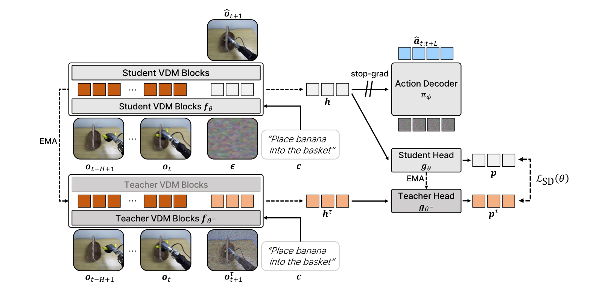

**Caption:** Figure 2 | Overview of FRED. We interpret the usage of a VDM in WAMs as a future representation generator, i.e., $h = f_\theta(\boldsymbol{\epsilon} \mid o_t, c)$. From this perspective, FRED trains the representation generator $f_\theta$ to improve the future representations generated from noise in a single step. Specifically, FRED uses self-distillation to align representations generated from noise with target representations extracted from clean or mildly noisy future observations by an EMA teacher $f_{\theta^-}$. In addition, we condition the video model on observation history to provide temporal context for predicting future representations. The action decoder then generates actions conditioned on the student's future representation $h$.

**Caption[CN]:** 图 2 | FRED 整体框架概览。我们将解耦式 WAMs 中 VDM 的角色诠释为未来表征生成器，即 $h = f_\theta(\boldsymbol{\epsilon} \mid o_t, c)$。立足于该视角，FRED 通过专门的表征学习机制，优化表征生成器 $f_\theta$ 在单步去噪中直接从纯噪声生成更高质量未来表征的能力。具体而言，FRED 引入动量自蒸馏机制，将学生模型从纯噪声中生成的表征与由 EMA 动量教师 $f_{\theta^-}$ 从干净或轻微加噪真实未来观测中提取的目标表征在 Patch 级别进行对齐。此外，我们将视频模型条件建立在短程历史观测窗口之上，为预测未来物理演化提供至关重要的时序上下文。最后，动作解码器以学生网络输出的高质量未来表征 $h$ 为条件生成动作块。

### 3.2. FRED | FRED 框架：表征自蒸馏与时序上下文

> <strong>Para. 12:</strong> FRED introduces a new framework for training WAMs by improving the representation generator $f_\theta$ to generate higher-quality future representations in a single step (Figure 2). Our key idea is to use self-distillation to train $f_\theta$ to predict representations extracted from ground-truth future observations. Specifically, we define a student representation generator $f_\theta$ and a momentum teacher representation generator $f_{\theta^-}$, whose weights $\theta^-$ are an exponential moving average (EMA) of $\theta$. Given an observation $o_t$ and task instruction $c$, the student takes Gaussian noise $\boldsymbol{\epsilon} \sim \mathcal{N}(0, \mathbf{I})$ as input and produces an intermediate hidden representation $h$. In contrast, the teacher takes a future observation $o_{t+1}^\tau$ corrupted with noise level $\tau \in [0, 1)$ as input and extracts an intermediate representation $h_\tau$ from the same layer:
$$h = f_\theta(\boldsymbol{\epsilon} \mid o_t, c) \quad \text{and} \quad h_\tau = f_{\theta^-}(o_{t+1}^\tau \mid o_t, c) \qquad (1)$$
where $o_{t+1}^\tau = (1-\tau)o_{t+1} + \tau \boldsymbol{\epsilon}$ denotes the future observation perturbed with Gaussian noise $\boldsymbol{\epsilon}$. We treat the teacher representation $h_\tau$ as a target and optimize the student parameters $\theta$ to predict $h_\tau$ from noise $\boldsymbol{\epsilon}$.

> <strong>Para. 12[CN]:</strong> FRED 引入了一种用于训练 WAMs 的全新范式，通过显式优化表征生成器 $f_\theta$，使其在单步去噪中直接合成更高质量的未来表征（图 2）。我们的核心思想是采用自蒸馏（Self-Distillation）技术，训练 $f_\theta$ 以直接预测从真实未来观测中提取的特征。具体而言，我们构建了一个学生表征生成器 $f_\theta$ 和一个动量教师表征生成器 $f_{\theta^-}$，其中教师权重 $\theta^-$ 通过学生权重 $\theta$ 的指数移动平均（EMA）在线更新。给定当前观测 $o_t$ 与任务指令 $c$，学生模型接收纯高斯噪声 $\boldsymbol{\epsilon} \sim \mathcal{N}(0, \mathbf{I})$ 作为输入并输出中间层隐藏表征 $h$。与此同时，教师模型接收受到噪声水平 $\tau \in [0, 1)$ 扰动的真实未来观测 $o_{t+1}^\tau$ 作为输入，并从同一对应网络层提取目标中间表征 $h_\tau$：
$$h = f_\theta(\boldsymbol{\epsilon} \mid o_t, c) \quad \text{且} \quad h_\tau = f_{\theta^-}(o_{t+1}^\tau \mid o_t, c) \qquad (1)$$
其中 $o_{t+1}^\tau = (1-\tau)o_{t+1} + \tau \boldsymbol{\epsilon}$ 表示融入高斯噪声 $\boldsymbol{\epsilon}$ 的未来观测。我们将教师提取的 $h_\tau$ 作为监督目标，优化学生参数 $\theta$，促使其直接从纯噪声 $\boldsymbol{\epsilon}$ 中重构并对齐 $h_\tau$。

> <strong>Para. 13:</strong> We then process these intermediate representations through the patch-wise student and teacher projection heads $g_\theta$, $g_{\theta^-}$ and apply softmax functions to obtain distributions $p$, $p_\tau$, respectively. Specifically, we apply softmax with temperature $\gamma_1 > 0$ to obtain the student distribution $p$. For the teacher distribution $p_\tau$, we center the logits by subtracting the mean teacher logits $m$ and apply softmax with a sharpening temperature $\gamma_2 > 0$ to prevent representation collapse, following Caron et al. (2021) and Zhou et al. (2022):
$$p = \operatorname{softmax}(g_\theta(h)/\gamma_1) \quad \text{and} \quad p_\tau = \operatorname{softmax}((g_{\theta^-}(h_\tau) - m)/\gamma_2) \qquad (2)$$
Then, FRED trains $f_\theta$ to generate better future video representations by minimizing the KL divergence between the output distributions $p$ and $p_\tau$, averaged over all $N > 0$ patches:
$$\mathcal{L}_{\text{SD}}(\theta) = \frac{1}{N} \sum_{i=1}^N \operatorname{KL}(p_{\tau, i} \parallel p_i) \qquad (3)$$

> <strong>Para. 13[CN]:</strong> 随后，我们将这些提取出的中间表征送入基于 Patch 维度的学生与教师投影头 $g_\theta$ 和 $g_{\theta^-}$，并通过 Softmax 函数分别计算其概率分布输出 $p$ 和 $p_\tau$。具体来说，我们采用温度系数 $\gamma_1 > 0$ 的 Softmax 获取学生概率分布 $p$。针对教师分布 $p_\tau$，为了防止自蒸馏过程中出现特征崩溃（Representation Collapse），我们遵循自监督学习经典工作（Caron 等, 2021；Zhou 等, 2022）的做法，通过减去教师 Logits 的滑动均值 $m$ 进行中心化（Centering），并施加锐化温度系数（Sharpening Temperature）$\gamma_2 > 0$（其中 $\gamma_2 < \gamma_1$）：
$$p = \operatorname{softmax}(g_\theta(h)/\gamma_1) \quad \text{且} \quad p_\tau = \operatorname{softmax}((g_{\theta^-}(h_\tau) - m)/\gamma_2) \qquad (2)$$
接着，FRED 通过最小化学生分布 $p$ 与教师分布 $p_\tau$ 之间的 KL 散度，并对全图所有 $N > 0$ 个图像块（Patches）进行平均，训练 $f_\theta$ 生成具备高保真物理结构的未来表征：
$$\mathcal{L}_{\text{SD}}(\theta) = \frac{1}{N} \sum_{i=1}^N \operatorname{KL}(p_{\tau, i} \parallel p_i) \qquad (3)$$

> <strong>Para. 14:</strong> Historical context for the VDM encoders. To facilitate more effective future representation generation, we additionally condition both the student $f_\theta$ and teacher $f_{\theta^-}$ on an $H$-frame short history of observations $o_{t-H:t} := [o_{t-H+1}, \dots, o_t]$, rather than only the current frame $o_t$. This provides temporal cues (e.g., recent robot motion) that encourage the VDM to infer how the robot has been moving and better predict the future dynamics.

> <strong>Para. 14[CN]:</strong> VDM 编码器的历史时序上下文条件。为了促使模型更加准确地生成未来表征，我们进一步将学生网络 $f_\theta$ 与教师网络 $f_{\theta^-}$ 同时建立在长度为 $H$ 帧的简短历史观测序列 $o_{t-H:t} := [o_{t-H+1}, \dots, o_t]$ 之上，而非仅仅输入单一的当前帧 $o_t$。这一时序观测窗口为模型注入了决定性的物理运动线索（例如末端执行器的实时速度与加速度），引导 VDM 准确推断机器人在最近几个时刻的运动趋势，从而能够对未来环境的物理演化做出更加合理的因果预测。

> <strong>Para. 15:</strong> WAM Training Objective and Inference. The overall WAM training objective combines the self-distillation loss with the video and action flow-matching losses (Lipman et al., 2022), as follows:
$$\mathcal{L}_{\text{video}}(\theta) = \mathcal{L}_{\text{FM}}(\theta) + \lambda_{\text{SD}} \mathcal{L}_{\text{SD}}(\theta) \quad \text{and} \quad \mathcal{L}_{\text{action}}(\phi) = \mathcal{L}_{\text{FM}}(\phi) \qquad (4)$$
where $\lambda_{\text{SD}} > 0$ is a hyperparameter that balances the flow-matching and self-distillation objectives. Here, we do not update $\theta$ with the action flow-matching loss $\mathcal{L}_{\text{FM}}(\phi)$; thus, the representation generator $f_\theta$ is trained only by the video denoising and self-distillation objectives. We update the parameters of momentum teacher networks as $\theta^- \leftarrow m \theta^- + (1-m) \theta$, where $m \in [0, 1]$ is the momentum coefficient given as a hyperparameter. At inference, we obtain the future representation $h$ from the representation generator $f_\theta$, and then use the action decoder $\pi_\phi$ to generate $a_t$ conditioned on $(q_t, h)$ using Euler ODE sampling (Lipman et al., 2022).

> <strong>Para. 15[CN]:</strong> WAM 联合训练目标与部署推理。WAM 的总体训练目标将上述自蒸馏损失与标准的视频及动作流匹配损失（Flow-Matching Losses；Lipman 等, 2022）相融合，形式化定义如下：
$$\mathcal{L}_{\text{video}}(\theta) = \mathcal{L}_{\text{FM}}(\theta) + \lambda_{\text{SD}} \mathcal{L}_{\text{SD}}(\theta) \quad \text{且} \quad \mathcal{L}_{\text{action}}(\phi) = \mathcal{L}_{\text{FM}}(\phi) \qquad (4)$$
其中 $\lambda_{\text{SD}} > 0$ 是权衡视频流匹配目标与自蒸馏目标的超参数。极为关键的是，我们严格**阻断动作流匹配损失 $\mathcal{L}_{\text{FM}}(\phi)$ 对视频模型参数 $\theta$ 的梯度回传**（Stop-gradient）；因此，表征生成器 $f_\theta$ 纯粹在视频去噪与自蒸馏目标的联合驱动下优化，避免了动作任务过拟合对通用视频物理先验的污染。动量教师网络的参数按照 $\theta^- \leftarrow m \theta^- + (1-m) \theta$ 进行指数平滑更新，其中 $m \in [0, 1]$ 为动量衰减系数。在测试推理阶段，模型仅需执行一次表征生成器 $f_\theta$ 的单步前向推理获取未来隐状态 $h$，随后动作解码器 $\pi_\phi$ 以 $(q_t, h)$ 为条件，通过轻量级欧拉常微分方程采样（Euler ODE Sampling）直接高效生成动作序列 $a_t$。

## 4. Experiments | 实验评估

> <strong>Para. 16:</strong> We design experiments to investigate whether learning to generate useful future video representations using FRED can improve the control performance of World Action Models (WAMs) in complex real-world environments. In particular, we consider the following questions:
• Can FRED generalize to unseen environments and tasks? (Table 1)
• Can FRED benefit from human video co-training, allowing human-to-robot skill transfer? (Table 2)
• What is the effect of each component of FRED? (Tables 3 and 5 to 7)
• How does future representation quality correlate with control performance? (Table 4 and Figure 4)

> <strong>Para. 16[CN]:</strong> 我们设计了系统性的实验体系，旨在探究通过 FRED 学习生成高质量未来视频表征能否真正提升世界动作模型（WAMs）在复杂真实物理环境中的控制性能。我们重点围绕以下四个核心科学问题展开论证：
• FRED 能否泛化到完全未见过的物理环境与全新操作任务中？（见表 1）
• FRED 能否从无动作的人类第一视角视频协同训练中汲取先验，实现零样本人类到机器人的技能迁移？（见表 2）
• FRED 中的各个核心组件与设计决策各自产生了何种影响？（见表 3、表 5 至表 7）
• 未来表征的内在质量与下游机器人最终控制表现之间存在何种统计相关性？（见表 4 与图 4）

### 4.1. Experimental Setup | 实验设置

> <strong>Para. 17:</strong> Implementation Details. We consider two different model scales for our experiments: 5B and 14B. For the 5B-scale experiments, we use Wan2.2-TI2V-5B (Wan et al., 2025) as the video diffusion backbone and a 16-layer DiT (Peebles & Xie, 2023) as the action decoder. For self-distillation in FRED, we extract features from 19th layer (index 18) of the video backbone for both the student and teacher, fix the teacher's noise level at 0.25, and use $\lambda_{\text{SD}} = 0.01$ by default. We update the momentum teacher using an exponential moving average (EMA) of the student, with the decay warmed up using an inverse decay schedule. We use 4 historical observations with the current observation as input. For our 14B-scale experiments, we utilize the Wan2.1-I2V-14B (Wan et al., 2025) with a 24-layer DiT action decoder and extract features from 25th layer of the video backbone for self-distillation. Unless otherwise stated, we extract video features from the same layer for self-distillation and action decoder conditioning. See more details in Appendix A.

> <strong>Para. 17[CN]:</strong> 实现细节。我们在实验中评估了两种不同参数规模的模型配置：5B 规模与 14B 规模。针对 5B 规模实验，我们采用 Wan2.2-TI2V-5B（Wan 等, 2025）作为视频扩散模型骨干，并采用 16 层 DiT（Peebles & Xie, 2023）作为动作解码器。在 FRED 的自蒸馏模块中，我们在学生与教师网络中均从视频骨干网络的第 19 层（索引 index 18）提取特征，将教师输入的加噪水平固定在 $\tau = 0.25$，并默认设置损失权重 $\lambda_{\text{SD}} = 0.01$。动量教师参数通过学生的指数移动平均（EMA）进行更新，其衰减系数采用逆衰减调度策略进行预热。输入端包含 4 帧历史观测与 1 帧当前观测（共 5 帧）。针对 14B 规模实验，我们采用 Wan2.1-I2V-14B（Wan 等, 2025）搭配 24 层 DiT 动作解码器，并从视频骨干网络的第 25 层提取表征用于自蒸馏。除另有说明外，自蒸馏与动作解码器条件均提取自同一层视频特征。更多详尽参数参见附录 A。

### Figure 3. Visualization of the training and evaluation setup

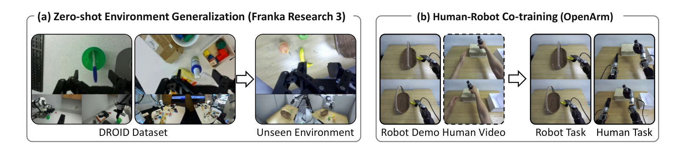

**Caption:** Figure 3 | Visualization of the training and evaluation setup. (a) For zero-shot environment generalization, we train FRED on the DROID (Khazatsky et al., 2024) dataset and evaluate it on diverse tasks in a new real-world environment without task-specific fine-tuning. (b) For human-robot co-training, we train FRED either on robot demonstrations alone or jointly on robot demonstrations and human videos, and evaluate it on both in-domain robot tasks and human-to-robot skill transfer tasks.

**Caption[CN]:** 图 3 | 训练与评测实验设定可视化展示。(a) 针对零样本环境泛化，我们在大规模真实机械臂数据集 DROID（Khazatsky 等, 2024）上训练 FRED，随后在未见过的全新真实物理环境中评测多样化操作任务，全程不进行任何针对该新环境的微调。(b) 针对人机协同训练，我们在纯机器人遥操作演示或“机器人演示 + 无动作人类第一视角视频”联合数据上训练 FRED，并同时评估域内机器人基础任务以及跨形态人类到机器人的零样本技能迁移任务。

> <strong>Para. 18:</strong> Baselines. We use several recent robot foundation models as baselines. Specifically, we first consider recent World Action Models (WAMs): (a) DiT4DiT (Ma et al., 2026), Fast-WAM (Yuan et al., 2026), and AGRA (Qiu et al., 2026) are WAMs with a single video denoising step, and (b) DreamZero (Ye et al., 2026) is a WAM with multi-step video denoising due to shared video-action modeling within the same architecture. We also consider recent pre-trained Vision-Language-Action models (VLAs): $\pi_{0.5}$ (Black et al., 2025) and GR00T N1.7 (NVIDIA, 2026). We describe further details in Appendix C.

> <strong>Para. 18[CN]:</strong> 对比基线模型。我们选取了近期一系列代表性的机器人基座模型作为基线。具体而言，我们首先对比了前沿的世界动作模型（WAMs）：(a) DiT4DiT（Ma 等, 2026）、Fast-WAM（Yuan 等, 2026）以及 AGRA（Qiu 等, 2026），它们均属于采用单步前向去噪的高效 WAM 范式；(b) DreamZero（Ye 等, 2026），它在单一共享架构中联合建模视频与动作，在推理时需要执行多步视频去噪采样。此外，我们还选取了当前最先进的开源预训练视觉-语言-动作模型（VLAs）进行横向对比，包括 $\pi_{0.5}$（Black 等, 2025）与 GR00T N1.7（NVIDIA, 2026）。所有基线的具体实现与评测细节详见附录 C。

### 4.2. Zero-shot Environment Generalization | 零样本环境泛化

> <strong>Para. 19:</strong> First, we investigate whether FRED can generalize to unseen environments and tasks using future video representations generated in a single denoising step. To this end, we train our method on DROID (Khazatsky et al., 2024), one of the largest publicly available robotics datasets, and evaluate it across diverse real-world situations, including unseen environments and tasks. Specifically, we categorize the evaluation tasks into four types:
• In-domain easy tasks use instruction and object categories seen during training, but are evaluated in a new environment with different object details.
• In-domain long-horizon task extends in-domain easy settings to longer-horizon manipulations that require multiple manipulation steps.
• Out-of-domain tasks evaluate generalization to manipulation behaviors whose action verbs are absent from the DROID training instructions. They require the robot to execute novel motions.
• Object grounding tasks require the robot to select and manipulate the object specified by the instruction in the presence of distractors with similar colors or shapes.
We provide more detailed setup in Appendix B, and the full results in Appendix G.1.

> <strong>Para. 19[CN]:</strong> 首先，我们深入探讨 FRED 能否在单步去噪生成的未来表征支持下，直接零样本泛化至全新的物理环境与复杂任务中。为此，我们在开源具身机器人领域规模最大的基准数据集之一 DROID（Khazatsky 等, 2024）上训练模型，并在物理位置、台架布局、背景光照及具体物体完全陌生的新实验室环境中评估其控制表现。我们将评测任务体系划分为四大类型：
• 域内简单任务（In-domain easy）：采用训练集中出现过的操作动词与物体类别，但在全新物理环境中施加外观与摆放变化；
• 域内长时程任务（In-domain long-horizon）：将基础操作拓展为包含多个先后物理交互阶段的长程复合任务（如桌面多物体清理）；
• 域外全新任务（Out-of-domain）：评估对训练指令中完全缺失的操作动词（如揭开、盖印章）的动作泛化能力，要求机械臂生成未见过的全新运动轨迹；
• 目标空间定位任务（Object grounding）：在工作空间内存在颜色、形状高度相似的干扰物时，要求机械臂严格精准地定位并抓取指令指定的特定目标。
评测任务的完整环境参数见附录 B，逐项任务细分数据见附录 G.1。

### Table 1. Results on zero-shot generalization to a new real-world environment

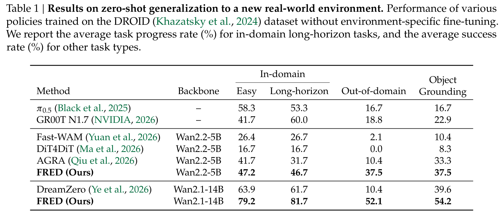

**Caption:** Table 1 | Results on zero-shot generalization to a new real-world environment. Performance of various policies trained on the DROID (Khazatsky et al., 2024) dataset without environment-specific fine-tuning. We report the average task progress rate (%) for in-domain long-horizon tasks, and the average success rate (%) for other task types.

**Caption[CN]:** 表 1 | 真实世界新环境下的零样本环境泛化实验结果。所有策略模型均在大规模 DROID 数据集上预训练，未针对评测新环境进行任何微调。表中针对域内长时程任务报告平均任务完成进度百分比（%），针对其余三类任务报告平均成功率（%）。

> <strong>Para. 20:</strong> Results. As shown in Table 1, we find that FRED consistently outperforms the other WAM baselines across all task types, demonstrating the effectiveness of learning future representations via self-distillation. Specifically, for 5B-scale models, FRED achieves an average performance of 47.2% on in-domain easy tasks, 46.7% on long-horizon tasks, 37.5% on out-of-domain tasks, and 37.5% on object grounding tasks, improving upon the best single-step WAM baseline (AGRA) by 5.5%, 15.0%, 27.1%, and 4.2%, respectively. Remarkably, this superior performance is also maintained at the 14B scale: FRED achieves 79.2% on in-domain easy tasks, 81.7% on long-horizon tasks, 52.1% on out-of-domain tasks, and 54.2% on object grounding tasks, outperforming DreamZero by 15.3%, 20.0%, 41.7%, and 14.6%, respectively, while being approximately 8× faster at inference time (Table 7). In particular, FRED achieves large gains on long-horizon and out-of-domain tasks. We attribute this to the fact that high-quality future representations allow the policy to better understand the temporal sequence of actions required for multi-step tasks and infer the dynamics of novel actions.

> <strong>Para. 20[CN]:</strong> 实验结果分析。如表 1 所示，FRED 在所有四类任务套件中均无一例外地显著超越了其他竞争性 WAM 基线，充分印证了通过自蒸馏学习未来物理表征的决定性价值。具体而言：在 5B 模型尺度下，FRED 在域内简单任务上达到 47.2%，长时程任务上达到 46.7%，域外全新动作任务上达到 37.5%，目标定位任务上达到 37.5%，相较于性能最佳的单步 WAM 基线 AGRA 分别实现了 +5.5%、+15.0%、+27.1% 和 +4.2% 的显著提升。更令人瞩目的是，这种压倒性优势在扩展至 14B 尺度时依然得到了稳固保持：FRED-14B 在四类任务上的得分分别飙升至 79.2%、81.7%、52.1% 和 54.2%，全面领先同体量的多步视频生成 WAM 基线 DreamZero 达 +15.3%、+20.0%、+41.7% 和 +14.6%，同时测试推理速度实现了惊人的约 8 倍加速（表 7）。尤其在长时程任务和域外新动作任务上，FRED 的增益最为悬殊。我们将这一飞跃归因于：高质量的未来表征赋予了控制策略深入理解长程多阶段物理演化时序、并准确认知全新动作动态走向的能力。

### 4.3. Human-robot Co-training | 人机协同训练

> <strong>Para. 21:</strong> Next, we investigate whether FRED can benefit from human video co-training, enabling human-to-robot skill transfer. To this end, we collect a bimanual manipulation dataset on an OpenArm humanoid robot and an egocentric human video dataset in real-world environments. We then train FRED on either the robot dataset alone or jointly on the robot and human datasets, and evaluate it on seven real-world tasks across three categories: in-domain atomic tasks, in-domain composite tasks, and human skill transfer tasks. Importantly, the human skill transfer tasks are absent from the robot training demonstrations and are demonstrated only in human videos. See Appendix B.2 for more details.

> <strong>Para. 21[CN]:</strong> 接下来，我们重点验证 FRED 能否从无动作标注的人类视频协同训练中实质性获益，从而实现前沿的人类到机器人跨形态技能迁移。为此，我们在双臂 OpenArm 人形机器人平台上采集了包含 553 条轨迹的高质量遥操作演示数据集，同时在真实世界多场景中采集了包含 1,187 段、共计 32.1 万帧的第一视角人类操作视频。随后，我们分别在“纯机器人数据集”以及“机器人演示 + 人类视频联合数据”两种配置下训练 FRED，并在三大类共计 7 项物理实机任务上进行严格测试：域内原子任务、域内复合任务以及人类技能迁移任务。至关重要的是：人类技能迁移任务在机器人演示数据中处于完全未见状态，仅在人类第一视角视频中存在视觉演示。详细设置见附录 B.2。

### Table 2. Results on humanoid control with and without human-robot co-training

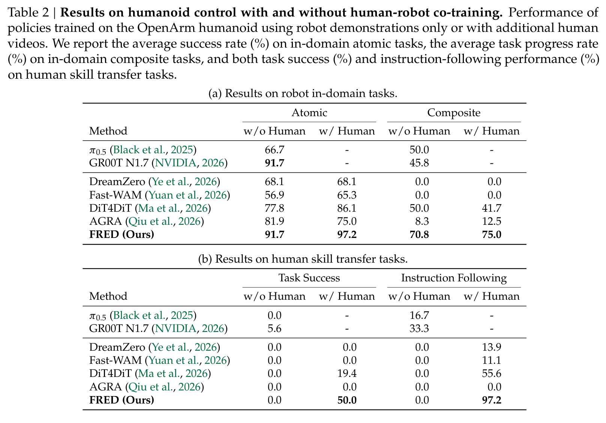

**Caption:** Table 2 | Results on humanoid control with and without human-robot co-training. Performance of policies trained on the OpenArm humanoid using robot demonstrations only or with additional human videos. We report the average success rate (%) on in-domain atomic tasks, the average task progress rate (%) on in-domain composite tasks, and both task success (%) and instruction-following performance (%) on human skill transfer tasks.

**Caption[CN]:** 表 2 | 在具备与不具备人类视频协同训练下的 OpenArm 人形机器人控制评测结果。表中展示了仅采用机器人演示数据训练与联合加入无动作人类视频协同训练的模型表现。针对域内原子任务报告平均成功率（%），针对域内复合任务报告平均阶段完成进度（%），针对人类技能迁移任务同时报告最终物理成功率（%）与高层指令遵循率（%）。

> <strong>Para. 22:</strong> In-domain Results. Table 2a shows FRED consistently outperforms WAM baselines on both atomic and composite tasks, with and without human data. When trained only on robot demonstrations, FRED achieves 91.7% and 70.8% on atomic and composite tasks, respectively, outperforming the best baseline (DiT4DiT) by 13.9% and 20.8%. Adding human videos further improves performance, reaching 97.2% and 75.0%.

> <strong>Para. 22[CN]:</strong> 域内任务结果分析。表 2a 表明，无论是否加入人类视频数据，FRED 在域内原子任务与长程复合任务中均稳定领先所有 WAM 基线。在仅使用机器人遥操作演示数据时，FRED 在原子任务和复合任务上分别取得 91.7% 和 70.8% 的优异表现，相较于表现最好的基线 DiT4DiT 分别高出 +13.9% 和 +20.8%。在进一步融入人类视频协同训练后，FRED 的表现进一步攀升至 97.2% 和 75.0% 的极高水准。

> <strong>Para. 23:</strong> Human Skill Transfer Results. In Table 2b, we observe that FRED achieves strong human-to-robot skill transfer performance when co-trained on human videos. While all methods fail completely without human data, FRED co-trained with human videos achieves a 50.0% task success rate on tasks only demonstrated by humans, substantially outperforming DiT4DiT (19.4%) and DreamZero (0.0%). Moreover, FRED achieves a 97.2% instruction following rate, indicating that the policy reliably executes task-relevant motions. We attribute this success to FRED's ability to learn useful spatiotemporal representations that bridge the visual and embodiment gap between humans and robots, allowing the policy to transfer manipulation skills without robot demonstrations.

> <strong>Para. 23[CN]:</strong> 人类技能迁移结果分析。如表 2b 所示，当联合人类视频进行协同训练时，FRED 展现出了极其惊艳的人类到机器人跨形态技能迁移能力。在完全不使用人类数据时，所有被测策略在该类零样本迁移任务上的成功率均为 0.0%；而在引入人类第一视角视频后，FRED 在仅由人类演示过的全新任务上斩获了高达 50.0% 的最终物理成功率，呈现压倒性优势（相比之下，最佳基线 DiT4DiT 仅为 19.4%，而多步生成的 DreamZero 完全为 0.0%）。更引人瞩目的是，FRED 在此类任务上的指令遵循率达到了惊人的 97.2%，表明机器人能够高度可靠地执行与任务意图严密对齐的操作姿态。我们将这一重大成功归结于：FRED 通过时序上下文与自蒸馏机制，学到了能够跨越人类手臂与人形双臂机械结构的深层时空物理表征，从而成功抹平了视觉与具身形态鸿沟，使机器人首次能够在完全没有实机遥操作先验的前提下自主执行复杂的陌生操作。

### 4.4. Analysis and Ablation Studies | 分析与消融研究

> <strong>Para. 24:</strong> We conduct extensive ablation studies and analyses to investigate how each component affects robot control performance and analyze the properties of the learned representations. Unless otherwise stated, we conduct these studies on RoboCasa Kitchen (Nasiriany et al., 2024), a challenging simulation benchmark for robotic manipulation.

> <strong>Para. 24[CN]:</strong> 我们进行了系统完备的消融实验与分析，以深入探究各个架构组件对机器人控制表现的具体影响机理，并深入剖析所学隐空间表征的内在属性。除另有说明外，本节分析均在极具挑战性的机器人操作仿真基准 RoboCasa Kitchen（Nasiriany 等, 2024）上规范展开。

### Table 3. Component ablation study of FRED on RoboCasa Kitchen benchmark

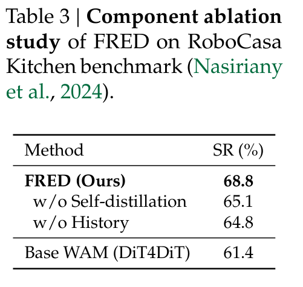

**Caption:** Table 3 | Component ablation study of FRED on RoboCasa Kitchen benchmark (Nasiriany et al., 2024). We report the average success rate (SR) in percentage.

**Caption[CN]:** 表 3 | FRED 在 RoboCasa Kitchen 仿真基准上的核心组件消融实验结果。表中报告平均成功率（SR，%）。

### Table 4. Comparison of representation learning methods on various simulation benchmarks

**Caption:** Table 4 | Comparison of representation learning methods on various simulation benchmarks. For each benchmark, all models are fine-tuned on its training dataset under the same configuration. We report the average success rate (SR) in percentage.

**Caption[CN]:** 表 4 | 在多个仿真基准上对多种主流表征学习方法的横向对比实验。在每个基准上，所有模型均在相同配置下于训练集上进行微调。表中报告平均成功率（SR，%）。

> <strong>Para. 25:</strong> Component Analysis. In Table 3, we evaluate the contribution of self-distillation to future representation learning and the role of historical conditioning. Compared with the baseline DiT4DiT (61.4%), adding self-distillation alone improves performance by 4.2% (65.6%), while historical conditioning alone brings a 3.2% gain (64.6%). Combining both in FRED achieves the best performance of 68.8% (a 7.4% total gain), indicating that self-distillation and temporal context provide complementary benefits for future representation learning.

> <strong>Para. 25[CN]:</strong> 核心组件贡献分析。在表 3 中，我们分别评估了未来表征自蒸馏机制与时序历史观测条件的独立贡献。相较于单步 WAM 基准模型 DiT4DiT（成功率 61.4%），仅引入自蒸馏机制即可带来 +4.2% 的显著提升（达到 65.6%），而仅加入历史多帧观测条件则带来 +3.2% 的稳步增益（达到 64.6%）。当将二者有机结合在 FRED 中时，模型取得了 68.8% 的最高成功率（累计总增益达 +7.4%）。这有力地证明了自蒸馏表征监督与时序运动上下文在促进未来动力学建模方面具有高度互补的深层协同效应。

> <strong>Para. 26:</strong> Comparison with Representation Learning Methods. To verify the effectiveness of FRED as a representation learning method for WAMs, we compare FRED with other representation learning methods across three simulation benchmarks in Table 4: RoboCasa Kitchen (Nasiriany et al., 2024), GR-1 Tabletop (Bjorck et al., 2025), and LIBERO (Liu et al., 2023). Specifically, we compare FRED with (a) base WAM (DiT4DiT), (b) DINOv2 (Oquab et al., 2023), which distills features from a pre-trained vision backbone, and (c) Inverse Dynamics Model (IDM), which trains the VDM to predict actions from consecutive observations. Across all benchmarks, FRED consistently outperforms competing representation learning approaches, demonstrating that learning to generate future representations from noise via self-distillation provides a more effective representation for downstream action prediction.

> <strong>Para. 26[CN]:</strong> 与主流表征学习方法的横向对比。为了确证 FRED 作为一种专为 WAM 设计的表征学习机制的优越性，我们在表 4 中将 FRED 与其他通用表征学习范式在三大仿真基准上进行了严格横向比对：RoboCasa Kitchen（Nasiriany 等, 2024）、GR-1 Tabletop（Bjorck 等, 2025）以及 LIBERO（Liu 等, 2023）。具体对比对象涵盖：(a) 基础 WAM 模型（DiT4DiT）；(b) 基于 DINOv2（Oquab 等, 2023）的特征蒸馏方法（从预训练静态视觉编码器蒸馏语义特征）；(c) 逆动力学模型（IDM）监督方法（训练 VDM 依据连续帧差分预测动作）。实验结果清晰表明：在所有评测基准中，FRED 均持续显著超越所有对比方案，这充分证明了通过自蒸馏使模型学会在单步去噪中直接从噪声生成未来物理表征，能够为底层动作解码提供最具指导价值的时空特征基底。

### Figure 4. Policy performance versus video generation and representation quality

**Caption:** Figure 4 | Policy performance versus video generation and representation quality. Using DiT4DiT as the base WAM, we compare variants with different VDM training iterations, self-distillation loss coefficients, and teacher noise levels on the RoboCasa Kitchen benchmark. We measure (a) one-step video generation quality using Fréchet Video Distance (FVD; lower is better), (b) feature probing accuracy on representations extracted from clean future observations, and (c) feature probing accuracy on future representations generated from noise. Each point corresponds to a different model variant, and the dashed line shows the linear fit with the Pearson correlation coefficient ($r$). Feature probing accuracy measures how well an attentive probe predicts the ground-truth motion primitive of the future video into predefined motion primitive classes (see Appendix D for more detailed setup).

**Caption[CN]:** 图 4 | 策略控制性能 vs 视频像素生成质量及潜在表征质量的相关性分析。以 DiT4DiT 为基准 WAM，我们在 RoboCasa Kitchen 仿真基准上横向比对了不同 VDM 训练迭代步数、自蒸馏损失权重以及教师加噪水平下的数十个模型变体。我们分别测定并绘制了：(a) 基于弗雷歇视频距离（FVD；越低越好）的单步视频生成像素保真度；(b) 从真实干净未来观测提取的表征在注意力探测器下的未来运动原语分类准确率；(c) 在测试时直接从纯高斯噪声生成的未来表征的运动原语探测准确率。散点图中每个数据点对应一个独立模型，虚线表示线性拟合线并标注皮尔逊相关系数（$r$）。注意力探测准确率衡量了特征中包含未来运动方向与位移趋势的丰富程度（详见附录 D）。

### Table 5. Analysis of FRED design choices

**Caption:** Table 5 | Analysis of FRED design choices. We examine the effects of (a) teacher noise level, (b) feature extraction layer, (c) self-distillation loss coefficient, and (d) blocking action gradients to the video backbone on RoboCasa Kitchen (Nasiriany et al., 2024). Default settings are highlighted in gray.

**Caption[CN]:** 表 5 | FRED 关键架构设计选择的消融与参数敏感性分析。我们在 RoboCasa Kitchen 基准上系统考察了：(a) 教师输入噪声水平 $\tau$；(b) 特征提取网络层索引；(c) 自蒸馏损失平衡系数 $\lambda_{\text{SD}}$；(d) 是否阻断从动作解码器损失向视频扩散骨干的梯度回传。默认参数在表中以灰色高亮标注。

> <strong>Para. 27:</strong> In Figures 4a and 4b, we find that task success is only weakly correlated with one-step video generation quality ($r = 0.24$) and representation quality on observed future videos ($r = 0.49$). In contrast, in Figure 4c, we observe that the quality of future representations generated from noise shows a stronger correlation with task success ($r = 0.89$). This supports our view of the VDM as a future representation generator and suggests that improving the representations directly used for action generation may be particularly relevant to control performance.

> <strong>Para. 27[CN]:</strong> 表征质量与控制表现的相关性深度发现。在图 4a 和 4b 中，我们发现任务控制成功率与单步生成的视频像素质量（FVD 指标）之间仅存在极弱的统计相关性（$r = 0.24$），而与从已知干净未来视频中提取的表征质量也仅呈中等相关（$r = 0.49$）。与此形成鲜明对比的是，在图 4c 中，直接从纯高斯噪声生成的未来表征的探测质量与最终策略控制成功率呈现出极其显著的高强度正相关性（$r = 0.89$）。这一关键发现极具理论穿透力：它直接印证了我们将 VDM 重新定义为“未来表征生成器”的核心立论，并雄辩地证明，直接优化下游动作解码器在测试时所真正消费的噪声表征，才是决定机器人控制成败的核心命脉。

> <strong>Para. 28:</strong> Self-distillation Design Choices. We analyze several design choices of FRED: teacher noise level, feature extraction layer used for both self-distillation and action conditioning, self-distillation loss coefficient, and gradient flow from the action loss to the video diffusion backbone. In Table 5a, we find that a moderately noisy teacher input with $\tau = 0.25$ performs best, outperforming both clean future observations and more heavily corrupted inputs. We hypothesize that moderate corruption provides more informative target representations for self-distillation, consistent with prior observations that representations from diffusion models can be strongest at intermediate noise levels (Yu et al., 2025; Vélez et al., 2025). In Table 5b, we find that performance peaks at layer index 18, while using either shallower or deeper layers degrades performance, which aligns with prior findings in WAMs that intermediate video-model layers provide more effective representations for action conditioning (Ma et al., 2026). In Table 5c, we find that $\lambda_{\text{SD}} = 0.01$ performs best among the evaluated coefficients, while a larger coefficient of 0.1 achieves comparable performance. Finally, in Table 5d, we find that stopping gradients from the action loss to the video backbone improves the success rate from 65.6% -> 68.8%, suggesting that optimizing future video representations directly for action prediction is not necessarily beneficial.

> <strong>Para. 28[CN]:</strong> 自蒸馏设计选择消融分析。我们在表 5 中系统剖析了 FRED 的各项具体设计细节：教师噪声水平、特征提取层深度、自蒸馏损失权重以及动作损失向视频骨干的梯度流向。在表 5a 中，实验表明输入中等噪声水平 $\tau = 0.25$ 的教师模型取得了 68.8% 的最高成功率，全面优于完全干净的真实未来观测（$\tau = 0.0$，65.3%）以及重度扰动的输入（$\tau = 0.75$，67.6%）。我们推测：适度的噪声注入为自蒸馏提供了更具泛化性与抗噪性的丰富目标表征，这与扩散模型在中间加噪步隐层特征最具语义表达力的前沿结论高度契合（Yu 等, 2025；Vélez 等, 2025）。在表 5b 中，控制性能在网络第 19 层（索引 18）达到峰值，过浅或过深的网络层均会导致性能滑落，这验证了先前 WAMs 领域关于中间层最具时空动作指导价值的观察（Ma 等, 2026）。在表 5c 中，$\lambda_{\text{SD}} = 0.01$ 在被测系数中取得了最优平衡。最后，在表 5d 中，一个极具启发性的发现是：**完全截断从动作损失向视频扩散骨干的梯度回传（Stop-gradient），反而使成功率从 65.6% 显著提升至 68.8%**。这强有力地说明：强行让视频骨干直接拟合动作目标，容易导致通用时空表征发生退化与动作过拟合，保持视频模型专注于物理动力学自蒸馏建模才是最优解。

### Table 6. Generalization across video backbones

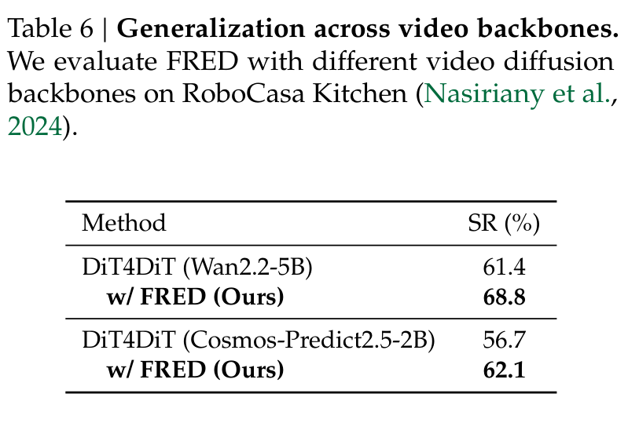

**Caption:** Table 6 | Generalization across video backbones. We evaluate FRED with different video diffusion backbones on RoboCasa Kitchen (Nasiriany et al., 2024).

**Caption[CN]:** 表 6 | 视频扩散骨干网络的跨架构通用性验证。我们在 RoboCasa Kitchen 仿真基准上评估了 FRED 搭载不同视频扩散底座的性能提升。

### Table 7. Inference cost

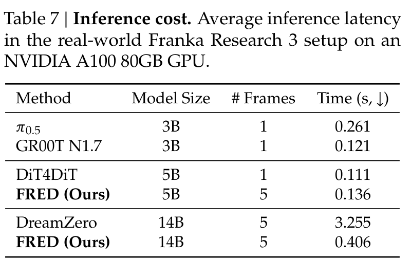

**Caption:** Table 7 | Inference cost. Average inference latency in the real-world Franka Research 3 setup on an NVIDIA A100 80GB GPU.

**Caption[CN]:** 表 7 | 推理开销与控制延迟实测。在搭载 NVIDIA A100 80GB GPU 的物理真实世界 Franka Research 3 机械臂台架上测得的单次动作决策平均推理时延（秒，越低越好）。

> <strong>Para. 29:</strong> Generality across Video Backbones. In Table 6, we evaluate whether the gains of FRED generalize across different video diffusion backbones. We find that FRED consistently improves the success rates of DiT4DiT with both the Wan2.2-5B (Wan et al., 2025) and Cosmos-Predict2.5-2B (Ali et al., 2025) backbones, demonstrating that its effectiveness extends beyond a single video backbone.

> <strong>Para. 29[CN]:</strong> 跨视频底座的通用性。在表 6 中，我们评估了 FRED 带来的性能提升能否无缝迁移到不同的视频扩散架构之中。评测证实，无论是以开源领先的 Wan2.2-5B（Wan 等, 2025）为主干（从 61.4% 提升至 68.8%），还是搭载 NVIDIA 最新推出的物理 AI 视频基座 Cosmos-Predict2.5-2B（Ali 等, 2025）（从 56.7% 提升至 62.1%），FRED 均取得了稳定且大幅度的控制性能增益，展现了极强的架构无关通用性。

> <strong>Para. 30:</strong> Inference Cost. In Table 7, we measure the average inference latency of FRED and other baselines at different model scales. At the 5B scale, we observe that FRED achieves inference latency comparable to the VLA baselines, despite conditioning on 5 frames by default, with only a 1.2x increase over DiT4DiT with 1-frame input. At the 14B scale, FRED is approximately 8x faster than DreamZero (Ye et al., 2026), demonstrating the practical efficiency of using a single video denoising step for action generation.

> <strong>Para. 30[CN]:</strong> 推理时延与硬件开销实测。在表 7 中，我们在标准的 NVIDIA A100 80GB 实机控制计算节点上严格测试了各主流策略模型的单次动作决策延迟。在 5B 模型尺度下，尽管 FRED 默认输入了 5 帧视觉时序观测，其单次推理时延（0.136 秒）依然全面超越了参数量更小的纯 VLA 模型 $\pi_{0.5}$（0.261 秒），且相较于仅输入单帧图像的 DiT4DiT（0.111 秒）仅增加了微不足道的 1.2 倍耗时。而在 14B 超大模型尺度下，FRED 的推理延迟仅为 0.406 秒，相较于采用多步视频去噪迭代采样的 DreamZero（3.255 秒）实现了极其震撼的约 8 倍加速！这确凿地证明了：通过单步去噪提取未来隐空间表征驱动动作生成，在兼顾极致物理泛化与实时闭环控制要求方面具有绝对的工程领先性。

## 5. Conclusion | 结论

> <strong>Para. 31:</strong> In this paper, we have presented FRED, a novel framework for training World Action Models (WAMs) that explicitly learns the future representations used for action generation from a single video denoising step via self-distillation. Our key insight is to view the video diffusion model (VDM) as a future representation generator and explicitly improve these representations by aligning them with self-distillation targets extracted from noisy future observations, while using observation history as additional temporal context. Our experiments show that FRED consistently improves robot control in complex real-world scenarios, including zero-shot environment generalization and human-to-robot skill transfer. We hope our work on the connection between representation learning and WAMs encourages further work toward efficient and generalizable robot foundation models that better leverage large-scale pre-trained video models. We provide more discussion in Appendix F.

> <strong>Para. 31[CN]:</strong> 在本文中，我们提出了 FRED，一种用于训练世界动作模型（WAMs）的全新框架，它通过动量自蒸馏机制，显式优化了在单步去噪前向中直接从纯高斯噪声合成高质量未来表征的能力，以支撑底层的实时动作解码。我们的核心理论洞见在于：将 WAMs 中的视频扩散模型（VDM）重新定义为一个专门的未来表征生成器，并通过将其与从加噪未来真实观测中提取的自蒸馏目标相逼近，结合短程历史时序观测上下文，彻底攻克了噪声输入表征退化的难题。涵盖真实单臂机械臂与双臂人形机器人的全面实物实验表明，FRED 在零样本环境泛化以及跨形态人类到机器人技能迁移等前沿严苛挑战中均取得了实质性突破。我们衷心希望本文关于表征学习与世界动作模型深层联结的探索，能够为未来构建更加高效、强大、通用的具身机器人基座模型提供富有启发性的技术基石。我们在附录 F 中提供了更多关于局限性与未来发展方向的深入讨论。

> <strong>Para. 32:</strong> Acknowledgement. For SJ, HJ, and JS: this paper was supported by RLWRLD Inc. We thank Myungkyu Koo, Beomjun Kim, Junhyeong Park, Junyoung Sung, Seunghoon Sim, John Won, Seungyong Lee, and Wook Jung for their help in collecting robot and human demonstrations for our real-world experiments. SY thanks Shusheng Yang for providing the manuscript template.

> <strong>Para. 32[CN]:</strong> 致谢。本研究由 RLWRLD 公司提供资助支持（针对作者 SJ、HJ 和 JS）。我们由衷感谢 Myungkyu Koo、Beomjun Kim、Junhyeong Park、Junyoung Sung、Seunghoon Sim、John Won、Seungyong Lee 以及 Wook Jung 在我们真实世界实验中协助采集机器人遥操作演示与人类第一视角视频。SY 诚挚感谢 Shusheng Yang 为本项目提供的论文排版模板。

## References | 参考文献目录

> <strong>Para. 33:</strong> Key references cited in this paper include: Peebles & Xie (2023) Scalable diffusion models with transformers (DiT); Lipman et al. (2022) Flow matching for generative modeling; Wan et al. (2025) Wan2.1 and Wan2.2 video foundation models; Ali et al. (2025) World simulation with Cosmos video foundation models; Khazatsky et al. (2024) DROID large-scale robot manipulation benchmark; Black et al. (2025) pi_0.5 vision-language-action flow matching policy; NVIDIA (2026) GR00T N1.7 open humanoid foundation model; Ma et al. (2026) DiT4DiT world action models; Ye et al. (2026) DreamZero unified video-action generation; Yuan et al. (2026) Fast-WAM inference-efficient world action models; Qiu et al. (2026) AGRA representation alignment in WAMs; Caron et al. (2021) DINO self-distillation with no labels; Zhou et al. (2022) iBOT image BERT pre-training with online tokenizer.

> <strong>Para. 33[CN]:</strong> 本文引用的核心经典与前沿文献包括：Peebles & Xie (2023) 基于 Transformer 的可扩展扩散模型 (DiT)；Lipman 等 (2022) 面向生成式建模的流匹配 (Flow Matching)；Wan 等 (2025) 万象 Wan2.1 与 Wan2.2 视频基座模型；Ali 等 (2025) 基于 Cosmos 视频模型的物理 AI 世界模拟器；Khazatsky 等 (2024) 大规模机械臂操作基准 DROID；Black 等 (2025) 视觉-语言-动作流匹配策略 $\pi_{0.5}$；NVIDIA (2026) GR00T N1.7 开源通用人形机器人基座；Ma 等 (2026) DiT4DiT 解耦世界动作模型；Ye 等 (2026) DreamZero 统一步态视频动作模型；Yuan 等 (2026) Fast-WAM 推理高效世界动作模型；Qiu 等 (2026) AGRA 世界动作模型表征对齐；Caron 等 (2021) DINO 无监督自蒸馏视觉 Transformer；Zhou 等 (2022) iBOT 基于在线分词器的图像自监督预训练等。

## Appendix A: Implementation Details | 附录 A：实现细节

> <strong>Para. 34:</strong> Implementation Details for Real-world Experiments. For the Franka Research 3 experiments, we use Wan2.2-TI2V-5B and Wan2.1-I2V-14B as the 5B and 14B video diffusion backbones, respectively, while all OpenArm experiments use Wan2.2-TI2V-5B. We condition the video model on 4 historical frames with the current frame, and predict 8 future frames, with a temporal stride of 3. For FRED, we use the same intermediate layer for self-distillation and action conditioning (19th layer for Wan2.2-5B and 25th layer for Wan2.1-14B). Across all experiments, we use $\gamma_1 = 0.1$, $\gamma_2 = 0.04$, teacher noise level $\tau = 0.25$, and $\lambda_{\text{SD}} = 0.01$. We update the teacher with an exponential moving average (EMA) using the $1 - (1 + t)^{-3/4}$ warmup decay schedule implemented in Diffusers. We normalize actions and proprioceptive states using Q01-Q99 normalization. We train the Franka 5B and 14B models for 150K and 100K iterations with batch size 128. OpenArm models are trained for 50K iterations; robot-only training uses batch size 32, while robot-human co-training uses 32 robot and 32 human samples per batch. All models are optimized with AdamW and cosine learning rate decay. For the 14B FRED model trained on DROID, we set the video-model learning rate to $10^{-5}$, following DreamZero. For all other settings, we use a learning rate of $10^{-4}$ for both the video model and action decoder.

> <strong>Para. 34[CN]:</strong> 真实世界实验实现细节。针对 Franka Research 3 单臂实验，我们分别采用 Wan2.2-TI2V-5B 和 Wan2.1-I2V-14B 作为 5B 与 14B 参数尺度的视频扩散骨干底座；而针对全部 OpenArm 双臂人形实验，统一采用 Wan2.2-TI2V-5B。输入端包含 4 帧历史观测与 1 帧当前观测，并向下预测 8 帧未来画面，时序跨度（temporal stride）设为 3。针对 FRED，我们选用完全相同的中间网络层用于自蒸馏与下游动作解码（Wan2.2-5B 采用第 19 层，Wan2.1-14B 采用第 25 层）。在全套实验中，我们统一设定学生 Softmax 温度 $\gamma_1 = 0.1$、教师锐化温度 $\gamma_2 = 0.04$、教师输入加噪水平 $\tau = 0.25$ 以及蒸馏损失权重 $\lambda_{\text{SD}} = 0.01$。教师模型的参数通过 Diffusers 库中实现的 $1 - (1 + t)^{-3/4}$ 预热衰减调度公式由学生网络平滑更新。底层动作向量与机器人本体感知状态采用 Q01-Q99 分位数归一化。Franka 5B 和 14B 模型分别在全局批大小 128 下训练 150K 与 100K 迭代步。OpenArm 实验训练 50K 迭代步；纯机器人训练批大小为 32，而人机协同训练每批包含 32 个机器人样本与 32 个无标注人类样本（总批大小 64）。所有模型均采用 AdamW 优化器结合余弦学习率衰减。在 DROID 数据集上训练 14B 模型时，遵循 DreamZero 的设定将视频骨干学习率设为 $10^{-5}$；其余所有配置下，视频骨干与动作解码器均采用 $10^{-4}$ 的峰值学习率。

> <strong>Para. 35:</strong> During training, we sample video diffusion timesteps from a shifted-uniform distribution, following the official Wan2.1 and Wan2.2 implementations (Wan et al., 2025), and sample action diffusion timesteps from a Beta(1.5, 1.0) distribution. At inference, we generate actions using 4 denoising steps. For baseline comparisons, we use publicly released checkpoints if available. Otherwise, we train them following their official implementations, matching the number of training iterations and batch size to our corresponding experiments. Specifically, for DROID experiments, we use the publicly released checkpoints for $\pi_{0.5}$, GR00T N1.7, and DreamZero. For DreamZero on OpenArm, Fast-WAM, and DiT4DiT, we follow the official training recipes. AGRA is reproduced in our codebase since there is no available official implementation. We provide the detailed training configurations of FRED in Table 8.

> <strong>Para. 35[CN]:</strong> 在训练过程中，遵循 Wan2.1 与 Wan2.2 的官方开源实现（Wan 等, 2025），我们从偏置均匀分布（Shifted-uniform distribution）中采样视频扩散时间步，并从 $\text{Beta}(1.5, 1.0)$ 分布中采样动作扩散时间步。在推理部署时，动作解码器仅采用 4 步流匹配去噪即可生成高质量动作轨迹。针对基线对比，若官方公开了权重（例如 DROID 上的 $\pi_{0.5}$、GR00T N1.7 与 DreamZero），我们直接使用其官方检查点进行实机部署评测；对于其他没有现成权重的基线（如 OpenArm 上的 DreamZero、Fast-WAM 以及 DiT4DiT），我们严格按照其官方配方进行训练，完全对齐训练迭代步数与数据批大小。AGRA 由于官方未开源代码，由我们在同一代码库中予以严格复现。表 8 详尽汇总了 FRED 在各类实验场景下的全套超参数配置。

### Table 8. Hyperparameter details for training FRED

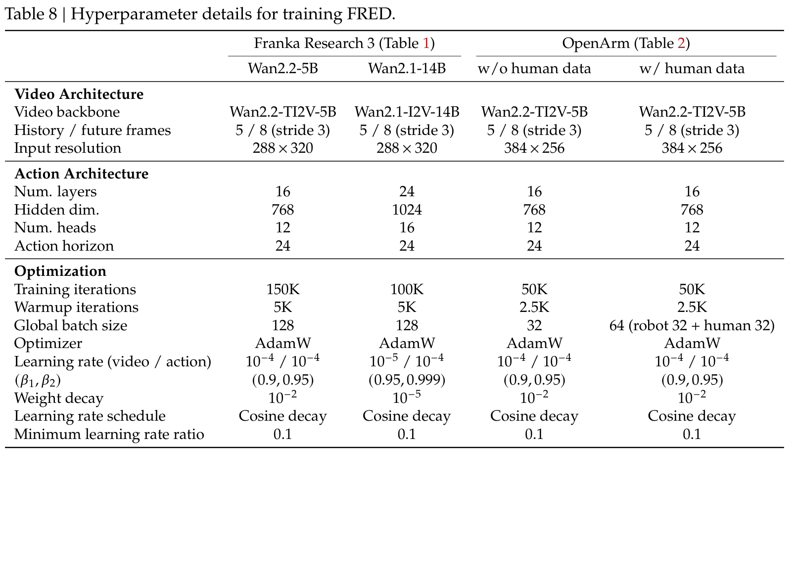

**Caption:** Table 8 | Hyperparameter details for training FRED across Franka Research 3 and OpenArm robot platforms under 5B and 14B configurations.

**Caption[CN]:** 表 8 | FRED 在 Franka Research 3 与 OpenArm 双臂人形机器人平台上，分别在 5B 与 14B 骨干规模下的全套训练与网络超参数细节汇总。

> <strong>Para. 36:</strong> Implementation Details for Simulation Experiments. For each simulation benchmark in Table 4, we train FRED with the same Wan2.2-TI2V-5B (Wan et al., 2025) backbone and 16-layer DiT action decoder for 100K iterations with a global batch size of 64. We use three concatenated views (two external and one wrist) at $384 \times 256$ for RoboCasa Kitchen (Nasiriany et al., 2024), one egocentric view at $256 \times 256$ for GR-1 Tabletop (Bjorck et al., 2025), and two concatenated views (one external and one wrist) at $256 \times 512$ for LIBERO (Liu et al., 2023). We fix the action prediction horizon at 16 across all benchmarks, and we normalize proprioceptive states and actions using min-max normalization for RoboCasa Kitchen and LIBERO, and Q01-Q99 normalization for GR-1 Tabletop. We condition the video model on 4 historical frames and the current frame, and predict 8 future frames, with a temporal stride of 2. All models are optimized with AdamW using cosine learning rate decay and a 5K iteration warmup. We set the peak learning rate to $10^{-4}$ for both the video model and action decoder, while the minimum learning rate is 1% of the peak across all benchmarks. For the remaining FRED-specific hyperparameters and training and inference details, we follow those used in the real-world experiments.

> <strong>Para. 36[CN]:</strong> 仿真基准实验实现细节。针对表 4 中的每一项仿真基准，我们均采用相同的 Wan2.2-TI2V-5B 视频底座搭配 16 层 DiT 动作解码器，在全局批大小 64 下训练 100K 迭代步。在视觉输入分辨率上：RoboCasa Kitchen 采用三个拼接视角（两路外置 + 一路手腕视角），分辨率为 $384 \times 256$；GR-1 Tabletop 采用单一第一视角，分辨率为 $256 \times 256$；LIBERO 采用双拼接视角（一路外置 + 一路手腕），分辨率为 $256 \times 512$。在所有基准上，动作块预测长度统一固定为 16 步；本体感知与动作值在 RoboCasa 与 LIBERO 上采用 Min-Max 极值归一化，在 GR-1 上采用 Q01-Q99 分位数归一化。视频扩散模型接收 4 帧历史与 1 帧当前观测，预测 8 帧未来画面，时序跨度设为 2。所有模型采用带有 5K 步预热的 AdamW 优化器与余弦退火，峰值学习率设为 $10^{-4}$，最小衰减至峰值的 1%。其余超参数与推理流程与真实世界实验完全一致。

### Table 9. PyTorch-like descriptions of image augmentations for FRED

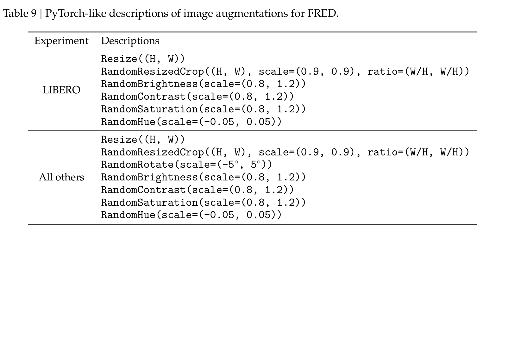

**Caption:** Table 9 | PyTorch-like descriptions of image augmentations for FRED in Franka Research 3, OpenArm, and simulation benchmarks.

**Caption[CN]:** 表 9 | FRED 在 Franka Research 3、OpenArm 以及仿真环境中所采用的 PyTorch 风格图像几何与光度数据增强流程规范。

## Appendix B: Benchmark Details | 附录 B：评测基准细节

### B.1. Zero-shot Environment Generalization Tasks on DROID | DROID 零样本环境泛化评测

> <strong>Para. 37:</strong> Hardware Setup. We evaluate models trained on DROID in a new environment without additional training on data from the evaluation environment. The evaluation setup differs from the training data in location, background, and objects, and includes tasks with instructions not present in DROID. We conduct these experiments using a Franka Research 3 robot arm equipped with a Robotiq 2F-85 gripper. For $\pi_{0.5}$ and GR00T N1.7, we follow the official implementations that use the wrist camera and the left exterior camera. The action space consists of relative joint angles (7D) and an absolute gripper opening (1D). For the remaining models, we use both the left and right exterior cameras. We show the hardware setup in Figure 5.

> <strong>Para. 37[CN]:</strong> 硬件设置。我们在一个全新的物理环境中对在 DROID 上训练的策略进行评测，全程不引入该新环境的任何数据进行额外微调。评测台架在实验室物理位置、桌面背景、光照以及具体摆放物体上与 DROID 训练集完全脱钩，并且涵盖了 DROID 中从未出现过的全新语言指令。实验硬件采用一台搭载 Robotiq 2F-85 双指平行夹爪的 7 自由度 Franka Research 3 协作机械臂。针对 $\pi_{0.5}$ 与 GR00T N1.7，我们遵循其官方接口标准，输入手腕相机与左侧外置相机画面；控制动作空间由 7 维相对关节角与 1 维绝对夹爪开合度构成（8D）。针对其余所有被测模型，我们使用左侧与右侧两路外置立体相机。硬件台架如图 5 所示。

### Figure 5. DROID evaluation setup

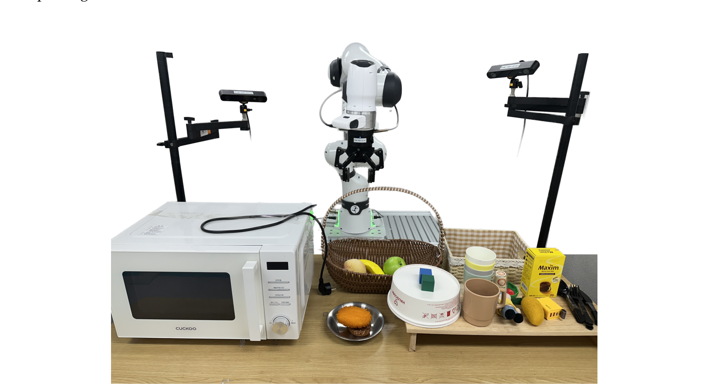

**Caption:** Figure 5 | DROID evaluation setup. The setup consists of a Franka Research 3 robot arm with a Robotiq 2F-85 gripper, a wrist camera, and left and right exterior cameras.

**Caption[CN]:** 图 5 | DROID 实机零样本泛化评测硬件台架。系统包含一台 Franka Research 3 机械臂、Robotiq 2F-85 夹爪、手腕相机以及左、右两侧外置工作空间监控相机。

> <strong>Para. 38:</strong> Evaluation Details. We evaluate four task sets: (a) in-domain easy tasks, (b) in-domain long-horizon tasks, (c) out-of-domain tasks, and (d) object grounding tasks. Each task is evaluated over 12 trials with diverse object positions and orientations. For in-domain long-horizon tasks, we report the task progress rate (%), which measures the fraction of successfully completed sub-tasks. For other tasks, we report the binary success rate (%). The task suite details are visualized in Figure 6.

> <strong>Para. 38[CN]:</strong> 评测任务细节。我们设置了四套极具代表性的任务集：(a) 域内简单任务（如抓取香蕉放入篮子、开关微波炉门、抓取积木）；(b) 域内长时程复合任务（清理杂乱桌面，要求按序完成多个物体的转移与归位）；(c) 域外动作任务（如揭开遮盖布、按压印章，动词在 DROID 中完全未见）；(d) 目标精准定位任务（在存在高度相似同类物体干扰下准确抓取特定杯子或刀叉）。每项任务均在物体位置、朝向随机扰动下进行 12 次独立实机测试。针对长时程任务，我们报告完成子阶段比例的任务进度百分比（%）；其余任务报告最终成功率（%）。全套评测任务场景详见图 6。

### Figure 6. DROID evaluation tasks

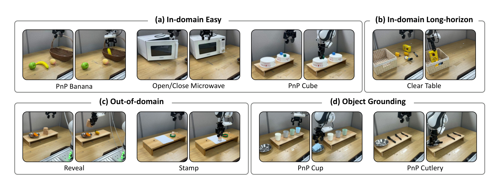

**Caption:** Figure 6 | DROID evaluation tasks. Task visualization for four task suites: (a) in-domain easy, (b) in-domain long-horizon, (c) out-of-domain, and (d) object grounding.

**Caption[CN]:** 图 6 | DROID 零样本泛化实物评测任务场景展示：(a) 域内简单任务；(b) 域内长时程复合任务；(c) 域外全新动作任务；(d) 多干扰目标精准定位任务。

### B.2. Human-robot Co-training on OpenArm | OpenArm 双臂人形人机协同训练

> <strong>Para. 39:</strong> Hardware Setup. We use the OpenArm humanoid robot, which consists of two 7-DoF arms and a 2-DoF neck equipped with a ZED 2i stereo camera. The action space is a 16-dimensional continuous vector representing relative joint angles for both arms and binary gripper commands. The setup is depicted in Figure 7.

> <strong>Para. 39[CN]:</strong> 硬件设置。我们在开源双臂人形机器人平台 OpenArm（https://openarm.dev/）上进行实验。该平台拥有两台 7 自由度机械臂以及一个搭载 ZED 2i 双目深度相机的 2 自由度头部颈部云台。控制动作空间为 16 维连续向量，分别对应双臂各 7 个关节的相对转角变化量以及双侧手爪的开合控制信号。物理硬件构造如图 7 所示。

### Figure 7. OpenArm evaluation setup

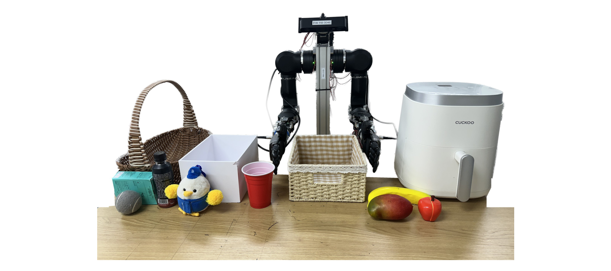

**Caption:** Figure 7 | OpenArm evaluation setup. It consists of the two 7-DoF OpenArm arms and a ZED 2i stereo camera mounted on the 2-DoF neck, together with the teleoperation system.

**Caption[CN]:** 图 7 | OpenArm 双臂人形机器人实机评测台架。由两台 7 自由度机械臂、安装于 2 自由度颈部的 ZED 2i 立体相机以及配套遥操作采集系统构成。

> <strong>Para. 40:</strong> Datasets and Skill Distributions. For robot demonstrations, we collect 553 teleoperated trajectories comprising diverse manipulation skills (Pick-and-place, open/close, move). For human co-training, we collect 1,187 egocentric human videos comprising 321K frames in multi-room kitchen and tabletop environments. Figure 8 and Figure 9 illustrate the distribution of manipulation skills and object categories in the robot and human datasets, respectively.

> <strong>Para. 40[CN]:</strong> 数据集与操作技能分布。针对机器人演示，我们使用遥操作采集了 553 条高质量双臂协同轨迹，涵盖抓取放置、开合容器以及物体搬运等多类基本技能。针对人机协同训练，我们在多种真实厨房与桌面环境中采集了 1,187 段自然第一视角人类操作视频，总计 32.1 万帧高帧率画面。图 8 与图 9 分别定量统计了机器人演示数据与人类视频数据集中的操作技能与目标物体类别分布直方图。

### Figure 8. Distribution of skills and object categories in the OpenArm robot dataset

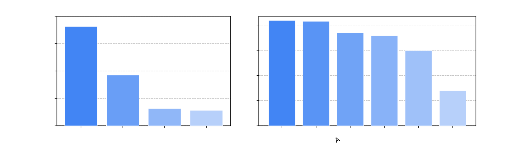

**Caption:** Figure 8 | Distribution of skills and object categories in the OpenArm robot dataset (553 teleoperated demonstrations).

**Caption[CN]:** 图 8 | OpenArm 机器人演示数据集（553 条双臂遥操作轨迹）中具体操作技能与涉及物体类别的分布统计。

### Figure 9. Distribution of skills and object categories in the human video dataset

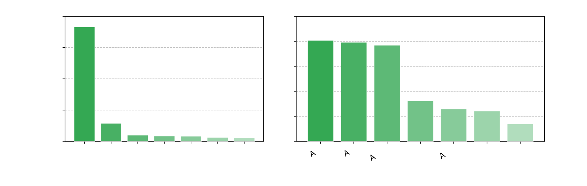

**Caption:** Figure 9 | Distribution of skills and object categories in the human video dataset (1,187 egocentric videos, 321K frames).

**Caption[CN]:** 图 9 | 人类自我中心第一视角视频数据集（1,187 段视频，32.1 万帧图像）中日常操作动作技能与物体类别的丰富分布统计。

> <strong>Para. 41:</strong> OpenArm Evaluation Tasks. We evaluate policies across 7 tasks categorized into: (a) In-domain atomic: Pick-and-place Banana, Open/Close Air Fryer, Pick-and-place Apple/Mango; (b) In-domain composite: Open Air Fryer and Place Apple; (c) Human skill transfer tasks: Place Bottle on Basket, Pick-and-place Novel Objects, Pour Coffee. Each task is tested over 12 trials. Task visual trajectories are presented in Figure 10.

> <strong>Para. 41[CN]:</strong> OpenArm 评测任务设计。我们设置了 7 项富有挑战性的实物双臂任务：(a) 域内原子任务：抓放香蕉、开关空气炸锅拉篮、双臂抓放苹果与芒果；(b) 域内复合任务：自主拉开空气炸锅并准确将苹果放入炸锅内；(c) 人类技能迁移任务：将水瓶精准立放于狭窄提篮内、抓取未见过的全新物体、以及难度极高的**双臂协同倒咖啡**。每项任务均独立运行 12 次。具体操作过程如图 10 所示。

### Figure 10. OpenArm evaluation tasks

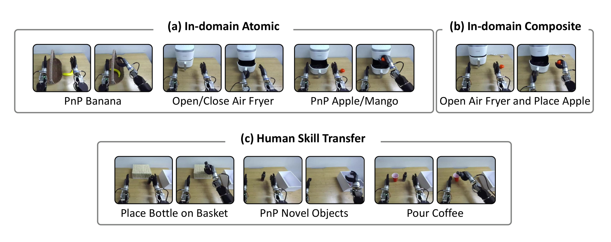

**Caption:** Figure 10 | OpenArm evaluation tasks visualization across (a) in-domain atomic, (b) in-domain composite, and (c) human skill transfer.

**Caption[CN]:** 图 10 | OpenArm 双臂人形机器人实机评测任务轨迹展开图：(a) 域内原子任务；(b) 域内长程复合任务；(c) 人类视频技能迁移任务。

## Appendix C: Baselines | 附录 C：基线模型详细说明

> <strong>Para. 42:</strong> We evaluate several state-of-the-art robot foundation models as baselines:
• $\pi_{0.5}$ (Black et al., 2025): A flow-matching vision-language-action foundation model pre-trained on open-x and real robot data.
• GR00T N1.7 (NVIDIA, 2026): A generalist humanoid robot policy based on multimodal transformer architectures.
• Fast-WAM (Yuan et al., 2026): An inference-efficient WAM that decouples video and action paths without explicit future generation at test time.
• DiT4DiT (Ma et al., 2026): A decoupled WAM architecture that conditions an action DiT on hidden states extracted from a single denoising forward pass of a video DiT.
• AGRA (Qiu et al., 2026): A representation-aligned WAM that introduces external representation alignment objectives.
• DreamZero (Ye et al., 2026): A unified world-action model that performs multi-step co-denoising of future video and actions within the same network backbone.

> <strong>Para. 42[CN]:</strong> 我们在实验中系统评测了多款代表性的前沿机器人基座模型：
• $\pi_{0.5}$（Black 等, 2025）：基于流匹配架构的大规模视觉-语言-动作（VLA）模型，在 Open-X 及海量实机轨迹上进行了充分预训练；
• GR00T N1.7（NVIDIA, 2026）：由 NVIDIA 研发的通用人形机器人操作基座模型，融合了先进的多模态 Transformer 策略；
• Fast-WAM（Yuan 等, 2026）：旨在降低推理开销的解耦式世界动作模型，在测试时不显式解码未来视觉画面；
• DiT4DiT（Ma 等, 2026）：采用双 DiT 解耦架构的高效 WAM，动作 DiT 以前向单步视频去噪生成的隐层状态为条件；
• AGRA（Qiu 等, 2026）：在 WAM 中引入外置表征对齐与特征重构损失的代表性工作；
• DreamZero（Ye 等, 2026）：在统一骨干中同时对未来视频帧与控制动作进行多步联合扩散去噪的统一样式世界动作模型。

## Appendix D: Analysis Setup Details | 附录 D：分析设置细节

> <strong>Para. 43:</strong> D.1. Attentive Probe. To assess whether intermediate representations contain predictive motion dynamics, we train an attentive probe consisting of cross-attention and transformer layers followed by a classification head. We partition manipulation trajectories into non-overlapping 16-frame clips and label each clip into one of 9 motion primitives: Forward, Down, Left, Right, Backward, Up, Stop, Clockwise rotation (CW), and Counter-clockwise rotation (CCW). The validation dataset distribution is presented in Table 10.

> <strong>Para. 43[CN]:</strong> D.1. 注意力探测器（Attentive Probe）。为了客观定量地检验网络中间隐藏表征中是否包含准确的未来运动物理动态，我们构建了一个基于交叉注意力与 Transformer 层的探测网络，后接多分类线性头。我们将机器人操作轨迹切分为互不重叠的 16 帧视频片段，并将每个片段根据末端主要运动趋势标注为 9 类预定义运动原语之一：向前移动、向下压/降、向左移、向右移、向后退、向上抬、静止停止、顺时针旋转（CW）与逆时针旋转（CCW）。验证集各原语分布见表 10。

### Table 10. Distribution of motion-primitive labels in the probing validation dataset

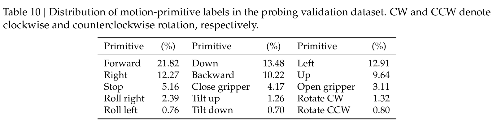

**Caption:** Table 10 | Distribution of motion-primitive labels in the probing validation dataset. CW and CCW denote clockwise and counterclockwise rotation, respectively.

**Caption[CN]:** 表 10 | 探测分析验证集中的 9 种运动原语标签分布统计（CW 与 CCW 分别代表末端执行器的顺时针与逆时针转动）。

> <strong>Para. 44:</strong> D.2. CKNNA. Centered Kernel Non-alignment measures the geometric discrepancy between representation spaces. Given representations $X, Y \in \mathbb{R}^{B \times D}$, Centered Kernel Alignment (CKA) computes $\operatorname{CKA}(K, L) = \frac{\operatorname{HSIC}(K, L)}{\sqrt{\operatorname{HSIC}(K, K) \operatorname{HSIC}(L, L)}}$, where $K = XX^T, L = YY^T$. CKNNA is defined as $1 - \operatorname{CKA}(K, L)$. Lower CKNNA indicates that the representation spaces share closer geometric structures.

> <strong>Para. 44[CN]:</strong> D.2. 中心化核非对齐度（CKNNA）。中心化核非对齐度用于严格度量不同表征空间之间的几何流形差异。给定两个特征矩阵 $X, Y \in \mathbb{R}^{B \times D}$，中心化核对齐度（CKA）定义为两核矩阵在希尔伯特-施密特独立性准则下的归一化内积：$\operatorname{CKA}(K, L) = \frac{\operatorname{HSIC}(K, L)}{\sqrt{\operatorname{HSIC}(K, K) \operatorname{HSIC}(L, L)}}$，其中 $K = XX^T, L = YY^T$。CKNNA 则定义为 $1 - \operatorname{CKA}(K, L)$。CKNNA 数值越小，表明两个隐空间的拓扑流形与结构几何越发趋于高度一致。

> <strong>Para. 45:</strong> D.3. Generated Video Quality and One-Step Distillation. We measure one-step video generation quality using Fréchet Video Distance (FVD; Unterthiner et al. 2018) and PSNR. As established in Figure 4, one-step visual fidelity correlates weakly with policy control, demonstrating that visual appearance does not directly equate to actionable future representations.

> <strong>Para. 45[CN]:</strong> D.3. 生成视频保真度与单步蒸馏。我们采用视频生成领域的标准指标弗雷歇视频距离（FVD；Unterthiner 等, 2018）与峰值信噪比（PSNR）来定量衡量单步去噪还原出的视频质量。正如图 4 所证实的，像素层面的感知保真度与机器人的最终控制成功率仅呈现微弱关联，这一重要实证有力地揭示了视觉像素的高保真度并不等价于富含因果控制信息的物理隐表征。

## Appendix E: Flow Matching Process in FRED | 附录 E：FRED 中的流匹配过程

> <strong>Para. 46:</strong> We formulate conditional flow matching (Lipman et al., 2022; Albergo et al., 2025) as the generative modeling backbone for both video and actions. Let $x$ denote a clean data target and $c$ denote conditions. A noisy trajectory $x_\tau$ is constructed by linear interpolation with Gaussian noise $\boldsymbol{\epsilon} \sim \mathcal{N}(0, \mathbf{I})$:
$$x_\tau = (1 - \tau) x + \tau \boldsymbol{\epsilon}, \quad \tau \in [0, 1] \qquad (5)$$
where $\tau = 0$ corresponds to clean data and $\tau = 1$ to pure noise. The velocity network $v_\theta(x_\tau, \tau \mid c)$ is trained to predict the vector field $\boldsymbol{\epsilon} - x$:
$$\mathcal{L}_{\text{FM}}(\theta) = \mathbb{E}_{(x, c), \boldsymbol{\epsilon}, \tau} \left[ \| v_\theta(x_\tau, \tau \mid c) - (\boldsymbol{\epsilon} - x) \|^2_2 \right] \qquad (6)$$
At inference, sample generation integrates the learned velocity field from $\tau = 1$ to $\tau = 0$. Using single-step Euler sampling with step size $\Delta \tau = 1$, the model predicts clean targets directly as $\hat{x}_0 = x_1 - v_\theta(x_1, 1 \mid c) = \boldsymbol{\epsilon} - v_\theta(\boldsymbol{\epsilon}, 1 \mid c)$. In FRED, student hidden states are extracted from the velocity network at $\tau = 1.0$ under noise input $\boldsymbol{\epsilon}$.

> <strong>Para. 46[CN]:</strong> 我们基于条件流匹配理论（Conditional Flow Matching；Lipman 等, 2022；Albergo 等, 2025）构建视频与动作的生成模型底座。设 $x$ 为真实干净样本（如未来视频潜变量或动作序列），$c$ 为上下文条件。加噪过渡样本 $x_\tau$ 由真实样本与纯高斯噪声 $\boldsymbol{\epsilon} \sim \mathcal{N}(0, \mathbf{I})$ 线性插值生成：
$$x_\tau = (1 - \tau) x + \tau \boldsymbol{\epsilon}, \quad \tau \in [0, 1] \qquad (5)$$
其中 $\tau = 0$ 对应完全干净的目标数据，$\tau = 1$ 对应完全纯净的高斯白噪声。速度网络 $v_\theta(x_\tau, \tau \mid c)$ 的训练目标是重构真实的速度向量场 $\boldsymbol{\epsilon} - x$：
$$\mathcal{L}_{\text{FM}}(\theta) = \mathbb{E}_{(x, c), \boldsymbol{\epsilon}, \tau} \left[ \| v_\theta(x_\tau, \tau \mid c) - (\boldsymbol{\epsilon} - x) \|^2_2 \right] \qquad (6)$$
在推理采样时，通过沿着学习到的速度矢量场从 $\tau = 1$ 数值积分至 $\tau = 0$。在单步欧拉采样（步长 $\Delta \tau = 1$）下，预测的去噪目标可直接解析求解为 $\hat{x}_0 = x_1 - v_\theta(x_1, 1 \mid c) = \boldsymbol{\epsilon} - v_\theta(\boldsymbol{\epsilon}, 1 \mid c)$。在 FRED 中，学生网络的未来隐层特征正是在 $\tau = 1.0$、以纯噪声 $\boldsymbol{\epsilon}$ 为输入的单次速度网络前向传播中被提取并供下游动作解码所使用。

## Appendix F: Limitations and Future Work | 附录 F：局限性与未来展望

> <strong>Para. 47:</strong> Limitations. A potential limitation of FRED is its reliance on the language understanding capabilities of the underlying video model. When instructions require complex spatial reasoning or subtle task descriptions beyond the video foundation model's training distribution, task execution can fail. Another limitation is that human-to-robot transfer remains challenging on tasks that demand millimeter-level precision or delicate physical contact dynamics (e.g., pouring without splashing), where human hand visual cues cannot fully bridge embodiment kinematics.
Future Work. Future directions include: (1) extending FRED from single-step future representation generation to long-horizon rolling latent world models; (2) integrating visual gaze or contact-point cues from human demonstrations to improve fine-grained contact dynamics; and (3) scaling self-distillation to unified multimodal foundation backbones that jointly handle vision, action, and language tokens.

> <strong>Para. 47[CN]:</strong> 局限性剖析。FRED 现存的一个潜在局限性在于其对底层视频大模型语言指令理解能力的继承依赖。当任务指令涉及极其精细的空间相对方位推理、或超出了预训练视频模型常识分布时，策略的高层意图推断可能出现偏差。另一项局限性体现在：在涉及毫米级极端精密接触或需要精细力反馈微调的物理交互任务中（例如控制杯子微小倾角倒水而不溅出），单纯凭借人类手部视觉演示仍难以彻底消除由于人手机械运动学不匹配带来的末端控制误差。
未来发展展望。未来富有前景的研究方向涵盖：(1) 将 FRED 的单步前向表征自蒸馏机制推广至长时程滚动潜在动力学循环（Rolling Latent Dynamics）与树状搜索规划；(2) 在人类视频中显式提取手部注视点（Gaze）与物理接触点引导，以进一步消解人机具身形态学差异；(3) 将自蒸馏目标拓展至原生多模态联合大模型（如统一同时处理视频、动作和语言 token 的通用架构），进一步释放世界模型的物理智能潜力。

## Appendix G: Full Benchmark Results | 附录 G：全量基准评测结果

### G.1. DROID | DROID 全量单任务结果

> <strong>Para. 48:</strong> Table 11 presents the full breakdown of results across all individual tasks on DROID under zero-shot environment generalization. FRED consistently outperforms competing models across in-domain, long-horizon, out-of-domain, and object grounding tasks at both 5B and 14B model scales.

> <strong>Para. 48[CN]:</strong> 表 11 完整列出了 DROID 实机新环境零样本泛化中所有单项评测任务的细分表现。无论是在 5B 还是 14B 模型规模下，FRED 在域内基础操作、多阶段长程复合任务、域外陌生动词任务以及带强干扰物的物体精确定位中均全线保持显著领先。

### Table 11. Per-task results on zero-shot generalization to a new real-world environment

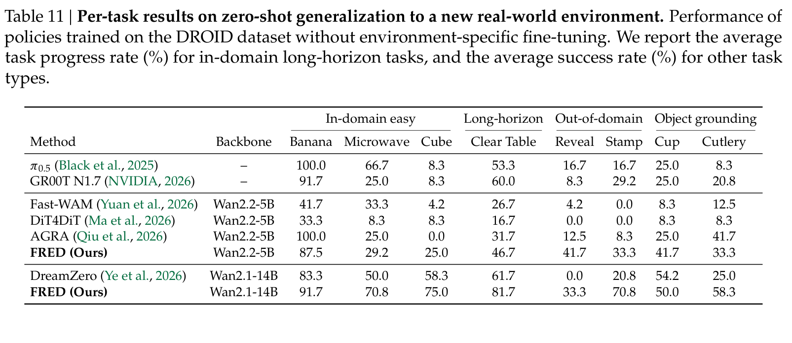

**Caption:** Table 11 | Per-task results on zero-shot generalization to a new real-world environment (DROID, Franka Research 3). Task progress (%) is reported for Clear Table; success rate (%) is reported for all other tasks.

**Caption[CN]:** 表 11 | 真实世界新环境下 DROID 各单项任务的零样本泛化细分结果全表。针对长时程任务“清理桌面（Clear Table）”报告任务完成进度百分比（%），其余所有任务均报告平均成功率（%）。

### G.2. OpenArm | OpenArm 全量单任务结果

> <strong>Para. 49:</strong> Table 12 presents the full per-task results on the OpenArm humanoid robot. Co-training with human videos allows FRED to achieve unprecedented success on human skill transfer tasks (e.g., 66.7% on novel objects, 58.3% on pour coffee, and 100.0% instruction following rate).

> <strong>Para. 49[CN]:</strong> 表 12 完整汇总了 OpenArm 双臂人形机器人在域内与人机协同训练下的各项任务细化指标。数据表明，引入人类视频协同训练使 FRED 在前所未见的人类技能迁移任务上斩获了突破性的高成功率（如未见新物体抓放达 66.7%、倒咖啡达 58.3%，且多项任务指令遵循率达到完美的 100.0%）。

### Table 12. Per-task results on humanoid control with and without human-robot co-training

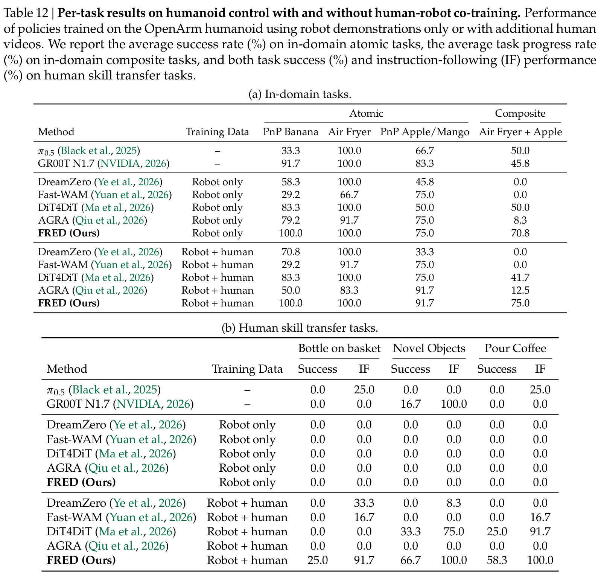

**Caption:** Table 12 | Per-task results on humanoid control with and without human-robot co-training (OpenArm). Success rates (%) and instruction-following (IF) scores (%) are reported across 7 tasks.

**Caption[CN]:** 表 12 | OpenArm 双臂人形机器人在是否包含人类视频协同训练下的各单项任务评测细分全表。表中详细报告了 7 大任务的最终成功率（%）以及高层指令遵循率（IF，%）。

## Appendix H: Additional Simulation Benchmark Results | 附录 H：扩展仿真基准结果

> <strong>Para. 50:</strong> To further verify the effectiveness of FRED, Table 13 compares FRED with state-of-the-art robot foundation models on the RoboCasa Kitchen benchmark with scaled-up batch size (256) and training iterations (100K). FRED achieves the highest average success rate of 75.4%, surpassing leading models including RLDX-1 (70.6%), GR00T N1.7 (70.8%), Xiaomi-Robotics-1 (74.5%), Video Policy (66.0%), and Cosmos Policy (67.1%).

> <strong>Para. 50[CN]:</strong> 为了进一步确证 FRED 在充足计算资源下的规模化扩展潜力，表 13 将 FRED 与当前最具代表性的具身机器人基座大模型在权威的 RoboCasa Kitchen 仿真基准上进行了高规格横向比对（采用 256 全局批大小与 100K 训练步）。实验证实：FRED 取得了 75.4% 的全场最高成功率，全面超越了国内外顶尖模型，包括 RLDX-1（70.6%）、GR00T N1.7（70.8%）、小米机器人基座 Xiaomi-Robotics-1（74.5%）、Video Policy（66.0%）以及 Cosmos Policy（67.1%）。这充分展示了 FRED 作为通用表征增强范式的卓越性能上限与广泛扩展价值。

### Table 13. Results on RoboCasa Kitchen benchmark

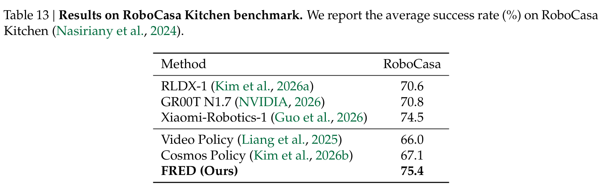

**Caption:** Table 13 | Results on RoboCasa Kitchen benchmark. We report the average success rate (%) on RoboCasa Kitchen (Nasiriany et al., 2024).

**Caption[CN]:** 表 13 | 在 RoboCasa Kitchen 仿真基准上与国内外前沿具身机器人基座模型的横向评测结果。表中报告平均控制成功率（%）。

## Critical Reading Notes | 批判性精读笔记与核心洞察

> [!IMPORTANT]
> **核心立论与学术贡献的本质：**
> 1. **对解耦式世界动作模型（WAM）的深刻理论重塑：** 过去的研究将 WAM 简单看作“视频生成”与“动作去噪”的机械拼接，导致研究重心过度倾斜于像素保真度（FVD/PSNR）。FRED 敏锐地指出，在单步去噪的低延迟部署范式下，VDM 的本质是**动作解码器的隐空间未来表征生成器**。
> 2. **精准击中“噪声前向表征劣化”的病灶：** 现有解耦 WAM 在全时间步随机加噪训练，但在测试时直接以纯高斯噪声 $\boldsymbol{\epsilon} (\tau=1.0)$ 进行单步前向提取特征，导致隐空间表征与真实未来动力学严重失配（图 1）。FRED 通过动量教师自蒸馏，迫使模型在单步去噪下将噪声映射为与真实未来中度加噪观测一致的流形结构，从根源上治愈了表征退化。
> 3. **打破“生成像素越逼真、控制越好”的直觉误区：** 图 4 提供了极具说服力的经验证据：单步生成视频的像素感知指标 FVD 与下游操作成功率的相关性仅为 $r=0.24$，而隐空间未来运动原语探测准确率与控制成功率的相关性高达 $r=0.89$。这警示具身智能领域：**做世界模型切忌盲目追求像素级高清渲染，而应将算力聚焦于因果物理表征的对齐**。
> 4. **梯度阻断（Stop-gradient）的深层物理意义：** 表 5d 证明阻断动作损失向视频骨干的反向传播能带来 +3.2% 的增益。这表明底层电机控制信号具有强烈的特定任务与特定本体偏置，直接端到端回传会破坏预训练视频模型宝贵的通用物理时空先验；让视频大模型专注于自蒸馏动力学演化，才是保持强大零样本泛化能力的关键法则。
