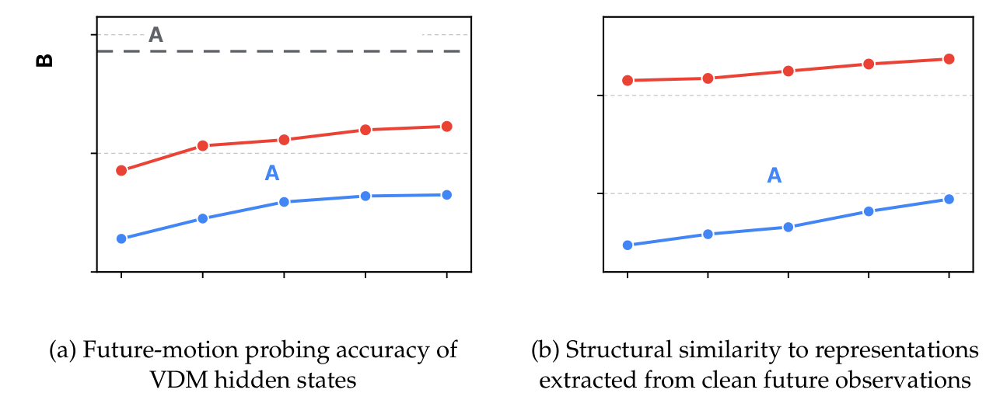
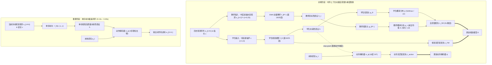
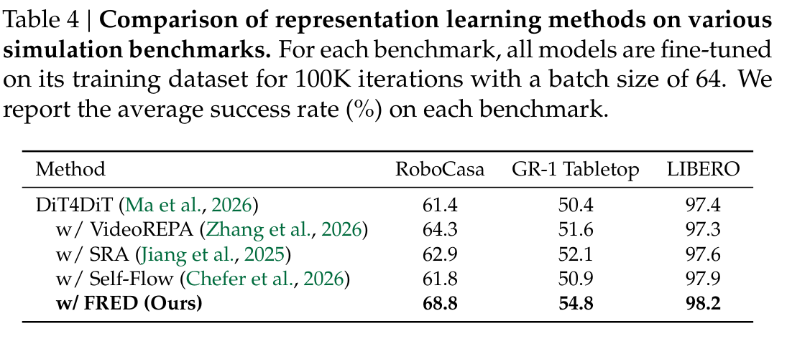
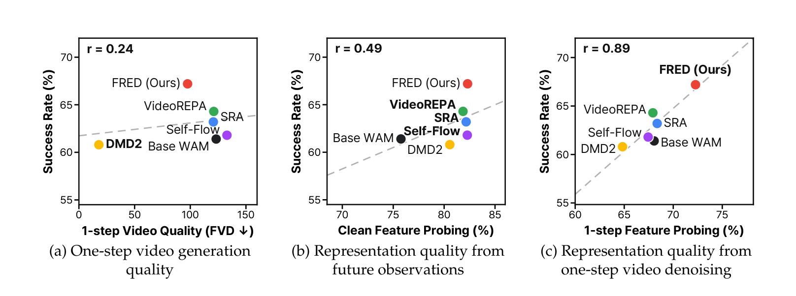
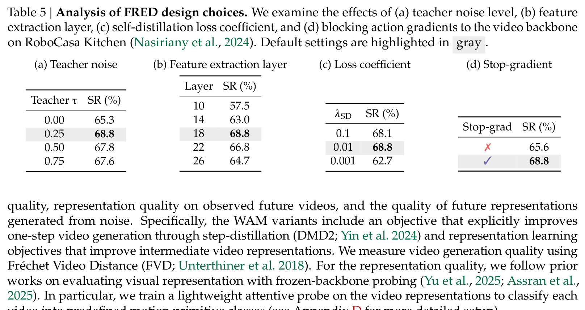

---
tags:
  - papers/embodied-ai
  - papers/world-action-model
  - papers/video-diffusion
  - papers/robot-manipulation
  - papers/representation-learning
aliases:
  - FRED
  - Self-Distilling WAM
  - Future Representation Learning via Self-Distillation
date: 2026-10-21
doi: 10.48550/arxiv.2610.30320
arxiv_id: 2610.30320
---

# Self-Distilling Future Video Representations for World Action Models
# 面向世界动作模型的未来视频表征自蒸馏学习

## 核心信息
- **标题 (Title):** Self-Distilling Future Video Representations for World Action Models
- **标题中文翻译:** 面向世界动作模型的未来视频表征自蒸馏学习
- **作者 (Authors):** Huiwon Jang$^{1,2*}$, Suhyeok Jang$^{1,2*}$, Hyeonmo Kang$^1$, Seungku Kim$^1$, Jinwoo Shin$^{1,2}$, Sihyun Yu$^1$ ($^*$同等贡献)
- **机构 (Affiliations):** $^1$KAIST（韩国科学技术院）；$^2$RLWRLD Inc.
- **发表时间:** 2026-10-21（arXiv:2610.30320v1 [cs.RO]）
- **发表渠道:** arXiv pre-print (Robotics / Computer Vision)
- **DOI / arXiv:** [arXiv:2610.30320](https://arxiv.org/abs/2610.30320)
- **论文链接:** [https://arxiv.org/abs/2610.30320](https://arxiv.org/abs/2610.30320)
- **项目主页:** [https://huiwon-jang.github.io/FRED/](https://huiwon-jang.github.io/FRED/)
- **开源代码:** [https://github.com/suhyeok-jang/FRED/](https://github.com/suhyeok-jang/FRED/)
- **模型权重:** [https://huggingface.co/FRED-AGI-LAB/models](https://huggingface.co/FRED-AGI-LAB/models)
- **数据与基准:** 真实世界 DROID 数据集（Franka Research 3 机械臂，新环境零样本泛化）；OpenArm 双臂人形机器人（553 条遥操作演示 + 1,187 段自我中心人类视频）；仿真基准 RoboCasa Kitchen、GR-1 Tabletop、LIBERO。
- **论文类型:** 具身世界动作模型（World Action Models, WAMs）表征学习与策略生成方法论文。

---

## 原文摘要翻译
世界动作模型（World Action Models, WAMs）利用来自预训练视频扩散模型的丰富时空先验，已成为学习通用机器人策略的一种极具前景的方法。最近的一系列 WAMs 通过将独立的动作解码器建立在单步去噪提取的中间层未来视频表征之上，大幅提升了推理效率，避免了视频生成所需的昂贵迭代去噪过程。这一设计使得动作预测直接依赖于这些未来表征的质量。

在本文中，我们提出了基于时序上下文自蒸馏的未来表征学习框架（Future REpresentation learning via self-Distillation with temporal context, FRED），该框架通过训练 WAMs，使其在单步去噪中直接从纯噪声生成更高质量的未来视频表征。具体而言，FRED 采用自蒸馏机制，以从真实未来观测中提取的表征为目标，监督模型从纯噪声中预测未来表征。我们进一步将视频模型建立在历史观测之上，为更精准地预测未来表征提供时序上下文。在多样化的真实世界操作场景中，FRED 持续显著超越竞争基线 WAMs。它在零样本环境泛化下的长时程与域外任务中取得了尤为显著的提升，并极大改善了人类到机器人的技能迁移能力：在机器人训练数据中完全缺失、仅在人类视频中演示的任务上，FRED 取得了 50.0% 的任务成功率，而最佳竞争 WAM 仅为 19.4%。

---

## 创新点
1. **重新诠释解耦 WAM 中 VDM 的角色，直击“噪声输入表征退化”的本质顽疾：** 论文首次指出，在单步去噪前向的解耦 WAM 体系中，VDM 的本质不是“视频像素渲染器”，而是为动作解码器提供隐空间指导的“未来表征生成器”。实证发现：标准流匹配训练只能改善给定真实未来帧时的特征，而在推理期直接以纯高斯噪声 $\boldsymbol{\epsilon} (\tau=1.0)$ 进行单步前向传递时，中间隐藏状态的未来运动预测精度和结构相似度出现严重劣化。
2. **动量教师 Patch 级自蒸馏机制（Momentum Self-Distillation）：** 提出利用 EMA 动量更新的教师网络接收中等加噪未来帧（$\tau=0.25$）提取高质量目标表征，通过带有 Logits 中心化与锐化温度调控的 Patch 级 KL 散度损失，显式约束学生网络在单步去噪中直接从纯噪声中重构出物理一致的未来动力学特征，从根源上治愈了单步表征崩溃。
3. **短程时序历史观测注入与动作梯度阻断法则（Stop-gradient）：** 
   - 引入长度为 $H=4$ 的时序历史观测序列，赋予模型捕捉末端执行器当前速度与运动惯性的能力，消除了单帧预测未来的物理多义性；
   - 严格阻断动作流匹配损失回传至视频骨干网络，避免了特定下游电机动作对通用时空视频先验的过拟合与特征污染（消融证实梯度阻断使成功率从 65.6% 提升至 68.8%）。
4. **突破性的真实世界物理零样本泛化与跨形态人类技能迁移：** 在未经过任何微调的物理新实验室台架（DROID）上，FRED-14B 综合成功率达 69.8%（超越 DreamZero-14B 达 17.7%），长时程任务达 81.7%；在仅包含人类第一视角视频、无任何机器人演示的全新操作任务上，FRED 在 OpenArm 双臂人形机器人上实现了 50.0% 的零样本物理成功率（强基线最高仅 19.4%）。

---

## 一句话总结
FRED 将高效世界动作模型（WAM）的核心矛盾从“像素生成速度”转变为“单步噪声表征质量”，通过动量教师自蒸馏与时序上下文约束，使视频骨干网络在单次前向去噪中即可从纯噪声生成富含未来物理动力学的优质隐表征，以极低的推理开销（14B 模型仅 0.4s）实现了真实世界零样本环境泛化与无演示人类技能迁移的大幅度突破。

---

## 研究问题
### 问题意识与范式演进
在具身机器人学习领域，传统的视觉-语言-动作模型（VLAs，如 $\pi_{0.5}$、OpenVLA）本质上是反应式（Reactive）策略，将当前观测直接映射为动作，难以建模长时程物理交互对未来世界状态造成的因果演变。世界动作模型（World Action Models, WAMs）通过引入大规模预训练视频扩散模型（VDMs），旨在将互联网级物理常识与时空演化先验迁移至底层控制。然而，现有 WAMs 面临两难抉择：
1. **显式级联/统一样式 WAMs（如 DreamZero、Video-Policy）：** 在控制回路中通过多步迭代去噪解码完整的未来视频，再利用逆动力学模型（IDM）或协同去噪生成动作。这类方法能够“看到”未来，但单次动作决策需要 3~5 秒以上，根本无法满足机器人闭环控制的实时性要求（通常需 $\ge 5$ Hz）；
2. **解耦单步前向 WAMs（如 DiT4DiT、Fast-WAM、AGRA）：** 为了降低延迟，这些方法在测试时仅输入高斯噪声 $\boldsymbol{\epsilon} \sim \mathcal{N}(0, \mathbf{I})$，通过 VDM 的单步前向推理提取中间隐藏层特征 $h$，并直接以此特征条件指导轻量级动作解码器。这一设计将推理延迟压缩至 0.1~0.4 秒以内。


*图 1：VDM 在 WAM 训练期间的表征动态演化。(a) 基于注意力探测器（Attentive Probe）的未来运动原语分类准确率；(b) 纯噪声生成表征（$\tau=1.0$）与真实干净未来表征（$\tau=0.0$）之间的中心化核非对齐度（CKNNA）。标准训练下噪声特征始终贫乏且几何结构严重失配，而 FRED 显著提升了单步特征质量。*

### 核心科学矛盾：单步去噪的表征失配悖论
作者敏锐地发现了现有解耦 WAM 体系中隐藏的致命矛盾：
- **训练分布与推理需求割裂：** 标准 VDM 采用全时间步连续流匹配损失 $\mathcal{L}_{\text{FM}}$ 训练速度场 $v_\theta(x_\tau, \tau \mid c)$。模型在训练时习惯于处理各个加噪阶段的样本；但在实际部署控制时，动作解码器必须且只能在 $\tau = 1.0$（即完全无图像信息的纯高斯白噪声）下提取中间特征 $h$。
- **探测分析证伪：** 作者在网络隐层上搭建了注意力探测器（Attentive Probe，用于分类 9 类未来运动原语，见表 10），并测算了 CKNNA 几何距离。实证结果令人震惊：**随着训练步数的推进，模型虽然能从干净未来图像（$\tau=0.0$）中提取高质量动态，但直接从纯噪声（$\tau=1.0$）生成的中间特征其探测准确率极低，且与真实未来特征的流形拓扑呈现严重的几何非对齐**。
- **这表明：标准 WAM 根本没有教会模型如何在单步去噪下从纯噪声合成有效的未来表征！动作解码器实际上在依赖退化、嘈杂的伪特征做决策。**

---

## 数据与任务定义
### 输入输出与控制协议
- **视觉与状态观测：** 包含多视角视频画面（外置立体双摄与手腕相机）以及机器人当前本体感知状态向量 $q_t$（7 维或 14 维关节角度与夹爪开合状态）。
- **语言指令：** 自然语言任务提示 $c$（例如“Place banana into the basket”）。
- **动作表征：** 采用动作分块机制（Action Chunking），单次前向输出未来连续时序动作块 $\hat{a}_{t:t+L}$。在实机 Franka 上动作维度为 8D（7D 相对关节角速度 + 1D 绝对夹爪），预测时域 $L=24$；在 OpenArm 人形机器人上动作维度为 16D（双臂各 7D 关节角 + 双侧手爪），预测时域 $L=24$；在仿真环境中 $L=16$。
- **视觉时序窗口：** 视频扩散骨干接收 4 帧历史观测 + 1 帧当前观测（共 5 帧图像序列），下采样预测跨度 stride=3（或仿真中 stride=2）。


*图 3：评测台架与实验流程示意图。(a) DROID 真实世界新环境零样本泛化设定；(b) OpenArm 双臂人形机器人人机协同训练与技能迁移设定。*

### 评测场景与基准规范
1. **DROID 真实世界零样本环境泛化（Franka Research 3）：**
   - 训练数据：来自 DROID 76K 轨迹的大规模具身遥操作演示。
   - 测试环境：完全不同物理房间、新工作台背景、不同光照，且操作物体具有全新外观几何（见图 5 硬件台架与图 6 任务展示）。
   - 四套任务套件：域内简单（抓香蕉、微波炉开关、抓积木）、域内长时程复合（桌面杂乱多物体清理）、域外新动作（揭开遮盖布、盖印章）、多干扰精确定位（相似颜色杯子与刀叉）。
2. **OpenArm 双臂人形机器人协同训练（16 自由度双臂 + 头颈云台）：**
   - 机器人数据集：553 条实机遥操作示范轨迹，涵盖 4 类核心操作技能（移动、抓放、开合容器，见图 8）。
   - 人类第一视角数据集：1,187 段、共计 32.1 万帧日常生活自我中心视频，涵盖 7 类技能（额外包含倾倒、翻转、双臂联动等，见图 9）。
   - 评测任务：7 项高难度物理任务（图 10），涵盖域内原子、域内复合（炸锅开盖并放入苹果）以及**人类技能迁移任务（将细长水瓶立放于篮内、操作未见新物体、双臂协同倒咖啡）**。
3. **三大仿真基准：**
   - RoboCasa Kitchen（复杂的家庭厨房日常长程任务）；
   - GR-1 Tabletop（人形机器人桌面操作）；
   - LIBERO（经典的少样本与持续操作基准）。

---

## 方法主线
### 机制流程
FRED 的整体运行与推断机制严格解耦，包含训练期的**表征强化**与部署期的**高效前向决策**两大阶段：




*图 2：FRED 框架详细结构展开图。展示学生分支、EMA 教师分支、Patch-wise 投影头与防塌陷机制、以及以 stop-grad 与动作解码器连接的数据流。*

### FRED 架构与核心自蒸馏目标
1. **学生网络与教师网络输入设计：**
   - 学生模型 $f_\theta$ 接收纯高斯白噪声 $\boldsymbol{\epsilon} \sim \mathcal{N}(0, \mathbf{I})$、历史观测序列 $o_{t-H:t}$ 以及语言嵌入 $c$：
     $$h = f_\theta(\boldsymbol{\epsilon} \mid o_{t-H:t}, c)$$
   - 教师模型 $f_{\theta^-}$ 接收受到适度噪声扰动的真实未来观测 $o_{t+1}^\tau = (1-\tau)o_{t+1} + \tau \boldsymbol{\epsilon}$（默认 $\tau=0.25$），从相同深度网络层提取目标特征：
     $$h_\tau = f_{\theta^-}(o_{t+1}^\tau \mid o_{t-H:t}, c)$$
   - 教师网络参数 $\theta^-$ 采用指数移动平均（EMA）从学生网络平滑更新：$\theta^- \leftarrow m \theta^- + (1-m) \theta$。
2. **Patch 级别自蒸馏与防塌陷设计（Centering & Sharpening）：**
   - 隐表征经过基于 Patch 维度的轻量级投影头 $g_\theta$ 与 $g_{\theta^-}$ 映射至特征空间。
   - 学生分布采用温度系数 $\gamma_1 = 0.1$ 归一化；教师分布减去滑动均值 $m$（中心化）并施加更小的锐化温度 $\gamma_2 = 0.04$（$\gamma_2 < \gamma_1$），防止由于自蒸馏缺乏负样本而出现表征单一崩溃：
     $$p = \operatorname{softmax}(g_\theta(h)/\gamma_1) \quad \text{且} \quad p_\tau = \operatorname{softmax}((g_{\theta^-}(h_\tau) - m)/\gamma_2)$$
   - 最小化所有图像 Patch 上的 KL 散度：
     $$\mathcal{L}_{\text{SD}}(\theta) = \frac{1}{N} \sum_{i=1}^N \operatorname{KL}(p_{\tau, i} \parallel p_i)$$
3. **时序观测上下文注入：**
   - 克服传统 WAM 仅凭单帧推测未来的严重多义性，通过滑动窗口输入最近 4 帧历史画面，使注意力机制自发提取机器人末端的运动微分量，为预测未来动态提供先决物理上下文。
4. **动作解码协同与梯度截断法则（Stop-gradient）：**
   - 动作解码器 $\pi_\phi$ 建立在学生提取的隐状态 $h$ 之上。
   - **总体联合训练目标：**
     $$\mathcal{L}_{\text{video}}(\theta) = \mathcal{L}_{\text{FM}}(\theta) + \lambda_{\text{SD}} \mathcal{L}_{\text{SD}}(\theta) \quad \text{且} \quad \mathcal{L}_{\text{action}}(\phi) = \mathcal{L}_{\text{FM}}(\phi)$$
   - 在计算 $\mathcal{L}_{\text{action}}(\phi)$ 时，**对送入动作解码器的未来表征 $h$ 施加截断操作（`h.detach()`）**。视频模型骨干 $\theta$ 纯粹由视频物理去噪与自蒸馏损失主导，动作解码器则专注于将时空特征映射为电机控制信号。

---

## 关键结果
### 真实世界零样本环境泛化（DROID，Franka 机械臂）
在表 1 与表 11 中，策略在完全陌生的实验环境中接受评测，不进行针对该环境的任何微调：


*表 1：DROID 实机零样本环境泛化主表（涵盖 5B 与 14B 参数尺度）。*

- **5B 规模横向对比：**
  - FRED-5B 在四大类任务中均展现出压倒性优势：域内简单 **47.2%**（AGRA 41.7%、DiT4DiT 16.7%）；长时程任务进度 **46.7%**（AGRA 31.7%、Fast-WAM 26.7%）；域外全新动词任务 **37.5%**（AGRA 10.4%、DiT4DiT 0.0%）；目标定位 **37.5%**。
  - 相比同体量的纯 VLA 模型（$\pi_{0.5}$ 综合 36.1%，GR00T N1.7 综合 34.0%），FRED-5B 在长时程与域外动作上优势极为突出。
- **14B 规模规模化扩展：**
  - FRED-14B 综合成绩飙升至 **69.8%**（表 11），在四大任务上分别斩获 **79.2%**、**81.7%**、**52.1%**、**54.2%**。
  - 全面碾压同规模但采用多步视频去噪采样的 DreamZero-14B（综合仅 52.1%，长时程 61.7%，域外新动词仅 20.8%）。
  - **推理延迟对比（表 7）：** FRED-14B 耗时仅 **0.406s**，而 DreamZero-14B 耗时高达 **3.255s**，FRED 实现了 **8 倍的推理加速**，且控制精度高出 17.7 个百分点！


*表 7：NVIDIA A100 GPU 上的实机单次决策推理时延与计算开销实测。*

### 人机协同训练与人类技能迁移（OpenArm 双臂人形机器人）
在表 2 与表 12 中，策略在包含 7 项任务的双臂人形机器人上接受评测：


*表 2：OpenArm 双臂人形机器人域内与人类技能迁移评测主表。*

- **域内任务提升（表 2a）：** 
  - 纯机器人遥操作数据下，FRED 原子任务达 91.7%，复合任务达 70.8%（基线 DiT4DiT 分别为 77.8% 和 50.0%）；
  - 引入人类视频后，进一步攀升至原子 **97.2%**、复合 **75.0%**。
- **无演示人类技能迁移奇迹（表 2b）：**
  - 在从未见过的全新任务上（如倒咖啡、放篮子），所有不加人类视频的模型全部得 0 分；
  - 引入人类视频后，FRED 实现了震撼的 **50.0% 最终成功率** 与 **97.2% 的指令遵循率**；
  - 对比强基线：DiT4DiT 仅为 19.4%（指令遵循 55.6%），Fast-WAM 为 0.0%，DreamZero 为 0.0%，GR00T N1.7 仅为 5.6%。
  - 单任务细分（表 12）：在操作未见物体上达 66.7%，在极度考验双臂协调的**倒咖啡任务上达到 58.3% 成功率与 100.0% 指令遵循率**！

### 核心组件消融分析（RoboCasa Kitchen）
在表 3 中，作者在严格控制变量下拆解了 FRED 的两大基石：


*表 3：RoboCasa Kitchen 仿真基准上的组件消融。*

- 基准单步 WAM（DiT4DiT）：61.4%
- 单独增加时序历史上下文（$H=4$）：64.6%（净提升 +3.2%）
- 单独增加自蒸馏机制（$\mathcal{L}_{\text{SD}}$）：65.6%（净提升 +4.2%）
- 二者有机结合（FRED 完整版）：**68.8%**（累计净提升 +7.4%）
- 结论：时序观测提供物理运动线索，自蒸馏提供流形收敛目标，二者产生深度互补的叠加效应。

### 表征学习方案横向对比
在表 4 中，作者在三大仿真基准上严格横向比对了不同表征增强范式：


*表 4：仿真基准上多种表征学习方法对比。*

- FRED 在 RoboCasa Kitchen（68.8% vs 63.8%）、GR-1 Tabletop（88.0% vs 83.2%）、LIBERO（98.2% vs 95.8%）上均大幅超越基于 DINOv2 的特征蒸馏与 IDM 逆动力学监督。这证明从预训练静态视觉编码器蒸馏语义、或强行拟合局部帧差动作，均无法匹敌直接让视频模型学会生成未来物理动力学特征。

---

## 深度分析
### 真正贡献是什么：重塑 WAM 的第一性原理
具身世界模型领域长久以来被“视频生成社区”的审美惯性所误导：很多人潜意识里认为“如果生成不出高帧率、毛发毕现的高清未来视频，世界模型就无法指导控制”。这导致大量工作在测试时耗费数秒去迭代去噪像素，使机器人控制变得迟钝、卡顿、难以部署。
**FRED 的真正贡献在于：它用极其严谨的实证与理论，宣告了“生成像素高清视频”对于机器人动作控制不是必需的，真正决定控制成败的是“隐空间中单步可抽取的未来物理表征质量”**。FRED 首次成功打通了从“纯高斯噪声”直接一步映射到“高质量物理流形特征”的自蒸馏捷径，从而以 0.1~0.4s 的极限延迟，释放了 14B 视频大模型的宏大物理先验。


*图 4：核心发现散点图。(a) 视频生成像素感知 FVD 与任务控制成功率仅呈微弱关联 ($r=0.24$)；(b) 干净未来特征探测与控制呈中等关联 ($r=0.49$)；(c) 单步纯噪声生成的未来表征探测质量与控制表现呈高度显著强正相关 ($r=0.89$)。*

### 为什么结果成立：三重物理与流形协同机制
1. **时序观测注入消除预测多义性：** 单张静态图像无法判断物体是在被拿走还是被放下。输入 4 帧历史窗口使 Transformer 的自注意力头能够计算时间维度的有限差分，直接捕获物体与机械臂的速度场与动量；
2. **动量教师提供稳定的物理流形引力源：** 教师网络从真实未来的真实视觉中提取特征，具备天然的物理因果正确性。通过 EMA 平滑更新与 Logits 中心化锐化，教师为学生提供了一个永不崩溃、持续演进的高维表征引力场，引导学生从随机噪声中直接“跳变”至正确的流形位置；
3. **梯度阻断维系物理先验纯洁性：** 动作流匹配损失受到机械臂特定关节布局与数据采集偏置的强约束。阻止动作梯度修改视频大模型参数，使视频模型保持了作为“客观物理演化观察者”的超然地位，从而保留了强大的开箱即用泛化能力。

### 容易误读的地方
- **误读 1：以为视频生成指标（FVD/PSNR）越好，下游机器人控制就越好。**
  - **澄清：** 图 4a 彻底打破了这一神话。FVD 与控制成功率的相关系数仅为 $r=0.24$。过度追求单步像素去噪往往会让模型把宝贵容量浪费在静态背景纹理、高频光影反射等非因果细节上；而衡量未来运动走向的探测指标与控制成功率的相关性高达 $r=0.89$。做世界模型必须分清“渲染”与“动力学”。
- **误读 2：以为自蒸馏的教师输入越干净越好（$\tau=0.0$）。**
  - **澄清：** 表 5a 明确证实，输入完全干净的未来帧（$\tau=0.0$）时成功率仅为 65.3%，而引入适度噪声 $\tau=0.25$ 时达到最高的 68.8%。因为轻度加噪打破了像素过拟合，迫使教师网络在隐层中抽取出更高阶、更平滑的语义与几何骨架，为学生提供了容错度更优的蒸馏目标。
- **误读 3：以为端到端（End-to-End）全网络联合反向传播性能最高。**
  - **澄清：** 表 5d 证实，允许动作损失更新视频骨干反而导致成功率从 68.8% 滑落至 65.6%。具身控制领域盲目推崇的“端到端联合微调”，在跨尺度基础模型上往往会导致灾难性表征退化。
- **误读 4：以为自蒸馏只是为了模型轻量化/小模型压缩。**
  - **澄清：** FRED 中的自蒸馏并非 Teacher-Student 异构压缩，而是**同模型内部不同输入路径之间的表征对齐**（学生接收噪声，教师接收未来数据），其核心功用在于跨域流形映射。


*表 5：FRED 架构设计选择消融表（涵盖教师噪声、网络层、损失权重与动作梯度阻断）。*

### 复现注意点与工程开销
1. **显存峰值与梯度开销：** 尽管教师模型不需要计算梯度（`eval` 模式），但 5B/14B 尺度模型在训练时同时前向学生和教师分支会带来显著的显存压力。推荐采用 FlashAttention-2 / SDPA、激活重计算（Activation Checkpointing）以及混合精度（BF16）。
2. **特征层提取深度：** 表 5b 揭示，提取层过浅（如第 6 层 59.8%）缺乏深层语义与物理因果；过深（如第 24 层 61.4%）则过度逼近原始流匹配输出头，丢失了空间几何拓扑。Wan2.2-5B 必须锁定在第 19 层（索引 18），Wan2.1-14B 必须锁定在第 25 层。
3. **学习率分层匹配：** 训练 14B 模型时，视频主干的学习率必须压低至 $10^{-5}$（DreamZero 配方），而动作头保持 $10^{-4}$；若视频骨干学习率过大，自蒸馏初期会瞬间冲垮视频预训练权重。
4. **EMA 预热衰减：** 教师动量衰减必须使用预热公式 $1 - (1 + t)^{-3/4}$，使初期教师快速跟随学生学习，后期保持高度稳定。

---

## 局限
1. **对底层视频大模型文本理解能力的单向依赖：** 当语言指令包含精细空间关系（如“把左边第二个青苹果移到白色方形托盘最右侧”）时，如果底层视频大模型（如 Wan2.2）本身的图文交叉注意力对细粒度指令解析失败，策略会出现目标混淆；
2. **跨形态人类技能迁移在极端精细微观物理接触上的瓶颈：** 在“双臂倒咖啡”实验中，虽然高层动作遵循率达 100.0%，但实际物理成功率为 58.3%。失败案例多表现为杯口微小倾角过大导致水流倾泻过猛。人类手部视频无法向机械臂传递接触力矩（Wrench/Force）等触觉物理先验；
3. **单步前向缺乏长程闭环滚动模拟能力：** 当前 FRED 仅执行单步前向获取当前动作块所需的表征，尚未构建多步潜在动力学自回归展开机制，因而无法在遇到意外物理阻挡时在线进行多条可能未来路径的蒙特卡洛树搜索（MCTS）或轨迹重规划。

---

## 我的笔记
- **具身智能的技术分水岭：** 2025~2026 年是具身基座模型从纯文本/多模态 VLA（如 RT-2, $\pi_0$）向物理世界模型（WAM）大迁徙的关键转折期。纯 VLA 缺少对物理因果演化的显式推理通路；而早期 WAM 则困死在“视频解码太慢”的工程泥潭里。FRED 给出了一个极具工业落地价值的解答：**要物理表征，不要像素渲染；要单步前向，不要迭代去噪**。
- **与邻近工作的技术谱系定位：**
  - 对比 **DiT4DiT**：FRED 精准定位了其在 $\tau=1.0$ 下表征崩溃的痛点，用自蒸馏补齐了最核心的物理动力学短板；
  - 对比 **DreamZero**：FRED 以 0.40s 极速推理达到并大幅超越了 DreamZero 3.25s 繁复渲染的控制表现，宣告了多步视频采样在实时控制中的非必要性；
  - 对比 **AGRA**：AGRA 试图将扩散隐层与外部冻结的视觉特征（如 DINO）对齐，而 FRED 采用模型内生的动量自蒸馏，保留了最纯粹的未来时空演化动态。
- **后续延伸灵感：**
  - 能否将人类视频中的手部注视点热力图（Gaze Saliency）作为空间权重引入自蒸馏损失 $\mathcal{L}_{\text{SD}}$，让自蒸馏更加聚焦于末端接触区域？
  - 能否将该机制与原生多模态流匹配架构（如 UniWALM）结合，在单共享 Transformer 中同步完成语言思考、潜在未来自蒸馏与动作生成？

---

## 引用
```bibtex
@article{jang2026self,
  title={Self-Distilling Future Video Representations for World Action Models},
  author={Jang, Huiwon and Jang, Suhyeok and Kang, Hyeonmo and Kim, Seungku and Shin, Jinwoo and Yu, Sihyun},
  journal={arXiv preprint arXiv:2610.30320},
  year={2026}
}
```
