# Towards Agentic Robots: Model, Data, Environment, and Harness
# 迈向具身智能体机器人：模型、数据、环境与支架控制治理框架综述

> **Authors / 论文作者:** Chonghan Qin, Dongming Wu, Kaituo Feng, Jiaxu Wang, Xinlei Yu, Peiwen Sun, Yijia Fan, Xilin He, Bingao Chen, Weitong Lian, Ryan Ji, Wenqi Ren, Xiaobin Hu, Dahua Lin†, Yu-Gang Jiang†, Xiangyu Yue†
> **Institutions / 研究机构:** MMLab, The Chinese University of Hong Kong (香港中文大学多媒体实验室); Fudan University (复旦大学); NovaXBot; Tsinghua University (清华大学); Zhejiang University (浙江大学); Sun Yat-sen University (中山大学)
> **Contact / 通讯作者:** chonghanqin@link.cuhk.edu.hk, xyyue@ie.cuhk.edu.hk
> **Repository / 项目仓库:** https://github.com/chonghanqin/Awesome-Agentic-Robots
> **ArXiv / 预印本标识:** arXiv:2610.20442v1 [cs.RO], 14 Oct 2026

---

## Page / Section Index (文档结构与页码导引)

| Section (章节) | Pages (页码) | Content Highlights (核心内容概要) | Anchors (图表索引) |
| :--- | :--- | :--- | :--- |
| **Frontmatter & Abstract** | pp. 1–2 | 论文元数据、摘要、四大范式示意图 | Figure 1 |
| **1 Introduction** | pp. 3–4 | 具身智能体机器人的演进动力、核心挑战与四大功能域全景 | Figure 2 |
| **2 Evolution of Robot Learning** | pp. 4–7 | 传统策略、VLA、世界模型/世界动作模型向具身智能体演进 | - |
| **3 Foundations of Agentic Robots** | pp. 8–10 | 定义与范畴、17 个类别的操作分类法、相关概念辨析 | Figure 3, Table 1 |
| **4 Model** | pp. 11–20 | 训练、感知、规划、控制与自适应 | Figure 4, Tables 2–6 |
| **5 Data** | pp. 21–25 | 机器人经验的采集、多模态标注与数据精炼 | Figure 5, Tables 7–9 |
| **6 Environment** | pp. 26–30 | 3D/4D场景重建、任务生成与基准评测体系 | Figure 6, Tables 10–12 |
| **7 Harness** | pp. 31–45 | 编排机制、记忆系统、监控与恢复、技能体系、基础设施与分层系统 | Figure 7, Tables 13–18 |
| **8 Outlook** | pp. 46–48 | 公平基准测试、真机部署、高效机器人使用与跨本体泛化 | - |
| **9 Conclusion** | p. 48 | 总结与未来展望 | - |
| **References** | pp. 49–79 | 469 篇参考文献完整著录（保留英文检索原样） | [1]–[469] |

---

## Terminology Ledger (核心专业术语对照表)

| English Term | 规范学术中文对照 | 详细概念定义与上下文应用 |
| :--- | :--- | :--- |
| **Agentic Robots** | **具身智能体机器人 / 自主智能体机器人** | 将基础模型（LLM/MLLM）的高阶推理与自主决策能力同物理具身交互相融合的下一代智能机器人系统，能够自主进行任务规划、工具调用、错误监控与策略纠偏。 |
| **VLA (Vision-Language-Action)** | **视觉-语言-动作模型** | 将视觉输入、自然语言指令直接映射到底层离散或连续动作预测的大规模端到端多模态具身策略模型。 |
| **World Model / WAM** | **世界模型 / 世界动作模型** | 预测环境物理状态演化及未来多模态观测的动力学模型；WAM 则进一步将机器人动作条件化于预测过程，实现物理推演与规划。 |
| **Harness** | **支架控制治理框架 / 系统治理层** | 围绕机器人执行构建的软件与系统治理框架，负责多模块调度编排（Orchestration）、上下文记忆（Memory）、运行时监控与异常恢复（Monitoring & Recovery）、可复用技能库（Skills）、底层基础设施（Infrastructure）以及分层控制（Layered Systems）。 |
| **Action Chunking** | **动作分块 / 动作时域分块** | 一次性预测并连续执行包含多个未来时间步的动作序列技术，用于减少推理频率并提高轨迹平滑度。 |
| **Affordance** | **可供性 / 交互可能性** | 场景与物体表面所蕴含的物理动作可行性表征（如把手可拉、按钮可按），常用掩码或关键点形式体现。 |
| **Cross-Embodiment Generalization** | **跨本体泛化** | 策略或智能体在不同物理形态（如机械臂、双臂系统、轮式移动底盘、四足、双足人形等）之间的迁移与适应能力。 |
| **End-Effector (EEF)** | **末端执行器** | 机器人机械臂最末端的执行工具（如两指夹爪、多指灵巧手、吸盘等）。 |
| **Rollout** | **轨迹采样 / 交互展开轨迹** | 策略在仿真或真实环境中从起始到终止执行所采集的一整条包含观测、动作与状态的状态转移序列。 |
| **Residual Policy** | **残差策略** | 在固定基座策略输出之上添加用于纠正微小偏差或应对特定失败模式的高频补偿策略。 |
| **Frontier Ranking** | **前沿探索边界排序** | 自主移动导航中对未知空间与已知空间交界区域（Frontiers）根据信息增益进行的排序与目标选择机制。 |
| **Layered System** | **分层架构系统** | 将高级语义规划（低频）与底层电机控制（高频）在不同时间尺度和权限级别进行解耦与协同的系统设计。 |

---

## Abstract (摘要)

> <strong>Para. 1:</strong> Foundation models are driving a paradigm shift in robotic intelligence, moving beyond low-level action prediction to goal-directed orchestration of data collection, model training, task planning, and real-world execution. We characterize this emerging paradigm as an agentic robots, in which agents reason over human instructions, interact with robotic environments, rectify execution errors autonomously, and dynamically adjust operational strategies. Although this field develops fast, current studies are not well connected. Researchers have no consistent view of how to combine different agentic functions into a complete robot system.

> <strong>Para. 1[CN]:</strong> 基础模型正在驱动机器人智能领域发生深刻的范式转变，推动其从底层的动作预测迈向以目标为导向的数据采集、模型训练、任务规划与物理世界执行的综合协同编排。我们将这一新兴范式界定为具身智能体机器人（Agentic Robots）。在此范式下，智能体能够对人类自然语言指令进行深入推理、与机器人所处的物理环境动态交互、自主纠正执行过程中的偶发错误，并实时动态调整运行策略。尽管该领域发展极为迅速，但现有的各项研究尚缺乏紧密衔接，学术界对于如何将不同的智能体功能有机融合成一个完备的机器人系统仍未形成统一共识。

> <strong>Para. 2:</strong> This paper provides a unified overview of existing research on agentic robots. We first trace the development from robot policies to agentic systems, covering vision-language-action models, world models, and world-action models. We then clarify the definition and scope of agentic robots and organize existing research into seventeen categories across four functional domains: Model, Data, Environment, and Harness. Across these domains, we examine how agents shape model learning and robot decisions, collect and curate robot data, construct worlds, tasks, and tests for learning and evaluation, and organize capabilities for robot use. Finally, we discuss open challenges and outline directions for future research. Looking forward, we hope this work contributes to a clearer understanding of agentic robots and supports new approaches to making them more capable, reliable, and adaptive.

> <strong>Para. 2[CN]:</strong> 本文对具身智能体机器人领域的现有前沿研究提供了系统性的统一综述。我们首先梳理了从传统机器人单点策略向具身智能体系统演进的完整脉络，涵盖视觉-语言-动作（VLA）模型、世界模型（WM）以及世界动作模型（WAM）。随后，我们系统厘清了具身智能体机器人的严格定义与研究范畴，并将现有研究提炼归纳为横跨四大核心功能领域的 17 个子类别：模型（Model）、数据（Data）、环境（Environment）与支架控制治理框架（Harness）。在这些领域中，我们深入剖析了智能体如何塑造模型学习进程与物理决策、如何采集与管护机器人数据、如何构建用于策略学习与评测的仿真世界/任务/基准，以及如何高效组织各项能力以供机器人调度使用。最后，我们深入探讨了该领域面临的开放性挑战并指明了未来发展路径。展望未来，我们期望本项工作能够帮助学术界建立对具身智能体机器人更加清晰透彻的理解，并启发全新方法以使其更加强大、可靠与自适应。

### Figure 1. 机器人智能四大范式演进 (Robot Intelligence Across Four Paradigms)

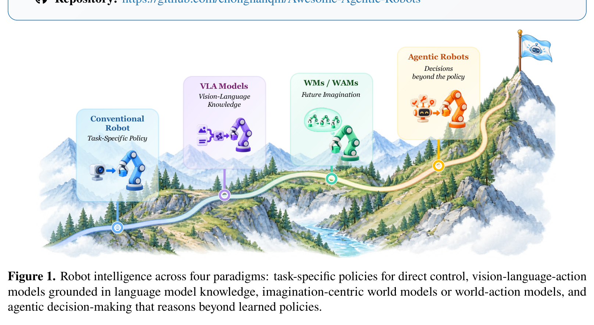

**Caption:** Figure 1. Robot intelligence across four paradigms: task-specific policies for direct control, vision-language-action models grounded in language model knowledge, imagination-centric world models or world-action models, and agentic decision-making that reasons beyond learned policies.

**Caption[CN]:** 图 1. 机器人智能在四大范式间的演进历程：用于直接控制的特定任务策略（Conventional Robot）、基于语言模型知识接地的视觉-语言-动作模型（VLA Models）、以未来想象为中心的世界模型或世界动作模型（WMs / WAMs），以及超越既定策略进行高阶推理与决策的具身智能体决策系统（Agentic Robots）。

---

## 1 Introduction (引言)

### Figure 2. 具身智能体机器人的四大核心功能域架构 (Overview of Agentic Robots)

**Caption:** Figure 2. Overview of agentic robots across Model, Data, Environment, and Harness. The four domains connect model decisions, robot execution, environmental interaction, and learning from experience.

**Caption[CN]:** 图 2. 具身智能体机器人在模型（Model）、数据（Data）、环境（Environment）与支架控制框架（Harness）四大功能领域的总体全景图。这四大领域将模型决策、机器人执行、环境交互以及经验学习紧密连接在一起。

> <strong>Para. 1:</strong> Over the past few years, foundation models including large language models (LLMs) and multimodal large language models (MLLMs) have greatly advanced robotic policy learning. They endow robots with novel capabilities that traditional task-specific models lack, especially in scene and task understanding and cross-scene generalization, by scaling robot datasets and model size [20, 256]. As a dominant technical solution in this field, vision-language-action (VLA) models utilize either discrete action tokens or diffusion- or flow-matching-based continuous action prediction strategies to connect robotic action prediction and the semantic knowledge embedded in pre-trained LLMs [13, 19, 269]. Nevertheless, improved action prediction alone cannot guarantee reliable execution for long-horizon tasks. These tasks demand robots to track task progress, adjust plans amid environmental changes, and recover from failures. VLA policies by themselves cannot consistently deliver these capabilities.

> <strong>Para. 1[CN]:</strong> 在过去的几年中，以大语言模型（LLM）和多模态大语言模型（MLLM）为代表的基础模型极大地推进了机器人策略学习的发展。通过扩展机器人数据集规模和模型参数量，基础模型赋予了机器人传统特定任务模型所匮乏的新颖能力，尤其体现在场景理解、任务意图推断以及跨场景泛化方面 [20, 256]。作为该领域的主流技术方案，视觉-语言-动作（VLA）模型采用离散动作分词（Discrete Action Tokens）或基于扩散/流匹配（Diffusion- or Flow-Matching）的连续动作预测策略，将机器人的动作生成与预训练大语言模型中蕴含的丰富语义先验知识连接起来 [13, 19, 269]。然而，仅凭动作预测精度的提升并不能保证长程复杂任务的可靠执行。此类长时程任务要求机器人必须能够持续追踪任务执行进度、在环境动态变化中适时调整规划，并自主从偶发失败中恢复。单凭 VLA 策略本身，尚无法持续且稳定地提供这些系统级能力。

> <strong>Para. 2:</strong> Why Agentic Robots Matter? Recently, agentic robots are attracting surging attention in the research community, which represent a new generation of embodied intelligent systems that integrate foundation model reasoning with embodied agency and environmental interaction capabilities. General-purpose models such as GPT-6 Astra [258] and Gemini 4 Argon [87] are opening new possibilities for such systems. For example, GPT-6 Astra demonstrates promising capabilities as a robot manipulation agent, using visual observations to generate end-effector commands and adjust its actions from execution feedback without task-specific fine-tuning [439]. On RoboDojo, it achieves a 22.48% average success rate across 42 simulation tasks, outperforming the trained robot policy DM0.5 (19.34%) [59], GalaxeaVLA G0.5 (14.88%) [76], Xiaomi-Robotics-1 (13.93%) [384], OpenWAM-𝛼(11.92%) [363] and 𝜋0.5 (6.91%) [269]. Despite this progress, inference latency and resource costs highlight the importance of how foundation models are integrated into robotic systems. Beyond optimizing and scaling model parameters, agentic robots use foundation models to plan actions, monitor task progress, and revise decisions based on execution feedback. Their capabilities therefore depend on both the model and the tools, observations, and feedback available in the environment. The agentic robot paradigm addresses the “brain in a vat” limitation of previous robotic solutions, shifting robotic intelligence from static pattern matching toward adaptive autonomous operation.

> <strong>Para. 2[CN]:</strong> 为何具身智能体机器人至关重要？近期，具身智能体机器人（Agentic Robots）在学术与工业界引起了广泛关注，它们代表了新一代具身智能系统，将基础模型的强推理能力与具身自主性及物理环境交互能力深度融合。诸如 GPT-6 Astra [258] 和 Gemini 4 Argon [87] 等通用多模态基础模型为此类系统开辟了全新路径。例如，GPT-6 Astra 在无需任何特定任务微调的前提下，作为机器人操作智能体展现出了引人瞩目的能力——它直接利用视觉观测生成末端执行器控制指令，并根据实际执行反馈动态微调动作 [439]。在 RoboDojo 基准上，它在 42 项仿真任务中取得了 22.48% 的平均成功率，超越了经过专门训练的具身机器人策略 DM0.5 (19.34%) [59]、GalaxeaVLA G0.5 (14.88%) [76]、Xiaomi-Robotics-1 (13.93%) [384]、OpenWAM-𝛼 (11.92%) [363] 以及 𝜋0.5 (6.91%) [269]。尽管取得了这些进展，但高昂的推理延迟与计算资源开销愈发突显出基础模型与机器人系统集成方式的关键性。除了单纯优化与扩展模型参数规模之外，具身智能体机器人还利用基础模型来制定动作规划、监控任务进度，并依据物理执行反馈修正后续决策。因此，它们的能力不仅取决于模型本身，更取决于环境中可用的工具接口、多模态观测通道以及反馈回路。具身智能体机器人范式有效打破了以往机器人方案中“缸中之脑”的孤立局限，推动机器人智能从静态的模式匹配迈向具备自适应能力的真正自主运行。

> <strong>Para. 3:</strong> Agentic Robots Need a Taxonomy. Despite growing interest, research on agentic robots remains fragmented across model learning, data acquisition, environment construction, and runtime system design. These directions are often studied separately, although their contributions interact within a robotic system. Related terms such as embodied agents, autonomous robots, and self-improving robotic systems further blur the scope of the field by emphasizing different capabilities without consistently clarifying their boundaries. Together, these issues make it difficult to identify where agents make decisions and how those decisions contribute to the overall system. A unified taxonomy should therefore distinguish the roles of individual components while explaining how they work together. To this end, we organize agentic robotics into four functional domains: Model, Data, Environment, and Harness, tracing the agent’s decisions within each domain and their effects across the system. Figure 2 shows how these four domains work together in agentic robot systems.

> <strong>Para. 3[CN]:</strong> 具身智能体机器人亟需清晰的分类体系。尽管研究热情持续高涨，但目前关于具身智能体机器人的探索依然高度碎片化，零散分布在模型学习、数据获取、仿真环境构建以及运行时系统设计等多个割裂方向中。这些研究方向往往被孤立探讨，但在完整的机器人系统中，其技术贡献存在着紧密的相互耦合与交互。诸如具身智能体（Embodied Agents）、自主机器人（Autonomous Robots）和自进化机器人系统（Self-Improving Robotic Systems）等相关术语，也因分别强调不同维度的系统能力而未明确划定彼此边界，进一步模糊了该领域的研究范畴。这些问题交织在一起，使得研究人员难以清晰界定智能体究竟在系统的哪些环节做出决策，以及这些决策如何赋能整体系统。因此，一套统一的分类体系应当在明确区分各个独立组件功能定位的同时，系统阐明它们协同作业的机制。为此，我们将具身智能体机器人划分为四大核心功能领域：模型（Model）、数据（Data）、环境（Environment）以及支架控制框架（Harness），深入追踪智能体在各领域内的决策过程及其对整个系统产生的涟漪效应。图 2 阐释了这四大功能域在具身智能体机器人系统中的协同机理。

> <strong>Para. 4:</strong> Key Questions:
> 
> 1. Model: What should the agent learn, understand, decide, and control?
> 2. Data: How should the agent collect, annotate, and refine robot data?
> 3. Environment: What worlds, tasks, and tests should the agent build?
> 4. Harness: How should robot capabilities be orchestrated, recovered, and evolved?

> <strong>Para. 4[CN]:</strong> 核心研究问题：
> 
> 1. 模型（Model）：智能体应当学习、理解、决策并控制什么？
> 2. 数据（Data）：智能体应当如何采集、标注并精炼机器人数据？
> 3. 环境（Environment）：智能体应当构建怎样的仿真世界、任务设定与评测测试？
> 4. 支架治理框架（Harness）：机器人的各项软硬件能力应当如何被编排、错误恢复与持续进化？

> <strong>Para. 5:</strong> The four questions above guide our discussion of how agents contribute to robotic systems. Section 4 examines how agents support model learning and robot decision-making, while Section 5 explains how they collect, annotate, and refine robot data. Section 6 considers the worlds, tasks, and tests agents construct for learning and evaluation. Section 7 examines how agents coordinate executable capabilities, monitor execution, recover from failures, and retain useful knowledge for subsequent tasks.

> <strong>Para. 5[CN]:</strong> 上述四个核心问题贯穿并引导了本文关于智能体如何赋能机器人系统的全面探讨。第 4 节深入剖析智能体如何支持模型学习与机器人分层决策；第 5 节详细阐释智能体如何采集、标注与精炼机器人训练数据；第 6 节系统探讨智能体为学习与评测所构建的仿真世界、任务分布与基准测试；第 7 节重点检视智能体如何协调可执行能力、监控执行状态、从失败中恢复并为后续任务沉淀和复用有价值的先验经验。

> <strong>Para. 6:</strong> Contributions. This paper makes three main contributions:
> 
> - A Unified Illustration for Agentic Robotics. We trace the evolution from robot policies to agentic systems and clarify the role of agents in robot task execution and capability development. We introduce a taxonomy spanning Model, Data, Environment, and Harness, bringing these research directions into a common framework.
> - A Systematic Analysis of Agentic Methods. We synthesize the mechanisms through which agents acquire, coordinate, and improve robotic capabilities. By comparing representative approaches across the taxonomy, we explain how agent decisions depend on available tools, robot executors, and interaction feedback, and examine the strengths and limitations of these approaches.
> - A Research Agenda for Practical Agentic Robots. Drawing on this analysis, we outline research directions for establishing agents’ contributions and translating current advances into reliable, efficient robot operation. The agenda connects fair evaluation with the challenges of physical deployment and generalization across robotic platforms.

> <strong>Para. 6[CN]:</strong> 核心贡献。本文的主要学术贡献可总结为以下三点：
> 
> - 提出具身智能体机器人的统一阐释框架：我们系统梳理了从传统机器人策略向具身智能体系统的演进脉络，明确厘清了智能体在机器人任务执行与能力拓展中的核心角色。我们提出了涵盖模型、数据、环境与支架治理框架（Model, Data, Environment, Harness）的四维分类体系，将原本割裂的多元研究方向统一于同一宏观框架下。
> - 开展智能体使能机制的系统性对比分析：我们深入综合了智能体获取、协同编排与改进机器人各项能力的底层机制。通过在分类体系中对代表性方法进行横向与纵向严谨对比，系统阐明了智能体决策如何依赖于可用工具、底层执行器与物理交互反馈，并客观剖析了各类方案的优势与局限性。
> - 规划面向实用的具身智能体机器人未来研究议程：立足于现有技术分析，我们勾勒了确立智能体实际增量贡献、并将现有学术突破转化为可靠高效物理运行的关键研究方向。该议程将严格公正的基准评测与物理真机部署、跨本体泛化等核心工程与科学挑战有机连接。

---

## 2 Evolution of Robot Learning (机器人学习的演进历程)

> <strong>Para. 1:</strong> Robot learning spans four connected stages: learning executable behavior, integrating multimodal knowledge, predicting physical outcomes, and coordinating execution and improvement. (1) Conventional Robot Policies: Learning Executable Behavior. Reinforcement and imitation learning map observations to actions, while generalist policies share experience across tasks and embodiments. Their capabilities depend largely on the robot experience available during training. (2) Vision-Language-Action Models: Connecting Knowledge to Action. VLAs bring the visual and linguistic knowledge of pretrained foundation models into control, connecting the interpretation of scenes, instructions, and semantic relationships to action generation. (3) World Models and World-Action Models: Anticipating Physical Outcomes. These models connect action selection and generation to predictions of environmental change, using representations of future states, observations, and their relation to actions. (4) Agentic Robots: Organizing Execution and Improvement. Agentic systems extend model-mediated decisions to selecting and coordinating capabilities, acquiring experience, and using feedback to guide subsequent execution and capability improvement. These stages describe overlapping research traditions and complementary capabilities that can coexist in one system.

> <strong>Para. 1[CN]:</strong> 机器人学习的发展跨越了四个相互承接的演进阶段：学习可执行行为、融合多模态知识、预测物理结果，以及协同编排执行与持续改进。(1) 传统机器人策略：学习可执行行为。强化学习与模仿学习将实时观测直接映射为底层动作，而通用策略则在多任务与多具身硬件之间共享经验。它们的能力在很大程度上取决于训练阶段所能获取的物理交互数据规模。(2) 视觉-语言-动作模型：连接语义知识与物理动作。VLA 模型将预训练基础模型中蕴含的丰富视觉与语言常识引入具身控制，建立了场景解译、指令理解与语义关联向底层动作生成的桥梁。(3) 世界模型与世界动作模型：前瞻预测物理结果。这些模型将动作选择与生成建立在对环境未来演化的精准预测之上，通过对未来物理状态、视觉观测及其与动作因果关系的表征实现物理推演。(4) 具身智能体机器人：组织系统执行与能力进化。智能体系统将由模型介导的高阶决策拓展至选择与编排各项软硬件能力、自主采集新经验，并利用闭环反馈指导后续执行与系统级能力改进。这四个阶段描述了彼此重叠的研究传统和高度互补的系统能力，完全可以在同一机器人系统中并存与协同。

### 2.1 Conventional Robot Policies (传统机器人策略)

> <strong>Para. 2:</strong> Conventional robot policies learn from demonstrations or reward-based experience. We group visual policies by scene representation: image-based policies use image features, while 3D-aware policies introduce geometric structure for action prediction. This distinction concerns scene representation, not action dimensionality.

> <strong>Para. 2[CN]:</strong> 传统机器人策略主要从专家示范轨迹或基于奖励信号的环境交互经验中学习。根据场景表征的不同，我们通常将视觉策略分为两类：基于图像的策略（Image-based Policies）直接利用 2D 图像特征，而具备 3D 感知的策略（3D-aware Policies）则显式引入空间几何结构以辅助动作预测。这种划分侧重于场景感知表征形式，而非控制动作本身的自由度维度。

> <strong>Para. 3:</strong> Image-based Policies. Early policies learn actions from camera images. Guided policy search [168] maps images and robot state to motor torques, while QT-Opt [143] learns an image-conditioned action-value function for grasping. RoboMimic [238] studies visual behavior cloning from offline demonstrations. Visual pretraining supplies reusable policy features: R3M [244] pretrains an image encoder on human videos for downstream imitation learning. Beyond visual encoding, ACT [449] and Diffusion Policy [55] model action sequences with a conditional variational autoencoder and conditional diffusion, respectively. Task conditioning extends these policies to multiple behaviors: BC-Z [128] and RT-1 [20] use task descriptions, while VIMA [138] conditions policies on multimodal prompts that combine text with image tokens.

> <strong>Para. 3[CN]:</strong> 基于图像的策略。早期的具身策略直接从单目或多目相机图像中学习物理动作。引导式策略搜索（GPS）[168] 将视觉图像与机器人自身关节状态直接映射为电机力矩；QT-Opt [143] 则学习了一个以视觉图像为条件的动作价值函数，用于大规模灵巧抓取；RoboMimic [238] 系统研究了从离线示范中进行视觉行为克隆（Behavior Cloning）的标准范式。自监督视觉预训练为下游策略提供了强可复用的表征：R3M [244] 在大规模人类活动视频上预训练视觉编码器，显著提升了模仿学习的数据效率。在动作生成建模方面，ACT [449] 和 Diffusion Policy [55] 分别利用条件变分自编码器（CVAE）和条件扩散模型（Diffusion Models）来表征多模态长程动作序列分布。任务条件化技术进一步将单任务策略拓展为多任务通用策略：BC-Z [128] 和 RT-1 [20] 引入自然语言任务描述作为条件；而 VIMA [138] 则通过交织文本与图像 Token 的多模态 Prompt 来引导策略生成对应行为。

> <strong>Para. 4:</strong> 3D-aware Policies. These policies use scene geometry to predict actions. PerAct [312] voxelizes RGB-D observations and predicts discretised 6-DoF gripper poses using a 3D transformer. Act3D [110] samples continuous 3D candidate positions and evaluates them with a transformer-based scoring module. PolarNet [423] models robot manipulation using a polar-coordinate representation centered on the robot base. Point cloud representations provide unstructured geometric inputs: DP3 [408] applies 3D diffusion to point clouds, while [267] evaluates diffusion policies on multi-view point clouds. Sparse point tracks offer dynamic representations: Track2Act [32] predicts actions from 2D point trajectories, while FlowAct [333] represents dynamic scenes with point tracks and predicts 3D action flows. Spatial representations support cross-embodiment transfer by separating spatial structure from robot configuration.

> <strong>Para. 4[CN]:</strong> 具备 3D 感知的策略。此类策略显式利用物理场景的 3D 几何先验来预测动作。PerAct [312] 将 RGB-D 观测体素化（Voxelization），并使用 3D Transformer 预测离散化的 6 自由度夹爪目标姿态；Act3D [110] 在连续 3D 空间中密集采样候选点，并通过基于 Transformer 的打分模块评估动作可行性；PolarNet [423] 采用以机器人底座为中心的极坐标表征来建模机械臂操作；点云表征则提供了轻量且无需网格化的非结构化几何输入：DP3 [408] 将 3D 扩散模型直接作用于点云，而 [267] 则系统评估了多视角点云上的扩散策略性能；稀疏点追踪提供了丰富的动态运动表征：Track2Act [32] 从 2D 点轨迹中逆向预测动作，FlowAct [333] 则通过时空点追踪表征动态场景并预测 3D 动作流（Action Flows）。通过将 3D 空间结构与特定的机器人机构配置解耦，空间几何表征极大地促进了跨具身形态（Cross-Embodiment）的泛化迁移。

### 2.2 Vision-Language-Action Models (视觉-语言-动作模型)

> <strong>Para. 5:</strong> General VLA Models. VLAs adapt large-scale pretrained vision–language backbones to generate robot actions. RT-2 [439] frames action generation as language modeling by tokenizing continuous actions into text tokens within a PaLM-E [85] or PaLI-X [56] backbone. OpenVLA [154] fine-tunes a Llama-2-based VLM on Open X-Embodiment data [256]. Scaling extends generalist VLAs across tasks and platforms: 𝜋0 [19] and 𝜋0.5 [269] train flow-matching action decoders on large multi-robot datasets. GalaxeaVLA G0.5 [76] and Xiaomi-Robotics-1 [384] extend generalist VLAs to dual-arm and mobile manipulation platforms.

> <strong>Para. 5[CN]:</strong> 通用 VLA 模型。VLA 模型通过适配大规模预训练的视觉-语言大模型基座来直接生成机器人动作。RT-2 [439] 在 PaLM-E [85] 或 PaLI-X [56] 基座中将连续动作离散化为文本动作 Token，从而将物理动作生成完全形式化为类似语言模型的自回归解码任务；OpenVLA [154] 则在跨具身开放数据集 Open X-Embodiment [256] 上对基于 Llama-2 的视觉语言模型进行了开源端到端微调。模型规模扩展进一步推动了通用 VLA 跨越不同任务与硬件平台的泛化表现：𝜋0 [19] 与 𝜋0.5 [269] 在大规模多机器人混合数据集上训练了基于流匹配（Flow-Matching）的高频动作解码器；GalaxeaVLA G0.5 [76] 与 Xiaomi-Robotics-1 [384] 则成功将通用 VLA 拓展至双臂协同以及移动复合操作（Mobile Manipulation）复杂物理平台。

> <strong>Para. 6:</strong> Action Representation. A central choice is how to decode robot actions. Discretised action tokens [13, 154, 439] cast action prediction as next-token prediction, which can limit precision and action frequency. Hybrid approaches combine autoregressive token prediction with continuous action heads. RoboFlamingo [243] pairs an autoregressive backbone with an MLP action head, while RT-Trajectory [107] conditions a policy on predicted 2D trajectory overlays. Diffusion- and flow-matching-based VLAs condition continuous action decoders on visual and language features to generate action sequences. Octo [252] pairs a transformer backbone with a diffusion action head, while 𝜋0 [19] uses continuous flow matching for multi-step action prediction. Fast-Slow VLA [287] uses a slow reasoning model to generate multimodal goal representations for a faster action policy.

> <strong>Para. 6[CN]:</strong> 动作表征策略。VLA 架构的核心设计选择之一在于如何高效解码机器人的底层动作。离散化动作分词策略 [13, 154, 439] 将动作预测等价于自回归 Next-Token 预测，但这往往会受限于动作离散化精度以及较慢的自回归解码频率。混合式架构将自回归语义表征与连续动作预测头紧密结合：RoboFlamingo [243] 将自回归主干与 MLP 动作头配对；RT-Trajectory [107] 则将策略条件化在预测的 2D 轨迹叠加图像上；基于扩散与流匹配的现代 VLA 模型则将连续动作解码器条件化于高级视觉与语言特征之上，实现平滑连续动作序列的批量生成；Octo [252] 将 Transformer 骨干与扩散动作头相连接；𝜋0 [19] 则采用连续流匹配进行多步动作序列联合推断；Fast-Slow VLA [287] 则引入快慢双脑分层设计，利用低频运行的慢速推理模型为快速运行的高频动作策略提供多模态目标表征。

> <strong>Para. 7:</strong> VLA with Memory. History and memory provide temporal context when a single observation is insufficient. In manipulation, actions often depend on past interactions: whether an object was grasped, how an obstacle moved, or which subtask was just completed. RoboMamba [187] uses a state space model to maintain an internal recurrent state across time steps. Memory-augmented architectures store past observations in explicit memory banks: MemVLA [317] maintains a working memory of visual tokens across subtasks, while [307] introduces an episodic memory module for long-horizon manipulation. For navigation, spatial memory matters: AgenticNav [188] indexes past views by heading direction, allowing the robot to revisit observed locations without relying solely on the current camera view.

> <strong>Para. 7[CN]:</strong> 融入记忆机制的 VLA。当单帧瞬时观测无法提供充分信息时，历史交互与时序记忆能够提供至关重要的时序上下文。在机械臂操作中，当前动作极度依赖过去的交互历程：物体是否已经被牢固抓取、障碍物此前如何移动、或者哪一项子任务刚刚执行完毕。RoboMamba [187] 借助状态空间模型（Mamba / SSM）在长时序时间步之间维护一个内部递归状态；外置记忆增强架构则将历史观测显式存储于记忆库中：MemVLA [317] 在不同子任务之间持续维护跨阶段的视觉 Token 工作记忆；[307] 则为长程操作引入了情景记忆（Episodic Memory）模块；在自主导航任务中，空间记忆至关重要：AgenticNav [188] 按照机器人的航向角对历史视角进行结构化索引，使机器人能够在无需单纯依赖当前相机视角的前提下，随时回溯与重访曾观测到的空间区域。

> <strong>Para. 8:</strong> VLA with Reasoning. Intermediate reasoning and semantic prediction provide structured guidance for action generation. Chain-of-thought prompting encourages models to generate verbal rationales before predicting actions: ECoT [425] predicts subgoals, bounding boxes, and action rationales alongside actions. Visual reasoning models make spatial relationships explicit: CogACT [177] predicts 3D bounding boxes and contact points to structure continuous action generation, while SpatialVLA [284] introduces a spatial representation to ground actions in physical coordinates. CoT-VLA [422] conditions action prediction on generated reasoning traces. Task-level reasoning extends to tool use: Tool-VLA [447] prompts models to select tools, while [466] defines tool interfaces that allow models to invoke external capabilities.

> <strong>Para. 8[CN]:</strong> 融入中间推理的 VLA。显式的中间推理过程与结构化语义预测能够为动作生成提供强有力的归纳偏置。思维链（Chain-of-Thought, CoT）提示鼓励模型在直接输出电机动作之前先生成语言化的因果推理痕迹：ECoT [425] 在预测物理动作的同时，联合预测子目标、目标边界框以及动作决策理由；视觉空间推理模型使物理几何关系显式化：CogACT [177] 预测 3D 边界框与物理接触点以指导连续动作生成，SpatialVLA [284] 引入空间表征将动作牢固接地在物理坐标系中；CoT-VLA [422] 将动作预测显式条件化于生成的推理链条之上；任务级的高阶推理进一步拓展到外部工具调用：Tool-VLA [447] 引导模型根据场景自主选择外部物理工具，而 [466] 则定义了标准的工具函数接口，使具身模型能够按需调用外部感知与求解能力。

> <strong>Para. 9:</strong> VLA with Imagination. Future prediction connects VLA action learning to visual expectations of task progress. Instead of predicting only the immediate next action, models predict future observations or latent representations of success. RoboDreamer [463] uses visual imagination to generate future subgoal images that guide action execution. In [369], a video diffusion model generates rollout plans that conditioned policies follow. Predictive representations also support action evaluation: by comparing observed outcomes with anticipated progress, models can detect execution anomalies before completing a failed trajectory.

> <strong>Para. 9[CN]:</strong> 融入想象前瞻的 VLA。未来预测能力将 VLA 动作学习与对任务进展的视觉前瞻期望有机结合。模型不再仅仅预测即刻的下一步动作，而是同时前瞻预测未来的视觉观测或表征任务成功的潜在状态。RoboDreamer [463] 借助视觉想象技术生成未来的视觉子目标图像，以指导底层动作的顺次执行；在 [369] 中，视频扩散模型直接生成可视化的交互推演视频方案供下游策略追踪执行；前瞻预测表征同样强力赋能了动作评估：通过将物理执行后的实际观测与前瞻期望进行动态对比，模型能够在不可逆失败彻底发生之前尽早敏锐捕捉执行异常。

### 2.3 World Models and World-Action Models (世界模型与世界动作模型)

> <strong>Para. 10:</strong> World models learn how the environment changes in response to robot actions. Predicting future observations or latent states enables policy learning in simulation, visual planning, and trajectory evaluation. In robot learning, world models operate as environments for policy training, as visual planners, and as predictive components within larger systems.

> <strong>Para. 10[CN]:</strong> 世界模型旨在学习物理环境响应机器人动作时的状态转移与动态演化规律。通过预测未来的环境观测或潜在状态，世界模型能够支撑纯虚拟仿真中的策略训练、基于视觉的物理规划以及动作轨迹的质量评估。在机器人学习体系中，世界模型通常扮演三大关键角色：作为策略训练的交互式虚拟仿真环境、作为生成前瞻视觉子目标的规划器，以及作为更大规模复合具身系统中的核心预测性组件。

> <strong>Para. 11:</strong> World Model as Environment. Action-conditioned video models simulate interaction outcomes from current observations and proposed actions. IRIS [229] trains reinforcement learning policies entirely within a discrete world model. In robotics, action-conditioned video generation simulates manipulation: UniSim [400] builds an interactive visual simulator from real robot videos, while VideoWorld [364] simulates mobile manipulation outcomes. Policy learning inside world models avoids real-robot wear and reset costs, but depends on simulation fidelity: errors in predicted dynamics compound over time, producing compounding errors that limit training horizon.

> <strong>Para. 11[CN]:</strong> 作为仿真环境的世界模型。以积分为条件的视频生成模型能够依据当前观测与候选动作，仿真出高度逼真的物理交互结果。IRIS [229] 实现了完全在一个离散世界模型内部通过强化学习训练智能体控制策略；在具身机器人领域，动作条件化视频生成技术模拟了精细的操作过程：UniSim [400] 从真实机器人交互视频中构建出了交互式物理视觉仿真器，而 VideoWorld [364] 则能够模拟移动复合操作在复杂场景下的执行后果；在世界模型内部直接进行策略学习彻底避免了真机磨损与高昂的人工重置成本，但这高度依赖于物理仿真的保真度：预测动力学中的微小误差会随着时间步推进而不断累积复合，产生显著的复合漂移误差（Compounding Errors），从而制约了有效训练的时程跨度。

> <strong>Para. 12:</strong> 4D World Model. 4D world modeling captures how 3D scene geometry evolves over time, supporting spatial planning and physically grounded evaluation. Dynamic point cloud prediction models predict future point cloud sequences conditioned on robot actions: [454] models point cloud dynamics for manipulation, while [126] predicts 3D occupancy grids for navigation. Neural radiance fields (NeRF) and 3D Gaussian Splatting (3DGS) provide differentiable 3D representations that support view synthesis and geometric rendering: RoboNeRF [380] models dynamic scene geometry from multi-view observations, while DreamCity [179] generates editable 3DGS environments for robot navigation. By predicting physical structure rather than 2D pixels, 4D world models support collision checking, contact reasoning, and spatial verification.

> <strong>Para. 12[CN]:</strong> 4D 世界模型。4D 世界模型精准捕捉 3D 物理场景几何随时间的动态演变过程，为 3D 空间规划与物理接地评估提供了坚实的表征底座。动态点云预测模型在动作条件化下预测未来的时空点云序列：[454] 对机械臂操作中的点云动力学进行建模，[126] 则预测移动导航中的 3D 空间体素占用网格（Occupancy Grids）；神经辐射场（NeRF）与 3D 高斯泼溅（3DGS）提供了支持新视角合成与可微渲染的连续 3D 空间表征：RoboNeRF [380] 从多视角动态观测中重建运动几何，而 DreamCity [179] 则为移动机器人导航生成了可交互编辑的大规模 3DGS 虚拟现实环境；通过直接预测底层的 3D 物理结构而非浅层的 2D 像素，4D 世界模型天然支持高精度的碰撞检测、接触力学推理以及空间几何有效性验证。

> <strong>Para. 13:</strong> World Model as Planner. World models supply visual plans. Generating goal images, keyframe trajectories, or point tracks frames planning as visual prediction. DINO-WM [459] learns an action-conditioned latent world model and plans by searching over latent rollouts. In [365], a diffusion model generates keyframe images connecting initial and goal states, which a lower-level controller follows. Inverse dynamics maps predicted observations or latents to robot actions. Uni-O4 [276] combines a visual world model with an inverse-dynamics action predictor, while [265] plans end-effector trajectories from generated video rollouts. Visual planning allows models to reason about complex physical interactions without maintaining explicit symbolic states.

> <strong>Para. 13[CN]:</strong> 作为物理规划器的世界模型。世界模型同样可以直接作为直观的视觉规划器。通过前瞻生成最终目标图像、关键帧动作轨迹或密集特征点追踪轨迹，世界模型将传统的任务规划问题重新定义为前瞻视觉预测问题。DINO-WM [459] 学习了一个动作条件化的潜在世界模型，并通过在潜在空间展开（Latent Rollouts）中进行快速搜索来实现零样本规划；在 [365] 中，扩散模型生成了平滑连接初始状态与目标状态的关键帧视觉图像，供底层跟踪控制器精确执行；逆动力学模型（Inverse Dynamics Model）则负责将预测的前瞻视觉观测或潜在特征精准反解为具体的机器人底层关节动作：Uni-O4 [276] 将视觉世界模型与逆动力学动作预测器深度融合，而 [265] 则直接从生成的推演视频轨迹中反求末端执行器 6 自由度位姿；基于视觉前瞻的物理规划赋予了具身模型对复杂物理交互过程进行直观因果推演的能力，摆脱了对脆弱且难以手工穷举的显式符号逻辑状态的过度依赖。

> <strong>Para. 14:</strong> Joint Video–Action Modeling. World-action models (WAMs) combine future video prediction with action generation. Rather than predicting actions and observations separately, WAMs jointly model the distribution of future visual states and robot actions. $𝜏_0$-WM [462] pretrains on large-scale robot and Internet videos, modeling video prediction and action generation with a unified diffusion transformer. UWM [468] jointly predicts future video frames and continuous action chunks, sharing representations between visual forecasting and control. Joint modeling connects visual and motor representations: video prediction forces the model to anticipate environmental changes, while action generation grounds predictions in executable commands.

> <strong>Para. 14[CN]:</strong> 联合视频-动作建模。世界动作模型（WAM）将面向未来的视频前瞻预测与底层的电机动作生成深度联合在一起。WAM 并没有将动作预测与观测预测拆分为独立的割裂模块，而是直接联合建模未来视觉状态与机器人动作的联合概率分布。$𝜏_0$-WM [462] 在海量机器人交互数据与互联网人类视频上开展大规模联合预训练，采用统一的扩散 Transformer（DiT）统一表征视频预测与动作生成；UWM [468] 则联合预测未来的连续视频帧与连续动作时域分块（Action Chunks），在视觉前瞻推演与物理控制之间共享深层多模态表征；这种联合建模机制在视觉几何语义与电机控制动作之间架起了强有力的归纳纽带：视频预测强制驱动模型深入理解环境物理演化的因果约束，而动作生成则反向确保了所有视觉前瞻期望能够切实接地为可稳定执行的物理控制指令。

### 2.4 Agentic Robots (具身智能体机器人)

> <strong>Para. 15:</strong> Agentic robots organize robotic execution and capability improvement. Given a goal, they coordinate capable models, skills, tools, and execution feedback into a closed loop: planning a sequence of subtasks, dispatching them to learned policies or callable tools, monitoring progress, and revising decisions when actions fail. The agentic perspective treats models not as standalone policies, but as components within a larger decision architecture.

> <strong>Para. 15[CN]:</strong> 具身智能体机器人负责组织机器人的物理执行与系统级能力的持续进化。给定一个复杂的高级目标，它们将多模态基础模型、动作技能库、分析型工具接口以及实时执行反馈有机编织为一个完整的自主闭环：规划长程子任务序列、将子目标智能调度派发给专精的习得策略或底层分析工具、实时严密监控执行进度，并在行动发生偏离或失败时自主纠偏与动态重规划。具身智能体的新视角不再将单一神经网络视为孤立的端到端策略，而是将其视为更庞大、更具弹性的高阶决策与治理架构中的专业功能构件。

> <strong>Para. 16:</strong> This perspective also extends to data collection, model training, and environment construction. The agent may gather new trajectories, curate demonstrations, specify training recipes, or generate simulation environments and tasks. Rather than relying entirely on human engineering, agentic systems use model-mediated decisions to expand, evaluate, and refine their own capabilities.

> <strong>Para. 16[CN]:</strong> 这一智能体视角同样全面延伸到了数据采集、模型训练以及仿真环境构建等全生命周期中。智能体可以自主在未知环境中探索并采集新轨迹、智能清洗与筛选高质量专家示范、自适应设计并调优模型训练的超参数与奖励函数代码，甚至能自主生成多样化的仿真交互环境与阶梯式训练任务分布。具身智能体系统不再被动依赖于繁重且高成本的人工工程调优，而是积极利用由基础模型介导的自主决策机制，持续自我扩展、严格评估并闭环精炼自身的各项软硬件具身能力。

---

## 3 Foundations of Agentic Robots (具身智能体机器人基础理论)

### Figure 3. 具身智能体机器人系统的分类体系与研究全景 (Taxonomy and Literature Landscape)

**Caption:** Figure 3. Taxonomy and literature landscape of agentic robotic systems. Four functional domains cover seventeen non-exclusive categories: Model covers learning and robot-facing decisions. Data covers the acquisition and curation of data. Environment covers worlds, tasks, and evaluation. Harness covers how robotic capabilities are coordinated, reused, and improved to support agentic task execution.

**Caption[CN]:** 图 3. 具身智能体机器人系统的分类体系与研究文献全景图。四大功能领域涵盖 17 个非互斥类别：模型层（Model）覆盖学习过程与面向机器人的决策；数据层（Data）覆盖数据的获取与管护；环境层（Environment）覆盖仿真世界、任务与评测；支架治理层（Harness）覆盖机器人各项能力的协同编排、复用与持续演进，以全面支持智能体任务执行。

> <strong>Para. 1:</strong> The approaches discussed in Section 2 provide capabilities for perception, reasoning, action, and world modeling. However, developing an agentic robotic system requires more than combining these models: it requires understanding where and how agents make decisions, what resources they use, and how those decisions affect the system’s performance. This section defines agentic robots, introduces our operational taxonomy, and contrasts agentic robots with related concepts in embodied AI and autonomous systems.

> <strong>Para. 1[CN]:</strong> 第 2 节所探讨的前沿方法为具身系统提供了感知、推理、动作控制以及世界建模等一系列基础能力。然而，构建一个实用的具身智能体机器人系统绝非将这些模型进行简单堆叠：它要求系统设计者必须透彻理解智能体究竟在何时、何地做出关键决策、它们依赖何种软硬件资源，以及这些决策如何深远地影响整个系统的运行性能。本节将明确给出具身智能体机器人的严格定义与核心范畴，系统介绍本文的操作级分类体系（Operational Taxonomy），并深入辨析具身智能体机器人与具身智能、传统自主系统等相近概念的本质差异。

### 3.1 Definition and Scope (定义与范畴)

> <strong>Para. 2:</strong> We define agentic robots as robotic systems in which agents autonomously plan and coordinate task execution and capability improvement across physical and digital environments. An agentic robot operates with some degree of autonomy: it interprets goals, decides what actions or tool calls to make, monitors progress, and adapts its behavior from interaction feedback. The agent’s decisions may govern physical movement (such as selecting grasping targets or coordinating navigation and manipulation) or digital operations (such as generating simulation tasks, designing reward functions, or updating skill libraries).

> <strong>Para. 2[CN]:</strong> 我们将具身智能体机器人（Agentic Robots）定义为：智能体在其中能够跨越物理与数字环境，自主规划并协同编排任务执行与能力进化的智能机器人系统。具身智能体机器人在运行过程中具备高度的自主任性：它能够深度解析抽象的高级目标、自主裁定应当采取何种物理动作或外部工具调用、持续监控任务推进状态，并依据物理交互反馈自适应修正行为。智能体的决策既可以直接支配机器人的物理动作（例如动态选择抓取关键点、协同编排底盘导航与机械臂精细操作），也可以直接管控系统的数字软硬件运作（例如自动化生成仿真任务、编写与迭代强化学习奖励函数、或扩充与重构可复用技能库）。

> <strong>Para. 3:</strong> These capabilities can be implemented within an integrated model or through modular components. In an integrated architecture, a single model handles perception, planning, and action generation directly. In a modular architecture, distinct components handle perception, reasoning, control, and verification, with an agentic coordinator managing calls and handoffs among them. The defining characteristic of an agentic robot is not its architectural style, but whether the system uses model-mediated decisions to organize its own execution and improvement.

> <strong>Para. 3[CN]:</strong> 这些核心能力既可以在单个紧耦合的端到端集成模型中实现，也可以通过松耦合的模块化系统进行架构。在集成式端到端架构中，单一的大模型同时兼揽多模态感知、长程规划以及底层动作生成的全过程；而在模块化分层架构中，独立的专业模块分别负责高阶感知、因果推理、底层高频控制与安全性验证，并由一个居于核心治理地位的智能体协调器统领各模块之间的调用调度与控制权交接。具身智能体机器人的本质特征并不取决于其采取何种具体的系统架构风格，而在于系统是否切实利用由基础模型介导的自主决策机制来全面组织与治理自身的物理执行和自我进化。

> <strong>Para. 4:</strong> Beyond task execution, agents can also contribute to developing robot capabilities. An agent may generate training tasks, annotate recorded demonstrations, construct simulation scenes, or synthesize reward functions for policy learning. In these developmental roles, the agent acts on the system’s learning pipeline rather than directly in the physical environment. Both execution-time and developmental decisions fall within the scope of agentic robotics, as both rely on model-mediated reasoning to improve the robot’s capabilities.

> <strong>Para. 4[CN]:</strong> 除了即时的在线任务执行之外，智能体同样深度介入并赋能机器人各项能力的离线研发与演进。智能体可以自动化生成阶梯式训练任务、为海量人类或机器人交互视频追加高质结构化监督标注、程序化合成高保真 3D 仿真交互场景，或为强化学习策略自动编写精细的奖励函数代码。在这些面向系统发展的研发角色中，智能体作用于机器人系统底层的算法与数据闭环流水线，而非直接在物理现场下发关节力矩。无论是执行期的动态控制决策，还是研发期的能力拓展决策，都完全归属于具身智能体机器人的核心研究范畴，因为两者均深度依赖由大模型介导的高阶因果推理来全面提升机器人的物理智能边界。

> <strong>Para. 5:</strong> Comparison with Current Works. PAPAV [47] compares computer use and robot use through Perceive, Act, Plan, Adaptation, and Verification, but focuses primarily on computer interaction without systematically examining robot-specific challenges such as data curation, environment construction, or system harnesses. Other surveys focus on specific components: VLAs [13], robot world models [434], or LLM-based planning [224]. In contrast, this paper covers the full spectrum of agentic capabilities across Model, Data, Environment, and Harness.

> <strong>Para. 5[CN]:</strong> 与现有代表性综述的对比辨析。近期工作 PAPAV [47] 尝试通过感知（Perceive）、行动（Act）、规划（Plan）、自适应（Adaptation）与验证（Verification）五联架构对比计算机使用（Computer Use）与机器人使用（Robot Use）的异同，但其视野主要局限于虚拟计算机交互环境，未能系统探讨机器人特有的关键物理挑战，诸如实体机器人数据管护、物理仿真环境重建以及底层运行时系统支架治理；其他现存综述则普遍聚焦于单一细分技术组件：例如专门探讨 VLA 策略 [13]、专注于机器人世界模型 [434]、或局限于基于大语言模型的高级任务规划 [224]。与之形成鲜明对比的是，本文首次建立了横跨模型（Model）、数据（Data）、环境（Environment）与支架治理框架（Harness）的完整全景体系，全方位覆盖了具身智能体机器人的完整能力版图。

### 3.2 Taxonomy (操作级分类体系)

> <strong>Para. 6:</strong> We organize existing work into four domains according to the roles agents play in developing and operating robotic systems: Model, Data, Environment, and Harness. Within each domain, we define categories that group approaches by the specific function the agent performs:
> 
> - Model (Section 4): Training, Perception, Planning, Robot Control, Adaptation.
> - Data (Section 5): Collection, Annotation, Refinement.
> - Environment (Section 6): Reconstruction, Task Generation, Benchmarking.
> - Harness (Section 7): Orchestration, Memory, Monitoring and Recovery, Skills, Infrastructure, Layered Systems.

> <strong>Para. 6[CN]:</strong> 依据智能体在研发和运行机器人系统过程中所扮演的具体角色与功能，我们将现有海量学术研究体系化归纳为四大功能领域：模型（Model）、数据（Data）、环境（Environment）以及支架治理框架（Harness）。在每一个领域内部，我们进一步按照智能体所执行的特定核心功能划分子类别：
> 
> - 模型（Model，第 4 节）：训练（Training）、感知（Perception）、规划（Planning）、机器人控制（Robot Control）、自适应（Adaptation）。
> - 数据（Data，第 5 节）：数据采集（Collection）、数据标注（Annotation）、数据精炼（Refinement）。
> - 环境（Environment，第 6 节）：场景重建（Reconstruction）、任务生成（Task Generation）、基准评测（Benchmarking）。
> - 支架治理框架（Harness，第 7 节）：编排机制（Orchestration）、记忆系统（Memory）、监控与恢复（Monitoring and Recovery）、技能系统（Skills）、基础设施（Infrastructure）、分层系统（Layered Systems）。

> <strong>Para. 7:</strong> The taxonomy distinguishes functional contributions rather than assigning each paper to a single category. Many systems span multiple categories: for example, a system may use an LLM for planning, monitor execution with a VLM checker, and store lessons in an external memory. We discuss such systems under each relevant category, highlighting how their components interact. Table 1 summarizes the seventeen categories across the four domains.

> <strong>Para. 7[CN]:</strong> 本分类体系旨在严谨区分各项功能性贡献，而非武断地将每篇论文孤立归入单一类别。事实上，许多前沿的优秀具身系统都同时横跨多个功能维度：例如，一个复合系统可能同时采用大语言模型进行高阶子任务规划、引入视觉语言模型监控器对物理动作进行实时验证检查，并将偶发错误教训持久化存储在外部情景记忆库中。我们在每一个相关的功能类别下分别探讨此类系统，重点剖析其各个子模块之间的动态交互与协同效应。表 1 系统总结了四大功能领域下的全部 17 个子类别。

### Table 1. 具身智能体机器人的操作级分类体系 (Operational Taxonomy of Agentic Robots)

| Domain | Category | Definition |
| :--- | :--- | :--- |
| **Model** | Training | Designs or revises rewards, objectives, training recipes, or learning experiments. |
| **Model** | Perception | Interprets observations to recover task-relevant concepts, relations, geometry, or beliefs, and decides when additional evidence is needed. |
| **Model** | Planning | Chooses and revises subgoals, action sequences, dependencies, or task solutions as a task progresses. |
| **Model** | Robot Control | Translates selected operations into robot-facing actions, poses, programs, or motion constraints for execution. |
| **Model** | Adaptation | Uses experience to update model parameters or task-specific conditioning and decision rules. |
| **Data** | Collection | Acquires or generates new robot experience for learning or later use. |
| **Data** | Annotation | Interprets recorded experience and adds structured supervision, such as text, spatial labels, interaction targets, or outcomes. |
| **Data** | Refinement | Improves existing experience by selecting useful records or segments and revising unreliable supervision. |
| **Environment** | Reconstruction | Constructs or revises executable scenes, assets, geometry, and task-relevant physical properties. |
| **Environment** | Task Generation | Defines or generates goals, constraints, curricula, or task distributions for practice, learning, or execution. |
| **Environment** | Benchmarking | Constructs or adapts tests, perturbations, metrics, evaluators, and evaluation procedures. |
| **Harness** | Orchestration | Selects models, policies, skills, or tools and governs their calls and handoffs. |
| **Harness** | Memory | Stores, updates, and retrieves interaction history or knowledge for later decisions. |
| **Harness** | Monitoring and Recovery | Assesses progress, completion, failure, or constraints and organizes corrective responses. |
| **Harness** | Skills | Creates, validates, retains, revises, or retires reusable procedural knowledge and executable behaviors. |
| **Harness** | Infrastructure | Exposes, serves, and gates tools and policies through interfaces, services, and runtime checks. |
| **Harness** | Layered Systems | Divides information, authority, and operating rates across planners, learned policies, and analytic control. |

**Caption:** Table 1. Operational taxonomy of agentic robots. Four functional domains organize seventeen non-exclusive categories by the part of the robotic system shaped by model-mediated decisions.

**Caption[CN]:** 表 1. 具身智能体机器人的操作级分类体系。四大功能领域（模型、数据、环境、支架治理框架）根据由模型介导的决策所塑造的机器人系统组成部分，将 17 个非互斥类别进行了系统性组织。

### 3.3 Comparison with Related Concepts (相关概念深入辨析)

> <strong>Para. 8:</strong> Agentic robotics is closely related to embodied AI, autonomous robotics, and robot learning, but differs in scope and operational mechanisms.

> <strong>Para. 8[CN]:</strong> 具身智能体机器人与具身人工智能（Embodied AI）、经典自主机器人（Autonomous Robotics）以及机器人策略学习（Robot Learning）等概念休戚相关，但在研究范畴的广度以及底层的运行机理上存在显著区别。

> <strong>Para. 9:</strong> Agentic Robotics vs. Embodied AI. Embodied AI studies intelligence through physical interaction, often focusing on end-to-end policy learning where a model maps observations directly to actions. Agentic robotics shifts the focus from learning a single policy to orchestrating multiple capabilities: the agent may invoke a trained policy for one subtask, call an analytic motion planner for another, monitor execution with a separate checker, and adapt its strategy based on feedback. The agent operates at the level of capability coordination, not only action prediction.

> <strong>Para. 9[CN]:</strong> 具身智能体机器人与具身人工智能的辨析。具身人工智能侧重于通过物理交互来探究智能的本质，其主流研究范式往往集中在端到端策略学习（End-to-End Policy Learning）上，即训练单一网络模型直接将原始高维观测映射为电机控制动作。具身智能体机器人则将研究重心从“训练单一端到端策略”战略性转移到“多维异构能力的系统级编排与协同”上：智能体可以在某一子任务中自主调用专门微调的 VLA 策略，在另一子任务中无缝切换至解析型运动规划器，同时借助独立的视觉验证器实时监控执行状态，并依据物理反馈动态调整后续全局策略。智能体是在“系统能力协调与治理”的高度上自主运行，而不仅仅停留在“瞬时动作预测”层面。

> <strong>Para. 10:</strong> Agentic Robotics vs. Autonomous Robotics. Autonomous robotics concerns systems that operate without human intervention for extended periods, such as self-driving vehicles or warehouse mobile robots. These systems rely on carefully engineered modular architectures with formal safety guarantees. In agentic robotics, autonomy refers to how decisions are organized within the system; it does not imply complete independence from human guidance or a higher level of intelligence. An agentic robot uses model-mediated reasoning to handle open-world tasks, unpredicted situations, and capability acquisition, trading formal guarantees for flexibility and generalizability.

> <strong>Para. 10[CN]:</strong> 具身智能体机器人与经典自主机器人的辨析。经典自主机器人主要关注在长时间内无需人类介入即可独立稳定运行的工程系统，例如自动驾驶车辆或仓储物流 AGV。这些系统通常依赖经过精细人工工程设计的确定性模块化流水线，并具备严格的形式化安全保障。在具身智能体机器人中，“自主性”特指系统内部组织与制定决策的结构化方式；它绝不意味着完全脱离人类的高级引导，也并不假定系统具备超越实际能力的通用超智能。具身智能体机器人依托基础模型强大的常识推理能力来从容应对开放物理世界中的长尾未知任务、突发异常态势以及新技能的自主获取，在适度放宽严苛形式化数学保证的同时，极大换取了无与伦比的场景通用性与任务泛化柔性。

> <strong>Para. 11:</strong> Agentic Robotics vs. Robot Foundation Models. Robot foundation models such as VLAs provide representations and policies trained on large-scale multimodal data. Agentic robots treat foundation models as components rather than complete solutions: a VLA policy may serve as one executor among several, while an LLM or VLM agent coordinates task planning, monitors progress, and manages recovery. Foundation models provide the reasoning and perceptual capabilities that make agentic robotics possible, but the agentic architecture determines how those capabilities are deployed, verified, and improved.

> <strong>Para. 11[CN]:</strong> 具身智能体机器人与机器人基础模型的辨析。以 VLA 为代表的机器人基础模型提供了在大规模多模态具身数据上预训练得到的通用表征与基座策略。而具身智能体机器人则明确将这些基础模型视作完整系统架构中的功能性组件，而非包揽一切的终极方案：一个 VLA 模型在系统中可能仅作为众多专业底层执行器中的一个分支，而上位的大语言模型或多模态智能体则负责全局任务规划、进度严密监控以及失败恢复管理。基础模型提供了使具身智能体机器人成为可能的关键感知与因果推理源泉，但唯有具身智能体的系统级架构才能决定这些强大的模型能力究竟如何在严酷的物理现实中被可靠部署、严格验证并自主进化。

> <strong>Para. 12:</strong> The following four sections review these domains in turn. Within each domain, we discuss how agents make decisions and how those decisions affect the system.

> <strong>Para. 12[CN]:</strong> 在接下来的四个核心章节中，我们将依次对这四大功能领域展开详尽透彻的系统综述。在每一个领域内部，我们将深入剖析智能体如何在各个环节做出关键决策，以及这些决策如何从根本上塑造和提升整个机器人系统的运行效能。

## 4 Model: What Should the Agent Learn, Understand, Decide, and Control? (模型层：智能体应当学习、理解、决策与控制什么？)

### Figure 4. 抽屉检索任务中的五大模型端干预机制 (Five Model-Side Interventions)

**Caption:** Figure 4. Five model-side interventions illustrated by a drawer-retrieval task. Training shapes the learning process; Perception interprets task-relevant evidence; Planning organizes task structure; Robot Control specifies robot-facing commands; and Adaptation changes model parameters or task-specific conditioning using experience.

**Caption[CN]:** 图 4. 以抽屉抓取检索任务为例说明的五大模型端干预机制。训练（Training）塑造学习进程；感知（Perception）解译与任务相关的关键证据；规划（Planning）组织任务结构；机器人控制（Robot Control）生成面向机器人的控制指令；自适应（Adaptation）则基于经验更新模型参数或任务特定条件上下文。

> <strong>Para. 1:</strong> Figure 4 shows that a drawer task can fail for different reasons, and each calls for a different fix: better evidence about the handle, a revised order of actions, a feasible grasp command, or a policy that improves after repeated failures. These are different model-side interventions. Training asks who chooses the learning process; Perception, Planning, and Robot Control trace how evidence becomes action; Adaptation asks which parameters or task-specific conditioning change with experience. Their effectiveness depends on matching each decision to an executor that can carry it out.

> <strong>Para. 1[CN]:</strong> 图 4 表明，一个看似简单的抽屉抓取检索任务可能因多种截然不同的原因遭遇失败，而每种失败都需要模型端采取不同的干预对策：获取关于把手更精确的感知证据、重新编排动作的时序依赖、生成符合运动学约束的可行抓取指令，或是利用多次失败经验在线更新策略权重。这些对策对应了模型端在不同层级的干预机制。训练（Training）探讨的是由谁来主导和配置学习过程；感知（Perception）、规划（Planning）与机器人控制（Robot Control）描绘了多模态感知证据如何一步步转化为物理动作；自适应（Adaptation）则探究哪些模型参数或任务特定上下文条件随着交互经验而动态演进。这些干预机制的实际效能，根本上取决于能否将每一项高阶决策精确匹配给具备对应执行能力的底层执行模块。

### 4.1 Training (模型训练)

> <strong>Para. 2:</strong> The agent acts on the learning process rather than in the environment. It specifies rewards, objectives, configurations, or experiments. During this process, an optimizer consumes the resulting artifact, and robot rollouts reveal whether the policy learned the desired behavior. In iterative workflows, the agent uses these results to decide what to revise next. Existing systems differ mainly in the scope of this editable artifact: 1) reward-design methods keep the optimizer fixed and revise only the signal it consumes, whereas 2) program- and experiment-level methods extend revision to policy code, training pipelines, and 3) the experimental workflow itself.

> <strong>Para. 2[CN]:</strong> 在训练维度，智能体直接作用于策略的学习流水线，而非直接与物理环境交互。它负责具体指定奖励函数、优化目标、算法配置或系统性实验方案。在此过程中，数值优化器消费智能体生成的这些构件，并通过机器人在仿真或现实环境中的轨迹展开（Rollouts）检验习得策略是否达成了预期行为。在迭代式闭环工作流中，智能体依据这些客观评测指标来决定下一步应当修改何种参数或代码。现有系统之间的主要差异体现在可编辑构件的作用范畴上：1) 奖励设计类方法固定底层优化器，仅专注于迭代优化其消费的奖励信号；2) 程序与实验级方法则将编辑范畴扩展至策略网络代码、训练数据编排流水线；3) 工作流治理方法则进一步对整体科研探索工作流本身进行动态调度。

> <strong>Para. 3:</strong> Reward Design. Reward transfers a behavioral objective into a signal an optimizer can use. Eureka [233] established the basic loop: a language model writes reward code and revises it using training feedback. Such feedback, however, can confirm that a terminal predicate is satisfied without revealing whether execution actually followed the instruction. RDA [161] further addresses this gap with semantic analysis of the resulting behavior. It decomposes the instruction into subtasks, generates executable reward candidates, trains policies, and uses visual and trajectory feedback to select and refine rewards that match the original intent. Other methods shorten the training loop: Demo2Reward [92] predicts recursive reward functions from demonstrations, while CRWM [401] generates rewards by predicting interaction-state distributions under a causal world model.

> <strong>Para. 3[CN]:</strong> 奖励函数设计。奖励函数的作用在于将抽象的人类行为意图转化为数值优化器可直接消费的标量反馈信号。Eureka [233] 确立了该方向的标准范式：大语言模型自主编写 Python 奖励函数代码，并根据策略训练过程中的性能曲线反馈进行迭代自优化。然而，传统的数值指标反馈往往只能确认终止条件是否被触发，却无法反映机器人的物理运动过程是否真正符合人类的细粒度指令语义。RDA [161] 通过对执行行为引入语义级因果分析弥补了这一断层：它首先将复杂长指令拆解为结构化子任务，批量生成可执行的候选奖励函数并训练对应策略，随后结合多视角视频分析与轨迹时空反馈，筛选并精细调整与原始意图高度契合的奖励信号。另有一些方法致力于大幅缩短优化闭环：Demo2Reward [92] 直接从少量无动作标注的视频示范中递归预测密集奖励函数；而 CRWM [401] 则利用因果世界模型预测状态分布转移，从而实现高效的单次奖励函数生成。

> <strong>Para. 4:</strong> Eureka and RDA evaluate candidate rewards through full policy training. In ReCoVLA [106], a VLM maps failure observations to descriptors, a deterministic compiler binds them to predefined state-based reward components, and RL trains failure-specific residual policies while the base VLA stays frozen. Generally, each method trades the generality of full-training feedback for a cheaper but more constrained source of reliability: proxy rollouts, offline causal structure, labelled demonstrations, or predefined reward components.

> <strong>Para. 4[CN]:</strong> Eureka 和 RDA 通过完整的端到端强化学习训练来严格评估候选奖励函数。相比之下，ReCoVLA [106] 采取了更为高效的分层机制：多模态大模型（VLM）将物理失败观测直接映射为故障语义描述符，确定性编译器将这些描述符绑定到预先定义好的基于状态的奖励组件上，随后强化学习在冻结基座 VLA 策略的前提下，仅针对特定失败模式训练轻量级的残差补偿策略（Residual Policies）。总体而言，各类方法都在完整训练反馈的通用性与更低成本、更结构化的先验约束之间进行权衡取舍：例如利用代理快速采样轨迹、离线因果图结构、标注示范数据或预先设计好的模块化奖励基底。

> <strong>Para. 5:</strong> Policy Training. Beyond reward design, agents participate in robot policy development by implementing policies, organizing training experiments, and revising the learning process. ENPIRE [383] first constructs reset, verification, and safety interfaces with human feedback, then exposes these interfaces to coding agents that inspect real rollouts and modify policy or training code. Behavior cloning, reinforcement learning, and heuristic policy synthesis are alternatives inside the research process, not simultaneous properties of every resulting controller. HARBOR [191] organizes simulation reinforcement learning into typed artifacts and gate-checked stages. Failed interface checks return actionable diagnostics; parallel tuning trials retain code, videos, and logs, and recurring lessons are retrieved for later experiments. ENPIRE depends on reliable physical resets; HARBOR depends on agreement among generated task, reward, and algorithm interfaces. Each exposes a different bottleneck to the experimental agent.

> <strong>Para. 5[CN]:</strong> 策略代码编写与实验管理。除了设计奖励函数之外，智能体还能更深层次地介入机器人策略研发：直接编写策略网络代码、自动化组织训练实验并自适应调整学习流程。ENPIRE [383] 首先在人类协助下构建自动化环境重置、状态验证与物理安全接口，随后将这些标准化接口开放给代码智能体，由其审查真实机器人轨迹展开日志并自主修改策略架构或训练算法源码。行为克隆（BC）、强化学习（RL）与启发式策略合成在科研探索流程中是并列可选的实现路径，而非单一控制器的固定特性。HARBOR [191] 将仿真强化学习研发流程严格规范为类型化构件资产与阶段性门控检查：未通过接口检查的实验会返回富含上下文的诊断报告；并行超参数调优试验完整沉淀代码、渲染视频与训练日志，并提取高频经验供后续实验检索复用。ENPIRE 的有效性依赖于高度可靠的真机物理环境重置机制；而 HARBOR 则高度依赖所生成的任务、奖励与算法接口之间严格的一致性契约。两者分别向实验智能体揭示了不同的工程与算法瓶颈。

> <strong>Para. 6:</strong> This broader search on policy training makes reproducible execution and human control of the research agenda especially consequential. This work [148] uses coding-agent edits, experiment launches, and log-based triage for quadruped policy improvement within human-directed research waves. Nautilus [139] instead standardizes policy, robot, and benchmark contracts and isolates their execution environments, allowing a coding agent to assemble and validate learning workflows. Overall, these works not only expand experiment search under a human agenda, but also reduce the integration work required to implement those experiments.

> <strong>Para. 6[CN]:</strong> 在策略训练过程中开展如此广阔的自动化探索空间，使得实验执行的可复现性以及人类对整体研究议程的宏观掌控变得尤为至关重要。ADARLR [148] 在人类设定的宏观研究脉络下，利用代码智能体进行源码修改、自主发起分布式实验并基于训练日志进行故障分诊，实现了四足机器人运动控制策略的自主迭代提升。Nautilus [139] 则通过对策略模型、机器人硬件抽象以及基准评测契约进行标准化规范，并在完全隔离的容器环境中运行实验，使得代码智能体能够安全地拼装并验证复杂的机器人学习工作流。总体而言，这些工作不仅在人类制定的研发议程下大幅拓宽了自动化算法探索空间，更显著降低了落地此类研究所需的庞大系统集成与环境配置负担。

> <strong>Para. 7:</strong> Workflow. The workflow contains structure and measurements to keep the agent on the right direction. [417] treat each experiment as a durable transaction with an immutable objective, controller-owned measurement, artifact-bound tool quality, and crash recovery. In LWD [359], fleet successes, failures, and human interventions instead update a pretrained generalist VLA through offline-to-online post-training. The two workflows intervene at different levels: policy post-training from fleet experience and management of the experiments used to assess revisions.

> <strong>Para. 7[CN]:</strong> 自动化研发工作流。规范严密的工作流能够提供稳健的软件工程结构与客观的度量基准，防止智能体在探索过程中偏离预定轨道。AgenticRobotics [417] 将每一次策略探索实验视作一个强一致性的持久化事务（Transaction），具备不可变的研究目标、控制器拥有的严格度量衡、与构件绑定的工具质量保证以及故障崩溃自动恢复机制。而在 LWD [359] 中，机器人集群在物理部署中遭遇的成功、失败以及人类接管干预数据，被系统性沉淀并通过离线到在线的强化学习后训练机制，持续增量微调预训练通用 VLA 策略。这两种工作流分别干预在不同的系统层级：前者侧重于管理评估算法修改的研发实验本身，而后者则直接从大规模机群部署经验中闭环演进底层策略权重。

> <strong>Para. 8:</strong> That separation of decision and measurement also matters when an agent edits more than the training recipe. Reward, prompt, tool, and data edits can otherwise change both the intervention and its judge. RoboLineage [231] makes this transition explicit by storing rollouts, reviews, dataset decisions, training runs, policy metadata, and deployment recommendations as typed artifacts. From the perspective of foundational infrastructure, FluxVLA Engine [189] supplies configuration-resolved contracts that connect data, training, evaluation, and deployment. EmbodiedSkills [351] then provides separate interfaces through which planning, verification, and execution components can be trained or adapted. The useful design principle is to expose objectives, recipes, and experiments for revision while keeping the measurements used to judge them stable. The learning choices are analyzed here under Training; the execution contracts and measurement interfaces that support those choices are discussed as capability-building infrastructure in Section 7.5. Related works are compared in Table 2.

> <strong>Para. 8[CN]:</strong> 当智能体的修改权限超越单纯的训练超参数，延伸至奖励函数、提示词、工具实现甚至训练数据本身时，“决策逻辑”与“评估度量”的严格解耦就变得尤为生死攸关，否则智能体的修改可能会同时篡改干预手段及其裁判标准（导致严重的评测作弊或自圆其说）。RoboLineage [231] 显式规范了这一演化边界：它将轨迹展开记录、多模态代码审查意见、数据集筛选决策、训练作业日志、策略元数据以及部署准入建议统一固化为带强类型的不可变资产。从底层工程基础设施的视角来看，FluxVLA Engine [189] 提供了统一由配置驱动的确定性契约，无缝打通了数据管线、分布式训练、仿真评测与边缘部署全流程；EmbodiedSkills [351] 则进一步提供了模块化解耦接口，使得高层规划器、中间验证器与底层执行策略均可独立进行训练或参数微调。核心的设计准则在于：允许智能体灵活修改训练目标、算法配方与实验方案，但必须始终保持用于评判其优劣的度量衡处于神圣不可侵犯的稳定状态。本节主要聚焦于策略训练中的算法选择；而支撑这些算法选择的底层执行契约与度量接口，将在第 7.5 节作为系统基础设施深入展开。相关代表性工作在表 2 中进行了详细横向对比。

### Table 2. 模型训练相关工作对比 (Comparison of Works on Training)

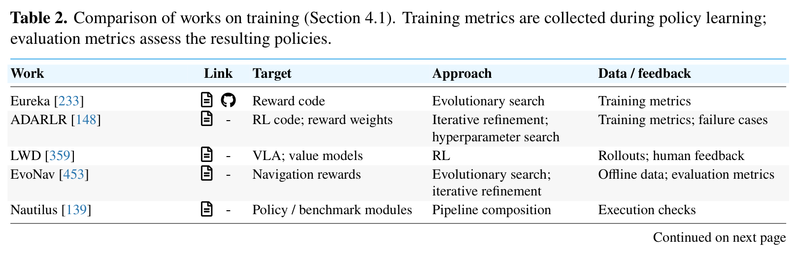

| Work | Link | Target | Approach | Data / feedback |
| :--- | :--- | :--- | :--- | :--- |
| Eureka [233] | A § | Reward code | Evolutionary search | Training metrics |
| ADARLR [148] | A - | RL code; reward weights | Iterative refinement; hyperparameter search | Training metrics; failure cases |
| LWD [359] | A - | VLA; value models | RL | Rollouts; human feedback |
| EvoNav [453] | A - | Navigation rewards | Evolutionary search; iterative refinement | Offline data; evaluation metrics |
| Nautilus [139] | A - | Policy / benchmark modules | Pipeline composition | Execution checks |
| Demo2Reward [92] | A § | Reward prompt | Iterative refinement | Demonstrations |
| RDA [161] | A - | Reward code | Evolutionary search | Rollout videos |
| HARBOR [191] | A § | RL code; configurations | Iterative refinement; hyperparameter search | Execution checks; training metrics |
| ReCoVLA [106] | A - | Recovery rewards; residual policies | Single-pass generation; RL | Failure cases; simulator state |
| ENPIRE [383] | A § | Training code | Iterative refinement | Rollouts; evaluation metrics |
| RoboLineage [231] | A § | Training data; policy records | Data curation; iterative refinement | Rollouts; evaluation metrics |
| CRWM [401] | A - | Reward code | Single-pass generation | Offline data |
| AgenticRobotics [417] | A - | Tool records; reusable workflows | Iterative refinement | Evaluation metrics |
| EmbodiedSkills [351] | A § | Planner; VLA; scheduler | SFT | Demonstrations |
| FluxVLA Engine [189] | A § | Training pipelines | Pipeline composition; SFT | Demonstrations |

**Caption:** Table 2. Comparison of works on training (Section 4.1). Training metrics are collected during policy learning; evaluation metrics assess the resulting policies.

**Caption[CN]:** 表 2. 训练相关代表性工作对比（第 4.1 节）。训练指标在策略学习过程中收集；评估指标用于评估生成的策略。

### 4.2 Perception (感知理解)

> <strong>Para. 9:</strong> Perception translates observations into task-relevant concepts, relations, geometry, or beliefs. The agentic intervention may be an interpretation, a request for another observation, or a physical action that reveals missing evidence. The representation must support the next decision: identifying a handle, for example, also requires geometry accurate enough for the intended grasp.

> <strong>Para. 9[CN]:</strong> 感知模块负责将原始传感器观测转化为与当前任务紧密相关的概念、空间拓扑关系、度量几何或信念状态。智能体在感知环节的自主干预可以表现为一次高阶语义解译、发起对另一视角观测的主动查询请求，或是通过物理动作来主动消除遮挡以获取缺失证据。感知的输出表征形式必须切实匹配下游决策的需求：例如，单纯在 2D 图像中识别出抽屉把手是远远不够的，系统还必须提供足够精确的 3D 空间几何与朝向参数，以支撑机械臂完成确定性的物理抓取。

> <strong>Para. 10:</strong> Observations. An observations process chooses what evidence to seek when the current view needs renewal. Situated human-robot conversation systems [160] combine multimodal interaction with task-level attention and tool calls, while HINT [239] updates intent and routes camera views at manipulation-pattern transitions, and re-localizes the same committed target when tracking confidence is low. SCOPE [103] makes camera orientation and zoom explicit actions whose returned observations condition the next perception request, illustrating a camera agent rather than a fixed detector.

> <strong>Para. 10[CN]:</strong> 观测调度。当现存的瞬时视角无法提供充分信息时，观测调度机制负责决定应当主动探寻何种新证据。情境化人机多模态对话系统 [160] 将人类语言交互与任务级视觉注意力及感知工具调用深度结合；HINT [239] 则在操作行为范式切换的临界点动态更新意图并主动路由相机视角，并在视觉追踪置信度跌破阈值时自适应重新定位已锁定的操作目标；SCOPE [103] 则将相机的平移、俯仰（PTZ）与光学变焦建模为显式的可执行控制动作，其返回的新特写观测直接作为下一次感知解译的输入条件，生动诠释了“主动相机控制智能体”相比于“被动固定目标检测器”的巨大灵活性。

> <strong>Para. 11:</strong> Active perception changes the evidence itself. MG-VQA (formerly Probe) [11] lets a VLM invoke perception, grasp-and-remove, and pushing tools to expose occluded information before answering a visual question. [257] uses visual predicate checks and additional viewpoints to correct the state supplied to a Planning Domain Definition Language (PDDL) planner. Manipulation can therefore gather information, while an additional observation can invalidate a symbolic planning premise. The choice to move an object or camera trades the value of new evidence against motion cost and risk.

> <strong>Para. 11[CN]:</strong> 主动感知干预。主动感知机制能够直接通过物理动作去改变证据本身的存在状态。MG-VQA（原名 Probe）[11] 赋予多模态大模型在回答视觉问题之前，主动调用抓取移开或推挤拨弄工具的能力，从而揭示被前方杂物严重遮挡的关键目标；VAP-TAMP [257] 则利用视觉谓词检测与多视角变换，动态修正并校准输入给经典规划域定义语言（PDDL）规划器的符号化状态空间。由此可见，物理操作本身可以成为一种高效的信息获取手段，而额外视角下的新观测则可能直接推翻原有的符号规划前提。选择移动物理物体还是移动观测相机，本质上是在新证据带来的信息增益与物理动作消耗的机械成本及碰撞风险之间进行权衡。

> <strong>Para. 12:</strong> Decisions. Based on the previous observation, the decision is the final product that the executor can use. ABot-N1 [86] uses a recurrent spatial reasoner to update semantic targets while a distinct action expert supplies continuous navigation behavior; Steerable VLA policies [42] similarly expose semantic-subtask, atomic-motion, and grounded-point or trace steering modes. A distributed conversational manipulation framework [142] grounds pixel predictions through depth and robot coordinates on each command, whereas RoboVista’s [386] robot-VQA abstraction evaluates whether a model can answer perception questions across diverse application modules. Whether the output is a renewed view, a geometric target, or a symbolic answer, its quality depends on the downstream decision it must support.

> <strong>Para. 12[CN]:</strong> 感知决策产物。立足于前序的多模态观测，感知模块最终产出可供底层执行器直接消费的结构化决策结果。ABot-N1 [86] 采用循环空间推理器（Recurrent Spatial Reasoner）来持续追踪与更新语义导航目标，同时由独立的底层动作专家网络输出连续运动控制；可控具身策略 Steerable Policies [42] 同样提供了语义子任务、原子动作以及物理接地点/轨迹引导等多重控制模式；分布式对话操作框架 [142] 在响应每条自然语言指令时，将 2D 像素预测通过深度传感器与手眼标定矩阵严格投射至机器人绝对坐标系中；而 RoboVista [386] 则提出机器人专属的具身问答（Robot-VQA）评测基准，全面考察大模型跨多元应用模块回答空间几何与拓扑感知问题的综合能力。无论是输出一个经由主动探索获得的新鲜视角、一个 3D 几何位姿目标，还是一个符号化谓词真值，感知的优劣最终完全取决于它能否精确赋能下游的执行动作。

> <strong>Para. 13:</strong> Navigation requires spatial evidence to remain accessible as the robot moves. AgenticNav [188] provides heading-indexed views, selective recall, a compact trajectory map, and geometric tools. The VLM can request evidence and choose a navigation target; depth-based validity checks and movement remain below that choice. SoFar [271] provides an earlier spatial-grounding comparison: object perception constructs a scene graph containing positions and semantic orientation vectors, and the VLM specifies desired object geometry that deterministic fitting and motion planning realize. A textual description such as “upright” becomes useful only when bound to the orientation representation understood by the executor.

> <strong>Para. 13[CN]:</strong> 移动导航对空间多模态证据的连续可访问性提出了极高要求。AgenticNav [188] 创新性地构建了按航向角索引的环视视图库、选择性回溯检索机制、紧凑的历史轨迹拓扑图以及一系列 3D 几何计算工具：多模态大模型能够自主请求空间几何证据并决策下一阶段的导航锚点，而基于深度图的可行性检测与底层电机驱动则稳居于该高阶决策之下可靠运行；SoFar [271] 提供了早期的空间接地对比范例：物体感知模块构建包含绝对 3D 空间坐标与语义朝向向量的场景图（Scene Graph），随后大模型指定期望达成的物体几何关系，最终由确定性表面拟合与经典运动规划器联合求解落地。像“垂直竖立放置”这样抽象的自然语言描述，唯有被严格绑定到底层执行器能够理解的物理法向量或四元数朝向表征时，才能真正转化为物理世界中的有效动作。

> <strong>Para. 14:</strong> Reflections. The robot needs a prompt reflection for the change of environment or behavior. [193] first builds a visual scene graph from sensor observations, then identifies which object changed its status during manipulation, and finally guides a corrective action if the target slipped from the gripper. Robo-Harness K1 [193] uses this reflection loop to update object states across subtasks, distinguishing expected contact forces from abnormal collisions.

> <strong>Para. 14[CN]:</strong> 敏捷即时反思。当物理环境突变或机器人动作偏离预期时，系统必须具备敏捷的即时反思与状态重估能力。Robo-Harness K1 [193] 首先从传感器观测中构建实时视觉场景图，精确判定机械臂在抓取过程中究竟哪个物体的位姿状态发生了非预期改变，并在检测到目标滑落夹爪时即刻触发几何级纠偏动作；该工作利用这种闭环反思机制在长程子任务切换间持续维护物体真实状态，能够清晰区分抓取所需的预期接触反力与危险的非预期机械碰撞。

> <strong>Para. 15:</strong> Navigation summarizes all dynamic and static spatial information. OpenFrontier [261] uses semantic frontiers to guide autonomous exploration: open areas are ranked by predicted relevance to the task prompt, allowing the agent to systematically explore multi-room buildings. AnchorVLN [330] and CoRelNav [100] link panoramic observations and topological graphs, grounding textual room descriptions in geometric frontiers. Related works are compared in Table 3.

> <strong>Para. 15[CN]:</strong> 导航系统对动静态空间信息的全局汇总。OpenFrontier [261] 利用语义前沿（Semantic Frontiers）引导大空间自主探索：根据未知前沿区域与当前自然语言任务目标的潜在相关性对探索候选点进行动态优先级排序，使智能体能够系统化穿梭于多房间建筑群中开展搜寻；AnchorVLN [330] 与 CoRelNav [100] 则将 360 度全景视觉观测与拓扑环境图建立严密关联，将“去厨房水槽旁”等粗粒度语言指令精准接地为拓扑图中的几何前沿路径点。感知领域的代表性工作在表 3 中进行了系统梳理与对比。

### Table 3. 感知相关工作对比 (Comparison of Works on Perception)

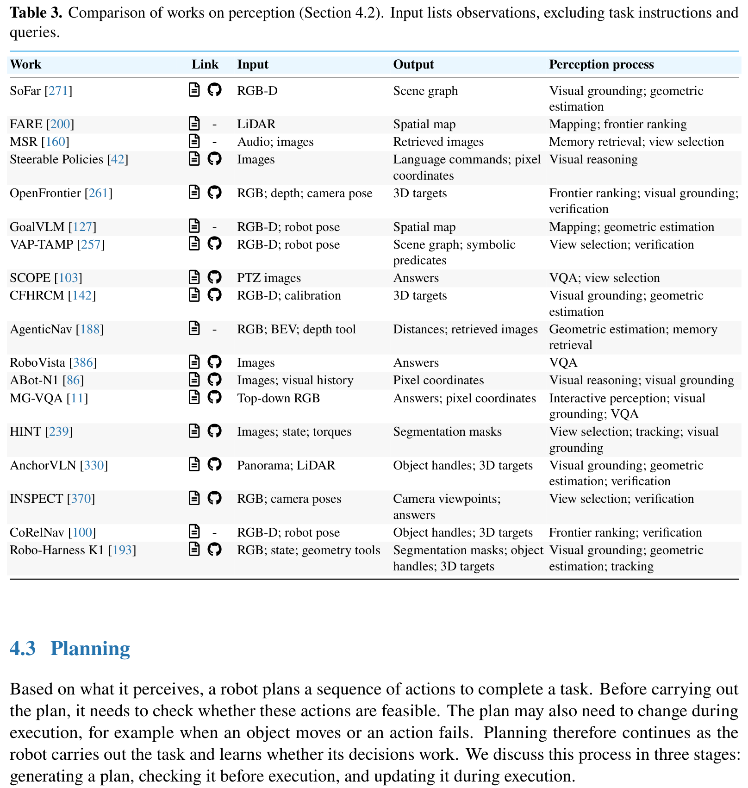

| Work | Link | Input | Output | Perception process |
| :--- | :--- | :--- | :--- | :--- |
| SoFar [271] | A § | RGB-D | Scene graph | Visual grounding; geometric estimation |
| FARE [200] | A - | LiDAR | Spatial map | Mapping; frontier ranking |
| MSR [160] | A - | Audio; images | Retrieved images | Memory retrieval; view selection |
| Steerable Policies [42] | A § | Images | Language commands; pixel coordinates | Visual reasoning |
| OpenFrontier [261] | A § | RGB; depth; camera pose | 3D targets | Frontier ranking; visual grounding; verification |
| GoalVLM [127] | A - | RGB-D; robot pose | Spatial map | Mapping; geometric estimation |
| VAP-TAMP [257] | A § | RGB-D; robot pose | Scene graph; symbolic predicates | View selection; verification |
| SCOPE [103] | A § | PTZ images | Answers | VQA; view selection |
| CFHRCM [142] | A § | RGB-D; calibration | 3D targets | Visual grounding; geometric estimation |
| AgenticNav [188] | A - | RGB; BEV; depth tool | Distances; retrieved images | Geometric estimation; memory retrieval |
| RoboVista [386] | A § | Images | Answers | VQA |
| ABot-N1 [86] | A § | Images; visual history | Pixel coordinates | Visual reasoning; visual grounding |
| MG-VQA [11] | A § | Top-down RGB | Answers; pixel coordinates | Interactive perception; visual grounding; VQA |
| HINT [239] | A § | Images; state; torques | Segmentation masks | View selection; tracking; visual grounding |
| AnchorVLN [330] | A § | Panorama; LiDAR | Object handles; 3D targets | Visual grounding; geometric estimation; verification |
| INSPECT [370] | A § | RGB; camera poses | Camera viewpoints; answers | View selection; verification |
| CoRelNav [100] | A - | RGB-D; robot pose | Object handles; 3D targets | Frontier ranking; verification |
| Robo-Harness K1 [193] | A § | RGB; state; geometry tools | Segmentation masks; object handles; 3D targets | Visual grounding; geometric estimation; tracking |

**Caption:** Table 3. Comparison of works on perception (Section 4.2). Input lists observations, excluding task instructions and queries.

**Caption[CN]:** 表 3. 感知相关代表性工作对比（第 4.2 节）。输入列列出了各类观测数据（不含任务指令与查询文本）。

### 4.3 Planning (任务规划)

> <strong>Para. 16:</strong> Based on what it perceives, a robot plans a sequence of actions to complete a task. Before carrying out the task, the planner breaks the user's instruction into subgoals or operations. During execution, it adjusts the sequence when an action fails or the environment changes. How far ahead a planner decides depends on the reliability of its models and the difficulty of predicting downstream effects.

> <strong>Para. 16[CN]:</strong> 依托感知层所提供的物理世界证据，机器人需要规划出一套有序的动作序列以达成指定任务。在正式执行之前，规划器负责将用户的高级抽象指令合理拆解为一系列连贯的子目标或原子操作；在执行阶段，一旦某项操作遭遇失败或外部环境发生动态突变，规划器必须能够自适应调整后续步骤的时序依赖。规划器在前瞻决策时究竟应当规划多长的时间步跨度，根本上取决于其底层预测模型的保真度以及预测长时程物理交互后果的难易程度。

> <strong>Para. 17:</strong> Generating a Plan. Some planners choose one operation at a time and use its result to decide what to do next. SayPlan [274] uses a hierarchical 3D scene graph: the planner first searches for the relevant room, expands the objects inside that room, and then chooses the next action based on current object states. This search limits the context length of the language model and keeps the plan aligned with the physical layout. RoCo [237] uses two communicating language models for bimanual coordination, where each agent proposes candidate trajectories for one arm and negotiates collision-free paths before execution.

> <strong>Para. 17[CN]:</strong> 规划生成机制。部分反应式规划器采取单步推进策略，即每次仅决策单一操作，并根据该操作返回的物理执行结果决定下一步对策。SayPlan [274] 引入分层 3D 场景图：规划器首先在顶层检索目标所在的房间，随后局部展开该房间内部的候选物体节点，并依据物体的实时状态生成下一阶段动作。这种自顶向下的搜索剪枝策略有效避免了大语言模型上下文窗口的爆炸，并确保了高阶逻辑规划始终与物理真实布局保持严密一致；RoCo [237] 则引入多智能体通信机制来实现复杂的双臂协同：两个独立的大模型分别扮演左右机械臂的专用智能体，在正式下发控制前相互协商候选轨迹并消除潜在的几何碰撞冲突。

> <strong>Para. 18:</strong> The planner can also specify a subgoal and let a trained policy produce the lower-level movement. HiRobot [297] predicts a 2D bounding box or a keypoint representing where the object should be moved, while Gemini Robotics-ER 1.5 [320] outputs continuous 3D target coordinates that condition a lower-level controller. When the environment allows several valid plans, STARS [153] uses affordance maps to score alternative grasp poses and selects the candidate that leaves subsequent steps unobstructed.

> <strong>Para. 18[CN]:</strong> 规划器同样可以仅决策高阶子目标（Subgoals），并将底层连续运动的生成全权委托给经过专门训练的局部策略。HiRobot [297] 预测表示物体目标放置位置的 2D 目标边界框或几何关键点；Gemini Robotics-ER 1.5 [320] 则直接输出高精度的连续 3D 目标空间坐标，作为底层控制器的输入条件；当物理环境允许多条可行的规划路径时，STARS [153] 借助交互可供性图谱（Affordance Maps）对多种候选抓取位姿进行综合打分，优先选择那些不会对后续操作步骤构成几何阻挡的最优解。

> <strong>Para. 19:</strong> Beyond choosing the next operation or subgoal, a planner can also specify how actions depend on each other. EmboTeam [428] and IMR-LLM [306] generate executable programs or behavior trees that define sequential, parallel, and conditional execution. Specifying these relationships allows the robot to execute independent operations concurrently and skip unnecessary steps when an outcome has already been achieved.

> <strong>Para. 19[CN]:</strong> 除了顺序挑选下一步操作或子目标，高阶规划器还可以显式指定不同动作之间的逻辑依赖与因果前置条件。EmboTeam [428] 与 IMR-LLM [306] 直接生成可执行的 Python 程序或行为树（Behavior Trees），结构化定义了任务的顺序执行、并行执行以及条件分支逻辑。显式建模这些时空依赖关系使得机器人系统能够在双臂或多机协作时并发执行相互独立的动作分支，并在检测到某项中间目标已被提前达成时，自主跳过冗余动作。

> <strong>Para. 20:</strong> Checking a Plan before Execution. Once actions have been proposed, the system can check whether they are feasible before the robot moves. KnowNo [279] measures the uncertainty of the language model across possible next steps: when the model is confident, it proceeds; when multiple actions appear equally likely, it asks for human clarification. AARC [202] tests whether the planned action satisfies predefined preconditions: if an object must be open before items can be retrieved from it, the planner verifies that the open subtask has completed.

> <strong>Para. 20[CN]:</strong> 执行前的可行性校验。在候选动作被提议之后，系统可以在机器人实际物理动作之前先行开展严格的可行性审查。KnowNo [279] 系统度量了大语言模型在预测各种候选动作时的置信度分布与认知不确定性：当模型高度笃定时直接放行执行；而当多个冲突动作的概率相持不下时，系统主动暂停并向人类请求澄清；AARC [202] 则对规划动作的前置物理依赖进行逻辑检验：例如，从抽屉中取出物品的前提是抽屉已被完全拉开，规划器会严格校验该前置状态是否确已满足。

> <strong>Para. 21:</strong> Before planning the actions, the system can also check whether the goal is clear. When given an ambiguous command like “clean the table”, an agent may list the objects that need to be moved and ask the user to confirm which ones to discard [279]. SafeMem [180] verifies plans against safety constraints, ensuring that the proposed trajectory does not violate workspace boundaries or move fragile objects through hazardous regions.

> <strong>Para. 21[CN]:</strong> 在正式制定动作序列之前，系统同样需要校验任务目标本身的清晰度与无歧义性。当接收到类似“清理桌面”等高度模糊粗粒度的人类指令时，智能体能够主动枚举桌面上需要移动的各类物品，并主动向人类用户核实哪些物品应当被丢弃、哪些物品应当归位保留 [279]；SafeMem [180] 则将生成的规划方案对照严格的形式化物理安全边界进行检验，确保提议的轨迹绝不会越过机械臂工作空间死区或将易碎贵重物品搬运至高温明火等危险区域上方。

> <strong>Para. 22:</strong> Alongside checks based on graphs and rules, planners can also use learned models to evaluate proposed plans. Reflective Test-Time Planning [105] uses a 3D-aware VLM to visually evaluate candidate subgoals, predicting whether each candidate will lead to task success. MaP-WAM [448] pairs a language planner with a world-action model that simulates the video outcome of proposed steps, filtering out plans whose predicted physical consequences diverge from the goal.

> <strong>Para. 22[CN]:</strong> 除了依赖几何图和硬编码逻辑规则外，规划器还可以引入学习型的世界模型或评判模型来前瞻评估候选方案。测试期反思规划（Reflective Test-Time Planning）[105] 借助具备 3D 空间感知的视觉语言模型对候选子目标进行视觉前瞻评估，精准预测每个候选状态达成最终任务目标的概率；MaP-WAM [448] 将大语言模型规划器与世界动作模型（WAM）深度绑定，由世界动作模型前瞻推演提议动作在未来数秒内的物理视频展开，从而在物理执行前直接过滤掉那些在推演中偏离预期目标的错误规划。

> <strong>Para. 23:</strong> Updating a Plan during Execution. Even after these checks, an action may fail or encounter unexpected conditions. When an object slips from the gripper or an obstacle blocks the path, the planner must detect the failure and decide how to recover. DV-VLN [194] monitors navigation progress: if the robot remains in the same location across multiple time steps, the agent selects an alternative unexplored direction. ReflectVLM [71] uses visual feedback to diagnose manipulation failures, determining whether an ungrasped object should be re-approached from a different angle.

> <strong>Para. 23[CN]:</strong> 执行期的动态重规划与纠偏。即便利落地通过了上述前置校验，物理世界中的动作执行依然可能遭遇突发失败或未预期的动态扰动。当物体在夹爪中发生滑动偏斜、或突发动态障碍物阻断路径时，规划器必须能够敏锐检测到该失败事件并自主决断恢复对策。DV-VLN [194] 在自主导航中实时监控位移进度：若检测到机器人在多个连续时步内陷于原地打滑或徘徊，智能体会立即判定发生停滞并主动选择另一条尚未探索的备选通道；ReflectVLM [71] 则利用操作前后的视觉差异直接诊断机械臂操作故障，精准判断未成功抓取的物体是否需要重新调整机械臂位姿从全新的接近角度发起二次抓取。

> <strong>Para. 24:</strong> To support these decisions, the system needs to report execution results in a way the planner can understand. A low-level controller may report joint torques or Cartesian errors, but the planner needs to know whether the subtask succeeded. HLMF [145] translates motor logs into semantic progress descriptions, allowing an LLM planner to reason about execution failures without processing raw sensor streams.

> <strong>Para. 24[CN]:</strong> 为了支撑高阶重规划决策，底层系统必须将物理执行结果以高阶规划器能够无歧义理解的形式向上汇报。底层的电机控制器通常仅能返回关节力矩负荷或笛卡尔坐标跟踪误差等低维数值，但上位规划器真正关切的是语义级的子任务是否确已成功达成。HLMF [145] 能够自动将底层的电机运行日志与传感器时序流翻译为结构化的语义进度摘要，从而允许上位的大语言模型规划器在无需直面海量原始物理时序流的前提下，直接就执行故障根因开展高阶因果推理。

> <strong>Para. 25:</strong> When selecting the next action, the planner can also draw on earlier actions and observations. EEAgent [340] maintains an interaction log of completed subtasks, preventing the planner from repeating operations that have already been carried out. In long-horizon tasks, remembering which drawers were already inspected or which tools were tried and rejected prevents redundant exploration.

> <strong>Para. 25[CN]:</strong> 在裁定下一步动作时，规划器同样需要借力于历史交互中沉淀的长期动作与观测记忆。EEAgent [340] 维护着一份完整的已完成子任务时序日志，坚决防止规划器在长流程中陷入重复执行已完成步骤的死循环；在长程家政清洁或物品搜寻任务中，精准记住哪些抽屉柜门此前已经被翻找过、哪些工具此前已被测试并证伪，对于杜绝无意义的低效冗余探索至关重要。

> <strong>Para. 26:</strong> For embodied question answering, HFLEX-EQA [270] combines past visual observations and topological maps, allowing the planner to identify which unexplored room is most likely to contain the answer object. LocalNav [9] and NavMCP [167] use structured tool calls to query spatial maps, letting the planner verify that a proposed waypoint is physically reachable before commanding the base to move.

> <strong>Para. 26[CN]:</strong> 在具身问答（EQA）任务中，HFLEX-EQA [270] 将历史多视角图像与全局拓扑地图深度融合，使高层规划器能够结合先验常识智能推断哪一个尚未踏足的房间最有可能寻获目标物体；LocalNav [9] 与 NavMCP [167] 则通过标准的结构化工具调用接口查询几何与语义地图，在正式向底盘下发导航指令前，先行严格校验候选路径点在当前物理环境下是否完全可达。

> <strong>Para. 27:</strong> However, revising the action sequence may be insufficient if the planner repeatedly attempts the same failing behavior. MaCoPlanner [389] tracks failure patterns: when multiple attempts at the same step fail, it switches from localized adjustment to an entirely different high-level strategy, such as asking for human assistance or selecting an alternative tool.

> <strong>Para. 27[CN]:</strong> 然而，若规划器在遭遇顽固物理障碍时陷入反复尝试同一种无效行为的僵局，单纯微调动作序列往往无济于事。MaCoPlanner [389] 持续追踪故障模式：当检测到系统在执行同一特定子任务时连续多次受挫，它会果断从局部的微小参数微调跳脱出来，主动切换至截然不同的宏观策略分支，例如主动呼叫人类介入协助，或是从工具库中调换另一种物理形态的备选工具。

> <strong>Para. 28:</strong> Overall, how far ahead a robot plans should depend on how reliably it can predict what will happen. In static environments with known objects, open-loop plans spanning several operations execute reliably. In dynamic environments, reactive planning that selects one subtask at a time and verifies each step prevents cascading execution errors. Related works are compared in Table 4.

> <strong>Para. 28[CN]:</strong> 概括而言，机器人究竟应当向前预测多远的规划时域，根本上取决于它对物理未来演化的预测置信度与可靠度。在已知物体完全静态分布的确定性环境中，直接生成跨越多个复杂操作的长程开环规划即可稳定可靠地执行；而在高度动态多变、富含不可预知扰动的非结构化环境中，采用单步推进、实时严密校验每一步物理效果的反应式闭环规划，则是杜绝级联累积性执行崩溃的根本保障。规划领域的代表性工作在表 4 中进行了详尽对比。

### Table 4. 任务规划相关工作对比 (Comparison of Works on Planning)

| Work | Link | Task | Plan Output | Model |
| :--- | :--- | :--- | :--- | :--- |
| KnowNo [279] | A § | Manipulation | Action | PaLM-2-L |
| SayPlan [274] | A - | Manipulation | Action | GPT-4 |
| RoCo [237] | A § | Manipulation | Action; Trajectory | GPT-4 |
| ReflectVLM [71] | A § | Manipulation | Action | LLaVA-1.5-13B |
| HiRobot [297] | A - | Manipulation | Goal | PaliGemma-3B |
| Gemini Robotics 1.5 [320] | A - | Manipulation | Goal | Gemini Robotics-ER 1.5 |
| EmboTeam [428] | A - | Manipulation | Program | GPT-4o |
| DV-VLN [194] | A § | Navigation | Action | Llama-2-7B |
| AARC [202] | A - | Manipulation; Navigation | Action | GPT-o3 |
| AgentRob [218] | A § | Human–Robot Interaction | Action | Doubao-Seed-1.8 |
| Reflective Test-Time Planning [105] | A § | Manipulation | Action | LLaVA-3D-7B; Qwen2.5-VL-3B |
| HLMF [145] | A - | Manipulation | Action | GPT-4o |
| FLA [290] | A § | Manipulation | Action | GPT-4.1; Claude Sonnet 4 |
| IMR-LLM [306] | A - | Manipulation | Schedule; Program | GPT-4o; Qwen3-32B |
| SERP [171] | A - | Navigation | Trajectory | Qwen3-VL-Plus; Qwen3.7-Plus |
| EEAgent [340] | A - | Manipulation | Action | GPT-4o |
| LocalNav [9] | A - | Navigation | Goal | Qwen3.5-4B |
| HUME [382] | A § | Manipulation | Action | GPT-4.1 |
| WCM [51] | A - | Manipulation | Action | - |
| STARS [153] | A § | Manipulation | Goal | GPT-3.5 (text-davinci-002); GPT-4 |
| MaCoPlanner [389] | A § | Manipulation | Action | GPT-4o |
| NavMCP [167] | A - | Navigation; Embodied Question Answering | Goal | Qwen3.6-Plus |
| ATP-VPDSG [232] | A - | Manipulation | Action | Qwen3-VL |
| ActionReasoning 2.0 [335] | A - | Manipulation | Action | Qwen3.7-Plus / Qwen3-7B |
| SafeMem [180] | A § | Manipulation | Action | GPT-4o |
| MaP-WAM [448] | A - | Manipulation | Goal | Qwen3.5-4B; Wan2.2-5B |
| BTA [235] | A - | Navigation; Human–Robot Interaction | Program | GPT-OSS-120B |
| GAVEL [350] | A - | Manipulation | Action; Schedule | Qwen3-8B |
| ActiveArena (Plan) [186] | A § | Manipulation | Goal | Qwen3-VL-2B |
| HFLEX-EQA [270] | A § | Embodied Question Answering | Goal | GPT-5.5; Gemini 3.5 Pro |
| CoRelNav [100] | A - | Navigation | Goal | Qwen3.7-Plus |
| NavProbe [210] | A § | Navigation | Goal; Action | GPT-5.5 |

**Caption:** Table 4. Comparison of works on planning (Section 4.3). Manipulation includes mobile manipulation; Model lists planning, replanning, or verification backbones.

**Caption[CN]:** 表 4. 规划相关代表性工作对比（第 4.3 节）。操作任务包括移动操作（Mobile Manipulation）；模型列列出了负责规划、重规划或验证的基座模型。

### 4.4 Robot Control (底层控制与动作执行)

> <strong>Para. 29:</strong> Robot control turns the steps chosen during planning into physical movement. How much detail the model needs to specify depends on what the execution module can do. A model may choose among predefined actions, provide language instructions to a learned policy, specify target poses for an inverse-kinematics solver, or write programs that define motion constraints and cost functions.

> <strong>Para. 29[CN]:</strong> 机器人底层控制模块的核心职责在于将规划层制定的离散决策步骤切实转化为连续平滑的物理机械运动。模型究竟需要输出何种细粒度的控制指令，完全取决于底层执行模块所具备的自主能力水平。模型可以直接在预先封装好的离散原子动作库中挑选、向具备通用理解能力的底层习得策略输出自然语言引导指令、向逆运动学（IK）求解器直接提供末端执行器的 6 自由度目标位姿，亦或是通过动态编写控制代码来显式指定优化器所需的运动约束条件与成本函数（Cost Functions）。

> <strong>Para. 30:</strong> Action and Language Commands. A model can control a robot by choosing among predefined actions. In manipulation, these actions often correspond to skills like grasping, placing, or pushing; in navigation, they correspond to moving forward, turning, or stopping. ETA [50] and BSP [104] use discrete action commands paired with parameter arguments (such as object IDs or target directions), letting a lower-level controller handle trajectory generation.

> <strong>Para. 30[CN]:</strong> 离散动作与自然语言指令控制。模型可以通过在预定义的动作集合中进行离散选择来直接控制机器人。在机械臂操作任务中，这些动作通常直接对应于成熟的封装技能，如“抓取”、“放置”或“推移”；在自主导航任务中，则对应于“直行”、“转向”或“制动”。ETA [50] 与 BSP [104] 采用离散动作指令与连续参数字典相绑定的范式（例如指定目标物体 ID 或运动方向偏角），将复杂的时空轨迹规划与碰撞规避完全交由底层专业控制器处理。

> <strong>Para. 31:</strong> The execution layer can also accept language instructions. For example, LWSV [130] trains a generalist VLA policy to follow language commands, while an upper-level LLM selects which instruction to send at each step. This hierarchy separates task-level reasoning from high-frequency motor control: the language model decides what the robot should do next, and the learned policy translates that instruction into joint velocities.

> <strong>Para. 31[CN]:</strong> 执行层同样可以直接接收连续的自然语言引导。例如，LWSV [130] 训练了一个能够精准遵从语言指令的通用 VLA 策略，而上位的大语言模型则专注于在每个阶段挑选并下发最恰当的语言控制指令。这种分层架构实现了任务级因果推理与高频电机控制的完美解耦：大语言模型在宏观时间尺度上决策机器人下一步的目标意图，而训练有素的底层神经策略则以几十赫兹的高频将这一语义指令实时转化为平滑的关节角速度。

> <strong>Para. 32:</strong> Target Poses and Control Programs. When predefined actions or language instructions are not precise enough, the model can specify a physical target. A common approach is to predict 3D target coordinates for the robot's end effector or navigation base. VIA [107] predicts 2D trajectory waypoints overlaid on camera images, which an inverse-kinematics solver lifts to 3D Cartesian commands. ManiSkillFormer [419] and Robo-Harness K1 [193] predict 6-DoF gripper poses, delegating path planning and collision avoidance to a motion-planning library.

> <strong>Para. 32[CN]:</strong> 空间目标位姿与控制程序生成。当预定义的离散动作或粗粒度的语言指令无法满足高精度工业装配或灵巧操作的需求时，模型可以直接指定精准的连续物理目标。最普遍的方法是预测机器人末端执行器或移动底盘的 3D 目标空间位姿。VIA [107] 在相机图像上直接预测 2D 轨迹路径点（Waypoints），随后通过逆运动学求解器将其解算提升为 3D 笛卡尔运动指令；ManiSkillFormer [419] 与 Robo-Harness K1 [193] 则直接预测夹爪在三维空间中的 6 自由度抓取姿态，将复杂的无碰撞轨迹平滑生成完全委托给成熟的运动规划库（如 MoveIt 或 cuRobo）。

> <strong>Para. 33:</strong> Other systems help the model choose and check motion targets. World Action Models [440] predict the visual consequences of proposed target poses, filtering out candidates that would cause collision. FAEA [325] and MEMENTO [314] let the model write Python programs that call motion APIs, incorporating loops, conditional branching, and sensor checks directly into the control logic.

> <strong>Para. 33[CN]:</strong> 许多先进系统为模型挑选与验证运动目标提供了强大的辅助机制。世界动作模型 WAA [440] 能够前瞻推演提议目标位姿所导致的物理视觉结果，在真实下发前主动筛除可能引发严重碰撞的危险候选；FAEA [325] 与 MEMENTO [314] 则更进一步，允许高阶模型直接编写调用底层运动 API 的完整 Python 控制程序，将逻辑循环、条件分支以及传感器实时门控逻辑无缝嵌入到控制流程中。

> <strong>Para. 34:</strong> Motion Constraints and Cost Functions. Instead of specifying a target pose, a model can specify constraints or a cost function for an optimizer. ReKep [120] uses a vision model to detect keypoints on objects and the robot, then writes Python code defining geometric constraints between those keypoints (such as keeping a cup upright or aligning a peg with a hole). An optimization-based solver then computes collision-free trajectories that satisfy the constraints in real time.

> <strong>Para. 34[CN]:</strong> 运动约束与成本函数生成。除了直接输出单一刚性目标位姿之外，模型还可以为底层数值优化器提供高级几何约束或连续成本函数。ReKep [120] 利用大视觉模型在操作物体与机器人关键部件上密集检测 3D 语义关键点，随后自主编写 Python 代码以严密定义这些关键点之间必须满足的相对几何约束（例如约束杯口必须始终保持竖直向上、或将轴销中心轴线与装配孔严格对齐）。底层的实时优化求解器随后在线计算出既完全满足这些时空约束、又完全杜绝碰撞的平滑轨迹。

> <strong>Para. 35:</strong> VoxPoser [118] writes programs that build spatial value maps for where the robot should move and what it should avoid. An optimal controller extracts trajectories from these value maps. For manipulation that involves substantial physical contact, CoRAL [469] generates stiffness and damping parameters for an impedance controller, adapting contact forces based on tactile and visual feedback.

> <strong>Para. 35[CN]:</strong> VoxPoser [118] 自主生成构建 3D 空间价值体素图（Value Maps）的程序代码，显式刻画机械臂应当趋近的吸引力场与应当规避的排斥力场，最优控制器随后在合成的势场中高速反解出平滑运动轨迹。对于涉及大量复杂物理接触与挤压的精密操作，CoRAL [469] 能够依据多模态先验自适应生成阻抗控制器所需的刚度（Stiffness）与阻尼（Damping）矩阵参数，并结合实时触觉与视觉力觉反馈动态微调接触力，避免压损精密工件。

> <strong>Para. 36:</strong> Execution Feedback. As the robot moves, the system needs to monitor whether the motion succeeded. Some systems rely on visual verification: Show-Harness [46] checks keyframe observations after each primitive to confirm that an object was successfully grasped. Other systems monitor sensor signals during motion: RoboDawn [93] tracks joint torques and tactile readings, halting execution when unexpected resistance is detected.

> <strong>Para. 36[CN]:</strong> 执行反馈回路。在机械运动过程中，系统必须不间断地严格监控物理动作是否切实达成了预期效果。部分系统高度依赖视觉验证：Show-Harness [46] 在每个原子控制原语结束时捕获关键帧观测，严格确认目标物体是否确已稳固处于夹爪之中；另一些系统则在高速运动全过程中持续监控底层物理传感流：RoboDawn [93] 以毫秒级频率实时追踪关节力矩负荷与末端触觉阵列读数，一旦捕捉到非预期的异常接触阻力便立即触发急停避险。

> <strong>Para. 37:</strong> Overall, the model’s output should match what the execution layer can reliably carry out. When the robot has a capable learned policy, high-level language or action commands suffice. When fine-grained geometric coordination or force control is required, target poses, motion constraints, and impedance parameters provide more direct control over the robot’s physical interaction. Related works are compared in Table 5.

> <strong>Para. 37[CN]:</strong> 总结而言，上位模型的输出形式必须与底层执行架构的实际处理能力相匹配。当机器人底层已经具备了鲁棒的泛化神经策略时，下发粗粒度的高层自然语言或离散动作原语便足以达成高效控制；而当面临亚毫米级的精密几何装配或需要精细控力的重接触操作时，直接指定空间目标姿态、数学运动约束以及阻抗力控参数，则能为机器人的物理交互提供更为确定、鲁棒且直观的安全保障。底层控制领域的代表性工作在表 5 中进行了系统对比。

### Table 5. 机器人控制相关工作对比 (Comparison of Works on Robot Control)

| Work | Link | Control Output | Executor | Feedback |
| :--- | :--- | :--- | :--- | :--- |
| VoxPoser [118] | A § | Cost | Optimizer | Vision; State |
| ReKep [120] | A § | Constraint | Optimizer | Vision; State |
| FAEA [325] | A § | Program | Interpreter | State; Execution Status |
| CoRAL [469] | A - | Cost | Optimizer | State |
| SCOPE [103] | A § | Action | Controller | Text; Execution Status |
| LWSV [130] | A - | Language | Learned Policy | Vision; State |
| ABot-N1 [86] | A § | Language; Target | Learned Policy | Vision |
| VIA [107] | A § | Target | Controller | Vision; State; Execution Status |
| MEMENTO [314] | A § | Program | Interpreter | State; Execution Status |
| ETA [50] | A § | Action | Controller | Vision; State; Execution Status |
| ART [412] | A - | Action | Controller | Vision; State |
| BSP [104] | A - | Action | Controller | State; Execution Status |
| Show-Harness [46] | A § | Action | Controller | Vision; State; Execution Status |
| ManiSkillFormer [419] | A - | Target | Controller | State; Execution Status |
| A-RAM [79] | A - | Trajectory | Controller | State |
| GPT-Policy [53] | A § | Target | Controller | Vision; State; Execution Status |
| KINO [39] | A - | Target | Learned Policy | Vision; State; Execution Status |
| RoboDawn [93] | A § | Action | Controller | Vision; State; Execution Status |
| ARMS [411] | A - | Feature | Learned Policy | Vision; State |
| COMPASS [329] | A - | Feature | Learned Policy | State; Feature |
| Robo-Harness K1 [193] | A § | Target | Controller | Vision; State; Execution Status |
| WAA [440] | A - | Target | Controller | Vision; Execution Status |

**Caption:** Table 5. Comparison of works on robot control (Section 4.4). Control Output lists the commands or representations passed to the execution module. Executor identifies the module that turns these outputs into robot actions. Feedback lists the information returned during execution.

**Caption[CN]:** 表 5. 机器人控制相关代表性工作对比（第 4.4 节）。控制输出列列出了传递给执行模块的指令或表征形式；执行器列指明了将这些输出转化为机器人实际动作的模块；反馈列列出了执行期间返回的信息。

### 4.5 Adaptation (自适应演进)

> <strong>Para. 38:</strong> Adaptation enables robotic systems to improve from experience by modifying inference-time conditioning, parameters, or policies. Unlike planning, which organizes decisions within a single task, adaptation carries knowledge across tasks or deployment environments. Systems adapt by updating in-context prompts, retrieving relevant experiences, tuning hyperparameters, or fine-tuning model weights.

> <strong>Para. 38[CN]:</strong> 自适应机制赋予了机器人系统基于历史物理经验持续自我改进的能力，其实现途径涵盖动态修改推理期的上下文条件（Conditioning）、调整系统超参数、乃至直接更新策略模型权重。不同于仅在单个任务生命周期内调度动作的局部规划，自适应机制致力于实现跨越不同任务甚至跨越全新物理部署环境的知识迁移与能力沉淀。具身系统的自适应途径主要包括：在线更新提示词上下文、从先验数据库中高效检索相似经验、自适应调优控制器参数，以及对神经网络主干进行参数级微调。

> <strong>Para. 39:</strong> Experience-Conditioned Decision Making. Prior experience can guide decisions without changing model weights. In-context learning uses successful or failed trajectories from previous tasks as examples in the model's prompt. TidyBot [376] summarizes user preferences from examples (such as where specific objects should be stored) and applies those rules to new rooms. DROC [430] retrieves past human corrections when a robot encounters a similar task, conditioning the planner on lessons learned from earlier mistakes.

> <strong>Para. 39[CN]:</strong> 基于经验条件化的决策机制。先验交互经验可以在完全冻结模型网络权重的前提下直接引导高阶决策。上下文学习（In-Context Learning）将此前任务中沉淀的高价值成功示范或失败教训直接作为少样本示例（Few-Shot Prompts）喂入大模型。TidyBot [376] 从人类的少量示范中自动提炼总结出个性化的收纳偏好规则（例如特定类型的衣物或玩具应当存放在哪个抽屉），并能将这些规则完美泛化应用至从未见过的全新居室环境中；DROC [430] 则在机器人面临相似困境时，高效检索历史上曾接受过的人类纠偏记录，从而利用过去所犯错误的教训作为约束，引导规划器规避重蹈覆辙。

> <strong>Para. 40:</strong> Planner Adaptation. Experience can also improve planning without modifying policy weights. SERP [171] tunes planner parameters (such as search depth and threshold values) based on execution outcomes across multiple trials. PhysMem [172] maintains a memory of physical object properties (such as mass and friction estimates) and updates these estimates when manipulation outcomes diverge from expectations, improving subsequent grasp planning.

> <strong>Para. 40[CN]:</strong> 规划器参数级自适应。经验同样可以在无需触碰底层策略权重的前提下，直接提升规划器的决策质效。SERP [171] 能够基于多个物理回合的执行成败反馈，自适应优化调优规划器内部的核心超参数（如搜索深度与剪枝阈值）；PhysMem [172] 专门维护了一套物理实体属性记忆库（存储对不同物体的质量、摩擦系数以及质心位置的在线估计值），一旦实际操控结果与物理推演出现偏差便即刻更新这些物理参数估计，从而极大改善后续抓取与放置规划的成功率。

> <strong>Para. 41:</strong> Policy and Model Updates. Parameter updates enable more persistent behavioral changes. Supervised fine-tuning adapts pretrained policies using demonstrations collected in the deployment environment: PAFF [80] and RoboCat [18] fine-tune generalist models on new tasks and embodiments. When demonstrations are scarce, corrective intervention provides targeted training data: Yell At Your Robot [296] fine-tunes high-level policies using language corrections provided during execution, while OLAF [209] updates policies online from human interventions.

> <strong>Para. 41[CN]:</strong> 策略与网络权重持久化微调。直接更新神经网络权重能够带来更为持久和彻底的行为模式进化。有监督微调（SFT）利用在目标部署现场所采集的全新物理示范来深度适配预训练模型：PAFF [80] 与 RoboCat [18] 成功在全新任务与全新硬件本体上对通用基座策略开展增量微调；当高质量完整示范极难获取时，人类的交互式即时干预提供了极具针对性的宝贵微调数据：Yell At Your Robot [296] 利用人类在执行现场所给出的即时口头语言纠错来定向微调上位高阶策略，而 OLAF [209] 则直接从人类物理接管介入的轨迹中在线微调底层策略。

> <strong>Para. 42:</strong> Autonomous interaction provides an additional learning signal. Self-improving systems use reinforcement learning to refine policies without continuous human oversight. SIEFM [289] and RECAP [268] use reward models or success detectors to evaluate autonomously collected rollouts, updating policy weights through reinforcement learning. Learning While Deploying [359] combines offline pretraining with online RL fine-tuning on a physical robot fleet, adapting policies to variations in lighting, background, and object appearance.

> <strong>Para. 42[CN]:</strong> 自主物理交互产生的强化学习信号。具备自进化能力的系统能够通过自主物理探索生成强化学习训练信号，摆脱对人类持续监督的重度依赖。SIEFM [289] 与 RECAP [268] 分别利用预训练奖励模型或高精度任务成功判别器，对机器人自主展开的交互轨迹进行自动化无偏打分，进而通过强化学习算法闭环更新策略网络权重；Learning While Deploying（LWD）[359] 将离线预训练与真实机器人集群上的在线强化学习微调融为一体，使策略在实际物理作业中能够迅速自适应真实环境的光照剧烈变化、背景杂乱扰动以及目标物体外观的细微差异。

> <strong>Para. 43:</strong> The choice of adaptation mechanism depends on the source of failure. When failure arises from incomplete task context or unstated preferences, in-context learning and memory retrieval provide immediate adaptation without training costs. When failure stems from motor execution errors or novel physical dynamics, parameter fine-tuning or reinforcement learning is necessary to produce reliable behavioral updates. Related works are compared in Table 6.

> <strong>Para. 43[CN]:</strong> 自适应机制的具体选型根本上取决于物理失败的深层根因。当执行失败源于不完备的任务上下文或人类未言明的个性化偏好时，上下文学习（In-Context Learning）与外置记忆检索能够以零训练成本实现立竿见影的自适应调整；而当失败根植于底层电机的动力学失准、高频执行偏差或前所未见的复杂接触物理特性时，针对网络权重的微调或基于物理反馈的在线强化学习，则是固化并获得可靠新运动技能的必经之路。自适应演进领域的代表性工作在表 6 中进行了系统对比。

### Table 6. 自适应相关工作对比 (Comparison of Works on Adaptation)

| Work | Link | Adapted Component | Adaptation Method | Adaptation Signal |
| :--- | :--- | :--- | :--- | :--- |
| PAFF [80] | A § | Model Weights | Supervised Learning | Demonstrations; Execution Outcomes |
| TidyBot [376] | A § | Context | Summarization | Demonstrations |
| RoboCat [18] | A - | Model Weights | Supervised Learning | Demonstrations; Execution Outcomes |
| OLAF [209] | A § | Model Weights | Supervised Learning | Corrections |
| DROC [430] | A § | Context; Memory | In-Context Learning; Summarization; Experience Retrieval | Corrections |
| LMPC [197] | A - | Model Weights; Context | Supervised Learning; In-Context Learning | Corrections; Execution Outcomes |
| Yell At Your Robot [296] | A § | Model Weights | Supervised Learning | Corrections |
| SIEFM [289] | A § | Model Weights | Reinforcement Learning | Rewards |
| RECAP [268] | A - | Model Weights | Reinforcement Learning | Corrections; Rewards |
| VLAW [95] | A § | Model Weights | Reinforcement Learning | Rewards; Execution Outcomes |
| PhysMem [172] | A § | Memory | Hypothesis Testing | Execution Outcomes |
| Reflective Test-Time Planning [105] | A § | Model Weights; Memory | Supervised Learning; Reinforcement Learning; Reflection | Rewards; Execution Outcomes |
| UPS [421] | A § | Model Weights | Supervised Learning | Corrections |
| SERP [171] | A - | Planner Settings; Memory | Parameter Tuning; Experience Retrieval | Execution Outcomes |
| CMMR-VLN [173] | A - | Memory | Reflection; Experience Retrieval | Execution Outcomes |
| Learning While Deploying [359] | A - | Model Weights | Reinforcement Learning | Corrections; Rewards |
| VERITAS [437] | A § | Model Weights | Supervised Learning | Demonstrations; Execution Outcomes |
| HERO [174] | A - | Model Weights; Memory | Supervised Learning; Experience Retrieval | Demonstrations; Execution Outcomes |
| EmbodiedSkills [351] | A § | Model Weights | Supervised Learning | Demonstrations |
| GPT-Policy [53] | A § | Context | In-Context Learning | Demonstrations; Execution Outcomes |
| RoboDawn [93] | A § | Memory | In-Context Learning | Execution Outcomes |

**Caption:** Table 6. Comparison of works on adaptation (Section 4.5). Demonstrations include task examples and action trajectories; Corrections include corrective instructions and interventions. Execution Outcomes include success, failure, and execution feedback.

**Caption[CN]:** 表 6. 自适应相关代表性工作对比（第 4.5 节）。示范包括任务示例与动作轨迹；纠正包括修正性指令与人工干预；执行结果包括成功、失败以及执行反馈。

## 5 Data: How Should the Agent Collect, Annotate, and Refine Robot Data? (数据层：智能体应当如何采集、标注与精炼机器人数据？)

### Figure 5. 共享机器人经验上的三大数据端干预机制 (Three Data-Side Interventions)

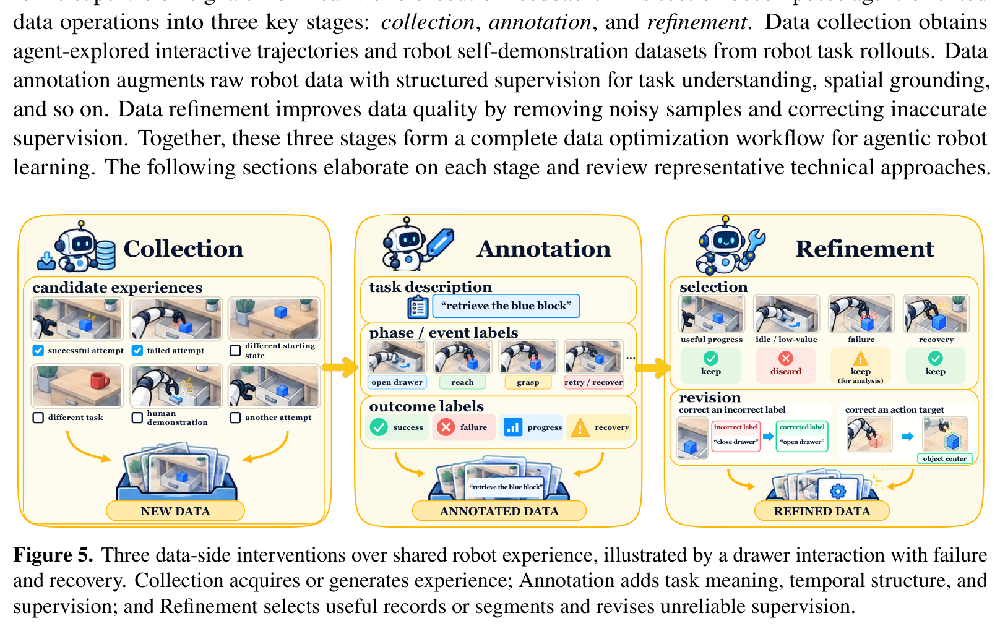

**Caption:** Figure 5. Three data-side interventions over shared robot experience, illustrated by a drawer interaction with failure and recovery. Collection acquires or generates experience; Annotation adds task meaning, temporal structure, and supervision; and Refinement selects useful records or segments and revises unreliable supervision.

**Caption[CN]:** 图 5. 以包含失败与恢复的抽屉交互为例说明的共享机器人经验三大数据端干预机制。数据采集（Collection）获取或自主生成经验轨迹；数据标注（Annotation）增添任务语义、时间结构与结构化监督信号；数据精炼（Refinement）筛选高价值记录或轨迹片段并修正不可靠监督。

> <strong>Para. 1:</strong> The progress of agentic robots is largely driven by data processing pipelines that prepare training data for robot policies and models. However, robot data is difficult and expensive to collect, and raw demonstration logs rarely contain the rich task labels, spatial relations, and verification signals required by modern foundation models. To address this bottleneck, researchers increasingly use agents to automate data collection, enrich demonstrations with multimodal annotations, and refine recorded trajectories into high-quality training datasets. Figure 5 illustrates how Collection, Annotation, and Refinement act on shared robot experience.

> <strong>Para. 1[CN]:</strong> 具身智能体机器人的跨越式演进，在很大程度上得益于为底层策略与具身模型构建的高效数据处理流水线。然而，真实机器人物理数据的采集极为困难且成本高昂，而未经加工的原始遥操作或交互日志极少直接蕴含现代具身基础模型所必需的丰富任务语义、空间几何关系以及细粒度验证信号。为突破这一严重的数据瓶颈，研究人员日益广泛地引入自主智能体来自动化执行物理数据采集、为多模态示范追加高维语义标注，并将杂乱的交互轨迹精炼清洗为高质量的黄金训练集。图 5 形象展示了数据采集（Collection）、数据标注（Annotation）与数据精炼（Refinement）三大干预机制如何协同作用于共享的机器人交互经验。

### 5.1 Collection (数据采集)

> <strong>Para. 2:</strong> Agent-based data collection aims to generate new robot trajectories or demonstrations through autonomous exploration, simulated practice, or generative synthesis. Unlike passive logging of human teleoperation, agentic collection allows the system to guide exploration toward novel states, balance task diversity, and generate data at scales that manual collection cannot match.

> <strong>Para. 2[CN]:</strong> 基于智能体的数据采集旨在通过自主物理探索、仿真交互演练或生成式多模态合成，批量生成全新的机器人交互轨迹或示范数据。不同于被动记录人类遥操作的传统方式，智能体使能的数据采集允许系统自主将探索前沿引向未曾涉足的新颖物理状态、主动平衡任务分布的多样性，并以纯人工采集无法企及的大规模吞吐量源源不断地供给具身数据。

> <strong>Para. 3:</strong> Physical Data Collection. An early example, AutoRT [3], uses language models to propose safe exploration goals in real environments, deploying mobile manipulators to execute foundational skills and collect real-world trajectories. SOAR [467] uses CogVLM [352] to identify task-relevant interaction targets in camera views and guides real-robot trial-and-error manipulation, expanding a dataset of instruction-following skills. FIND [68] coordinates autonomous physical exploration, collecting 456 manipulation episodes across six hours without human intervention.

> <strong>Para. 3[CN]:</strong> 物理真机自主数据采集。作为早期代表性开创工作，AutoRT [3] 利用大语言模型在真实物理场景中自主提出兼顾安全宪章的探索目标，调度大规模移动操作机器人机群自主执行基础动作技能，沉淀了海量真实交互轨迹；SOAR [467] 引入视觉语言模型 CogVLM [352] 在实时相机画面中精准识别与任务相关的交互目标，并引导真机自主开展试错式双臂操作，成功扩充了大规模复杂指令跟随技能数据集；FIND [68] 协同多臂自主物理探索，在长达 6 小时的连续无人工干预作业中全自动采集了 456 幕高质量操作轨迹。

> <strong>Para. 4:</strong> Sustained agent-based data collection involves key design choices for safety, reset mechanisms, and exploration strategies. Tether [199] addresses physical reset constraints by training bi-directional recovery policies: after attempting a task, the robot executes a learned reset skill to return the environment to an operable initial state. UPS [421] combines autonomous exploration with periodic human teleoperation, collecting corrective interventions only when the autonomous agent encounters unrecoverable failure states.

> <strong>Para. 4[CN]:</strong> 持续稳定的真机自主采集必须妥善解决物理安全约束、环境自主重置机制以及高效探索策略等核心工程难题。Tether [199] 针对物理环境难以自动重置的致命瓶颈，创新性地联合训练了正向任务策略与双向可逆的恢复重置策略：当机器人完成一次操作尝试后，自动触发后向重置技能将物体与工作台恢复至可再次操作的初始位姿；UPS [421] 则将自主探索与按需的人类遥操作纠偏深度融合，仅在智能体陷入不可逆的死锁或崩溃态势时请求人工接管，极具针对性地捕获关键故障修正数据。

> <strong>Para. 5:</strong> Agents can also direct additional data collection toward underrepresented scenarios. RoboCurate [152] evaluates policy success rates across task variations and directs collection toward configurations where performance is lowest. RoboTalk [84] coordinates inter-robot communication across multiple simulated embodiments, generating 7,950 validated trajectories across 53 multi-agent collaboration tasks. EmbodiRSI [158] combines 400 simulated trajectories with 10 real-robot rollouts per subtask, maximizing real-world sample efficiency.

> <strong>Para. 5[CN]:</strong> 智能体能够主动将数据采集重心导向长尾与低置信度的薄弱场景。RoboCurate [152] 持续评估当前策略在不同任务变体与空间布局下的成功率曲线，并自主调配采集预算优先探索那些当前性能表现最差的薄弱构型；RoboTalk [84] 在多机器人异构协同仿真中建立机间通信协议，全自动生成并验证了跨越 53 个复杂多智能体协作任务的 7,950 条有效轨迹；EmbodiRSI [158] 则在每个子任务中将 400 条高保真仿真轨迹与 10 条宝贵的真机实测展开轨迹进行联合优化，将真机物理采样效率推向极致。

> <strong>Para. 6:</strong> Simulation Data Generation. RoboGen [362] is an early example that integrates LLMs for task proposal, asset generation, and RL reward synthesis, autonomously generating 106 diverse tasks and corresponding training demonstrations. HumanoidGen [140] extends generative task design to humanoid whole-body control, producing 100 demonstrations per task across 20 humanoid manipulation benchmarks. RoboFactory [273] synthesizes multi-stage industrial assembly tasks, generating up to 150 demonstrations per task across 11 factory environments.

> <strong>Para. 6[CN]:</strong> 仿真环境自主数据生成。RoboGen [362] 率先提出将大语言模型全面整合至仿真任务提议、3D 资产生成与强化学习奖励函数合成的全生命周期闭环中，完全自主生成了 106 个高多样性具身任务及配套的训练示范；HumanoidGen [140] 将生成式任务设计拓展至双足人形机器人的全身协调控制，在 20 个高难度人形操作基准上为每个任务合成了 100 条全自由度轨迹；RoboFactory [273] 则针对工业装配场景，在 11 个现代化工厂仿真环境中为每个复杂多工序装配任务全自动合成了多达 150 条高质量专家轨迹。

> <strong>Para. 7:</strong> More recent work broadens the types of simulation data collected and generates full curricula. Video2Policy [409] extracts object geometry and motion trajectories from human demonstration videos, reconstructing executable simulation tasks that yield 100 policy rollouts per task. Zero2Skill [334] combines LLM task planning with heuristic motion primitives, accumulating 50 verified demonstrations for desktop clearing without manual reward tuning.

> <strong>Para. 7[CN]:</strong> 近期前沿研究进一步拓宽了仿真数据的模态类型并实现了完整的自适应课程生成。Video2Policy [409] 直接从网络人类操作演示视频中逆向解算物体 3D 几何与运动学位姿轨迹，将其高保真重建为可交互执行的仿真任务，并为每个任务自主生成 100 条策略学习轨迹；Zero2Skill [334] 将大语言模型的高阶任务拆解与确定性启发式运动原语相结合，在无需任何人工作业与奖励调优的情况下，全自动积累了 50 条经严格物理验证的桌面整理黄金示范。

> <strong>Para. 8:</strong> Generative Data Synthesis. Generative models offer another path to robot data by synthesizing videos and hand poses directly. V-Dreamer [101] uses video diffusion to generate visual trajectories, synthesizing up to 2,500 lifting trajectories that guide policy learning. Wh0 [45] generates 50,000 video episodes with paired 3D human hand poses in its WM-H dataset, providing diverse pretraining data for dexterous hand manipulation. Related works on data collection are compared in Table 7.

> <strong>Para. 8[CN]:</strong> 生成式多模态数据合成。生成式扩散大模型为机器人数据开辟了颠覆性的全新供给路径——直接跨模态合成高保真交互视频与 3D 人手/机械手姿态时序。V-Dreamer [101] 借助视频扩散模型直接生成可视化的物体交互运动轨迹，合成了多达 2,500 条物体抓取与抬升轨迹以直接引导下游策略模仿学习；Wh0 [45] 在其开源的 WM-H 数据集中生成了包含精确 3D 人手位姿时序的 50,000 幕视频片段，为五指多关节灵巧手的精细操作策略提供了极具广度与多样性的预训练燃料。数据采集代表性工作在表 7 中进行了详尽的横向对比。

### Table 7. 数据采集相关工作对比 (Comparison of Works on Data Collection)

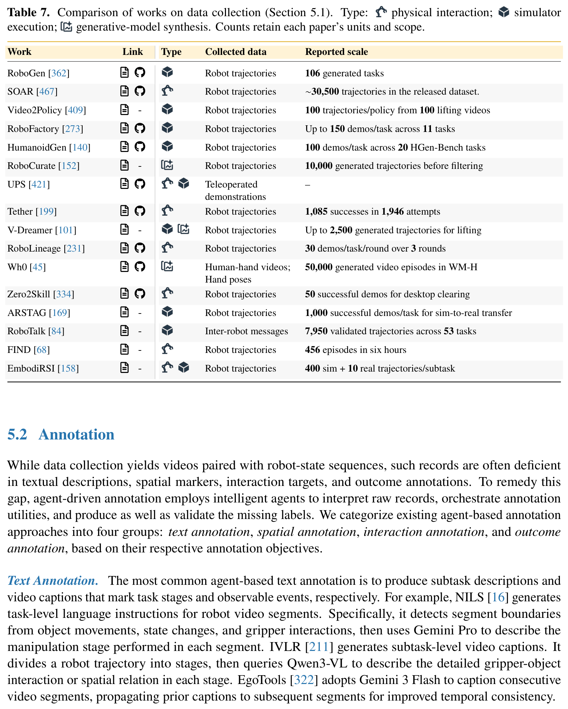

| Work | Link | Type | Collected data | Reported scale |
| :--- | :--- | :--- | :--- | :--- |
| RoboGen [362] | A § | Simulator | Robot trajectories | 106 generated tasks |
| SOAR [467] | A § | Physical | Robot trajectories | ∼30,500 trajectories in the released dataset |
| Video2Policy [409] | A - | Simulator | Robot trajectories | 100 trajectories/policy from 100 lifting videos |
| RoboFactory [273] | A § | Simulator | Robot trajectories | Up to 150 demos/task across 11 tasks |
| HumanoidGen [140] | A § | Simulator | Robot trajectories | 100 demos/task across 20 HGen-Bench tasks |
| RoboCurate [152] | A - | Simulator | Robot trajectories | 10,000 generated trajectories before filtering |
| UPS [421] | A § | Physical | Teleoperated demonstrations | – |
| Tether [199] | A § | Physical | Robot trajectories | 1,085 successes in 1,946 attempts |
| V-Dreamer [101] | A - | Generative | Robot trajectories | Up to 2,500 generated trajectories for lifting |
| RoboLineage [231] | A § | Simulator | Robot trajectories | 30 demos/task/round over 3 rounds |
| Wh0 [45] | A § | Generative | Human-hand videos; Hand poses | 50,000 generated video episodes in WM-H |
| Zero2Skill [334] | A § | Simulator | Robot trajectories | 50 successful demos for desktop clearing |
| ARSTAG [169] | A - | Simulator | Robot trajectories | 1,000 successful demos/task for sim-to-real transfer |
| RoboTalk [84] | A - | Simulator | Inter-robot messages | 7,950 validated trajectories across 53 tasks |
| FIND [68] | A - | Physical | Robot trajectories | 456 episodes in six hours |
| EmbodiRSI [158] | A - | Simulator + Real | Robot trajectories | 400 sim + 10 real trajectories/subtask |

**Caption:** Table 7. Comparison of works on data collection (Section 5.1). Type: physical interaction; simulator execution; generative-model synthesis. Counts retain each paper’s units and scope.

**Caption[CN]:** 表 7. 数据采集相关代表性工作对比（第 5.1 节）。类型包括物理交互、仿真器执行与生成模型合成。数量规模保留各篇原始论文所采用的统计单位与统计范围。

### 5.2 Annotation (数据标注)

> <strong>Para. 9:</strong> While data collection yields videos paired with robot-state sequences, such records are often deficient in structured task semantics, spatial references, and outcome labels. Foundation models excel at visual reasoning and can automate the annotation of raw interaction logs, producing enriched datasets with text descriptions, 2D/3D bounding boxes, affordance masks, and success verifications.

> <strong>Para. 9[CN]:</strong> 尽管数据采集能够输出海量由多视角视频与机器人关节状态时序组成的原始轨迹，但这些原始数据极度匮乏结构化的任务高阶语义、精确的空间参考坐标以及细粒度的执行结果真值。多模态基础模型在跨模态语义理解与视觉空间推理方面展现出卓越才能，能够完全自动化处理杂乱的原始交互日志，为原本扁平的轨迹数据注入详尽的自然语言任务描述、2D/3D 目标边界框、物理接触可供性掩码以及阶段性成功验证标签。

> <strong>Para. 10:</strong> Text Annotation. The most common agent-based text annotation is to provide task descriptions for unlabeled robot videos. NILS [16] uses Gemini 1.5 to segment long-horizon manipulation videos into semantic phases and generates task descriptions for each phase. SPARC [17] uses Qwen3.6-30B paired with gripper-event detection to identify key transition moments and generate concise subtask instructions. REAL [241] generates conversational dialogues and reasoning traces that explain why specific actions were chosen.

> <strong>Para. 10[CN]:</strong> 文本语义标注。基于智能体的文本标注最经典的应用在于为海量无标注的机器人操作视频逆向生成精确的任务语义描述。NILS [16] 借助 Gemini 1.5 将长程操作视频智能切分为因果分明的语义阶段，并为每个阶段全自动生成高质量的任务指令文本；SPARC [17] 将 Qwen3.6-30B 与夹爪开合事件检测器相耦合，精准捕捉机械臂状态改变的关键时序跃迁节点，并生成紧凑连贯的子任务指令；REAL [241] 则基于物理轨迹回放进一步生成上下文对话与深层推理痕迹，详尽解释每一步具体动作背后的物理因果缘由。

> <strong>Para. 11:</strong> Another form of text annotation adopts question-answer (QA) pairs to capture spatial, functional, and causal scene attributes. SpatialVLM [33] generates dense 3D spatial QA pairs using a pipeline of object detectors and depth estimators, enabling models to reason about quantitative distances and relative spatial positions. RoboSpatial [301] and FSD [424] generate geometric QA pairs from point clouds, training models to identify graspable parts and collision obstacles.

> <strong>Para. 11[CN]:</strong> 另一种极具价值的文本标注形态是生成丰富的问答对（QA Pairs），用于捕捉物理场景中的空间几何、功能属性与因果关联。SpatialVLM [33] 串联目标检测器、分割掩码与度量深度估计器，大规模程序化合成了密集的 3D 空间几何问答对，赋能具身大模型理解绝对物理距离与相对空间拓扑关系；RoboSpatial [301] 与 FSD [424] 则直接立足于 3D 点云生成高精度几何问答对，专门训练模型识别物体的可抓取部件与潜在物理碰撞障碍物。

> <strong>Para. 12:</strong> Beyond question-answer pairs, reasoning-trace annotations augment records with step-by-step rationales. ECoT [425] uses vision-language models to annotate robot demonstrations with chain-of-thought rationales, bounding boxes, and intermediate subgoals. This structured reasoning supervision encourages downstream policies to generate intermediate semantic predictions before decoding continuous motor actions.

> <strong>Para. 12[CN]:</strong> 除了常规的问答对，因果推理链条（Reasoning Traces）标注通过为轨迹追加逐步递进的决策理由，极大地丰富了具身监督信号。具身思维链 ECoT [425] 利用视觉语言模型为大规模机器人示范轨迹系统性标注思维链推导、目标 2D 边界框以及阶段性子目标；这种显式结构化的高阶推理监督，强力驱动下游策略网络在输出底层连续电机动作之前，先行自回归生成中间语义推理表征，极大提升了长程控制的鲁棒性。

> <strong>Para. 13:</strong> Spatial Annotation. Robotic agents perform spatial annotation by interpreting visual inputs and producing metric geometric labels. ECoT [425] annotates bounding boxes and 2D gripper positions across demonstration frames. SPARC [17] tracks 3D object trajectories using SAM2.1 and point trackers, reconstructing object motions in metric coordinates. AnnotateAnything [227] and EmbodiedGen V2 [357] segment 3D part masks and semantic labels from point clouds, providing the granular object structure required for part-level manipulation.

> <strong>Para. 13[CN]:</strong> 空间几何标注。智能体通过深度解译多模态视觉流，输出精确的度量几何标签以完成空间标注。ECoT [425] 在整个示范视频序列中逐帧标注高精度的物体边界框与夹爪 2D 像素位置；SPARC [17] 融合 SAM2.1 与先进点追踪算法，逆向解算出物体在真实物理空间中的 3D 运动轨迹；AnnotateAnything [227] 与 EmbodiedGen V2 [357] 则直接在 3D 点云中分割出部件级细粒度掩码并赋予精确的语义标签，为部件级灵巧操作提供了不可或缺的高精度几何底座。

> <strong>Para. 14:</strong> Interaction Annotation. Interaction annotation captures physical engagement between the robot and environment. A4-Agent [444], Affordance Agent Harness [114], and Affordance2Action [213] annotate affordance masks that identify where an object can be gripped, pushed, or opened. DextER [162] annotates multi-finger contact points and grasp stability metrics from simulated physics logs, enriching multi-fingered hand demonstrations with physical force feedback.

> <strong>Para. 14[CN]:</strong> 物理交互标注。交互标注专门聚焦于捕捉和显式化机器人与物理环境之间的接触与交互特征。A4-Agent [444]、Affordance Agent Harness [114] 与 Affordance2Action [213] 自动为场景图像标注细粒度的物理可供性掩码（Affordance Masks），精准高亮物体表面可供捏取、推移、旋转或拉开的局部交互热区；DextER [162] 则直接从 MuJoCo 物理引擎的底层接触力学日志中反解出多指灵巧手的实际接触点分布与抓取稳定性度量，为高自由度灵巧手示范数据注入了弥足珍贵的物理力觉反馈真值。

> <strong>Para. 15:</strong> Outcome Annotation. Outcome annotation labels task achievement in robot demonstrations. ROVER [288] and ARS [109] annotate continuous progress scores across video trajectories, allowing value models to learn reward landscapes from uncurated videos. Zero2Skill [334] uses VLM judges to determine binary success or failure labels for rollouts, filtering out unsuccessful trajectories before training. Related works are compared in Table 8.

> <strong>Para. 15[CN]:</strong> 执行结果与成败标注。结果标注用于系统裁定机器人示范轨迹中的任务达成状态与时序进展。ROVER [288] 与 ARS [109] 能够为整段视频轨迹标注平滑连续的进度打分曲线（Progress Scores），使下游的价值模型（Value Models）能够直接从未经人工筛选的海量粗糙视频中学习出平滑的奖励势场；Zero2Skill [334] 则引入视觉语言模型裁判，对轨迹展开结果进行严格的二值成功/失败判决，在策略训练前自动化剔除一切无效与失败轨迹。数据标注领域的代表性工作在表 8 中进行了分类横向对比。

### Table 8. 数据标注相关工作对比 (Comparison of Works on Data Annotation)

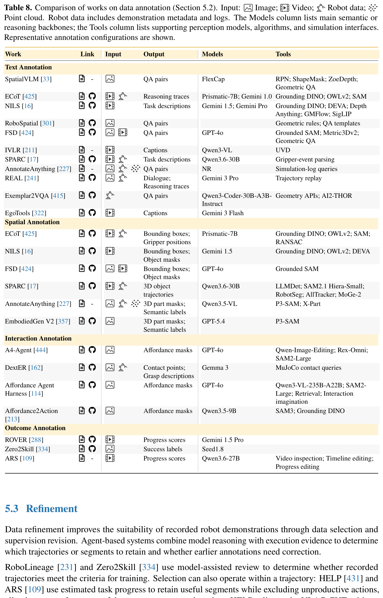

| Work | Link | Input | Output | Models | Tools |
| :--- | :--- | :--- | :--- | :--- | :--- |
| **Text Annotation** | | | | | |
| SpatialVLM [33] | A - | Image | QA pairs | FlexCap | RPN; ShapeMask; ZoeDepth; Geometric QA |
| ECoT [425] | A § | Video; Robot data | Reasoning traces | Prismatic-7B; Gemini 1.0 | Grounding DINO; OWLv2; SAM |
| NILS [16] | A § | Video | Task descriptions | Gemini 1.5; Gemini Pro | Grounding DINO; DEVA; Depth Anything; GMFlow; SigLIP |
| RoboSpatial [301] | A § | Image | QA pairs | - | Geometric rules; QA templates |
| FSD [424] | A § | Image; Point cloud | QA pairs | GPT-4o | Grounded SAM; Metric3Dv2; Geometric QA |
| IVLR [211] | A - | Video | Captions | Qwen3-VL | UVD |
| SPARC [17] | A § | Video; Robot data | Task descriptions | Qwen3.6-30B | Gripper-event parsing |
| AnnotateAnything [227] | A - | Image; Point cloud | QA pairs | NR | Simulation-log queries |
| REAL [241] | A § | Video; Robot data | Dialogue; Reasoning traces | Gemini 3 Pro | Trajectory replay |
| Exemplar2VQA [415] | A § | Image | QA pairs | Qwen3-Coder-30B-A3B-Instruct | Geometry APIs; AI2-THOR |
| EgoTools [322] | A § | Video | Captions | Gemini 3 Flash | - |
| **Spatial Annotation** | | | | | |
| ECoT [425] | A § | Video; Robot data | Bounding boxes; Gripper positions | Prismatic-7B | Grounding DINO; OWLv2; SAM; RANSAC |
| NILS [16] | A § | Video | Bounding boxes; Object masks | Gemini 1.5 | Grounding DINO; OWLv2; DEVA |
| FSD [424] | A § | Image; Point cloud | Bounding boxes; Object masks | GPT-4o | Grounded SAM |
| SPARC [17] | A § | Video; Robot data | 3D object trajectories | Qwen3.6-30B | LLMDet; SAM2.1 Hiera-Small; RobotSeg; AllTracker; MoGe-2 |
| AnnotateAnything [227] | A - | Image; Point cloud | 3D part masks; Semantic labels | Qwen3.5-VL | P3-SAM; X-Part |
| EmbodiedGen V2 [357] | A § | Image; Point cloud | 3D part masks; Semantic labels | GPT-5.4 | P3-SAM |
| **Interaction Annotation** | | | | | |
| A4-Agent [444] | A § | Image | Affordance masks | GPT-4o | Qwen-Image-Editing; Rex-Omni; SAM2-Large |
| DextER [162] | A § | Video; Robot data | Contact points; Grasp descriptions | Gemma 3 | MuJoCo contact queries |
| Affordance Agent Harness [114] | A § | Image | Affordance masks | GPT-4o | Qwen3-VL-235B-A22B; SAM2-Large; Retrieval; Interaction imagination |
| Affordance2Action [213] | A § | Image | Affordance masks | Qwen3.5-9B | SAM3; Grounding DINO |
| **Outcome Annotation** | | | | | |
| ROVER [288] | A § | Video | Progress scores | Gemini 1.5 Pro | - |
| Zero2Skill [334] | A § | Video | Success labels | Seed1.8 | - |
| ARS [109] | A - | Video | Progress scores | Qwen3.6-27B | Video inspection; Timeline editing; Progress editing |

**Caption:** Table 8. Comparison of works on data annotation (Section 5.2). Input: Image; Video; Robot data; Point cloud. Robot data includes demonstration metadata and logs. The Models column lists main semantic or reasoning backbones; the Tools column lists supporting perception models, algorithms, and simulation interfaces. Representative annotation configurations are shown.

**Caption[CN]:** 表 8. 数据标注相关代表性工作对比（第 5.2 节）。输入类型包括图像、视频、机器人本体数据、点云。机器人数据包括示范元数据与执行日志。模型列列出了主要的语义或推理基座模型；工具列列出了辅助感知模型、算法以及仿真接口。表中展示了代表性标注配置。

### 5.3 Refinement (数据精炼与提精)

> <strong>Para. 16:</strong> Data refinement improves the suitability of recorded robot demonstrations through data selection and supervision revision. Raw interaction logs often contain failed attempts, idle movements, or noisy labels. Refinement agents inspect existing records, select the most informative segments, and repair incorrect task descriptions or waypoint targets.

> <strong>Para. 16[CN]:</strong> 数据精炼旨在通过智能数据筛选与监督信号修正，全面提升所记录机器人示范数据的纯净度与训练契合度。未加工的原始物理交互日志中普遍混杂着偶发失败的尝试、原地停滞的冗余空转动作以及带有噪声的错误标签。数据精炼智能体能够系统化审查现有数据集资产，智能挑选出信息量最为密集的高价值轨迹片段，并主动修复有偏差的任务描述文本或运动路径点目标。

> <strong>Para. 17:</strong> RoboLineage [231] and Zero2Skill [334] use model-assisted review to delete unproductive or dangerous trajectories, ensuring that policy learning focuses on successful strategies. ARS [109] uses Qwen3.6-27B to perform timeline editing, segmenting demonstration videos into productive interaction intervals and trimming leading/trailing idle periods.

> <strong>Para. 17[CN]:</strong> RoboLineage [231] 与 Zero2Skill [334] 采用大模型辅助的代码与行为审查机制，果断剔除一切无效停滞或包含危险碰撞隐患的不良轨迹，确保下游策略微调始终聚焦于正确的物理解决范式；ARS [109] 借助 Qwen3.6-27B 的强大长视频时序理解能力开展精细的时间轴剪辑（Timeline Editing），将长示范视频精准裁剪切分为发生实质物理接触的有效交互区间，智能剔除机械臂起始阶段的漫长空走与结束阶段的无效静止。

> <strong>Para. 18:</strong> In addition to filtering, refinement can also repair and revise existing annotations. Reflective Test-Time Planning [105] revisits earlier rollouts to update action scores and reflection notes, refining the quality of supervision used for policy training. Distinguishing progress and recovery from idle or failure-inducing behavior prevents policies from imitating inefficient motion patterns. Related works are compared in Table 9.

> <strong>Para. 18[CN]:</strong> 除了消极的数据过滤，精炼机制同样能够主动修复并优化已有的监督信息。测试期反思规划（Reflective Test-Time Planning）[105] 周期性回溯过往的物理采样展开记录，动态刷新动作价值打分并增补更深刻的反思备忘录，显著提纯了用于后续策略微调的监督质量；通过清晰界定“稳步推进任务与自主从错误中恢复”和“低效游荡或致命诱错行为”之间的本质界限，数据精炼有效杜绝了模仿学习策略对冗余、低效甚至错误运动模式的盲目过拟合。数据精炼领域的代表性工作在表 9 中进行了横向对比。

### Table 9. 数据精炼/提精相关工作对比 (Comparison of Works on Data Refinement)

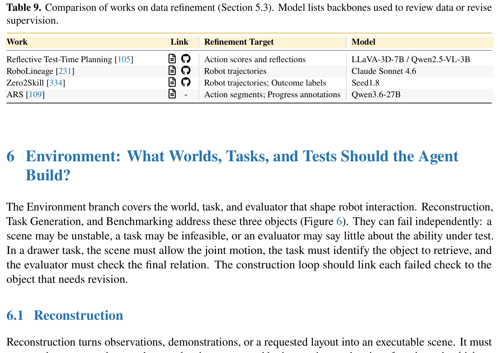

| Work | Link | Refinement Target | Model |
| :--- | :--- | :--- | :--- |
| Reflective Test-Time Planning [105] | A § | Action scores and reflections | LLaVA-3D-7B / Qwen2.5-VL-3B |
| RoboLineage [231] | A § | Robot trajectories | Claude Sonnet 4.6 |
| Zero2Skill [334] | A § | Robot trajectories; Outcome labels | Seed1.8 |
| ARS [109] | A - | Action segments; Progress annotations | Qwen3.6-27B |

**Caption:** Table 9. Comparison of works on data refinement (Section 5.3). Model lists backbones used to review data or revise supervision.

**Caption[CN]:** 表 9. 数据精炼/提精相关代表性工作对比（第 5.3 节）。模型列列出了用于审查数据或修正监督信号的主干模型。

## 6 Environment: What Worlds, Tasks, and Tests Should the Agent Build? (环境层：智能体应当构建怎样的仿真世界、任务与评测？)

### Figure 6. 为单项机器人任务构建与测试环境的三种途径 (Three Ways to Build and Test an Environment)

**Caption:** Figure 6. Three ways to build and test an environment for one robot task. Reconstruction recovers an executable scene from observations. Task Generation defines goals, constraints, and success conditions. Benchmarking fixes test conditions, reset protocols, metrics, and evaluators for success, safety, efficiency, and robustness.

**Caption[CN]:** 图 6. 为单项机器人任务构建与测试环境的三种途径。场景重建（Reconstruction）从多模态观测中恢复可执行场景；任务生成（Task Generation）明确定义目标、约束条件与成功判据；基准评测（Benchmarking）设定标准测试条件、重置协议、评测指标以及针对成功率、安全性、效率与鲁棒性的评测器。

> <strong>Para. 19:</strong> The Environment branch covers the world, task, and evaluator that shape policy learning and verification. Evaluating an agent on real robots is slow and poses safety risks, while manually building simulation environments requires substantial 3D modeling and engineering effort. To scale evaluation and training, agents increasingly build executable 3D worlds from images and video, generate structured task curricula, and construct automated benchmarking suites. Figure 6 contrasts Reconstruction, Task Generation, and Benchmarking.

> <strong>Para. 19[CN]:</strong> 环境功能领域涵盖了塑造和检验机器人策略的仿真物理世界、任务规格定义以及评测器系统。直接在真实物理机器人上评测智能体不仅周期极其漫长，且伴随着昂贵的硬件磨损与物理碰撞安全风险；而完全依赖人工手工搭建仿真环境则需要投入庞大的 3D 几何建模、物理引擎调参和软件工程成本。为实现大规模训练与评测的自主化扩展，学术界日益依托智能体从单张图像或开放视频中程序化重建可执行的 3D 物理场景、自适应生成阶梯式结构化任务课程，并构建高度规范的自动化基准评测套件。图 6 系统对比了场景重建（Reconstruction）、任务生成（Task Generation）与基准评测（Benchmarking）三者之间的有机联系与分工。

### 6.1 Reconstruction (场景与物理环境重建)

> <strong>Para. 20:</strong> Reconstruction turns observations, demonstrations, or a requested layout into an executable scene. It recovers visual appearance, geometry, physical parameters, and kinematic articulations. Once reconstructed, the agent can inspect and revise the result. Checks should expose errors that prevent execution, such as intersecting meshes, unreachable objects, or floating surfaces.

> <strong>Para. 20[CN]:</strong> 场景重建技术能够将原始多模态观测、人类演示视频或粗粒度的自然语言空间布局需求，完整转化为可在物理引擎中实时交互执行的虚拟仿真场景。该过程涵盖物体视觉外观材质的高保真恢复、3D 表面几何网格重构、物理力学参数辨识以及多体运动学铰接结构（Articulations）的解析绑定。在场景初步合成之后，智能体能够对重建成果开展闭环检查与程序化修正。严格的几何与动力学校验能够快速暴露一切阻碍物理仿真的致命错误，例如物体网格穿模交叉、目标物体超出机械臂工作空间死区、或是支撑面悬空不贴合等异常缺陷。

> <strong>Para. 21:</strong> Static Structure. Static structure includes objects, poses, supports, and visual appearance. Genie Sim 3.0 [414] and SceneSmith [266] generate interactive 3D rooms by retrieving CAD assets that match text prompts and placing them on collision-free support surfaces in Isaac Sim or Drake. SimFoundry [275] and EmbodiedGen V2 [357] convert images into 3D assets using convex decomposition (CoACD) and SAPIEN interfaces, generating realistic indoor scenes for manipulation learning.

> <strong>Para. 21[CN]:</strong> 静态物理结构构建。静态环境结构主要涵盖场景中的各类物体实体、绝对空间位姿、物理承载支撑面以及高保真视觉材质贴图。Genie Sim 3.0 [414] 与 SceneSmith [266] 能够精准响应用户的自然语言提示，从海量 CAD 资产库中智能检索语义与几何完全匹配的 3D 物体，并在 Isaac Sim 或 Drake 引擎中将它们合理摆放于无碰撞干涉的支撑台面上，快速合成可交互的 3D 居室；SimFoundry [275] 与 EmbodiedGen V2 [357] 则利用近似凸体分解算法（CoACD）将单张 RGB 图像逆向转化为带物理碰撞体的 3D 仿真网格，并通过 SAPIEN 仿真接口组装出高度拟真的室内桌面与厨卫操作场景。

> <strong>Para. 22:</strong> Dynamic and Articulated Structure. A replayable scene must also respond realistically when objects are pushed, grasped, or opened. Articulated assets require kinematic tests. Articulate-Anything [159] and Articraft [461] predict joint types (revolute vs. prismatic), axis orientations, and motion limits from images or text, generating validated URDF models for drawers, cabinets, and appliances. DiagGen [35] generates articulated assets inside the Genesis physics engine.

> <strong>Para. 22[CN]:</strong> 动态力学与可动铰接结构建模。一个真正具备可重放交互价值的仿真场景，必须在物体遭受机械臂推挤、牢固抓取或拉动开启时，做出完全符合真实物理规律的动力学响应。铰接可动资产（Articulated Assets）对关节运动学约束的定义提出了极高要求。Articulate-Anything [159] 与 Articraft [461] 直接从单张图像或文本描述中逆向推断铰接关节类型（如转动关节 Revolute 与移动滑块 Prismatic）、关节旋转轴的空间向量以及极限开合行程边界，全自动生成经物理验证的 URDF 描述文件，完美覆盖抽屉、柜门与复杂家用电器；DiagGen [35] 则在现代可微物理引擎 Genesis 内部程序化生成高保真铰接资产。

> <strong>Para. 23:</strong> Construction Interfaces and Revision. The interface determines which software tools the agent can use to build scenes. SceneSmith [266] exposes Drake APIs to an LLM, allowing the model to position assets and solve contact kinematics. GIF [393] and Agentic Real2Sim [36] optimize physical parameters (such as friction coefficients, restitution, and mass distributions) by aligning simulated trajectories with real-robot video recordings, bridging the sim-to-real gap.

> <strong>Para. 23[CN]:</strong> 场景构建接口与自动化参数校准。暴露给智能体的接口规范决定了它能够调用何种物理仿真工具来构建世界。SceneSmith [266] 将 Drake 物理引擎的高级 Python API 完整暴露给大语言模型，允许模型自主调配资产空间拓扑并解析多体接触动力学；GIF [393] 与 Agentic Real2Sim [36] 则将仿真环境中的摩擦系数、弹性恢复系数、阻尼以及质量分布等不可观测物理参数形式化为优化变量，通过最小化仿真推演轨迹与真机实录视频之间的动态差异，精准反向标定物理参数，极大弥合了仿真到物理真实（Sim-to-Real）的迁移鸿沟。

> <strong>Para. 24:</strong> Revision should match the intended downstream use. RAPID [222] screens generated scenes by attempting heuristic grasps before admitting them to the training set. 4DCodeBench [292] and Video2World [316] use coding agents to iteratively repair simulation scripts, checking that generated objects neither explode due to numerical instability nor pass through supporting surfaces. Related works on reconstruction are compared in Table 10.

> <strong>Para. 24[CN]:</strong> 场景的自动化校验修正必须紧扣其下游任务目标。RAPID [222] 在正式将新合成的场景纳入策略训练集之前，先由自动化机器人运行一系列启发式抓取与推移原语进行前置压力测试；4DCodeBench [292] 与 Video2World [316] 则利用代码智能体循环审查与修复仿真驱动脚本，严格检查并杜绝因接触刚度过大导致的物理穿透或数值飞散崩溃（Exploding Physics），确保所有资产平稳贴合物理地面。场景与环境重建代表性工作在表 10 中进行了全面梳理。

### Table 10. 场景与环境重建相关工作对比 (Comparison of Works on Reconstruction)

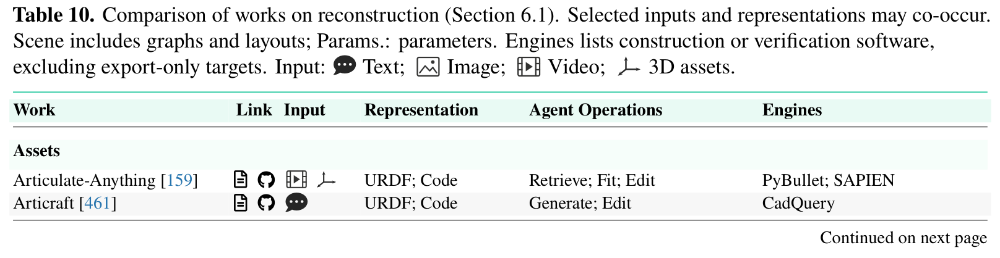

| Work | Link | Input | Representation | Agent Operations | Engines |
| :--- | :--- | :--- | :--- | :--- | :--- |
| **Assets** | | | | | |
| Articulate-Anything [159] | A § | Image; Video | URDF; Code | Retrieve; Fit; Edit | PyBullet; SAPIEN |
| Articraft [461] | A § | Text; Image | URDF; Code | Generate; Edit | CadQuery |
| DiagGen [35] | A § | Text; Image | Mesh; Params. | Generate; Edit | Genesis |
| **Scenes** | | | | | |
| Video2Policy [409] | A - | Video | Mesh; URDF | Generate; Fit; Assemble | Isaac Gym |
| Genie Sim 3.0 [414] | A § | Text; Image | Scene; Code | Retrieve; Generate; Assemble | Isaac Sim; OpenUSD |
| SceneSmith [266] | A § | Text; Image | Mesh; Scene | Generate; Assemble; Edit | Drake |
| SAGE [379] | A § | Text; Image | Mesh; Scene | Generate; Assemble; Edit | Isaac Sim |
| RoboPlayground [360] | A - | Text | Code | Generate; Edit | MuJoCo |
| RoboLab [398] | A § | Text; Image | Scene | Assemble; Edit | Isaac Sim |
| DexSim2Real [429] | A - | Video | Params. | Optimize | Isaac Sim |
| SimWorld Studio [144] | A - | Text | Scene; Code | Generate; Assemble; Edit | Unreal Engine |
| SimFoundry [275] | A § | Text; Image | Mesh; URDF; Scene | Generate; Fit; Assemble | PyBullet; CoACD |
| EmbodiedGen V2 [357] | A § | Text; Image | URDF; Scene | Generate; Assemble | SAPIEN; CoACD |
| GIF [393] | A - | Text; Image | Mesh; Params. | Generate; Fit; Optimize | MuJoCo; Drake |
| ARSTAG [169] | A - | Text; Image | Mesh; Scene | Generate; Fit; Assemble; Edit | Isaac Sim |
| RAPID [222] | A - | Text; Video | Mesh; Scene | Generate; Fit; Assemble | MuJoCo |
| CoDimRecon [387] | A - | Image | Mesh; Scene | Generate; Fit; Edit | Blender; MuJoCo |
| DexAgent [361] | A - | Text; Image | URDF; Scene | Generate; Fit; Edit | MuJoCo; Isaac Sim |
| LEGO-Anything [183] | A - | Image | Code; Scene | Generate; Edit | Blender |
| Code4Scene [410] | A - | Text; Image | Scene | Generate; Assemble; Edit | Unreal Engine |
| Awomo-SimDataEngine [6] | A - | Text; Image | URDF; Scene | Generate; Assemble; Edit | Isaac Sim |
| **Dynamics** | | | | | |
| ChronoAgentic [338] | A - | Text | Code | Generate; Edit | PyChrono |
| Agentic Real2Sim [36] | A § | Video | Mesh; Params. | Generate; Fit; Optimize | MuJoCo |
| 4DCodeBench [292] | A § | Text; Video | Code | Generate; Edit | Blender |
| Video2World [316] | A § | Video | Code; Scene | Generate; Edit | SAPIEN; Isaac Sim; MuJoCo |

**Caption:** Table 10. Comparison of works on reconstruction (Section 6.1). Selected inputs and representations may co-occur. Scene includes graphs and layouts; Params.: parameters. Engines lists construction or verification software, excluding export-only targets. Input: Text; Image; Video; 3D assets.

**Caption[CN]:** 表 10. 场景重建相关代表性工作对比（第 6.1 节）。所选输入和表征可能同时存在。场景（Scene）包括场景图与布局；参数（Params.）表示物理与仿真参数。引擎列列出了构建或验证所使用的软件（不含仅作为导出的目标格式）。输入类型包括文本、图像、视频以及 3D 资产。

### 6.2 Task Generation (任务生成与课程编排)

> <strong>Para. 25:</strong> Task generation specifies the goal, initial state, constraints, and success conditions that a robot must achieve. Rather than testing policies on static benchmark tasks, agentic task generators produce diverse task variants, adapt task difficulty to match the learner's progress, and verify that generated goals are physically solvable.

> <strong>Para. 25[CN]:</strong> 任务生成模块负责精准界定机器人必须达成的目标规格、初始空间状态分布、物理运动约束以及严密的数学成功判定逻辑。智能体任务生成器不再局限于在几套固定的静态测试任务上僵化评测策略，而是能够自主派生出海量任务变体、依据当前学习者的掌握程度动态调整任务阶梯难度，并通过前瞻求解确保每一个生成的物理任务都具备切实可达的数学可行解。

> <strong>Para. 26:</strong> Executable Task Construction. GenSim [345] generates task libraries as Python code within Ravens, defining visual goals, object initializations, and evaluation logic. RoboGen [362] uses an LLM to propose high-level task descriptions, synthesize asset layouts, and generate reward functions verified by an OMPL motion planner. Video2Policy [409] converts human demonstration videos into structured task specifications inside Isaac Gym.

> <strong>Para. 26[CN]:</strong> 可执行仿真任务构建。GenSim [345] 在 Ravens 仿真环境中直接以 Python 源码形式批量生成成套任务库，程序化定义多模态视觉目标、物体空间初始分布以及严格的自动化评测打分逻辑；RoboGen [362] 借助大语言模型自主构思富有想象力的多样化任务、组装所需 3D 资产，并生成由开源运动规划库 OMPL 提前验证具备物理可行性的奖励函数代码；Video2Policy [409] 则直接将一段单目人类生活视频逆向转化为 Isaac Gym 内部带标准终止谓词的结构化交互任务。

> <strong>Para. 27:</strong> Generating a solution does not necessarily generate a new task. EmbodiedSmith [272] and GenPHRI [343] generate feasible motion plans for specified robot tasks, checking kinematic feasibility using cuRobo and Genesis before finalizing the task configuration. PARTNR [31] generates diverse collaborative household tasks for human-robot teams in Habitat 3.0, testing whether agents can coordinate with simulated partners.

> <strong>Para. 27[CN]:</strong> 求解一个已有任务并不等同于创造一个全新任务。EmbodiedSmith [272] 与 GenPHRI [343] 在为指定的具身场景合成任务构型时，利用 GPU 加速运动规划库 cuRobo 与 Genesis 物理引擎先行求解出完整的动作轨迹，以此作为物理可解性的先验保证后方才固化任务配置；PARTNR [31] 则在 Habitat 3.0 大规模室内场景中，为人类-机器人协同作业全自动生成高度多样的家政协作任务，全面考察智能体与动态虚拟人类伙伴的实时沟通与动作协调能力。

> <strong>Para. 28:</strong> Adaptive Task Distributions. CurricuLLM [286] generates a subtask sequence that gradually scales up task difficulty based on current policy performance, scheduling harder object positions and heavier obstacles as success rates improve. RATs [435] generates exploratory tasks from scene information, a code-skill library, and failure memory, focusing task generation on states where the current policy struggles. Related works are compared in Table 11.

> <strong>Para. 28[CN]:</strong> 自适应任务分布与课程编排。CurricuLLM [286] 依据当前策略的实时学习曲线，自适应生成平滑爬坡的子任务阶梯序列（Curriculum Learning）：随着基础成功率的攀升，自动化解锁更远距离的目标放置点、更杂乱的遮挡障碍物以及更苛刻的位姿公差要求；RATs [435] 则深度综合当前物理场景图、底层代码技能库以及历史失败记忆库，精准将新任务生成的核心预算定向投放到当前策略最易犯错的瓶颈状态空间。任务生成领域的代表性工作在表 11 中进行了系统梳理。

### Table 11. 任务生成相关工作对比 (Comparison of Works on Task Generation)

| Work | Link | Input | Output | Agent Operations | Tools |
| :--- | :--- | :--- | :--- | :--- | :--- |
| **Tasks** | | | | | |
| GenSim [345] | A § | Goal; Examples | Task; Curriculum | Generate; Select | Ravens |
| RoboGen [362] | A § | Assets; Examples | Task; Reward; Plan | Generate; Compose | Genesis; OMPL |
| Video2Policy [409] | A - | Demo | Task; Reward; Eval. | Generate; Repair; Select | Isaac Gym |
| PARTNR [31] | A § | Scene; Examples | Task; Eval. | Generate; Vary | Habitat 3.0 |
| RoboPlayground [360] | A - | Goal | Task; Eval. | Generate; Vary; Repair | MuJoCo |
| RoboLab [398] | A § | Scene; Examples | Task; Eval. | Generate; Compose; Repair | Isaac Sim |
| FATE [366] | A - | Scene; Goal; Policy | Task; Reward | Repair | Isaac Sim |
| HARBOR [191] | A § | Goal; Code | Task; Reward; Config. | Generate; Repair | Multiple |
| **Curricula** | | | | | |
| CurricuLLM [286] | A § | Goal; Scene | Curriculum; Reward | Generate; Schedule; Select | Gymnasium; Isaac Lab |
| SimWorld Studio [144] | A - | Goal; Scene; History | Task; Curriculum | Generate; Vary; Schedule | UE5; Gymnasium |
| RATs [435] | A § | Scene; Skills; History | Task | Generate; Select | LIBERO-PRO; MolmoSp. |
| **Plans** | | | | | |
| ARSTAG [169] | A - | Image; Goal | Plan; Config. | Compose; Vary | Isaac Sim |
| Scene2Demo [219] | A - | Image; Goal | Task; Eval.; Plan | Generate; Compose; Repair | OmniGibson |
| GenPHRI [343] | A - | Goal | Config.; Plan | Generate; Repair | Genesis; SceneSmith |
| EmbodiedSmith [272] | A - | Goal; Robot | Plan; Config. | Compose; Repair | Isaac Sim; cuRobo |

**Caption:** Table 11. Comparison of works on task generation (Section 6.2). Output lists generated or revised artifacts. Eval.: success/evaluation code; Config.: initialization/randomization settings; Plan: executable solution, which may preserve the task. UE5: Unreal Engine 5; MolmoSp.: MolmoSpaces. Multiple (HARBOR): Isaac Lab, ManiSkill, Genesis, MJLab.

**Caption[CN]:** 表 11. 任务生成相关代表性工作对比（第 6.2 节）。输出列列出了生成或修改的构件资产。Eval.：成功判定/评测代码；Config.：初始化/随机化环境配置；Plan：可执行的解方案（可能用于验证任务可行性）。UE5：Unreal Engine 5；MolmoSp.：MolmoSpaces；Multiple（HARBOR）：包括 Isaac Lab、ManiSkill、Genesis 与 MJLab。

### 6.3 Benchmarking (基准评测体系)

> <strong>Para. 29:</strong> Benchmarking fixes the task, interface, reset protocol, and scoring rule used to measure an ability. Agentic benchmarks evaluate capabilities that traditional policy benchmarks ignore, such as long-horizon task planning, tool invocation, active information gathering, memory utilization, and failure recovery.

> <strong>Para. 29[CN]:</strong> 基准评测旨在严格固化用于度量某一特定具身能力的任务设定、输入输出接口契约、环境自动化重置协议以及量化计分规则。具身智能体基准评测系统性考察了传统短程策略基准完全忽视的一系列关键高阶能力，诸如长时程层次化规划、外部工具函数自主调用、主动信息获取、跨时间步记忆检索以及从突发物理失败中自主恢复的韧性。

> <strong>Para. 30:</strong> Evaluating Agents in Robot Control. Planning benchmarks test whether an agent can decompose instructions and handle environmental disruptions. EmbodiedBench [399] benchmarks multimodal agents across manipulation and navigation in AI2-THOR and Habitat, testing reasoning and tool calling. LIBERO-PRO [465] introduces visual and physical perturbations to LIBERO tasks, evaluating whether VLA policies memorize fixed trajectories or genuinely adapt to environmental variations.

> <strong>Para. 30[CN]:</strong> 具身控制中智能体能力的系统评测。规划类基准专门测试智能体是否能够合理分解复杂自然语言指令并具备抗击外界环境扰动的鲁棒性。EmbodiedBench [399] 在 AI2-THOR 与 Habitat 等多引擎中跨操作与导航任务联合评测多模态智能体，全面考察其高阶因果推理与工具调用能力；LIBERO-PRO [465] 则在经典 LIBERO 基准中系统性引入剧烈光照畸变、随机背景纹理与物理接触扰动，严格审查当前 VLA 策略究竟是死记硬背了静态轨迹，还是真正具备适应物理环境动态变化的鲁棒泛化能力。

> <strong>Para. 31:</strong> Tool and programming benchmarks evaluate executable decisions. EmbodiedSWE [294] and CaP-X [74] evaluate coding agents on robot task implementation, measuring whether generated code compiles, passes safety assertions, and executes to completion. RobotWorld [404] benchmarks agents on 84 diverse tasks spanning manipulation, locomotion, and aerial flight, testing whether a single agentic system can generalize across heterogeneous robot morphologies.

> <strong>Para. 31[CN]:</strong> 工具调用与代码编程基准。具身代码评测基准专门考察智能体生成可直接执行决策程序的工程能力。EmbodiedSWE [294] 与 CaP-X [74] 在复杂的机器人控制任务中系统评测代码智能体，严格度量所生成的控制程序能否顺利通过静态语法编译、满足运行时安全断言并稳定闭环执行至任务终点；RobotWorld [404] 则在涵盖机械臂操作、四足腿足移动、双足行走以及无人机空中飞行等 84 项高难度异构任务中评测智能体，深入探究单一智能体架构能否直接跨越完全相异的物理具身形态实现通用控制。

> <strong>Para. 32:</strong> Existing robot suites can host these evaluations. LIBERO [206] provides modular benchmarks for lifelong robot learning across robosuite environments. RoboDojo [41] evaluates policies on Isaac Lab tasks with strict physical contact checks. RoboMemArena [164] and MEMOBench [308] test memory utilization across long-horizon episodes, evaluating whether agents retain information across multiple rooms or interaction trials.

> <strong>Para. 32[CN]:</strong> 现有的机器人仿真套件为承载此类高阶评测提供了坚实底座。LIBERO [206] 在 robosuite 物理环境中为终身机器人学习构建了标准化评测基底；RoboDojo [41] 在 Isaac Lab 高性能并行仿真中设立了包含极高物理接触保真度与严格动力学校验的通用评测场；RoboMemArena [164] 与 MEMOBench [308] 则专门针对超长程跨回合任务构建记忆力评测基准，全面检视智能体能否在穿梭于多个房间或历经多次交互尝试后，依然精准检索并调用早期的关键记忆锚点。

> <strong>Para. 33:</strong> Safety tests separate hazard avoidance from task completion. ReactHuman [190] and ManiGuard [264] evaluate robot safety around dynamic human obstacles, verifying that planners do not command trajectories that collide with humans or breach force constraints. VABench [443] and ActiveArena [186] benchmark active perception and spatial reasoning, verifying that robots can actively search for hidden objects before executing manipulation.

> <strong>Para. 33[CN]:</strong> 安全性评测将“物理避障防害”从“任务完成率”中显式剥离出来进行独立度量。ReactHuman [190] 与 ManiGuard [264] 专注于评测机器人在面对动态人类阻挡时的安全避险能力，严格判定规划器下发的轨迹是否绝不触碰人体或绝不突破关节力矩安全阈值；VABench [443] 与 ActiveArena [186] 则专门针对主动感知与 3D 空间推理设立量化指标，严格考察机器人是否具备在正式抓取之前主动变换视角搜寻被遮挡物体的具身主动性。

> <strong>Para. 34:</strong> Agent-Directed Evaluation Construction. An agent that builds an evaluation suite may also adapt tests to reveal specific policy limitations. RoboPlayground [360] and ManipEvalAgent [49] use LLMs to dynamically generate challenging scene perturbations, systematically stress-testing robot policies to find boundary failure conditions. A benchmark score therefore reflects the full execution contract: agent decisions, available tools, observation interfaces, and evaluator protocols. Related works are compared in Table 12.

> <strong>Para. 34[CN]:</strong> 智能体主导的对抗性评测构建。由智能体自主构建评测套件，能够根据当前受测系统的薄弱点自适应派生具有针对性的对抗性测试用例。RoboPlayground [360] 与 ManipEvalAgent [49] 引入大语言模型作为智能红队测试器，动态合成极具挑战性的物理场景扰动与边界干扰，系统化对现有具身策略开展压力测试以精准探查其失效边界。因此，一项基准测试的最终得分不仅反映了模型本身的优劣，更是智能体高阶决策、可用工具生态、多模态观测接口以及评测协议严密程度的综合系统级映射。基准评测代表性工作在表 12 中进行了详尽的分类对比。

### Table 12. 基准评测相关工作对比 (Comparison of Works on Benchmarking)

| Work | Link | Setting | Capability | Interface | Engines |
| :--- | :--- | :--- | :--- | :--- | :--- |
| **Benchmarks** | | | | | |
| LIBERO [206] | A § | Sim | Transfer | Action | robosuite |
| PARTNR [31] | A § | Sim | Planning; Collab. | Call | Habitat 3.0 |
| EmbodiedBench [399] | A § | Sim | Planning; Reasoning | Action; Call | AI2-THOR; Habitat; CoppeliaSim |
| LIBERO-PRO [465] | A - | Sim | Robustness | Action | LIBERO |
| RoboLab [398] | A § | Sim | Robustness; Control | Action | Isaac Sim |
| CaP-X [74] | A - | Sim | Coding | Code | robosuite; LIBERO-PRO; BEHAVIOR |
| KinDER [122] | A § | Sim | Reasoning | Action; Call | Pymunk; PyBullet; MuJoCo |
| RoboMemArena [164] | A § | Sim | Memory | Action; Call | NR |
| EmbodiedTool [466] | A - | Offline data | Tools | Answer; Call | N/A |
| MissionBench [247] | A § | Sim | Planning; Perception | Answer; Action | Cosys-AirSim; UE5 |
| RoboGraph [346] | A - | Sim | Memory | Call | RoboTwin; RoboCasa |
| EvoNav-Bench [355] | A - | Sim | Memory; Robustness | Action | AI2-THOR |
| ReactHuman [190] | A - | Sim | Reasoning; Safety | Action | Genesis |
| VABench [443] | A - | Sim | Perception; Control | Action | NR |
| ActiveArena [186] | A § | Sim | Perception; Memory | Action; Call | RoboTwin 2.0 |
| EmbodiedSWE [294] | A § | Sim | Coding; Control | Code | Isaac Lab |
| Embodied Agent Arena [115] | A § | Real; Sim; Offline | Reasoning; Planning | Action; Call; Code | Multiple |
| RoboDojo [41] | A § | Sim | Control; Robustness | Action | Isaac Lab; Isaac Sim |
| ManiGuard [264] | A - | Sim | Safety | Action | Isaac Sim; OmniGibson |
| MEMOBench [308] | A § | Sim | Memory | Action | LIBERO; robosuite |
| RobotWorld [404] | A - | Sim | Planning; Control | Action; Code | Multiple |
| **Systems** | | | | | |
| ASPIRE [228] | A § | Sim | Coding; Transfer | Code | CaP-X |
| Harness VLA [441] | A § | Sim | Memory; Robustness | Call | robosuite; RoboCasa; RoboTwin |
| RoboHarness [116] | A - | Sim | Planning; Robustness | Call | LIBERO; RoboTwin |
| AGOS-Agent [416] | A - | Sim | Planning; Collab. | Call | CARLA-Air |
| **Evaluators** | | | | | |
| RoboPlayground [360] | A - | Sim | Robustness | Action | MuJoCo |
| A2Eval [438] | A - | Offline data | Perception; Reasoning | Answer | N/A |
| ManipEvalAgent [49] | A - | Sim | Robustness | Action | LIBERO; RoboTwin |
| Embodied-BenchForge [133] | A - | Offline data | Reasoning; Planning | Answer; Call | AI2-THOR |

**Caption:** Table 12. Comparison of works on benchmarking (Section 6.3). Interface describes tested-system outputs: Answer (predictions), Action (motor commands), Call (tools/skills), Code (programs); evaluator-generated code is excluded. RobotWorld’s Code is optional. Engines lists simulation backends; Multiple denotes mixed suites. NR: not reported; N/A: offline evaluation without simulator execution. Collab.: collaboration; UE5: Unreal Engine 5. Setting: Real; Sim; Offline data.

**Caption[CN]:** 表 12. 基准评测相关代表性工作对比（第 6.3 节）。接口描述了被测系统的输出形式：Answer（回答/预测）、Action（电机/底层动作指令）、Call（工具/技能调用）、Code（程序代码）；评测器生成的代码除外。RobotWorld 的 Code 输出为可选模式。引擎列列出了仿真后端；Multiple 表示混合评测套件；NR 表示未报告；N/A 表示无需仿真器执行的离线评测。Collab.：协同；UE5：虚幻引擎 5。评测设定包括真实世界（Real）、仿真（Sim）与离线数据（Offline data）。

## 7 Harness: How Should Robot Capabilities Be Orchestrated, Recovered, and Evolved? (支架控制治理层：机器人的各项能力应当如何被编排、错误恢复与持续进化？)

### Figure 7. 围绕机器人执行组织智能体能力的支架治理架构 (Harness Functions Organizing Agentic Capabilities)

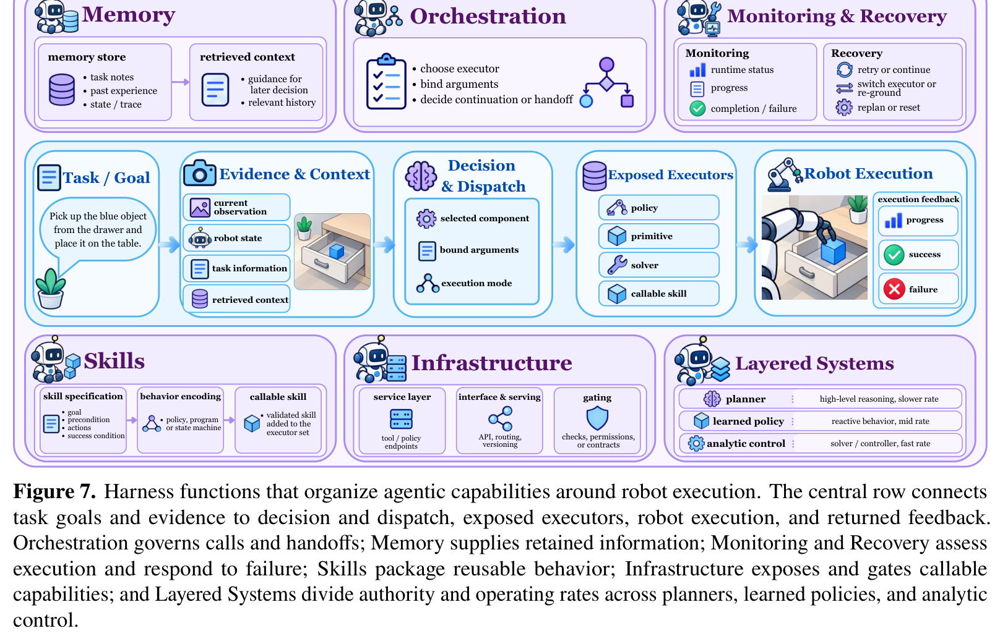

**Caption:** Figure 7. Harness functions that organize agentic capabilities around robot execution. The central row connects task goals and evidence to decision and dispatch, exposed executors, robot execution, and returned feedback. Orchestration governs calls and handoffs; Memory supplies retained information; Monitoring and Recovery assess execution and respond to failure; Skills package reusable behavior; Infrastructure exposes and gates executable capabilities; and Layered Systems divide authority across planners, learned policies, and analytic control.

**Caption[CN]:** 图 7. 围绕机器人执行组织智能体各项能力的支架治理框架（Harness）功能架构。中间行将任务目标与感知证据连接至决策调度、开放执行器、机器人物理执行以及返回的执行反馈。编排机制（Orchestration）掌管调用与控制权交接；记忆系统（Memory）提供先验与历史沉淀信息；监控与恢复（Monitoring and Recovery）评估执行状态并响应失败；技能系统（Skills）封装可复用行为；基础设施（Infrastructure）对外暴露并对可执行能力进行安全门控；分层系统（Layered Systems）在高级规划器、习得策略与解析控制算法之间划分控制权限与运行频率。

> <strong>Para. 1:</strong> A robot may have capable models and policies yet still fail if they are not coordinated effectively during execution. While the Model branch examines what the agent learns and decides, the Harness branch examines the software system that organizes those capabilities around robot execution. The harness governs how models invoke tools and skills, how interaction history is retained across steps, how runtime failures are detected and repaired, and how capabilities are packaged and deployed. Figure 7 illustrates these six harness functions: Orchestration, Memory, Monitoring and Recovery, Skills, Infrastructure, and Layered Systems.

> <strong>Para. 1[CN]:</strong> 一台机器人即便配备了极具能力的算法模型与策略网络，但如果在物理执行过程中缺乏高效的系统协同编排，依然极易遭遇崩溃与失败。模型分支（Model）主要深入探讨智能体应当学习并决策什么，而支架治理分支（Harness）则重点剖析围绕机器人物理执行组织与治理这些能力的底层软件工程框架。支架系统决定了高阶模型如何安全调用外部工具与技能、交互历史如何在长时钟跨度中被有序保留与检索、运行时的物理偶发失败如何被敏锐捕捉并自愈修复，以及各项软硬件能力如何被模块化封装与隔离部署。图 7 系统描绘了六大约束性支架治理功能：编排机制（Orchestration）、记忆系统（Memory）、监控与恢复（Monitoring and Recovery）、技能系统（Skills）、基础设施（Infrastructure）以及分层系统（Layered Systems）。

### 7.1 Orchestration (多模块调度与编排机制)

> <strong>Para. 2:</strong> Orchestration decides which model, policy, skill, or tool runs, how long it keeps control, and how control passes from one component to another. The coordinator must route task instructions to appropriate executors, standardize input and output interfaces, connect physical states across component boundaries, and decide when to hand off control.

> <strong>Para. 2[CN]:</strong> 编排机制负责系统裁定究竟由哪一个模型、神经策略、动作技能或计算工具投入运行、它能持有物理控制权多长时间，以及控制权如何在不同异质组件之间平稳安全交接。上位协调器必须精准地将自然语言任务指令路由分发给最为适格的专业执行器、对异构输入输出接口进行契约化标准化、在跨越不同组件边界时严密缝合物理状态空间，并科学决策移交控制权的临界时机。

> <strong>Para. 3:</strong> Routing and Dispatch. In an agentic harness, the planner rarely acts on the environment directly; instead, it dispatches operations to specialized executors. VoLo [40] routes manipulation commands between a generalist VLA policy and specialized motion planners. Physical Agency [75] and MistyPilot [354] use hybrid dispatching: an LLM proposes skill sequences, which a rule-based safety layer checks against physical constraints before releasing execution. Guava [208] dispatches operations across multiple robot tools, ensuring that tool arguments adhere to typed schema definitions.

> <strong>Para. 3[CN]:</strong> 路由分发与指令调度。在具身支架系统中，高级规划器极少直接下发底层电机电压或力矩，而是将解构出的具体子操作精准路由派发给专业的下游执行模块。VoLo [40] 巧妙地在通用 VLA 策略与专用高精度解析运动规划器之间动态路由操作指令；Physical Agency [75] 与 MistyPilot [354] 则采用混合调度范式：由大语言模型自主提议候选技能序列，在正式下发硬件执行前，交由基于确定性规则的安全层严格对照物理运动学与动力学边界进行多重校验；Guava [208] 则将高级操作指令分发至多样化的机器人外部工具接口，确保每一次工具调用的传参严格遵循强类型的数据模式（Typed Schemas）约束。

> <strong>Para. 4:</strong> Meanwhile, routing is reliable only when the dispatcher knows what each component can do. ABot-AgentOS [321] and AeroWeaver [226] maintain registry files that declare the preconditions, postconditions, and argument signatures of available skills. In multi-robot and collaborative systems, M2HRI [99] and EMOS [37] route subtasks among heterogeneous robots and human partners, matching operations to each agent's physical capabilities.

> <strong>Para. 4[CN]:</strong> 显而易见，唯有当调度中枢透彻洞悉每一个底层组件的真实能力边界与运行边界时，路由分发才能保持高度可靠。ABot-AgentOS [321] 与 AeroWeaver [226] 显式维护着一份集中式技能注册表（Skill Registry），严格声明各项可用技能的前置物理触发条件、后置预期达成状态以及严密的参数签名规范；在多机协作与人机混合系统中，M2HRI [99] 与 EMOS [37] 能够将复杂的复合长程子任务科学分发至形态完全相异的异构机器人或人类协同伙伴之间，实现操作需求与各参与方物理承载能力的最优匹配。

> <strong>Para. 5:</strong> Function Protocol. Robot capabilities are usually exposed to the agent as callable functions or tools. EmbodiedTool [466] standardizes tool interfaces across manipulation environments, allowing models to invoke grasp planners and object detectors using standard JSON schemas. ROSClaw [26] and Physical Agentic AI [220] bridge language models with ROS and ROS2 middlewares, translating function calls into publish-subscribe message streams that robot hardware can consume.

> <strong>Para. 5[CN]:</strong> 统一函数调用协议。底层机器人的物理交互能力通常被标准化包装为可供智能体调用的函数（Tools）。EmbodiedTool [466] 统一规范了跨越多个机械臂操作环境的工具交互接口，使得上层大模型能够借助标准化的 JSON Schema 直接调用抓取规划器与高精 3D 目标检测器；ROSClaw [26] 与 Physical Agentic AI [220] 则搭建了从大模型高阶函数调用通向现代机器人操作系统（ROS/ROS2）中间件的高性能桥梁，将抽象的函数调用实时序列化为工业级发布-订阅（Pub-Sub）消息流，供真实硬件底层无缝消费。

> <strong>Para. 6:</strong> Once a call has run, the protocol defines what comes back to the agent. Thea [348] and EmbodiedSkills [351] format tool outputs into structured dictionaries containing success status, execution duration, and updated object bounding boxes. Standardizing returned evidence ensures that the agent receives actionable feedback without having to interpret raw sensor data directly.

> <strong>Para. 6[CN]:</strong> 在底层工具函数执行完成后，函数协议进一步严格规定了向上层智能体返回的数据结构。Thea [348] 与 EmbodiedSkills [351] 将工具执行结果规整格式化为包含执行成败布尔值、耗时统计以及经物理交互后刷新重估的物体 3D 边界框等结构化字段字典。对返回证据的标准化清洗与封装，确保了上位决策智能体能够直接消费富含上下文的显式反馈，彻底摆脱了反复直接解析高维嘈杂传感器裸数据的巨大推理负担。

> <strong>Para. 7:</strong> Even a detailed result is still the executor’s own report. Success conditions often require external verification by independent perception modules. RoboHarness [116] and RoboRouter [48] verify handoff conditions using independent camera views, preventing an executor from incorrectly reporting success when an object was dropped outside the sensor field of view.

> <strong>Para. 7[CN]:</strong> 即便执行器返回了极为详尽的执行报告，这也仅仅代表执行器自身的局部断言。真正的任务达成状态往往需要由完全独立的第三方感知模块开展交叉验证。RoboHarness [116] 与 RoboRouter [48] 创新性地引入独立架设的第三人称视角相机对交接状态进行交叉审查，坚决杜绝执行器在夹爪内空无一物、而物体早已滑落至局部视场盲区之外时仍盲目向系统上报“抓取成功”的严重误判。

> <strong>Para. 8:</strong> State Connection. Each executor works reliably only from certain starting states. When control passes from navigation to manipulation, the mobile base must be positioned such that the target object falls within the arm's reachable workspace. RoboHarness [116] and RoCo [237] enforce explicit pre-conditions before transferring control, commanding base repositioning if an arm cannot find a collision-free inverse-kinematics solution.

> <strong>Para. 8[CN]:</strong> 跨模块物理状态缝合。每一个底层的专业执行器通常只能在特定的初始物理状态流形内保持高可靠运行。当系统控制权从底盘移动导航无缝移交至机械臂精细操作时，移动底盘的最终停靠位姿必须严格保证目标物体恰好落在机械臂最舒适且高灵巧度的有效工作空间核心区。RoboHarness [116] 与 RoCo [237] 在控制权正式换乘交接前强制执行严格的前置物理几何条件检验：一旦逆运动学（IK）求解器无法在当前底盘位姿下为机械臂求得无碰撞可行解，系统会强制要求移动底盘进行局部精细位姿重对准。

> <strong>Para. 9:</strong> The other two ways set up the connection before the handoff, which is common in multi-agent and layered execution. RoboTalk [84] and AGOS-Agent [416] use shared communication blackboards to synchronize world state across robots, ensuring that one agent does not move an object while another is preparing to grasp it.

> <strong>Para. 9[CN]:</strong> 另一种解决状态衔接的稳健途径是在控制权交接之前预先建立全局物理共识，这在多机器人协同与深层分层执行架构中尤为普遍。RoboTalk [84] 与 AGOS-Agent [416] 构建了高效的高频共享通信黑板机制（Shared Blackboards），在多个异构协作机器人之间高频同步动态世界状态图谱，坚决杜绝某一机器人正在伸爪准备闭合抓取、而另一协作机器人却突然自作主张将目标物体粗暴搬离的致命时序竞争冲突。

> <strong>Para. 10:</strong> Handoff Timing. Handoff timing decides when control returns from an executor to the coordinator. Fixed-duration execution commits the robot to a predefined number of steps, which can cause delays if the action fails early. HarnessWAM [89] and Cortex [263] use event-driven handoffs: control returns immediately when a terminal predicate is satisfied (such as a contact switch triggering) or when an anomaly detector flags an unexpected collision.

> <strong>Para. 10[CN]:</strong> 控制权移交时序判定。移交时机判定决定了底层执行模块何时应当将系统主控权交还给上位全局协调中枢。僵化采用固定时间步的执行策略会导致机器人在预先指定的步数内盲目开环执行，一旦动作在初期就已失败滑脱，系统将白白耗费漫长的时间空等；HarnessWAM [89] 与 Cortex [263] 坚决推行事件驱动的动态交接范式（Event-driven Handoffs）：一旦任务终止谓词被满足（如微动开关或力觉传感器检测到物体到位）、或是异常检测器捕捉到非预期的剧烈碰撞冲击，底层策略立即中断并即刻将主控权让渡回退给上位决策系统。

> <strong>Para. 11:</strong> Other systems limit each call in time or coordinate components that run at different frequencies. VLAs-as-Tools [166] wraps high-frequency VLA policies inside bounded tool executions, allowing an LLM planner to re-evaluate the scene after every 2 seconds of continuous manipulation. Retriever [446] uses an analytic schedule to balance reasoning latency against control deadlines. Related works are compared in Table 13.

> <strong>Para. 11[CN]:</strong> 另有一些前沿架构通过为每次工具调用设定严格的动态时间预算，来协调运行在不同时钟频率上的组件。VLAs-as-Tools [166] 将运行在几十赫兹高频上的连续 VLA 策略安全封装在有界的局部时间沙箱工具内，允许上位的大语言模型规划器在机械臂每完成 2 秒钟的连续物理推进后，强制介入重新采集全新视觉画面开展环境重估；Retriever [446] 则借助解析型时钟调度算法，在高级大模型深思熟虑的高昂推理延迟与底层物理控制的硬实时截止时间（Deadlines）之间寻求最佳系统平衡。编排机制代表性工作在表 13 中进行了分类对比。

### Table 13. 编排机制相关工作对比 (Comparison of Works on Orchestration)

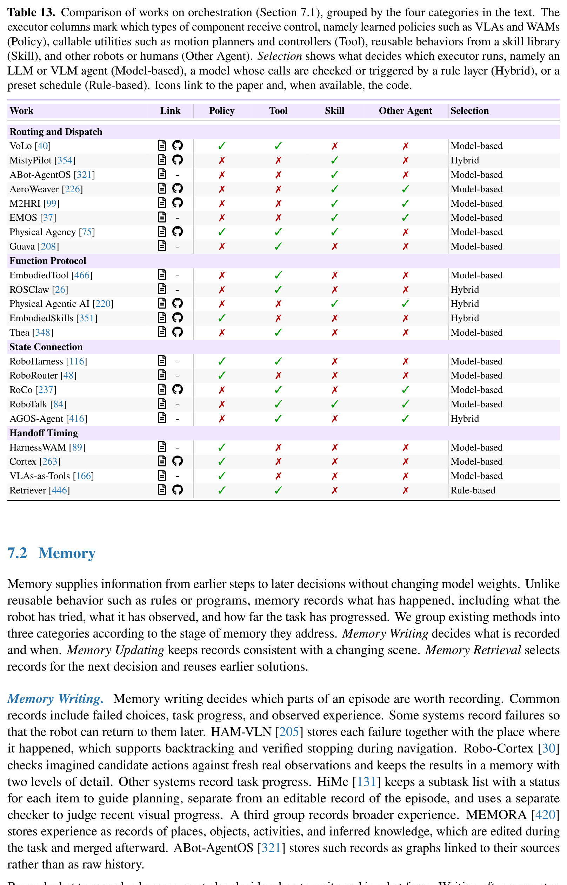

| Work | Link | Policy | Tool | Skill | Other Agent | Selection |
| :--- | :--- | :--- | :--- | :--- | :--- | :--- |
| **Routing and Dispatch** | | | | | | |
| VoLo [40] | A § | ✓ | ✓ | ✗ | ✗ | Model-based |
| MistyPilot [354] | A § | ✗ | ✗ | ✓ | ✗ | Hybrid |
| ABot-AgentOS [321] | A - | ✗ | ✗ | ✓ | ✗ | Model-based |
| AeroWeaver [226] | A § | ✗ | ✗ | ✓ | ✓ | Model-based |
| M2HRI [99] | A § | ✗ | ✗ | ✓ | ✓ | Model-based |
| EMOS [37] | A - | ✗ | ✗ | ✓ | ✓ | Model-based |
| Physical Agency [75] | A § | ✓ | ✓ | ✓ | ✗ | Model-based |
| Guava [208] | A - | ✗ | ✓ | ✗ | ✗ | Model-based |
| **Function Protocol** | | | | | | |
| EmbodiedTool [466] | A - | ✗ | ✓ | ✗ | ✗ | Model-based |
| ROSClaw [26] | A - | ✗ | ✓ | ✗ | ✗ | Hybrid |
| Physical Agentic AI [220] | A § | ✗ | ✗ | ✓ | ✓ | Hybrid |
| EmbodiedSkills [351] | A § | ✓ | ✗ | ✗ | ✗ | Hybrid |
| Thea [348] | A § | ✗ | ✓ | ✗ | ✗ | Model-based |
| **State Connection** | | | | | | |
| RoboHarness [116] | A - | ✓ | ✓ | ✗ | ✗ | Model-based |
| RoboRouter [48] | A - | ✓ | ✗ | ✗ | ✗ | Model-based |
| RoCo [237] | A § | ✗ | ✓ | ✗ | ✓ | Model-based |
| RoboTalk [84] | A - | ✗ | ✓ | ✓ | ✓ | Model-based |
| AGOS-Agent [416] | A - | ✗ | ✓ | ✗ | ✓ | Hybrid |
| **Handoff Timing** | | | | | | |
| HarnessWAM [89] | A - | ✓ | ✗ | ✗ | ✗ | Model-based |
| Cortex [263] | A § | ✓ | ✗ | ✗ | ✗ | Model-based |
| VLAs-as-Tools [166] | A - | ✓ | ✗ | ✗ | ✗ | Model-based |
| Retriever [446] | A § | ✓ | ✓ | ✗ | ✗ | Rule-based |

**Caption:** Table 13. Comparison of works on orchestration (Section 7.1), grouped by the four categories in the text. The executor columns mark which types of component receive control, namely learned policies such as VLAs and WAMs (Policy), callable utilities such as motion planners and controllers (Tool), reusable behaviors from a skill library (Skill), and other robots or humans (Other Agent). Selection shows what decides which executor runs, namely an LLM or VLM agent (Model-based), a model whose calls are checked or triggered by a rule layer (Hybrid), or a preset schedule (Rule-based). Icons link to the paper and, when available, the code.

**Caption[CN]:** 表 13. 编排机制相关代表性工作对比（第 7.1 节），按正文中的四个类别分组。执行器列标注了哪类组件接收控制权，包括学习策略如 VLA 和 WAM（Policy）、可调用实用程序如运动规划器与控制器（Tool）、技能库中的可复用行为（Skill）以及其他机器人或人类（Other Agent）。选择列展示了决定执行哪个执行器的机制，包括基于大语言模型或视觉语言模型的智能体（Model-based）、调用受到规则层检查或触发的模型（Hybrid）或预设调度（Rule-based）。

### 7.2 Memory (记忆系统与知识持久化)

> <strong>Para. 12:</strong> Memory supplies information from earlier steps to later decisions without changing model weights. Unlike reusable skills that package executable behavior, memory stores interaction history, spatial layouts, object states, and execution records. The harness must govern memory writing, memory updating, and memory retrieval across both short-horizon subtasks and long-horizon multi-episode deployments.

> <strong>Para. 12[CN]:</strong> 记忆系统旨在完全冻结神经网络模型权重的优雅前提下，将早先时间步中沉淀的高价值信息无缝传递赋能给后续阶段的高级决策。不同于封装具体运动程序的可复用技能库，记忆系统专注于长期持久化存储物理交互历史、多房间空间几何拓扑、物体动静态物理状态以及细粒度的执行履历档案。支架控制治理框架必须在超短程子任务原子步进以及横跨多天数个长回合的大规模物理部署中，全面管控记忆的写入（Writing）、记忆的动态更新（Updating）与记忆的精准检索（Retrieval）。

> <strong>Para. 13:</strong> Memory Writing. Memory writing decides which parts of an episode are worth keeping and what format to use. HAM-VLN [205] and MessyMem [8] record spatial observations as 3D topological graphs, adding new nodes as the robot explores unfamiliar rooms. Robo-Cortex [30] and HiMe [131] store textual summaries of task episodes, recording user preferences, object locations, and interaction outcomes at episode boundaries.

> <strong>Para. 13[CN]:</strong> 记忆写入机制。记忆写入主要决断物理展开过程中究竟哪些模态的信息具备长期保留价值，以及采用何种数据结构进行结构化落盘。HAM-VLN [205] 与 MessyMem [8] 将高维视觉空间观测沉淀为精炼的 3D 拓扑度量图谱，随着机器人在未知空间中不断纵深探索而动态扩展新节点与边；Robo-Cortex [30] 与 HiMe [131] 则在物理回合结束时，将交互全过程提炼浓缩为高质量的自然语言文本摘要，将人类用户的特异性偏好、隐蔽物体的最终收纳位姿以及任务成败总结稳健归档。

> <strong>Para. 14:</strong> Beyond what to record, a harness must also decide when to write and in what format. Writing at every step fills memory with redundant records, while writing too rarely misses essential state transitions. MEMORA [420] writes structured key-value pairs at verified task milestones, while ARMS [411] and HyMeS [452] trigger memory writes on specific physical events, such as when an object is picked up, dropped, or relocated.

> <strong>Para. 14[CN]:</strong> 除了判定记录的具体内容，支架框架还必须科学裁决写入的时序触发机制与数据组织格式。盲目在每一个连续毫秒控制步都全量写入，会导致记忆库迅速充斥海量高度冗余的低价值垃圾信息，引发检索灾难；而写入频率过于迟钝稀疏，又会导致不可逆物理状态跃迁的关键证据被彻底遗漏。MEMORA [420] 在系统严格验证通过的里程碑子任务节点处才结构化写入键值对（Key-Value Pairs）；ARMS [411] 与 HyMeS [452] 则采取事件触发式写入机制（Event-Driven Writing），即仅在物体被成功抓起、意外滑脱或发生显著空间位移等重大物理事件被捕捉时，才精准唤醒写入流程。

> <strong>Para. 15:</strong> Memory Updating. Memory updating keeps stored records consistent with changing real-world conditions. When a robot moves an object from the counter into the refrigerator, the memory of that object's position must be updated and the previous position invalidated. RoboStream [123] and SafeMem [180] maintain dynamic scene graphs that continuously overwrite spatial coordinates when objects move, ensuring that motion planners do not rely on stale spatial evidence.

> <strong>Para. 15[CN]:</strong> 记忆动态更新与一致性维护。记忆更新的核心使命在于确保记忆库中所持久化的认知表征始终与剧烈动态变化的真实物理世界保持强一致性。当机器人亲手将原本放置在台面上的苹果转移至冰箱内部闭门保存后，记忆库中关于该苹果的空间坐标必须被原子化更新，同时彻底将台面旧位置的陈旧索引声明作废。RoboStream [123] 与 SafeMem [180] 维护着实时自愈的动态场景图（Dynamic Scene Graphs），一旦物体位姿被物理改变，立即自动覆写其最新的局部与全局绝对坐标，确保上游规划器绝不会基于过时失效的旧空间数据做出荒唐决策。

> <strong>Para. 16:</strong> Updating also decides how long records are kept. Keeping every record indefinitely consumes memory and slows down retrieval queries. Mimir [392] and OVAL [262] prune outdated records using temporal decay or relevance filtering. In contrast, EEAgent [340] and WAA [440] retain cross-episode persistence, ensuring that spatial knowledge and user habits survive across days of autonomous operation.

> <strong>Para. 16[CN]:</strong> 记忆更新同样需要统筹裁定不同记忆记录的生命周期与淘汰遗忘策略。毫无节制地无限期持久化全部历史细节，必然会耗尽内存带宽并成倍拖慢向量检索的响应速度。Mimir [392] 与 OVAL [262] 引入时序衰减（Temporal Decay）与相关性门控机制，自动化修剪淘汰不再相关的边缘记忆；而在长程家政与管家场景中，EEAgent [340] 与 WAA [440] 则对特定核心知识施加跨回合持久化（Cross-Episode Persistence）保护，确保家庭全局空间拓扑与主人的特定生活习惯在机器人历经数天断电重启后依然完好留存。

> <strong>Para. 17:</strong> Memory Retrieval. Memory retrieval decides which stored records reach the agent's current context window. The first kind is historical context: past failures and lessons that guide the next action. CMMR-VLN [173] and MeCo [332] use embedding-based similarity search to retrieve relevant failure traces when a robot enters a room with visual features resembling a past failure state.

> <strong>Para. 17[CN]:</strong> 记忆检索机制。记忆检索负责在正确的时间从庞大的先验数据库中提取出最相关的知识切片，精准投喂进当前大模型的上下文窗口中。第一类关键记忆是历史反思上下文：即过往遭遇过的失败教训与纠偏备忘录。CMMR-VLN [173] 与 MeCo [332] 借助深度特征向量空间的高维相似度检索（Similarity Search），当移动机器人在未知建筑中踏入一个在视觉结构上高度神似过往曾发生剧烈碰撞或迷路死胡同的房间时，瞬间召回历史失败轨迹，从而提前指导避坑。

> <strong>Para. 18:</strong> The second kind is the task state needed to continue work. This kind maintains task progress, unvisited subgoals, and verified prerequisites. NavMCP [167] and HFLEX-EQA [270] use structured queries to check which candidate rooms remain uninspected. NavProbe [210] and HoloAgent-0 [464] query 3D spatial memories to determine whether an object was already located during an earlier exploration phase.

> <strong>Para. 18[CN]:</strong> 第二类记忆是维系长程任务连续推进不可或缺的任务推进状态（Task State）。该类记忆严密维护着当前的任务总进度、尚未踏足探索的待办子目标以及已获验证的物理前置条件列表。NavMCP [167] 与 HFLEX-EQA [270] 利用结构化 SQL/图查询接口快速梳理哪些候选房间目前仍未被视察；NavProbe [210] 与 HoloAgent-0 [464] 则随时向 3D 空间全息记忆库发起几何求交查询，以秒级确认目标物品在此前的全局探索巡航阶段中是否其实早已被多目相机偶然捕获并定位在案。

> <strong>Para. 19:</strong> The third kind is an earlier result that can replace new computation. BATON [391] retrieves cached motion plans for recurring navigation paths, while 2AM [112] caches object recognition predictions across static backgrounds. APEX [432] reuses the spatial evidence produced by earlier VLM updates, preventing the robot from having to re-compute visual grounding queries when moving within the same room. Related works are compared in Table 14.

> <strong>Para. 19[CN]:</strong> 第三类记忆则是前序高昂计算的确定性缓存结果，能够直接取代耗时的实时重新计算。BATON [391] 为高频出现的移动导航走廊路线直接检索复用已验证的运动规划路径，避免重复调用开销巨大的全局图搜索；2AM [112] 针对静态背景中固定的家具物体，缓存目标识别与分割先验；APEX [432] 则高效复用此前大模型推理所生成的 3D 空间几何证据，使机器人在同一间客厅内部小范围移动时，彻底省去了重复运行庞大视觉语言模型进行空间接地的昂贵延迟。记忆系统代表性工作在表 14 中进行了纵览对比。

### Table 14. 记忆机制相关工作对比 (Comparison of Works on Memory)

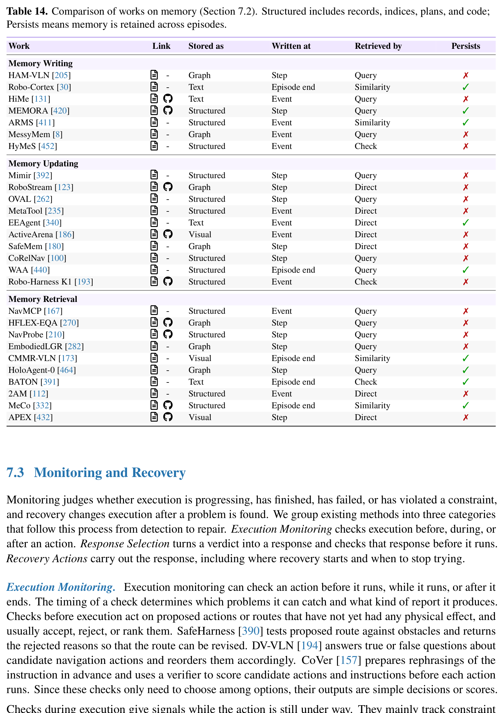

| Work | Link | Stored as | Written at | Retrieved by | Persists |
| :--- | :--- | :--- | :--- | :--- | :--- |
| **Memory Writing** | | | | | |
| HAM-VLN [205] | A - | Graph | Step | Query | ✗ |
| Robo-Cortex [30] | A - | Text | Episode end | Similarity | ✓ |
| HiMe [131] | A § | Text | Event | Query | ✗ |
| MEMORA [420] | A § | Structured | Step | Query | ✓ |
| ARMS [411] | A - | Structured | Event | Similarity | ✓ |
| MessyMem [8] | A - | Graph | Event | Query | ✗ |
| HyMeS [452] | A - | Structured | Event | Check | ✗ |
| **Memory Updating** | | | | | |
| Mimir [392] | A - | Structured | Step | Query | ✗ |
| RoboStream [123] | A § | Graph | Step | Direct | ✗ |
| OVAL [262] | A - | Structured | Step | Query | ✗ |
| MetaTool [235] | A - | Structured | Event | Direct | ✗ |
| EEAgent [340] | A - | Text | Event | Direct | ✓ |
| ActiveArena [186] | A § | Visual | Event | Direct | ✗ |
| SafeMem [180] | A - | Graph | Step | Direct | ✗ |
| CoRelNav [100] | A - | Structured | Step | Query | ✗ |
| WAA [440] | A - | Structured | Episode end | Query | ✓ |
| Robo-Harness K1 [193] | A § | Structured | Event | Check | ✗ |
| **Memory Retrieval** | | | | | |
| NavMCP [167] | A - | Structured | Event | Query | ✗ |
| HFLEX-EQA [270] | A § | Graph | Step | Query | ✗ |
| NavProbe [210] | A § | Structured | Step | Query | ✗ |
| EmbodiedLGR [282] | A - | Graph | Step | Query | ✗ |
| CMMR-VLN [173] | A - | Visual | Episode end | Similarity | ✓ |
| HoloAgent-0 [464] | A - | Graph | Step | Query | ✓ |
| BATON [391] | A - | Text | Episode end | Check | ✓ |
| 2AM [112] | A - | Structured | Event | Direct | ✗ |
| MeCo [332] | A § | Structured | Episode end | Similarity | ✓ |
| APEX [432] | A § | Visual | Step | Direct | ✗ |

**Caption:** Table 14. Comparison of works on memory (Section 7.2). Structured includes records, indices, plans, and code; Persists means memory is retained across episodes.

**Caption[CN]:** 表 14. 记忆机制相关代表性工作对比（第 7.2 节）。结构化（Structured）包括结构化记录、索引、规划与代码；跨回合持久化（Persists）表示记忆在不同任务回合（Episodes）之间得以保留。

### 7.3 Monitoring and Recovery (运行时监控与异常恢复)

> <strong>Para. 20:</strong> Monitoring judges whether execution is progressing, has finished, has failed, or has violated physical constraints. When a problem is detected, recovery decides what corrective action to take: retrying the action, re-planning the sequence, switching tools, or resetting the environment. A reliable harness combines multi-stage monitoring with robust recovery mechanisms.

> <strong>Para. 20[CN]:</strong> 运行时监控模块负责客观评判当前的机械执行过程是否处于健康推进状态、任务是否确已彻底终结、是否遭遇物理阻碍发生故障、或是是否突破了形式化物理安全约束。一旦异常被监控器捕捉，错误恢复机制便立即接管系统决策，采取极具针对性的纠偏响应：重新尝试原动作、重新制定高层规划时序、切换备选工具接口，或是将环境状态回滚重置。一个高度可靠的具身支架控制系统，必然深度融合了多阶段交叉覆盖的监控机制与多层级容错自愈的恢复架构。

> <strong>Para. 21:</strong> Execution Monitoring. Execution monitoring can check an action before, during, or after execution. Checks before execution inspect proposed actions against safety constraints and precondition rules: SafeHarness [390] checks that planned trajectories stay clear of physical obstacles, while DV-VLN [194] and CoVer [157] evaluate whether a proposed navigation waypoint is physically reachable before the motor drives engage.

> <strong>Para. 21[CN]:</strong> 多阶段执行监控。执行监控可以在物理动作发生之前（Before）、执行过程之中（During）以及动作结束之后（After）全周期介入。执行前的前置检查主要审查提议的候选动作是否触碰安全红线或违背物理前置逻辑约束：SafeHarness [390] 严格核查规划轨迹与外部物理障碍物之间是否留有充裕的安全距离裕度；而 DV-VLN [194] 与 CoVer [157] 则在底盘电机真正接电运转之前，先行严格审查候选导航路径点在当前真实物理环境下是否完全可达。

> <strong>Para. 22:</strong> Checks during execution give signals while the action is still under way. DoReMi [94] and OnFly [455] monitor camera streams in real time, detecting trajectory drift and commanding replanning before the robot collides with an obstacle. Code-as-Monitor [458] evaluates visual assertions embedded in code, while Robometer [195] uses a learned policy to continuously score progress during manipulation, triggering early stopping when stagnation occurs.

> <strong>Para. 22[CN]:</strong> 执行期间的实时动态监控能够在动作推进全过程中高频输出警报信号。DoReMi [94] 与 OnFly [455] 毫秒级并行监听实时相机视频流，敏锐捕捉机器人的实际运动轨迹漂移，在即将撞上障碍物前数个时间步紧急截断并下发避障重规划；Code-as-Monitor [458] 在代码层嵌入形式化视觉断言（Visual Assertions）并实时求值；Robometer [195] 则利用经过专门训练的轻量化价值评估网络，在机械臂操作过程中对任务推进度进行连续高频打分，一旦捕捉到曲线长时期停滞不前，立即触发早停机制止损。

> <strong>Para. 23:</strong> Checks after execution can use the full record of what happened. REFLECT [223] and AHA [64] use LLMs and VLMs to analyze multimodal logs recorded during manipulation, diagnosing whether an ungrasped object slipped or was never reached. DQAF [245] and RoboLab [398] compare post-execution keyframes against target goal descriptions, producing verifiable success determinations.

> <strong>Para. 23[CN]:</strong> 执行完成后的事后因果审查能够调用该次动作期间沉淀的完整多模态全景数据。REFLECT [223] 与 AHA [64] 借助大语言模型与多模态模型，对整个操作周期内捕获的触觉、视觉与力矩日志进行全景回溯因果分析，精准诊断未被抓起的物体究竟是因为夹爪在闭合前距离计算有偏差、还是在提起瞬间因摩擦力不足而中途滑落；DQAF [245] 与 RoboLab [398] 则将执行完毕后的关键帧画面对照最终目标语义进行严格的视觉谓词比对，给出具备高度审计追溯性的成功判决。

> <strong>Para. 24:</strong> Response Selection. Response selection decides what the system does after detecting a problem. The simplest response is retrying: DSHF [285] and ACE [165] repeat the failed action with adjusted parameters (such as a deeper grasp depth or higher contact force). When the problem reflects a flawed sequence of operations, replanning is required: Goal2Skill [225] and WCM [51] re-prompt the high-level planner with failure descriptions, generating an alternative action sequence.

> <strong>Para. 24[CN]:</strong> 响应策略裁决机制。响应选择机制负责在监控器确凿报障之后，决定系统应当采取何种力度的应对策略。最轻量级的即时响应是局部重试：DSHF [285] 与 ACE [165] 在微调局部关键参数（如加大抓取下潜深度、或微调末端夹持力阈值）后直接重新触发该失败动作；而当监控器判定故障根植于宏观任务时序编排的逻辑缺陷时，必须坚决触发重规划流程：Goal2Skill [225] 与 WCM [51] 将结构化的失败归因摘要重新喂入高层规划大模型，迫使其全面推翻旧思路并开辟全新的备选动作路径。

> <strong>Para. 25:</strong> A chosen response can also be wrong, so systems validate proposed actions. CLMAF [102] uses a VLM to verify that a proposed replan does not repeat an action that previously failed under the same conditions. HarnessVLN [44] uses rule-based validators to ensure that error recovery does not command motions into unmapped territory without sensory verification.

> <strong>Para. 25[CN]:</strong> 提议的自愈响应方案本身同样存在犯错或二次诱错的风险，因此系统必须对拟采取的恢复方案进行二次检验。CLMAF [102] 引入独立的视觉语言模型作为方案审查员，严查新生成的重规划步骤是否在本质上又机械地重复了此前在完全相同物理条件下惨遭失败的老路；HarnessVLN [44] 则借助确定性规则校验器严格把关，确保在发生迷航或丢标时的纠偏恢复动作，绝不会在缺乏前向感知确认的情况下贸然指挥底盘向未建模的盲区区域盲目冲撞。

> <strong>Para. 26:</strong> Recovery Actions. Once a failure is detected, the robot needs a recovery skill to fix it. VLA-Corrector [302] deploys a learned residual policy that applies small corrective displacements to an active trajectory. ReCoVLA [106] and AgentChord [395] switch from general manipulation policies to specialized failure-specific recovery skills, such as dislodging an object trapped against a container wall.

> <strong>Para. 26[CN]:</strong> 物理级自愈恢复动作库。一旦物理失败确凿发生，机器人必须能够调用高度专业的自愈技能来扭转乾坤。VLA-Corrector [302] 在主干策略动作之上叠加一个极轻量级的残差神经策略，以高频输出细微的位移补偿量，动态纠正物理轨迹漂移；ReCoVLA [106] 与 AgentChord [395] 则在检测到受阻死锁时，主动从通用的宽泛操作策略硬切至高度专精的故障专项解脱技能，例如专门调用“轻震容器边缘”或“倒拨解卡”等微操技能来释放卡死在容器壁缝隙中的目标物体。

> <strong>Para. 27:</strong> Recovery also needs to choose which state to resume from. A failed attempt can leave the physical environment disorganized: an overturned cup or a displaced obstacle prevents the next step from running normally. Dream2Fix [170] and PhyAgentOS [221] plan physical remediation actions to right tilted objects before resuming the primary task.

> <strong>Para. 27[CN]:</strong> 恢复机制同样需要科学裁决系统应当从哪一个物理基准状态重新起步。一次中途流产的失败尝试往往会给物理现场留下极度杂乱无序的烂摊子：翻倒的杯子中液体洒出、或被机械臂无意推离原位的杂物直接阻碍了下一阶段的必经之路。Dream2Fix [170] 与 PhyAgentOS [221] 创新性地引入了物理清障与现场扶正重置规划，在正式重启主干任务前，先指挥机器人自主将倾斜侧翻的物体扶正归位、搬开意外掉落的绊脚石。

> <strong>Para. 28:</strong> HALTER [134] restores the scene first, using scene-graph histories to return moved items to their original locations. When automated recovery is impossible, LabVLA [280], PAL [353], and SPINE [97] request human assistance, halting operation and flagging safety-critical failures. Related works on monitoring and recovery are compared in Table 15.

> <strong>Para. 28[CN]:</strong> HALTER [134] 优先致力于环境的物理级主动复原：充分借助拓扑场景图的完整历史时间序列，引导机械臂将所有被意外拨乱移位的无关物品物归原位；而在面临完全超出自主物理能力范畴的灾难性死锁时，LabVLA [280]、PAL [353] 与 SPINE [97] 则能够极为严谨地主动请求人类工程师入场接管，在第一时间截断动力输出、锁定机械臂位姿，并向终端发出最高优先级的安全告警报告。监控与恢复领域的代表性工作在表 15 中进行了详尽分类对比。

### Table 15. 监控与恢复机制相关工作对比 (Comparison of Works on Monitoring and Recovery)

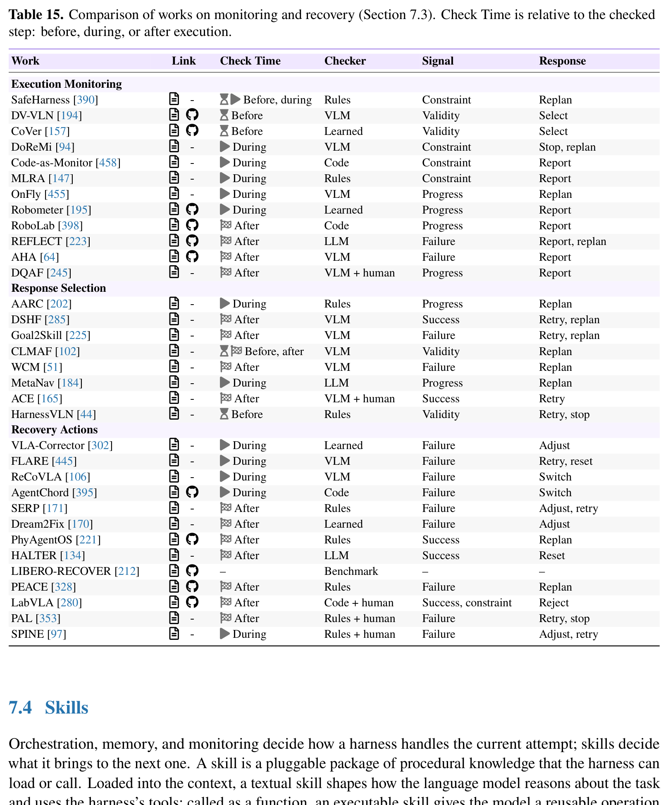

| Work | Link | Check Time | Checker | Signal | Response |
| :--- | :--- | :--- | :--- | :--- | :--- |
| **Execution Monitoring** | | | | | |
| SafeHarness [390] | A - | Before, during | Rules | Constraint | Replan |
| DV-VLN [194] | A § | Before | VLM | Validity | Select |
| CoVer [157] | A § | Before | Learned | Validity | Select |
| DoReMi [94] | A - | During | VLM | Constraint | Stop, replan |
| Code-as-Monitor [458] | A - | During | Code | Constraint | Report |
| MLRA [147] | A - | During | Rules | Constraint | Report |
| OnFly [455] | A - | During | VLM | Progress | Replan |
| Robometer [195] | A § | During | Learned | Progress | Report |
| RoboLab [398] | A § | After | Code | Progress | Report |
| REFLECT [223] | A § | After | LLM | Failure | Report, replan |
| AHA [64] | A § | After | VLM | Failure | Report |
| DQAF [245] | A - | After | VLM + human | Progress | Report |
| **Response Selection** | | | | | |
| AARC [202] | A - | During | Rules | Progress | Replan |
| DSHF [285] | A - | After | VLM | Success | Retry, replan |
| Goal2Skill [225] | A - | After | VLM | Failure | Retry, replan |
| CLMAF [102] | A - | Before, after | VLM | Validity | Replan |
| WCM [51] | A - | After | VLM | Failure | Replan |
| MetaNav [184] | A - | During | LLM | Progress | Replan |
| ACE [165] | A - | After | VLM + human | Success | Retry |
| HarnessVLN [44] | A - | Before | Rules | Validity | Retry, stop |
| **Recovery Actions** | | | | | |
| VLA-Corrector [302] | A - | During | Learned | Failure | Adjust |
| FLARE [445] | A - | During | VLM | Failure | Retry, reset |
| ReCoVLA [106] | A - | During | VLM | Failure | Switch |
| AgentChord [395] | A § | During | Code | Failure | Switch |
| SERP [171] | A - | After | Rules | Failure | Adjust, retry |
| Dream2Fix [170] | A - | After | Learned | Failure | Adjust |
| PhyAgentOS [221] | A § | After | Rules | Success | Replan |
| HALTER [134] | A - | After | LLM | Success | Reset |
| LIBERO-RECOVER [212] | A § | – | Benchmark | – | – |
| PEACE [328] | A § | After | Rules | Failure | Replan |
| LabVLA [280] | A § | After | Code + human | Success, constraint | Reject |
| PAL [353] | A - | After | Rules + human | Failure | Retry, stop |
| SPINE [97] | A - | During | Rules + human | Failure | Adjust, retry |

**Caption:** Table 15. Comparison of works on monitoring and recovery (Section 7.3). Check Time is relative to the checked step: before, during, or after execution.

**Caption[CN]:** 表 15. 监控与恢复机制相关代表性工作对比（第 7.3 节）。检查时机（Check Time）相对于被检查步骤的时间节点：执行前（Before）、执行中（During）或执行后（After）。

### 7.4 Skills (技能体系与程序库演进)

> <strong>Para. 29:</strong> Orchestration, memory, and monitoring decide how a harness handles the current attempt; skills decide what it can carry over to the next. In an agentic harness, skills encapsulate reusable procedural knowledge and executable behaviors. Rather than retraining end-to-end neural networks for every new task, a harness can package verified procedures into functions, store them in searchable libraries, and evolve those libraries through trial and error.

> <strong>Para. 29[CN]:</strong> 编排机制、记忆系统与运行时监控共同决定了支架控制框架如何妥善处理好当前的单次任务尝试；而技能系统则决定了系统究竟能够为未来的下一次任务沉淀并继承何等深厚的程序化能力。在具身智能体支架体系中，技能模块对可复用的过程化程序知识（Procedural Knowledge）与闭环执行行为进行了优雅封装。系统无需针对每一个新任务都耗时费力地重新端到端训练神经网络，而是直接将经过严格物理实测验证的有效控制过程固化为标准化函数、分门别类地归档在可高效检索的技能库中，并通过持续试错让这些代码技能库实现终身自主进化。

> <strong>Para. 30:</strong> From Skills to Code as Policies. Early language-model harnesses treated language generation directly as policy synthesis. Code as Policies [196] showed that LLMs can generate Python programs that compose perception APIs and robot primitives into complex manipulation skills. ProgPrompt [300] expanded code generation to include assertions and tracking variables, allowing programs to recover from transient failures within the plan.

> <strong>Para. 30[CN]:</strong> 从离散技能迈向“代码即策略”。早期将语言大模型引入机器人的尝试，往往直接将自然语言代码生成与具身策略合成划上等号。Code as Policies（CaP）[196] 具有里程碑意义地证明了：大语言模型能够熟练编写出高度结构化的 Python 控制程序，将第三方的感知 API 与底层的机器人几何原语精巧拼装为功能强大的复杂复合操作技能；ProgPrompt [300] 进一步将显式的环境状态断言与时序追踪变量深度注入到自动生成的代码框架中，赋予了所生成的程序在遭遇瞬态扰动时在计划内自主触发局部自愈与重试的高级弹性。

> <strong>Para. 31:</strong> VoxPoser [118] writes code that builds 3D spatial cost maps, while Act-Observe-Rewrite [155] iteratively updates controller code based on execution logs across repeated trials. MEMENTO [314] uses an evolutionary algorithm to mutate and recombine stateful policy programs, selecting high-performing candidates through rollout metrics.

> <strong>Para. 31[CN]:</strong> VoxPoser [118] 专注于编写在 3D 空间中连续构建吸引与排斥势场价值图的几何代码；Act-Observe-Rewrite [155] 则依托多回合物理执行日志与关键帧视觉图像，采用“行动-观察-重写”的三段式循环，在连续试验中闭环重构并优化控制器源码；MEMENTO [314] 引入了先进的演化算法机制对包含状态记忆的策略程序进行变异和交叉重组，完全依据轨迹物理展开的客观量化表现筛选并晋级最优的代码精英群体。

> <strong>Para. 32:</strong> Skill Libraries and Reuse. Generating code from scratch for every task is inefficient and unreliable. Voyager [336] introduced self-directed skill libraries in Minecraft, storing validated action programs in a vector database and retrieving them by task description. In robotics, DROC [430] and ARCHITECT [34] store human language corrections as reusable code patterns, expanding the robot's repertoire of skills without retraining models.

> <strong>Para. 32[CN]:</strong> 技能库的构建与智能复用。针对每一次突发任务都从零开始由大模型临场即兴编写全部代码，既极度低效又伴随着巨大的随机语法与逻辑幻觉风险。Voyager [336] 率先在 Minecraft 虚拟世界中确立了由智能体自主驱动构建可持久化技能库的范式：将通过物理验证的动作程序存入向量数据库中，并在面临新任务时依据语义相似度快速召回复用；在真实物理机器人领域，DROC [430] 与 ARCHITECT [34] 将人类专家的口头纠偏指令提炼转化为可广泛复用的代码行为范式（Code Patterns），在完全无需对神经网络进行重新微调的前提下，极大地扩充了机器人的技能储备库。

> <strong>Para. 33:</strong> RoboCoder [175] and Uni-Skill [385] retrieve video-derived skill templates from an indexed repository (SkillFolder), synthesizing missing function implementations on demand. CaP-X [74] synthesizes a compact library of 9 general-purpose helper functions across benchmark tasks, dramatically improving the success rate of code-as-policy generation on novel tasks.

> <strong>Para. 33[CN]:</strong> RoboCoder [175] 与 Uni-Skill [385] 能够从结构化索引的高维代码技能仓库（SkillFolder）中精准检索从海量人类演示视频中提炼出的技能骨架模板，并在此基础上按需快速合成当前任务缺失的特定底层函数实现；CaP-X [74] 在广泛的基准测试集上，系统性提炼合成了一套仅包含 9 个核心高通用性辅助函数（Helper Functions）的紧凑技能基础库，使得大模型在面临前所未见的全新复杂任务时，“代码即策略”的零样本生成成功率获得了飞跃式的提升。

> <strong>Para. 34:</strong> Skill Evolution. Beyond static libraries, an agentic harness should evolve its skills over time. LRLL [327] and LYRA [240] abstract similar code snippets into parameterized functions that take object IDs and spatial targets as arguments. RHO [65] and SHAPER [347] mutate code repositories based on rollout scores, promoting high-performing skills while archiving or deleting failing implementations.

> <strong>Para. 34[CN]:</strong> 技能库的主动演化机制。超越死板的静态函数库，一个成熟的具身智能体支架必须能够推动其技能库随物理实战经验实现终身主动演化。LRLL [327] 与 LYRA [240] 能够自动对多个相似功能的代码片段进行高阶泛化抽象，提炼出以物体 ID、空间目标位姿以及几何约束作为动态输入参数的通用参数化函数；RHO [65] 与 SHAPER [347] 则建立了一整套基于物理轨迹展开得分的算法代码库演化淘汰机制，优先晋级并在生产环境中部署高得分的成熟技能，同时果断归档封存或彻底抹除频频引发物理碰撞与失败的残缺代码实现。

> <strong>Para. 35:</strong> Zetta 𝜁 [60] deploys versioned harness packages containing critics, recovery procedures, and tools, using validation rollouts to consolidate successful bug patches into stable releases. WSRSI [339] and RoboSkill [388] replay historical failure cases to verify that updated skills maintain backward compatibility without breaking previously mastered tasks.

> <strong>Para. 35[CN]:</strong> Zetta 𝜁 [60] 在工程上创新性地采用了带严格语义版本控制的支架治理代码包（Versioned Packages），将专用的评估器、异常恢复过程与底层分析工具系统化封装，并强制利用严格的回归验证轨迹展开，确保每一个针对特定缺陷打入的代码补丁都能稳健合入稳定主干发行版；WSRSI [339] 与 RoboSkill [388] 则专门维护了一套历史经典失败用例回放测试套件，在每一次技能代码升级迭代后，强制进行全量回归测试，严密检验新版本技能在破解新难题的同时，是否完全保持了向下兼容性，绝不倒退损害此前已经攻克并熟练掌握的历史任务能力。

> <strong>Para. 36:</strong> From Skill Evolution to Training. The ultimate stage of skill evolution connects procedural code improvements back to neural policy training. ENPIRE [383] uses code-agent workflows to synthesize training pipelines that train specialized neural policies on demand. Agentic Skill Discovery [450] uses self-generated reward functions and RL to train missing skills, while RoboClaw [178] integrates trained policies as callable tools within a wider procedural skill framework. Related works are compared in Table 16.

> <strong>Para. 36[CN]:</strong> 从技能自主演化到闭环策略重训练。技能演化体系的最高境界在于：将过程化代码工程的演化突破，反哺并闭环驱动到底层神经网络策略的自主重训练中。ENPIRE [383] 利用代码智能体自适应拼装和优化端到端训练流水线，根据物理现场的紧迫需求按需在线训练专精的神经小策略；Agentic Skill Discovery [450] 则利用智能体自主编写的密集奖励函数配合强化学习，全自动为机器人补齐缺失的关键高难度运动技能；RoboClaw [178] 则将经过充分训练的专用深度策略模型直接包装为高层过程化代码体系中可随时调用的确定性工具算子。技能系统代表性工作在表 16 中进行了系统横向对比。

### Table 16. 技能系统相关工作对比 (Comparison of Works on Skills)

| Work | Link | Skill Form | Built From | Reuse | Update |
| :--- | :--- | :--- | :--- | :--- | :--- |
| **From Skills to Code as Policies** | | | | | |
| Code as Policies [196] | A § | Python functions | Instructions; API examples | Call earlier functions | Generate missing functions |
| ProgPrompt [300] | A § | Plans with assertions | Instructions; action examples | Compose provided actions | Within-plan recovery; skill revision NR |
| VoxPoser [118] | A § | Value-map code | Instructions; visual grounding | Rerun code on new observations | Code fixed within each subtask |
| Act-Observe-Rewrite [155] | A - | Python controllers | Episode logs; keyframe images | Run controller in the next trial | Rewrite between episodes |
| IMR-LLM [306] | A - | Process tree; robot programs | Program examples; human checks | Select branches; reuse code snippets | Tree built once for the reported tests |
| MEMENTO [314] | A § | Stateful policy programs | Rollout metrics; search history | Run the selected program | Mutate and combine code; retain the elite |
| AGP [132] | A - | Task definitions; scripts | Task materials; robot observations | Reload saved task definitions | Revise scripts during execution |
| EmbodiedSWE [294] | A § | Executable solutions | Task materials; simulator trials | Use verified solutions as references | Test and revise task programs |
| RAPID [222] | A - | Relational programs | One visual demonstration | Bind a fixed strategy to a new scene | Revise in simulation before deployment |
| **Skill Libraries and Reuse** | | | | | |
| Voyager [336] | A § | Action programs | Exploration; execution feedback | Retrieve relevant programs | Add success-verified programs |
| DROC [430] | A § | Code; correction knowledge | Human corrections | Retrieve task/object knowledge | Revise code; save reusable lessons |
| RoboCoder [175] | A - | Action programs | Basic actions; evaluator feedback | Retrieve similar actions | Repair code; add accepted actions |
| Uni-Skill [385] | A - | On-demand skill code | Video-derived skill examples | Retrieve examples from SkillFolder | Generate missing skill implementations |
| CaP-X [74] | A - | 9 helper functions | Successful benchmark rollouts | Call the synthesized library | Single library-synthesis pass |
| ARCHITECT [34] | A § | Text rules; code patterns | Human language corrections | Load the full skill library | Append corrections as reusable skills |
| SkillComposer [374] | A - | Callable macros | Accepted robot programs | Expand macros into primitive calls | Relearn macros after accepted prompts |
| Teach and Grow [249] | A § | Validated behavior blocks | Successful demonstrations | Ground blocks in the current scene | Refine scope or executor; revalidate |
| LTCLRS [156] | A - | Closed-loop software | Demonstrations; simulated trials | Use archived code as examples | Revise code; select on validation |
| **Skill Evolution** | | | | | |
| LRLL [327] | A - | Python skill functions | Demonstrations; simulated trials | Call library functions | Group similar code; abstract and replay |
| LYRA [240] | A § | Parameterized functions | Human-guided successful trials | Retrieve skills and examples | Extend functions with human feedback |
| VASO [403] | A - | Labeling code; plan templates | Task; APIs; formal rules | Guide plan generation | Revise using model-checker feedback |
| RHO [65] | A § | Policy repositories | Rollouts; failure feedback | Deploy the selected repository | Mutate files; select by rollout scores |
| RATs [435] | A § | Manipulation functions | Self-directed play | Retrieve the learned library | Curate during play; freeze at test time |
| ASPIRE [228] | A § | Repair notes; code sketches | Primitive-level execution traces | Load relevant repair guidance | Admit validated, reusable repairs |
| SHAPER [347] | A - | Text; context-building code | Target-environment rollouts | Reuse guidance and context builder | Test edits; retain top candidates |
| Zetta 𝜁 [60] | A § | Critic, recovery and tool packages | Failure traces; validation rollouts | Deploy versioned harness packages | Patch, validate and consolidate repairs |
| WSRSI [339] | A - | Skill code; model adapters | Recorded failures | Call skills through typed interfaces | Replay failures; test on fresh tasks |
| RoboSkill [388] | A § | Text; code; supporting records | Exploration and execution records | Select relevant skill packages | Consolidate skills after agent exit |
| RPG [358] | A - | Skill code; system prompts | Simulated practice; failure diagnosis | Deploy the retained system | Test across tasks; merge and retest |
| **From Skill Evolution to Training** | | | | | |
| RoboCodeX [242] | A - | Object-centered code units | Multimodal code training | Compose motion primitives | Skill-library revision NR |
| Agentic Skill Discovery [450] | A § | Learned policies | Generated rewards; RL | Compose learned skills | Train missing skills on demand |
| RoboClaw [178] | A § | Tool-use procedures | Modular skills; trained policies | Compose tool and policy calls | Procedure revision NR |
| ENPIRE [383] | A § | Policy-learning code | Physical trials; automated rewards | Reuse successful training recipes | Edit code; train and retest policies |
| AgenticRobotics [417] | A - | Skill procedures; tool records | Round logs; measured outcomes | Select skill–tool pairs | Registry promotion: live use untested |
| HarnessPAI [356] | A - | Repair notes; linked code | Between-rollout failure analysis | Retrieve repairs by workflow node | Evolve code; save failure–repair pairs |
| RACaP [192] | A § | Policy API library | Development-task rollouts | Call APIs with runtime arguments | Paired testing; code frozen at deployment |

**Caption:** Table 16. Comparison of works on skills (Section 7.4), grouped by the four parts of the text. Update distinguishes code/library changes from policy training. NR: not reported.

**Caption[CN]:** 表 16. 技能系统相关代表性工作对比（第 7.4 节），按正文四个部分分组。更新（Update）区分了代码/函数库层面的修改与底层策略的重训练。NR：未报告。

### 7.5 Infrastructure (软件基础设施与服务化部署)

> <strong>Para. 37:</strong> Beneath skills, every harness function rests on software infrastructure: the interface through which tools and policies communicate, the runtime services that host neural models, and the safety mechanisms that gate physical execution. High-performance infrastructure ensures that foundation-model inference runs with low latency, policies receive fresh observation streams, and actions are vetted before commanding physical motors.

> <strong>Para. 37[CN]:</strong> 在高级技能体系之下，支架系统的每一项宏观治理职能都完全奠基在扎实坚固的底层软件工程基础设施之上：包括工具算子与神经策略之间高频互通的通信接口、托管巨量参数基础模型的工业级运行时服务架构、以及在电机执行前把关的硬件安全门控防护机制。高性能的具身系统基础设施必须从根本上确保：百亿大模型的推理能够在极低时延内敏捷返回、高频运动控制策略能够持续获取低延迟的新鲜传感器多模态流，且所有电机动作在正式生效前均经过严格的安全审查。

> <strong>Para. 38:</strong> Capability Interfaces. The first layer of infrastructure standardizes how tools, learned policies, and sensors communicate. RoboNeuron [90] defines a unified middleware that separates tool orchestration from streaming execution, allowing LLM planners to run asynchronously from high-frequency motion controllers. LeRobot [23] standardizes data recording, policy training, and hardware control across real and simulated robots, reducing the integration effort required to transfer models across platforms.

> <strong>Para. 38[CN]:</strong> 统一能力抽象接口。基础设施的首要基石在于标准化规范异构工具、深度策略与多传感器阵列之间的交互协议。RoboNeuron [90] 提出了一套统一的具身中间件架构，彻底将大模型的高阶工具编排与底层电机的连续数据流执行进行物理级解耦，使高层大语言模型规划器能够完全异步于百赫兹的底层运控闭环独立运行；开源具身项目 LeRobot [23] 则在真实机器人硬件与仿真平台之间，高度统一了数据记录格式、神经策略训练协议以及底层硬件驱动接口，大幅削减了具身模型在不同机器人本体之间迁移适配所需的巨大系统集成工作量。

> <strong>Para. 39:</strong> Perception and Manipulation Toolchains. Behind the interface, code-as-policy harnesses rely on perception and geometry libraries to turn semantic commands into physical actions. OK-Robot [215] connects pretrained visual detectors, open-vocabulary semantic maps, and collision-free grasping primitives to execute mobile manipulation across home environments without task-specific training.

> <strong>Para. 39[CN]:</strong> 经典感知与操作几何工具链。在统一接口之后，“代码即策略”等主流架构高度依赖成熟的经典计算机视觉与空间几何计算工具链，将上位高级语义意图严谨落地为物理动作。OK-Robot [215] 成功串联了预训练的目标检测大模型、开放词表（Open-Vocabulary）3D 空间语义图谱、以及基于启发式凸包几何求解的无碰撞抓取原语，在完全无需任何下游特定任务微调的前提下，直接在完全未知的真实家庭杂乱环境中高成功率完成了复杂的移动复合抓取与放置任务。

> <strong>Para. 40:</strong> These toolchains determine much of what a harness can achieve. Perception libraries like Grounding DINO, SAM2, and Metric3D provide bounding boxes, segmentation masks, and metric depth estimates. Geometry libraries like cuRobo and OMPL solve collision-free inverse kinematics, allowing an LLM planner to command 3D target coordinates without worrying about joint-level motor constraints.

> <strong>Para. 40[CN]:</strong> 这些经典而强大的工具链直接界定了支架治理系统所能达成的工程能力上限。以 Grounding DINO、SAM2 和 Metric3D 为代表的先进感知工具库，为系统提供了像素级边界框、高精度物体分割掩码与绝对公制深度图；而以 cuRobo 和 OMPL 为代表的高性能几何运动规划库，则利用 GPU 并行加速毫秒级解算无碰撞的逆运动学（IK）可行路径，使得上位大语言模型规划器只需直观下发末端 3D 目标坐标，完全无需陷入底层关节角极限与奇异点规避等繁重复杂的底层机械力学计算泥潭。

> <strong>Para. 41:</strong> Policy Inference and Serving. Learned policies form the other half of the infrastructure challenge. Foundation models require extensive compute, making real-time robot control challenging. SmolVLA [299] and RTC [14] enable continuous execution by overlapping server-side inference with queued robot actions: while the robot executes action chunk $t$, the model predicts action chunk $t+1$, eliminating idle pauses between steps.

> <strong>Para. 41[CN]:</strong> 具身策略的高并发推理与服务化调度。深度神经策略的大规模部署构成了基础设施工程的另一大核心挑战。多模态具身基础模型极其庞大的参数量需要消耗海量 GPU 算力，为实时高频的闭环机器人控制带来了巨大的时延挑战。SmolVLA [299] 与实时块流式预测架构 RTC [14] 创新性地引入了动作时域双缓冲重叠执行范式：当机器人正在执行当前时域分块中的连续动作轨迹 $t$ 时，服务端的庞大模型在后台并行前瞻计算下一时域分块动作 $t+1$，彻底消除了传统分步执行中机械臂走走停停的尴尬停顿，实现了物理机械的无缝丝滑连续作业。

> <strong>Para. 42:</strong> Running VLAs at Real-time Speed [234] optimizes GPU kernels and fuses transformer operations, while BitVLA [337] quantizes VLA weights to ternary values and activations to 8-bit integers, enabling fast onboard inference. VLASH [315] and Training-time RTC [15] introduce delay compensation mechanisms, conditioning action predictions on the expected future robot state at execution time rather than the delayed state observed during inference start.

> <strong>Para. 42[CN]:</strong> “实时运行 VLA”研究 [234] 深度重构底层算子并高度融合 Transformer 注意力计算核函数，从底层极大榨干了 GPU 算力；BitVLA [337] 则将庞大 VLA 策略的主干权重极致量化为三值（1.58-bit Ternary Values）、激活值量化为 INT8，使得百亿多模态模型能够直接在机器人机载端侧低功耗计算平台上实现高速高频推理；面对难以完全消除的物理通信时延，VLASH [315] 与训练期时延补偿框架 Training-Time RTC [15] 引入了前瞻时延补偿算法：不再基于推理发起时的陈旧状态预测动作，而是将动作生成严格条件化于动作在物理生效瞬间所预估达到的未来绝对机器人关节状态之上，从根本上克服了时延导致的控制发散问题。

> <strong>Para. 43:</strong> For fleet deployments, ROSA [135], Robion [1], and Armory [7] pool GPU resources across multiple robots, batching inference requests dynamically and managing model weights across edge-cloud server tiers. RoboECC [457] partitions VLA models dynamically between onboard edge computers and remote cloud clusters based on real-time network bandwidth and latency measurements.

> <strong>Para. 43[CN]:</strong> 针对大规模机器人集群的集中式服务化部署，ROSA [135]、Robion [1] 与 Armory [7] 建立了跨越机群的分布式 GPU 算力池化调度架构，动态合并不同机器人的并发推理请求，并在边缘节点与云端服务器之间智能调度模型权重加载；RoboECC [457] 则基于真实网络带宽波动与往返时延的毫秒级实测指标，在大模型计算图的不同层级处自适应切分网络算子，动态平衡机载端侧轻量计算与远程云端超强计算之间的协同负荷。

> <strong>Para. 44:</strong> Runtime Gating and Versioning. Once tools and policies are reachable, the infrastructure must ensure safe execution. Safety Chip [405] monitors proposed action commands against temporal logic rules, intercepting forbidden actions (such as collisions with humans or workspace boundary breaches) and reprompting the model. RoboSafe [344] and SafeGate [255] screen task requests before execution begins, blocking adversarial or hazardous commands.

> <strong>Para. 44[CN]:</strong> 运行时安全门控与版本契约管理。在底层工具与算法策略完全打通之后，基础设施必须提供不可僭越的硬实时安全保障。Safety Chip [405] 在最靠近电机驱动的底层部署专用时序逻辑校验器，全天候严密过滤模型输出的每一条动作指令，一旦检测到可能引发人身碰撞或冲出安全工作空间边界的危险动作，立即进行物理拦截并强制触发系统重试；RoboSafe [344] 与 SafeGate [255] 则在长任务启动前先行部署输入级安全审查机制，精准识别并拦截包含恶意物理对抗攻击或具有潜在人身财产安全隐患的高危违规指令。

> <strong>Para. 45:</strong> RoboPAIR [283] motivates this placement by jailbreaking a self-driving system through adversarial language prompts, proving that models cannot be trusted without external verification. VLA-Perf [136] and Harness Robotic OS [397] benchmark hardware performance across different deployment configurations, ensuring that safety-critical execution contracts are maintained under varying computational loads. Related works are compared in Table 17.

> <strong>Para. 45[CN]:</strong> RoboPAIR [283] 极为震撼地通过越狱对抗语言提示词（Jailbreak Attacks）成功攻破了某主流自动驾驶系统，铁证如山地警示学术界：在涉及物理安全的真实世界具身场景中，绝不可盲目信赖任何端到端大模型的所谓自律性，必须强制引入外部独立的硬核安全防护与状态验证机制；VLA-Perf [136] 与 Harness Robotic OS [397] 则针对多元化的异构硬件计算平台设立了详尽的吞吐量与时延基准分析方案，确保系统在剧烈的计算负载与传感器波动下，依然能够坚不可摧地维系安全关键的实时执行契约。基础设施与部署系统代表性工作在表 17 中进行了分类对比。

### Table 17. 基础设施与部署系统相关工作对比 (Comparison of Works on Infrastructure)

| Work | Link | Purpose | Works on | Main operation |
| :--- | :--- | :--- | :--- | :--- |
| Safety Chip [405] | A § | Action safety | Proposed actions | Check temporal rules; block violations and reprompt |
| OK-Robot [215] | A § | Mobile manipulation | Navigation; grasping; placement | Connect pretrained tools through a semantic map |
| RoboPAIR [283] | A § | Adversarial testing | Robot-language interfaces | Refine attack prompts using judges and API checks |
| Gemini Robotics [81] | A - | Safety evaluation | Embodied model responses | Test with ASIMOV; add constitutions and safety training |
| SmolVLA [299] | A § | Continuous execution | Action chunks | Overlap server inference with queued robot actions |
| RTC [14] | A § | Continuous execution | Action chunks | Freeze committed actions; fill in the next chunk |
| Running VLAs at Real-time Speed [234] | A § | Inference acceleration | VLA GPU computation | Fuse operations and optimize GPU kernels |
| VLASH [315] | A § | Delay compensation | VLA state inputs | Condition on the predicted execution-time robot state |
| Training-time RTC [15] | A - | Delay compensation | Action-chunk policies | Train on committed action prefixes and sampled delays |
| RoboNeuron [90] | A § | Robot middleware | Tool calls; robot streams | Separate tool orchestration from streaming execution |
| RoboGuard [277] | A § | Plan safety | LLM-generated plans | Check plans against context-specific temporal rules |
| BitVLA [337] | A § | Model compression | VLA weights; activations | Quantize weights to ternary values and activations to INT8 |
| RoboSafe [344] | A - | Action safety | Proposed actions; recent history | Run generated safety checks; block or request replanning |
| VLA-Perf [136] | A § | Deployment analysis | Model–hardware choices | Estimate inference latency and throughput analytically |
| CORE [278] | A - | Motion safety | Controller outputs | Ground visual safety regions; filter control commands |
| LeRobot [23] | A § | Robot-learning workflow | Hardware; data; policies | Unify data collection, training and deployment interfaces |
| OxyGen [181] | A § | Shared inference | Action and language experts | Reuse observation caches; prioritize action deadlines |
| RoboECC [457] | A § | Edge–cloud deployment | VLA model partitions | Choose hardware-aware splits; adjust to network changes |
| SafeGate [255] | A - | Task safety | Task requests; execution | Screen commands first; monitor task contracts at runtime |
| vla.cpp [248] | A § | Portable inference | VLA models; robot clients | Run model adapters through a shared C++ runtime |
| ROSA [135] | A - | Fleet inference | Requests from multiple robots | Pool model serving and batch requests across robots |
| GaP [38] | A § | Reusable automation | Robot skill graphs | Rehearse and refine graphs; deploy an edge interpreter |
| Armory [7] | A § | Fleet scheduling | Queued action chunks | Plan inference batches using robot execution mirrors |
| ETA [50] | A § | Checked execution | Agent tool calls | Gate commands; return execution records and fresh observations |
| Bridging Semantics and Physics [104] | A - | Checked execution | Pouring tool calls | Validate arguments, then check motion-template feasibility |
| Show-Harness [46] | A § | Robot action interface | VLM action tokens | Translate semantic actions into robot control deterministically |
| Harness Robotic OS [397] | A - | Inspection runtime | Robot services; agent context | Connect autonomy skills through shared context and interfaces |
| Robion [1] | A - | Fleet inference | Multiple VLA models | Overlap model stages; assign robot traffic across GPUs |

**Caption:** Table 17. Comparison of works on infrastructure (Section 7.5). Includes supporting tools and deployment systems, which need not be autonomous agents.

**Caption[CN]:** 表 17. 基础设施相关代表性工作对比（第 7.5 节）。包括支撑性工具与部署系统（这些系统本身并不一定是自主智能体）。

### 7.6 Layered Systems (分层架构系统与多频协同)

> <strong>Para. 46:</strong> Layered systems organize the tools and policies above into layers that run at different operating rates. In this hierarchy, upper layers handle slow, high-level semantic reasoning (such as instruction decomposition and goal selection), while lower layers handle fast, reactive sensorimotor control (such as collision avoidance and trajectory generation). Decoupling slow reasoning from fast control prevents expensive model inference from throttling real-time robot reflexes.

> <strong>Para. 46[CN]:</strong> 分层架构系统将前述的所有工具、模型与策略按照其内在的动态特性，合理组织为运行在截然不同时钟频率上的多级层次化架构。在此类层次化体系中，上位宏观治理层专司低频的深层语义因果推理（如长指令拆解、目标抉择与故障诊断）；而下位微观执行层则专司超高频的实时感知运动控制闭环（如局部碰撞规避、力矩补偿与轨迹平滑跟踪）。将耗时昂贵的深度语义慢思考与瞬息万变的底层物理快反应进行彻底解耦，坚决杜绝了高延迟的大模型推理对底层电机硬实时控制闭环产生灾难性的降频与节流。

> <strong>Para. 47:</strong> Layer Interfaces and Rates. The first design choice is what each layer produces and at what rate it updates. In SayCan [125], an LLM selects discrete skills sequentially, querying affordability values after each completed skill. Instruct2Act [117] and KnowNo [279] use LLM planners to generate action options that are passed down to low-level controllers, asking for human clarification when ambiguity is high.

> <strong>Para. 47[CN]:</strong> 分层接口与刷新频率设计。分层架构的核心设计抉择在于：各层向上向下具体传递何种表征、以及各自维持多高的刷新频率。在经典的开创性工作 SayCan [125] 中，大语言模型以事件触发的方式顺序挑选离散的高级技能，在每个技能执行完毕后才重新评估场景中的物理可供性概率；Instruct2Act [117] 与 KnowNo [279] 依托上位大语言模型规划器输出精确的动作候选项并直接透传至底层控制器，且仅在置信度处于临界模糊状态时才向上挂起向人类请求介入指导。

> <strong>Para. 48:</strong> MOKA [207] and ReKep [120] use VLMs to predict 3D keypoints and geometric constraints at subtask transitions, letting an analytic optimization solver replan continuous trajectories at 10 Hz. HiRT [433] caches vision-language features asynchronously: the visual policy runs at 10 Hz using fresh camera images, while the VLM updates cached features at a slower rate when subgoals change.

> <strong>Para. 48[CN]:</strong> MOKA [207] 与 ReKep [120] 借助视觉语言大模型在子任务更迭的关键节点预测精确的 3D 关键点位姿与相对几何拓扑约束，而底层的高性能解析数值优化器则以 10 Hz 的高频实时在线解算连续动作轨迹；HiRT [433] 创新性地采用了异步特征缓存机制：底层的视觉运动策略直接利用实时相机图像以 10 Hz 的高频稳健执行，而耗时的上位多模态大模型仅在子目标发生跃迁时，才以较慢的频率异步刷新深层语义特征缓存。

> <strong>Para. 49:</strong> Agents Calling VLAs as Tools. Beyond integrated dual-system models, a common pattern is an LLM or VLM agent that invokes an end-to-end VLA as one of its tools. RoboDual [21] combines a generalist VLA with an action diffusion policy: the VLA provides latent semantic features and high-level goal vectors, while the fast diffusion policy generates continuous joint actions at high frequency.

> <strong>Para. 49[CN]:</strong> 智能体将端到端 VLA 视为专用执行工具。除了构建完全一体化的双脑大模型之外，工业界与学术界极为通用的另一种高级范式是由上位多模态智能体直接将端到端微调的 VLA 策略作为一个标准的底层原子执行工具进行按需调度。RoboDual [21] 将高通用的通用 VLA 模型与高精度的动作扩散策略深度融合：由通用 VLA 提供深层语义特征表征与宏观目标向量，而底层的轻量化快速扩散策略则在十几毫秒内连续输出高频的物理关节控制量。

> <strong>Para. 50:</strong> In navigation, NaVILA [52] uses an upper-level VLM to predict directional waypoints, delegating continuous locomotion control to a trained quadruped policy. HAMSTER [185] predicts 2D path waypoints across an aerial view, letting a 3D robot policy follow the path while managing fine-grained obstacle avoidance.

> <strong>Para. 50[CN]:</strong> 在自主具身导航领域，NaVILA [52] 采用上位视觉语言模型预测粗粒度的航向路径点与距离目标，将复杂的步态稳定与地面接触力学全权委托给专门强化学习训练的四足运控策略；HAMSTER [185] 在俯瞰鸟瞰图（BEV）视角中预测 2D 全局路径航路点，交由底层的 3D 机器人策略精准追踪该路径，同时自主处理局部的微小突发障碍物动态避碰。

> <strong>Para. 51:</strong> GR00T N1 [254] and 𝜋0.5 [269] demonstrate high-performance layered pipelines: an upper-level VLM operates at 10 Hz to generate semantic subtasks, while lower-level action experts predict continuous action chunks at 50 Hz to 120 Hz. Gemini Robotics 1.5 [320] uses a multimodal orchestrator to dispatch language instructions to specialized VLA tools, switching subtasks as soon as completion is verified.

> <strong>Para. 51[CN]:</strong> GR00T N1 [254] 与 𝜋0.5 [269] 完美展现了当前全球顶尖的高性能分层具身工程流水线：上位的高阶视觉语言主干以 10 Hz 较为充裕的频率生成深层多模态语义子任务特征，而底层的轻量级专用动作专家网络则在英伟达 GPU（如 L40）上以 50 Hz 至 120 Hz 的极致超高频连续预测并吐出动作分块（Action Chunks）；Gemini Robotics 1.5 [320] 则利用多模态中央编排器将自然语言指令动态下发给各个专精的 VLA 工具，并在确认当前子任务达成瞬间实现无缝切换。

> <strong>Para. 52:</strong> DualVLN [367] pairs an upper-level VLM with a fast trajectory policy using pixel-waypoint reasoning. Critic-in-the-Loop [413] introduces an independent VLM critic that monitors lower-level action execution, commanding replanning whenever stagnation or abnormal physical behavior is observed. Harness VLA [441] treats the VLA as a frozen primitive tool, orchestrating calls alongside analytic motion planners and vision APIs through standard JSON interfaces.

> <strong>Para. 52[CN]:</strong> DualVLN [367] 借助基于像素路径点的连续几何推理，将上位视觉语言模型与高速运动轨迹跟踪策略深度绑定；Critic-in-the-Loop [413] 在分层系统中引入完全独立的视觉语言评审员（Critic），全天候不间断凝视底层动作专家的物理轨迹推演，一旦观察到底层动作出现停滞僵死或发生反常物理姿态，立即果断下发强行重规划中断；Harness VLA [441] 则明确将 VLA 模型视为一个冻结权重的原子执行算子，通过标准化的 JSON 接口将其与解析型运动规划器、经典视觉 API 平起平坐地统一纳入全局编排架构中。

> <strong>Para. 53:</strong> Architecture Studies. Comparing layered architectures clarifies the tradeoffs between tightly coupled models and modular orchestrations. VLA-OS [77] evaluates alternative action-head designs and planning representations across multiple robotic benchmarks, demonstrating that separating spatial and text planning produces more robust execution than monolithic generation. WMORP [108] compares fixed, success-based, and model-timed switching schedules between high-level planners and low-level VLAs, proving that adaptive, event-driven handoffs outperform rigid periodic schedules. Related works are compared in Table 18.

> <strong>Para. 53[CN]:</strong> 分层系统架构对比研究。对多元分层架构进行严格的受控对比，系统揭示了紧耦合端到端网络与松耦合模块化治理编排之间的关键技术权衡。VLA-OS [77] 在多个具有代表性的机器人基准上系统评估了备选动作头设计与规划表征形式，无可辩驳地证明了：将高维空间几何规划与纯语言逻辑规划在架构上显式解耦，其物理执行鲁棒性显著优于完全端到端黑盒生成方案；WMORP [108] 系统对比了高层规划大模型与底层 VLA 之间采用固定时间步、基于成功判定、以及基于模型自适应预测等多重控制权切换调度逻辑，最终以详实数据确凿证实：基于真实物理事件驱动的自适应交接机制，在整体任务成功率与执行效率上均大幅碾压死板僵化的固定时钟周期调度方案。分层系统领域的代表性工作在表 18 中进行了全面总结与对比。

### Table 18. 分层系统架构与控制相关工作对比 (Comparison of Works on Layered Systems)

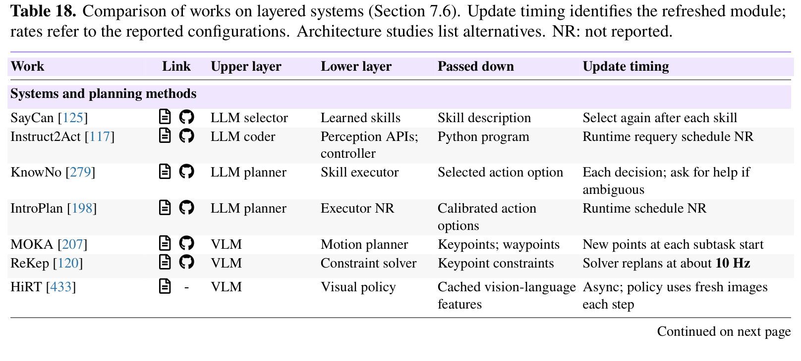

| Work | Link | Upper layer | Lower layer | Passed down | Update timing |
| :--- | :--- | :--- | :--- | :--- | :--- |
| **Systems and planning methods** | | | | | |
| SayCan [125] | A § | LLM selector | Learned skills | Skill description | Select again after each skill |
| Instruct2Act [117] | A § | LLM coder | Perception APIs; controller | Python program | Runtime requery schedule NR |
| KnowNo [279] | A § | LLM planner | Skill executor | Selected action option | Each decision; ask for help if ambiguous |
| IntroPlan [198] | A § | LLM planner | Executor NR | Calibrated action options | Runtime schedule NR |
| MOKA [207] | A § | VLM | Motion planner | Keypoints; waypoints | New points at each subtask start |
| ReKep [120] | A § | VLM | Constraint solver | Keypoint constraints | Solver replans at about 10 Hz |
| HiRT [433] | A - | VLM | Visual policy | Cached vision-language features | Async; policy uses fresh images each step |
| RoboDual [21] | A § | Generalist VLA | Diffusion policy | Latent features; action chunk | Async; several policy steps per VLA call |
| NaVILA [52] | A § | Navigation VLM | Locomotion policy | Movement; distance or angle | Motion duration set by the command |
| HAMSTER [185] | A § | Path VLM | 3D robot policy | 2D path; gripper states | Path generated once per episode |
| Hi Robot [297] | A - | VLM | VLA | Language subtask | Every 1 s or on new user feedback |
| GR00T N1 [254] | A § | VLM | Action transformer | Vision-language features | VLM 10 Hz; actions 120 Hz (L40) |
| 𝜋0.5 [269] | A § | Subtask predictor | Action expert | Language subtask | Actions 50 Hz; upper-layer rate NR |
| Gemini Robotics 1.5 [320] | A - | VLM orchestrator | VLA tool | Language instruction | Switch subtasks on detected completion |
| DualVLN [367] | A § | Navigation VLM | Trajectory policy | Latent goal from pixel-waypoint reasoning | Async; fast policy reuses the latest latent |
| Critic in the Loop [413] | A - | VLM planner; critic | Action expert | Language subtask | Replan on completion, anomaly or stagnation |
| Harness VLA [441] | A § | VLM planner | Analytic tools; frozen VLA | JSON primitive call | New observation after each primitive ends |
| **Architecture studies** | | | | | |
| VLA-OS [77] | A § | VLM; planning heads | Alternative action heads | Text / spatial / image plans | Varies across the compared architectures |
| WMORP [108] | A - | VLM planner | VLA | Language subtask | Compare fixed, success-based and VLM-timed switching |

**Caption:** Table 18. Comparison of works on layered systems (Section 7.6). Update timing identifies the refreshed module; rates refer to the reported configurations. Architecture studies list alternatives. NR: not reported.

**Caption[CN]:** 表 18. 分层系统相关代表性工作对比（第 7.6 节）。更新时机（Update timing）指明了被刷新的模块；刷新频率指的是论文中所报告的实际配置。架构对比研究列出了备选方案。NR：未报告。

---

## 8 Outlook: What Comes Next for Agentic Robots? (前景展望：具身智能体机器人的下一站走向何方？)

> <strong>Para. 1:</strong> Agentic robots connect general-purpose reasoning models with robot policies, tools, and physical execution. However, integrating these components does not necessarily make a robotic system more capable. It remains difficult to determine what the agent contributes, whether its decisions can be executed reliably on physical robots, and how well the system performs under limited resources or on unfamiliar platforms. These challenges motivate four research directions.
>
> <strong>Para. 1[CN]:</strong> 具身智能体机器人将通用推理大模型与底层机器人策略、工具链及物理执行端紧密相连。然而，将这些组件单纯集成在一起，并不必然使机器人系统变得更具能力。当前学术界与工业界仍难以量化评估智能体到底贡献了什么、其决策能否在物理实体机器人上可靠执行，以及系统在受限资源或未知陌生的硬件平台上表现如何。这些现实挑战催生了四大核心研究方向。

### 8.1 Fair Benchmarking (公平公正的基准评测体系)

> <strong>Para. 2:</strong> What does a task success rate actually tell us about an agentic robot? Consider two systems evaluated on the same manipulation benchmark. One may rely on a stronger VLA executor, while the other uses an agent to coordinate multiple weaker skills, gather additional observations, and recover from failures. Similar scores can reflect very different capabilities. CaP-X [74] evaluates agents that generate robot-control programs, while Harness VLA [441] and RoboHarness [116] study how agents coordinate robotic policies and skills. Their results depend not only on the agent but also on the underlying executors, available tools, observation access, and allowed retries. Task success alone therefore cannot show which part of the system made the difference.
>
> <strong>Para. 2[CN]:</strong> 任务成功率究竟能告诉我们具身智能体机器人的什么信息？以在同一操作基准上评估的两套系统为例：一套系统可能依赖更强大的 VLA 底层执行器，而另一套系统则使用智能体来协同调度多个较弱的基础技能、主动采集额外观测并从失败中实施恢复。相近的评测得分背后可能反映出截然不同的系统能力。CaP-X [74] 评估了生成机器人控制程序的智能体，而 Harness VLA [441] 和 RoboHarness [116] 则系统研究了智能体如何协调调度底层机器人策略与操作技能。它们的实测结果不仅取决于高层智能体，还高度依赖于底层执行器、可用工具库、环境观测获取权限以及所允许的重试次数。因此，单纯的任务成功率标量指标无法揭示到底是系统的哪个部分真正发挥了关键作用。

> <strong>Para. 3:</strong> To compare agents fairly, we need to examine their decisions under comparable conditions. Using the same executors, observation access, and interaction budgets makes it easier to assess planning, tool selection, and recovery. Comparing a system with and without memory or replanning can further show what each component contributes. However, controlled comparisons alone are not enough, since choosing and combining different models and tools is itself an important capability. End-to-end evaluations should therefore report the resources available to each system, including additional observations, computational costs, execution time, and human assistance. Such comparisons can reveal whether the benefits of additional reasoning and tool use justify their costs.
>
> <strong>Para. 3[CN]:</strong> 为了公平客观地对比各类智能体，我们需要在具备可比性的统一条件下细致审视它们的决策行为。采用相同的底层执行器、观测访问权限和交互预算，使得系统评估规划质量、工具选取以及故障恢复能力变得更为清晰明了。对比配备与不配备记忆模块或重规划机制的系统，能够进一步定量剖析各个组件的独立贡献。然而，仅靠严格控制变量的对比仍远远不够，因为自主选择并组合不同的异构模型与工具本身就是一项至关重要的核心能力。因此，端到端评估应当完整公开每套系统所占用的资源边界，包括额外获取的观测数据量、计算开销、物理执行耗时以及人工介入协助程度。此类细粒度的多维对比能够如实揭示：引入额外推理开销与工具调用所带来的性能增益，是否真正与其消耗的系统代价相匹配。

> <strong>Para. 4:</strong> Even with careful comparisons, a benchmark may tell us little about the agent if its tasks can be completed by a single fixed policy. Some robot benchmarks focus on task completion without requiring the agent to handle missing information, unsuitable executors, or failed actions. More informative benchmarks could introduce unexpected environmental changes, incomplete observations, and tasks that require coordination across different skills. For agents that collect data, update models, or develop new skills, evaluation should also examine whether these changes improve performance on unseen tasks. This would help establish when an agent is useful and whether its improvements generalize beyond the original setting.
>
> <strong>Para. 4[CN]:</strong> 即便开展了缜密的对照实验，如果基准测试中的任务本身完全可以由单一固定的端到端策略直接闭环完成，那么该基准对于评估智能体特性的参考价值依然微乎其微。部分现有的机器人基准仅专注于任务是否最终达成，却无需智能体处理信息缺失、执行器不匹配或偶发动作失败等复杂突发扰动。更具信息量和诊断价值的基准应当主动引入未预期的环境突变、非完全可观测状态以及需要跨不同技能紧密协同的长程任务。对于那些具备自主采集数据、迭代更新模型或持续习得新技能特性的智能体，评测体系还必须检验这些系统级更新是否能够在未见的新任务上带来实质性的泛化性能提升。这将有助于确立智能体究竟在何种工况下具有独特实用价值，以及其自演进增益能否泛化至初始设定之外的真实物理场景。

### 8.2 Real-robot Agentic Robotics (真实物理实体机器人的具身智能体落地挑战)

> <strong>Para. 5:</strong> A plan that makes sense to an agent may not always be executable by a robot. A reasoning model might request a grasp beyond the robot’s reach or select a skill based on an outdated observation. Agentic robots may combine reasoning models, VLAs, world-action models, and specialized robot skills, each with different capabilities and execution requirements. ReKep [120] uses model-generated constraints to guide robot motion, while Harness VLA [441] allows an agent to call a VLA alongside other robot operations. Yet choosing a suitable executor is only part of the problem. A valid command may still fail during physical execution, and the scene may change before the agent receives feedback.
>
> <strong>Para. 5[CN]:</strong> 对于高层智能体而言完全合理的宏观规划，在底层物理机器人上往往并不总能顺利付诸执行。推理模型可能会发起超出机械臂实际可达工作空间的抓取请求，或者基于过时的历史视觉观测选中了不合时宜的操作技能。具身智能体机器人通常结合了通用推理大模型、VLA、世界-动作模型以及专用的底层机器人控制技能，各组件具备迥异的能力边界与执行前置要求。ReKep [120] 利用大模型生成的几何空间约束来引导机器人连续运动，而 Harness VLA [441] 则允许高层智能体将 VLA 与其他基础机器人算子同等作为工具调用。然而，挑选合适的底层执行器仅解决了半边难题：一条语法上合法的机器人动作指令在物理执行过程中仍可能遭遇偶发失败，且物理工作场景可能在智能体收到状态反馈之前就已经发生了不可逆的动态改变。

> <strong>Para. 6:</strong> Robot interfaces therefore need to describe more than the names and inputs of available skills. An agent should know when a skill can be used, what conditions it requires, and how to tell whether execution has finished. For example, a failed grasp may require another observation, a revised grasp command, or a different skill. The right response depends on what actually happened: the object may have moved, or the previous command may still be running. Sending a stop request does not guarantee that the robot has stopped moving. Before replanning, the agent needs feedback that confirms the current state and the effects of actions already taken.
>
> <strong>Para. 6[CN]:</strong> 因此，面向机器人的抽象调用接口所描述的内容，绝不能仅仅局限于可用技能的函数名和入参格式。高层智能体必须明确知晓某项技能在何种前置条件下可以使用、其对物理状态有何严苛依赖，以及如何判定该动作执行是否已经彻底终止。例如，一次失败的抓取尝试可能需要重新采集一帧观测、修正抓取姿态指令，或者切换至完全不同的重试技能。正确的应对策略取决于物理世界中到底发生了什么：目标物体可能发生了意外滑移，或者前序发出的控制指令仍在电机关节层面继续生效运行。单纯发送一条紧急停止指令，并不能在物理上保证机械臂瞬间停止运动。在发起重规划之前，智能体需要获得确凿的执行级闭环反馈，以确认当前物理系统的稳态以及已执行动作所产生的真实累积效应。

> <strong>Para. 7:</strong> These difficulties become harder to address when moving from simulation to physical robots. Simulators can provide accurate object positions and clearly defined success conditions, while real robots must often estimate these from noisy camera images and sensor readings. Small perception errors, calibration differences, and unexpected contacts can cause an otherwise reasonable plan to fail. Future systems should recognize when their observations are insufficient, check important assumptions before execution, and use physical feedback to correct their decisions. Real-robot evaluations should also make clear what information the agent receives, what the lower-level controllers handle, and whether the agent can recover when its assumptions turn out to be wrong.
>
> <strong>Para. 7[CN]:</strong> 当从仿真环境跨越到物理实体机器人时，这些现实困难将变得更加棘手。仿真器能够提供完美的物体地面真值位姿和定义严密的任务成功判定条件，而实体机器人则必须从充满噪声的相机图像和本体传感器读数中估计这些隐变量。微小的感知误差、传感器外参标定漂移以及未预期的物理接触碰撞，都可能导致在逻辑上完全合理的规划瞬间溃败。未来的实用化系统应当具备主动辨识自身观测信息是否充分的能力，在正式动作执行前核验关键物理前置假设，并充分利用多模态物理反馈动态纠偏决策。实体机器人评测还必须清晰界定高层智能体所接收的具体信息层级、底层实时控制器所分担的安全兜底范畴，以及当智能体的前置假设被真实世界证伪时，系统是否具备健壮的原地自愈容错能力。

### 8.3 Efficient Robot Use (高能效、低延迟的机器人资源利用)

> <strong>Para. 8:</strong> A robot may complete a motion in a few seconds, yet spend much longer waiting for the agent to decide what to do next. Repeated model calls, visual observations, and tool interactions can introduce significant delays, especially when a task requires many small actions. Recent work has begun addressing this problem by reducing unnecessary high-level reasoning. HarnessWAM [89] uses a lightweight progress estimator to monitor execution and invokes its VLM task manager when important events occur. Similarly, VLAs-as-Tools [166] provides execution feedback that allows an agent to replan when needed, rather than continuously checking the robot’s progress. Efficiency therefore depends not only on how fast a model runs, but also on when it is called.
>
> <strong>Para. 8[CN]:</strong> 机器人在几秒钟内便能顺畅完成一次关节物理运动，但却往往需要花费更长的时间停在原地等待高层智能体决定下一步该做什么。反复的模型前向推理、密集的视觉观测获取以及频繁的工具链交互，都会引入不可忽视的延迟滞后，在需要执行大量细碎离散动作的长程任务中尤为显著。近期工作已开始着手削减此类不必要的高层推理开销。HarnessWAM [89] 引入了一个轻量化的任务进度评估器来实时监控底层执行状态，仅在关键里程碑事件或异常发生时才唤醒高层 VLM 任务管理器。类似地，VLAs-as-Tools [166] 提供了结构化执行反馈，使得智能体仅在确有必要时才触发重规划，而非在每个控制拍持续轮询机器人的微观进度。因此，系统的运行能效不仅取决于单个模型的推理吞吐速度，更取决于它在何时被适时唤醒调用。

> <strong>Para. 9:</strong> The main challenge is deciding when another model call is worth the delay. A robot following a familiar manipulation sequence may continue with lightweight monitoring, while an unexpected obstacle or failed action may require a new decision from the reasoning model. Calling the model too often wastes time, but waiting too long can leave the robot following a plan that no longer works. The timing should depend on task progress, uncertainty, and the possible consequences of a delayed response.
>
> <strong>Para. 9[CN]:</strong> 这里的核心技术挑战在于：如何精准权衡并发起另一次大模型推理调用，以使其所消耗的延迟开销物有所值。当机器人沿着熟悉确定的常规操作轨迹前行时，系统完全可以仅依托轻量级监控逻辑平滑推进；而一旦偶遇未预期的物理障碍或动作执行失败，则必须立即由高层推理模型做出全新裁决。过于频繁地调用大模型将造成严重的时间与算力浪费，但若介入时机过于滞后，又会导致机器人盲目执行一套早已失效的陈旧动作计划。触发调用的最佳时机应当综合取决于当前任务的推进度、系统感知与决策的不确定性，以及延迟响应可能引发的安全或任务失败后果。

> <strong>Para. 10:</strong> Efficiency also depends on where computation takes place. Large models running in the cloud may offer stronger reasoning but introduce communication delays, while smaller local models can respond more quickly with limited computational resources. Future systems could combine these options, using local components for time-sensitive decisions and stronger models when additional reasoning is needed. Evaluations should therefore consider the full execution process, including reasoning time, tool calls, communication overhead, and physical task completion time. Fewer model calls or faster inference do not necessarily improve efficiency if they lead to more failures, retries, or longer task execution.
>
> <strong>Para. 10[CN]:</strong> 运行效率还深度依赖于计算算力的实际部署拓扑。部署在云端集群上的超大规模基础模型虽然具备更强大的通用推理能力，却不可避免地引入了跨网络通信延迟；而在机器人本体边缘端部署的轻量化小型模型虽然能够在受限算力下实现极快响应，但在复杂逻辑处理上往往力不从心。未来的前沿系统可以采用端云协同的混合部署形态：利用本体轻量级组件负责处理高时效性决策与快速闭环，仅在遭遇高难度长程推理需求时才按需回传云端强模型介入。因此，评测指标必须审视整个物理执行生命周期的端到端综合开销，将模型推理耗时、工具链调用开销、网络通信延迟以及真实任务完成总时间合并统计。如果刻意减少模型调用次数或盲目追求单次极速推理却导致了更高的物理失败率、频发的原地重试以及更冗长拖沓的整体任务耗时，那么这绝非真正意义上的系统能效提升。

### 8.4 Cross-Embodiment Generalization (跨本体与多异构具身的通用泛化)

> <strong>Para. 11:</strong> An agent that works well with one robot may struggle when given a different platform. Even a simple task, such as reaching a target location, requires different actions from a wheeled robot, a humanoid, or a drone. The high-level goal may remain similar, but the available sensors, control interfaces, and physical constraints are different. RobotWorld [404] evaluates general-purpose agents on 84 simulated tasks spanning manipulation, mobile manipulation, locomotion, driving, and aerial control. What remains unclear is whether the same agent can adapt to a new robot without major changes to its planning and tool-use setup.
>
> <strong>Para. 11[CN]:</strong> 在一套特定机器人平台上运转顺畅的高层智能体，在迁移到截然不同的全新硬件平台时往往捉襟见肘。即便是诸如到达目标位置这般简单的子任务，轮式移动机器人、人形双足机器人或无人机所对应的底层控制动作也存在本质差异。尽管顶层宏观目标高度相似，但不同构型机器人所配备的传感器阵列、底层控制接口规范以及固有物理运动学/动力学约束却大相径庭。RobotWorld [404] 在涵盖机械臂操作、移动操作、双足足式移动、自主导航驾驶以及无人机空中飞控等领域的 84 项仿真任务上对通用智能体进行了全面评测。然而悬而未决的核心疑问在于：相同的顶层智能体是否能够在不对其宏观规划逻辑与工具调用框架进行伤筋动骨的重构的前提下，无缝自适应全新的异构机器人本体。

> <strong>Para. 12:</strong> One promising direction is to enable agents to understand the capabilities of unfamiliar robots before using them. An agent could identify the robot’s available sensors, movement capabilities, and supported skills, then plan around those capabilities. For example, a wheeled robot may need to navigate around obstacles to inspect an area, while a drone could approach it from above. The goal is similar, but the actions and physical constraints are different. The agent must therefore adjust its plan rather than simply translate the same commands into another robot’s control interface.
>
> <strong>Para. 12[CN]:</strong> 一条极具前景的攻坚方向，是赋予高层智能体在调用陌生硬件前自主解析并理解其硬件能力边界的元认知能力。智能体能够自省并识别新机器人所挂载的可用传感器类型、自由度运动空间范围以及系统支持的底层技能集合，进而围绕这些物理禀赋量身规划动作策略。例如，轮式地面机器人必须绕过地面杂乱障碍物才能视检某一隐蔽区域，而无人机则可以直接从上方俯视接近。宏观探索目标虽完全一致，但具体的运动轨迹空间与物理动力学约束却截然不同。因此，智能体必须从任务规划层主动调整全局行为分解链条，而不仅仅是生硬地将同一套控制指令逐字直译到底层机器人的通信协议接口中。

> <strong>Para. 13:</strong> Another important question is how much of an agent’s previous experience can be reused. High-level strategies, such as gathering additional observations when information is missing or checking why an action failed, may remain useful across different robots. In contrast, specific motion commands and control parameters often depend on the robot’s embodiment. Future systems should retain general task knowledge without assuming that the same execution details apply to every platform. Evaluations could test agents on previously unseen robots, measuring task success, the amount of additional configuration or training required, and whether experience from other robots improves performance.
>
> <strong>Para. 13[CN]:</strong> 另一个关键课题在于智能体过往积累的交互经验究竟有多少能够跨本体直接复用。诸如在信息不完整时主动采集多角度环视观测、在动作失败后排查因果诱因等高层元认知策略，在跨越不同硬件本体时往往展现出普适的迁移价值；相反，微观的关节运动轨迹指令与精细动力学控制参数则高度依附于特定机器人的物理形体。未来的系统架构应当提炼并持久化保存通用的高阶任务解决范式，同时摒弃将微观物理执行细节机械套用到所有硬件平台的盲目假设。评测体系应当在前所未见的全新异构机器人本体上对智能体展开严苛检验，量化评估最终任务成功率、适配新本体所需的额外配置或微调训练开销，以及跨本体的历史先验经验是否真正对新本体的性能释放起到了积极的正向促进作用。

---

## 9 Conclusion (结语)

> <strong>Para. 14:</strong> This paper examines how agents support robot execution and learning. We trace the evolution from robot policies to agentic systems and clarify the scope of agentic robots. We organize existing work into seventeen overlapping categories across four functional domains: Model, Data, Environment, and Harness. These categories cover model learning and decisions, data collection and preparation, the construction of worlds, tasks, and tests, and the software that coordinates robot capabilities.
>
> <strong>Para. 14[CN]:</strong> 本文全面系统地考察了具身智能体如何全方位赋能机器人的物理执行与自主学习。我们系统梳理了从传统专用机器人控制策略演进到具身智能体系统的发展脉络，并严格厘清了具身智能体机器人的内涵与研究范畴边界。我们将该领域现有的海量代表性工作系统归纳为横跨四大核心功能域（模型 Model、数据 Data、环境 Environment 以及支架 Harness）的十七个相互交织的操作类别。这十七个大类完整覆盖了模型端表征学习与决策推理、数据端规模化采集与标注提精、仿真与物理环境资产构建与任务基准测试，以及协同调度底层机器人软硬件能力的支架编排系统。

> <strong>Para. 15:</strong> Across these approaches, an agent’s decisions depend on what it can observe, what the robot can do, and what feedback it receives. During execution, agents coordinate tools and skills, check progress, and use feedback to decide whether to continue, gather more information, or recover from failure. Beyond the current task, stored experience can guide later decisions and changes to data, training procedures, skills, models, and software. These changes need to be tested on new tasks and conditions, while checking that previously learned capabilities are preserved.
>
> <strong>Para. 15[CN]:</strong> 纵观上述所有技术路线，智能体所做出的核心决策始终深刻依附于其所能感知的多模态观测、底层机器人所具备的物理动作能力，以及物理世界所赋予的多维闭环反馈。在实际物理执行阶段，智能体通过高层逻辑协同调度各类专业工具与底层运动技能，实时追踪任务推进阶段，并依据多模态执行反馈自主决断是继续推进、补充主动观测，还是触发故障自愈恢复。而在单次任务执行之外，系统持久化存储的跨回合交互经验能够进一步指导未来的高层决策，并驱动数据生产配方、模型微调训练流程、底层技能库演进、神经模型权重迭代乃至支架治理软件架构的持续自演化。而所有这些系统层面的自演进变更，都必须在全新的未知任务和扰动工况下接受严格的泛化检验，同时确保系统先前已稳固掌握的基础能力不会发生灾难性遗忘。

> <strong>Para. 16:</strong> Building on this analysis, we discuss four directions for future research: fair benchmarking, real-robot deployment, efficient robot use, and cross-embodiment generalization. Future work needs to establish when agents improve performance under comparable conditions and how they handle uncertainty and failures on physical robots. It should also examine whether these improvements justify the time and resources used, and how well agents adapt to unfamiliar robots. We hope this work helps researchers connect these questions and develop more capable agentic robots. Progress in agentic robotics could bring us closer to intelligent systems that turn knowledge into action, learn from experience, and adapt to the changing physical world.
>
> <strong>Para. 16[CN]:</strong> 基于前述系统化剖析，我们深入探讨了未来极具探索价值的四大前沿研究方向：公平公正的基准评测体系、面向物理实体机器人的健壮落地部署、高能效低延迟的机器人资源利用，以及跨异构本体的通用泛化。未来的研究工作需要严格确立具身智能体在具备可比性的统一评测基准下何时能带来确定性的性能提升，并阐明其在实体物理世界中如何从容化解高度不确定性与偶发硬件故障。学术界与工业界还应系统评估这些性能增益是否与其所耗费的时间开销与计算资源相称，以及智能体在迁移至未知全新机器人平台时的自适应适应能力。我们衷心希望本文的研究全景梳理能够帮助研究人员串联起这些关键科研课题，共同打造出更强大、更自主的具身智能体机器人。具身智能体机器人领域的坚实迈进，必将引领我们不断逼近真正具备“格物致知、知行合一、见微知著、自化于世”特质的通用物理智能系统。

---

## References

> **Retention Notice:**
> The following 469 bibliography entries are preserved verbatim from the original survey paper [arXiv:2610.20442v1], preserving exact citation keys, author rosters, titles, and publication venues.

1. [1] Dionysios Adamopoulos, Nattapol Chanpaisit, Basel Fakhri, and Christina Giannoula. Efficient Vision- Language-Action Management and Serving for Robot Factories. arXiv preprint arXiv:2609.12075, 2026.

2. [2] AgiBot Research Team, Renhang Liu, Wenzhi Zhao, Zhuo Yang, Liliang Chen, Pengfei Zhou, Shengcong Chen, Guanghui Ren, Youlun Peng, Rongjun Jin, Nan Wang, Sukai Wang, Xindong He, Jinyuan Feng, Ziyu Xiong, Linqing Zhong, Yifei Wei, Feng Han, Long Zhang, Da Huang, Nanshu Zhao, Chenghao Yin, Mo Wu, Zhaodong Yan, Kongtao Hu, Yuxiang Yan, Aogelijiang Niyazi, Yu Fang, Jia Zeng, Lizhu Meng, Daizhen Lv, Haoyu Cao, Zhiwen Hou, Lianjin Ye, Yuehan Niu, Zhikai Cai, Xuan Hu, Hui Min, Xiongfeng Cai, Yue Liao, Jing Wu, Soujanya Poria, Ye Li, Sanping Zhou, and Maoqing Yao. GE-Act 2.0: Pretraining and Scaling a World-Action Model for Robotic Manipulation. arXiv preprint arXiv:2609.05588, 2026.

3. [3] Michael Ahn, Debidatta Dwibedi, Chelsea Finn, et al. AutoRT: Embodied Foundation Models for Large Scale Orchestration of Robotic Agents. arXiv preprint arXiv:2401.12963, 2024.

4. [4] Alibaba Cloud. Qwen-Max, 2026. URL https://www.alibabacloud.com/help/en/model-studio/qwen-max.

5. [5] Mido Assran, Adrien Bardes, David Fan, Quentin Garrido, Russell Howes, Mojtaba Komeili, Matthew Muckley, Ammar Rizvi, Claire Roberts, Koustuv Sinha, Artem Zholus, Sergio Arnaud, Abha Gejji, Ada Martin, Francois Robert Hogan, Daniel Dugas, Piotr Bojanowski, Vasil Khalidov, Patrick Labatut, Francisco Massa, Marc Szafraniec, Kapil Krishnakumar, Yong Li, Xiaodong Ma, Sarath Chandar, Franziska Meier, Yann LeCun, Michael Rabbat, and Nicolas Ballas. V-JEPA 2: Self-Supervised Video Models Enable Understanding, Prediction and Planning. arXiv preprint arXiv:2506.09985, 2025.

6. [6] Awomo-PhysicalRSI Team, Danjiao Ma, Enhui Ma, Haohan Liu, Heng Jia, Hui Shan, Jianhua Xu, Jiahuan Zhang, Jiangdi Xu, Kaiwen Guo, Kaicheng Yu, Linwei Zhang, Liyang Jin, Maochun Luo, Pengyao Niu, Shiwen Li, Shuangyu Feng, Tong Zhang, Tianheng Wang, Xin Wang, Xiangru Huang, Yongqiang Huang, Zhaozhi Wang, and Zijian Ma. Awomo-SimDataEngine: Agentic Simulation-Ready World Generation. arXiv preprint arXiv:2610.02274, 2026.

7. [7] Rohan Bansal, David He, Nadun Ranawaka Arachchige, Zhenyang Chen, Soobum Kim, Kexin Rong, and Danfei Xu. Action Chunk Scheduling for Batched Robot Policy Serving. arXiv preprint arXiv:2608.00337, 2026.

8. [8] Anuva Banwasi, William Muckelroy III, Priya Sundaresan, Linfeng Zhao, Jeannette Bohg, and Cherie Ho. MessyMem: Learning-from-Doing Memory for Mobile Manipulation. arXiv preprint arXiv:2609.15976, 2026.

9. [9] Nicolas Baumann, Liam Boyle, Pu Deng, Edoardo Ghignone, Boyang Sun, Marc Pollefeys, Luca Benini, and Michele Magno. LocalNav: Distilling Frontier VLMs and Embodied RL for On-Device Object Goal Navigation. arXiv preprint arXiv:2606.27871, 2026.

10. [10] Suneel Belkhale, Tianli Ding, Ted Xiao, Pierre Sermanet, Quon Vuong, Jonathan Tompson, Yevgen Chebotar, Debidatta Dwibedi, and Dorsa Sadigh. RT-H: Action Hierarchies Using Language. arXiv preprint arXiv:2403.01823, 2024.

11. [11] Vineet Bhat, Mikaela Angelina Uy, Siyi Chen, Alex Zook, Xuning Yang, Stan Birchfield, Valts Blukis, and Jonathan Tremblay. MG-VQA: Manipulation Grounded Visual Question Answering with VLMs. arXiv preprint arXiv:2608.17129, 2026.

12. [12] Hongzhe Bi, Hengkai Tan, Shenghao Xie, Zeyuan Wang, Shuhe Huang, Haitian Liu, Ruowen Zhao, Yao Feng, Chendong Xiang, Yinze Rong, Hongyan Zhao, Hanyu Liu, Zhizhong Su, Lei Ma, Hang Su, and Jun Zhu. Motus: A Unified Latent Action World Model. arXiv preprint arXiv:2512.13030, 2025.

13. [13] Kevin Black, Noah Brown, Danny Driess, Adnan Esmail, Michael Equi, Chelsea Finn, Niccolo Fusai, Lachy Groom, Karol Hausman, Brian Ichter, Szymon Jakubczak, Tim Jones, Liyiming Ke, Sergey Levine, Adrian Li-Bell, Mohith Mothukuri, Suraj Nair, Karl Pertsch, Lucy Xiaoyang Shi, James Tanner, Quan Vuong, Anna Walling, Haohuan Wang, and Ury Zhilinsky. 𝜋0: A Vision-Language-Action Flow Model for General Robot Control. arXiv preprint arXiv:2410.24164, 2024.

14. [14] Kevin Black, Manuel Y. Galliker, and Sergey Levine. Real-Time Execution of Action Chunking Flow Policies. arXiv preprint arXiv:2506.07339, 2025.

15. [15] Kevin Black, Allen Z. Ren, Michael Equi, and Sergey Levine. Training-Time Action Conditioning for Efficient Real-Time Chunking. arXiv preprint arXiv:2512.05964, 2025.

16. [16] Nils Blank, Moritz Reuss, Marcel Rühle, Ömer Erdinç Yağmurlu, Fabian Wenzel, Oier Mees, and Rudolf Lioutikov. Scaling Robot Policy Learning via Zero-Shot Labeling with Foundation Models. In Proceedings of The 8th Conference on Robot Learning, volume 270, pages 4158–4187. PMLR, 2025.

17. [17] Nils Blank, Paul Mattes, Maximilian Xiling Li, Jakub Suliga, Thomas Roth, Moritz Reuss, Pankhuri Vanjani, and Rudolf Lioutikov. SPARC: Reliable Spatial Annotations from Robot Demonstrations at Scale. arXiv preprint arXiv:2606.13497, 2026.

18. [18] Konstantinos Bousmalis, Giulia Vezzani, Dushyant Rao, Coline Devin, Alex X. Lee, Maria Bauza, Todor Davchev, Yuxiang Zhou, Agrim Gupta, Akhil Raju, Antoine Laurens, Claudio Fantacci, Valentin Dalibard, Martina Zambelli, Murilo Martins, Rugile Pevceviciute, Michiel Blokzijl, Misha Denil, Nathan Batchelor, Thomas Lampe, Emilio Parisotto, Konrad Żołna, Scott Reed, Sergio Gómez Colmenarejo, Jon Scholz, Abbas Abdolmaleki, Oliver Groth, Jean-Baptiste Regli, Oleg Sushkov, Tom Rothörl, José Enrique Chen, Yusuf Aytar, Dave Barker, Joy Ortiz, Martin Riedmiller, Jost Tobias Springenberg, Raia Hadsell, Francesco Nori, and Nicolas Heess. RoboCat: A Self-Improving Generalist Agent for Robotic Manipulation. Transactions on Machine Learning Research, 2023.

19. [19] Anthony Brohan, Noah Brown, Justice Carbajal, Yevgen Chebotar, Xi Chen, Krzysztof Choromanski, Tianli Ding, Danny Driess, Avinava Dubey, Chelsea Finn, Pete Florence, Chuyuan Fu, Montse Gonzalez Arenas, Keerthana Gopalakrishnan, Kehang Han, Karol Hausman, Alexander Herzog, Jasmine Hsu, Brian Ichter, Alex Irpan, Nikhil Joshi, Ryan Julian, Dmitry Kalashnikov, Yuheng Kuang, Isabel Leal, Lisa Lee, Tsang- Wei Edward Lee, Sergey Levine, Yao Lu, Henryk Michalewski, Igor Mordatch, Karl Pertsch, Kanishka Rao, Krista Reymann, Michael Ryoo, Grecia Salazar, Pannag Sanketi, Pierre Sermanet, Jaspiar Singh, Anikait Singh, Radu Soricut, Huong Tran, Vincent Vanhoucke, Quan Vuong, Ayzaan Wahid, Stefan Welker, Paul Wohlhart, Jialin Wu, Fei Xia, Ted Xiao, Peng Xu, Sichun Xu, Tianhe Yu, and Brianna Zitkovich. RT-2: Vision- Language-Action Models Transfer Web Knowledge to Robotic Control. arXiv preprint arXiv:2307.15818, 2023.

20. [20] Anthony Brohan, Noah Brown, Justice Carbajal, Yevgen Chebotar, Joseph Dabis, Chelsea Finn, Keerthana Gopalakrishnan, Karol Hausman, Alex Herzog, Jasmine Hsu, Julian Ibarz, Brian Ichter, Alex Irpan, Tomas Jackson, Sally Jesmonth, Nikhil J Joshi, Ryan Julian, Dmitry Kalashnikov, Yuheng Kuang, Isabel Leal, Kuang-Huei Lee, Sergey Levine, Yao Lu, Utsav Malla, Deeksha Manjunath, Igor Mordatch, Ofir Nachum, Carolina Parada, Jodilyn Peralta, Emily Perez, Karl Pertsch, Jornell Quiambao, Kanishka Rao, Michael Ryoo, Grecia Salazar, Pannag Sanketi, Kevin Sayed, Jaspiar Singh, Sumedh Sontakke, Austin Stone, Clayton Tan, Huong Tran, Vincent Vanhoucke, Steve Vega, Quan Vuong, Fei Xia, Ted Xiao, Peng Xu, Sichun Xu, Tianhe Yu, and Brianna Zitkovich. RT-1: Robotics Transformer for Real-World Control at Scale. arXiv preprint arXiv:2212.06817, 2023.

21. [21] Qingwen Bu, Hongyang Li, Li Chen, Jisong Cai, Jia Zeng, Heming Cui, Maoqing Yao, and Yu Qiao. Towards Synergistic, Generalized, and Efficient Dual-System for Robotic Manipulation. arXiv preprint arXiv:2410.08001, 2024.

22. [22] Bytedance Seed. Seed1.8 Model Card: Towards Generalized Real-World Agency. arXiv preprint arXiv:2603.20633, 2026.

23. [23] Remi Cadene, Simon Aliberts, Francesco Capuano, Michel Aractingi, Adil Zouitine, Pepijn Kooijmans, Jade Choghari, Martino Russi, Caroline Pascal, Steven Palma, et al. LeRobot: An Open-Source Library for End-to-End Robot Learning. arXiv preprint arXiv:2602.22818, 2026.

24. [24] Xiaowei Cai, Yunuo Cai, Bingao Chen, Jingxiao Chen, Zhi Chen, Siyuan Feng, Tengyu Hou, Jingshun Huang, Han Jiang, Runkun Ju, Dong Li, Mingxiang Li, Shaowei Li, Xinchen Li, Yifan Li, Yi Liu, Zhongyuan Liu, Jianlan Luo, Junwen Miao, Ruiqi Ni, Buqing Nie, Mingjie Pan, Xinlin Ren, Jianheng Song, Jiaxu Wang, Peiqi Wang, Sen Wang, Xiaoyan Wang, Dafeng Wei, Dongming Wu, Pengwei Xie, Pu Yang, Hangjian Ye, Xiangyu Yue, Jinyu Zhang, Qinglin Zhang, Xueyong Zhao, Pengfei Zhou, and Yue Zhou. 𝜏0-VLA: a Hierarchical Robot Foundation Model with World-Model-Guided Test-Time Computation. arXiv preprint arXiv:2608.16885, 2026.

25. [25] Jiahang Cao, Qiang Zhang, Jingkai Sun, Jiaxu Wang, Hao Cheng, Yulin Li, Jun Ma, Kun Wu, Zhiyuan Xu, Yecheng Shao, Wen Zhao, Gang Han, Yijie Guo, and Renjing Xu. Mamba Policy: Towards Efficient 3D Diffusion Policy with Hybrid Selective State Models. In 2025 IEEE/RSJ International Conference on Intelligent Robots and Systems (IROS), pages 11359–11366. IEEE, 2025. doi: 10.1109/IROS60139.2025.11247625.

26. [26] Irvin Steve Cardenas, Marcus Anthony Arnett, Natalie Catherine Yeo, Lucky Sah, and Jong-Hoon Kim. ROSClaw: An OpenClaw ROS 2 Framework for Agentic Robot Control and Interaction. arXiv preprint arXiv:2603.26997, 2026.

27. [27] Nicolas Carion, Laura Gustafson, Yuan-Ting Hu, Shoubhik Debnath, Ronghang Hu, Didac Suris, Chaitanya Ryali, Kalyan Vasudev Alwala, Haitham Khedr, Andrew Huang, et al. SAM 3: Segment Anything with Concepts. arXiv preprint arXiv:2511.16719, 2025.

28. [28] Jun Cen, Siteng Huang, Yuqian Yuan, Kehan Li, Hangjie Yuan, Chaohui Yu, Yuming Jiang, Jiayan Guo, Xin Li, Hao Luo, Fan Wang, Deli Zhao, and Hao Chen. RynnVLA-002: A Unified Vision-Language-Action and World Model. arXiv preprint arXiv:2511.17502, 2025.

29. [29] Jun Cen, Chaohui Yu, Hangjie Yuan, Yuming Jiang, Siteng Huang, Jiayan Guo, Xin Li, Yibing Song, Hao Luo, Fan Wang, Deli Zhao, and Hao Chen. WorldVLA: Towards Autoregressive Action World Model. arXiv preprint arXiv:2506.21539, 2025.

30. [30] Nga Teng Chan, Yi Zhang, Yechi Liu, Renwen Cui, Fanhu Zeng, Zeyuan Ding, Xiancong Ren, Zhang Zhang, Qifeng Chen, Jian Liu, Yong Dai, and Xiaozhu Ju. Robo-Cortex: A Self-Evolving Embodied Agent via Dual-Grain Cognitive Memory and Autonomous Knowledge Induction. arXiv preprint arXiv:2605.18729, 2026.

31. [31] Matthew Chang, Gunjan Chhablani, Alexander Clegg, Mikael Dallaire Cote, Ruta Desai, Michal Hlavac, Vladimir Karashchuk, Jacob Krantz, Roozbeh Mottaghi, Priyam Parashar, Siddharth Patki, Ishita Prasad, Xavier Puig, Akshara Rai, Ram Ramrakhya, Daniel Tran, Joanne Truong, John M. Turner, Eric Undersander, and Tsung-Yen Yang. PARTNR: A Benchmark for Planning and Reasoning in Embodied Multi-agent Tasks. In International Conference on Learning Representations, 2025.

32. [32] Chi-Lam Cheang, Guangzeng Chen, Ya Jing, Tao Kong, Hang Li, Yifeng Li, Yuxiao Liu, Hongtao Wu, Jiafeng Xu, Yichu Yang, Hanbo Zhang, and Minzhao Zhu. GR-2: A Generative Video-Language-Action Model with Web-Scale Knowledge for Robot Manipulation. arXiv preprint arXiv:2410.06158, 2024.

33. [33] Boyuan Chen, Zhuo Xu, Sean Kirmani, Brian Ichter, Dorsa Sadigh, Leonidas Guibas, and Fei Xia. SpatialVLM: Endowing Vision-Language Models with Spatial Reasoning Capabilities. In Proceedings of the IEEE/CVF Conference on Computer Vision and Pattern Recognition (CVPR), pages 14455–14465, 2024.

34. [34] Daphne Chen, Archit Ritesh Jain, Eric Goossen, Emma Romig, Michael Murray, Nick Walker, and Maya Cakmak. A Few Words Go a Long Way: Language Guided Robot Policy Synthesis. arXiv preprint arXiv:2607.23784, 2026.

35. [35] Guanxiong Chen, Yiduo Qu, Qianjun Xia, Pengyu Jing, Yixian Cheng, Bole Ma, Pengzhi Yang, Bingyang Zhou, Ziming Li, Shashwat Suri, Gongbo Sun, Chao Liu, Peter Yichen Chen, Ziqiu Zeng, and Fan Shi. DiagGen: Agentic Generation of Deformable Assets with Sim-based Diagnostics for Robotic Simulation. arXiv preprint arXiv:2609.23103, 2026.

36. [36] Guanxiong Chen, Qianjun Xia, Jiawei Peng, Heng Zhang, Pengyu Jing, Bole Ma, Justin Qian, Yixian Cheng, Ziyi Jiao, Bingyang Zhou, Yiduo Qu, Luoxin Ye, Kaifeng Zhang, Kunyi Wang, Weijia Zeng, Yunuo Chen, Pengzhi Yang, Ziqiu Zeng, Siyuan Luo, Huamin Wang, Chao Liu, Alan Yuille, Fan Shi, Changxi Zheng, Yunzhu Li, Chenfanfu Jiang, and Peter Yichen Chen. Agentic Real2Sim: Physics-based World Modeling with Vision-Language Agents. arXiv preprint arXiv:2607.19190, 2026.

37. [37] Junting Chen, Checheng Yu, Xunzhe Zhou, Tianqi Xu, Yao Mu, Mengkang Hu, Wenqi Shao, Yikai Wang, Guohao Li, and Lin Shao. EMOS: Embodiment-aware Heterogeneous Multi-robot Operating System with LLM Agents. In International Conference on Learning Representations, 2025.

38. [38] Kaiyuan Chen, Shuangyu Xie, Letian Fu, Justin Yu, William Pacini, Sandeep Bajamahal, Hudson Kim, Jaimyn Drake, Daehwa Kim, Haoru Xue, Jonathan Francis, Christian Juette, Peter Schaldenbrand, Muham- met Yunus Seker, Ruwan Wickramarachchi, Uksang Yoo, Guanzhi Wang, Adithyavairavan Murali, Balakumar Sundaralingam, S. Shankar Sastry, Spencer Huang, Yuke Zhu, Linxi "Jim" Fan, and Ken Goldberg. GaP: A Graph-as-Policy Multi-Agent Self-Learning Harness For Variational Automation Tasks. arXiv preprint arXiv:2607.05369, 2026.

39. [39] Sitong Chen, Fatemeh Zargarbashi, Jin Cheng, Tianxu An, and Stelian Coros. KINO: A Keyframe Interface for VLM Planning and Whole-Body Control in Humanoid Loco-Manipulation. arXiv preprint arXiv:2609.18869, 2026.

40. [40] Siyi Chen, Hugo Hadfield, Alex Zook, Mikaela Angelina Uy, Chan Hee Song, Erwin Coumans, Xuning Yang, Faisal Ladhak, Qing Qu, Stan Birchfield, Jonathan Tremblay, and Valts Blukis. VoLo: A Physical Orchestrator for Open-Vocabulary Long-Horizon Manipulation. arXiv preprint arXiv:2606.07723, 2026.

41. [41] Tianxing Chen, Yue Chen, Zixuan Li, Junyuan Tang, Kailun Su, Haoran Lu, Weijie Wan, Baijun Chen, Songling Liu, Haowen Yan, Honghao Su, Zhiyang Dou, Kaixuan Wang, Dandan Zhang, Yunze Liu, Yan Qin, Qiwei Liang, Qiwei Wu, Zijian Lin, Wenwei Lin, Yuran Wang, Minghua He, Tianshu Wu, Ruihai Wu, Jingquan Zhou, Kai-Chong Lei, Haibao Yu, Yuanfeng Ji, Weiyang Jin, Guanyu Lin, Xiaofan Li, Qi Xiong, Renjing Xu, Zhongyu Li, Wenhao Chai, Enze Xie, Ziwei Wang, Yao Mu, Hao Dong, Wojciech Matusik, Mingyu Ding, Wenbo Ding, Ping Luo, and Masayoshi Tomizuka. RoboDojo: A Unified Sim-and-Real Benchmark for Comprehensive Evaluation of Generalist Robot Manipulation Policies. arXiv preprint arXiv:2607.04434, 2026.

42. [42] William Chen, Jagdeep Singh Bhatia, Catherine Glossop, Nikhil Mathihalli, Ria Doshi, Andy Tang, Danny Driess, Karl Pertsch, and Sergey Levine. Steerable Vision-Language-Action Policies for Embodied Reasoning and Hierarchical Control. arXiv preprint arXiv:2602.13193, 2026.

43. [43] Xinyi Chen, Yilun Chen, Yanwei Fu, Ning Gao, Jiaya Jia, Weiyang Jin, Hao Li, Yao Mu, Jiangmiao Pang, Yu Qiao, Yang Tian, Bin Wang, Bolun Wang, Fangjing Wang, Hanqing Wang, Tai Wang, Ziqin Wang, Xueyuan Wei, Chao Wu, Shuai Yang, Jinhui Ye, Junqiu Yu, Jia Zeng, Jingjing Zhang, Jinyu Zhang, Shi Zhang, Feng Zheng, Bowen Zhou, and Yangkun Zhu. InternVLA-M1: A Spatially Guided Vision-Language-Action Framework for Generalist Robot Policy. arXiv preprint arXiv:2510.13778, 2025.

44. [44] Yang Chen, Lirong Che, Zhenyu Huang, Wenbo Fu, Chuang Wang, Xu Cao, Daqi Liu, Yuzhe Yang, Jian Su, and Lan-Zhe Guo. HarnessVLN: Unifying Training-Free Embodied Navigation through an Agent Harness. arXiv preprint arXiv:2609.15195, 2026.

45. [45] Yangtao Chen, Zixuan Chen, Peiyang Wang, Yong-Lu Li, Jing Huo, Jieqi Shi, and Yang Gao. Wh0: Generative World Models as Scalable Sources of Egocentric Human Hand Manipulation Data. arXiv preprint arXiv:2606.22136, 2026.

46. [46] Yanzhe Chen, Zechen Bai, Zhijun Cao, Wenzheng Zeng, Kevin Qinghong Lin, Yiqi Lin, Guoqiang Liang, Kevin Yuchen Ma, Qiming Huang, and Mike Zheng Shou. Show-Harness: Just a VLM Agent Can Play Robots. arXiv preprint arXiv:2609.10522, 2026.

47. [47] Yanzhe Chen, Ziyi Yang, Jifeng Zhu, Qiming Huang, Ruihe An, Peiyao Xu, Hesen Yang, Runda Liu, Chang Gong, Zhijun Cao, Zechen Bai, Wenzheng Zeng, Yiqi Lin, Guoqiang Liang, Kevin Yuchen Ma, Kevin Qinghong Lin, and Mike Zheng Shou. Survey on Multimodal Embodied Agents: A Unified Capability-centric Perspective from Computer-Use to Robot-Use, 2026.

48. [48] Yiteng Chen, Zhe Cao, Hongjia Ren, Chenjie Yang, Wenbo Li, Shiyi Wang, Yemin Wang, Li Zhang, Yanming Shao, Zhenjun Zhao, Huiping Zhuang, and Qingyao Wu. RoboRouter: Training-Free Policy Routing for Robotic Manipulation. arXiv preprint arXiv:2603.07892, 2026.

49. [49] Yiteng Chen, Huiping Zhuang, Wenbo Li, Shiyi Wang, Xiangyu Zhao, and Qingyao Wu. ManipEvalAgent: Promptable and Efficient Evaluation Framework for Robotic Manipulation Policies. In International Conference on Learning Representations, volume 2026, pages 84574–84598, 2026.

50. [50] Yitong Chen, Zezheng Huai, Sixian Li, Yubang Wang, Haozhe Zhang, Yifei Zhang, Hechang Chen, Jingjing Gong, Yu-Gang Jiang, and Xipeng Qiu. ETA: A New Agentic Paradigm for Embodied Tasks. arXiv preprint arXiv:2608.03924, 2026.

51. [51] Yuzhen Chen and KC Zhou. WCM: World-Cognition Model for Generalizable Human-Robot Interaction. arXiv preprint arXiv:2607.22999, 2026.

52. [52] An-Chieh Cheng, Yandong Ji, Zhaojing Yang, Zaitian Gongye, Xueyan Zou, Jan Kautz, Erdem Bıyık, Hongxu Yin, Sifei Liu, and Xiaolong Wang. NaVILA: Legged Robot Vision-Language-Action Model for Navigation. arXiv preprint arXiv:2412.04453, 2024.

53. [53] Dongzhou Cheng, Taoran Yi, Ye Fang, Xingwu Zhang, Fan Feng, Yixuan Li, Gengxiong Zhuang, Rongze Wang, Shuai Yang, Wei Song, Weizhi Xue, Minyan Wu, Jie Gui, Jiaqi Wang, and Tong Wu. In-Context Robot Learning with VLM Agents. arXiv preprint arXiv:2609.19138, 2026.

54. [54] Ho Kei Cheng, Seoung Wug Oh, Brian Price, Alexander Schwing, and Joon-Young Lee. Tracking Anything with Decoupled Video Segmentation. In Proceedings of the IEEE/CVF International Conference on Computer Vision (ICCV), pages 1316–1326, 2023.

55. [55] Cheng Chi, Zhenjia Xu, Siyuan Feng, Eric Cousineau, Yilun Du, Benjamin Burchfiel, Russ Tedrake, and Shuran Song. Diffusion Policy: Visuomotor Policy Learning via Action Diffusion. arXiv preprint arXiv:2303.04137, 2024.

56. [56] Gheorghe Comanici, Eric Bieber, Mike Schaekermann, Ice Pasupat, Noveen Sachdeva, et al. Gemini 2.5: Pushing the Frontier with Advanced Reasoning, Multimodality, Long Context, and Next Generation Agentic Capabilities. arXiv preprint arXiv:2507.06261, 2025.

57. [57] Nitish Dashora, Douglas Chen, Idan Shenfeld, John Marangola, Pulkit Agrawal, and Max Simchowitz. Workspace Models: Lightweight Robotic Memory via Saliency-Driven Supervision. arXiv preprint arXiv:2609.20820, 2026.

58. [58] Matt Deitke, Christopher Clark, Sangho Lee, Rohun Tripathi, Yue Yang, Jae Sung Park, Mohammadreza Salehi, Niklas Muennighoff, Kyle Lo, Luca Soldaini, et al. Molmo and PixMo: Open Weights and Open Data for State-of-the-Art Vision-Language Models. arXiv preprint arXiv:2409.17146, 2024.

59. [59] Dexmal. OpenDM: DM0.5 for Open-World Robot Control, 2026. URL https://github.com/dexmal/opendm.

60. [60] Xin Ding, Liang Mi, Mingzhe Huang, Zixuan Wang, Chao Zhang, Zixu Hao, Fu Chen, Xiangyu Li, Yikai Zheng, Yaoyu Guo, Weijun Wang, Kun Li, Hao Wu, Yunxin Liu, and Ting Cao. Zetta 𝜁: An Efficient Closed-Loop Embodied Harness for Self-Evolving Physical Intelligence. arXiv preprint arXiv:2608.16590, 2026.

61. [61] Danny Driess, Fei Xia, Mehdi S. M. Sajjadi, Corey Lynch, Aakanksha Chowdhery, Brian Ichter, Ayzaan Wahid, Jonathan Tompson, Quan Vuong, Tianhe Yu, Wenlong Huang, Yevgen Chebotar, Pierre Sermanet, Daniel Duckworth, Sergey Levine, Vincent Vanhoucke, Karol Hausman, Marc Toussaint, Klaus Greff, Andy Zeng, Igor Mordatch, and Pete Florence. PaLM-E: An Embodied Multimodal Language Model. In Proceedings of the 40th International Conference on Machine Learning, volume 202 of Proceedings of Machine Learning Research, pages 8469–8488. PMLR, 2023.

62. [62] Yilun Du, Mengjiao Yang, Bo Dai, Hanjun Dai, Ofir Nachum, Joshua B. Tenenbaum, Dale Schuurmans, and Pieter Abbeel. Learning Universal Policies via Text-Guided Video Generation. arXiv preprint arXiv:2302.00111, 2023.

63. [63] Jiafei Duan, Samson Yu, Hui Li Tan, Hongyuan Zhu, and Cheston Tan. A Survey of Embodied AI: From Simulators to Research Tasks. IEEE Transactions on Emerging Topics in Computational Intelligence, 6(2): 230–244, 2022. doi: 10.1109/TETCI.2022.3141105.

64. [64] Jiafei Duan, Wilbert Pumacay, Nishanth Kumar, Yi Ru Wang, Shulin Tian, Wentao Yuan, Ranjay Krishna, Dieter Fox, Ajay Mandlekar, and Yijie Guo. AHA: A Vision-Language-Model for Detecting and Reasoning Over Failures in Robotic Manipulation. In International Conference on Learning Representations, 2025.

65. [65] Karim Elmaaroufi, Justin Svegliato, Sarunas Kalade, Graham Schelle, Sanjit A. Seshia, and Matei Zaharia. RHO: Your Coding Agent is Secretly a Roboticist. arXiv preprint arXiv:2606.16458, 2026.

66. [66] Yijia Fan, Zonglin Di, Zimo Wen, Yifan Yang, Mingxi Cheng, Qi Dai, Bei Liu, Kai Qiu, Yue Dong, Ji Li, and Chong Luo. Resource2Skill: Distilling Executable Agent Skills from Human-Created Multimodal Resources. arXiv preprint arXiv:2606.29538, 2026.

67. [67] Hao-Shu Fang, Chenxi Wang, Hongjie Fang, Minghao Gou, Jirong Liu, Hengxu Yan, Wenhai Liu, Yichen Xie, and Cewu Lu. AnyGrasp: Robust and Efficient Grasp Perception in Spatial and Temporal Domains. arXiv preprint arXiv:2212.08333, 2022.

68. [68] Yuan Fang, Zechu Li, Haolei Tong, Puze Liu, and Georgia Chalvatzaki. Find Something You Can’t Do: Agentic Real-World Reinforcement Learning for Self-Improving VLA Models. arXiv preprint arXiv:2609.32069, 2026.

69. [69] FBddcz. EmbodiedJev: A Browser-Based Workbench for Language-Model Decisions in Robot Manipulation, 2026. URL https://github.com/FBddcz/embodied-jev.

70. [70] Youhe Feng, Hansen Shi, Haoyang Li, Xinlei Guo, Yang Wang, Chengyang Zhang, Jinkai Zhang, Xiaohan Zhang, Jie Tang, and Jing Zhang. ProcVLM: Learning Procedure-Grounded Progress Rewards for Robotic Manipulation. arXiv preprint arXiv:2605.08774, 2026.

71. [71] Yunhai Feng, Jiaming Han, Zhuoran Yang, Xiangyu Yue, Sergey Levine, and Jianlan Luo. Reflective Planning: Vision-Language Models for Multi-Stage Long-Horizon Robotic Manipulation. In Proceedings of The 9th Conference on Robot Learning, volume 305 of Proceedings of Machine Learning Research, pages 2038–2062. PMLR, 2025.

72. [72] Figure AI. Helix: A Vision-Language-Action Model for Generalist Humanoid Control, 2025. URL https://www.figure.ai/news/helix.

73. [73] Chelsea Finn and Sergey Levine. Deep Visual Foresight for Planning Robot Motion. arXiv preprint arXiv:1610.00696, 2017.

74. [74] Letian Fu, Justin Yu, Karim El-Refai, Ethan Kou, Haoru Xue, Huang Huang, Wenli Xiao, Guanzhi Wang, Dantong Niu, Fei-Fei Li, Guanya Shi, Jiajun Wu, Shankar Sastry, Yuke Zhu, Ken Goldberg, and Linxi "Jim" Fan. CaP-X: A Framework for Benchmarking and Improving Coding Agents for Robot Manipulation. arXiv preprint arXiv:2603.22435, 2026.

75. [75] Liane Galanti, Dhruv Shah, and Tri Dao. Addressing the Orchestration Gap in Generalist Robots via Physical Agency. arXiv preprint arXiv:2607.21725, 2026.

76. [76] Galaxea Team. Galaxea G0.5: One Autoregressive Stream for Robot Reasoning and Action, 2026.

77. [77] Chongkai Gao, Zixuan Liu, Zhenghao Chi, Junshan Huang, Xin Fei, Yiwen Hou, Yuxuan Zhang, Yudi Lin, Zhirui Fang, Zeyu Jiang, et al. VLA-OS: Structuring and Dissecting Planning Representations and Paradigms in Vision-Language-Action Models. arXiv preprint arXiv:2506.17561, 2025.

78. [78] Shenyuan Gao, William Liang, Kaiyuan Zheng, Ayaan Malik, Seonghyeon Ye, Sihyun Yu, Wei-Cheng Tseng, Yuzhu Dong, Kaichun Mo, Chen-Hsuan Lin, Qianli Ma, Seungjun Nah, Loic Magne, Jiannan Xiang, Yuqi Xie, Ruijie Zheng, Dantong Niu, You Liang Tan, K. R. Zentner, George Kurian, Suneel Indupuru, Pooya Jannaty, Jinwei Gu, Jun Zhang, Jitendra Malik, Pieter Abbeel, Ming-Yu Liu, Yuke Zhu, Joel Jang, and Linxi "Jim" Fan. DreamDojo: A Generalist Robot World Model from Large-Scale Human Videos. arXiv preprint arXiv:2602.06949, 2026.

79. [79] Jingzhan Ge, Ruimin Chen, Azadeh Haghighi, Jiong Tang, and Farhad Imani. Kinematics-Grounded Agentic AI for Robotic Additive Manufacturing Process Planning. arXiv preprint arXiv:2609.19347, 2026.

80. [80] Yuying Ge, Annabella Macaluso, Li Erran Li, Ping Luo, and Xiaolong Wang. Policy Adaptation from Foundation Model Feedback. arXiv preprint arXiv:2212.07398, 2023.

81. [81] Gemini Robotics Team et al. Gemini Robotics: Bringing AI into the Physical World. arXiv preprint arXiv:2503.20020, 2025.

82. [82] Genesis Authors. Genesis: A Generative and Universal Physics Engine for Robotics and Beyond, December 2024. URL https://github.com/Genesis-Embodied-AI/genesis-world.

83. [83] Theophile Gervet, Zhou Xian, Nikolaos Gkanatsios, and Katerina Fragkiadaki. Act3D: 3D Feature Field Transformers for Multi-Task Robotic Manipulation. In Proceedings of The 7th Conference on Robot Learning, volume 229 of Proceedings of Machine Learning Research, pages 3949–3965. PMLR, 2023.

84. [84] Dorian Benhamou Goldfajn, Mason Nakamura, Saaduddin Mahmud, Justin Svegliato, Kyle H. Wray, and Shlomo Zilberstein. RoboTalk: Learning Multi-Robot Communication and Coordination from Multimodal Demonstrations. arXiv preprint arXiv:2609.23997, 2026.

85. [85] Litian Gong, Fatemeh Bahrani, Yutai Zhou, Amin Banayeeanzade, Jiachen Li, and Erdem Bıyık. AutoFocus- IL: VLM-based Saliency Maps for Data-Efficient Visual Imitation Learning without Extra Human Annotations. arXiv preprint arXiv:2511.18617, 2025.

86. [86] Ruiyan Gong, Yingnan Guo, Junjun Hu, Jintao Kong, Xiaoxu Leng, Tianlun Li, Weize Li, Fei Liu, Zhicheng Liu, Jia Lu, Minghua Luo, Chenlin Ming, Yanfen Shen, Jiyue Tao, Zhengbo Wang, Mingyang Yin, Minqi Gu, Zihao Guan, Wei Guo, Guoqing Liu, Huachong Pang, Menglin Yang, Zeqian Ye, Xiaoxiao Geng, Zhining Gu, Honglin Han, Di Jing, Hongyu Pan, Mingchao Sun, Kuan Yang, Jianfang Zhang, Yanghong Chen, Ye He, Wei Mei, Jiahao Shi, Xiangpo Yang, Yanqing Zhu, Yang Cai, Jingjing Ma, Shihui Su, Zixiao Tang, Linbo Zheng, Zedong Chu, Xiaolong Wu, Wenbin Tang, and Mu Xu. ABot-N1: Toward a General Visual Language Navigation Foundation Model. arXiv preprint arXiv:2607.10383, 2026.

87. [87] Google DeepMind. Gemini 4 Argon: Model Card, 2026. URL https://deepmind.google/models/model-cards/ gemini-4-argon/. Accessed October 14, 2026.

88. [88] Ankit Goyal, Jie Xu, Yijie Guo, Valts Blukis, Yu-Wei Chao, and Dieter Fox. RVT: Robotic View Transformer for 3D Object Manipulation. arXiv preprint arXiv:2306.14896, 2023.

89. [89] Zhaopeng Gu, Bingke Zhu, Tianxi Lin, Guibo Zhu, Yingying Chen, Kai Wang, Tingyu Yuan, Chaoyang Zhao, Zhaowen Li, Peng Su, and Jinqiao Wang. HarnessWAM: Bridging Prediction and Deliberation in World Action Models. arXiv preprint arXiv:2608.09516, 2026.

90. [90] Weifan Guan, Qinghao Hu, Huasen Xi, Chenxiao Zhang, Aosheng Li, and Jian Cheng. RoboNeuron: A Middle- Layer Infrastructure for Agent-Driven Orchestration in Embodied AI. arXiv preprint arXiv:2512.10394, 2025.

91. [91] Xinyuan Guan, Feifan Chen, Xinyu Zhan, Fu-Cheng Zhang, Cewu Lu, and Lixin Yang. EgoAfford: Task- Oriented Affordance Grounding via Egocentric Referring Segmentation. arXiv preprint arXiv:2608.04533, 2026.

92. [92] Christian Gumbsch, Leonardo Barcellona, Lennard Schünemann, Platon Karageorgis, Andrii Zadaianchuk, Zehao Wang, Sergey Zakharov, Fabien Despinoy, Rahaf Aljundi, and Efstratios Gavves. From Demonstrations to Rewards: Test-Time Prompt Optimization for VLM Reward Models. arXiv preprint arXiv:2606.00083, 2026.

93. [93] Meng-Hao Guo, Zhe-Han Mo, Jia-Jun Wang, Yi Zhang, Kejin Wang, Yi-Xuan Deng, Jia-Peng Zhang, Yongming Rao, and Shi-Min Hu. Transferring the Intelligence of VLMs to Robotic Control. arXiv preprint arXiv:2609.22966, 2026.

94. [94] Yanjiang Guo, Yen-Jen Wang, Lihan Zha, and Jianyu Chen. DoReMi: Grounding Language Model by Detecting and Recovering from Plan-Execution Misalignment. In 2024 IEEE/RSJ International Conference on Intelligent Robots and Systems (IROS), 2024.

95. [95] Yanjiang Guo, Tony Lee, Lucy Xiaoyang Shi, Jianyu Chen, Percy Liang, and Chelsea Finn. VLAW: Iterative Co-Improvement of Vision-Language-Action Policy and World Model. arXiv preprint arXiv:2602.12063, 2026.

96. [96] Danijar Hafner, Timothy Lillicrap, Ian Fischer, Ruben Villegas, David Ha, Honglak Lee, and James Davidson. Learning Latent Dynamics for Planning from Pixels. In Proceedings of the 36th International Conference on Machine Learning, volume 97 of Proceedings of Machine Learning Research, pages 2555–2565. PMLR, 2019.

97. [97] Minkyu Ham, Dongho Kim, Chan Lee, Min Jun Kim, Yixi Zhang, Jiayi Wang, and Han Liu. SPINE: Bridging the Cyber-Physical Gap with Agentic AI. arXiv preprint arXiv:2607.13049, 2026.

98. [98] Nicklas Hansen, Hao Su, and Xiaolong Wang. TD-MPC2: Scalable, Robust World Models for Continuous Control. arXiv preprint arXiv:2310.16828, 2023.

99. [99] Shaid Hasan, Breenice Lee, Sujan Sarker, and Tariq Iqbal. M2HRI: An LLM-Driven Multimodal Multi-Agent Framework for Personalized Human-Robot Interaction. arXiv preprint arXiv:2604.11975, 2026.

100. [100] Jinyu He, Zihao Mao, Haonan Jin, Mengyin Fu, and Wenjie Song. CoRelNav: Collaborative Relational Navigation for Multi-Robot Spatially Constrained Semantic Navigation. arXiv preprint arXiv:2609.27720, 2026.

101. [101] Songjia He, Zixuan Chen, Hongyu Ding, Dian Shao, Jieqi Shi, Chenxu Li, Jing Huo, and Yang Gao. V-Dreamer: Automating Robotic Simulation and Trajectory Synthesis via Video Generation Priors. arXiv preprint arXiv:2603.18811, 2026.

102. [102] Yi-Xiang He, Lan Wei, Haoming Cen, Jian-Jian Jiang, Zhuohao Li, Guanxing Lu, Yihan Yang, Dandan Zhang, and Wei-Shi Zheng. A Closed-Loop Multi-Agent Framework for Robust Multi-Robot Manipulation. In Proceedings of Robotics: Science and Systems, 2026. doi: 10.15607/RSS.2026.XXII.036.

103. [103] Nikolaj Hindsbo, Sina Ehsani, and Pragyana Mishra. SCOPE: Real-Time Natural Language Camera Agent at the Edge. In Proceedings of the 21st ACM/IEEE International Conference on Human-Robot Interaction, pages 553–561. ACM, 2026. doi: 10.1145/3757279.3785641.

104. [104] Wenhao Hong, Lan Wei, and Dandan Zhang. Bridging Semantics and Physics with Constrained LLMs for Safe and Trustworthy Robotic Manipulation. arXiv preprint arXiv:2608.29379, 2026.

105. [105] Yining Hong, Huang Huang, Manling Li, Li Fei-Fei, Leonidas Guibas, Jiajun Wu, and Yejin Choi. Learning from Trials and Errors: Reflective Test-Time Planning for Embodied LLMs. arXiv preprint arXiv:2602.21198, 2026.

106. [106] Haodi Hu, Chung-Ta Huang, Jing Liu, Ye Wang, Kei Suzuki, Matthew Brand, and Toshiaki Koike-Akino. ReCoVLA: VLM-Guided Reward Compilation for Failure Recovery in Vision-Language-Action Policies. arXiv preprint arXiv:2606.09630, 2026.

107. [107] Hengyuan Hu, Jensen Gao, Priya Sundaresan, Satvik Sharma, Jeannette Bohg, and Dorsa Sadigh. VIA: Visual Interface Agent for Robot Control. arXiv preprint arXiv:2607.11119, 2026.

108. [108] Jiaheng Hu, Mohit Shridhar, Caden Lu, Dhruv Shah, Hao-Tien Lewis Chiang, Jie Tan, and Annie Xie. What Matters in Orchestrating Robot Policies: A Systematic Study of Hierarchical VLA Agents. arXiv preprint arXiv:2606.10267, 2026.

109. [109] Sheng Hu, Weiyi Lu, Lingbing Zeng, Gan Weng, Weiwei Zhang, Kai Xie, Xiaofeng Mou, and Yi Xu. ARS: Agentic Reward System for Robot Learning. arXiv preprint arXiv:2609.34484, 2026.

110. [110] Yafei Hu, Quanting Xie, Vidhi Jain, Jonathan Francis, Jay Patrikar, Nikhil Keetha, Seungchan Kim, Yaqi Xie, Tianyi Zhang, Hao-Shu Fang, Shibo Zhao, Shayegan Omidshafiei, Dong-Ki Kim, Ali-akbar Agha- mohammadi, Katia Sycara, Matthew Johnson-Roberson, Dhruv Batra, Xiaolong Wang, Sebastian Scherer, Chen Wang, Zsolt Kira, Fei Xia, and Yonatan Bisk. Toward General-Purpose Robots via Foundation Models: A Survey and Meta-Analysis. arXiv preprint arXiv:2312.08782, 2024.

111. [111] Yucheng Hu, Jianke Zhang, Yuanfei Luo, Yanjiang Guo, Xiaoyu Chen, Xinshu Sun, Kun Feng, Qingzhou Lu, Sheng Chen, Yangang Zhang, Wei Li, and Jianyu Chen. BagelVLA: Enhancing Long-Horizon Manipulation via Interleaved Vision-Language-Action Generation. arXiv preprint arXiv:2602.09849, 2026.

112. [112] Yutong Hu, Fengjiao Chen, Xuezhi Cao, and Renaud Detry. 2AM: Grounding Agent-Side Memory as Guidance for Steerable Action Models in Long-Horizon Manipulation. arXiv preprint arXiv:2609.11308, 2026.

113. [113] Pu Hua, Minghuan Liu, Annabella Macaluso, Yunfeng Lin, Weinan Zhang, Huazhe Xu, and Lirui Wang. GenSim2: Scaling Robot Data Generation with Multi-modal and Reasoning LLMs. In Proceedings of The 8th Conference on Robot Learning, volume 270, pages 5030–5066. PMLR, 2025.

114. [114] Haojian Huang, Jiahao Shi, Yinchuan Li, and Yingcong Chen. Affordance Agent Harness: Verification-Gated Skill Orchestration. arXiv preprint arXiv:2605.00663, 2026.

115. [115] Haojian Huang, Pukun Zhao, Zexi Li, Yehang Zhang, Yangkai Wei, Wenqian Li, Han Yang, Kaiwen Zhou, Ying-Cong Chen, and Yinchuan Li. Are Frontier VLM Agents Ready to Be Robot Generalists? An Empirical Study with the Embodied Agent Arena. arXiv preprint arXiv:2610.00854, 2026.

116. [116] Jinbang Huang, Zhiyuan Li, Yuanzhao Hu, Ran Qi, Yixin Xiao, Mark Coates, Tongtong Cao, Zhanguang Zhang, and Yingxue Zhang. RoboHarness: Memory-Driven Orchestration of Heterogeneous Robot Policies for Long-Horizon Planning. arXiv preprint arXiv:2607.18060, 2026.

117. [117] Siyuan Huang, Zhengkai Jiang, Hao Dong, Yu Qiao, Peng Gao, and Hongsheng Li. Instruct2Act: Mapping Multi-modality Instructions to Robotic Actions with Large Language Model. arXiv preprint arXiv:2305.11176, 2023.

118. [118] Wenlong Huang, Chen Wang, Ruohan Zhang, Yunzhu Li, Jiajun Wu, and Li Fei-Fei. VoxPoser: Composable 3D Value Maps for Robotic Manipulation with Language Models. In Proceedings of The 7th Conference on Robot Learning, volume 229 of Proceedings of Machine Learning Research, pages 540–562. PMLR, 2023.

119. [119] Wenlong Huang, Fei Xia, Ted Xiao, Harris Chan, Jacky Liang, Pete Florence, Andy Zeng, Jonathan Tompson, Igor Mordatch, Yevgen Chebotar, Pierre Sermanet, Tomas Jackson, Noah Brown, Linda Luu, Sergey Levine, Karol Hausman, and Brian Ichter. Inner Monologue: Embodied Reasoning through Planning with Language Models. In Proceedings of The 6th Conference on Robot Learning, volume 205 of Proceedings of Machine Learning Research, pages 1769–1782. PMLR, 2023.

120. [120] Wenlong Huang, Chen Wang, Yunzhu Li, Ruohan Zhang, and Li Fei-Fei. ReKep: Spatio-Temporal Reasoning of Relational Keypoint Constraints for Robotic Manipulation. In Proceedings of The 8th Conference on Robot Learning, volume 270 of Proceedings of Machine Learning Research, pages 4573–4602. PMLR, 2025.

121. [121] Wenlong Huang, Yu-Wei Chao, Arsalan Mousavian, Ming-Yu Liu, Dieter Fox, Kaichun Mo, and Fei-Fei Li. PointWorld: Scaling 3D world models for in-the-wild robotic manipulation. In Proceedings of the IEEE/CVF Conference on Computer Vision and Pattern Recognition (CVPR), pages 20765–20779, 2026.

122. [122] Yixuan Huang, Bowen Li, Vaibhav Saxena, Yichao Liang, Utkarsh Aashu Mishra, Liang Ji, Lihan Zha, Jimmy Wu, Nishanth Kumar, Sebastian Scherer, Danfei Xu, and Tom Silver. KinDER: A Physical Reasoning Benchmark for Robot Learning and Planning. In Proceedings of Robotics: Science and Systems, 2026. doi: 10.15607/RSS.2026.XXII.184.

123. [123] Yuzhi Huang, Jie Wu, Weijue Bu, Ziyi Xiong, Gaoyang Jiang, Ye Li, Kangye Ji, Shuzhao Xie, Yue Huang, Chenglei Wu, Jingyan Jiang, and Zhi Wang. RoboStream: Weaving Spatio-Temporal Reasoning with Memory in Vision-Language Models for Robotics. arXiv preprint arXiv:2603.12939, 2026.

124. [124] Zhiyu Huang, Yun Zhang, Johnson Liu, Rui Song, Chen Tang, and Jiaqi Ma. TIC-VLA: A Think-in-Control Vision-Language-Action Model for Robot Navigation in Dynamic Environments. In Proceedings of the 43rd International Conference on Machine Learning, volume 306, pages 48344–48367. PMLR, 2026.

125. [125] Brian Ichter, Anthony Brohan, Yevgen Chebotar, Chelsea Finn, Karol Hausman, Alexander Herzog, Daniel Ho, Julian Ibarz, Alex Irpan, Eric Jang, Ryan Julian, Dmitry Kalashnikov, Sergey Levine, Yao Lu, Carolina Parada, Kanishka Rao, Pierre Sermanet, Alexander T Toshev, Vincent Vanhoucke, Fei Xia, Ted Xiao, Peng Xu, Mengyuan Yan, Noah Brown, Michael Ahn, Omar Cortes, Nicolas Sievers, Clayton Tan, Sichun Xu, Diego Reyes, Jarek Rettinghouse, Jornell Quiambao, Peter Pastor, Linda Luu, Kuang-Huei Lee, Yuheng Kuang, Sally Jesmonth, Nikhil J. Joshi, Kyle Jeffrey, Rosario Jauregui Ruano, Jasmine Hsu, Keerthana Gopalakrishnan, Byron David, Andy Zeng, and Chuyuan Kelly Fu. Do As I Can, Not As I Say: Grounding Language in Robotic Affordances. In Proceedings of The 6th Conference on Robot Learning, volume 205 of Proceedings of Machine Learning Research, pages 287–318. PMLR, 2023.

126. [126] Félix Ingrand and Malik Ghallab. Deliberation for Autonomous Robots: A Survey. Artificial Intelligence, 247:10–44, 2017. doi: 10.1016/j.artint.2014.11.003.

127. [127] MoniJesu James, Amir Atef Habel, Aleksey Fedoseev, and Dzmitry Tsetserokou. GoalVLM: VLM-driven Object Goal Navigation for Multi-Agent System. arXiv preprint arXiv:2603.18210, 2026.

128. [128] Eric Jang, Alex Irpan, Mohi Khansari, Daniel Kappler, Frederik Ebert, Corey Lynch, Sergey Levine, and Chelsea Finn. BC-Z: Zero-Shot Task Generalization with Robotic Imitation Learning. arXiv preprint arXiv:2202.02005, 2022.

129. [129] Gaytri Jena, Kapil Wanaskar, Vinija Jain, Aman Chadha, Vasu Sharma, and Amitava Das. Weights or Skills? A Survey of Robot-Learning Techniques: from Action-Predicting Weights to Robots that Write their Own Skills. arXiv preprint arXiv:2608.01851, 2026.

130. [130] Hyun Joe Jeong, Gokul Swamy, and Andrea Bajcsy. Learning What to Say to Your VLA: Mostly Harmless Vision Language Action Model Steering. arXiv preprint arXiv:2606.12299, 2026.

131. [131] Li Ji, Siyin Wang, Pengfang Qian, Xiaopeng Yu, Yihai Tian, Zhaoye Fei, Jingjing Gong, and Xipeng Qiu. HiMe: Hierarchical Embodied Memory for Long-Horizon Vision-Language-Action Control. arXiv preprint arXiv:2607.03449, 2026.

132. [132] Mengzhao Jia, Yang Lin, Xixin Zhang, Zhihan Zhang, Xiaobai Liu, and Meng Jiang. Agent as Policy for Robotic Manipulation. arXiv preprint arXiv:2609.12541, 2026.

133. [133] Baoyang Jiang, Fengchun Zhang, Leyuan Wang, Haotian Li, Yida Wang, Zhe Ji, Jinshan Lai, Xi Ren, Danyang Li, Zheng Yang, Jianwei Hu, and Qiang Ma. Embodied-BenchForge: A Closed-Loop Agentic Workflow for Embodied Benchmark Construction. arXiv preprint arXiv:2609.13082, 2026.

134. [134] Jing Jiang, Yue Yang, Xinkai Jiang, Gedas Bertasius, Daniel J. Szafir, and Rudolf Lioutikov. From Rollout to Reset: A Graph-Based Harness for Autonomous Long-Horizon Manipulation Evaluation. arXiv preprint arXiv:2609.19413, 2026.

135. [135] Wenqi Jiang, Jason Clemons, Rowland O’Flaherty, Hugo Hadfield, Alperen Degirmenci, Shuran Song, Yashraj Narang, and Christos Kozyrakis. ROSA: A Robotics Foundation Model Serving System for Robot Factories. arXiv preprint arXiv:2607.01088, 2026.

136. [136] Wenqi Jiang, Jason Clemons, Karu Sankaralingam, and Christos Kozyrakis. How Fast Can I Run My VLA? Demystifying VLA Inference Performance with VLA-Perf. arXiv preprint arXiv:2602.18397, 2026.

137. [137] Yicheng Jiang, Jiaxu Wang, Junhao He, Zesen Gan, Junhao Li, Qiang Zhang, Jingkai Sun, Jiahang Cao, Mingyuan Sun, Xiangyu Yue, and Qiming Shao. Learning Structural Latent Points for Efficient Visual Representations in Robotic Manipulation. In 2026 IEEE International Conference on Robotics and Automation (ICRA), pages 10457–10464. IEEE, 2026. doi: 10.1109/ICRA57385.2026.11696212.

138. [138] Yunfan Jiang, Agrim Gupta, Zichen Zhang, Guanzhi Wang, Yongqiang Dou, Yanjun Chen, Li Fei-Fei, Anima Anandkumar, Yuke Zhu, and Linxi Fan. VIMA: General Robot Manipulation with Multimodal Prompts. arXiv preprint arXiv:2210.03094, 2022.

139. [139] Yufeng Jin, Jianfei Guo, Xiaogang Jia, Yu Deng, Zechu Li, Han Liu, Weiran Liao, Vignesh Prasad, Mathias Franzius, Gerhard Neumann, and Georgia Chalvatzaki. Nautilus: From One Prompt to Plug-and-Play Robot Learning. arXiv preprint arXiv:2605.11665, 2026.

140. [140] Zhi Jing, Siyuan Yang, Jicong Ao, Ting Xiao, Yu-Gang Jiang, and Chenjia Bai. HumanoidGen: Data Generation for Bimanual Dexterous Manipulation via LLM Reasoning. In Advances in Neural Information Processing Systems, volume 38, pages 173413–173459, 2025. doi: 10.52202/085713-5220.

141. [141] Daniel Kahneman. Thinking, Fast and Slow. Farrar, Straus and Giroux, 2011.

142. [142] Arash Ghasemzadeh Kakroudi and Roel Pieters. A Conversational Framework for Human-Robot Collaborative Manipulation with Distributed Generative AI models. arXiv preprint arXiv:2606.06061, 2026.

143. [143] Dmitry Kalashnikov, Alex Irpan, Peter Pastor, Julian Ibarz, Alexander Herzog, Eric Jang, Deirdre Quillen, Ethan Holly, Mrinal Kalakrishnan, Vincent Vanhoucke, and Sergey Levine. QT-Opt: Scalable Deep Reinforcement Learning for Vision-Based Robotic Manipulation. arXiv preprint arXiv:1806.10293, 2018.

144. [144] Haoqiang Kang, Xiaokang Ye, Yuhan Liu, Siddhant Hitesh Mantri, Lingjun Mao, James Fleming, Drishti Regmi, and Lianhui Qin. SimWorld Studio: Automatic Environment Generation with Evolving Coding Agent for Embodied Agent Learning. arXiv preprint arXiv:2605.09423, 2026.

145. [145] Tomoya Kawabe and Rin Takano. Hierarchical LLM-Based Multi-Agent Framework with Prompt Optimization for Multi-Robot Task Planning. arXiv preprint arXiv:2602.21670, 2026.

146. [146] Tsung-Wei Ke, Nikolaos Gkanatsios, and Katerina Fragkiadaki. 3D Diffuser Actor: Policy Diffusion with 3D Scene Representations. In Proceedings of The 8th Conference on Robot Learning, volume 270 of Proceedings of Machine Learning Research, pages 1949–1974. PMLR, 2025. CoRL 2024.

147. [147] Nikolaos Kekatos, Panagiotis Katsaros, Alexios Lekidis, Theodoros Nestoridis, and Tom Nianios. Mission- Level Runtime Assurance for LLM-Assisted ISR Swarms over a Verification-Aware Fabric. arXiv preprint arXiv:2607.23532, 2026.

148. [148] Nimesh Khandelwal and Shakti S. Gupta. Agent-Driven Autonomous Reinforcement Learning Research: Iterative Policy Improvement for Quadruped Locomotion. arXiv preprint arXiv:2603.27416, 2026.

149. [149] Moo Jin Kim, Karl Pertsch, Siddharth Karamcheti, Ted Xiao, Ashwin Balakrishna, Suraj Nair, Rafael Rafailov, Ethan Foster, Grace Lam, Pannag Sanketi, Quan Vuong, Thomas Kollar, Benjamin Burchfiel, Russ Tedrake, Dorsa Sadigh, Sergey Levine, Percy Liang, and Chelsea Finn. OpenVLA: An Open-Source Vision-Language-Action Model. arXiv preprint arXiv:2406.09246, 2024.

150. [150] Moo Jin Kim, Chelsea Finn, and Percy Liang. Fine-Tuning Vision-Language-Action Models: Optimizing Speed and Success. arXiv preprint arXiv:2502.19645, 2025.

151. [151] Moo Jin Kim, Yihuai Gao, Tsung-Yi Lin, Yen-Chen Lin, Yunhao Ge, Grace Lam, Percy Liang, Shuran Song, Ming-Yu Liu, Chelsea Finn, and Jinwei Gu. Cosmos Policy: Fine-Tuning Video Models for Visuomotor Control and Planning. arXiv preprint arXiv:2601.16163, 2026.

152. [152] Seungku Kim, Suhyeok Jang, Byungjun Yoon, Dongyoung Kim, John Won, and Jinwoo Shin. RoboCu- rate: Harnessing Diversity with Action-Verified Neural Trajectory for Robot Learning. arXiv preprint arXiv:2602.18742, 2026.

153. [153] James R. Kirk, Robert E. Wray, and John E. Laird. STARS: extending interactive task learning with large language models. Frontiers in Computer Science, 8:1848830, 2026. doi: 10.3389/fcomp.2026.1848830.

154. [154] Longxin Kou, Fei Ni, Yan Zheng, Peilong Han, Jinyi Liu, Haiqin Cui, Rui Liu, and Jianye Hao. RoboAnnota- torX: A Comprehensive and Universal Annotation Framework for Accurate Understanding of Long-horizon Robot Demonstration. In Proceedings of the IEEE/CVF International Conference on Computer Vision (ICCV), pages 10353–10363, October 2025.

155. [155] Vaishak Kumar. Act-Observe-Rewrite: Multimodal Coding Agents as In-Context Policy Learners for Robot Manipulation. arXiv preprint arXiv:2603.04466, 2026.

156. [156] So Kuroki and Yujin Tang. Learning and Transferring Closed-Loop Robot Software. arXiv preprint arXiv:2609.19906, 2026.

157. [157] Jacky Kwok, Xilun Zhang, Mengdi Xu, Yuejiang Liu, Azalia Mirhoseini, Chelsea Finn, and Marco Pavone. Scaling Verification Can Be More Effective than Scaling Policy Learning for Vision-Language-Action Alignment. arXiv preprint arXiv:2602.12281, 2026.

158. [158] Haoran Lang, Haotao Lu, Shiyu Sang, Haoyang Luo, Guo Chen, Qun Li, Jingyi Yu, Ye Shi, and Jingya Wang. EmbodiRSI: Recursive Self-Improvement for Data-Efficient Robot Adaptation. arXiv preprint arXiv:2609.38905, 2026.

159. [159] Long Le, Jason Xie, William Liang, Hung-Ju Wang, Yue Yang, Yecheng Jason Ma, Kyle Vedder, Arjun Krishna, Dinesh Jayaraman, and Eric Eaton. Articulate-Anything: Automatic Modeling of Articulated Objects via a Vision-Language Foundation Model. arXiv preprint arXiv:2410.13882, 2024.

160. [160] Dong Won Lee, Sarah Gillet, Louis-Philippe Morency, Cynthia Breazeal, and Hae Won Park. A Modern System Recipe for Situated Embodied Human-Robot Conversation with Real-Time Multimodal LLMs and Tool-Calling. arXiv preprint arXiv:2602.04157, 2026.

161. [161] Hojoon Lee, Ajay Subramanian, Ben Abbatematteo, Vijay Veerabadran, Pedro Matias, Karl Ridgeway, and Nitin Kamra. Reward Design Agent for Reinforcement Learning. Reinforcement Learning Journal, 7, 2026.

162. [162] Junha Lee, Eunha Park, and Minsu Cho. DextER: Language-driven Dexterous Grasp Generation with Embodied Reasoning. In Proceedings of the IEEE/CVF Conference on Computer Vision and Pattern Recognition (CVPR), pages 1067–1077, 2026.

163. [163] Tony Lee, Andrew Wagenmaker, Karl Pertsch, Percy Liang, Sergey Levine, and Chelsea Finn. RoboReward: General-Purpose Vision-Language Reward Models for Robotics. arXiv preprint arXiv:2601.00675, 2026.

164. [164] Huashuo Lei, Wenxuan Song, Huarui Zhang, Jieyuan Pei, Jiayi Chen, Haodong Yan, Han Zhao, Pengxiang Ding, Zhipeng Zhang, Lida Huang, Donglin Wang, Yan Wang, and Haoang Li. RoboMemArena: A Comprehensive and Challenging Robotic Memory Benchmark. arXiv preprint arXiv:2605.10921, 2026.

165. [165] Iok Tong Lei, QianZhi Li, Ying Jie Yap, Yujie Zhang, Rui Zhong, Haichao Gui, Xiaolong Liu, and Zhidong Deng. ACE: Agentic Control for Embodied Manipulation via Zero-shot Workflow Reasoning. arXiv preprint arXiv:2607.04162, 2026.

166. [166] Zixing Lei, Changxing Liu, Yichen Xiong, Minhao Xiong, Yuanzhuo Ding, Zhipeng Zhang, Weixin Li, and Siheng Chen. Towards Long-horizon Embodied Agents with Tool-Aligned Vision-Language-Action Models. arXiv preprint arXiv:2605.13119, 2026.

167. [167] Zixing Lei, Gengze Zhou, Xiong-Hui Chen, Jiazhao Zhang, Yiyang Huang, Hang Yin, Haoqi Yuan, Qi Wu, Weixin Li, and Siheng Chen. Scaffolding Foundation Models into Physical-World Agents Pushes the Frontier of Long-Horizon Navigation. arXiv preprint arXiv:2608.30396, 2026.

168. [168] Sergey Levine, Chelsea Finn, Trevor Darrell, and Pieter Abbeel. End-to-End Training of Deep Visuomotor Policies. Journal of Machine Learning Research, 17(39):1–40, 2016.

169. [169] Bowei Li, Yuner Zhang, and Changliu Liu. ARSTAG: An Agentic Real2Sim2Real System for Task-Specific Robot Data Generation. arXiv preprint arXiv:2609.24563, 2026.

170. [170] Dayou Li, Jiuzhou Lei, Hao Wang, Lulin Liu, Yunhao Yang, Zihan Wang, Bangya Liu, Minghui Zheng, and Zhiwen Fan. Learning Actionable Manipulation Recovery via Counterfactual Failure Synthesis. arXiv preprint arXiv:2603.13528, 2026.

171. [171] Guoliang Li, Ruihua Han, Chengyang Li, He Li, Shuai Wang, Wenchao Ding, Hong Zhang, and Chengzhong Xu. Self-Evolutionary Replanning for Failure-Aware Motion Planning. arXiv preprint arXiv:2603.02772, 2026.

172. [172] Haoyang Li, Yang You, Hao Su, and Leonidas Guibas. PhysMem: Scaling Test-Time Memory for Embodied Physical Reasoning. arXiv preprint arXiv:2602.20323, 2026.

173. [173] Haozhou Li, Xiangyu Dong, Huiyan Jiang, Yaoming Zhou, and Xiaoguang Ma. CMMR-VLN: Vision- and-Language Navigation via Continual Multimodal Memory Retrieval. arXiv preprint arXiv:2603.07997, 2026.

174. [174] Jialiang Li, Yuhan Wang, Haojun Li, Gaojing Zhang, Yangtian Ye, Qipeng Liu, Haotian Liang, and Wenzhao Lian. Practice Makes Policies: Bootstrapping and Consolidating Robotic Capabilities from Zero Human Demonstrations. arXiv preprint arXiv:2607.26809, 2026.

175. [175] Jingyao Li, Pengguang Chen, Sitong Wu, Chuanyang Zheng, Hong Xu, and Jiaya Jia. RoboCoder: Robotic Learning from Basic Skills to General Tasks with Large Language Models. arXiv preprint arXiv:2406.03757, 2024.

176. [176] Lin Li, Qihang Zhang, Yiming Luo, Shuai Yang, Ruilin Wang, Fei Han, Mingrui Yu, Zelin Gao, Nan Xue, Xing Zhu, Yujun Shen, and Yinghao Xu. Causal World Modeling for Robot Control. arXiv preprint arXiv:2601.21998, 2026.

177. [177] Qixiu Li, Yaobo Liang, Zeyu Wang, Lin Luo, Xi Chen, Mozheng Liao, Fangyun Wei, Yu Deng, Sicheng Xu, Yizhong Zhang, Xiaofan Wang, Bei Liu, Jianlong Fu, Jianmin Bao, Dong Chen, Yuanchun Shi, Jiaolong Yang, and Baining Guo. CogACT: A Foundational Vision-Language-Action Model for Synergizing Cognition and Action in Robotic Manipulation. arXiv preprint arXiv:2411.19650, 2024.

178. [178] Ruiying Li, Yunlang Zhou, YuYao Zhu, Kylin Chen, Jingyuan Wang, Sukai Wang, Kongtao Hu, Minhui Yu, Bowen Jiang, Zhan Su, Jiayao Ma, Xin He, Yongjian Shen, Yang Yang, Guanghui Ren, Maoqing Yao, Wenhao Wang, and Yao Mu. RoboClaw: An Agentic Framework for Scalable Long-Horizon Robotic Tasks. arXiv preprint arXiv:2603.11558, 2026.

179. [179] Shuang Li, Yihuai Gao, Dorsa Sadigh, and Shuran Song. Unified Video Action Model. arXiv preprint arXiv:2503.00200, 2025.

180. [180] Siyuan Li, Taiyan Lang, Aoqi Yan, Jia Yu, Feifan Liu, Yihan Du, Yu Zheng, Xun Wang, and Peng Liu. Safe Task Planning with Long-Term Graph Memory for Embodied Agents. arXiv preprint arXiv:2609.08444, 2026.

181. [181] Xiangyu Li, Huaizhi Tang, Xin Ding, Weijun Wang, Ting Cao, and Yunxin Liu. OxyGen: Unified KV Cache Management for VLA Inference under Multi-Task Parallelism. arXiv preprint arXiv:2603.14371, 2026.

182. [182] Xinghang Li, Minghuan Liu, Hanbo Zhang, Cunjun Yu, Jie Xu, Hongtao Wu, Chilam Cheang, Ya Jing, Weinan Zhang, Huaping Liu, Hang Li, and Tao Kong. Vision-Language Foundation Models as Effective Robot Imitators. arXiv preprint arXiv:2311.01378, 2023.

183. [183] Xirui Li, Peng Shi, Mingwen Dong, Sheng Zhang, Zhuoyan Xu, Dongkyu Lee, Shuaichen Chang, Yi Xiang, Lin Pan, and Jiarong Jiang. LEGO-Anything: Coding Agents for 3D Scene Reconstruction. arXiv preprint arXiv:2609.36380, 2026.

184. [184] Xueying Li, Feng Lyu, Hao Wu, Mingliu Liu, Jia-Nan Liu, and Guozi Liu. Stop Wandering: Efficient Vision-Language Navigation via Metacognitive Reasoning. arXiv preprint arXiv:2604.02318, 2026.

185. [185] Yi Li, Yuquan Deng, Jesse Zhang, Joel Jang, Marius Memmel, Raymond Yu, Caelan Reed Garrett, Fabio Ramos, Dieter Fox, Anqi Li, et al. HAMSTER: Hierarchical Action Models For Open-World Robot Manipulation. arXiv preprint arXiv:2502.05485, 2025.

186. [186] Yibo Li, Enshen Zhou, Rui Chen, Yanjun Ding, Mengzhen Liu, Yi Han, Jiabo Zhan, Lipeng Wang, Shanghang Zhang, and Lu Sheng. ActiveArena: Benchmarking and Understanding Active Perception in Robotic Manipulation. arXiv preprint arXiv:2609.24124, 2026.

187. [187] Yifan Li, Jiaxu Wang, Dongming Wu, Yicheng Jiang, Ryan Ji, Xiangyu Yue, and Yanwei Fu. Vela: Scaling Vision-Language-Action Models with Adaptive Action Curve Parametrization. arXiv preprint arXiv:2610.05230, 2026.

188. [188] Yijian Li, Changze Li, Han Zheng, Jiyuan Cai, Tong Qin, and Ming Yang. AgenticNav: Zero-Shot Vision-and-Language Navigation as a Tool-Calling Harness. arXiv preprint arXiv:2606.10577, 2026.

189. [189] Yinhao Li, Weixin Mao, Zihan Lan, Jikun Rong, Qirui Hu, Yiming Zhang, Weipeng Deng, Bowen Shen, Minzhao Zhu, Yiming Mao, Yan Yang, Chenguang Cui, Hongyuan Chen, Xu Huang, Zheyi Zhao, Pinxi Shen, Bozhen He, Zhen Fu, Yifan Wang, Zexin Zhang, Ang Gao, Haoyu Chen, Chengqi Shi, and Hua Chen. FluxVLA Engine: A One-Stop VLA Engineering Platform for Embodied Intelligence. arXiv preprint arXiv:2609.17210, 2026.

190. [190] Yizhan Li, Jianxin You, Mengyang Xiong, Yinhuan Chen, Zicheng Zhao, Dekun Wu, Dongqing Zhang, and Bang Liu. ReactHuman: A Physics-Grounded Benchmark for Human-Like Reactive Decision-Making in Embodied Multimodal LLMs. arXiv preprint arXiv:2609.10895, 2026.

191. [191] Zechu Li, Yufeng Jin, Xiaoyang Liu, Puze Liu, Vignesh Prasad, Carlo D’Eramo, and Georgia Chal- vatzaki. HARBOR: A Harness Framework for Agentic Robot Reinforcement Learning. arXiv preprint arXiv:2606.08610, 2026.

192. [192] Zexi Li, Yehang Zhang, Haojian Huang, Bohan Zhou, Wenqian Li, Chenxu Wang, Yifan Chang, Yangkai Wei, Tianyi Zhang, Ying-Cong Chen, Kaiwen Zhou, Yinchuan Li, and James Cheng. RACaP: Agentic Reasoning, Acting, and Coding as Policies for Evolvable Robot Learning. arXiv preprint arXiv:2609.29394, 2026.

193. [193] Zexi Li, Yehang Zhang, Wenqian Li, Haojian Huang, Chenxu Wang, Shiyuan Deng, Yangkai Wei, Tianyi Zhang, Binghui Xie, Bohan Zhou, Yifan Chang, Kaiwen Zhou, Ying-Cong Chen, James Cheng, and Yinchuan Li. Robo-Harness K1: Harnessing Robot-Use Agents via Perception Augmentation. arXiv preprint arXiv:2609.29389, 2026.

194. [194] Zijun Li, Shijie Li, Zhenxi Zhang, Bin Li, and Shoujun Zhou. DV-VLN: Dual Verification for Reliable LLM-Based Vision-and-Language Navigation. arXiv preprint arXiv:2601.18492, 2026.

195. [195] Anthony Liang, Yigit Korkmaz, Jiahui Zhang, Minyoung Hwang, Abrar Anwar, Sidhant Kaushik, Aditya Shah, Alex S. Huang, Luke Zettlemoyer, Dieter Fox, Yu Xiang, Anqi Li, Andreea Bobu, Abhishek Gupta, Stephen Tu, Erdem Biyik, and Jesse Zhang. Robometer: Scaling General-Purpose Robotic Reward Models via Trajectory Comparisons. In Proceedings of Robotics: Science and Systems, Sydney, Australia, July 2026. doi: 10.15607/RSS.2026.XXII.140.

196. [196] Jacky Liang, Wenlong Huang, Fei Xia, Peng Xu, Karol Hausman, Brian Ichter, Pete Florence, and Andy Zeng. Code as Policies: Language Model Programs for Embodied Control. In 2023 IEEE International Conference on Robotics and Automation (ICRA), pages 9493–9500. IEEE, 2023. doi: 10.1109/icra48891.2023.10160591.

197. [197] Jacky Liang, Fei Xia, Wenhao Yu, Andy Zeng, Montserrat Gonzalez Arenas, Maria Attarian, Maria Bauza, Matthew Bennice, Alex Bewley, Adil Dostmohamed, Chuyuan Kelly Fu, Nimrod Gileadi, Marissa Giustina, Keerthana Gopalakrishnan, Leonard Hasenclever, Jan Humplik, Jasmine Hsu, Nikhil Joshi, Ben Jyenis, Chase Kew, Sean Kirmani, Tsang-Wei Edward Lee, Kuang-Huei Lee, Assaf Hurwitz Michaely, Joss Moore, Ken Oslund, Dushyant Rao, Allen Ren, Baruch Tabanpour, Quan Vuong, Ayzaan Wahid, Ted Xiao, Ying Xu, Vincent Zhuang, Peng Xu, Erik Frey, Ken Caluwaerts, Tingnan Zhang, Brian Ichter, Jonathan Tompson, Leila Takayama, Vincent Vanhoucke, Izhak Shafran, Maja Mataric, Dorsa Sadigh, Nicolas Heess, Kanishka Rao, Nik Stewart, Jie Tan, and Carolina Parada. Learning to Learn Faster from Human Feedback with Language Model Predictive Control. arXiv preprint arXiv:2402.11450, 2024.

198. [198] Kaiqu Liang, Zixu Zhang, and Jaime Fernández Fisac. Introspective Planning: Aligning Robots’ Uncertainty with Inherent Task Ambiguity. arXiv preprint arXiv:2402.06529, 2024.

199. [199] William Liang, Sam Wang, Hung-Ju Wang, Osbert Bastani, Yecheng Jason Ma, and Dinesh Jayaraman. Tether: Autonomous Functional Play with Correspondence-Driven Trajectory Warping. In International Conference on Learning Representations, 2026.

200. [200] Shuhao Liao, Xuxin Lv, Jeric Lew, Shizhe Zhang, Jingsong Liang, Peizhuo Li, Yuhong Cao, Wenjun Wu, and Guillaume Sartoretti. FARE: Fast-Slow Agentic Robotic Exploration. arXiv preprint arXiv:2601.14681, 2026.

201. [201] Yue Liao, Pengfei Zhou, Siyuan Huang, Donglin Yang, Shengcong Chen, Yuxin Jiang, Yue Hu, Jingbin Cai, Si Liu, Jianlan Luo, Liliang Chen, Shuicheng Yan, Maoqing Yao, and Guanghui Ren. Genie Envisioner: A Unified World Foundation Platform for Robotic Manipulation. arXiv preprint arXiv:2508.05635, 2025.

202. [202] Oscar Lima, Marc Vinci, Martin Günther, Marian Renz, Alexander Sung, Sebastian Stock, Johannes Brust, Lennart Niecksch, Zongyao Yi, Felix Igelbrink, Benjamin Kisliuk, Martin Atzmueller, and Joachim Hertzberg. Agentic AI for Robot Control: Flexible but still Fragile. Proceedings of the AAAI Symposium Series, 8(1): 465–473, 2026. doi: 10.1609/aaaiss.v8i1.42578.

203. [203] Fanqi Lin, Ruiqian Nai, Yingdong Hu, Jiacheng You, Junming Zhao, and Yang Gao. OneTwoVLA: A Unified Vision-Language-Action Model with Adaptive Reasoning. arXiv preprint arXiv:2505.11917, 2025.

204. [204] Liquid AI. Introducing d1: The most capable decision model, now with vision, 2026. URL https: //www.liquid.ai/blog/d1-decision-model.

205. [205] An Liu, Bingxi Liu, Hongyu Ding, Yixuan Jiang, Yaran Chen, Fulin Tang, Cong Leng, Hong Zhang, and Jian Cheng. HAM-VLN: Harnessing Hierarchical Agentic Memory for Zero-Shot Vision-and-Language Navigation. arXiv preprint arXiv:2607.29600, 2026.

206. [206] Bo Liu, Yifeng Zhu, Chongkai Gao, Yihao Feng, Qiang Liu, Yuke Zhu, and Peter Stone. LIBERO: Benchmarking Knowledge Transfer for Lifelong Robot Learning. In Advances in Neural Information Processing Systems, volume 36, pages 44776–44791. Curran Associates, Inc., 2023. doi: 10.52202/ 075280-1939.

207. [207] Fangchen Liu, Kuan Fang, Pieter Abbeel, and Sergey Levine. MOKA: Open-World Robotic Manipulation through Mark-Based Visual Prompting. arXiv preprint arXiv:2403.03174, 2024.

208. [208] Haowen Liu, Xirui Li, Shaoxiong Yao, Peng Shi, Tianyi Zhou, Jia-Bin Huang, Furong Huang, and Jiayuan Mao. Guava: Distilling Frontier VLMs into a Compact Agent through a Robotic Manipulation Harness. arXiv preprint arXiv:2606.18363, 2026.

209. [209] Huihan Liu, Alice Chen, Yuke Zhu, Adith Swaminathan, Andrey Kolobov, and Ching-An Cheng. Interactive Robot Learning from Verbal Correction. arXiv preprint arXiv:2310.17555, 2023.

210. [210] Jingyang Liu, Sujia Yao, Jiayuan Gu, and Lan Xu. NavProbe: Evidence-Grounded Reasoning with Active Memory Retrieval for Zero-Shot Navigation. arXiv preprint arXiv:2609.27526, 2026.

211. [211] Jinkun Liu, Haohan Chi, Lingfeng Zhang, Yifan Xie, YuAn Wang, Long Chen, Hangjun Ye, Xiaoshuai Hao, and Wenbo Ding. Thinking in Text and Images: Interleaved Vision–Language Reasoning Traces for Long-Horizon Robot Manipulation. arXiv preprint arXiv:2605.00438, 2026.

212. [212] Lin Liu, Zhicheng Bao, Lu Zhang, Ziying Song, Wu Yang, Yuzheng Zhuang, Shuai Tao, Wulong Liu, Caiyan Jia, and Huchuan Lu. LIBERO-RECOVER: Beyond Task Success Towards Failure Recovery in Robotic Manipulation Models. arXiv preprint arXiv:2609.05178, 2026.

213. [213] Litao Liu, Yifan Han, Pengfei Yi, Wenbo Yu, Hanqing Wang, Haoran Du, Enze Yuan, Zilin Yuan, Ruiding Feng, Michael Liu, Qi Zhang, and Jingjin Yu. Affordance2Action: Task-Conditioned Scene-level Affordance Grounding for Real-Time Manipulation. arXiv preprint arXiv:2606.04172, 2026.

214. [214] Liu Liu, Xiaofeng Wang, Guosheng Zhao, Keyu Li, Wenkang Qin, Jiagang Zhu, Jiaxiong Qiu, Zheng Zhu, Guan Huang, and Zhizhong Su. RoboTransfer: Controllable Geometry-Consistent Video Diffusion for Manipulation Policy Transfer. arXiv preprint arXiv:2505.23171, 2025.

215. [215] Peiqi Liu, Yaswanth Orru, Jay Vakil, Chris Paxton, Nur Muhammad Mahi Shafiullah, and Lerrel Pinto. OK-Robot: What Really Matters in Integrating Open-Knowledge Models for Robotics. arXiv preprint arXiv:2401.12202, 2024.

216. [216] Shilong Liu, Zhaoyang Zeng, Tianhe Ren, Feng Li, Hao Zhang, Jie Yang, Qing Jiang, Chunyuan Li, Jianwei Yang, Hang Su, Jun Zhu, and Lei Zhang. Grounding DINO: Marrying DINO with Grounded Pre-Training for Open-Set Object Detection. arXiv preprint arXiv:2303.05499, 2023.

217. [217] Songming Liu, Lingxuan Wu, Bangguo Li, Hengkai Tan, Huayu Chen, Zhengyi Wang, Ke Xu, Hang Su, and Jun Zhu. RDT-1B: a Diffusion Foundation Model for Bimanual Manipulation. arXiv preprint arXiv:2410.07864, 2024.

218. [218] Wenrui Liu, Yaxuan Wang, Xun Zhang, Yanshu Wang, Jiashen Wei, Yifan Xiang, Yuhang Wang, Mingshen Ye, Elsie Dai, Zhiqi Liu, Yingjie Xu, Xinyang Chen, Hengzhe Sun, Jiyu Shen, Jingjing He, and Tong Yang. AgentRob: From Virtual Forum Agents to Hijacked Physical Robots. arXiv preprint arXiv:2602.13591, 2026.

219. [219] Xiang Liu, Sen Cui, Guocai Yao, Zhong Cao, Jingheng Ma, Min Zhang, and Changshui Zhang. Scene2Demo: Self-Evolving Embodied Data Generation via Object-Action Graph. arXiv preprint arXiv:2602.12065, 2026.

220. [220] Xinyuan Liu, Eren Sadikoglu, Riana Chatterjee, and Ransalu Senanayake. Physical Agentic AI: An Architecture for Orchestrating a Robot Crew with LLMs. arXiv preprint arXiv:2608.22657, 2026.

221. [221] Yang Liu, Weixing Chen, Xinshuai Song, Tao Pu, Siwen Mo, Yongjie Bai, Zihao Chen, Qianran Sun, Liruo Zhong, Ying Shen, and Liang Lin. PhyAgentOS: A Self-Evolving Operating System for Embodied Agents with Decoupled Cognitive Planning and Physical Execution. arXiv preprint arXiv:2607.16636, 2026.

222. [222] Yuyao Liu, Jiayuan Mao, David Hsu, Leslie Pack Kaelbling, and Tomás Lozano-Pérez. RAPID: Robot Agentic Programming from Demonstrations. arXiv preprint arXiv:2609.30249, 2026.

223. [223] Zeyi Liu, Arpit Bahety, and Shuran Song. REFLECT: Summarizing Robot Experiences for Failure Explanation and Correction. In Proceedings of The 7th Conference on Robot Learning, volume 229 of Proceedings of Machine Learning Research, pages 3468–3484. PMLR, 2023.

224. [224] Zeyi Liu, Shuang Li, Eric Cousineau, Siyuan Feng, Benjamin Burchfiel, and Shuran Song. Geometry-aware 4D Video Generation for Robot Manipulation. In International Conference on Learning Representations, 2026.

225. [225] Zhen Liu, Xinyu Ning, Zhe Hu, Xinxin Xie, Weize Li, Zhipeng Tang, Chongyu Wang, Zejun Yang, Hanlin Wang, Yitong Liu, and Zhongzhu Pu. Goal2Skill: Long-Horizon Manipulation with Adaptive Planning and Reflection. arXiv preprint arXiv:2604.13942, 2026.

226. [226] Jiabin Lou, Yirong Yang, Haopeng Wang, Xuxin Lv, Xinyu Liu, Diyuan Hou, Xuehong Liu, Rongye Shi, and Wenjun Wu. AeroWeaver: An Embodied-Agent Harness for Weaving Aerial Skills into Distributed, Adaptive Swarm Execution. arXiv preprint arXiv:2609.18520, 2026.

227. [227] Haoran Lu, Mutian Shen, Shuyang Yu, Yu Xiao, Songling Liu, Jianshu Zhang, Shang Wu, Yue Chen, Guo Ye, Jiayi Wang, Zhaoran Wang, and Han Liu. AnnotateAnything: Automatic Annotation of 3D Assets for Robot Manipulation. arXiv preprint arXiv:2606.17446, 2026.

228. [228] Runyu Lu, Yubo Wu, Ethan Kou, Letian Fu, Wenli Xiao, Ajay Mandlekar, Yinzhen Xu, Guanya Shi, Ken Goldberg, Ang Chen, Mosharaf Chowdhury, Yuke Zhu, Linxi "Jim" Fan, and Guanzhi Wang. ASPIRE: Agentic /Skills Discovery for Robotics. arXiv preprint arXiv:2607.00272, 2026.

229. [229] Yupu Lu, Hang Xu, Yizhou Chen, and Jia Pan. Keypose Exploration: Efficient Automatic Trajectory Labelling and Cross-Embodiment Policy Transfer. arXiv preprint arXiv:2606.29028, 2026.

230. [230] Hao Luo, Wanpeng Zhang, Yicheng Feng, Sipeng Zheng, Haiweng Xu, Chaoyi Xu, Ziheng Xi, Yuhui Fu, and Zongqing Lu. Being-H0.7: A Latent World-Action Model from Egocentric Videos. arXiv preprint arXiv:2605.00078, 2026.

231. [231] Qian Luo, Wentao Guo, Zhennan Qin, Nanchun Guo, Yunhan Zhao, Yi Ma, and Yanchao Yang. RoboLineage: Agent-Native Data Lifecycle Governance Across Robot Policy Iterations. arXiv preprint arXiv:2606.22142, 2026.

232. [232] Guanghui Ma, Jiahui Guo, Xinhua Tang, Huaidong Zhou, and Yongfeng Rong. Adaptive Task Planning for Long-Horizon Robotic Manipulation Based on Video Priors and Dynamic Scene Graphs. Sensors, 26(17): 5595, 2026. doi: 10.3390/s26175595.

233. [233] Yecheng Jason Ma, William Liang, Guanzhi Wang, De-An Huang, Osbert Bastani, Dinesh Jayaraman, Yuke Zhu, Linxi Fan, and Anima Anandkumar. Eureka: Human-Level Reward Design via Coding Large Language Models. In International Conference on Learning Representations, volume 2024, pages 26516–26560, 2024.

234. [234] Yunchao Ma, Yizhuang Zhou, Yunhuan Yang, Tiancai Wang, and Haoqiang Fan. Running VLAs at Real-time Speed. arXiv preprint arXiv:2510.26742, 2025.

235. [235] Kazi Abrar Mahmud, Nilotpaul Kundu Dhurubo, Tamal Kirttonia, Sabbir Hossain Ujjal, and Mohammad Ariful Haque. Bridging Thought and Action: Taming Long-Horizon Instability in Open-Source LLM Agents with a MetaTool-Enhanced ROS Framework. arXiv preprint arXiv:2609.13335, 2026.

236. [236] Viktor Makoviychuk, Lukasz Wawrzyniak, Yunrong Guo, Michelle Lu, Kier Storey, Miles Macklin, David Hoeller, Nikita Rudin, Arthur Allshire, Ankur Handa, and Gavriel State. Isaac Gym: High Performance GPU-Based Physics Simulation For Robot Learning. arXiv preprint arXiv:2108.10470, 2021.

237. [237] Zhao Mandi, Shreeya Jain, and Shuran Song. RoCo: Dialectic Multi-Robot Collaboration with Large Language Models. In 2024 IEEE International Conference on Robotics and Automation (ICRA). IEEE, 2024. doi: 10.1109/ICRA57147.2024.10610855.

238. [238] Ajay Mandlekar, Danfei Xu, Josiah Wong, Soroush Nasiriany, Chen Wang, Rohun Kulkarni, Li Fei-Fei, Silvio Savarese, Yuke Zhu, and Roberto Martín-Martín. What Matters in Learning from Offline Human Demonstrations for Robot Manipulation. arXiv preprint arXiv:2108.03298, 2021.

239. [239] Mingyu Mei, Haojie Xu, Shihao Jin, Zibo Dai, Qihao Cheng, Zhengrui Lv, Hongjie Fang, Shirun Tang, Guang Chen, Xinyue Zhao, Huiliang Shen, and Zaixing He. HINT: Human-Intent Inception for Long-Horizon Robot Manipulation. arXiv preprint arXiv:2609.02653, 2026.

240. [240] Yuan Meng, Zhenguo Sun, Max Fest, Xiangtong Yao, Xukun Li, Zhenshan Bing, and Alois Knoll. Robotic Ultra-Long-Horizon Manipulation Skills via Human-guided Lifelong Code Generation. arXiv preprint arXiv:2509.18597, 2025.

241. [241] Boyu Mi, Mengchen Ma, Yifei Yao, Xing Gao, Junting Chen, Yangzi Li, Zihou Zhu, Guohao Li, Zhenfei Yin, Tai Wang, Yao Mu, Jiangmiao Pang, and Hanqing Wang. Exploratory, Communicative, and Deployable: Vision-Driven Embodied Agents for Open-World Mobile Manipulation. In Computer Vision – ECCV 2026, volume 17042 of Lecture Notes in Computer Science, pages 627–645. Springer Nature Switzerland, 2026. doi: 10.1007/978-3-032-37422-6_36.

242. [242] Yao Mu, Junting Chen, Qinglong Zhang, Shoufa Chen, Qiaojun Yu, Chongjian Ge, Runjian Chen, Zhixuan Liang, Mengkang Hu, Chaofan Tao, et al. RoboCodeX: Multimodal Code Generation for Robotic Behavior Synthesis. arXiv preprint arXiv:2402.16117, 2024.

243. [243] Adithyavairavan Murali, Balakumar Sundaralingam, Yu-Wei Chao, Wentao Yuan, Jun Yamada, Mark Carlson, Fabio Ramos, Stan Birchfield, Dieter Fox, and Clemens Eppner. GraspGen: A Diffusion-based Framework for 6-DOF Grasping with On-Generator Training. arXiv preprint arXiv:2507.13097, 2025.

244. [244] Suraj Nair, Aravind Rajeswaran, Vikash Kumar, Chelsea Finn, and Abhinav Gupta. R3M: A Universal Visual Representation for Robot Manipulation. arXiv preprint arXiv:2203.12601, 2022.

245. [245] Gokul Narayanan, Yash Shahapurkar, Melih Erdogan, Brian Zhu, and Eugen Solowjow. Closing the Loop in Teleoperation: Episode-Level Data Quality Assessment and Feedback for High-Quality Demonstration Collection. arXiv preprint arXiv:2605.26349, 2026.

246. [246] Soroush Nasiriany, Sepehr Nasiriany, Abhiram Maddukuri, and Yuke Zhu. RoboCasa365: A Large-Scale Simulation Framework for Training and Benchmarking Generalist Robots. arXiv preprint arXiv:2603.04356, 2026.

247. [247] Suman Navaratnarajah, Taehyoung Kim, Jona Ruthardt, Ishaan Bhimwal, Ryousuke Yamada, Yannik Blei, Wolfram Burgard, and Yuki M Asano. Zero-Shot Mission-Level Evaluation for Aerial MLLM Agents. arXiv preprint arXiv:2607.22014, 2026.

248. [248] Khanh D. Nguyen, Hung T. Ho, Chinh T. Nguyen, Thanh Q. Duong, Linh D. Le, Duy M. H. Nguyen, Vien A. Ngo, and An T. Le. vla.cpp: A Unified Inference Runtime for Vision-Language-Action Models. arXiv preprint arXiv:2606.08094, 2026.

249. [249] Chang Nie, Zhe Liu, and Hesheng Wang. Teach and Grow: An Agent-Centered Architecture for General Robot Learning. arXiv preprint arXiv:2608.17209, 2026.

250. [250] Xuying Ning, Katherine Tieu, Dongqi Fu, Tianxin Wei, Zihao Li, Yuanchen Bei, Jiaru Zou, Mengting Ai, Zhining Liu, Ting-Wei Li, Lingjie Chen, Yanjun Zhao, Ke Yang, Bingxuan Li, Cheng Qian, Gaotang Li, Xiao Lin, Zhichen Zeng, Ruizhong Qiu, Sirui Chen, Yifan Sun, Xiyuan Yang, Ruida Wang, Rui Pan, Chenyuan Yang, Dylan Zhang, Liri Fang, Zikun Cui, Yang Cao, Pan Chen, Dorothy Sun, Ren Chen, Mahesh Srinivasan, Nipun Mathur, Yinglong Xia, Hong Li, Hong Yan, Pan Lu, Lingming Zhang, Tong Zhang, Hanghang Tong, and Jingrui He. Code as Agent Harness. arXiv preprint arXiv:2605.18747, 2026.

251. [251] NVIDIA. Cosmos World Foundation Model Platform for Physical AI. arXiv preprint arXiv:2501.03575, 2025.

252. [252] NVIDIA. World Simulation with Video Foundation Models for Physical AI. arXiv preprint arXiv:2511.00062, 2025.

253. [253] NVIDIA. Cosmos 3: Omnimodal World Models for Physical AI. arXiv preprint arXiv:2606.02800, 2026.

254. [254] NVIDIA et al. GR00T N1: An Open Foundation Model for Generalist Humanoid Robots. arXiv preprint arXiv:2503.14734, 2025.

255. [255] Ike Obi, Vishnunandan L. N. Venkatesh, Weizheng Wang, Ruiqi Wang, Dayoon Suh, Temitope I. Amosa, Wonse Jo, and Byung-Cheol Min. Pre-Execution Safety Gate & Task Safety Contracts for LLM-Controlled Robot Systems. arXiv preprint arXiv:2604.05427, 2026.

256. [256] Octo Model Team, Dibya Ghosh, Homer Walke, Karl Pertsch, Kevin Black, Oier Mees, Sudeep Dasari, Joey Hejna, Tobias Kreiman, Charles Xu, Jianlan Luo, You Liang Tan, Lawrence Yunliang Chen, Pannag Sanketi, Quan Vuong, Ted Xiao, Dorsa Sadigh, Chelsea Finn, and Sergey Levine. Octo: An Open-Source Generalist Robot Policy. arXiv preprint arXiv:2405.12213, 2024.

257. [257] Austine Oloo, Zainab Altaweel, Yohei Hayamizu, Peiqi Liu, Yan Ding, Saeid Amiri, Hao Yang, Andy Kaminski, Chad Esselink, Chris Paxton, Xiaohan Zhang, and Shiqi Zhang. Robot Planning and Situation Handling with Active Perception. arXiv preprint arXiv:2604.26988, 2026.

258. [258] OpenAI. GPT-6 Astra: The Next Generation in Intelligence for Work, 2026. URL https://openai.com/index/ gpt-6-astra-next-generation-work/. Accessed October 14, 2026.

259. [259] OpenAI. Decisions, 2026. URL https://developers.openai.com/api/docs/guides/decisions.

260. [260] Abhishek Padalkar, Acorn Pooley, Ajinkya Jain, Alex Bewley, Alex Herzog, Alex Irpan, Alexander Khazatsky, Anant Rai, Anikait Singh, Anthony Brohan, Antonin Raffin, Ayzaan Wahid, Ben Burgess-Limerick, Beomjoon Kim, Bernhard Schölkopf, Brian Ichter, Cewu Lu, Charles Xu, Chelsea Finn, Chenfeng Xu, Cheng Chi, Chenguang Huang, Christine Chan, Chuer Pan, Chuyuan Fu, Coline Devin, Danny Driess, Deepak Pathak, Dhruv Shah, Dieter Büchler, Dmitry Kalashnikov, Dorsa Sadigh, Edward Johns, Federico Ceola, Fei Xia, Freek Stulp, Gaoyue Zhou, Gaurav S. Sukhatme, Gautam Salhotra, Ge Yan, Giulio Schiavi, Gregory Kahn, Hao Su, Hao-Shu Fang, Haochen Shi, Heni Ben Amor, Henrik I Christensen, Hiroki Furuta, Homer Walke, Hongjie Fang, Igor Mordatch, Ilija Radosavovic, Isabel Leal, Jacky Liang, Jad Abou-Chakra, Jaehyung Kim, Jan Peters, Jan Schneider, Jasmine Hsu, Jeannette Bohg, Jeffrey Bingham, Jiajun Wu, Jialin Wu, Jianlan Luo, Jiayuan Gu, Jie Tan, Jihoon Oh, Jitendra Malik, Jonathan Tompson, Jonathan Yang, Joseph J. Lim, João Silvério, Junhyek Han, Kanishka Rao, Karl Pertsch, Karol Hausman, Keegan Go, Keerthana Gopalakrishnan, Ken Goldberg, Kendra Byrne, Kenneth Oslund, Kento Kawaharazuka, Kevin Zhang, Krishan Rana, Krishnan Srinivasan, Lawrence Yunliang Chen, Lerrel Pinto, Liam Tan, Lionel Ott, Lisa Lee, Masayoshi Tomizuka, Maximilian Du, Michael Ahn, Mingtong Zhang, Mingyu Ding, Mohan Kumar Srirama, Mohit Sharma, Moo Jin Kim, Naoaki Kanazawa, Nicklas Hansen, Nicolas Heess, Nikhil J Joshi, Niko Suenderhauf, Norman Di Palo, Nur Muhammad Mahi Shafiullah, Oier Mees, Oliver Kroemer, Pannag R Sanketi, Paul Wohlhart, Peng Xu, Pierre Sermanet, Priya Sundaresan, Quan Vuong, Rafael Rafailov, Ran Tian, Ria Doshi, Roberto Martín-Martín, Russell Mendonca, Rutav Shah, Ryan Hoque, Ryan Julian, Samuel Bustamante, Sean Kirmani, Sergey Levine, Sherry Moore, Shikhar Bahl, Shivin Dass, Shubham Sonawani, Shuran Song, Sichun Xu, Siddhant Haldar, Simeon Adebola, Simon Guist, Soroush Nasiriany, Stefan Schaal, Stefan Welker, Stephen Tian, Sudeep Dasari, Suneel Belkhale, Takayuki Osa, Tatsuya Harada, Tatsuya Matsushima, Ted Xiao, Tianhe Yu, Tianli Ding, Todor Davchev, Tony Z. Zhao, Travis Armstrong, Trevor Darrell, Vidhi Jain, Vincent Vanhoucke, Wei Zhan, Wenxuan Zhou, Wolfram Burgard, Xi Chen, Xiaolong Wang, Xinghao Zhu, Xuanlin Li, Yao Lu, Yevgen Chebotar, Yifan Zhou, Yifeng Zhu, Ying Xu, Yixuan Wang, Yonatan Bisk, Yoonyoung Cho, Youngwoon Lee, Yuchen Cui, Yueh-Hua Wu, Yujin Tang, Yuke Zhu, Yunzhu Li, Yusuke Iwasawa, Yutaka Matsuo, Zhuo Xu, and Zichen Jeff Cui. Open X-Embodiment: Robotic Learning Datasets and RT-X Models. arXiv preprint arXiv:2310.08864, 2023.

261. [261] Esteban Padilla-Cerdio, Boyang Sun, Marc Pollefeys, and Hermann Blum. OpenFrontier: General Navigation with Visual-Language Grounded Frontiers. In Proceedings of Robotics: Science and Systems, 2026. doi: 10.15607/RSS.2026.XXII.067.

262. [262] Jiahua Pei, Yi Liu, Guoping Pan, Yuanhao Jiang, Houde Liu, and Xueqian Wang. OVAL: Open-Vocabulary Augmented Memory Model for Lifelong Object Goal Navigation. arXiv preprint arXiv:2604.12872, 2026.

263. [263] Jiaqi Peng, Xiqian Yu, Delin Feng, Yuqiang Yang, Wenzhe Cai, Jing Xiong, Ganlin Yang, Jinliang Zheng, Jiafei Cao, Xueyuan Wei, Jiangmiao Pang, Yuan Shen, and Tai Wang. Cortex: A Bidirectionally Aligned Embodied Agent Framework for Long-horizon Manipulation. arXiv preprint arXiv:2607.05377, 2026.

264. [264] Yiyan Peng, Philip Wang, Simon Sinong Zhan, Yiqi Lyu, Zhenyang Ni, Jixin Yan, Fiorelli Wong, Ruochen Jiao, Hang Yin, Xinyu Cao, Huajie Shao, Manling Li, Ruohan Zhang, and Qi Zhu. ManiGuard: A Benchmark and Data Suite for Specification-Grounded Safety Evaluation and Improvement of Robotic Manipulation. arXiv preprint arXiv:2608.17386, 2026.

265. [265] Karl Pertsch, Kyle Stachowicz, Brian Ichter, Danny Driess, Suraj Nair, Quan Vuong, Oier Mees, Chelsea Finn, and Sergey Levine. FAST: Efficient Action Tokenization for Vision-Language-Action Models. arXiv preprint arXiv:2501.09747, 2025.

266. [266] Nicholas Pfaff, Thomas Cohn, Sergey Zakharov, Rick Cory, and Russ Tedrake. SceneSmith: Agentic Generation of Simulation-Ready Indoor Scenes. arXiv preprint arXiv:2602.09153, 2026.

267. [267] Physical Intelligence. openpi: Remote Inference, 2025. URL https://github.com/Physical-Intelligence/openpi/ blob/main/docs/remote_inference.md.

268. [268] Physical Intelligence, Ali Amin, Raichelle Aniceto, Ashwin Balakrishna, Kevin Black, Ken Conley, Grace Connors, James Darpinian, Karan Dhabalia, Jared DiCarlo, Danny Driess, Michael Equi, Adnan Esmail, Yunhao Fang, Chelsea Finn, Catherine Glossop, Thomas Godden, Ivan Goryachev, Lachy Groom, Hunter Hancock, Karol Hausman, Gashon Hussein, Brian Ichter, Szymon Jakubczak, Rowan Jen, Tim Jones, Ben Katz, Liyiming Ke, Chandra Kuchi, Marinda Lamb, Devin LeBlanc, Sergey Levine, Adrian Li-Bell, Yao Lu, Vishnu Mano, Mohith Mothukuri, Suraj Nair, Karl Pertsch, Allen Z. Ren, Charvi Sharma, Lucy Xiaoyang Shi, Laura Smith, Jost Tobias Springenberg, Kyle Stachowicz, Will Stoeckle, Alex Swerdlow, James Tanner, Marcel Torne, Quan Vuong, Anna Walling, Haohuan Wang, Blake Williams, Sukwon Yoo, Lili Yu, Ury Zhilinsky, and Zhiyuan Zhou. 𝜋∗ 0.6: A VLA That Learns From Experience. arXiv preprint arXiv:2511.14759, 2025.

269. [269] Physical Intelligence et al. 𝜋0.5: a Vision-Language-Action Model with Open-World Generalization. arXiv preprint arXiv:2504.16054, 2025.

270. [270] Albert Gassol Puigjaner and Kostas Alexis. Hierarchical Floorplan-Guided Vision-Language Exploration for Embodied Question Answering. arXiv preprint arXiv:2609.26360, 2026.

271. [271] Zekun Qi, Wenyao Zhang, Yufei Ding, Runpei Dong, Xinqiang Yu, Jingwen Li, Lingyun Xu, Baoyu Li, Xialin He, Guofan Fan, Jiazhao Zhang, Jiawei He, Jiayuan Gu, Xin Jin, Kaisheng Ma, Zhizheng Zhang, He Wang, and Li Yi. SoFar: Language-Grounded Orientation Bridges Spatial Reasoning and Object Manipulation. In Advances in Neural Information Processing Systems, volume 38, pages 76367–76412. Curran Associates, Inc., 2025. doi: 10.52202/085713-2565.

272. [272] Yikai Qin, Yifei Deng, Mingjian Liang, Wenxuan Song, Zepeng Lin, Zhiyi Jiang, Jiajun Fu, Qiao Sun, Huashuo Lei, Xicheng Gong, Jiayi Chen, Han Zhao, Shuanghao Bai, Pengxiang Ding, Pengwei Wang, and Haoang Li. EmbodiedSmith: Scaling Embodied Data through Recursive Self-Improvement Flywheel in Simulation. arXiv preprint arXiv:2610.07969, 2026.

273. [273] Yiran Qin, Li Kang, Xiufeng Song, Zhenfei Yin, Xiaohong Liu, Xihui Liu, Ruimao Zhang, and Lei Bai. RoboFactory: Exploring Embodied Agent Collaboration with Compositional Constraints. In Proceedings of the IEEE/CVF International Conference on Computer Vision (ICCV), pages 10075–10085, 2025.

274. [274] Krishan Rana, Jesse Haviland, Sourav Garg, Jad Abou-Chakra, Ian Reid, and Niko Suenderhauf. SayPlan: Grounding Large Language Models using 3D Scene Graphs for Scalable Robot Task Planning. In Proceedings of The 7th Conference on Robot Learning, volume 229 of Proceedings of Machine Learning Research, pages 23–72. PMLR, 2023.

275. [275] Nadun Ranawaka, Josiah Wong, Wei-Lin Pai, Wei-Teng Chu, Tianyuan Dai, Masoud Moghani, Hang Yin, Yunfan Jiang, Wesley Durbano, Brandon Huynh, Yu Fang, Danfei Xu, Ruohan Zhang, Li Fei-Fei, Linxi Fan, Bowen Wen, Ajay Mandlekar, and Yuke Zhu. SimFoundry: Modular and Automated Scene Generation for Policy Learning and Evaluation. arXiv preprint arXiv:2606.28276, 2026.

276. [276] Nikhila Ravi, Valentin Gabeur, Yuan-Ting Hu, Ronghang Hu, Chaitanya Ryali, Tengyu Ma, Haitham Khedr, Roman Rädle, Chloe Rolland, Laura Gustafson, et al. SAM 2: Segment Anything in Images and Videos. arXiv preprint arXiv:2408.00714, 2024.

277. [277] Zachary Ravichandran, Alexander Robey, Vijay Kumar, George J. Pappas, and Hamed Hassani. Safety Guardrails for LLM-Enabled Robots. arXiv preprint arXiv:2503.07885, 2025.

278. [278] Zachary Ravichandran, David Snyder, Alexander Robey, Hamed Hassani, Vijay Kumar, and George J. Pappas. Contextual Safety Reasoning and Grounding for Open-World Robots. arXiv preprint arXiv:2602.19983, 2026.

279. [279] Allen Z. Ren, Anushri Dixit, Alexandra Bodrova, Sumeet Singh, Stephen Tu, Noah Brown, Peng Xu, Leila Takayama, Fei Xia, Jake Varley, Zhenjia Xu, Dorsa Sadigh, Andy Zeng, and Anirudha Majumdar. Robots That Ask For Help: Uncertainty Alignment for Large Language Model Planners. In Proceedings of The 7th Conference on Robot Learning, volume 229 of Proceedings of Machine Learning Research, pages 661–682. PMLR, 2023.

280. [280] Baochang Ren, Xinjie Liu, Xi Chen, Yanshuo Liu, Chenxi Li, Daqi Gao, Zeqin Su, Jintao Xing, Zirui Xue, Rui Li, Xiangyu Zhao, Shuofei Qiao, Minting Pan, Wangmeng Zuo, Lei Bai, Dongzhan Zhou, Ningyu Zhang, and Huajun Chen. LabVLA: Grounding Vision-Language-Action Models in Scientific Laboratories. arXiv preprint arXiv:2606.13578, 2026.

281. [281] Tianhe Ren, Shilong Liu, Ailing Zeng, Jing Lin, Kunchang Li, He Cao, Jiayu Chen, Xinyu Huang, Yukang Chen, Feng Yan, Zhaoyang Zeng, Hao Zhang, Feng Li, Jie Yang, Hongyang Li, Qing Jiang, and Lei Zhang. Grounded SAM: Assembling Open-World Models for Diverse Visual Tasks. arXiv preprint arXiv:2401.14159, 2024.

282. [282] Paolo Riva, Leonardo Gargani, Matteo Frosi, and Matteo Matteucci. EmbodiedLGR: Integrating Lightweight Graph Representation and Retrieval for Semantic-Spatial Memory in Robotic Agents. arXiv preprint arXiv:2604.18271, 2026.

283. [283] Alexander Robey, Zachary Ravichandran, Vijay Kumar, Hamed Hassani, and George J. Pappas. Jailbreaking LLM-Controlled Robots. arXiv preprint arXiv:2410.13691, 2024.

284. [284] robotmcp. ROS MCP Server, 2025. URL https://github.com/robotmcp/ros-mcp-server.

285. [285] Ke Rui, Yushen Zuo, Jiawei Wang, Haoran Jia, Jinming Ma, Weitao Zhou, and Minglei Li. Diagnosing Semantic Handoff Failures in Agent-Orchestrated Vision-Language-Action Skill Composition. arXiv preprint arXiv:2607.06256, 2026.

286. [286] Kanghyun Ryu, Qiayuan Liao, Zhongyu Li, Payam Delgosha, Koushil Sreenath, and Negar Mehr. CurricuLLM: Automatic Task Curricula Design for Learning Complex Robot Skills using Large Language Models. arXiv preprint arXiv:2409.18382, 2024.

287. [287] Sahar Salimpour, Lei Fu, Kajetan Rachwał, Pascal Bertrand, Kevin O’Sullivan, Robert Jakob, Farhad Keramat, Leonardo Militano, Giovanni Toffetti, Harry Edelman, and Jorge Peña Queralta. Towards Embodied Agentic AI: Review and Classification of LLM- and VLM-Driven Robot Autonomy and Interaction. arXiv preprint arXiv:2508.05294, 2025.

288. [288] Philip Schroeder, Ondrej Biza, Thomas Weng, Hongyin Luo, and James Glass. ROVER: Recursive Reasoning Over Videos with Vision-Language Models for Embodied Tasks. In Advances in Neural Information Processing Systems, 2025.

289. [289] Seyed Kamyar Seyed Ghasemipour, Ayzaan Wahid, Jonathan Tompson, Pannag Sanketi, and Igor Mordatch. Self-Improving Embodied Foundation Models. In Advances in Neural Information Processing Systems, volume 38, Main Conference, pages 112651–112686. Curran Associates, Inc., 2025. doi: 10.52202/085713-3762.

290. [290] Shinas Shaji, Fabian Huppertz, Alex Mitrevski, and Sebastian Houben. From Language to Action: Can LLM-Based Agents Be Used for Embodied Robot Cognition? arXiv preprint arXiv:2603.03148, 2026.

291. [291] Rui Shao, Wei Li, Lingsen Zhang, Renshan Zhang, Zhiyang Liu, Ran Chen, and Liqiang Nie. Large VLM- based Vision-Language-Action Models for Robotic Manipulation: A Survey. arXiv preprint arXiv:2508.13073, 2025.

292. [292] Ruihong Shen, Žiga Kovačič, Peter Kulits, Xingrui Wang, Zizhang Li, Joshua B. Tenenbaum, Alan Yuille, Jieneng Chen, and Jiajun Wu. 4DCodeBench: Benchmarking Agents on Inverse Graphics of Dynamic Scenes. arXiv preprint arXiv:2610.03715, 2026.

293. [293] Shuaike Shen, Wenduo Cheng, Mingqian Ma, Alistair Turcan, Martin Jinye Zhang, and Jian Ma. SkillFoundry: Building Self-Evolving Agent Skill Libraries from Heterogeneous Scientific Resources. arXiv preprint arXiv:2604.03964, 2026.

294. [294] Zeyu Shen, Haoxiang You, Yilang Liu, Zhicheng Zheng, Lihan Zha, Kashu Yamazaki, Mingtong Zhang, Suning Huang, Jiankai Sun, Qianzhong Chen, Lucy He, Kaiyuan Liu, Haoran Chang, Katerina Fragkiadaki, Dhruv Shah, Mac Schwager, Peter Henderson, Ian Abraham, and Canwen Xu. EmbodiedSWE: Coding Agents for Long Horizon Dexterous Robotics. arXiv preprint arXiv:2609.27308, 2026.

295. [295] Hao Shi, Bin Xie, Yingfei Liu, Lin Sun, Fengrong Liu, Tiancai Wang, Erjin Zhou, Haoqiang Fan, Xiangyu Zhang, and Gao Huang. MemoryVLA: Perceptual-Cognitive Memory in Vision-Language-Action Models for Robotic Manipulation. In International Conference on Learning Representations, 2026.

296. [296] Lucy Xiaoyang Shi, Zheyuan Hu, Tony Z. Zhao, Archit Sharma, Karl Pertsch, Jianlan Luo, Sergey Levine, and Chelsea Finn. Yell At Your Robot: Improving On-the-Fly from Language Corrections. arXiv preprint arXiv:2403.12910, 2024.

297. [297] Lucy Xiaoyang Shi, Brian Ichter, Michael Robert Equi, Liyiming Ke, Karl Pertsch, Quan Vuong, James Tanner, Anna Walling, Haohuan Wang, Niccolo Fusai, Adrian Li-Bell, Danny Driess, Lachy Groom, Sergey Levine, and Chelsea Finn. Hi Robot: Open-Ended Instruction Following with Hierarchical Vision-Language- Action Models. In Proceedings of the 42nd International Conference on Machine Learning, volume 267 of Proceedings of Machine Learning Research, pages 54919–54933. PMLR, 2025.

298. [298] Mohit Shridhar, Lucas Manuelli, and Dieter Fox. Perceiver-Actor: A Multi-Task Transformer for Robotic Manipulation. arXiv preprint arXiv:2209.05451, 2022.

299. [299] Mustafa Shukor, Dana Aubakirova, Francesco Capuano, Pepijn Kooijmans, Steven Palma, Adil Zouitine, Michel Aractingi, Caroline Pascal, Martino Russi, Andres Marafioti, et al. SmolVLA: A Vision-Language- Action Model for Affordable and Efficient Robotics. arXiv preprint arXiv:2506.01844, 2025.

300. [300] Ishika Singh, Valts Blukis, Arsalan Mousavian, Ankit Goyal, Danfei Xu, Jonathan Tremblay, Dieter Fox, Jesse Thomason, and Animesh Garg. ProgPrompt: Generating Situated Robot Task Plans using Large Language Models. In 2023 IEEE International Conference on Robotics and Automation (ICRA), pages 11523–11530. IEEE, 2023. doi: 10.1109/icra48891.2023.10161317.

301. [301] Chan Hee Song, Valts Blukis, Jonathan Tremblay, Stephen Tyree, Yu Su, and Stan Birchfield. RoboSpatial: Teaching Spatial Understanding to 2D and 3D Vision-Language Models for Robotics. In Proceedings of the IEEE/CVF Conference on Computer Vision and Pattern Recognition (CVPR), pages 15768–15780, 2025.

302. [302] Chang Song, Bin Qian, Yan Feng, and Zhijie Song. VLA-Corrector: Stage-Aware Observable State Understanding for Prompt-Based Closed-Loop Recovery of Vision-Language-Action Policies. arXiv preprint arXiv:2609.06508, 2026.

303. [303] Wenxuan Song, Jiayi Chen, Jingbo Wang, Shuai Zhou, Xicheng Gong, Zehua Fan, Ziyang Zhou, Junwu E, Haodong Yan, Fuhao Li, Qize Yu, Xu Huang, Pengwei Wang, Wen Chen, Shunbo Zhou, and Haoang Li. UniWAM: Unified World-Action Model. arXiv preprint arXiv:2610.02054, 2026.

304. [304] Keith E. Stanovich and Richard F. West. Individual Differences in Reasoning: Implications for the Rationality Debate? Behavioral and Brain Sciences, 23(5):645–665, 2000.

305. [305] StarVLA Community. StarVLA: A lego-like codebase for vision-language-action model developing. arXiv preprint arXiv:2604.05014, 2026.

306. [306] Xiangyu Su, Juzhan Xu, Oliver van Kaick, Kai Xu, and Ruizhen Hu. IMR-LLM: Industrial Multi-Robot Task Planning and Program Generation using Large Language Models. arXiv preprint arXiv:2603.02669, 2026.

307. [307] Yue Su, Sijin Chen, Haixin Shi, Mingyu Liu, Zhengshen Zhang, Ningyuan Huang, Weiheng Zhong, Zhengbang Zhu, Yuxiao Liu, and Xihui Liu. World Guidance: World Modeling in Condition Space for Action Generation. arXiv preprint arXiv:2602.22010, 2026.

308. [308] Haiyang Sun, Haoxiao Wang, Junming Chen, Weicheng Fang, Zihao Su, Jingkun Yi, Wenyou Yi, Hao Chen, and Zhou Zhao. MEMOBench: A Process Level Memory Benchmark for Robotic Manipulation. arXiv preprint arXiv:2609.07047, 2026.

309. [309] Jingwen Sun, Wenyao Zhang, Zekun Qi, Shaojie Ren, Zezhi Liu, Hanxin Zhu, Guangzhong Sun, Xin Jin, and Zhibo Chen. VLA-JEPA: Enhancing Vision-Language-Action Model with Latent World Model. arXiv preprint arXiv:2602.10098, 2026.

310. [310] Nan Sun, Yuan Zhang, Yongkun Yang, Wentao Zhao, Peiyan Li, Jun Guo, Wenxuan Song, Pengxiang Ding, Runze Suo, Yifei Su, Xin Xiao, Xinghang Li, and Huaping Liu. Revisiting Embodied Chain-of-Thought for Generalizable Robot Manipulation. arXiv preprint arXiv:2606.03784, 2026.

311. [311] Peiwen Sun, Shiqiang Lang, Dongming Wu, Yi Ding, Kaituo Feng, Huadai Liu, Zhen Ye, Rui Liu, Yun-Hui Liu, Jianan Wang, and Xiangyu Yue. SpaceVista: All-Scale Visual Spatial Reasoning from mm to km. In Proceedings of the 43rd International Conference on Machine Learning, volume 306, pages 116715–116752. PMLR, 2026.

312. [312] Balakumar Sundaralingam, Siva Kumar Sastry Hari, Adam Fishman, Caelan Garrett, Karl Van Wyk, Valts Blukis, Alexander Millane, Helen Oleynikova, Ankur Handa, Fabio Ramos, et al. cuRobo: Parallelized Collision-Free Minimum-Jerk Robot Motion Generation. arXiv preprint arXiv:2310.17274, 2023.

313. [313] Martin Sundermeyer, Arsalan Mousavian, Rudolph Triebel, and Dieter Fox. Contact-GraspNet: Efficient 6-DoF Grasp Generation in Cluttered Scenes. arXiv preprint arXiv:2103.14127, 2021.

314. [314] Alkis Sygkounas, Victor Aregbede, Amy Loutfi, and Andreas Persson. MEMENTO: Memory-Guided Memetic Code-as-Policy Evolution. arXiv preprint arXiv:2607.22832, 2026.

315. [315] Jiaming Tang, Yufei Sun, Yilong Zhao, Shang Yang, Yujun Lin, Zhuoyang Zhang, James Hou, Yao Lu, Zhijian Liu, and Song Han. VLASH: Real-Time VLAs via Future-State-Aware Asynchronous Inference. arXiv preprint arXiv:2512.01031, 2025.

316. [316] Jinzhou Tang, Zijun Zhang, Jing Yang, Yuchen Yan, Kun Zhou, Lingjun Mao, Ruobing Han, Jinglin Cao, Wenpeng Xu, Lukun He, Minghao Fu, Fan Feng, and Biwei Huang. Video2World: Benchmarking Coding Agents for Interactive World Modeling from Embodied Videos. arXiv preprint arXiv:2610.04432, 2026.

317. [317] Tadahiro Taniguchi, Yasushi Hirai, Masahiro Suzuki, Shingo Murata, Takato Horii, and Kazutoshi Tanaka. System 0/1/2/3: Quad-process theory for multi-timescale embodied collective cognitive systems. arXiv preprint arXiv:2503.06138, 2025.

318. [318] Stone Tao, Fanbo Xiang, Arth Shukla, Yuzhe Qin, Xander Hinrichsen, Xiaodi Yuan, Chen Bao, Xinsong Lin, Yulin Liu, Tse kai Chan, Yuan Gao, Xuanlin Li, Tongzhou Mu, Nan Xiao, Arnav Gurha, Viswesh Nagaswamy Rajesh, Yong Woo Choi, Yen-Ru Chen, Zhiao Huang, Roberto Calandra, Rui Chen, Shan Luo, and Hao Su. ManiSkill3: GPU Parallelized Robotics Simulation and Rendering for Generalizable Embodied AI. arXiv preprint arXiv:2410.00425, 2024.

319. [319] Manan Tayal and Akshay Nambi. ShieldVLA: Feasibility-Aware Safety Alignment for Vision-Language- Action Models. arXiv preprint arXiv:2609.13231, 2026.

320. [320] Gemini Robotics Team, Abbas Abdolmaleki, Saminda Abeyruwan, Joshua Ainslie, Jean-Baptiste Alayrac, Montserrat Gonzalez Arenas, Ashwin Balakrishna, Nathan Batchelor, Alex Bewley, Jeff Bingham, Michael Bloesch, Konstantinos Bousmalis, Philemon Brakel, Anthony Brohan, Thomas Buschmann, Arunkumar Byravan, Serkan Cabi, Ken Caluwaerts, Federico Casarini, Christine Chan, Oscar Chang, London Chappellet- Volpini, Jose Enrique Chen, Xi Chen, Hao-Tien Lewis Chiang, Krzysztof Choromanski, Adrian Collister, David B. D’Ambrosio, Sudeep Dasari, Todor Davchev, Meet Kirankumar Dave, Coline Devin, Norman Di Palo, Tianli Ding, Carl Doersch, Adil Dostmohamed, Yilun Du, Debidatta Dwibedi, Sathish Thoppay Egambaram, Michael Elabd, Tom Erez, Xiaolin Fang, Claudio Fantacci, Cody Fong, Erik Frey, Chuyuan Fu, Ruiqi Gao, Marissa Giustina, Keerthana Gopalakrishnan, Laura Graesser, Oliver Groth, Agrim Gupta, Roland Hafner, Steven Hansen, Leonard Hasenclever, Sam Haves, Nicolas Heess, Brandon Hernaez, Alex Hofer, Jasmine Hsu, Lu Huang, Sandy H. Huang, Atil Iscen, Mithun George Jacob, Deepali Jain, Sally Jesmonth, Abhishek Jindal, Ryan Julian, Dmitry Kalashnikov, M. Emre Karagozler, Stefani Karp, Matija Kecman, J. Chase Kew, Donnie Kim, Frank Kim, Junkyung Kim, Thomas Kipf, Sean Kirmani, Ksenia Konyushkova, Li Yang Ku, Yuheng Kuang, Thomas Lampe, Antoine Laurens, Tuan Anh Le, Isabel Leal, Alex X. Lee, Tsang-Wei Edward Lee, Guy Lever, Jacky Liang, Li-Heng Lin, Fangchen Liu, Shangbang Long, Caden Lu, Sharath Maddineni, Anirudha Majumdar, Kevis-Kokitsi Maninis, Andrew Marmon, Sergio Martinez, Assaf Hurwitz Michaely, Niko Milonopoulos, Joss Moore, Robert Moreno, Michael Neunert, Francesco Nori, Joy Ortiz, Kenneth Oslund, Carolina Parada, Emilio Parisotto, Amaris Paryag, Acorn Pooley, Thomas Power, Alessio Quaglino, Haroon Qureshi, Rajkumar Vasudeva Raju, Helen Ran, Dushyant Rao, Kanishka Rao, Isaac Reid, David Rendleman, Krista Reymann, Miguel Rivas, Francesco Romano, Yulia Rubanova, Peter Pastor Sampedro, Pannag R Sanketi, Dhruv Shah, Mohit Sharma, Kathryn Shea, Mohit Shridhar, Charles Shu, Vikas Sindhwani, Sumeet Singh, Radu Soricut, Rachel Sterneck, Ian Storz, Razvan Surdulescu, Jie Tan, Jonathan Tompson, Saran Tunyasuvunakool, Jake Varley, Grace Vesom, Giulia Vezzani, Maria Bauza Villalonga, Oriol Vinyals, René Wagner, Ayzaan Wahid, Stefan Welker, Paul Wohlhart, Chengda Wu, Markus Wulfmeier, Fei Xia, Ted Xiao, Annie Xie, Jinyu Xie, Peng Xu, Sichun Xu, Ying Xu, Zhuo Xu, Jimmy Yan, Sherry Yang, Skye Yang, Yuxiang Yang, Hiu Hong Yu, Wenhao Yu, Wentao Yuan, Yuan Yuan, Jingwei Zhang, Tingnan Zhang, Zhiyuan Zhang, Allan Zhou, Guangyao Zhou, and Yuxiang Zhou. Gemini Robotics 1.5: Pushing the Frontier of Generalist Robots with Advanced Embodied Reasoning, Thinking, and Motion Transfer. arXiv preprint arXiv:2510.03342, 2025.

321. [321] Jiayi Tian, Shiao Liu, Yuting Xu, Jia Lu, Zihao Guan, Honglin Han, Di Yang, Minqi Gu, Yifei Qian, Tianlin Zhang, Yanqing Zhu, Zeqian Ye, Menglin Yang, Fei Wang, Xu Hu, Xiuxian Li, Wei Zhang, Shihui Su, Yiyan Ji, Jingbo Wang, Ziteng Feng, Jiaheng Liu, Zhaoxiang Zhang, Xiaolong Wu, Zixiao Tang, Zhining Gu, Yang Cai, Linbo Zheng, Jingjing Ma, Mingyang Yin, Zedong Chu, Wenbin Tang, and Mu Xu. ABot-AgentOS: A General Robotic Agent OS with Lifelong Multi-modal Memory. arXiv preprint arXiv:2607.10350, 2026.

322. [322] Shulin Tian, Junsu Kim, Shuai Liu, Hao Li, Yujiao Shen, Sihan Li, Zhe Yang, Yeongon Kim, Feiyu Li, Jialin Wu, Yichi Zhang, Wenhui Wang, Runmao Yao, Yuhao Dong, Zhaoxi Chen, Fangzhou Hong, Antonino Furnari, Jingkang Yang, Hongyuan Zhu, and Ziwei Liu. EgoTools: Towards Tool-Centric Reasoning in Real-World Egocentric Videos. arXiv preprint arXiv:2609.39378, 2026.

323. [323] Yang Tian, Sizhe Yang, Jia Zeng, Ping Wang, Dahua Lin, Hao Dong, and Jiangmiao Pang. Predictive Inverse Dynamics Models are Scalable Learners for Robotic Manipulation. In International Conference on Learning Representations, 2025.

324. [324] Marcel Torne, Karl Pertsch, Homer Walke, Kyle Vedder, Suraj Nair, Brian Ichter, Allen Z. Ren, Haohuan Wang, Jiaming Tang, Kyle Stachowicz, Karan Dhabalia, Michael Equi, Quan Vuong, Jost Tobias Springenberg, Sergey Levine, Chelsea Finn, and Danny Driess. MEM: Multi-Scale Embodied Memory for Vision Language Action Models. arXiv preprint arXiv:2603.03596, 2026.

325. [325] Brian Y. Tsui, Alan Y. Fang, and Tiffany J. Hwu. Demonstration-Free Robotic Control via LLM Agents. arXiv preprint arXiv:2601.20334, 2026.

326. [326] TypeSafe AI. Jev: A System One Decision Model, 2026. URL https://openrouter.ai/docs/guides/community/ jev.

327. [327] Georgios Tziafas and Hamidreza Kasaei. Lifelong Robot Library Learning: Bootstrapping Composable and Generalizable Skills for Embodied Control with Language Models. arXiv preprint arXiv:2406.18746, 2024.

328. [328] Erdem Uysal, Timo Kehrer, and Sebastiano Panichella. PEACE: A Planner-Executor Agent with Constraint Enforcement for UAVs. arXiv preprint arXiv:2606.00104, 2026.

329. [329] Frederic Vatnsdal, Roshan Gopal, Romina Garcia Camargo, Vijay Kumar, and Alejandro Ribeiro. Controlling Collectives of AI Agents in Reasoning Space with Spatial Transformers. arXiv preprint arXiv:2609.28247, 2026.

330. [330] Long Giang Vu, Chengkai Yao, Yuxin Liu, FNU Aryan, and Rajath Chandrashekar Aralikatti. AnchorVLN: Geometry-Anchored Vision-Language Grounding Reasoning for Open-Vocabulary Navigation. arXiv preprint arXiv:2609.12285, 2026.

331. [331] Yang Wan, Xihang Yue, Zhirui Liu, Ziyuan Chu, Shuxun Wang, Yuhan Chen, Xiaonan Jiang, Xukun Zhu, Yubo Dong, and Linchao Zhu. No Free Checker: A Survey of Verifiers for Robot Policies. arXiv preprint arXiv:2609.09250, 2026.

332. [332] Baiqing Wang, Helei Cui, Bo Zhang, Xiaolong Zheng, Bin Guo, and Zhiwen Yu. MeCo: Enhancing LLM-Empowered Multi-Robot Collaboration via Similar Task Memoization. In Proceedings of the 25th International Conference on Autonomous Agents and Multiagent Systems. International Foundation for Autonomous Agents and Multiagent Systems, 2026. doi: 10.65109/qpuc1624.

333. [333] Boyang Wang, Haoran Zhang, Shujie Zhang, Jinkun Hao, Mingda Jia, Qi Lv, Yucheng Mao, Zhaoyang Lyu, Jia Zeng, Xudong Xu, and Jiangmiao Pang. RoboVIP: Multi-View Video Generation with Visual Identity Prompting Augments Robot Manipulation. arXiv preprint arXiv:2601.05241, 2026.

334. [334] Boyuan Wang, Zhenyuan Zhang, Zhiqin Yang, Peijun Gu, Shuya Wang, Xiaofeng Wang, Xianghui Ze, Yifan Chang, Guosheng Zhao, Jiangnan Shao, Guan Huang, Hengyu Liu, Yonggang Zhang, Wei Xue, Chunyuan Guan, Chenglin Pu, Yike Guo, Xingang Wang, and Zheng Zhu. Zero2Skill: Bootstrapping Robot Skills through Autonomous Data Collection, Training, and Deployment. arXiv preprint arXiv:2607.14047, 2026.

335. [335] Guangming Wang, Pengfei Ye, Qizhen Ying, Yixiong Jing, Yuxiang Ma, Haonan Chen, Haibing Wu, Olaf Wysocki, Molong Duan, and Brian Sheil. A Brain-inspired Hierarchical Framework for Zero-Shot Robot Task Reasoning and Execution. arXiv preprint arXiv:2609.05985, 2026.

336. [336] Guanzhi Wang, Yuqi Xie, Yunfan Jiang, Ajay Mandlekar, Chaowei Xiao, Yuke Zhu, Linxi Fan, and Anima Anandkumar. Voyager: An Open-Ended Embodied Agent with Large Language Models. arXiv preprint arXiv:2305.16291, 2023.

337. [337] Hongyu Wang, Chuyan Xiong, Ruiping Wang, and Xilin Chen. BitVLA: 1-bit Vision-Language-Action Models for Robotics Manipulation. arXiv preprint arXiv:2506.07530, 2025.

338. [338] Hongyu Wang, Jingquan Wang, Ashvin Anilkumar, Bocheng Zou, Radu Serban, and Dan Negrut. ChronoA- gentic: A Code-based Multi-Agent World Simulator for Physically Grounded Simulation Construction. arXiv preprint arXiv:2605.14398, 2026.

339. [339] Jiaming Wang. What Stops Recursive Self-Improvement in Robotics? Lessons from 123 Rounds of Agentic Skill Discovery. arXiv preprint arXiv:2609.31760, 2026.

340. [340] Jianzong Wang, Botao Zhao, Yayun He, Junqing Peng, and Xulong Zhang. Evolvable Embodied Agent for Robotic Manipulation via Long Short-Term Reflection and Optimization. arXiv preprint arXiv:2604.13533, 2026.

341. [341] Jiaxu Wang, Qiang Zhang, Jingkai Sun, Jiahang Cao, Gang Han, Wen Zhao, Weining Zhang, Yecheng Shao, Yijie Guo, and Renjing Xu. Reinforcement Learning with Generalizable Gaussian Splatting. In 2024 IEEE/RSJ International Conference on Intelligent Robots and Systems (IROS), pages 435–441. IEEE, 2024. doi: 10.1109/IROS58592.2024.10801348.

342. [342] Jiaxu Wang, Yicheng Jiang, Tianlun He, Jingkai Sun, Qiang Zhang, Jiahang Cao, Zesen Gan, Mingyuan Sun, Qiming Shao, and Xiangyu Yue. MVISTA-4D: View-consistent 4D world model with test-time action inference for robotic manipulation. In Proceedings of the 43rd International Conference on Machine Learning, volume 306 of Proceedings of Machine Learning Research, pages 131846–131866. PMLR, 2026.

343. [343] Junxiang Wang, Nir Pechuk, Xinwen Xu, Tiancheng Wu, Nayon Kim, Julian Millan, and Zackory Erick- son. GenPHRI: Agentic Generative Simulation for Physical Human-Robot Interaction. arXiv preprint arXiv:2604.08664, 2026.

344. [344] Le Wang, Zonghao Ying, Xiao Yang, Quanchen Zou, Zhenfei Yin, Tianlin Li, Jian Yang, Yaodong Yang, Aishan Liu, and Xianglong Liu. RoboSafe: Safeguarding Embodied Agents via Executable Safety Logic. arXiv preprint arXiv:2512.21220, 2025.

345. [345] Lirui Wang, Yiyang Ling, Zhecheng Yuan, Mohit Shridhar, Chen Bao, Yuzhe Qin, Bailin Wang, Huazhe Xu, and Xiaolong Wang. GenSim: Generating Robotic Simulation Tasks via Large Language Models. arXiv preprint arXiv:2310.01361, 2023.

346. [346] Meiqi Wang and Shichao Li. Compiling and Benchmarking Task-State Horizons for Embodied Agents. arXiv preprint arXiv:2608.08036, 2026.

347. [347] Peidong Wang, Zhiming Ma, Ying Chang, Xufang Luo, Yiqun Zhang, Zihan Wang, Xiaocui Yang, Shi Feng, Yuqing Yang, and Dongsheng Li. Self-Evolving Embodied Agents via Skill-Harness Evolution. arXiv preprint arXiv:2608.11350, 2026.

348. [348] Qi Wang, Tianyi Wang, Chengyang Li, Shikun Ban, Yurun Chen, Yizhong Ge, Jason Qin, Chengtai Li, and Wentao Zhu. Towards the Harness of Embodied Agents. arXiv preprint arXiv:2608.11246, 2026.

349. [349] Qiuyue Wang, Mingsheng Li, Jian Guan, Jinhui Ye, Sicheng Xie, Yitao Liu, Junhao Chen, Zhixuan Liang, Jie Zhang, Xintong Hu, Xuhong Huang, Pei Lin, Junyang Lin, Dayiheng Liu, Shuai Bai, Jingren Zhou, Jiazhao Zhang, Haoqi Yuan, Gengze Zhou, Hang Yin, Ye Wang, Yiyang Huang, Zixing Lei, Wujian Peng, Delin Chen, Yingming Zheng, Jingyang Fan, Xianwei Zhuang, Xin Zhou, Haoyang Li, Anzhe Chen, Tong Zhang, Xuejing Liu, Yuchong Sun, Ruizhe Chen, Zhaohai Li, Chenxu Lü, Zhibo Yang, Tao Yu, and Xionghui Chen. Qwen-VLA: Unifying Vision-Language-Action Modeling across Tasks, Environments, and Robot Embodiments. arXiv preprint arXiv:2605.30280, 2026.

350. [350] Ruiyang Wang, Hao-Lun Hsu, Swarajh Mehta, Jiwoo Kim, Zhihao Dou, and Miroslav Pajic. GAVEL: Graph World Models for Verified and Efficient Long-Horizon LLM Task Planning. arXiv preprint arXiv:2609.19315, 2026.

351. [351] Wei Wang, Wenqiao Zhang, Yutong Lin, Yuqian Yuan, Tianwei Lin, Jinhao Mao, Zhenxuan Fan, Mingjian Gao, Yang Dai, Wentong Li, Zheqi Lv, Zheng Dong, Yingjie Niu, Jiaqi Zhu, Jun Xiao, Chao Li, and Yueting Zhuang. EmbodiedSkills: A Unified Framework for Orchestrating, Training, and Deploying VLA Agents. arXiv preprint arXiv:2609.01281, 2026.

352. [352] Weihan Wang, Qingsong Lv, Wenmeng Yu, Wenyi Hong, Ji Qi, Yan Wang, Junhui Ji, Zhuoyi Yang, Lei Zhao, Xixuan Song, Jiazheng Xu, Bin Xu, Juanzi Li, Yuxiao Dong, Ming Ding, and Jie Tang. CogVLM: Visual Expert for Pretrained Language Models. arXiv preprint arXiv:2311.03079, 2023.

353. [353] Wenze Wang, Mehdi Hosseinzadeh, and Feras Dayoub. A Physical Agentic Loop for Language-Guided Grasping with Execution-State Monitoring. arXiv preprint arXiv:2604.07395, 2026.

354. [354] Xiao Wang, Lu Dong, Ifeoma Nwogu, Srirangaraj Setlur, and Venu Govindaraju. MistyPilot: Enabling Social-Robot Control through Multi-Agent LLM Skill Orchestration. arXiv preprint arXiv:2608.15549, 2026.

355. [355] Xilin Wang, Guoxi Zhang, Hongming Xu, Zhuofan Zhang, Tianxu Wang, and Lifeng Fan. EvoNav-Bench: Benchmarking Lifelong Navigation in Evolving Environments. arXiv preprint arXiv:2609.08292, 2026.

356. [356] Xin Wang, Wenhao Wu, Menghao Zhang, Zhi Wang, Kun Shao, Jian Luan, Yang Li, Qing Li, Shangding Gu, Huichi Zhou, Shuqing Shi, Fei Ni, Shuo Lu, Weicheng Meng, Kang Li, Jin Wu, Kang Zhao, Shangmin Guo, Gen Li, Yongqiang Tang, Zhizhong Zhang, Yuan Xie, and Heng Qu. HarnessPAI: An Evolving Harness for Physical AI. arXiv preprint arXiv:2609.29166, 2026.

357. [357] Xinjie Wang, Liu Liu, Taojun Ding, Andrew Choi, Chaodong Huang, Mengao Zhao, Ziang Li, Jackson Jiang, Chunlei Yu, Shengxiang Liu, Wei Xu, and Zhizhong Su. EmbodiedGen V2: An Agentic, Simulation-Ready 3D World Engine for Embodied AI. arXiv preprint arXiv:2607.07459, 2026.

358. [358] Yen-Jen Wang, Haozhe Jiang, Shuying Deng, Haoru Xue, Weirui Ye, Rocky Duan, Nika Haghtalab, S. Shankar Sastry, Pieter Abbeel, and Haozhi Qi. Reconstruct, Practice, Go Real: Guided Self-Improvement for Embodied Agents. arXiv preprint arXiv:2610.02204, 2026.

359. [359] Yi Wang, Xinchen Li, Pengwei Xie, Pu Yang, Buqing Nie, Yunuo Cai, Qinglin Zhang, Chendi Qu, Jeffrey Wu, Jianheng Song, Xinlin Ren, Jingshun Huang, Mingjie Pan, Siyuan Feng, Zhi Chen, and Jianlan Luo. Learning While Deploying: Fleet-Scale Reinforcement Learning for Generalist Robot Policies. arXiv preprint arXiv:2605.00416, 2026.

360. [360] Yi Ru Wang, Carter Ung, Evan Gubarev, Christopher Tan, Siddhartha Srinivasa, and Dieter Fox. Robo- Playground: Democratizing Robotic Evaluation through Structured Physical Domains. arXiv preprint arXiv:2604.05226, 2026.

361. [361] Youhui Wang, Yunzhu Li, Li Fei-Fei, Jiajun Wu, and Huang Huang. DexAgent: An Agentic Hu- man2Sim2Robot Framework for Dexterous Manipulation with Self-Evolving Tool Library. arXiv preprint arXiv:2609.35318, 2026.

362. [362] Yufei Wang, Zhou Xian, Feng Chen, Tsun-Hsuan Wang, Yian Wang, Katerina Fragkiadaki, Zackory Erickson, David Held, and Chuang Gan. RoboGen: Towards Unleashing Infinite Data for Automated Robot Learning via Generative Simulation. In Proceedings of the 41st International Conference on Machine Learning, volume 235 of Proceedings of Machine Learning Research, pages 51936–51983. PMLR, 2024.

363. [363] Yuran Wang, Siqiao Huang, Mingleyang Li, Chenhao Zhang, Jiaqi Liang, Weiyang Jin, Yue Chen, Xuemin Chi, Donghao Zhou, Qize Yu, Yu-Kai Wang, Yuhan Rui, Shenzhe Yao, Zhen Yuan, Zhenhao Shen, Kefei Zhu, Zijie Zhu, Ning Gao, Xiaowei Chi, Guanqi He, Shanghang Zhang, Hao Dong, Lin Shao, and Hang Zhao. OpenWAM: An Open, Modular Exploration Towards Systematic World-Action Model Pretraining. arXiv preprint arXiv:2609.07398, 2026.

364. [364] Zhaoning Wang, Yi Zhong, Jiawei Fu, Henrik I. Christensen, and Jun Gao. AFUN: Towards an Affordance Foundation Model for Functionality Understanding. arXiv preprint arXiv:2606.02551, 2026.

365. [365] Ziye Wang, Modi Shi, Chaojun Ni, Jiazhi Yang, Mengdi Li, Zhizhong Su, Tianwei Lin, and Hongyang Li. NativeMEM: Native memory compression for long-horizon robotic manipulation. arXiv preprint arXiv:2607.06678, 2026.

366. [366] Bingchuan Wei, Bingqi Huang, Jingheng Ma, Zeyu Zhang, and Sen Cui. FATE: Closed-Loop Feasibility- Aware Task Generation with Active Repair for Physically Grounded Robotic Curricula. arXiv preprint arXiv:2603.01505, 2026.

367. [367] Meng Wei, Chenyang Wan, Jiaqi Peng, Xiqian Yu, Yuqiang Yang, Delin Feng, Wenzhe Cai, Chenming Zhu, Tai Wang, Jiangmiao Pang, and Xihui Liu. Ground Slow, Move Fast: A Dual-System Foundation Model for Generalizable Vision-and-Language Navigation. arXiv preprint arXiv:2512.08186, 2025.

368. [368] Bowen Wen, Wei Yang, Jan Kautz, and Stan Birchfield. FoundationPose: Unified 6D Pose Estimation and Tracking of Novel Objects. arXiv preprint arXiv:2312.08344, 2023.

369. [369] Bowen Wen, Matthew Trepte, Joseph Aribido, Jan Kautz, Orazio Gallo, and Stan Birchfield. FoundationStereo: Zero-Shot Stereo Matching. arXiv preprint arXiv:2501.09898, 2025.

370. [370] Di Wen, Kailun Yang, Wenhao Guo, Yitian Shi, Junwei Zheng, Yufan Chen, Ruiping Liu, Jiale Wei, Rania Rayyes, and Kunyu Peng. INSPECT: Learning Robot View Selection from Assistant Use. arXiv preprint arXiv:2609.20615, 2026.

371. [371] Junjie Wen, Yichen Zhu, Jinming Li, Minjie Zhu, Kun Wu, Zhiyuan Xu, Ning Liu, Ran Cheng, Chaomin Shen, Yaxin Peng, Feifei Feng, and Jian Tang. TinyVLA: Towards Fast, Data-Efficient Vision-Language-Action Models for Robotic Manipulation. arXiv preprint arXiv:2409.12514, 2024.

372. [372] Junjie Wen, Yichen Zhu, Jinming Li, Zhibin Tang, Chaomin Shen, and Feifei Feng. DexVLA: Vision- Language Model with Plug-In Diffusion Expert for General Robot Control. arXiv preprint arXiv:2502.05855, 2025.

373. [373] Zimo Wen, Yijin Chen, Yuxuan Cao, Wendi Chen, Yanwen Zou, Wenye Yu, Fuhang Kuang, Han Xue, Jun Lv, Chuan Wen, and Cewu Lu. RoboRSI: Stable, Efficient, and Reusable Robot Self-Evolution in Complex Real-World Environments. arXiv preprint arXiv:2610.12424, 2026.

374. [374] John Woods and Hasti Seifi. SkillComposer: Learning Reusable Skills for Natural-Language Robot Programming. arXiv preprint arXiv:2608.14944, 2026.

375. [375] Hongtao Wu, Ya Jing, Chilam Cheang, Guangzeng Chen, Jiafeng Xu, Xinghang Li, Minghuan Liu, Hang Li, and Tao Kong. Unleashing Large-Scale Video Generative Pre-training for Visual Robot Manipulation. arXiv preprint arXiv:2312.13139, 2023.

376. [376] Jimmy Wu, Rika Antonova, Adam Kan, Marion Lepert, Andy Zeng, Shuran Song, Jeannette Bohg, Szymon Rusinkiewicz, and Thomas Funkhouser. TidyBot: Personalized Robot Assistance with Large Language Models. arXiv preprint arXiv:2305.05658, 2023.

377. [377] Philipp Wu, Alejandro Escontrela, Danijar Hafner, Ken Goldberg, and Pieter Abbeel. DayDreamer: World Models for Physical Robot Learning. arXiv preprint arXiv:2206.14176, 2022.

378. [378] Wei Wu, Fan Lu, Yunnan Wang, Shuai Yang, Shi Liu, Fangjing Wang, Qian Zhu, He Sun, Yong Wang, Shuailei Ma, Yiyu Ren, Kejia Zhang, Hui Yu, Jingmei Zhao, Shuai Zhou, Zhenqi Qiu, Houlong Xiong, Ziyu Wang, Zechen Wang, Ran Cheng, Yong-Lu Li, Yongtao Huang, Xing Zhu, Yujun Shen, and Kecheng Zheng. A Pragmatic VLA Foundation Model. arXiv preprint arXiv:2601.18692, 2026.

379. [379] Hongchi Xia, Xuan Li, Zhaoshuo Li, Qianli Ma, Jiashu Xu, Ming-Yu Liu, Yin Cui, Tsung-Yi Lin, Wei-Chiu Ma, Shenlong Wang, Shuran Song, and Fangyin Wei. SAGE: Scalable Agentic 3D Scene Generation for Embodied AI. arXiv preprint arXiv:2602.10116, 2026.

380. [380] Peng Xia, Jianwen Chen, Hanyang Wang, Jiaqi Liu, Kaide Zeng, Yu Wang, Siwei Han, Yiyang Zhou, Xujiang Zhao, Haifeng Chen, Zeyu Zheng, Cihang Xie, and Huaxiu Yao. SkillRL: Evolving Agents via Recursive Skill-Augmented Reinforcement Learning. arXiv preprint arXiv:2602.08234, 2026.

381. [381] Fanbo Xiang, Yuzhe Qin, Kaichun Mo, Yikuan Xia, Hao Zhu, Fangchen Liu, Minghua Liu, Hanxiao Jiang, Yifu Yuan, He Wang, Li Yi, Angel X. Chang, Leonidas J. Guibas, and Hao Su. SAPIEN: A SimulAted Part-based Interactive ENvironment. arXiv preprint arXiv:2003.08515, 2020.

382. [382] Anxing Xiao, Hanbo Zhang, Tianrun Hu, and David Hsu. Hypothesis-driven Model Expansion under Uncertainty for Open-World Robot Planning. In Proceedings of Robotics: Science and Systems, 2026. doi: 10.15607/RSS.2026.XXII.181.

383. [383] Wenli Xiao, Jia Xie, Tonghe Zhang, Haotian Lin, Letian "Max" Fu, Haoru Xue, Jalen Lu, Yi Yang, Cunxi Dai, Zi Wang, Jimmy Wu, Guanzhi Wang, S. Shankar Sastry, Ken Goldberg, Linxi "Jim" Fan, Yuke Zhu, and Guanya Shi. ENPIRE: Agentic Robot Policy Self-Improvement in the Real World. arXiv preprint arXiv:2606.19980, 2026.

384. [384] Xiaomi Robotics Team, Jun Guo, Piaopiao Jin, Jason Li, Peiyan Li, Yingyan Li, Futeng Liu, Wanli Peng, Optimus Qin, Yifei Su, Nan Sun, Qiao Sun, Runze Suo, Heyun Wang, Yunhong Wang, Rujie Wu, Caoyu Xia, Lina Zhang, Jack Zhao, Guoliang Chen, Wenlong Chen, Xinze He, Bin Li, Qing Li, Zhuorong Li, Heng Qu, Wenxuan Song, Diyun Xiang, Yifan Xie, Peiran Xu, Hangjun Ye, Wen Ye, Han Zhao, and Quanyun Zhou. Xiaomi-Robotics-1: Scaling Vision-Language-Action Models with over 100K Hours of Real-World Trajectories. arXiv preprint arXiv:2607.15330, 2026.

385. [385] Senwei Xie, Yuntian Zhang, Ruiping Wang, and Xilin Chen. Uni-Skill: Building Self-Evolving Skill Repository for Generalizable Robotic Manipulation. arXiv preprint arXiv:2603.02623, 2026.

386. [386] Shuangyu Xie, Kaiyuan Chen, Ziyang Chen, Simeon Adebola, Yixuan Huang, Zehan Ma, Tianshuang Qiu, Wentao Yuan, Dhruv Shah, Pannag R. Sanketi, and Ken Goldberg. RoboVista: Evaluating Vision Language Models for Diverse Robot Applications. In Proceedings of Robotics: Science and Systems, 2026. doi: 10.15607/RSS.2026.XXII.095.

387. [387] Shuzhao Xie, Lelin Wang, Guying Lin, Zhi Wang, and Minchen Li. CoDimRecon: Agentic Reconstruction of Sim-Ready 3D Scenes with Deformable Curves, Surfaces, and Volumes. arXiv preprint arXiv:2609.36024, 2026.

388. [388] Sicheng Xie, Yitong Chen, Haidong Cao, Shunlin Lu, Zuxuan Wu, and Yu-Gang Jiang. Explore, Execute, Evolve: A Skill Acquisition and Reuse Loop for Embodied Agents. arXiv preprint arXiv:2609.37810, 2026.

389. [389] Guipeng Xin, Jiahe Xu, Mohammad Deghat, Chenhui Wan, Jie Liu, Youmin Hu, and Zhongxu Hu. MaCoPlanner: LLM-Assisted Manual-Compiled Task Planning with Proactive Safety Verification for Robotic Industrial Panel Operation. arXiv preprint arXiv:2608.28300, 2026.

390. [390] Bingxin Xu, Yuzhang Shang, Zhen Dong, and Emilio Ferrara. Coding Agents with an Obstacle-Aware Harness for Safe Robot Manipulation. arXiv preprint arXiv:2609.20822, 2026.

391. [391] Bingxin Xu, Yuzhang Shang, and Emilio Ferrara. Don’t Drop the BATON: Long-Horizon Robot Manipulation via Agentic Subtask Exploration and Transition-aware Memory. arXiv preprint arXiv:2608.16889, 2026.

392. [392] Haoming Xu, Zhenlin He, Hengyi Wang, Jiafeng Xu, and Hao Dong. Mimir: A Neuro-Symbolic Memory System with Dynamic Grounding for Embodied Agents in Interactive Environments. arXiv preprint arXiv:2608.04933, 2026.

393. [393] Long Xu, Zhiqi Zhang, Mi Yan, Shengliang Deng, Chong Xia, Mingyu Dong, Jiayi Chen, Jiangran Lyu, Fei Gao, Zhizheng Zhang, and He Wang. GIF: Agentic Generation of Interactive and Functional Object Compositions for Robot Learning. arXiv preprint arXiv:2609.05927, 2026.

394. [394] Mutian Xu, Tianbao Zhang, Tianqi Liu, Zhaoxi Chen, Xiaoguang Han, and Ziwei Liu. Kinema4D: Kinematic 4D World Modeling for Spatiotemporal Embodied Simulation. In Proceedings of the IEEE/CVF Conference on Computer Vision and Pattern Recognition Workshops, pages 4495–4500, 2026.

395. [395] Sheng Xu, Ruixing Jin, Huayi Zhou, Bo Yue, Guanren Qiao, Yunxin Tai, Yueci Deng, Kui Jia, and Guiliang Liu. From Reaction to Anticipation: Proactive Failure Recovery through Agentic Task Graph for Robotic Manipulation. In Proceedings of Robotics: Science and Systems, 2026. doi: 10.15607/RSS.2026.XXII.180.

396. [396] Zhiyuan Xu, Kun Wu, Junjie Wen, Jinming Li, Ning Liu, Zhengping Che, and Jian Tang. A Survey on Robotics with Foundation Models: toward Embodied AI. arXiv preprint arXiv:2402.02385, 2024.

397. [397] Yaoyuan Yan, Zhiyou Heng, Haoxiang Jie, Gang Liu, Hongjie Yan, and Wei Zhou. Harness Robotic OS: A Unified Embodied-Agent Runtime for Closed-Loop Quadruped Inspection. arXiv preprint arXiv:2609.11225, 2026.

398. [398] Jenai Xuning Yang, Rishit Dagli, Alex Zook, Hugo Hadfield, Ankit Goyal, Stan Birchfield, Fabio Ramos, and Jonathan Tremblay. RoboLab: A High-Fidelity Simulation Benchmark for Analysis of Task Generalist Policies. In Proceedings of Robotics: Science and Systems, 2026. doi: 10.15607/RSS.2026.XXII.096.

399. [399] Rui Yang, Hanyang Chen, Junyu Zhang, Mark Zhao, Cheng Qian, Kangrui Wang, Qineng Wang, Teja Venkat Koripella, Marziyeh Movahedi, Manling Li, Heng Ji, Huan Zhang, and Tong Zhang. EmbodiedBench: Comprehensive Benchmarking Multi-modal Large Language Models for Vision-Driven Embodied Agents. arXiv preprint arXiv:2502.09560, 2025.

400. [400] Sherry Yang, Yilun Du, Kamyar Ghasemipour, Jonathan Tompson, Leslie Kaelbling, Dale Schuurmans, and Pieter Abbeel. Learning Interactive Real-World Simulators. arXiv preprint arXiv:2310.06114, 2023.

401. [401] Yang Yang, Yuchuang Tong, Zhengtao Zhang, Xu Ding, Ning Yang, Yifan Zhang, Haipeng Li, Kehu Yang, and Miao Xin. Causal Reward World Models: Zero-shot Reward Design for Automated Skill Generation. arXiv preprint arXiv:2606.23280, 2026.

402. [402] Yifan Yang, Ziyang Gong, Weiquan Huang, Qihao Yang, Ziwei Zhou, Zisu Huang, Yan Li, Xuemei Gao, Qi Dai, Bei Liu, et al. SkillOpt: Executive Strategy for Self-Evolving Agent Skills. arXiv preprint arXiv:2605.23904, 2026.

403. [403] Yunhao Yang, Neel P. Bhatt, Kevin Wang, Samuel Tetteh, Zhangyang Wang, and Ufuk Topcu. VASO: Formally Verifiable Self-Evolving Skills for Physical AI Agents. arXiv preprint arXiv:2606.05395, 2026.

404. [404] Zhiqin Yang, Chenxin Li, Xiaomeng Hu, Yibin Liu, Weidong Huang, Jiankai Sun, Haitao Li, Zijian Wu, Yuzhi Huang, Fanding Huang, Hanwen Sun, Jiashun Liu, Jingqi Tong, Mingxin Huang, Shaoli Hu, Shijue Huang, Tianyi Bai, Xinyuan Wang, Yunlong Lin, Zhengyang Tang, Zhexin Zhang, Zhuo Chen, Xierui Song, Juntao Dai, Boyuan Chen, Jiaming Ji, Fangneng Zhan, Mengkang Hu, Wei Xue, Yonggang Zhang, Han Hu, Tsung-Yi Ho, and Yike Guo. RobotWorld: Benchmarking Multimodal Agents for Robot Use Across Diverse Tasks and Embodiments. arXiv preprint arXiv:2610.10409, 2026.

405. [405] Ziyi Yang, Shreyas S. Raman, Ankit Shah, and Stefanie Tellex. Plug in the Safety Chip: Enforcing Constraints for LLM-driven Robot Agents. arXiv preprint arXiv:2309.09919, 2023.

406. [406] Angen Ye, Boyuan Wang, Chaojun Ni, Guan Huang, Guosheng Zhao, Hao Li, Hengtao Li, Jie Li, Jindi Lv, Jingyu Liu, Min Cao, Peng Li, Qiuping Deng, Wenjun Mei, Xiaofeng Wang, Xinze Chen, Xinyu Zhou, Yang Wang, Yifan Chang, Yifan Li, Yukun Zhou, Yun Ye, Zhichao Liu, and Zheng Zhu. GigaWorld-Policy: An Efficient Action-Centered World–Action Model. arXiv preprint arXiv:2603.17240, 2026.

407. [407] Junjie Ye, Rong Xue, Basile Van Hoorick, Runhao Li, Harshitha Rajaprakash, Pavel Tokmakov, Muham- mad Zubair Irshad, Vitor Guizilini, and Yue Wang. RoboDream: Compositional World Models for Scalable Robot Data Synthesis. arXiv preprint arXiv:2606.02577, 2026.

408. [408] Seonghyeon Ye, Yunhao Ge, Kaiyuan Zheng, Shenyuan Gao, Sihyun Yu, George Kurian, Suneel Indupuru, You Liang Tan, Chuning Zhu, Jiannan Xiang, Ayaan Malik, Kyungmin Lee, William Liang, Nadun Ranawaka, Jiasheng Gu, Yinzhen Xu, Guanzhi Wang, Fengyuan Hu, Avnish Narayan, Johan Bjorck, Jing Wang, Gwanghyun Kim, Dantong Niu, Ruijie Zheng, Yuqi Xie, Jimmy Wu, Qi Wang, Ryan Julian, Danfei Xu, Yilun Du, Yevgen Chebotar, Scott Reed, Jan Kautz, Yuke Zhu, Linxi "Jim" Fan, and Joel Jang. World Action Models are Zero-shot Policies. arXiv preprint arXiv:2602.15922, 2026.

409. [409] Weirui Ye, Fangchen Liu, Zheng Ding, Yang Gao, Oleh Rybkin, and Pieter Abbeel. Video2Policy: Scaling up Manipulation Tasks in Simulation through Internet Videos. arXiv preprint arXiv:2502.09886, 2025.

410. [410] Xiaokang Ye, Siddhant Hitesh Mantri, Zimeng Chen, Edward Zhang, Zhaoxu Zheng, Yuanheng Li, Yizhao Chen, Tianyang Huang, and Lianhui Qin. Code4Scene: Benchmarking Coding Agents for Constructing and Editing 3D Scenes. arXiv preprint arXiv:2609.36777, 2026.

411. [411] Ding Yi, Peiwen Sun, Chenchu Rong, Jianan Wang, Xili Dai, Xiangyu Yue, and Xi Lin. Watch, Recall, Act: Always-On Robots in Concurrent Embodied Streams. arXiv preprint arXiv:2609.28429, 2026.

412. [412] Ding Yi, Yanzhao Yu, Xili Dai, Xianbiao Qi, Peiwen Sun, Xueqian Wang, Xiangyu Yue, and Jianan Wang. Evolve Vision-Language-Action Model into an Agent with On-the-fly Tool-use. In Proceedings of the IEEE/CVF Conference on Computer Vision and Pattern Recognition (CVPR) Findings, pages 1346–1357, 2026.

413. [413] Pengfei Yi, Yingjie Ma, Wenjiang Xu, Yanan Hao, Shuai Gan, Wanting Li, and Shanlin Zhong. Critic in the Loop: A Tri-System VLA Framework for Robust Long-Horizon Manipulation. arXiv preprint arXiv:2603.05185, 2026.

414. [414] Chenghao Yin, Da Huang, Di Yang, Jichao Wang, Nanshu Zhao, Chen Xu, Wenjun Sun, Linjie Hou, Zhijun Li, Junhui Wu, Zhaobo Liu, Zhen Xiao, Sheng Zhang, Lei Bao, Rui Feng, Zhenquan Pang, Jiayu Li, Qian Wang, and Maoqing Yao. Genie Sim 3.0 : A High-Fidelity Comprehensive Simulation Platform for Humanoid Robot. arXiv preprint arXiv:2601.02078, 2026.

415. [415] Jiayu Ying, Qijian Tian, Ruijie Xu, Xinnan Zhu, Daoguo Dong, Jiachen Xu, and Xin Tan. Exemplar2VQA: A Scalable Exemplar-Driven Visual Question Answering Generation Framework via Multi-Agent Coding. arXiv preprint arXiv:2609.37655, 2026.

416. [416] Boao Yu, Zimo Chen, Junreng Rao, Yue Hu, Zhengqiu Zhu, Yong Zhao, and Rusheng Ju. Towards Embodied Air-Ground Cooperative Object Search: Benchmark, Dataset and Agentic Method. arXiv preprint arXiv:2609.08402, 2026.

417. [417] Hang Yu. You Don’t Need To Stay in The Loop: An Agentic Robotics Loop for Robot-Policy Improvement. arXiv preprint arXiv:2608.07555, 2026.

418. [418] Hanyang Yu, Haitao Lin, Jingbo Zhang, Wenyao Zhang, Chenghao Gu, Heng Li, and Ping Tan. MaskWAM: Unifying Mask Prompting and Prediction for World-Action Models. arXiv preprint arXiv:2606.13515, 2026.

419. [419] Peiqi Yu, Mosam Dabhi, Shangtao Li, Bowei Li, Laszlo Jeni, and Changliu Liu. ManiSkillFormer: Demonstration-Free Compositional Manipulation via Geometric Contracts and Agentic Skill Graph. arXiv preprint arXiv:2609.16331, 2026.

420. [420] Zihao Yu, Xiu Yuan, and Chongjie Zhang. MEMORA: Embodied Action Memory from Egocentric Videos for Reasoning and Planning. arXiv preprint arXiv:2607.14252, 2026.

421. [421] Jessie Yuan, Yilin Wu, and Andrea Bajcsy. When to Act, Ask, or Learn: Uncertainty-Aware Policy Steering. In Proceedings of Robotics: Science and Systems, 2026. doi: 10.15607/RSS.2026.XXII.142.

422. [422] Tianyuan Yuan, Zibin Dong, Yicheng Liu, and Hang Zhao. Fast-WAM: Do World Action Models Need Test-time Future Imagination? arXiv preprint arXiv:2603.16666, 2026.

423. [423] Wentao Yuan, Adithyavairavan Murali, Arsalan Mousavian, and Dieter Fox. M2T2: Multi-Task Masked Transformer for Object-centric Pick and Place. arXiv preprint arXiv:2311.00926, 2023.

424. [424] Yifu Yuan, Haiqin Cui, Yibin Chen, Zibin Dong, Fei Ni, Longxin Kou, Jinyi Liu, Pengyi Li, Yan Zheng, and Jianye Hao. From Seeing to Doing: Bridging Reasoning and Decision for Robotic Manipulation. In International Conference on Learning Representations, 2026.

425. [425] Michał Zawalski, William Chen, Karl Pertsch, Oier Mees, Chelsea Finn, and Sergey Levine. Robotic Control via Embodied Chain-of-Thought Reasoning. In Proceedings of The 8th Conference on Robot Learning, volume 270, pages 3157–3181. PMLR, 2025.

426. [426] Yanjie Ze, Gu Zhang, Kangning Zhang, Chenyuan Hu, Muhan Wang, and Huazhe Xu. 3D Diffusion Policy: Generalizable Visuomotor Policy Learning via Simple 3D Representations. In Proceedings of Robotics: Science and Systems, Delft, Netherlands, July 2024. doi: 10.15607/RSS.2024.XX.067.

427. [427] Andy Zeng, Pete Florence, Jonathan Tompson, Stefan Welker, Jonathan Chien, Maria Attarian, Travis Armstrong, Ivan Krasin, Dan Duong, Vikas Sindhwani, and Johnny Lee. Transporter Networks: Rearranging the Visual World for Robotic Manipulation. In Proceedings of the 2020 Conference on Robot Learning, volume 155 of Proceedings of Machine Learning Research, pages 726–747. PMLR, 2021.

428. [428] Haishan Zeng, Mengna Wang, and Peng Li. EmboTeam: Grounding LLM Reasoning into Reactive Behavior Trees via PDDL for Embodied Multi-Robot Collaboration. arXiv preprint arXiv:2601.11063, 2026.

429. [429] Zijian Zeng, Fei Ding, Huiming Yang, Xianwei Li, and Yuhao Liao. DexSim2Real: Foundation Model-Guided Sim-to-Real Transfer for Generalizable Dexterous Manipulation. arXiv preprint arXiv:2605.05241, 2026.

430. [430] Lihan Zha, Yuchen Cui, Li-Heng Lin, Minae Kwon, Montserrat Gonzalez Arenas, Andy Zeng, Fei Xia, and Dorsa Sadigh. Distilling and Retrieving Generalizable Knowledge for Robot Manipulation via Language Corrections. arXiv preprint arXiv:2311.10678, 2023.

431. [431] Shaopeng Zhai, Qi Zhang, Tianyi Zhang, Haoran Zhang, Fuxian Huang, Zhanhui Lin, Zijun Xu, and Weinan Zhang. HELP: Human-Efficient Large-Scale Robot Post-Training with Rollout Segmentation. arXiv preprint arXiv:2607.09776, 2026.

432. [432] Daoxuan Zhang, Ping Chen, Xiaobo Xia, Xiu Su, Ruichen Zhen, Jianqiang Xiao, and Shuo Yang. APEX: A Decoupled Memory-based Explorer for Asynchronous Aerial Object Goal Navigation. In Proceedings of the IEEE/CVF Conference on Computer Vision and Pattern Recognition (CVPR), pages 15232–15242, 2026.

433. [433] Jianke Zhang, Yanjiang Guo, Xiaoyu Chen, Yen-Jen Wang, Yucheng Hu, Chengming Shi, and Jianyu Chen. HiRT: Enhancing Robotic Control with Hierarchical Robot Transformers. arXiv preprint arXiv:2410.05273, 2024.

434. [434] Jianke Zhang, Yanjiang Guo, Yucheng Hu, Xiaoyu Chen, Xiang Zhu, and Jianyu Chen. UP-VLA: A Unified Understanding and Prediction Model for Embodied Agent. arXiv preprint arXiv:2501.18867, 2025.

435. [435] Junyi Zhang, Jiaxin Ge, Hanjun Yoo, Letian Fu, Zihan Yang, Yaowei Liu, Raj Saravanan, Shaofeng Yin, Justin Yu, Dantong Niu, Zirui Wang, Roei Herzig, Ken Goldberg, Yutong Bai, David M. Chan, Ion Stoica, Angjoo Kanazawa, Jiahui Lei, Haiwen Feng, and Trevor Darrell. Playful Agentic Robot Learning. arXiv preprint arXiv:2606.19419, 2026.

436. [436] Lei Zhang, Diwen Zheng, Kaixin Bai, Zhenshan Bing, Zoltan-Csaba Marton, Zhaopeng Chen, Alois Christian Knoll, and Jianwei Zhang. OmniDexVLG: Learning Dexterous Grasp Generation from Vision Language Model-Guided Grasp Semantics, Taxonomy and Functional Affordance. arXiv preprint arXiv:2512.03874, 2025.

437. [437] Mingtong Zhang and Dhruv Shah. Visual Verification Enables Inference-time Steering and Autonomous Policy Improvement. In Proceedings of Robotics: Science and Systems, 2026. doi: 10.15607/RSS.2026.XXII.079.

438. [438] Shuai Zhang, Jiayu Hu, Zijie Chen, Zeyuan Ding, Yi Zhang, Yingji Zhang, Ziyi Zhou, Junwei Liao, Shengjie Zhou, Yong Dai, Zhenzhong Lan, and Xiaozhu Ju. A2Eval: Agentic and Automated Evaluation for Embodied Brain. arXiv preprint arXiv:2602.01640, 2026.

439. [439] Wenbo Zhang, Kaixuan Wang, Yutao Ouyang, Xiaoyu Huang, Liyang Li, Kailun Su, Weiyang Jin, Wenhao Chai, Haotian Liang, Zhiyang Dou, Yue Chen, and Tianxing Chen. An Unexpected Robot Policy: Early Evaluations of GPT-6 Astra on RoboDojo and Beyond. arXiv preprint arXiv:2609.24170, 2026.

440. [440] Yehang Zhang, Haojian Huang, Yifan Chang, Jianchong Su, Bohan Zhou, Yingjie Xu, Wosong Chen, Tianhao Zhou, Chenxu Wang, Tianyi Zhang, Yangkai Wei, Wenqian Li, Shiyuan Deng, Yinchuan Li, Ying-Cong Chen, and Zexi Li. World Action Agent: Harnessing VLMs for Robot Manipulation via World Action Rehearsal. arXiv preprint arXiv:2609.29964, 2026.

441. [441] Yixian Zhang, Huanming Zhang, Feng Gao, Xiao Li, Zhihao Liu, Yi Nie, Chunyang Zhu, Jiaxing Qiu, Yuchen Yan, Jiyuan Liu, Wenhao Tang, Jiaji Rao, Zhengru Fang, Changxu Wei, Yu Wang, Wenbo Ding, and Chao Yu. Harness VLA: Steering Frozen VLAs into Reliable Manipulation Primitives via Memory-Guided Agents. arXiv preprint arXiv:2607.08448, 2026.

442. [442] Yuyang Zhang, Wenyao Zhang, Zekun Qi, He Zhang, Haitao Lin, Jingbo Zhang, Yao Mu, Xiaokang Yang, Wenjun Zeng, and Xin Jin. ImageWAM: Do World Action Models Really Need Video Generation, or Just Image Editing? arXiv preprint arXiv:2606.19531, 2026.

443. [443] Zhongbo Zhang, Jiayi Jin, Yifan Wang, Zaibin Zhang, Haiwen Diao, Lijun Wang, and Huchuan Lu. VABench: Measuring Embodied Spatial Intelligence through Visual Demonstrations, Active Perception, and Metric Control. arXiv preprint arXiv:2609.19554, 2026.

444. [444] Zixin Zhang, Kanghao Chen, Hanqing Wang, Hongfei Zhang, Harold Haodong Chen, Chenfei Liao, Litao Guo, and Ying-Cong Chen. A4-Agent: An Agentic Framework for Zero-Shot Affordance Reasoning. In Computer Vision – ECCV 2026, pages 153–172, 2026.

445. [445] Ganlong Zhao, Zijia Tang, Xingping Chen, Zhanghui Kuang, Ye Tian, and Guanbin Li. FLARE: A Failure- Aware Framework for Autonomous Correction and Recovery in Visual-Language Robotic Manipulation. In Proceedings of the IEEE/CVF Conference on Computer Vision and Pattern Recognition (CVPR), pages 22391–22401, 2026.

446. [446] Linfeng Zhao, Haojie Huang, Jiayuan Mao, Weiyu Liu, Mykel Kochenderfer, and Lawson L.S. Wong. Retriever: Composing the Perception-Reasoning-Action Loop for Long-Horizon Manipulation. arXiv preprint arXiv:2607.17213, 2026.

447. [447] Qingqing Zhao, Yao Lu, Moo Jin Kim, Zipeng Fu, Zhuoyang Zhang, Yecheng Wu, Zhaoshuo Li, Qianli Ma, Song Han, Chelsea Finn, Ankur Handa, Ming-Yu Liu, Donglai Xiang, Gordon Wetzstein, and Tsung-Yi Lin. CoT-VLA: Visual Chain-of-Thought Reasoning for Vision-Language-Action Models. arXiv preprint arXiv:2503.22020, 2025.

448. [448] Sizhe Zhao, Haozhe Xie, Weiyu Zhao, Chenchu Zhang, Huan Wang, Chenyang Wang, Qinglin Liu, and Shengping Zhang. Memory as Plans: World-Action Modeling with Memory-Grounded Planning. arXiv preprint arXiv:2609.11561, 2026.

449. [449] Tony Z. Zhao, Vikash Kumar, Sergey Levine, and Chelsea Finn. Learning Fine-Grained Bimanual Manipulation with Low-Cost Hardware. arXiv preprint arXiv:2304.13705, 2023.

450. [450] Xufeng Zhao, Cornelius Weber, and Stefan Wermter. Agentic Skill Discovery. arXiv preprint arXiv:2405.15019, 2024.

451. [451] Yujie Zhao, Hongwei Fan, Di Chen, Shengcong Chen, Liliang Chen, Xiaoqi Li, Guanghui Ren, and Hao Dong. Real2Edit2Real: Generating Robotic Demonstrations via a 3D Control Interface. arXiv preprint arXiv:2512.19402, 2025.

452. [452] Yunhao Zhao, Zhenyang Ni, Haoyang Chen, Ruohan Zhang, and Qi Zhu. Skills in Weights, Memory in Code: Hybrid Learning for Memory-Dependent Robot Manipulation. arXiv preprint arXiv:2608.09410, 2026.

453. [453] Zhikai Zhao, Chuanbo Hua, Federico Berto, Zihan Ma, Kanghoon Lee, Jiachen Li, and Jinkyoo Park. EvoNav: Evolutionary Reward Function Design for Robot Navigation with Large Language Models. arXiv preprint arXiv:2605.11859, 2026.

454. [454] Haoyu Zhen, Qiao Sun, Hongxin Zhang, Junyan Li, Siyuan Zhou, Yilun Du, and Chuang Gan. Learning 4D embodied world models. In Proceedings of the IEEE/CVF International Conference on Computer Vision (ICCV), pages 5337–5347, 2025.

455. [455] Guiyong Zheng, Yueting Ban, Mingjie Zhang, Juepeng Zheng, and Boyu Zhou. OnFly: Onboard Zero-Shot Aerial Vision-Language Navigation toward Safety and Efficiency. arXiv preprint arXiv:2603.10682, 2026.

456. [456] Ruijie Zheng, Jing Wang, Scott Reed, Johan Bjorck, Yu Fang, Fengyuan Hu, Joel Jang, Kaushil Kundalia, Zongyu Lin, Loic Magne, Avnish Narayan, You Liang Tan, Guanzhi Wang, Qi Wang, Jiannan Xiang, Yinzhen Xu, Seonghyeon Ye, Jan Kautz, Furong Huang, Yuke Zhu, and Linxi Fan. FLARE: Robot Learning with Implicit World Modeling. arXiv preprint arXiv:2505.15659, 2025.

457. [457] Zihao Zheng, Hangyu Cao, Jiayu Chen, Sicheng Tian, Chenyue Li, Maoliang Li, Xinhao Sun, Guojie Luo, and Xiang Chen. RoboECC: Multi-Factor-Aware Edge-Cloud Collaborative Deployment for VLA Models. arXiv preprint arXiv:2603.20711, 2026.

458. [458] Enshen Zhou, Qi Su, Cheng Chi, Zhizheng Zhang, Zhongyuan Wang, Tiejun Huang, Lu Sheng, and He Wang. Code-as-Monitor: Constraint-aware Visual Programming for Reactive and Proactive Robotic Failure Detection. In Proceedings of the IEEE/CVF Conference on Computer Vision and Pattern Recognition (CVPR), pages 6919–6929, 2025.

459. [459] Gaoyue Zhou, Hengkai Pan, Yann LeCun, and Lerrel Pinto. DINO-WM: World Models on Pre-trained Visual Features enable Zero-shot Planning. arXiv preprint arXiv:2411.04983, 2024.

460. [460] Jian Zhou, Xunyi Zhao, Gengze Zhou, Zerui Li, Sihao Lin, Jiajun Liu, and Qi Wu. Embodied Agents Take Control: Minimal-Interface Zero-Shot Agents Rival Industrial-Scale Policies in Vision-and-Language Navigation. arXiv preprint arXiv:2607.26148, 2026.

461. [461] Matt Zhou, Ruining Li, Xiaoyang Lyu, Zhaomou Song, Zhening Huang, Chuanxia Zheng, Christian Rupprecht, Andrea Vedaldi, and Shangzhe Wu. Articraft: An Agentic System for Scalable Articulated 3D Asset Generation. arXiv preprint arXiv:2605.15187, 2026.

462. [462] Pengfei Zhou, Shengcong Chen, Di Chen, Jiaxu Wang, Rongjun Jin, Bingwen Zhu, Yike Pan, Songen Gu, Kuanning Wang, Shufeng Nan, Xingyu Qiu, Chenhao Qiu, Pu Yang, Yunuo Cai, Jianxiong Gao, Yifan Li, Yanwei Fu, Xiangyu Yue, Zhi Chen, and Jianlan Luo. 𝜏0-WM: A unified video-action world model for robotic manipulation. In Conference on Robot Learning (CoRL), 2026.

463. [463] Siyuan Zhou, Yilun Du, Jiaben Chen, Yandong Li, Dit-Yan Yeung, and Chuang Gan. RoboDreamer: Learning Compositional World Models for Robot Imagination. arXiv preprint arXiv:2404.12377, 2024.

464. [464] Xiaolin Zhou, Liu Liu, Tingyang Xiao, Wei Feng, Fa Fu, Xinrui Meng, Xinjie Wang, Jialiang Han, Boyang Yu, Yun Du, Wei Sui, and Zhizhong Su. HoloAgent-0: A Unified Embodied Agent Framework with 3D Spatial Memory. arXiv preprint arXiv:2606.23565, 2026.

465. [465] Xueyang Zhou, Yangming Xu, Guiyao Tie, Yongchao Chen, Guowen Zhang, Duanfeng Chu, Pan Zhou, and Lichao Sun. LIBERO-PRO: Towards Robust and Fair Evaluation of Vision-Language-Action Models Beyond Memorization. arXiv preprint arXiv:2510.03827, 2025.

466. [466] Xueyang Zhou, Zijia Wang, Qianjiang Li, Yibo Hu, Guiyao Tie, Li Wan, Yidan Liu, Pan Zhou, Lichao Sun, and Yongchao Chen. Enabling Extensible Embodied Capabilities with Tools. arXiv preprint arXiv:2605.26637, 2026.

467. [467] Zhiyuan Zhou, Pranav Atreya, Abraham Lee, Homer Walke, Oier Mees, and Sergey Levine. Autonomous Improvement of Instruction Following Skills via Foundation Models. In Proceedings of The 8th Conference on Robot Learning, volume 270, pages 4805–4825. PMLR, 2025.

468. [468] Chuning Zhu, Raymond Yu, Siyuan Feng, Benjamin Burchfiel, Paarth Shah, and Abhishek Gupta. Unified World Models: Coupling Video and Action Diffusion for Pretraining on Large Robotic Datasets. arXiv preprint arXiv:2504.02792, 2025.

469. [469] Berk Çiçek, Mert K. Er, and Ozgur S. Oguz. CoRAL: Contact-Rich Adaptive LLM-based Control for Robotic Manipulation. In Proceedings of Robotics: Science and Systems, 2026. doi: 10.15607/RSS.2026.XXII.054.
