---
tags:
  - papers/robotics
  - papers/agentic-robots
  - papers/world-model
  - papers/embodied-ai
  - papers/survey
aliases:
  - Agentic Robots Survey
  - Towards Agentic Robots Model Data Environment and Harness
date: 2026-10-14
doi: 10.48550/arXiv.2610.20442
arxiv_id: 2610.20442v1
---

# Towards Agentic Robots: Model, Data, Environment, and Harness

## 核心信息

- **标题**: Towards Agentic Robots: Model, Data, Environment, and Harness
- **标题翻译**: 迈向智能体机器人：模型、数据、环境与脚手架全景体系
- **作者**: Chonghan Qin, Dongming Wu, Kaituo Feng, Jiaxu Wang, Xinlei Yu, Peiwen Sun, Yijia Fan, Xilin He, Bingao Chen, Weitong Lian, Ryan Ji, Wenqi Ren, Xiaobin Hu, Dahua Lin†, Yu-Gang Jiang†, Xiangyu Yue†
- **机构**: 香港中文大学 MMLab (The Chinese University of Hong Kong)；复旦大学 (Fudan University)；NovaXBot；清华大学 (Tsinghua University)；浙江大学 (Zhejiang University)；中山大学 (Sun Yat-sen University)
- **发表时间**: 2026-10-14（arXiv 预印本 v1）
- **发表渠道**: arXiv:2610.20442v1 [cs.RO]
- **DOI**: 10.48550/arXiv.2610.20442
- **arXiv**: 2610.20442v1
- **论文链接**: [arXiv:2610.20442](https://arxiv.org/abs/2610.20442)
- **开源代码与文献库**: [Awesome-Agentic-Robots (GitHub)](https://github.com/chonghanqin/Awesome-Agentic-Robots)
- **文献与调研体量**: 全文共 79 页，包含正文与详尽分类附录，系统梳理了计算机视觉、自然语言处理、强化学习与机器人领域的 600+ 篇前沿核心文献，构建了 18 张跨越全生命周期的全景横向对照大表与分类图谱。
- **论文定位**: 具身智能机器人领域第一篇系统确立“智能体机器人（Agentic Robots）”大一统理论与系统架构规范的奠基性全景综述（Grand Survey & Architecture Blueprint）。

---

## 原文摘要翻译

基础大模型正在驱动机器人智能发生深刻的范式跃迁：从底层的低级动作直接预测（Low-level Action Prediction），跨越至以目标为导向的数据收集、模型训练、任务规划与真实世界物理执行的全链路自主编排（Goal-directed Orchestration）。我们将这一正在崛起的全新范式正式定义为**智能体机器人（Agentic Robots）**。在此范式下，智能体能够理解并推理人类的高层自然语言指令、在复杂的具身物理环境中自主交互、主动检测并纠正物理执行中的异常与错误，并动态调整全局操作策略。尽管这一领域发展极为迅猛，但现有研究仍处于割裂状态：学术界与工业界对于如何将各种互不相通的智能体职能有机融合成一个完备、闭环的机器人系统，缺乏一致且清晰的全局视野。

本文为智能体机器人现有研究提供了大一统的综述与理论全景。我们首先追溯了机器人学习从传统任务特化策略（Task-specific Policies）、视觉语言动作模型（VLAs）、到基于未来物理想象的世界模型（WMs）与世界动作模型（WAMs）、再到智能体机器人的四代演变历程。随后，我们严谨界定了智能体机器人的核心内涵与外延范畴，并将现有研究系统解构为分布于四大核心功能领域的十七个可操作分类：**模型（Model）**、**数据（Data）**、**环境（Environment）**以及**脚手架（Harness）**。依托这一分类体系，我们全面审视了智能体如何塑造模型学习过程并指导机器人高低层决策、如何自主收集与精炼具身经验数据、如何构建用于训练与评测的仿真世界/动态任务/隐蔽基准，以及如何在运行时编排并演化机器人的综合能力。最后，我们深入剖析了该领域面临的公平评测、真机物理落地、高效调用与跨本体泛化等核心开放性挑战，为未来打造更强泛化性、高韧性自适应的具身物理智能体指明了演进方向。

---

## 创新点

1. **确立机器人学习四代演进谱系（Four-Paradigm Evolution）**：跳出单体控制与端到端黑盒模型的思维定势，系统提炼了从“任务特定局部策略（Task-Specific Policies）”到“语义接地的视觉语言动作模型（VLAs）”、到“未来动态前瞻的世界动作模型（WAMs）”、再到“超越固定策略决策的智能体机器人（Agentic Robots）”的技术跃迁脉络，为具身智能确立了演进坐标系（Figure 1）。
2. **首创四维功能域大一统解耦框架（Model, Data, Environment, and Harness）**：首次打破将“智能体”仅视为运行时任务规划器的局限认知，提出智能体贯穿机器人全生命周期的四大职能闭环——模型决策调优（Model）、具身经验自循环（Data）、数字孪生与可执行测试场生成（Environment）、以及统摄系统调度的核心脚手架（Harness），形成了具身智能体的一体化架构蓝图（Figure 2）。
3. **划定 17 个细粒度非互斥操作分类与形式化边界（17 Operational Categories）**：构建了一套严密的操作分类法（Table 1 & Figure 3），将分散在强化学习、3D 视觉、程序合成、大模型微调、仿真基准等领域的 600+ 篇离散工作，精确锚定到跨越开发态（Development-time）与运行态（Execution-time）的 17 个标准化操作节点中。
4. **将“Harness（脚手架）”升格为具身智能的第一等系统公民**：深刻指出以往被视为“工程胶水代码（Glue Code）”的系统层，实则是决定具身大模型能否在真实物理世界生存的命脉所在；系统解构了编排路由（Orchestration）、时空记忆（Memory）、监控与容错自愈（Monitoring & Recovery）、技能演化（Skills）、底层安全沙箱（Infrastructure）与快慢速率异构系统（Layered Systems）六大支柱（Figure 7）。
5. **揭示数据与仿真环境的“智能体自驱动闭环飞轮（Self-Sustaining Flywheels）”**：深入阐释了利用 Foundation Agent 进行自主物理探索、合成轨迹过滤、可交互 3D 关节资产重建（URDF/CAD 自动化装配）、以及生成隐蔽验证器（Out-of-band Verifiers）的机制，展现了具身数据生产力指数级放大的自举（Bootstrap）范式。
6. **提炼分层异构控制（Hierarchical Layered Systems）的物理阻抗匹配律**：深入剖析了慢速符号语义推理（System 2, 0.1~1 Hz）、中频技能路由（5~20 Hz）与超高频动力学闭环（System 1, 100~1000 Hz）的时钟频率失配问题，给出了跨层信息传递与抢占式监控恢复的标准解耦协议。

---

## 一句话总结

本文是具身智能体领域具有分水岭意义的奠基性综述，首次将割裂的学术研究统一为 **Model、Data、Environment 与 Harness** 四大解耦功能域与 17 个操作分类，确立了跨越模型训练、数据飞轮、仿真重建与系统分层脚手架的完整具身智能体架构范式。

---

## 研究问题

### 1. 传统单体控制策略与端到端 VLA 的天花板困境
在具身机器人领域，传统的控制范式经历了从局部强化学习/行为克隆（如 ACT、Diffusion Policy）向单体多模态大模型（Monolithic VLAs，如 RT-1、RT-2、OpenVLA、Octo、$\pi_0$）的迁移。这类模型将高维视觉观测与自然语言直接映射到底层动作 Token（如末端执行器 6-DoF 增量与夹爪开合状态）。然而，在面对真实世界开放环境与长时程复合任务时，这一“感官直通电机（Sensory-to-Motor）”的端到端单体黑盒架构撞上了无法逾越的物理与认知墙：
- **缺乏反思纠偏与状态回溯能力**：自回归单向预测动作一旦由于接触滑移、传感器噪声或动态障碍发生单步执行偏差，误差便会像雪崩一样累积（Compounding Error），单体模型无法“跳出当前动作分布”进行宏观策略重估；
- **长时程语义地平线迷失**：端到端网络无法维持跨越数十分钟乃至数小时的因果记忆，在多阶段操作（如准备早餐、整备实验室）中极易产生子目标丢失（Subgoal Drift）；
- **对物理交互后果缺乏想象与预见**：单体 VLA 仅依据静态历史帧进行反应式动作吐出，并不具备前瞻性预测“当我推下该把手时世界会发生何种形变或位移”的物理动力学认知。

### 2. 世界动作模型（WAM）的涌现及其物理局限
为了弥补单体 VLA 的前瞻缺陷，**世界动作模型（World-Action Models, WAMs）**应运而生。它们通过视频生成扩散模型与联合潜空间建模，将“未来物理想象（Future Imagination）”内嵌到动作规划中。然而，纯粹依靠生成下一帧或未来视频片段作为规划隐变量，存在两大现实瓶颈：
- **推理延迟极为高昂**：多步扩散去噪过程在真机部署中难以满足毫秒级的实时避障与抓取闭环响应；
- **视觉想象幻觉累积**：在复杂形变、光照剧变或不可见接触物理属性下，视频预测极易出现非物理的“浮空、形变与穿模”，进而误导下游动作解码。

### 3. 具身领域缺乏大一统架构分类学（The Architectural Void）
面对上述瓶颈，研究者们开始将纯软件领域的“智能体（Agent）”思想引入机器人学，利用 LLM/VLM 进行任务拆解（如 SayCan、Inner Monologue）、利用代码即策略进行几何调用（如 Code as Policies、VoxPoser）、利用语言模型设计奖励函数（如 Eureka）或驱动真机自主采集数据（如 AutoRT）。

**然而，具身智能体领域的学术现状极其碎片化**：
- 许多工作将同一个系统混杂拼凑（例如一个论文里既有数据生成、又有抓取策略、又有高层规划），导致不同研究之间无法进行公平归因与能力隔离；
- “Agentic” 一词被过度泛化与滥用，究竟怎样的系统才算智能体机器人？它与传统的自主机器人（Autonomous Robots）、具身智能（Embodied AI）以及机器人基础模型（Robot Foundation Models）究竟有何本质界限？
- 业界长期将工程中间件、监控恢复、技能库等基础建设轻视为“实现细节”，缺乏对“**Harness（脚手架）**”在具身闭环中核心理论地位的系统性审视。

针对这一重大体系空白，本文正式提出了由 **Model（模型）、Data（数据）、Environment（环境）、Harness（脚手架）** 四大核心功能域构成的大一统解耦框架，彻底厘清了具身智能体的系统边界。

---

## 数据与任务定义

### 1. 调研范畴与文献广度（Survey Corpus Scope）
本文全面调研了截至 2026 年底的 600+ 篇具身智能相关前沿文献，横跨机械臂桌面精巧操作（Bimanual ALOHA, Franka Emika）、移动操作（Mobile Manipulation, TIAGo, Hello Robot Stretch）、双足人型机器人（Humanoids, Unitree, Boston Dynamics, Figure, AgiBot）、四足机器狗（Quadrupeds）以及主流物理仿真底座（Isaac Sim/Gym, SAPIEN, RoboTwin, Genesis, MuJoCo, PyBullet, Habitat, RoboCasa, RLBench）。

### 2. 17 个操作分类（17 Operational Categories）的形式化职责
根据智能体决策所干预的机器人系统不同生命周期与运行节点，本文将全部工作规约为四大领域与 17 个非互斥操作分类（Table 1）：

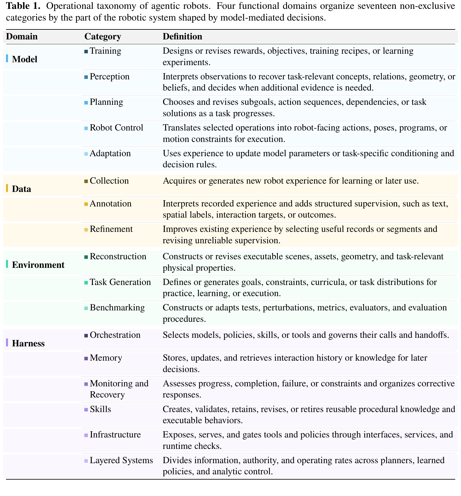

#### 表 1：智能体机器人 17 个操作分类的形式化职责界定

| 功能领域 (Domain) | 操作分类 (Category) | 核心形式化定义 (Definition) | 典型干预产物与交互媒介 |
| :--- | :--- | :--- | :--- |
| **Model** | **Training** | 设计或调整奖励函数、学习目标、训练配方（Recipe）或主导策略学习实验 | Python 奖励代码、Curriculum 调度、损失函数超参 |
| | **Perception** | 解析观测以提取任务相关的概念、空间关系、3D 几何或状态信念，并在信息缺失时主动发起决策 | 3D 场景图（Scene Graph）、位姿估计、主动多视角观测规划 |
| | **Planning** | 在任务推进过程中生成并动态修订子目标、动作依赖序列、符号规划或可行解 | 高层任务规划树、子目标状态、逻辑时序规范 |
| | **Robot Control** | 将高层规划或语义操作转化为可直接供执行器消费的动作、位姿、代码或运动约束 | 6-DoF/7-DoF 轨迹、Affordance 稠密场、Python 控制脚本 |
| | **Adaptation** | 利用在线物理交互或失败经验，调整模型网络参数、上下文提示（In-Context）或决策规则 | 上下文提示词、参数微调梯度、检索库样本修正 |
| **Data** | **Collection** | 自主调度物理真机、仿真程序或生成模型，获取多样化具身经验轨迹 | 远程遥操作示范、仿真探索轨迹、合成多视点视频 |
| | **Annotation** | 解析无标签原始多模态轨迹，自动化追加高层语言描述、空间关键点与结果标签 | 时序分段文本标签、接触事件戳、3D 边界框与抓取意图 |
| | **Refinement** | 评估筛选已有经验数据，剔除异常轨迹片段，修复错误标注并强化物理自洽性 | 优质示范过滤掩码、逆向纠偏修正后轨迹、质量评分 |
| **Environment** | **Reconstruction** | 从稀疏观测或文本提示重建可交互、带物理属性与关节约束的可执行仿真资产与场景 | 关节化 URDF/MJCF 文件、3D 网格、表面摩擦/质量刚度参数 |
| | **Task Generation** | 自动化合成可执行的任务目标、物理初始布局、动力学约束与自动化成功判定逻辑 | 任务环境 Python 代码、场景初始化分布、逻辑终止断言 |
| **Harness** | **Orchestration** | 选择合适的模型、策略、技能或工具，并全权管理组件之间的函数调用与控制权移交 | 调度路由器、有限状态机（FSM）、决策接管与握手协议 |
| | **Memory** | 存储、更新并实时检索跨越步数与多轮任务交互的历史经验与空间拓扑知识 | 结构化时空知识图谱、Episodic 记忆缓冲池、向量索引 |
| | **Monitoring & Recovery** | 实时评估物理执行进度、成功判定、安全越界与死锁失败，并触发自愈恢复响应 | 运行期断言校验器、反思重规划器、物理回退避障逻辑 |
| | **Skills** | 创建、验证、保留、重构或淘汰模块化、可复用的程序化或策略化行为组件 | 参数化 Python 技能库、闭环策略权重包、可迁移控制基元 |
| | **Infrastructure** | 通过标准化接口规范封装模型与工具，提供底层中间件服务并实施运行时物理安全拦截 | ROS2/gRPC 服务桥接层、动作限幅校验器、物理安全沙箱 |
| | **Layered Systems** | 将信息通道、控制权限与计算时钟频率在慢速规划器、中频策略与高速分析控制之间进行正交解耦 | 快慢异构分层执行栈（System 1 / System 2 时钟解耦） |

---

## 方法主线

### 1. 机制流程：机器人智能的四代范式演进
本文在 Section 2 建立了一条极为明晰的机器人学习进化路线图（Figure 1）：


```
+---------------------------------------------------------------------------------------------------+
| 第一代：任务特定策略 (Task-Specific Policies)                                                      |
|   - 代表：传统强化学习 (PPO/SAC), 模仿学习 (BC, ACT, Diffusion Policy)                           |
|   - 机制：观测 -> 动作映射 (I_t -> a_t)，严重依赖人工特征工程与有限领域示范分布，缺乏语言泛化能力       |
+---------------------------------------------------------------------------------------------------+
                                              ↓
+---------------------------------------------------------------------------------------------------+
| 第二代：视觉语言动作模型 (Vision-Language-Action Models, VLAs)                                     |
|   - 代表：RT-1, RT-2, OpenVLA, Octo, RoboFlamingo, π0                                             |
|   - 机制：(I_t, Text) -> Action Tokens，将互联网多模态大模型的通用语义先验直接映射到底层动作空间      |
|   - 痛点：反应式单向自回归吐 Token，缺乏显式物理前瞻、反思重试与长时程因果维持机制                |
+---------------------------------------------------------------------------------------------------+
                                              ↓
+---------------------------------------------------------------------------------------------------+
| 第三代：世界模型与世界动作模型 (World Models & World-Action Models, WMs / WAMs)                   |
|   - 代表：UniPi, SuSIE, GAIA-1, UniSim, OpenWAM, Long-WAM, VPP2, DreamZero, NVIDIA Cosmos/GR00T    |
|   - 机制：(I_t, a_t) -> I_{t+k}，利用视频扩散模型前瞻未来物理世界演化，进行反事实推理与轨迹评分  |
|   - 痛点：视频去噪时延数秒级，长程复合误差与视觉穿模严重，依然停留在动作生成层而非全局治理层      |
+---------------------------------------------------------------------------------------------------+
                                              ↓
+---------------------------------------------------------------------------------------------------+
| 第四代：智能体机器人 (Agentic Robots)                                                              |
|   - 代表：具有系统级自主性，统摄 Model、Data、Environment、Harness 四维治理闭环                   |
|   - 机制：具备超越固定策略的宏观决策能力：主动感知、因果长时程规划、代码生成、多模态记忆沉淀、   |
|           运行时异常监控与自适应恢复、多速率快慢系统协同、以及自主数据探索与环境课程自进化        |
+---------------------------------------------------------------------------------------------------+
```

这一演化清晰地表明：**具身智能的终局绝不是训练一个体积越来越庞大的单体 End-to-End 黑盒网络，而是构建一个由模型、数据、环境与脚手架紧密啮合的自主智能体系统。**

---

### 2. 概念界定与分类体系：四域宏观联动格局
论文在 Section 3 明确了智能体机器人与相关概念的边界，并展示了四大功能领域的宏观交互循环（Figure 2 & Figure 3）：

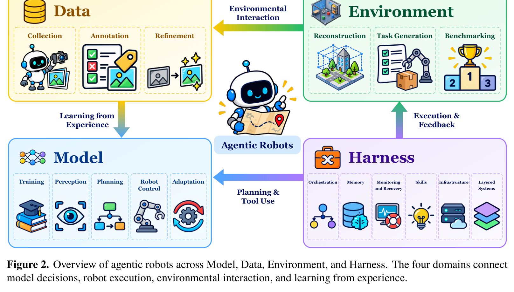

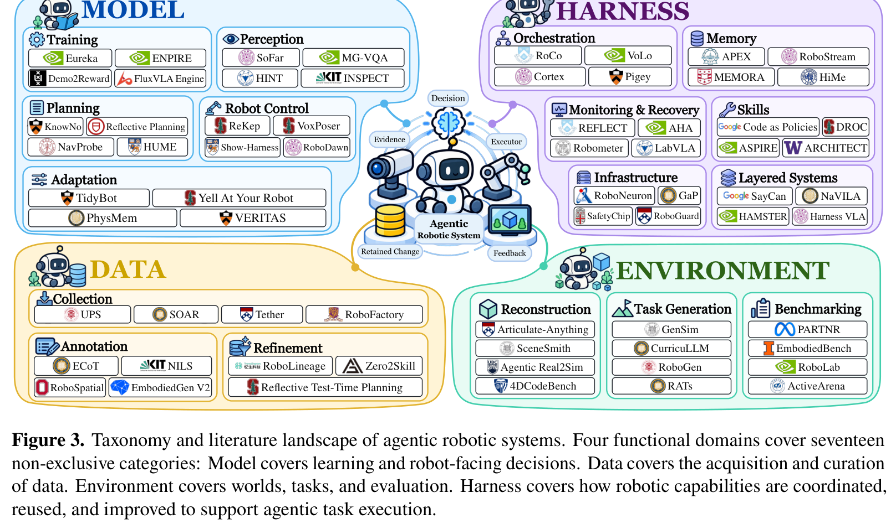

- **Agentic Robotics vs. Embodied AI**：具身智能宽泛关注智能体通过与环境物理交互进行学习；而智能体机器人则聚焦于**智能体如何统筹组织自身能力、自主调度多源工具、并在真实执行反馈中动态修正决策**。
- **Agentic Robotics vs. Autonomous Robotics**：经典自主机器人已经涵盖了规划、状态监控与控制；智能体机器人引入了通用基础大模型的开放式语言理解、少样本迁移与代码推理能力，使自主决策摆脱了预设状态机与人工穷举规则的桎梏。
- **Agentic Robotics vs. Robot Foundation Models**：基础模型提供通用的表征基底与策略权重；智能体机器人则是调用、监督、评估并驱动这些基础模型进化的整体系统架构。

---

### 3. Model 领域：学习、理解、决策与控制

在 Model 领域，智能体直接干预模型的输入、结构、输出与优化生命周期（Figure 4，Tables 2-6）：

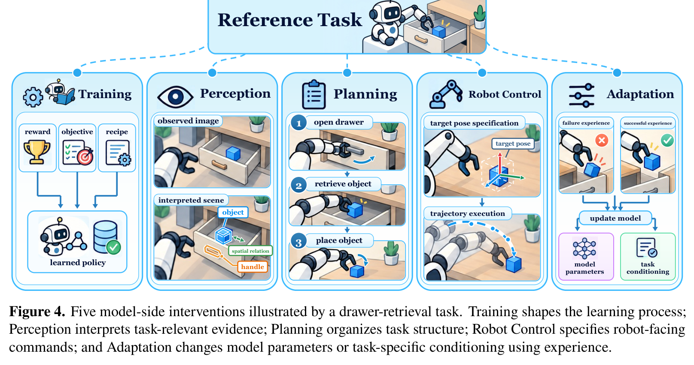

#### (1) Training（模型训练干预）
智能体作为“AI 算法研究员”，作用于离线策略优化过程（Table 2）：
- **自动奖励设计（Automated Reward Design）**：如 **Eureka** [233] 利用 LLM 编写 Python 奖励函数，并在 Isaac Gym 中进行环境演化搜索，以训练指标作为反馈进行代码反思迭代，在灵巧手笔旋转等超高自由度任务上超越人类专家设计；**Demo2Reward** [92] 结合人类示范视频逆向合成奖励。
- **算法超参自适应**：如 **ADARLR** [148] 与 **ENPIRE** [383]，智能体自动化编排实验超参、网络损失函数加权并管理整个策略训练实验流水线。


#### (2) Perception（主动与语义感知）
感知不再是被动接收单帧 RGB 图像，而是由智能体主导的动态证据搜集（Table 3）：
- **主动感知决策（Active Perception）**：当视场受限或发生遮挡时，智能体自主指挥云台相机变换机位或驱动移动底座寻找最佳观测角（如 **ViLa**、**MG-VQA**、**INSPECT**）；
- **3D 结构化场景理解（3D Scene Graphs）**：如 **SoFar** [271] 将 RGB-D 点云与开放语义结合，构建空间目标拓扑关系，直接为抓取提供带度量信息的 3D 抓取位姿估计。


#### (3) Planning（任务长程规划与几何可行性校验）
打破端到端直接吐动作的黑盒，将复杂任务解构为多阶段规划（Table 4）：
- **语义与可行性协同**：经典如 **SayCan** [125] 将 LLM 高层语言规划概率与底层价值网络（Value Functions）物理可行度得分相乘；**KnowNo** [279] 通过共形预测量化不确定性，在歧义场景下主动向人类求助；
- **反思式推理重规划**：如 **Reflective Planning** [105]，在每步动作执行后利用 VLM 反思执行偏差并动态调整后续规划。

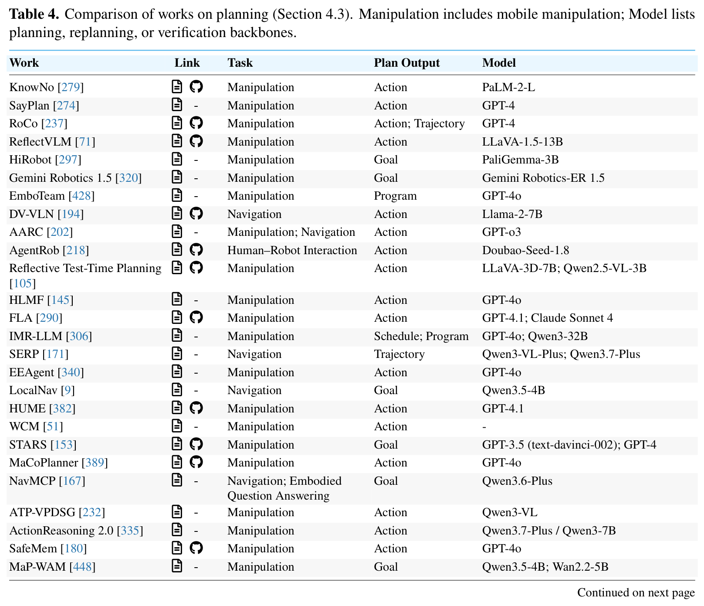

#### (4) Robot Control（机器人控制表征转换）
智能体决策如何流向真实的底层关节（Table 5）：
- **关键点与几何约束优化**：如 **ReKep** [153] 与 **VoxPoser** [118]，智能体通过代码合成空间 3D 价值图（3D Value Maps）或关系关键点约束，交由凸优化或逆运动学（IK）求解器平滑追踪，兼顾语义泛化与毫米级轨迹精确性；
- **程序化策略合成（Code-as-Policies）**：如 **CaP** [196]、**DROC**、**TidyBot**，将智能体推理直接转化为可执行的 Python 脚本，原生支持控制流（条件分支、for 循环与异常捕获）。

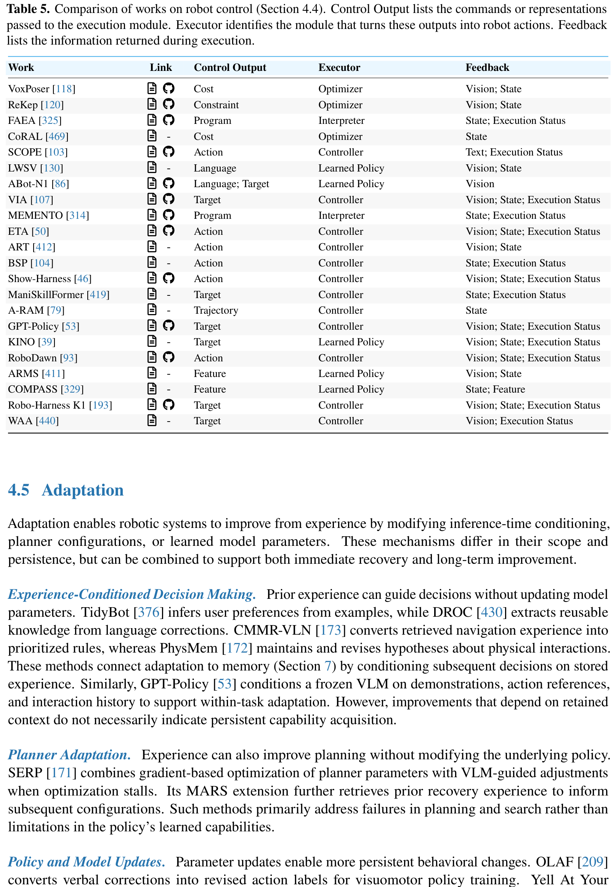

#### (5) Adaptation（在线经验自适应）
无需破坏既有模型权重，实现策略的即时物理对齐（Table 6）：
- **上下文学习（In-Context Adaptation）**：利用几步失败经验或历史交互轨迹作为上下文提示，直接修正后续动作输出；
- **测试时参数微调（Test-Time Fine-Tuning）**：通过环境强化信号在线微调适配层（Adapter），实现新工具或形变物体的快速对齐。

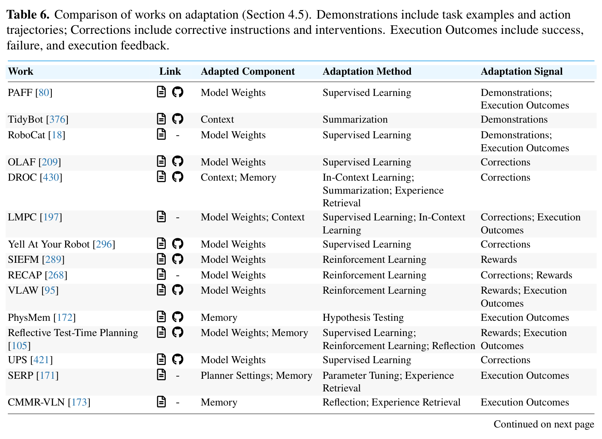

---

### 4. Data 领域：收集、标注与精炼

数据是具身智能规模化扩展的最大瓶颈。本文揭示了智能体如何主导数据飞轮（Figure 5，Tables 7-9）：


#### (1) Collection（经验自主收集）
- **真机自主探索与多机协作**：如 **AutoRT** [3] 利用 VLM 扫描物理环境，生成安全可行的探索任务提案，通过规则宪法（Robot Constitution）实施安全沙箱约束，指挥多台真机自主收集上万条轨迹；**SOAR** [467] 生成了超 30,500 条高质量真机操作数据；
- **仿真程序化自动化合成**：如 **RoboGen** [362]、**GenSim** [345]、**RoboFactory** [273]，从零自动化合成多达 106 种任务并驱动强化学习策略自动产出大规模专家轨迹。


#### (2) Annotation（多模态稠密标注）
原始录制的机器人物理交互日志极度缺乏语义与时空结构。智能体在此充当自动化数据标注工（Table 8）：
- 自动化切分长时程视频为原子技能片段；
- 追加细粒度自然语言指令、动作动词分类、关键接触帧时间戳；
- 结合感知模型预测稠密 3D 抓取热力图、交互目标 3D 边界框与前后状态语义差。


#### (3) Refinement（轨迹质量过滤与精炼）
- **反思性轨迹修剪**：并非所有录制的演示都有利于模仿学习。如 **RoboLineage** [231] 与 **Zero2Skill** [334]，利用多模态推理智能体审查轨迹中的无效抖动、误抓与停滞，剔除劣质数据；
- **失败重试轨迹重构**：将失败-自愈轨迹打标为“负样本/自愈样本”，大幅强化下游策略的分布外鲁棒性。


---

### 5. Environment 领域：重建、任务生成与基准评测

没有逼真且可交互的物理数字孪生，具身智能体便无法安全开展百万次试错探索（Figure 6，Tables 10-12）：

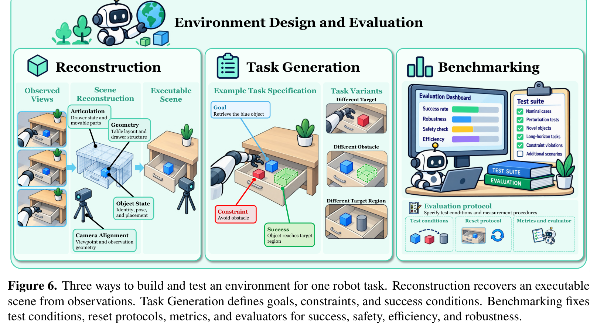

#### (1) Reconstruction（可交互场景与资产重建）
- **物理关节可动资产生成**：静态 3D 网格无法满足机器人抓取与开门等操作。**Articulate-Anything** [159] 与 **Articraft** [461] 利用智能体检索并预测物体的可动关节轴线、运动范围（Revolute/Prismatic Joints）与物理参数，自动生成可执行的 URDF 代码；
- **完整交互环境组装**：如 **Genie Sim 3.0** [414] 与 **DiagGen** [35]，将多源资产智能组装进 Isaac Gym 或 SAPIEN 中，构建可物理模拟的数字孪生厨房与工作台。


#### (2) Task Generation（自动化任务与课程生成）
- **无限长任务合成**：如 **GenSim** [345] 与 **RoboGen** [362]，根据场景资产的物理属性自动编写任务目标、约束条件与初始化随机范围（Domain Randomization）；
- **动态难度自适应课程**：根据策略当前的学习达成率，智能体动态调整阻碍物密度、目标位姿偏差与摩擦力分布，实现自动化 Curriculum Learning。

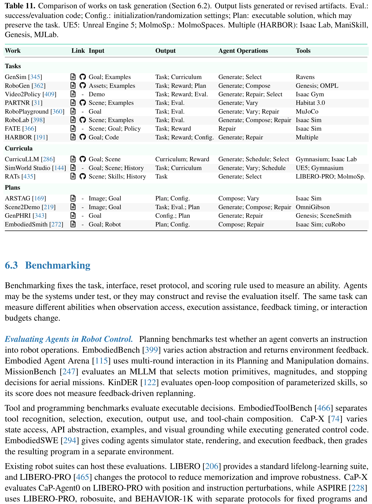

#### (3) Benchmarking（动态严苛基准设计）
- **带外物理验证器（Out-of-band Verifiers）**：如 **CodeActionBench** 与 **EmbodiedBench**，智能体生成严格隔离于被测系统可见信息之外的物理状态判定规则，杜绝虚假声称（False Done）；
- **对抗性扰动评测**：如 **RoboPAIR** [283]，智能体自动化设计视觉扰动、语言语义对抗攻击与物理突发故障，全面压力测试策略的鲁棒性边界。

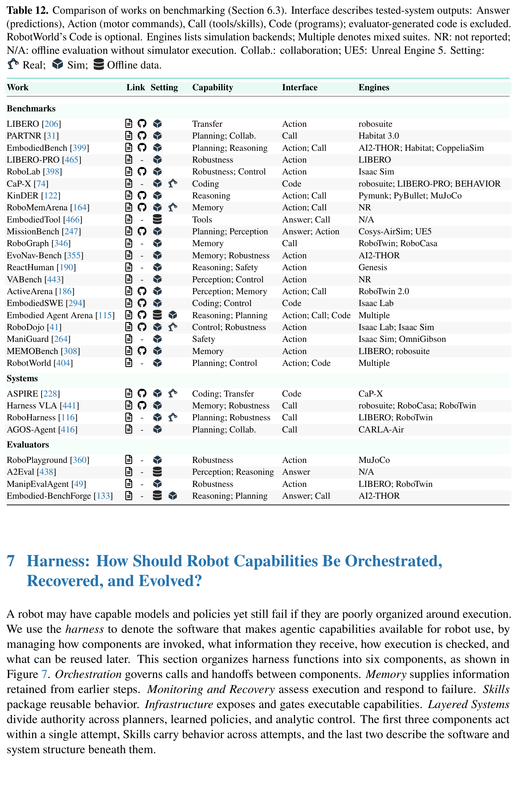

---

### 6. Harness 领域：编排、记忆、监控恢复、技能与分层架构

如果说 Model 是具身机器人的“大脑”，那么 **Harness 就是支撑整个生命系统的“神经系统、循环系统与免疫中枢”**。论文在 Section 7 首次将 Harness 系统性划分为六大核心支柱（Figure 7，Tables 13-18）：


#### (1) Orchestration（编排调度中枢）
管理各种异构模块的握手与控制权转移（Table 13）：
- **路由与派发模式**：智能体决定何时调用高精度的 3D 点云感知工具，何时将指令移交给端到端 VLA（如 $\pi_0$）进行富接触操作，何时调用传统运动规划库（如 cuRobo / OMPL）进行快速空程走位；
- 典型代表如 **VoLo** [40] 与 **MistyPilot** [354]，构建了严密的路由握手协议。


#### (2) Memory（多模态时空记忆系统）
解决端到端网络无持久状态的顽疾（Table 14）：
- **多粒度记忆分层**：
  - **Episodic 记忆**：记录当前尝试中的动作历史、失败反思与状态转移；
  - **Semantic / Spatial 记忆**：构建房间或工作台的拓扑语义地图（如 **HAM-VLN** [205]、**RoboStream** [123]）；
  - **跨任务持久记忆**：如 **MEMORA** [420] 与 **ARMS** [411]，跨任务保留成功的策略片段与环境交互参数。


#### (3) Monitoring & Recovery（实时监控与容错自愈）
机器人置身于充斥着物理随机性与动力学接触的真实物理世界，执行失败是绝对常态（Table 15）：
- **全生命周期断言检查**：
  - *执行前（Pre-execution）*：校验动作空间是否越界、目标是否碰撞（如 **SafeHarness** [390]、**CoVer** [157]）；
  - *执行中（In-execution）*：基于滑移检测、力矩异常或进度停滞实时中断当前动作（如 **DoReMi** [94]、**Code-as-Monitor** [458]）；
  - *执行后（Post-execution）*：结合视觉反思（如 **REFLECT** [223]、**AHA** [64]）判定物理子目标是否切实达成，并在失败时激活回退与重试机制。


#### (4) Skills（程序化与策略化技能库）
经验的长期沉淀离不开可复用技能模块（Table 16）：
- **从 Minecraft 到实体物理控制的技能自进化**：继承了 **Voyager** [336] 的核心设计哲学，智能体将反复验证有效的控制序列固化为参数化的 Python 函数或策略权重包；
- 典型如 **ASPIRE**、**ProgPrompt** [300]、**Act-Observe-Rewrite** [155]，支持技能库的动态检索、参数重载与在线修订。

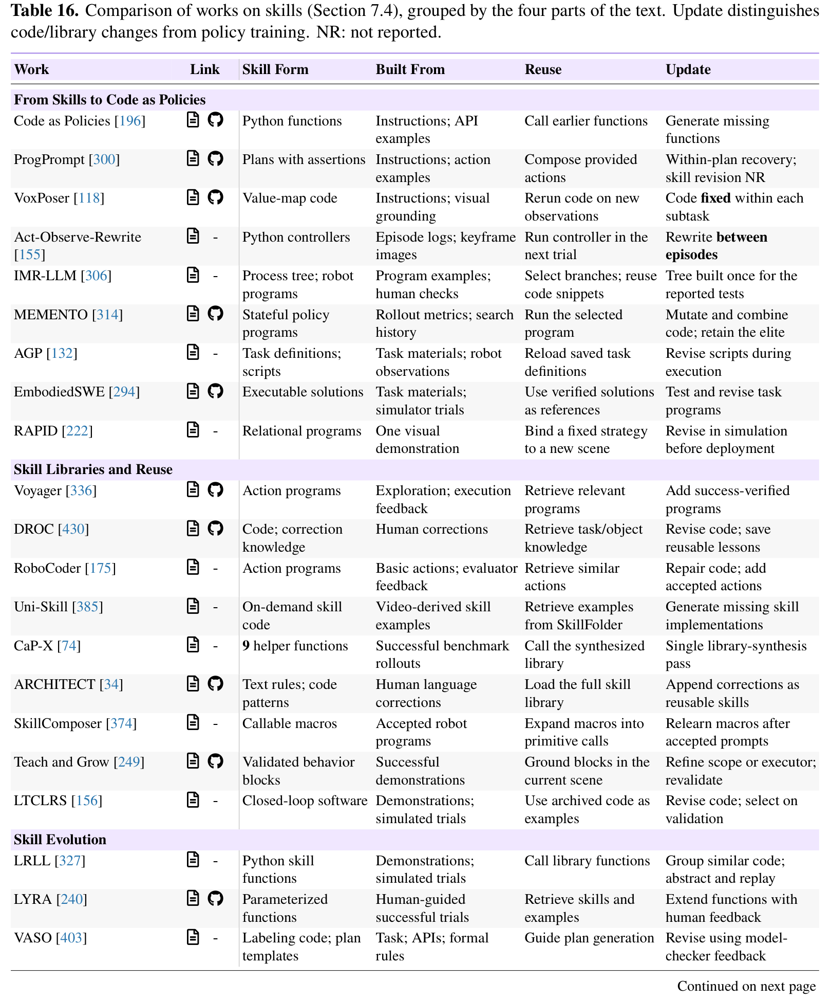

#### (5) Infrastructure（系统基础设施与安全芯片）
为智能体搭建合规、确定性且受控的真实物理接口（Table 17）：
- **物理安全沙箱与规则芯片**：如 **SafetyChip** [405]，作为独立于智能体策略之外的底层安全看门狗，强行拦截违反时序逻辑（LTL）或超出机械臂力矩/工作空间极限的危险动作；
- **异步推理与管线并发**：如 **SmolVLA** [299] 与 **RTC** [14]，通过流水线调度将云端大模型的高延迟推理与本地端侧的高频动作队列解耦，避免机器人因等待决策而频繁发呆停顿。

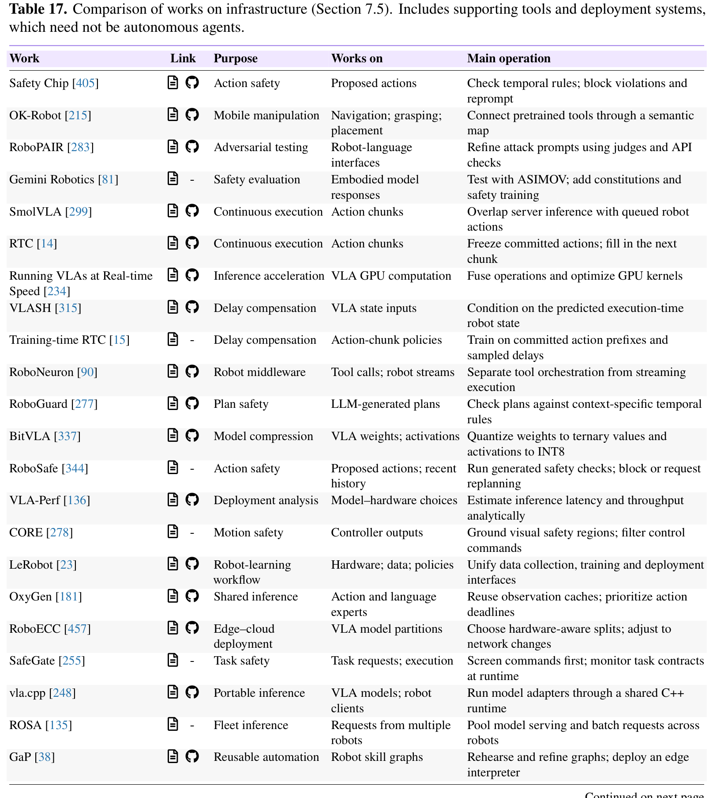

#### (6) Layered Systems（快慢异构分层执行栈）
具身系统在根本上需要妥协高层推理的深度与低层控制的实时性（Table 18）：
- **System 2 慢思考规划层（0.1 ~ 1 Hz）**：VLM/LLM 负责长程任务因果推断、环境异常诊断与子目标生成；
- **技能中间件与策略层（5 ~ 20 Hz）**：局部 VLA 策略或参数化技能执行器处理局部动态感知与目标追踪；
- **System 1 快系统动力学层（100 ~ 1000 Hz）**：解析式动力学控制器、逆运动学（IK）求解器、阻抗控制与低层 PID 关节驱动器，以毫秒级响应确保无碰撞平滑执行与接触稳定性。


---

## 关键分类与代表性工作横向对比

为了穿透 600+ 篇文献的庞杂细节，我们从 Model、Data、Environment 与 Harness 四个维度分别抽取核心前沿方法，进行纵深横向技术特性对比：

### 1. Model 领域前沿工作大比拼 (Table 2 - Table 6)

| 核心维度 | 代表工作 | 核心输入与骨干模型 | 策略干预产物 | 评估与反馈闭环机制 | WJ 核心批判与技术权衡 |
| :--- | :--- | :--- | :--- | :--- | :--- |
| **训练干预** | **Eureka** [233] | 仿真环境接口 + GPT-4 | 结构化 Python 奖励代码 | 结合 Isaac Gym 强化学习策略 Rollout 表现进行演化搜索 | 突破了灵巧手复杂操控的人工调参瓶颈；但对环境暴露的底层状态变量依赖极高，缺乏从纯视觉观测逆向推导奖励的能力。 |
| **感知干预** | **SoFar** [271] | 多视角 RGB-D + VLM | 3D 拓扑场景图与目标 6D 位姿 | 几何估计与物理抓取成功率反馈 | 成功桥接了开放词表语义与毫米级度量几何；但在极端光照与透明/反光物体下深度点云失效严重。 |
| **规划干预** | **KnowNo** [279] | RGB 观测 + PaLM-2-L | 带共形预测不确定性的行动选项 | 预测集置信度不达标时主动触发人类求助 | 首次将形式化不确定性界限引入具身决策，大幅压低了严重物理事故风险；但高度依赖预设选项集。 |
| **控制干预** | **VoxPoser** [118] | RGB-D + GPT-4 / VLM | 3D 稠密价值图（Value Maps） | 轨迹优化求解器无缝追踪 | 实现了无需重训策略的零样本空间操作控制；但在紧密富接触任务（如拧螺丝、插拔连接器）中表现疲软。 |
| **自适应干预** | **In-Context Robot** | 多视角视频 + 交互历史 | 动态修订的系统提示与行动修正 | 执行成败标签即时更新上下文记忆 | 实现了无梯度即时纠错；但在超长步数任务中极易受到大模型注意力漂移与长上下文遗忘干扰。 |

---

### 2. Data 领域自循环与飞轮机制 (Table 7 - Table 9)

| 数据阶段 | 代表工作 | 数据生成来源 | 报告规模与吞吐 | 智能体核心操作机制 | 真实物理落地瓶颈 |
| :--- | :--- | :--- | :--- | :--- | :--- |
| **自主收集** | **AutoRT** [3] | 真实物理场景移动双臂 + VLM | 20+ 台机器人车队自主运行数月 | 智能体提出安全任务方案，经规则宪法过滤后自主执行收集 | 对不可预见的人类环境动态交互风险规避不足，需人工安全员常态化旁站兜底。 |
| **自主收集** | **RoboGen** [362] | 纯仿真数字孪生环境 + GPT-4 | 自动化合成 106 种完整任务 | 联合生成场景、任务代码、技能策略并驱动自举式探索 | 典型的 Sim-to-Real 鸿沟，合成数据在光影细节与接触碰撞声学/柔性形变上保真度有限。 |
| **稠密标注** | **RoboLineage** [231] | 异构人类与机器操作日志 | 数万条长轨迹多维分解 | 自动化推断任务子目标、接触事件戳与分阶段自然语言指令 | 高度依赖基础 VLM 的时间感知粒度，在高速动态接触瞬间容易打错时间戳。 |
| **质量精炼** | **Reflective Planning** | 物理回放失败与抖动轨迹 | 全量候选演示过滤池 | 智能体通过视觉反思打分，剔除死锁、滑移与无效冗余片段 | 过滤阈值极难调和：过严会导致数据多样性坍缩，过宽会导致劣质动作噪声污染策略。 |

---

### 3. Environment 自动化生成与评估闭环 (Table 10 - Table 12)

| 环境构建分支 | 代表系统 | 输入媒介与引擎支持 | 产出成果与物理载体 | 核心评测与自验证断言 | 生态位与现实差距 |
| :--- | :--- | :--- | :--- | :--- | :--- |
| **可动场景重建** | **Articulate-Anything** | 静态单张图像/文本 + PyBullet / SAPIEN | 带活动关节与限位的可交互 URDF 模型 | 自动物理验证关节旋转/平移轴线不发生自相交穿模 | 实现了非受限物体的快速关节化建模；但在复杂铰链机构与柔性布料绳索上几乎无能为力。 |
| **任务自主生成** | **GenSim** [345] | 场景描述文本 + SAPIEN | 自动化任务初始状态分布与 Python 目标代码 | 任务成功与空间边界断言校验 | 极大丰富了模仿学习任务库；但生成的任务逻辑仍局限于“抓取-放置-堆叠”等初级排列组合。 |
| **动态基准设计** | **CodeActionBench** | 物理仿真环境 + RoboTwin / SAPIEN | 25 项精巧双臂任务 + 隐蔽结果验证器 | 55 个子目标检查点 + 72 个空间断言，严格隔离智能体可见度 | 彻底剔除了感知特权真值，实现了具身代码策略的最严苛审计；但缺乏对微小形变力控的测度。 |

---

### 4. Harness 系统的生命周期与恢复韧性 (Table 13 - Table 18)

| Harness 支柱 | 代表方案 | 核心技术机制 | 关键优势与赋能 | 核心架构代价与缺陷 |
| :--- | :--- | :--- | :--- | :--- |
| **编排调度 (7.1)** | **VoLo** [40] | 模型主导的条件路由器，在端到端策略与传统规划工具间移交控制权 | 让大模型做高层因果编排，让解析算子做无碰轨迹，各司其职 | 组件间状态序列化与反序列化握手带来额外的执行延迟与协议冗余。 |
| **持久记忆 (7.2)** | **HAM-VLN** [205] | 拓扑图与层次化语义记忆缓存池，跨时步记录探索路径与环境标记 | 彻底消除端到端模型在超长时程任务中的子目标迷失与死循环徘徊 | 记忆图谱的更新与拓扑重构在大场景下带来不可忽略的检索计算开销。 |
| **监控恢复 (7.3)** | **SafeHarness** [390] | 运行期形式化逻辑断言，结合失败后上下文反思重规划 | 变传统的“盲目开环重试”为“因果回退与补偿动作执行” | 监控器误报（False Alarm）会导致正常作业被频繁打断，降低操作连贯性。 |
| **可复用技能 (7.4)** | **Voyager** 范式 / **ASPIRE** | 将经验闭环验证过的成功代码段与控制参数固化为模块化技能库 | 知识随物理探索持续增量累积，越用越聪明，实现技能终身学习 | 技能库膨胀后面临索引衰退（Skill Retrieval Interference）与跨场景参数漂移。 |
| **基础设施 (7.5)** | **SafetyChip** [405] | 独立硬件级的安全仲裁看门狗与动作限幅拦截器 | 无论上层大模型产生何种荒谬幻觉动作，均能在物理出格前硬性刹车 | 严格的安全边界限制了机械臂在狭窄受限空间中的激进探索能力。 |
| **分层控制 (7.6)** | **SayCan** / **ReKep** / **MOKA** | 快慢异构分层时钟体系：高层语义（1Hz）下发几何目标，底层（100Hz）闭环伺服 | 优雅解决了 Foundation Model 推理高延迟与物理世界高频动力学的物理阻抗失配 | 高低层交界处的非线性接触动态丢失，在打磨、擦拭等连续富力控任务中难以适配。 |

---

## 深度分析

### 1. 真正贡献是什么：为什么四维解耦奠定了具身智能体的系统基石？
以往学术界普遍将“智能体”狭隘地理解为“一个挂载了工具调用 API 的大语言模型”。而在机器人学中，这种认识是极度危险且脱离实际的。

**本文最根本的理论贡献，在于建立了首个将智能体从单一执行者升格为全生命周期治理中枢的架构解耦规范**：
- **将“系统开发态”与“任务运行态”彻底打通**：在传统具身研发中，数据收集由一组脚本完成，环境搭建由仿真工程师手动拉模型，策略训练由算法工程师调参，真机部署又由控制工程师写 C++ 中间件——整个流水线严重割裂。本文证明，**智能体机器人不仅在运行期操控末端夹爪，更能在离线态自动化生产数据（Data）、构建孪生世界（Environment）、进化算法配方（Model），并由 Harness 统管全生命周期。**
- **为杂乱无章的具身文献树立了唯一的通用解耦坐标**：无论是 Eureka 还是 AutoRT，无论是 VoxPoser 还是 HarnessVLA，任何人都能在 Model-Data-Environment-Harness 矩阵中精确找到自己的生态位，使得学术界终于可以对不同组件进行“控制变量法”的严密对比。

---

### 2. 为什么该分类体系成立：操作闭环的正交性论证
该体系之所以能够经受住 600+ 篇文献的严酷检验而不产生概念坍缩，其底层数学与系统逻辑在于四大功能域拥有高度正交的操作循环（Operational Loops）：

```
+----------------------------------------------------------------------------------------------------+
|                                    大一统具身智能体四域解耦正交环                                      |
+----------------------------------------------------------------------------------------------------+
|  [ Environment Loop ] : 物理世界的孪生化表征 (Worlds, Assets, Tasks, Assertions)                   |
|        ↕ (提供演练舞台与基准审计)                                                                    |
|  [ Data Loop ]        : 具身经验的规模化自举 (Collect, Annotate, Refine, Filter)                   |
|        ↕ (提供海量优质动力学与语义数据流)                                                             |
|  [ Model Loop ]       : 具身智能的表征与计算 (Perceive, Plan, Predict, Control, Adapt)             |
|        ↕ (提供参数化感知与决策核心)                                                                  |
|  [ Harness Loop ]     : 真实系统的协调与生存 (Orchestrate, Memorize, Monitor, Recover, Sandbox)     |
+----------------------------------------------------------------------------------------------------+
```

每个环路的职责边界极其分明：
- **Model 是认知算力与先验的载体**（回答“当前表征与动作如何被推导”）；
- **Data 是模型演化的燃料源**（回答“多样性经验如何被采集、提炼并清洗”）；
- **Environment 是物理与几何交互的真理锚点**（回答“我们在什么样的物理法则、几何拓扑与测试断言下开展工作”）；
- **Harness 则是系统在现实混沌物理世界中的承重骨架**（回答“异构模块如何通讯、突发意外如何兜底、时钟延迟如何妥协”）。

这种解耦彻底避免了以往将算法创新与工程补丁混为一谈的弊端。

---

### 3. 容易误读的地方：破除具身智能三大核心迷思

#### 迷思一：智能体机器人与纯软件 Agent（如 AutoGPT, Claude Code）没有本质区别？
**致命误读！** 纯软件 Agent 运行在无磨损、无惯性、无连续时间惩罚、状态完全确定的数字世界中（一个 `git commit` 或 `SQL query` 要么成功返回，要么抛出明确 Exception，且支持完全回滚）。而智能体机器人深陷于**物理具身性（Embodiment）的冷酷现实**：
1. **动作的不可逆性（Irreversibility）**：杯子打碎就是物理破损，机械臂撞击就是硬件烧毁，物理世界没有 `Ctrl+Z`；
2. **状态的部分可观测与连续不确定性**：真实传感器存在盲区、反光、运动模糊与标定漂移，接触力学存在非线性微滑移；
3. **严格的实时物理动力学时限**：软件 Agent 等待 API 响应 5 秒毫无影响，而机器人平衡控制或动态抓取延迟超过 50 毫秒就会直接倾覆砸地。

#### 迷思二：只要单体 VLA / WAM 足够大，就不再需要复杂的 Harness 脚手架？
**过度乐观的技术狂想！** 端到端大模型的参数扩展（Scaling Law）能够极大丰富语义常识与视觉运动基元，但它**在结构上无法解决长程任务的组合爆炸与物理偶发异常**。哪怕单步动作成功率高达 99%，连续执行 100 步的整体任务成功率也将衰减至 $0.99^{100} \approx 36.6\%$！没有 Harness 提供的带外状态监控（Monitoring）、时空记忆拓扑（Memory）与异常因果回退（Recovery），任何单体超大规模模型在长程任务中都难逃雪崩失败的宿命。**Harness 绝非临时工程胶水，而是复杂自治系统抗熵增的必然架构选择。**

#### 迷思三：世界动作模型（WAM）已经实现了物理想象，智能体机器人的规划是否多此一举？
**混淆了局部物理模拟与全局目标治理的维度差异！** WAM 的本质是隐式动力学积分器（回答“如果我在当前 0.5 秒内施加动作 $a$，场景会变成怎样”）。但 WAM 无法回答“为了准备一顿晚餐，我应当先去洗菜还是先去热锅”、“如果冰箱门被锁死，我该去哪里寻找钥匙或改换菜单”。**WAM 属于 Model 域中的预测算子，而 Agentic Robots 处于更高的元认知编排层。**

---

### 4. 复现与真机落地痛点：不可忽视的工程地雷

1. **多层协调通信延迟（Inter-Layer Coordination Latency）**：
   - 当系统采用“System 2 VLM 规划器 $\to$ Python 代码生成 $\to$ 运动规划器 $\to$ VLA 执行器”链路时，一次规划往返时延往往长达 2~5 秒。在此期间，物理环境可能已经发生变动（例如目标物体滚落或人类介入）。若缺乏异步抢占（Preemption）机制，机器人将执行基于过期观测计算的危险动作。
2. **物理验证断言的静默失效（Silent Assertion Failure）**：
   - 依赖视觉 VLM 自身判定“抽屉是否已经关严”或“螺丝是否拧紧”极不可靠（过度声称 Overclaim 普遍高达 30% 以上）。真机落地必须引入物理接触力控传感、微动开关或硬几何投影双目校验等带外硬指标。
3. **安全沙箱防死锁机制（Safety Sandboxing & Deadlock）**：
   - 简单的关节限幅（Clamping）容易使机械臂在接近奇异位形（Singularity）或狭窄缝隙时陷入死锁，智能体往往陷入无限循环重复发出被拒动指令的困境。必须在 Harness 层设计显式的死锁检测器与退避策略（Back-off Policies）。

---

## 局限与未来挑战

本文虽然构建了恢弘的分类大厦，但客观审视当前整个领域，仍有四大横亘在具身智能体面前的重大挑战：

### 1. 真实与公平的基准评测（Fair Benchmarking）
- 当前大量所谓高成功率的学术工作，严重依赖“隐蔽特权信息”（如仿真器真值物体位姿、特化微调的 SAM 分割掩码或人工预置的无障碍抓取候选位姿）。一旦将其投入类似 **CodeActionBench** 这样彻底剔除示范轨迹、剔除特权状态、仅凭纯传感器输入自主闭环的严苛基准下，成功率往往发生雪崩式断崖（从 90% 跌落至 20% 以下）。具身智能界亟需建立统一的交互预算、标准化重置协议与完全隔离的客观物理评测底座。

### 2. 真机环境下的长程物理自愈韧性（Real-Robot Agentic Robotics）
- 90% 以上的智能体研究仍栖息于仿真世界。仿真器中的碰撞检测是刚性几何相交计算，而真机世界充斥着软体变形、线缆缠绕、表面微摩擦变化与光照过曝。智能体如何在缺乏完美物理仿真支持的真机环境下，仅凭板载计算资源实现快速自愈重试，仍缺乏突破性方案。

### 3. 计算与 Token 效率的极度压榨（Efficient Robot Use）
- 当前智能体系统极其贪婪地消耗商业大模型 API 资源与云端多卡算力，单次复杂操作尝试往往伴随着数十次 VLM 稠密调用与几千行代码的解析，耗资数美元且耗时数十分钟。如何在计算资源极度受限的机器人移动边缘端（如单个 Jetson Orin 或单张 RTX 4090），通过推测解码（Speculative Decoding）、动作缓存（Action Caching）与紧凑小模型蒸馏，实现每秒数十次的低功耗自主闭环，是产业化落地的命脉。

### 4. 跨本体的终极大一统泛化（Cross-Embodiment Generalization）
- 现有的具身智能体大多针对特定硬件本体特化定制（针对单臂 Franka 写一套 API，针对双臂 ALOHA 写一套，针对四足狗又换一套）。如何构建统一的**跨本体具身抽象层（Unified Embodiment Abstraction Layer）**，使同一个高层智能体大脑能够无缝、动态地指挥轮式底盘、单臂、仿生双臂乃至 22-DoF 拟人灵巧手与双足人型机器人，是通向通用具身人工通用智能（Embodied AGI）的必经之路。

---

## 我的笔记：全局生态位横向对照与大一统具身智能架构推演

将本文置于我们知识库的核心版图中，与近邻代表性重量级工作（**OpenWAM、Long-WAM、VPP2、ViGAR、ASPIRE、Rolling-WAM、CodeActionBench、Harness VLA**）进行深度宏观对照，可以推演出具身智能的完整进化图景：

```
+-----------------------------------------------------------------------------------------------------------------------------+
|                                        大一统具身智能生态坐标全景映射                                                         |
+-----------------------------------------------------------------------------------------------------------------------------+
| 范式层级           | 代表工作          | 生态位核心贡献                                 | 与本文 4 域分类的映射节点                  |
+-------------------+-------------------+----------------------------------------------+-------------------------------------------+
| 评测与基准体系     | CodeActionBench   | 首个彻底剥离特权状态与特化模块的纯代码策略严苛基准  | Environment (6.3 Benchmarking)            |
| 技能自发现体系     | ASPIRE            | 无监督自主探索、原子技能提炼与可进化代码库构建    | Harness (7.4 Skills) + Model (4.1 Train)  |
| 记忆与脚手架体系   | Harness VLA       | 冻结 VLA 的外围记忆引导与不可行区域自适应屏蔽    | Harness (7.1, 7.2, 7.3, 7.6)              |
| 宏观编排决策体系   | Towards Agentic   | 统一 Model/Data/Environment/Harness 顶层架构 | Grand Unified Blueprint (1-17 全分类统筹) |
| 层次化视觉推理     | ViGAR             | 视觉子目标分解与局部目标条件执行器解耦           | Model (4.3 Planning) + Layered (7.6)      |
| 基础动态预训练     | OpenWAM           | 开源、模块化世界动作模型大规模系统预训练框架     | Model (4.1 Training) + Data (5.1 Collect) |
| 长时程时空建模     | Long-WAM          | 突破扩散视频上下文窗口，维持超长时序一致性       | Model (4.1 Training, 4.3 Planning)        |
| 滚动前瞻想象       | Rolling-WAM       | 准实时滚动生成未来视频片段，指导在线低延迟控制   | Model (4.4 Robot Control) + Layered (7.6) |
| 高保真通用策略     | VPP2              | 视频基础模型持续预训练 + MoT 隐式逆动力学专家     | Model (4.1, 4.4) + Data (5.2 Annotation)  |
+-----------------------------------------------------------------------------------------------------------------------------+
```

### 深度洞察与技术推演

1. **从“单体端到端”向“分层外骨骼（Harness-Centric）”的历史性收敛**：
   - 在我们的知识库中，**Harness VLA** 雄辩地证明了一个关键事实：无需对预训练基础模型进行昂贵的微调，仅仅通过在其外部包裹一层轻量级的记忆机制（Memory）、空间可达域校验器（Monitoring）与回退重试路由（Orchestration），就能将冻结模型的分布外成功率直接暴拉 25~38 个百分点！
   - 本文《Towards Agentic Robots》将这一经验从单一算法实践正式升华为通用系统理论：**未来的具身智能绝不可能只是一张静态的权重网络，而是一个“基础大模型核芯（Model Core）+ 自动化数据与环境飞轮（Data & Env Flywheels）+ 强韧脚手架操作系统（Harness OS）”的三位一体复合生命系统。**

2. **世界动作模型（WAM）与智能体机器人（Agentic Robots）的终极融合点**：
   - **OpenWAM**、**VPP2** 与 **Long-WAM** 解决了底层物理表征（世界如何随动作演变）的建模问题；而 **ViGAR** 则尝试在 WAM 内部引入结构化的视觉子目标规划。
   - 然而，当面临真实环境的复杂分支、工具缺失与异常恢复时，纯 WAM 依然缺乏符号反思与跨模态记忆。本文给出的架构指明了未来的演进终局：**以 Agentic Harness 作为上层决策与监控总线，将 WAM 作为高速可调用的“物理常识模拟器（In-Silico Physics Simulator）”，配合底层的原子运动控制库，形成真正具备超强自愈与泛化能力的下一代通用具身超级智能！**

---

## 引用

```bibtex
@article{qin2026towards,
  title   = {Towards Agentic Robots: Model, Data, Environment, and Harness},
  author  = {Chonghan Qin and Dongming Wu and Kaituo Feng and Jiaxu Wang and Xinlei Yu and Peiwen Sun and Yijia Fan and Xilin He and Bingao Chen and Weitong Lian and Ryan Ji and Wenqi Ren and Xiaobin Hu and Dahua Lin and Yu-Gang Jiang and Xiangyu Yue},
  journal = {arXiv preprint arXiv:2610.20442},
  year    = {2026}
}
```
