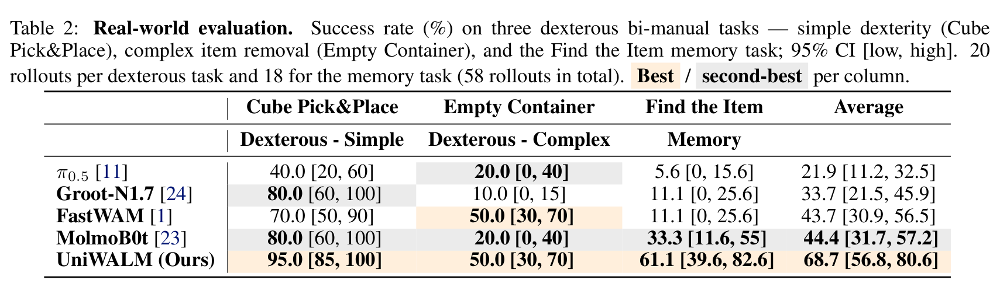
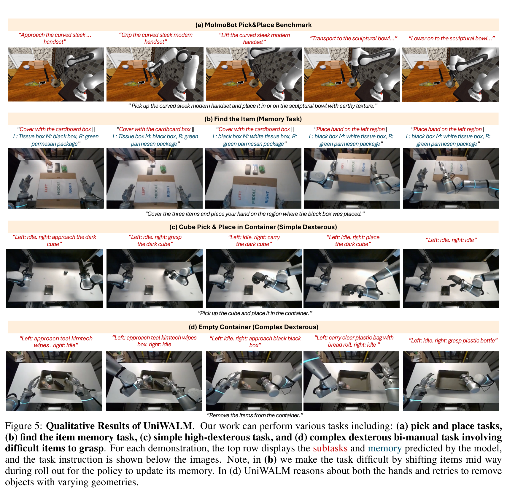
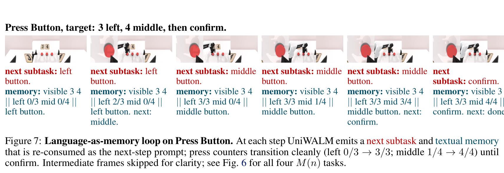
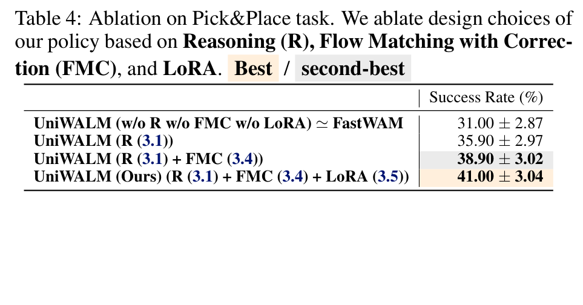
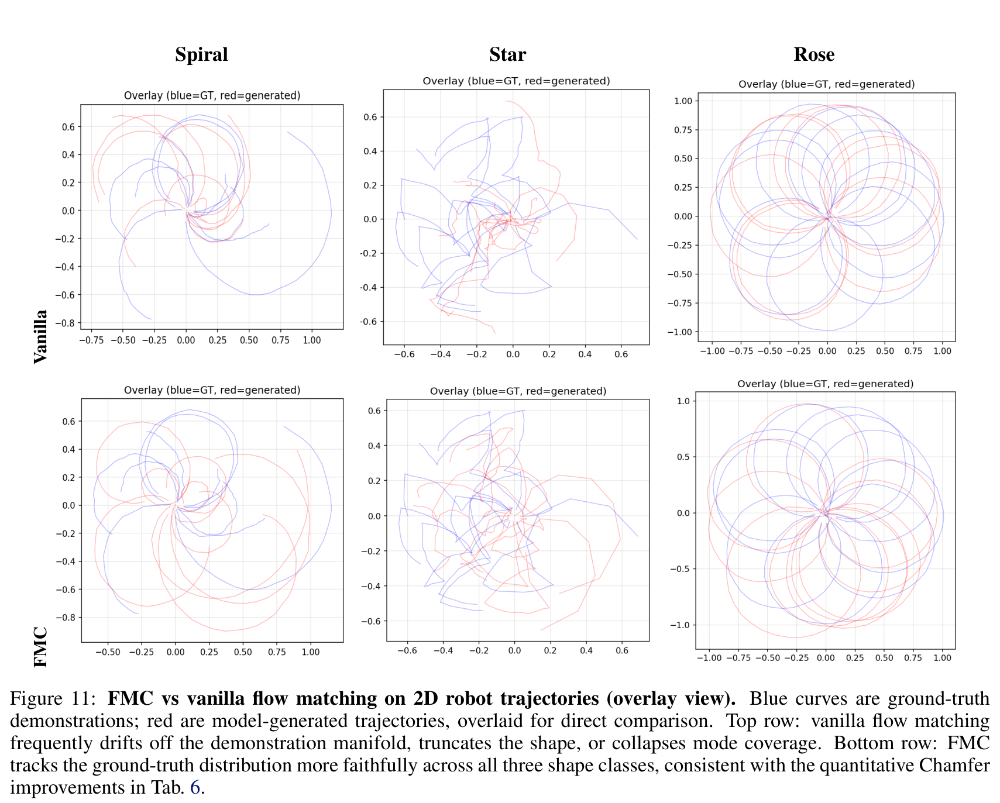
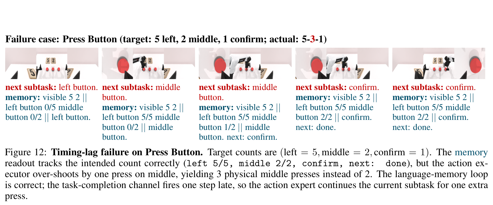
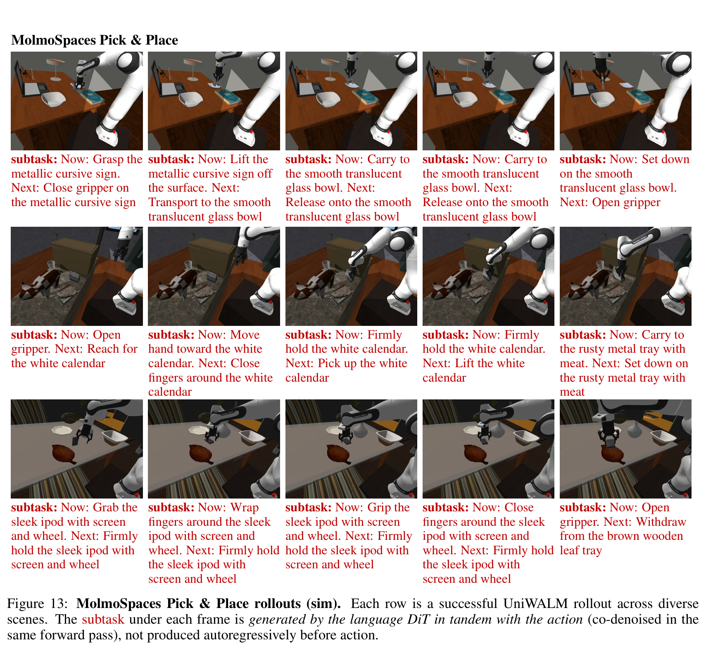
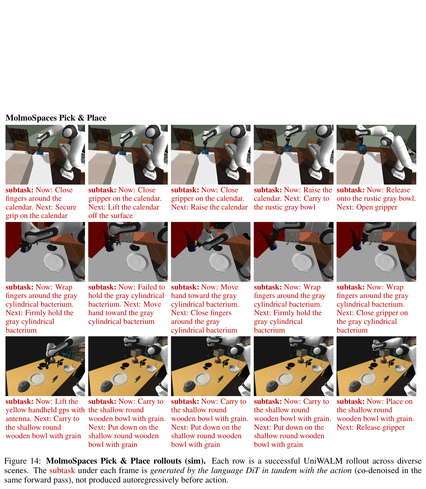

# UniWALM: Unified World Action Language Model for Embodied Robot Control
# 面向具身机器人控制的统一世界-动作-语言模型

**Authors / 作者:** Rahul Sajnani$^{1,2}$, Diego Romeres$^2$, Mingyuan Zhang$^{2,3}$, Kai Gao$^2$, Carl Qi$^{2,4}$, Baichuan Huang$^2$, Srinath Sridhar$^1$, Dylan Randle$^2$, Lillian J. Ratliff$^{2,5}$, Jose Barreiros$^2$, Manikantan Nambi$^2$, Jeroen Vanbaar$^2$  
**Affiliations / 机构:** $^1$Brown University, $^2$Amazon, $^3$Northeastern University, $^4$UT Austin, $^5$University of Washington  
**Project Page / 项目主页:** [rahulsajnani.github.io/projects/uniwalm/](https://rahulsajnani.github.io/projects/uniwalm/)  
**arXiv:** [2610.28626v1 [cs.RO] 20 Oct 2026](https://arxiv.org/abs/2610.28626)

---

## Page / Section Index | 章节与页面导航

- [Abstract / 摘要](#abstract--摘要)
- [1 Introduction / 引言](#1-introduction--引言)
  - [Figure 1. UniWALM 统一架构与任务泛化概览](#figure-1-uniwalm-统一架构与任务泛化概览)
- [2 Related Works / 相关工作](#2-related-works--相关工作)
- [3 UniWALM / UniWALM 统一架构与方法](#3-uniwalm--uniwalm-统一架构与方法)
  - [3.1 Reasoning with Video Action Models / 视频动作模型中的语言推理](#31-reasoning-with-video-action-models--视频动作模型中的语言推理)
    - [Figure 2. UniWALM 总体架构与数据流图](#figure-2-uniwalm-总体架构与数据流图)
    - [Figure 4. Mixture of Transformers (MoT) 层级结构](#figure-4-mixture-of-transformers-mot-层级结构)
  - [3.2 Multi-Modal Co-Training / 多模态协同训练](#32-multi-modal-co-training--多模态协同训练)
  - [3.3 Memory / 记忆机制：闭环语言记忆与视觉锚点](#33-memory--记忆机制闭环语言记忆与视觉锚点)
  - [3.4 Flow Matching with Correction (FMC) / 带校正的流匹配](#34-flow-matching-with-correction-fmc--带校正的流匹配)
    - [Figure 3. FMC 扰动轨迹与速度自校正示意图](#figure-3-fmc-扰动轨迹与速度自校正示意图)
  - [3.5 Architecture and Training Details / 架构与训练实现细节](#35-architecture-and-training-details--架构与训练实现细节)
- [4 Experiments / 实验评估](#4-experiments--实验评估)
  - [4.1 Benchmarks and Setup / 评测基准与实验设定](#41-benchmarks-and-setup--评测基准与实验设定)
  - [4.2 Main Results: Manipulation & Memory / 核心实验结果：操作提升与工作记忆](#42-main-results-manipulation--memory--核心实验结果操作提升与工作记忆)
    - [Table 1. MolmoB0t v2 仿真抓取放置基准成功率](#table-1-molmob0t-v2-仿真抓取放置基准成功率)
    - [Table 2. 真实世界双臂灵巧操作与记忆任务评测](#table-2-真实世界双臂灵巧操作与记忆任务评测)
    - [Table 3. RMBench 记忆子集 M(n) 评测结果](#table-3-rmbench-记忆子集-mn-评测结果)
    - [Figure 5. UniWALM 真实与仿真定性表现全览](#figure-5-uniwalm-真实与仿真定性表现全览)
    - [Figure 6. RMBench 记忆任务 M(n) 推理定性展开](#figure-6-rmbench-记忆任务-mn-推理定性展开)
    - [Figure 7. 按钮按压任务中的语言记忆自循环轨迹](#figure-7-按钮按压任务中的语言记忆自循环轨迹)
  - [4.3 Ablations / 消融实验分析](#43-ablations--消融实验分析)
    - [Table 4. 抓取与放置任务的模块消融实验](#table-4-抓取与放置任务的模块消融实验)
    - [Table 5. RMBench 按钮按压任务的记忆机制消融实验](#table-5-rmbench-按钮按压任务的记忆机制消融实验)
- [5 Limitations / 局限性分析](#5-limitations--局限性分析)
- [6 Conclusion & Future Work / 结论与未来展望](#6-conclusion--future-work--结论与未来展望)
- [References / 参考文献](#references--参考文献)
- [Appendix Contents / 附录目录](#appendix-contents--附录目录)
- [Appendix A: Related Works (Extended Discussion) / 附录 A：相关工作扩展讨论](#appendix-a-related-works-extended-discussion--附录-a相关工作扩展讨论)
- [Appendix B: Additional Experimental Details / 附录 B：扩展实验细节与设置](#appendix-b-additional-experimental-details--附录-b扩展实验细节与设置)
  - [B.1 Qualitative Results / 附录 B.1：定性展开图库](#b1-qualitative-results--附录-b1定性展开图库)
    - [Figure 8. 真实世界清空容器双臂灵巧操作定性展开](#figure-8-真实世界清空容器双臂灵巧操作定性展开)
  - [B.2 RMBench Environment and Tasks / 附录 B.2：RMBench 环境与任务描述](#b2-rmbench-environment-and-tasks--附录-b2rmbench-环境与任务描述)
    - [Figure 9. 真实世界寻找遮挡物品任务定性展开](#figure-9-真实世界寻找遮挡物品任务定性展开)
  - [B.3 RMBench Training Configuration / 附录 B.3：RMBench 训练超参数配置](#b3-rmbench-training-configuration--附录-b3rmbench-训练超参数配置)
  - [B.4 Memory Architecture Details / 附录 B.4：记忆模块架构实现细节](#b4-memory-architecture-details--附录-b4记忆模块架构实现细节)
  - [B.5 Flow Matching with Correction (FMC) Ablations on 2D Robot Trajectories / 附录 B.5：2D 轨迹基准 FMC 消融实验](#b5-flow-matching-with-correction-fmc-ablations-on-2d-robot-trajectories--附录-b52d-轨迹基准-fmc-消融实验)
    - [Figure 10. 2D 机器人端效应器基准轨迹类别](#figure-10-2d-机器人端效应器基准轨迹类别)
    - [Figure 11. FMC 与标准流匹配生成轨迹覆盖对比](#figure-11-fmc-与标准流匹配生成轨迹覆盖对比)
    - [Table 6. 2D 轨迹上 FMC 超参数与自校正消融评测](#table-6-2d-轨迹上-fmc-超参数与自校正消融评测)
  - [B.6 Failure Case: Press Button / 附录 B.6：典型失败案例：按键计数时序滞后](#b6-failure-case-press-button--附录-b6典型失败案例按键计数时序滞后)
    - [Figure 12. 按钮按压任务中的时序滞后失败案例分析](#figure-12-按钮按压任务中的时序滞后失败案例分析)
- [Appendix C: Limitations (Extended) / 附录 C：扩展局限性讨论](#appendix-c-limitations-extended--附录-c扩展局限性讨论)
- [Appendix D: Additional Future Work / 附录 D：扩展未来研究方向](#appendix-d-additional-future-work--附录-d扩展未来研究方向)
- [Appendix E: Additional Rollout Visualizations / 附录 E：附加仿真操作定性展开图库](#appendix-e-additional-rollout-visualizations--附录-e附加仿真操作定性展开图库)
  - [Figure 13. MolmoSpaces 复合抓取放置展开案例（一）](#figure-13-molmospaces-复合抓取放置展开案例一)
  - [Figure 14. MolmoSpaces 复合抓取放置展开案例（二）](#figure-14-molmospaces-复合抓取放置展开案例二)

---

## Terminology Ledger | 核心术语对照表

| 英文原词 / Term | 规范中文翻译 / Translation | 概念说明 / Context & Definition |
| :--- | :--- | :--- |
| **World Action Language Model (WALM)** | **世界-动作-语言模型** | 在单一共享表征中联合建模并协同生成视频、连续动作与语言的具身基础模型范式。 |
| **Mixture of Transformers (MoT)** | **Transformer 混合架构** | 针对不同模态（视频、动作、语言）分别构建专用 Transformer 分支，并通过统一自注意力层实现跨模态交互的架构。 |
| **Flow Matching with Correction (FMC)** | **带校正的流匹配** | 一种训练目标，通过在训练阶段对动作轨迹施加合成扰动并监督其在一步步长内返回标称流轨迹的速度场，使策略具备轨迹自校正能力。 |
| **Co-denoising** | **同步联合去噪 / 协同去噪** | 视频、动作和语言扩散头在同一个扩散前向迭代中同步执行去噪推断，无需分阶段自回归等待。 |
| **Language-as-Memory Loop** | **语言即记忆自循环** | 模型生成的下一阶段子任务与当前执行状态文本，在下一控制步作为 Prompt 重新输入策略，形成免外部检索器的工作记忆环路。 |
| **Textual Memory** | **文本记忆** | 模型生成的紧凑符号字符串，用于记录已执行的历史状态、计数进度与排除的尝试。 |
| **Visual Memory (Anchor Frame)** | **视觉记忆（锚点帧）** | 初始时段捕获的环境静态参考帧，通过 RoPE 坐标偏移拼入视频流，用于在发生物理遮挡时维持长程场景布局参考。 |
| **Task-Completion Signal ($\beta$)** | **任务完成信号 ($\beta$)** | 拼接入动作向量维度的 1-D 指示信号，标志子任务何时彻底完成，并作为门控控制文本记忆在子任务边界处更新。 |
| **Action Chunking** | **动作分块预测** | 策略一次前向推断输出 $N$ 步连续控制动作序列（本文取 $N=32$）。 |
| **Unified Self-Attention** | **统一自注意力** | 将视频、语言、动作的 Query/Key/Value Token 在同一序列维度拼接并联合计算自注意力，实现深层多模态双向特征融合。 |
| **Chamfer Distance** | **倒角距离** | 衡量两组点集或连续轨迹之间双向邻近程度的几何分布距离度量。 |

---

## Abstract / 摘要

> <span style="color:#3B82F6"><strong>Para. 1:</strong></span> Motivated by the human ability to integrate experience across language, perception, and action, we introduce UniWALM, a unified world-action-language model that learns video, action, and language in a single shared representation, where each modality is both a conditioning signal and a supervision target. We ask: can jointly generating language enrich this shared representation, improving manipulation and supporting memory-dependent behavior? Unlike prior approaches that attach a reasoning or vision-language model to a video-action backbone and run them as distinct stages, UniWALM unifies all three modalities inside a single mixture-of-transformers backbone whose per-modality diffusion heads co-denoise synchronously, decoding subtask and textual memory in the same pass as action with no separate planning stage; the generated language is re-consumed on the next step, closing a language-as-memory loop without an external planner or memory bank. To keep the action stream reliable under this richer objective, we further introduce Flow Matching with Correction (FMC), a training objective that teaches recovery from perturbed action trajectories at no inference-time cost. UniWALM consistently improves over same-backbone baselines (e.g., FastWAM [1]) on compositional pick-and-place (MolmoSpaces) and across the memory-dependent subset of RMBench [2], where it reaches 34.5% without any pretrained language or reasoning model and exceeds Mem-0’s keyframe-equipped setup (28.5%) using only a single anchor frame. On a real-world Find-the-Item task, generating textual memory lifts success from 11.1% to 61.1%, while state-of-the-art VLAs stay at or below chance ($\le 33.3\%$).

> <span style="color:#F59E0B"><strong>Para. 1[CN]:</strong></span> 受人类跨语言、感知与动作融合经验能力的启发，我们提出了 UniWALM——一种在单一共享表征中统一学习视频、动作与语言的“统一世界-动作-语言模型”（Unified World-Action-Language Model），其中每个模态既是条件引导信号，又是监督学习目标。我们探讨的核心问题是：联合生成语言能否丰富这一共享表征，进而提升机器人操作性能并支持强依赖记忆的行为？与以往将推理或视觉-语言模型（VLM）拼接在视频-动作主干上并分阶段运行的方法不同，UniWALM 在单个 Transformer 混合架构（Mixture-of-Transformers, MoT）主干中统摄了所有三种模态；各模态专用的扩散预测头同步执行联合去噪，在同一个前向过程中与动作协同解码出子任务规划和文本记忆，无需独立的规划阶段；生成的语言在下一控制步被重新作为输入消费，从而在无需外部规划器或外部记忆库的前提下闭合了“语言即记忆”（Language-as-Memory）环路。为了在这一更丰富的多模态目标下确保动作流的可靠性，我们进一步引入了带校正的流匹配（Flow Matching with Correction, FMC），该训练目标在不增加任何推理计算开销的前提下，教会模型从受到扰动的动作轨迹中自我恢复。UniWALM 在复合抓取放置基准（MolmoSpaces）以及 RMBench 的强记忆依赖子集上，均持续超越基于相同主干的基线模型（例如 FastWAM [1]）；在无需任何预训练语言或推理模型的情况下，UniWALM 在 RMBench 记忆子集上达到 34.5% 的成功率，仅凭借单一初始锚点帧便超过了配备全任务关键帧的 Mem-0 设置（28.5%）。在真实世界的“寻找遮挡物品”（Find-the-Item）任务中，生成文本记忆使任务成功率从 11.1% 跃升至 61.1%，而前沿视觉-语言-动作模型（VLA）在该任务上的成功率仍停留在或低于随机猜测水平（$\le 33.3\%$）。

---

## 1 Introduction / 引言

> <span style="color:#3B82F6"><strong>Para. 1:</strong></span> Humans integrate perception, language, and action in an any-to-any manner: regions like the posterior parietal and premotor cortex continuously fuse afferent inputs with efferent motor copies [3], and cognitive representations are inherently shaped by what an agent can do in the world [4, 5]. For embodied agents, language, video, and action are three complementary views of a single interaction; a unified representation should let each one inform the others: language guiding physical prediction, visual dynamics grounding action, and action anchoring predictions in embodied behavior. Multimodal models have operationalized this framing for vision and text [6, 7, 8] but largely omit action and motor control.

> <span style="color:#F59E0B"><strong>Para. 1[CN]:</strong></span> 人类以“任意模态到任意模态”（any-to-any）的方式深度整合感知、语言与动作：大脑后顶叶皮层和前运动皮层等区域持续将传入感知输入与传出运动副件（efferent motor copies）相互融合 [3]，且认知表征在本质上受到智能体在物理世界中所能执行行为的塑造 [4, 5]。对于具身智能体而言，语言、视频和动作是同一次物理交互的三种互补视角；理想的统一表征理应使各模态互相启发：语言指导物理预测，视觉动态为动作奠定物理基础，而动作则将预测锚定在真实的具身行为中。多模态模型已经在视觉与文本领域实现了这种思想框架 [6, 7, 8]，但大多忽略了动作与运动控制。

> <span style="color:#3B82F6"><strong>Para. 2:</strong></span> The same substrate that integrates these modalities also remembers: the hippocampus, which the brain uses to recall past experience, is also recruited to imagine the future and locate the self in time [9, 10]. We routinely enlist language itself as working memory (counting out loud, repeating a phone number, silently rehearsing a passage while reading to retain it) to track state through long-horizon, memory-dependent tasks. A truly unified representation should therefore not only let modalities inform one another but also let generated language serve as the working memory that threads behavior across step boundaries. Concretely, because language is co-denoised with action in one representation, the generated string serves as a learned, in-loop plan (next subtask) and textual memory (what has been done so far), while an anchor-frame visual memory preserves scene context across occlusion; re-consumed on the next step, these close a memory loop with no external planner, VLM, or retrieval buffer.

> <span style="color:#F59E0B"><strong>Para. 2[CN]:</strong></span> 负责融合上述模态的神经生理基质同样承载着记忆功能：大脑中用于回忆过往经验的海马体，同样被调用来设想未来并在时间维度上定位自我 [9, 10]。我们在日常生活中习惯于将语言本身用作工作记忆（例如大声计数、重复电话号码、在阅读时默背段落以维持短时记忆），从而在长时程、依赖记忆的任务中持续追踪状态。因此，真正统一的表征不仅应让各模态互相启发，还应使生成的语言充当跨越时间控制步边界的工作记忆。具体而言，由于语言与动作在同一表征中同步联合去噪，生成的字符串便充当了习得的闭环内规划（下一步子任务）和文本记忆（迄今已完成的事项），而初始锚点帧的视觉记忆则在物理遮挡发生时维持场景上下文；这些信息在下一控制步被重新作为输入消费，在无需外部规划器、VLM 或检索缓冲区的条件下闭合了记忆循环。

> <span style="color:#3B82F6"><strong>Para. 3:</strong></span> Recent robotic foundation models connect video, language, and action, but typically along only a subset of these directions. Vision-language-action models [11, 12] consume language as fixed conditioning but do not generate it. Chain-of-thought VLAs [13, 14, 15, 16, 17] generate intermediate language within a control step, but autoregressively, so action must wait for token decoding, and the generated string is not re-consumed across steps. World-action models (DreamZero [18], FastWAM [1]) co-model video and action but drop language entirely. Memory-augmented systems [19, 20, 2] attach retrieval buffers or an external planner to a pretrained backbone; $\pi_{0.7}$ [20] supplies language from a high-level semantic policy while a separate world model generates subgoal images that condition a VLA (Fig. 1(f)). On memory-dependent evaluations like RMBench [2]’s M(n) subset, where decisions require $n$ task-relevant past observations, policies that condition only on the current frame and prompt collapse.

> <span style="color:#F59E0B"><strong>Para. 3[CN]:</strong></span> 近期的机器人基础模型尝试连接视频、语言和动作，但通常仅覆盖其中的部分路径。视觉-语言-动作模型（VLA）[11, 12] 仅将语言用作固定的条件输入，并不生成语言。具身思维链（CoT）VLA 模型 [13, 14, 15, 16, 17] 虽然在单个控制步内生成中间语言，但是采用自回归方式，导致动作必须等待语言 Token 逐步解码，且生成的字符串不会在跨步控制中重新消费。世界-动作模型（如 DreamZero [18]、FastWAM [1]）联合建模视频与动作，却完全舍弃了语言模态。增强记忆的系统 [19, 20, 2] 则在预训练主干上附加检索缓冲区或外部规划器；例如 $\pi_{0.7}$ [20] 从高层语义策略提供语言，而由独立的世界模型生成子目标图像来作为 VLA 的条件输入（图 1(f)）。在像 RMBench [2] 的 M(n) 子集这种强依赖记忆的评测基准中（其决策需要 $n$ 个与任务相关的历史观测），仅以当前单帧和原始指令为条件的策略往往彻底失效。

> <span style="color:#3B82F6"><strong>Para. 4:</strong></span> A natural response is to compose a pretrained vision-language model with a video-action backbone and supply reasoning via auxiliary conditioning or an additional loss (Fig. 1(f)). This family (hybrid planner + VLA systems [20], concurrent compositional WALMs) is more accurately described as WAM + VLM features: it typically uses two vision backbones optimized for different objectives and only loosely coupled, treats language as an external hidden state rather than a generation target, and bolts memory on as a separate retrieval module. UniWALM (Fig. 1(g)) uses a single video backbone jointly optimized for all three modalities, with video, action, and language as first-class diffusion heads co-denoised in one pass; the generated language is re-consumed next step, closing a language-as-memory loop with no external planner, VLM, or memory bank. Where prior world-action models supervise the backbone with frame-level predictive structure (future video), UniWALM adds a task-level predictive stream (future subtask and task state as language), a second, longer-horizon supervision signal that frame prediction alone cannot cheaply express.

> <span style="color:#F59E0B"><strong>Para. 4[CN]:</strong></span> 一种直观的应对方式是将预训练视觉-语言模型与视频-动作主干相组合，并通过辅助条件输入或附加损失函数提供推理能力（图 1(f)）。这一类模型（混合规划器 + VLA 系统 [20] 以及近期的组合式 WALM）更准确地说是“WAM + VLM 特征拼接”：它们通常采用两个针对不同目标优化且仅松散耦合的视觉主干，将语言视为外部隐藏状态而非生成目标，并以独立的检索模块硬编码挂载记忆。与之形成鲜明对比的是，UniWALM（图 1(g)）使用单一视频主干对所有三种模态进行联合端到端优化，将视频、动作与语言作为一等公民的扩散头在单次前向传递中同步去噪；生成的语言在下一步被重新消费，从而在没有外部规划器、VLM 或记忆库的情况下闭合了“语言即记忆”循环。以往的世界-动作模型主要通过帧级预测结构（未来视频）监督主干，而 UniWALM 额外增加了一条任务级预测流（以语言形式表征未来子任务与任务状态），提供了纯帧预测难以轻量化表达的第二重长程时序监督信号。

> <span style="color:#3B82F6"><strong>Para. 5:</strong></span> In this work we study two questions: (i) does jointly generating language enrich the shared representation of a video-action model and improve manipulation? (Fig. 1(g)) and (ii) can a policy use its own generated language, re-consumed across steps, as working memory on memory-dependent tasks? (Fig. 2)

> <span style="color:#F59E0B"><strong>Para. 5[CN]:</strong></span> 在本研究中，我们重点探索两个科学问题：(i) 联合生成语言能否丰富视频-动作模型的共享表征，进而提升机器人的物理操作能力？（图 1(g)）；(ii) 策略能否将其自身生成的、跨步重新消费的语言用作强记忆依赖任务中的工作记忆？（图 2）。

> <span style="color:#3B82F6"><strong>Para. 6:</strong></span> Contributions. We introduce UniWALM, a multimodal world-model architecture that takes a step toward any-to-any modeling across language, video, and actions, where each modality serves as both a conditioning signal and a supervision target. Specifically:
>
> - World-Action-Language Model (WALM): We introduce WALM, a unified World Action Language Model implemented as a mixture of transformers that takes video, language, and actions as input and generates all three as output. The language stream emits a subtask and textual memory in the same denoising pass as action, and re-consumes them as prompt on the next control step, closing a language-as-memory loop. UniWALM’s language and action experts are trained from scratch on a video-only backbone: no pretrained language or reasoning model is used.
> - Flow Matching with Correction (FMC). We introduce FMC to improve the reliability of generated actions. During training, FMC perturbs action trajectories and supervises a corrective velocity that returns the perturbed denoising path toward the clean trajectory. This trains recovery from action-space perturbations without adding model capacity or sampling steps at inference.
> - Evaluation in simulation and real-world manipulation. UniWALM achieves the highest success on all three MolmoSpaces [21] compositional pick-and-place variants, improving over the same-backbone FastWAM baseline by +14.8% on average (Tab. 1). On RMBench’s memory-dependent M(n) subset, UniWALM reaches 34.5% without pretrained language or reasoning model, improving over same-backbone FastWAM (13.3%) by +21.2 points and above Mem-0’s keyframe-equipped setup (28.5%) using a single anchor frame instead of per-task privileged keyframes (Tab. 3). On a real-world bimanual Find-the-Item task, generating textual memory lifts success from 11.1% (FastWAM, same video backbone, no language) to 61.1%, while state-of-the-art VLAs stay at or below chance ($\le 33.3\%$) (Tab. 2).

> <span style="color:#F59E0B"><strong>Para. 6[CN]:</strong></span> 核心贡献。我们提出了 UniWALM，这是一种迈向语言、视频与动作全向任意模态（any-to-any）建模的多模态世界模型架构，其中每个模态既充当条件输入，又充当监督目标。具体贡献包括：
>
> - 世界-动作-语言模型（WALM）：我们提出了 WALM，一种采用 Transformer 混合架构实现的统一世界动作语言模型，以视频、语言和动作为输入，并联合生成这三种模态作为输出。语言流在与动作相同的去噪过程中同步输出子任务与文本记忆，并在下一控制步将其作为 Prompt 重新输入，闭合了“语言即记忆”自循环。UniWALM 的语言与动作专家完全在纯视频主干上从零训练：不依赖任何预训练的语言或推理大模型。
> - 带校正的流匹配（FMC）：我们提出了 FMC 以提升生成动作的可靠性。在训练期间，FMC 对动作轨迹施加扰动，并监督一个修正速度场，驱使受扰动的去噪路径返回到干净标称轨迹。这一机制在不增加模型参数容量或推理去噪步数的前提下，赋予策略从动作空间扰动中自我恢复的能力。
> - 仿真与真实世界操作全面评测：UniWALM 在 MolmoSpaces [21] 的全部三种复合抓取与放置变体中均取得最高成功率，相比使用相同主干的 FastWAM 基线平均提升 +14.8%（表 1）。在 RMBench 强依赖记忆的 M(n) 子集上，UniWALM 在没有预训练语言或推理模型的情况下达到 34.5% 的成功率，比同主干 FastWAM（13.3%）高出 +21.2 个百分点，且仅使用单个初始锚点帧即超过了配备各任务特权关键帧的 Mem-0 设定（28.5%）（表 3）。在真实世界双臂“寻找遮挡物品”任务中，生成文本记忆将成功率从 11.1%（同主干 FastWAM，无语言生成）提升至 61.1%，而前沿 VLA 基线均处于或低于随机概率水平（$\le 33.3\%$）（表 2）。

> <span style="color:#3B82F6"><strong>Para. 7:</strong></span> Together, these results motivate further investigation of any-to-any world modeling as a foundation for generalist embodied agents.

> <span style="color:#F59E0B"><strong>Para. 7[CN]:</strong></span> 综合上述成果，本研究为进一步探索基于任意模态互通的世界模型以构建通用具身智能体奠定了坚实基础。

### Figure 1. UniWALM 统一架构与任务泛化概览


**Caption:** Figure 1: (a) UniWALM is a unified World Action Language Model that extends a single video-model backbone to act and reason by co-generating video, action, and language through one shared diffusion process — no separate language model fused onto a world-action model. This supports (b) single and (c) bimanual dexterous manipulation with (d) multi-stage manipulation and (e) memory-dependent reasoning. Prior work (f) composes a VLM with a VLA and a video model in pipeline or parallel; UniWALM (g) tunes a single unified representation end-to-end. Each manipulation example displays the input task instruction at the bottom and the generated video, action, and subtask at the top. In (e) the predicted subtask and textual memory (shown as ‘subtask || memory’) are re-consumed as the next-step prompt.

**Caption[CN]:** 图 1：(a) UniWALM 是一种统一世界-动作-语言模型（WALM），它扩展了单个视频模型主干，通过单一共享扩散过程协同生成视频、动作与语言来实现行动与推理——完全无需将独立的语言模型拼接到世界-动作模型之上。该架构支持 (b) 单臂操作、(c) 双臂灵巧操作、(d) 多阶段复合操作以及 (e) 依赖记忆的物理推理。以往方法 (f) 通常将 VLM 与 VLA 及视频模型以流水线或并行方式组合；而 UniWALM (g) 端到端微调单一统一步骤表征。各操作示例在底部展示输入的任务指令，在顶部展示生成的预测视频、执行动作与子任务。在 (e) 中，预测的子任务与文本记忆（表示为“子任务 || 记忆”）被重新作为下一步的输入 Prompt。

---

## 2 Related Works / 相关工作

> <span style="color:#3B82F6"><strong>Para. 1:</strong></span> Generalist Visuomotor Policies. Generalist robot policies [11, 22, 23, 24, 25, 14, 26, 27] improve over single-task models [28, 29] by initializing from vision-language backbones [30, 31, 32, 33, 34, 35] and training for action. These policies map observations to actions but do not model world dynamics or reason over long-horizon subtasks.

> <span style="color:#F59E0B"><strong>Para. 1[CN]:</strong></span> 通用视觉运动策略。通用机器人策略 [11, 22, 23, 24, 25, 14, 26, 27] 相比传统的单任务模型 [28, 29] 取得了显著进步，其主要通过从视觉-语言大模型主干 [30, 31, 32, 33, 34, 35] 初始化并针对机器人动作输出进行微调。这些策略建立了从视觉观测到连续动作的直接映射，但并不对外部世界的物理动态进行建模，也缺乏对长时程子任务的推理能力。

> <span style="color:#3B82F6"><strong>Para. 2:</strong></span> World-Action Models. A recent line of works [1, 18, 36, 37, 38, 39, 40] adds a video-prediction objective, jointly modeling world dynamics and action. FastWAM [1], closest to our work, couples a pretrained Wan2.2 [41] video DiT with a parallel action DiT through unified attention. These models treat language purely as a conditioning input, never as a generation target and provide no mechanism for subtask reasoning or memory.

> <span style="color:#F59E0B"><strong>Para. 2[CN]:</strong></span> 世界-动作模型。近期一系列前沿工作 [1, 18, 36, 37, 38, 39, 40] 引入了视频预测目标，联合建模世界物理演化动态与机器人动作。与本文最接近的 FastWAM [1]，通过统一自注意力机制将预训练的 Wan2.2 [41] 视频扩散 Transformer（DiT）与平行的动作 DiT 进行特征耦合。然而，这些模型纯粹将自然语言视为单向条件输入，从未将其作为生成与自监督目标，因而缺乏长程子任务规划推理与跨步记忆机制。

> <span style="color:#3B82F6"><strong>Para. 3:</strong></span> Reasoning, Memory, and Hybrid Policies. Long-horizon and memory-dependent tasks have motivated explicit reasoning and memory [2, 42], and hybrid systems [20, 43, 44, 45, 46] that combine a high-level VLM planner, a low-level policy, and a video model to imagine action effects. Because these components are trained separately on heterogeneous data, they lack a shared representation and execute planning and control asynchronously.

> <span style="color:#F59E0B"><strong>Para. 3[CN]:</strong></span> 推理、记忆与混合策略系统。长时程与强依赖记忆的具身任务推动了对显式推理与记忆机制的探索 [2, 42]，并催生了一批混合系统 [20, 43, 44, 45, 46]，它们将高层 VLM 规划器、底层控制策略以及用于预想动作效果的视频生成模型拼合在一起。然而，由于这些异构组件是在不同分布的数据上分别独立训练的，它们缺乏统一共享的多模态内部表征，只能以异步解耦的方式执行规划与控制。

> <span style="color:#3B82F6"><strong>Para. 4:</strong></span> Unified and Omnimodal Models. Any-to-any modeling originates in multimodal LLMs [8, 7] which omit generating actions, and vision works like 4M [6], which unify many modalities via masked token modeling but target perception rather than control and do not reason. Concurrent work [46] additionally generates actions, DINO features, semantics, and video, but cannot reason or preserve memory during manipulation. Concurrent omnimodal models such as Cosmos 3 [47] extend any-to-any modeling to action within a single framework, but decode text autoregressively in one tower and continuous modalities by diffusion in another, running reasoning and generation as separate stages in a 64B model. UniWALM instead generates language, video, and action entirely by diffusion in one shared representation, denoising language and action synchronously so that reasoning and control co-refine in a single unified model.

> <span style="color:#F59E0B"><strong>Para. 4[CN]:</strong></span> 统一与全模态模型。“任意到任意”（any-to-any）建模起源于多模态大语言模型 [8, 7]（但它们不生成物理动作），以及像 4M [6] 这样的视觉模型（通过掩码 Token 建模统一多种模态，但面向感知而非具身控制，且缺乏推理）。同期工作 [46] 额外生成了动作、DINO 特征、语义图和视频，但在操作过程中无法进行逻辑推理或保存长程记忆。另一类同期全模态模型如 Cosmos 3 [47]，虽然在单一框架下将任意模态扩展到了动作，但其在一个网络塔中以自回归方式解码文本，在另一个网络塔中通过扩散生成连续模态，使得 64B 大模型中的推理与生成仍处于割裂的分阶段运行状态。相比之下，UniWALM 在单一共享表征中完全通过扩散机制联合生成语言、视频与动作，语言与动作同步去噪，从而使语义推理与物理控制在单个紧凑模型内协同细化。

> <span style="color:#3B82F6"><strong>Para. 5:</strong></span> An extended discussion contrasting UniWALM with CoT / inner-monologue policies, multi-scale memory VLAs, and recent unified models is deferred to Sec. A.

> <span style="color:#F59E0B"><strong>Para. 5[CN]:</strong></span> 有关 UniWALM 与具身思维链（CoT）/ 内心独白（Inner Monologue）策略、多尺度记忆 VLA 及近期统一模型的更详尽对比与扩展讨论，参见附录 A。

---

## 3 UniWALM / UniWALM 统一架构与方法

> <span style="color:#3B82F6"><strong>Para. 1:</strong></span> UniWALM jointly models the future video, robot actions, and language within a shared multimodal representation, enabling reasoning and control to be learned together. Next, we describe its world-action-language formulation, multimodal co-training, and corrective flow-matching objective.

> <span style="color:#F59E0B"><strong>Para. 1[CN]:</strong></span> UniWALM 在单一共享的多模态表征中联合建模未来视频、机器人动作以及自然语言，使得高级语义推理与底层运动控制能够在统一框架中协同学习。接下来，我们将系统阐述其世界-动作-语言数学建模、多模态协同训练机制以及带校正的流匹配目标。

### 3.1 Reasoning with Video Action Models / 视频动作模型中的语言推理

> <span style="color:#3B82F6"><strong>Para. 1:</strong></span> Video Action Models typically map the current observation and a coarse prompt to near-term video and actions, with no explicit mechanism to generate language that can reason about subtasks or maintain task memory. We introduce UniWALM, a World Action Language Model (WALM) that jointly generates future video, actions, and language within a unified model. Its language generation expert is a diffusion model that provides language reasoning in the form of subtasks and memory.

> <span style="color:#F59E0B"><strong>Para. 1[CN]:</strong></span> 现有的视频动作模型（WAM）通常将当前视觉观测与粗粒度指令映射到近期视频与动作，缺乏显式生成自然语言以推理子任务或维持任务记忆的内在机制。我们提出了 UniWALM——一种在统一模型内部联合生成未来视频、连续动作与语言的世界-动作-语言模型（WALM）。其语言生成专家基于扩散模型构建，能够以阶段性子任务规划与结构化记忆的形式提供连续的语言推理。

> <span style="color:#3B82F6"><strong>Para. 2:</strong></span> World Action Language Model (WALM). World Action Language Models are a new class of models that take as input the current observation ($O$, $k$ RGB views), robot state ($S$), visual memory $F$ (a set of one or more frames), and task prompt ($T$) to predict future video ($V$), action ($A$), language ($L$), and a learned task-completion signal ($\beta$) using a Mixture of Transformers (MoT) architecture with a single shared representation. UniWALM (Fig. 2) is a step towards a single-representation, synchronous WALM. Formally, UniWALM jointly generates $V_{1:H}, (A, \beta)_{1:N}, L := \text{UniWALM}(O, S, F, T)$, where $V_{1:H}$ is $H$ future frames, $(A, \beta)_{1:N}$ is a chunk of $N$ future actions each augmented with a 1-D task-completion signal $\beta$ that fires at subtask completion, and $L$ is a compact string (subtask $\parallel$ textual memory) re-consumed as prompt on the next control step. The visual memory $F$ is an optional input, enabled for memory-dependent tasks (see Sec. 3.3) and omitted for standard manipulation. $\beta$ gates when the textual memory is advanced, so memory updates only at subtask completions.

> <span style="color:#F59E0B"><strong>Para. 2[CN]:</strong></span> 世界-动作-语言模型（WALM）。世界-动作-语言模型代表了一类全新的模型范式：它以当前观测（$O$，$k$ 个 RGB 视角输入）、机器人本体状态（$S$）、视觉记忆 $F$（包含一帧或多帧历史图像）以及任务指令 Prompt（$T$）为输入，利用具有单一共享表征的 Transformer 混合架构（MoT），联合预测未来视频（$V$）、动作序列（$A$）、语言（$L$）以及习得的任务完成信号（$\beta$）。UniWALM（图 2）是迈向单一表征、全同步去噪 WALM 的坚实一步。形式化地，UniWALM 联合生成 $V_{1:H}, (A, \beta)_{1:N}, L := \text{UniWALM}(O, S, F, T)$，其中 $V_{1:H}$ 表示预测的未来 $H$ 帧视频，$(A, \beta)_{1:N}$ 表示由 $N$ 步未来动作构成的动作块（Action Chunk），每个动作附加了一个用于在子任务完成时触发的 1-D 任务完成信号 $\beta$，而 $L$ 是紧凑的语言字符串（由“子任务 $\parallel$ 文本记忆”构成），并在下一控制步作为 Prompt 重新输入。视觉记忆 $F$ 是可选输入通道，在强依赖记忆的任务中启用（见第 3.3 节），而在常规操作中省略。$\beta$ 起到门控作用，决定何时推进文本记忆，从而确保记忆仅在子任务真正达成时发生状态更新。

> <span style="color:#3B82F6"><strong>Para. 3:</strong></span> Generating Video, Action, and Language. Given a pretrained video model, the observation frames are encoded first and passed through the video DiT. We replicate the video DiT’s structure, matching its depth (30 layers) while reducing hidden dimension, to define the action and language DiTs, whose weights are initialized from scratch. Each layer of the video, action, and language DiT processes features via unified self-attention enabling feature sharing between modalities.

> <span style="color:#F59E0B"><strong>Para. 3[CN]:</strong></span> 视频、动作与语言的联合生成。基于预训练视频模型，观测图像帧首先经过 VAE 编码并输入视频 DiT。我们复刻视频 DiT 的结构，保持相同的网络深度（30 层），同时缩减隐层维度，以此构建动作 DiT 与语言 DiT，后两者的权重均从零初始化。视频、动作和语言 DiT 的每一层均通过统一自注意力（Unified Self-Attention）计算特征，实现了深层次跨模态的信息互通与特征共享。

> <span style="color:#3B82F6"><strong>Para. 4:</strong></span> Training the Language Expert for Reasoning. Per-frame RGB prediction captures short-horizon dynamics but cannot cheaply carry task-level information (what subtask is active, what has been done), and we need this signal produced in the same pass as action rather than through a separate autoregressive planner. We therefore adopt a discrete language diffusion [48] expert that denoises in tandem with video and action, giving us speed and architectural symmetry with the video model. At each training step we perturb ground-truth text ($L_{\text{GT}}$) depending on the diffusion time step, $t$, and predict the correct token embedding ($\hat{L}$) using a cross entropy objective ($L_{\text{lang}}$): $L_t := \text{RandomReplace}(L_{\text{GT}}, t)$, $\hat{L} := \text{DiffusionStep}(L_t, t)$, $L_{\text{lang}} := \text{CrossEntropy}(\hat{L}, L_{\text{GT}})$. This teaches the model to freeze already-correct tokens and update the incorrect ones based on the condition. We use the language expert to predict the next subtask the robot should perform, and additionally emit textual memory for memory-dependent tasks.

> <span style="color:#F59E0B"><strong>Para. 4[CN]:</strong></span> 面向推理的语言专家训练。逐帧 RGB 像素预测虽能捕获短程物理动力学，却难以经济有效地承载高层任务级信息（当前激活的子任务是什么、已经完成了哪些操作），而我们要求该信号必须与动作在同一个前向通道中输出，而非依赖独立的自回归规划器。因此，我们引入离散语言扩散专家 [48]，与视频及动作并行协同去噪，这不仅赋予模型极高的生成速度，也保持了与视频主干的高度架构对称性。在每个训练步，我们根据扩散时间步 $t$ 对真实文本标签（$L_{\text{GT}}$）进行加噪扰动，并通过交叉熵目标（$L_{\text{lang}}$）预测正确的 Token 嵌入（$\hat{L}$）：$L_t := \text{RandomReplace}(L_{\text{GT}}, t)$，$\hat{L} := \text{DiffusionStep}(L_t, t)$，$L_{\text{lang}} := \text{CrossEntropy}(\hat{L}, L_{\text{GT}})$。这教会了模型锁定已经正确的 Token，并基于多模态条件上下文逐步更新错误的 Token。我们利用语言专家预测机器人应当执行的下一个子任务，并在涉及长程记忆的任务中额外输出结构化文本记忆。

### Figure 2. UniWALM 总体架构与数据流图


**Caption:** Figure 2: Overview of UniWALM. UniWALM is a unified mixture-of-transformers (MoT) world-action-language model that co-denoises video, language, and action in a single shared representation. Given the current observation, task instruction, proprioception, an optional visual memory $F$ (one or more frames; in our experiments a single anchor at episode start), and the previously generated textual memory, UniWALM processes inputs through a (a) video, (b) language, and (c) action DiT that share features via unified self-attention. The language stream emits a subtask together with a textual memory string, which is re-consumed as the prompt on the next control step, closing a language-as-memory loop across time. Video generation is disabled at inference, so the language and action DiTs run without producing future frames.

**Caption[CN]:** 图 2：UniWALM 架构总览。UniWALM 是一种基于 Transformer 混合架构（MoT）的统一世界-动作-语言模型，在单一共享表征中协同去噪视频、语言与动作。给定当前视觉观测、任务指令、本体感知状态、可选视觉记忆 $F$（一帧或多帧图像；本实验采用剧集开始时的单帧锚点）以及前一步生成的文本记忆，UniWALM 通过 (a) 视频 DiT、(b) 语言 DiT 和 (c) 动作 DiT 处理输入，并通过统一自注意力实现深层跨模态特征共享。语言流同步输出子任务及文本记忆字符串，并在下一控制步被重新作为输入 Prompt 消费，从而构建起跨越时序的“语言即记忆”闭环。在推理阶段，视频生成通道被关闭，使得语言与动作 DiT 在不生成未来视频帧的情况下以高频执行。

### Figure 4. Mixture of Transformers (MoT) 层级结构


**Caption:** Figure 4: Mixture of Transformers Layer. Each modality is processed by its own transformer that performs adaptive layer norm followed by Q,K,V projection. The (a) unified self-attention enables feature sharing between different modalities. Each modality transformer then cross attends to the (b) task instruction and proprioception for conditional generation of video, language, and action in a unified architecture.

**Caption[CN]:** 图 4：Transformer 混合架构（MoT）单层结构。每个模态分别由其专属的 Transformer 专家处理，首先执行自适应层归一化（AdaLN）进行时间步调制，随后计算 Q、K、V 投影。其中 (a) 统一自注意力机制将各模态 Token 拼接并联合计算注意力，实现跨模态深层特征融合；随后各模态分别与 (b) 任务指令文本和本体感知特征执行交叉注意力交互，在统一架构中实现视频、语言和动作的高质量条件生成。

---

### 3.2 Multi-Modal Co-Training / 多模态协同训练

> <span style="color:#3B82F6"><strong>Para. 1:</strong></span> Co-training Objective. UniWALM trains Video DiT, Action DiT, and Language DiT in a co-training objective that combines the following: $L_{\text{video}} := \|v_t^{v\theta} - v_t^{v\text{GT}}\|_1$, $L_{\text{action}} := \|v_t^{a\theta} - v_t^{a\text{GT}}\|_1$, $L := L_{\text{video}} + L_{\text{action}} + \alpha L_{\text{lang}}$. Here, $L_{\text{video}}, L_{\text{action}}$ are flow-matching losses; $L_{\text{lang}}$ is the discrete diffusion loss (Sec. 3.1). The $v_t^{v/a\theta}$ and $v_t^{v/a\text{GT}}$ are predicted and ground truth velocities for video/action modality respectively.

> <span style="color:#F59E0B"><strong>Para. 1[CN]:</strong></span> 协同训练目标。UniWALM 在统一的多模态协同训练目标下联合优化视频 DiT、动作 DiT 和语言 DiT，损失函数定义为：$L_{\text{video}} := \|v_t^{v\theta} - v_t^{v\text{GT}}\|_1$，$L_{\text{action}} := \|v_t^{a\theta} - v_t^{a\text{GT}}\|_1$，$L := L_{\text{video}} + L_{\text{action}} + \alpha L_{\text{lang}}$。此处，$L_{\text{video}}$ 与 $L_{\text{action}}$ 分别为视频与动作模态的流匹配损失；$L_{\text{lang}}$ 为离散语言扩散损失（见第 3.1 节）。$v_t^{v\theta}$ 和 $v_t^{v\text{GT}}$（以及 $v_t^{a\theta}$ 和 $v_t^{a\text{GT}}$）分别表示视频（以及动作）模态的预测流速度场与真实目标流速度场。

> <span style="color:#3B82F6"><strong>Para. 2:</strong></span> We use an $\ell_1$ penalty for the flow-matching terms, which we find more stable than $\ell_2$ for learning actions. Together, these three terms supervise the shared representation at two levels of abstraction in parallel: $L_{\text{video}}$ is frame-level predictive structure (per-step dense RGB prediction, which prior world-action models like FastWAM [1] and DreamZero [18] already use), while $L_{\text{lang}}$ is task-level predictive structure (future subtask and task state as a short string), a longer-horizon signal that frame prediction alone cannot cheaply express; the action loss anchors both to physical behavior. Training with both predictive levels in one backbone, rather than only one, is what lets a single end-to-end policy internalize the structure usually externalized to a planner or VLM. During training, either all or a subset of the mixture of transformers can be trained in tandem depending on the availability of data to reap benefits from all modalities.

> <span style="color:#F59E0B"><strong>Para. 2[CN]:</strong></span> 我们在流匹配损失项中采用 $\ell_1$ 范数，在实际训练中发现其相比 $\ell_2$ 范数能为机械臂连续动作学习提供更平稳收敛的梯度。总体而言，这三项损失在两个不同抽象层级上并行监督单一共享表征：$L_{\text{video}}$ 施加帧级物理预测约束（逐控制步的高密度密集 RGB 预测，这正是 FastWAM [1] 和 DreamZero [18] 等经典 WAM 所采用的机制）；而 $L_{\text{lang}}$ 则提供任务级预测约束（以紧凑文本字符串的形式表征未来子任务规划与任务状态），构成了纯帧像素预测难以经济表达的长程时序监督信号；动作损失 $L_{\text{action}}$ 则将二者牢牢锚定在真实的物理执行行为上。在单一主干中同时引入这两层预测监督，使得单阶段端到端策略能够充分内化通常被外包给外部规划器或大型 VLM 的结构化推理能力。在训练阶段，根据数据源的多模态完整度，可以联合训练全部或部分 Transformer 专家分支，从而最大化利用各种异构数据源的优势。

### 3.3 Memory / 记忆机制：闭环语言记忆与视觉锚点

> <span style="color:#3B82F6"><strong>Para. 1:</strong></span> UniWALM integrates three memory mechanisms directly into the shared representation: a textual memory that is re-consumed as the next-step prompt (closing a language-as-memory loop without an external planner), a visual memory that admits one or more keyframes, and a task-completion channel that gates when the textual memory is updated. Full implementation details (RoPE-shifted keyframe tokenization, task-completion supervision, and RMBench-specific training configuration) are in Sec. B.4.

> <span style="color:#F59E0B"><strong>Para. 1[CN]:</strong></span> UniWALM 将三项互补的记忆机制直接内嵌至共享多模态表征中：一是生成的文本记忆在下一控制步作为 Prompt 重新输入（在无需外部规划器的情况下闭合“语言即记忆”环路）；二是支持接入一帧或多帧关键帧的视觉记忆流；三是用于门控文本记忆何时更新的 1-D 任务完成信号通道。有关 RoPE 坐标偏移的关键帧 Token 化、任务完成信号监督及 RMBench 专用训练配置的详尽细节，请参见附录 B.4。

> <span style="color:#3B82F6"><strong>Para. 2:</strong></span> Textual Memory Re-consumption. Policies that reason once per step cannot carry information across step boundaries, which is exactly what long-horizon and memory-dependent tasks require. At inference, the language head emits a compact string (subtask $\parallel$ textual memory) in the same denoising pass as action. For memory-dependent tasks, this string is re-consumed as prompt on the next control step, closing a language-as-memory loop without an external planner or memory bank.

> <span style="color:#F59E0B"><strong>Para. 2[CN]:</strong></span> 文本记忆的跨步重消费。仅在单个控制步内孤立推理的策略无法跨越时间步传递历史上下文，而这正是长时程和依赖记忆的任务所必需的核心能力。在推理阶段，语言头在与动作相同的去噪前向传递中输出一个紧凑字符串（“子任务 $\parallel$ 文本记忆”）。对于强依赖记忆的任务，该字符串在下一控制步被直接拼接为输入 Prompt 重新输入模型，从而在无需任何外部独立规划器或额外记忆检索库的条件下，优雅地闭合了“语言即记忆”自循环。

> <span style="color:#3B82F6"><strong>Para. 3:</strong></span> Visual Memory. Textual memory alone struggles with scene state that is hard to describe in words (precise object locations, occluded layouts), so we add a lightweight visual-memory stream $F$ the policy can always attend to. For tasks that hide or move objects mid-episode, $F$ preserves the layout otherwise lost as observations advance.

> <span style="color:#F59E0B"><strong>Para. 3[CN]:</strong></span> 视觉记忆（锚点帧）。纯文本记忆在描述难以用自然语言精确量化的物理场景状态时（例如物体的精确三维坐标、局部几何形状及复杂空间遮挡布局）往往显得力不从心，因此我们设计了一个轻量级视觉记忆流 $F$，策略在整个控制过程中可对其进行持续注意力交互。对于在执行中途物体发生移动或被遮挡的任务，$F$ 保留了初始未遮挡时的空间布局参考，避免因时间推进导致关键视觉信息永久丢失。

> <span style="color:#3B82F6"><strong>Para. 4:</strong></span> Task-Completion Signal ($\beta$). If the textual memory is rewritten at every control step, intermediate reasoning overwrites past progress and the summary ceases to be a reliable record of what has been done, especially since the language stream has no explicit supervision for when a subtask is actually complete. We therefore co-train a 1-D task-completion channel $\beta$, appended to the action vector, that fires at subtask completion and gates when the textual memory is updated, so the memory advances only at subtask boundaries rather than every step. Because $\beta$ is concatenated into the action vector, it is supervised jointly with the action by $L_{\text{action}}$ (Sec. 3.2) and requires no additional loss term.

> <span style="color:#F59E0B"><strong>Para. 4[CN]:</strong></span> 任务完成信号（$\beta$）。如果在每个连续控制步都随意重写文本记忆，中间推理可能会覆盖掉先前的累积进度，导致记忆摘要不再是已完成动作的历史可靠记录，尤其是语言流本身并未接收关于“子任务何时实质完成”的显式监督。因此，我们在动作向量末尾附加了一个 1-D 任务完成指示通道 $\beta$ 参与协同训练。该信号在子任务物理达成时触发，并充当门控开关以决定何时推进文本记忆，确保记忆状态仅在子任务边界处发生原子跃迁，而非每一步持续重置。由于 $\beta$ 直接拼接入动作向量，它通过动作流匹配损失 $L_{\text{action}}$（第 3.2 节）与动作联合受训，无需任何附加网络头或损失函数。

> <span style="color:#3B82F6"><strong>Para. 5:</strong></span> Taken together, these three mechanisms correspond to three distinct learned abstractions over the task that live in the shared representation: the generated subtask is a plan (what to do next), the generated textual memory is a running summary (what has been done), and $\beta$ is a task-completion signal (when to commit a subtask as done). All three are first-class outputs of the same backbone that generates video and action, not external modules bolted onto a pretrained VLM or retrieval buffer.

> <span style="color:#F59E0B"><strong>Para. 5[CN]:</strong></span> 综上所述，这三种机制共同构成了共享多模态表征中对具身任务的三层学习抽象：生成的子任务代表局部规划（下一步该做什么），生成的文本记忆充当运行中的动态摘要（迄今已完成了什么），而 $\beta$ 则充当任务完成指示信号（何时提交并锁定一个已达成的子任务）。所有这三个核心元素均为同一生成视频与动作的主干网络的一等公民输出，绝非硬编码挂载在预训练 VLM 或外部检索缓冲区上的外挂模块。

### 3.4 Flow Matching with Correction (FMC) / 带校正的流匹配

> <span style="color:#3B82F6"><strong>Para. 1:</strong></span> Flow matching [28, 49, 50] learns a parameterized velocity field $v_t^\theta$ that transports samples from a Gaussian prior $\mathcal{N}(0, I)$ to the data distribution $p_{\text{data}}(x)$ via a continuous normalizing flow. During training, a data sample $x \sim p_{\text{data}}(x)$ is linearly noised to $x_t = (1 - t)x + t\epsilon$ at timestep $t$ where $t \in [0, 1]$. The parameterized function learns to estimate the velocity $v_t := \frac{d}{dt}x_t = (\epsilon - x)$ using a mean-square-error objective $\|v_t^\theta - v_t\|^2$ where $v_t^\theta := p_\theta(x_t, t)$ is the predicted velocity. Then data is sampled $x_1 \sim \mathcal{N}(0, I)$ and denoised to the clean sample $x := x_1 - \int_0^1 v_t^\theta \, dt$.

> <span style="color:#F59E0B"><strong>Para. 1[CN]:</strong></span> 流匹配（Flow Matching）[28, 49, 50] 通过连续正规化流学习一个参数化的速度场 $v_t^\theta$，将标准高斯先验分布 $\mathcal{N}(0, I)$ 中的随机样本输运至真实数据分布 $p_{\text{data}}(x)$。在训练过程中，数据样本 $x \sim p_{\text{data}}(x)$ 在时间步 $t \in [0, 1]$ 下被线性加噪至 $x_t = (1 - t)x + t\epsilon$。参数化网络通过均方误差目标 $\|v_t^\theta - v_t\|^2$ 学习估计流速度 $v_t := \frac{d}{dt}x_t = (\epsilon - x)$，其中 $v_t^\theta := p_\theta(x_t, t)$ 为模型预测的速度场。在推理生成时，从标准高斯分布中采样噪声 $x_1 \sim \mathcal{N}(0, I)$，并通过反向数值积分去噪还原出干净样本 $x := x_1 - \int_0^1 v_t^\theta \, dt$。

> <span style="color:#3B82F6"><strong>Para. 2:</strong></span> Flow matching is a ubiquitous objective in training large scale video and action policies because it supports high-quality generation with relatively few sampling steps. However, policies trained with flow matching often exhibit minor deviations during the generation process resulting in imprecise rollouts. To curb this, we implement a flow correction strategy that simulates a perturbed noisy trajectory to teach the model to self-correct to a clean denoising trajectory, which we call Flow Matching with Correction (FMC).

> <span style="color:#F59E0B"><strong>Para. 2[CN]:</strong></span> 流匹配已成为大规模视频生成和机器人动作策略训练中广泛采用的目标函数，因为其仅需较少的去噪步数即可生成高质量样本。然而，标准流匹配策略在实际生成去噪轨迹时极易出现微小数值偏差，导致执行轨迹漂移并在真实闭环中造成操作失败。为抑制这一误差累积现象，我们提出了一种合成扰动噪声轨迹的流校正策略，训练模型主动纠偏并自我纠正至干净的标称去噪轨迹上，该方法被称为“带校正的流匹配”（Flow Matching with Correction, FMC）。

### Figure 3. FMC 扰动轨迹与速度自校正示意图


**Caption:** Figure 3: Flow Matching with Correction (FMC). A clean action $x_0$ (green path) and its perturbed counterpart $x_0 + \epsilon_1$ (red path) are noised to the same time $t$. The model is trained to transport the perturbed sample back onto the clean trajectory within $\Delta t$ (yellow arrow), while the clean branch follows standard flow matching. This requires no extra conditioning or model capacity and leaves inference unchanged.

**Caption[CN]:** 图 3：带校正的流匹配（FMC）。干净动作 $x_0$（绿色路径）与其受扰动样本 $x_0 + \epsilon_1$（红色路径）在相同时间步 $t$ 下被加噪。模型被监督在一步反向迭代步长 $\Delta t$ 内将受扰动样本重新引导回干净标称轨迹（黄色箭头），而干净分支则遵循标准流匹配。这一训练策略无需引入任何额外条件输入或扩展模型容量，且完全保持推理过程不变。

> <span style="color:#3B82F6"><strong>Para. 3:</strong></span> Given a clean action $x_0$ (cf. Fig. 3(a)), we first construct a perturbed action $x_0^p := x_0 + \epsilon_1$ where $\epsilon_1 \sim \mathcal{N}(0, sI)$, where $s$ is the noise scale for perturbation (cf. Algo. 1). The goal of flow correction is to avoid denoising to the perturbed action $x_0^p$ and instead denoise to the correct action $x_0$. Using the same noise sample $\epsilon$, the corresponding point at time $t$ is $x_t^p := (1 - t)x_0^p + t\epsilon$, which lies off the nominal denoising trajectory. Applying the standard flow-matching target at this point would continue denoising without explicitly removing this deviation. Instead, FMC chooses a target velocity such that one reverse step of size $\Delta t$ from $x_t^p$ returns to the nominal trajectory at $x_{t-\Delta t} = x_t^p - \Delta t v_{\text{corr}}$. Solving for the correction target yields $v_{\text{corr}} := \frac{x_t^p - x_{t-\Delta t}}{\Delta t} = (\epsilon - x_0) + \frac{1 - t}{\Delta t} \epsilon_1$. The expanded form makes the mechanism explicit: $v_{\text{corr}}$ is the standard flow-matching velocity $\epsilon - x_0$ plus a correction term that cancels the perturbation $\epsilon_1$, and it reduces exactly to the standard target when $\epsilon_1 = 0$.

> <span style="color:#F59E0B"><strong>Para. 3[CN]:</strong></span> 给定干净动作 $x_0$（参见图 3(a)），我们首先构造一个扰动动作 $x_0^p := x_0 + \epsilon_1$，其中 $\epsilon_1 \sim \mathcal{N}(0, sI)$，$s$ 为扰动噪声尺度（参见算法 1）。流校正的核心目标是避免去噪收敛至错误的扰动动作 $x_0^p$，而是自我校正至正确的干净动作 $x_0$。复用同一个高斯噪声向量 $\epsilon$，时间步 $t$ 处的对应扰动状态点为 $x_t^p := (1 - t)x_0^p + t\epsilon$，该点明显偏离了标称去噪轨迹。若在此处直接应用传统流匹配目标，去噪流将沿着偏离的流线继续积分，无法显式消除该扰动。相反，FMC 精心构造了一个校正目标速度场，使得从 $x_t^p$ 出发、步长为 $\Delta t$ 的单步反向离散迭代恰好能够返回标称轨迹上的 $x_{t-\Delta t} = x_t^p - \Delta t v_{\text{corr}}$。求解该校正目标速度可得 $v_{\text{corr}} := \frac{x_t^p - x_{t-\Delta t}}{\Delta t} = (\epsilon - x_0) + \frac{1 - t}{\Delta t} \epsilon_1$。展开后的数学形式清晰地揭示了 FMC 的物理机制：$v_{\text{corr}}$ 等于标准流匹配基准速度 $\epsilon - x_0$ 叠加一个专用于抵消扰动 $\epsilon_1$ 的纠偏速度项，并且在扰动 $\epsilon_1 = 0$ 时精确退化为标准流匹配目标。

> <span style="color:#3B82F6"><strong>Para. 4:</strong></span> Algorithm 1 describes the detailed training logic for Flow Matching with Correction:
>
> ```text
> Algorithm 1 Flow Matching with Correction
> Require: Clean sample x0, model v_theta, correction prob p = 0.5, step Delta_t, Noise Scale s = 0.2
>  1: Sample t ~ U(0, 1), epsilon ~ N(0, I)
>  2: if ((rand() < p) && (t >= 0.5)) then           // Correction branch
>  3:     Sample noise epsilon_1 ~ N(0, sI)
>  4:     x_t^p <- (1 - t)(x0 + epsilon_1) + t * epsilon
>  5:     x_{t - Delta_t} <- (1 - (t - Delta_t)) * x0 + (t - Delta_t) * epsilon
>  6:     v_target <- (x_t^p - x_{t - Delta_t}) / Delta_t
>  7:     x_in <- x_t^p
>  8: else                                           // Standard Flow Matching Branch
>  9:     x_in <- (1 - t) * x0 + t * epsilon
> 10:     v_target <- epsilon - x0
> 11: end if
> 12: Loss <- ||v_theta(x_in, t) - v_target||_1
> ```

> <span style="color:#F59E0B"><strong>Para. 4[CN]:</strong></span> 算法 1 阐述了带校正的流匹配（FMC）的完整训练过程：
>
> ```text
> 算法 1：带校正的流匹配（FMC）
> 输入：干净样本 x0，模型 v_theta，校正分支概率 p = 0.5，步长 Delta_t，扰动噪声尺度 s = 0.2
>  1: 采样时间步 t ~ U(0, 1)，高斯噪声 epsilon ~ N(0, I)
>  2: if ((rand() < p) 且 (t >= 0.5)) then          // 纠偏校正分支
>  3:     采样扰动噪声 epsilon_1 ~ N(0, sI)
>  4:     x_t^p <- (1 - t)(x0 + epsilon_1) + t * epsilon
>  5:     x_{t - Delta_t} <- (1 - (t - Delta_t)) * x0 + (t - Delta_t) * epsilon
>  6:     v_target <- (x_t^p - x_{t - Delta_t}) / Delta_t
>  7:     x_in <- x_t^p
>  8: else                                          // 标准流匹配分支
>  9:     x_in <- (1 - t) * x0 + t * epsilon
> 10:     v_target <- epsilon - x0
> 11: end if
> 12: Loss <- ||v_theta(x_in, t) - v_target||_1
> ```

> <span style="color:#3B82F6"><strong>Para. 5:</strong></span> Since the correction term scales with $(1 - t)/\Delta t$, we apply the correction branch only for $t \ge 0.5$, ensuring the sample is close to the noise manifold and the correction magnitude remains bounded; at smaller $t$ the injected noise $\epsilon_1$ dominates and correction provides no meaningful signal. The procedure is detailed in Algo. 1. FMC teaches the policy to both denoise and self-correct in tandem. Since the corrected velocity field coincides with the standard flow-matching field on the clean path, inference is unchanged: no additional conditioning, sampling steps, or model capacity is required. This results in more precise actions and improves the policy’s success rate (Tab. 4).

> <span style="color:#F59E0B"><strong>Para. 5[CN]:</strong></span> 由于速度校正项的幅度按比例受 $(1 - t)/\Delta t$ 调制，我们仅在 $t \ge 0.5$ 的大时间步区间激活校正分支。这确保了样本处于远离数据流形的近高斯噪声区域，且校正速度幅度保持严格有界；若在较小的 $t$（接近数据流形）处注入扰动，噪声 $\epsilon_1$ 的几何位移将主导动态，无法形成稳健有效的纠偏梯度。具体流程如算法 1 所述。FMC 训练策略在去噪的同时学会了主动自校正。由于校正速度场在干净流线路径上与标准流匹配速度场严格吻合，推理过程完全无需任何修改：不需要附加条件输入、额外的采样步数或扩充网络参数量。这显著提高了机器人的动作执行精度并提升了任务成功率（表 4）。

> <span style="color:#3B82F6"><strong>Para. 6:</strong></span> FMC is related in spirit to corrective imitation approaches such as DAgger-style residual correction [51], yet operates entirely within the denoising process and does not require expert relabeling. It is also related to consistency-style objectives, but differs in its goal: rather than accelerating sampling, FMC trains recovery from local action-space perturbations around the ground-truth trajectory. A hyperparameter sweep over the perturbation scale, drift strength, and correction threshold on a 2D robot-trajectory benchmark is given in Sec. B.5.

> <span style="color:#F59E0B"><strong>Para. 6[CN]:</strong></span> FMC 在核心思想上与基于交互式模仿学习的校正方法（如 DAgger 类残差校正策略 [51]）一脉相承，但 FMC 完全内生于扩散去噪流程之中，根本不需要昂贵的在线人类专家干预或重标注。它在数学形式上也与一致性模型类目标存在联系，但设计目标截然不同：FMC 并不以加速去噪采样为唯一诉求，而是致力于训练网络从真实物理轨迹附近的局部动作空间扰动中自动恢复。关于扰动噪声尺度、漂移强度以及校正激活阈值在 2D 机器人轨迹基准上的系统超参数网格搜索与消融分析，详见附录 B.5。

### 3.5 Architecture and Training Details / 架构与训练实现细节

> <span style="color:#3B82F6"><strong>Para. 1:</strong></span> Architecture. UniWALM’s architecture consists of a video prediction backbone [41] and expands it to add action and language DiTs. Our action and language DiT models are designed to match the video DiT and have 30 layers each. We reduce the size of the architecture by lowering the hidden dimension resulting in 1B action DiT (hidden dim = 1024) and 0.5B language DiT (hidden dim = 512). Fig. 4 displays one instance of the MoT layer. Each modality in the MoT expert layer has its own adaptive layer norm for time conditioning followed by Q, K, V projection. These query, key, and value tokens from video, action, and language are concatenated along the token dimension to perform a unified self-attention. We use RoPE position encoding on the query and key for unified self attention. The unified self-attention is followed by a cross attention operation that attends video, action, and language (queries) to the task instruction and proprioception (keys).

> <span style="color:#F59E0B"><strong>Para. 1[CN]:</strong></span> 网络架构设计。UniWALM 架构以预训练视频生成模型 [41] 为基础骨干，并平行扩展了动作 DiT 与语言 DiT 专家分支。动作与语言 DiT 在宏观结构上与视频 DiT 完全匹配，均拥有 30 层 Transformer 层。我们通过缩减内部隐层特征维度来控制模型参数规模，构建出包含 10 亿参数的动作 DiT（隐层维度 1024）以及包含 5 亿参数的语言 DiT（隐层维度 512）。图 4 详细展示了单个 MoT 专家层的内部计算流程：MoT 层中的每个模态分别拥有专属的自适应层归一化（AdaLN）用于注入扩散时间步条件，随后计算 Q、K、V 线性投影。来自视频、动作和语言三个模态的查询、键、值 Token 在序列维度上进行拼接，共同计算统一自注意力（Unified Self-Attention）。我们在统一自注意力的 Query 和 Key 上应用旋转位置编码（RoPE）。统一自注意力之后紧接交叉注意力层，使得视频、动作和语言专家特征（作为 Query）充分关注外部输入的任务指令以及本体感知状态特征（作为 Key）。

> <span style="color:#3B82F6"><strong>Para. 2:</strong></span> Implementation Details. Our approach initializes from a Wan2.2 pretrained model and attaches an action and language DiT expert. We fine-tune the video backbone with LoRA (rank 256) [52], restricting its update to a low-rank subspace. This reduces trainable parameters and makes optimization easier and more stable on limited data. During training, we randomly drop proprioception with a probability of 10%, and use a single image as input. We ensure that the reasoning tokens only attend to the visual features and input prompt and allow the action tokens to attend to the language tokens during generation (Fig. 2). The model is trained with 8-bit AdamW optimizer [53, 54] on 12 H200 nodes with 8 gpus each for 44 hours. We use an image resolution of 224 x 448 for simulator (two views) and 224 x 672 (three views) for real world experiments. The language and action DiT are initialized from scratch. We turn off video generation during inference, similar to FastWAM, and the language DiT runs synchronously with the action DiT. Unoptimized UniWALM without language generation runs at 76 ms and with the language expert runs at 123 ms to generate an action chunk of 32 with 10 denoising steps. Our model allows interleaved language generation by caching language features from the last step to choose the frequency of language generation.

> <span style="color:#F59E0B"><strong>Para. 2[CN]:</strong></span> 工程实现细节。UniWALM 从预训练的 Wan2.2 视频生成权重初始化，并挂载从零初始化的动作 DiT 与语言 DiT。我们采用 LoRA（秩 $r=256$）[52] 微调视频主干，将参数更新约束在低秩子空间内，大幅降低了可训练参数量，使得在有限机器人数据上的优化更为平稳高效。在训练期间，我们以 10% 的概率随机丢弃本体感知输入，并以当前单帧图像作为主视觉输入。通过精心设计的注意力掩码，我们确保推理语言 Token 仅关注视觉特征与输入 Prompt，同时允许动作 Token 在生成去噪过程中充分关注语言 Token（图 2）。模型采用 8-bit AdamW 优化器 [53, 54] 在 12 台配置 8 张 GPU 的 H200 计算节点上训练了 44 个小时。仿真实验采用 $224 \times 448$ 图像分辨率（双视角拼接），真实世界实验采用 $224 \times 672$ 分辨率（三视角拼接）。在推理阶段，仿照 FastWAM 的惯例，我们关闭未来视频去噪通道，使得语言 DiT 与动作 DiT 同步高频运行。在未进行特殊工程加速的情况下，不生成语言的 UniWALM 推理延迟为 76 ms，而同时激活语言专家在 10 步去噪下生成包含 32 步动作块的推理延迟为 123 ms。此外，该架构允许通过缓存上一控制步的语言特征来执行交错式语言生成，用户可按需灵活调节语言推理的更新频率。

> <span style="color:#3B82F6"><strong>Para. 3:</strong></span> Full training configuration: action chunk $N = 32$, video horizon $H = 5$, 20 action and language denoising steps at inference, batch size 3840, learning rate $4\times 10^{-4}$, 15k steps on the 221K-trajectory MolmoSpaces mixture (the ablation in Tab. 4 uses a 38K Pick&Place subset). Our model generates 64 language tokens for each diffusion forward process.

> <span style="color:#F59E0B"><strong>Para. 3[CN]:</strong></span> 完整训练超参数配置：动作块长度 $N = 32$，视频预测时域 $H = 5$ 帧，推理阶段动作与语言去噪步数设为 20 步，全局有效批大小（Batch Size）为 3840，学习率设定为 $4 \times 10^{-4}$，在包含 22.1 万条轨迹的 MolmoSpaces 混合数据集上迭代训练 1.5 万步（表 4 中的消融实验采用 3.8 万条轨迹的 Pick&Place 子集）。语言扩散头在单次去噪前向传递中输出 64 个离散文本 Token。

> <span style="color:#3B82F6"><strong>Para. 4:</strong></span> Data Flexibility. UniWALM by construction has a modular architecture and training objective that supports co-training (by masking attention) on heterogeneous data (e.g., video-only, video-action, video-VQA, and video-action-VQA) within one representation. We validate the design on in-domain video-action and reasoning data and leave large-scale multi-source co-training to future work.

> <span style="color:#F59E0B"><strong>Para. 4[CN]:</strong></span> 数据协同灵活性。凭借模块化的 MoT 架构与协同训练目标，UniWALM 在底层天然支持通过注意力掩码在异构数据源上执行联合训练（例如纯视频数据、视频-动作数据、视频问答 VQA 数据以及视频-动作-VQA 联合数据），并在单一共享表征中相互增益。本文重点在同源的视频-动作及具身推理数据上验证了其架构优越性，更大规模的多模态海量异构协同预训练留待未来工作拓展。

---

## 4 Experiments / 实验评估

### 4.1 Benchmarks and Setup / 评测基准与实验设定

> <span style="color:#3B82F6"><strong>Para. 1:</strong></span> We evaluate UniWALM along two axes: Q1: does jointly generating language enrich the shared representation of a video-action model and improve manipulation? Q2: can a policy use its own generated language as working memory on memory-dependent tasks? The evaluation setup involves five simulation tasks on MolmoSpaces, the memory-dependent M(n) subset of RMBench, and three real-world dexterous tasks (one of which requires memory). For fairness to baselines, we enable the anchor frame (visual memory) and the task-completion signal ($\beta$) only on RMBench M(n); on MolmoSpaces and all real-world experiments (including Find-the-Item) UniWALM runs with neither mechanism, so the manipulation and real-world comparisons use the same inputs as the baselines and the entire memory signal on Find-the-Item comes from UniWALM’s own re-consumed language. UniWALM and FastWAM [1] share the same Wan2.2 video backbone and action-expert size; UniWALM adds language generation, FMC, LoRA finetuning, and (only for RMBench) the anchor frame.

> <span style="color:#F59E0B"><strong>Para. 1[CN]:</strong></span> 我们围绕两个核心问题对 UniWALM 展开系统评测：Q1：联合生成语言能否丰富视频-动作模型的共享表征，从而提升物理操作能力？Q2：策略能否将其自身生成的语言用作强依赖记忆任务中的工作记忆？评测体系涵盖 MolmoSpaces 仿真环境中的 5 个操作任务、RMBench 仿真中的强记忆依赖 M(n) 子集，以及 3 个真实世界双臂灵巧操作任务（其中 1 个涉及长程遮挡记忆）。为确保与基线对比的绝对公平性，我们仅在 RMBench M(n) 任务中激活初始锚点帧（视觉记忆）和任务完成指示信号（$\beta$）；而在 MolmoSpaces 仿真及包括 Find-the-Item 在内的全部真实世界实验中，UniWALM 均不启用上述两项机制，因此操作基准和真实实验与各对比基线处于完全一致的输入条件，Find-the-Item 任务中的全部记忆能力均纯粹源于 UniWALM 自身跨步重新消费的生成语言。UniWALM 与 FastWAM [1] 共享完全相同的 Wan2.2 视频生成主干与动作专家参数规模；二者核心差异在于 UniWALM 增加了语言生成流、FMC 自校正训练、LoRA 低秩微调，以及（仅在 RMBench 中启用的）初始锚点帧机制。

> <span style="color:#3B82F6"><strong>Para. 2:</strong></span> MolmoSpaces (sim, manipulation). MolmoSpaces [21] contains 221K trajectories across Pick, Pick-RandCam, Pick&Place, Pick&Place-NextTo, and Pick&Place-Color on a DROID-style [55] Franka setup; we evaluate on 1000 OOD episodes per task using the Filament renderer, comparing against MolmoBot [23], $\pi_{0.5}$ [11], and FastWAM [1].

> <span style="color:#F59E0B"><strong>Para. 2[CN]:</strong></span> MolmoSpaces（仿真物理操作）。MolmoSpaces [21] 数据集包含在仿 DROID [55] 单臂 Franka 机器人平台上采集的 22.1 万条示范轨迹，涵盖单纯抓取（Pick）、随机视角抓取（Pick-RandCam）、标准放置（Pick&Place）、紧邻指定物体放置（Pick&Place-NextTo）以及按颜色特征放置（Pick&Place-Color）；我们在 Filament 高保真物理渲染器下，针对每个任务评测 1000 次分布外（OOD）测试剧集，全面对比 MolmoBot [23]、$\pi_{0.5}$ [11] 以及 FastWAM [1]。

> <span style="color:#3B82F6"><strong>Para. 3:</strong></span> RMBench M(n) (sim, memory). RMBench [2] organizes memory-dependent manipulation by the number $n$ of task-relevant past observations required for optimal action; we evaluate on all four M(n) tasks (Press Button, Blocks Ranking Try, Cover Blocks, Battery Try) on a dual-arm AgileX tabletop, with 50 demos / 100 rollout episodes per task, against same-backbone FastWAM, Mem-0 [2] (with and without privileged keyframes), and concurrent WLA-0 [56].

> <span style="color:#F59E0B"><strong>Para. 3[CN]:</strong></span> RMBench M(n)（仿真记忆基准）。RMBench [2] 按照做出最优决策所需记忆的任务相关历史观测步数 $n$，对强依赖记忆的机器人操作任务进行系统化分级；我们在配置双臂 AgileX 机械臂的桌面操作环境中，评测了全部 4 个 M(n) 核心任务（按钮按压 Press Button、色块排序尝试 Blocks Ranking Try、色块遮盖记忆 Cover Blocks 以及电池插装尝试 Battery Try），遵循官方评测协议为每个任务提供 50 条专家轨迹训练并在 100 次独立 Rollout 中评测，全面对比同主干 FastWAM、Mem-0 [2]（包含带特权关键帧与无关键帧版本）以及同期的 WLA-0 [56]。

> <span style="color:#3B82F6"><strong>Para. 4:</strong></span> Real-World (dexterous, bi-manual). Two Flexiv Rizon arms with dexterous hands (Sharpa Wave or Paxini) over three tasks (Fig. 5): Cube Pick & Place (simple, 44-DoF), Empty Container (bi-manual, varied items), and Find the Item (memory; items are covered mid-episode and queried). We evaluate on 20 held-out episodes per dexterous task and 18 for the memory task against $\pi_{0.5}$ [11], GROOT-N1.7 [24], FastWAM [1], and MolmoBot [23]. Full environment and per-task details are deferred to Sec. B.

> <span style="color:#F59E0B"><strong>Para. 4[CN]:</strong></span> 真实世界实验（双臂灵巧多模态操作）。采用双台 Flexiv Rizon 机械臂配备五指灵巧手（Sharpa Wave 或 Paxini 触觉灵巧手），开展 3 个极具挑战性的物理任务（图 5）：方块放置入盒（Cube Pick & Place，简单灵巧任务，高达 44 自由度协调控制）、清空容器（Empty Container，复杂双臂长程任务，需逐一移出不同几何形态的杂物）以及寻找遮挡物品（Find the Item，长程记忆任务，目标物体在中途被不透明盒子物理遮盖并受到查询）。针对灵巧操作任务评测 20 次保留测试，针对记忆任务评测 18 次测试，全面对比 $\pi_{0.5}$ [11]、GROOT-N1.7 [24]、FastWAM [1] 和 MolmoBot [23]。完整实验硬件设置与任务细节详见附录 B。

### 4.2 Main Results: Manipulation & Memory / 核心实验结果：操作提升与工作记忆

> <span style="color:#3B82F6"><strong>Para. 1:</strong></span> Q1: Language generation improves manipulation. On MolmoSpaces (Tab. 1), UniWALM surpasses MolmoBot on all Pick&Place variants by +7% on average without video history, despite using neither video history nor a large-scale pretrained vision-language generator (only the Wan2.2 video backbone is pretrained; language and action DiTs are trained from scratch). That UniWALM still beats grounding- and language-pretrained baselines on compositional placement indicates the gains stem from the unified representation rather than inherited VLM priors. FastWAM shares the same Wan2.2 backbone and action DiT structure, and is effectively the frame-level world model ablation of our co-training objective (video + action, no task-level language stream); against it, UniWALM improves success by 14.8% on average, isolating the benefit of adding task-level predictive structure. UniWALM underperforms on the two short-horizon grasp-only tasks (Pick, Pick-RandCam), which are bounded by a 303-step budget that penalizes our more deliberate trajectories; our gains grow with task compositionality (highest on Pick&Place-NextTo and Pick&Place-Color), indicating the unified representation contributes most where reasoning and placement precision, not raw reaching speed, are the bottleneck.

> <span style="color:#F59E0B"><strong>Para. 1[CN]:</strong></span> Q1：语言生成促进物理操作。在 MolmoSpaces 仿真基准上（表 1），UniWALM 在全部 Pick&Place 复合放置变体上相比 MolmoBot 平均胜出 +7%，且完全无需历史视频缓存，也不依赖任何大规模预训练视觉-语言生成器（仅 Wan2.2 视频生成主干经过预训练，语言与动作 DiT 完全从零初始化）。UniWALM 能够在复合放置任务中击败经过海量语言与定位预训练的模型，表明该性能优势源自统一表征带来的多模态协同效应，而非继承自外部 VLM 先验。FastWAM 拥有与我们完全相同的 Wan2.2 主干和动作 DiT 规模，在本质上等价于我们协同训练目标中缺少任务级语言流的帧级世界模型消融版本；相比 FastWAM，UniWALM 平均成功率大幅提升了 14.8%，充分证明了引入任务级语义预测流的独立增益。在两个单纯抓取的短程任务（Pick、Pick-RandCam）上，UniWALM 略逊于基线，这是由于测试环境施加了 303 步的严苛超时预算，惩罚了模型更稳健、更具深思熟虑特征的动作轨迹；随着任务语义复合度的提升，UniWALM 的优势显著扩大（在 Pick&Place-NextTo 上提升达 +6.8%，在 Pick&Place-Color 上提升达 +16.4%），有力印证了统一共享表征在需要高层推理与高精度空间对齐的任务中发挥了决定性作用。

### Table 1. MolmoB0t v2 仿真抓取放置基准成功率


| Method / 方法 | Pre-Training Data / 预训练数据 | Pick↑ | Pick-RandCam ↑ | Pick&Place ↑ | Pick&Place-Color ↑ | Pick&Place-NextTo ↑ |
| :--- | :--- | :---: | :---: | :---: | :---: | :---: |
| $\pi_{0.5}$-Finetuned [11] | Grounding + Language | $25.8 \pm 2.71$ | $29.7 \pm 2.83$ | $43.5 \pm 3.07$ | $48.3 \pm 3.10$ | $28.7 \pm 2.80$ |
| Molmobot-Pi0 [23] | Grounding + Language | $33.3 \pm 2.92$ | $39.8 \pm 3.03$ | $46.6 \pm 3.09$ | $46.2 \pm 3.09$ | $24.5 \pm 2.66$ |
| FastWAM [1] | Video | $30.1 \pm 2.84$ | $36.3 \pm 2.98$ | $51.1 \pm 3.10$ | $54.4 \pm 3.09$ | $32.0 \pm 2.89$ |
| Molmobot-Img [23] | Video + Grounding + Language | $61.4 \pm 3.02$ | $62.1 \pm 3.01$ | $62.9 \pm 2.99$ | $67.8 \pm 2.89$ | $21.0 \pm 2.52$ |
| Molmobot (With history) [23] | Video + Grounding + Language | $\mathbf{64.0 \pm 2.98}$ | $\mathbf{63.7 \pm 2.98}$ | $66.5 \pm 2.92$ | $67.8 \pm 2.89$ | $26.4 \pm 2.73$ |
| **UniWALM (Ours)** | Video | $49.2 \pm 3.10$ | $51.0 \pm 3.10$ | $\mathbf{68.0 \pm 2.89}$ | $\mathbf{70.8 \pm 2.81}$ | $\mathbf{38.8 \pm 3.02}$ |

**Caption:** Table 1: Success rate on the MolmoB0t v2 benchmark (1000 episodes per task, Filament renderer, 95% confidence intervals). Best / second-best per column.

**Caption[CN]:** 表 1：MolmoB0t v2 基准上的任务成功率（每个任务评测 1000 次剧集，基于 Filament 物理渲染器，95% 置信区间）。各列最佳结果加粗表示。

> <span style="color:#3B82F6"><strong>Para. 2:</strong></span> On the two non-memory real-world tasks (Tab. 2), UniWALM reaches 95.0% on Cube Pick&Place (vs. 80.0% for the next-best baseline) and ties FastWAM at 50.0% on Empty Container. FastWAM matches us on Empty Container as that task requires no task-level reasoning, consistent with reasoning helping specifically where it is needed. Per-component attribution of the manipulation gain is in Sec. 4.1.

> <span style="color:#F59E0B"><strong>Para. 2[CN]:</strong></span> 在两个非记忆依赖的真实世界物理任务中（表 2），UniWALM 在方块放置入盒任务上达到了 95.0% 的极高成功率（次优基线仅为 80.0%），并在复杂清空容器任务上以 50.0% 的成功率与 FastWAM 并列第一。FastWAM 在清空容器任务上能与我们表现相当，是因为该任务仅涉及连续物体抓取与移出，并不包含多步时序逻辑推理，这恰好印证了语言推理能够在确实需要高级决策的场景中精准赋能。有关操作增益的逐模块定量归因见第 4.3 节。

### Table 2. 真实世界双臂灵巧操作与记忆任务评测



| Method / 方法 | Cube Pick&Place<br>(Dexterous - Simple) | Empty Container<br>(Dexterous - Complex) | Find the Item<br>(Memory) | Average / 平均成功率 |
| :--- | :---: | :---: | :---: | :---: |
| $\pi_{0.5}$ [11] | 40.0 [20, 60] | 20.0 [0, 40] | 5.6 [0, 15.6] | 21.9 [11.2, 32.5] |
| Groot-N1.7 [24] | 80.0 [60, 100] | 10.0 [0, 15] | 11.1 [0, 25.6] | 33.7 [21.5, 45.9] |
| FastWAM [1] | 70.0 [50, 90] | $\mathbf{50.0 [30, 70]}$ | 11.1 [0, 25.6] | 43.7 [30.9, 56.5] |
| MolmoB0t [23] | 80.0 [60, 100] | 20.0 [0, 40] | 33.3 [11.6, 55] | 44.4 [31.7, 57.2] |
| **UniWALM (Ours)** | $\mathbf{95.0 [85, 100]}$ | $\mathbf{50.0 [30, 70]}$ | $\mathbf{61.1 [39.6, 82.6]}$ | $\mathbf{68.7 [56.8, 80.6]}$ |

**Caption:** Table 2: Real-world evaluation. Success rate (%) on three dexterous bi-manual tasks — simple dexterity (Cube Pick&Place), complex item removal (Empty Container), and the Find the Item memory task; 95% CI [low, high]. 20 rollouts per dexterous task and 18 for the memory task (58 rollouts in total). Best / second-best per column.

**Caption[CN]:** 表 2：真实世界双臂机器人评测。在三个双臂灵巧操作任务上的成功率（%）——简单灵巧任务（方块抓放）、复杂灵巧移物（清空容器）以及寻找被遮挡物品记忆任务；数据标注 95% 置信区间 [下界, 上界]。两个灵巧任务各执行 20 次 Rollout，记忆任务执行 18 次（共 58 次真实机器人测试）。各列最优结果加粗表示。

### Figure 5. UniWALM 真实与仿真定性表现全览



**Caption:** Figure 5: Qualitative Results of UniWALM. Our work can perform various tasks including: (a) pick and place tasks, (b) find the item memory task, (c) simple high-dexterous task, and (d) complex dexterous bi-manual task involving difficult items to grasp. For each demonstration, the top row displays the subtasks and memory predicted by the model, and the task instruction is shown below the images. Note, in (b) we make the task difficult by shifting items mid way during roll out for the policy to update its memory. In (d) UniWALM reasons about both the hands and retries to remove objects with varying geometries.

**Caption[CN]:** 图 5：UniWALM 定性表现全览。本模型能够在多种物理场景下执行高难度操作：(a) 复合抓取与放置任务；(b) 寻找遮挡物品的长程记忆任务；(c) 简单高自由度灵巧手操作；(d) 涉及难抓取异形物体的复杂双臂协调清空任务。在每个演示中，图像上方显示模型实时预测的子任务规划与文本记忆，下方标注全局任务指令。特别地，在 (b) 中我们在执行过程中故意调换物品位置以检验策略在线更新记忆的能力；在 (d) 中，UniWALM 能够对左右机械臂进行联合推理，并在初次抓取失败时自主执行重新抓取重试。

> <span style="color:#3B82F6"><strong>Para. 3:</strong></span> Q2: Generated language serves as working memory. On RMBench’s memory-dependent M(n) subset (Tab. 3, qualitative rollouts in Fig. 6), UniWALM succeeds 34.5% on average without any pretrained language or reasoning model, versus 13.3% for same-backbone FastWAM and 5–13% for other memoryless baselines (Mem-0 with its key memory ablated collapses to 4.8%); it also exceeds Mem-0’s keyframe-equipped setup (28.5%) using only a single anchor frame rather than per-task privileged keyframes. On RMBench we match the Mem-0 and WLA-0 input setup (visual memory + task-completion channel + textual memory), while using less information: no history keyframes. FastWAM shares our backbone and action-expert size but has no language stream; same-backbone FastWAM reaches only 13.3%, so the +21.2-point RMBench gap is attributable to the language-memory loop and the anchor-frame visual memory, with per-mechanism attribution in Tab. 5. Concurrent WLA-0 [56] scores higher but is a pipeline of a pretrained VLM plus a pretrained image-generation model linked via meta-queries; it inherits web-scale language and image-generation priors that UniWALM does not use, and does not form a unified representation. On the real-world Find-the-Item task (Tab. 2, rollouts in Fig. 9), we use textual memory only (no anchor frame, no task-completion channel) for fairness to the baselines ($\pi_{0.5}$, GR00T-N1.7, FastWAM, MolmoBot), which have no anchor-frame mechanism; the entire memory signal therefore comes from UniWALM’s own re-consumed language string. Objects are covered mid-episode, so any policy that re-plans from the current frame loses their identities; UniWALM’s re-consumed textual memory retains them across steps, raising success from 11.1% (FastWAM, same video backbone, no language) to 61.1%, while VLA and WAM baselines stay at or below chance ($\le 33.3\%$). This gap indicates that generating language reasoning, not action quality alone, drives memory-dependent performance. Per-mechanism attribution of the memory gain is in Sec. 4.1; a Press Button failure case is in Sec. B.

> <span style="color:#F59E0B"><strong>Para. 3[CN]:</strong></span> Q2：生成的语言充当长程工作记忆。在 RMBench 强依赖记忆的 M(n) 子集上（表 3，定性展开见图 6），UniWALM 在完全没有预训练语言或推理大模型的情况下，取得了 34.5% 的平均成功率，远超同主干 FastWAM 的 13.3% 以及其他无记忆基线的 5%~13%（消融掉关键帧记忆的 Mem-0 成功率崩塌至 4.8%）；同时，UniWALM 仅凭借单一初始锚点帧，便超越了依赖全任务特权关键帧历史的 Mem-0 完整设定（28.5%）。在 RMBench 实验中，我们对齐了 Mem-0 和 WLA-0 的输入配置（视觉记忆 + 任务完成指示信号 + 文本记忆），但在信息量上更为精简：完全不使用多历史关键帧。FastWAM 拥有与我们完全一致的主干与动作头规模，但缺少语言流；同主干 FastWAM 仅能取得 13.3% 的微弱成功率，因此 RMBench 上高达 +21.2 个百分点的性能飞跃，完全归功于“语言即记忆”环路与初始锚点帧视觉记忆，各机制的独立贡献消融见表 5。同期工作 WLA-0 [56] 取得了更高分数，但其本质上是由预训练大语言 VLM 与预训练图像生成模型通过元查询连接而成的级联流水线，继承了 UniWALM 未曾使用的海量互联网级多模态先验，且未形成单一端到端统一表征。在真实世界“寻找遮挡物品”实验中（表 2，定性展开见图 9），为了与没有任何锚点帧机制的基线策略（$\pi_{0.5}$、GR00T-N1.7、FastWAM、MolmoBot）保持绝对公平，UniWALM 仅使用文本记忆（关闭初始锚点帧，关闭任务完成通道）；因此该任务中的全部记忆信号均源自 UniWALM 自身跨步重消费的文本字符串。由于目标物品在中途被完全遮挡，任何仅基于当前单帧重新规划的策略都会彻底丧失物体身份信息；UniWALM 依靠跨步传递的文本记忆成功保留了遮挡前的空间映射关系，将成功率从同主干无语言策略的 11.1% 强力推升至 61.1%，而所有传统 VLA 与 WAM 基线策略均停留在或低于随机概率水平（$\le 33.3\%$）。这一巨大差距表明，生成式语言推理而非单纯的动作执行质量，才是突破强记忆依赖长程操作瓶颈的核心驱动力。各记忆机制的定量消融详见第 4.3 节，按钮按压的时序滞后失败案例分析详见附录 B.6。

### Table 3. RMBench 记忆子集 M(n) 评测结果


| Method / 方法 | Battery Try | Blocks Ranking Try | Cover Blocks | Press Button | Average / 平均成功率 |
| :--- | :---: | :---: | :---: | :---: | :---: |
| **Without keyframes / 无历史关键帧** | | | | | |
| DP [28] | 10% | 10% | 0% | 0% | 5.0% |
| ACT [29] | 19% | 0% | 0% | 0% | 4.8% |
| $\pi_{0.5}$ [11] | 16% | 6% | 0% | 0% | 5.5% |
| X-VLA [57] | 26% | 1% | 2% | 0% | 7.3% |
| Mem-0 [2] (w/o Key) | 13% | 1% | 5% | 0% | 4.8% |
| FastWAM [1] | 16% | 37% | 0% | 0% | 13.3% |
| **UniWALM (Ours)** | **25%** | **49%** | **13%** | **51%** | **34.5% (+21.2%)** |
| **With keyframes / 配备特权关键帧** | | | | | |
| Mem-0 [2] | 28% | 18% | 68% | 0% | 28.5% |
| WLA-0 [56] | 45% | 23% | 84% | 74% | 56.5% |

**Caption:** Table 3: RMBench evaluation on the M(n) memory subset. Success rate (%) per task on the four M(n) RMBench [2] tasks. Baselines and Mem-0 w/o Key operate without keyframes; UniWALM uses a single initial anchor frame plus a generated textual memory. Best / second-best per column in the without-keyframes block.

**Caption[CN]:** 表 3：RMBench 记忆依赖子集 M(n) 评测。在 RMBench [2] 的四个 M(n) 核心任务上的成功率（%）。基线模型以及 Mem-0 (w/o Key) 均在不使用历史关键帧的条件下运行；UniWALM 仅使用单张初始锚点帧外加模型自主生成的文本记忆。在无关键帧评测组别中，各列最优结果加粗表示。

### Figure 6. RMBench 记忆任务 M(n) 推理定性展开


**Caption:** Figure 6: RMBench M(n) qualitative rollouts. Each row is a successful UniWALM rollout on one M(n) task; we display a subsampled sequence of inference steps for clarity. Below each panel we show the predicted next subtask and the generated textual memory that is re-consumed as the prompt on the next control step; within the memory string, “||” separates memory components (task state, progress counters, and the next subtask). Reading left-to-right shows how the language-memory loop accumulates task-relevant state (button counts, battery orientations, tried permutations, cover progress) that memoryless baselines lose across steps.

**Caption[CN]:** 图 6：RMBench M(n) 记忆任务定性展开。每一行展示 UniWALM 在一个 M(n) 任务上的成功执行轨迹（为排版清晰对推断步进行了降采样）。在每个子图下方，我们展示了预测的下一步子任务规划以及重新输入模型的生成文本记忆；在记忆字符串中，“||”用作分隔不同的记忆语义成分（全局状态、进度计数器与当前执行子任务）。从左向右观察可以清晰看到，“语言即记忆”环路如何持续累积关键历史状态（按键计数、电池极性尝试、已排除的色块排列、遮盖进度），而这些信息在无记忆基线中会随时间推进彻底遗忘。

### Figure 7. 按钮按压任务中的语言记忆自循环轨迹



**Caption:** Figure 7: Language-as-memory loop on Press Button. At each step UniWALM emits a next subtask and textual memory that is re-consumed as the next-step prompt; press counters transition cleanly (left 0/3 → 3/3; middle 1/4 → 4/4) until confirm. Intermediate frames skipped for clarity; see Fig. 6 for all four M(n) tasks.

**Caption[CN]:** 图 7：按钮按压任务中的“语言即记忆”闭环。在每个控制步，UniWALM 输出下一步子任务与文本记忆，并在下一控制步作为 Prompt 重新消费；内部按键计数器状态平稳清晰递进（左键 $0/3 \rightarrow 3/3$；中键 $1/4 \rightarrow 4/4$），直至触发最后的确认按键。为展示简洁略去了部分中间帧；全部 4 个 M(n) 任务的完整定性分析见图 6。

---

### 4.3 Ablations / 消融实验分析

> <span style="color:#3B82F6"><strong>Para. 1:</strong></span> Manipulation (Pick&Place). Tab. 4 ablates each module on manipulation. For each row we train on a single Pick&Place split (38K trajectories) and evaluate on the MolmoSpaces Pick&Place OOD test set (1000 episodes, Filament renderer). Language generation (Sec. 3.1) improves OOD success by 4.9 points (15.8% relative); Flow Correction (Sec. 3.4) adds 3.0 points (9.7% relative), producing more precise actions; LoRA (Sec. 3.5) improves over full fine-tuning while drastically reducing trainable parameters.

> <span style="color:#F59E0B"><strong>Para. 1[CN]:</strong></span> 物理操作消融实验（Pick&Place）。表 4 展示了各核心架构模块对机器人物理操作能力的逐项消融。在每组实验中，模型均在单一的 Pick&Place 数据子集（3.8 万条轨迹）上受训，并在 MolmoSpaces Pick&Place 的分布外（OOD）测试集上评测 1000 次剧集（基于 Filament 物理渲染器）。结果表明：引入语言生成（第 3.1 节）使分布外成功率提升了 4.9 个百分点（相对提升 15.8%）；带校正的流匹配 FMC（第 3.4 节）进一步提升了 3.0 个百分点（相对提升 9.7%），生成了更为精确且具备抗扰自纠正能力的物理动作；LoRA 低秩微调（第 3.5 节）在大幅削减可训练参数的同时，表现显著优于全量微调。

### Table 4. 抓取与放置任务的模块消融实验



| Policy Configuration / 策略消融配置 | Success Rate (%) / 成功率 (%) |
| :--- | :---: |
| UniWALM (w/o R w/o FMC w/o LoRA) $\simeq$ FastWAM | $31.00 \pm 2.87$ |
| UniWALM (R (3.1)) | $35.90 \pm 2.97$ |
| UniWALM (R (3.1) + FMC (3.4)) | $38.90 \pm 3.02$ |
| **UniWALM (Ours) (R (3.1) + FMC (3.4) + LoRA (3.5))** | $\mathbf{41.00 \pm 3.04}$ |

**Caption:** Table 4: Ablation on Pick&Place task. We ablate design choices of our policy based on Reasoning (R), Flow Matching with Correction (FMC), and LoRA. Best / second-best.

**Caption[CN]:** 表 4：Pick&Place 任务上的架构消融实验。我们逐一消融了基于推理语言生成（R）、带校正的流匹配（FMC）以及 LoRA 参数高效微调的核心设计。加粗为最优性能。

> <span style="color:#3B82F6"><strong>Para. 2:</strong></span> Overall, UniWALM improves the base WAM from 31.0% to 41.0% (+10 points, 32% relative) on this split, and circa 14.8 points (37% relative) on average across the full benchmark over FastWAM. These gains come from merely adding a 0.5B-parameter language expert. The language decoding paradigm (AR vs. diffusion) is orthogonal to our contribution: these ablations isolate the effect of language co-training within a shared diffusion representation, not the decoding paradigm.

> <span style="color:#F59E0B"><strong>Para. 2[CN]:</strong></span> 总体而言，UniWALM 在该数据子集上将基础 WAM 策略从 31.0% 提升至 41.0%（提升达 +10 个百分点，相对提升 32%），并在全量评测基准上相比 FastWAM 平均取得约 14.8 个百分点（相对提升 37%）的突破。这一巨大提升仅来自于附加一个规模仅为 5 亿参数（0.5B）的轻量化语言扩散专家分支。语言解码范式本身（自回归 vs 扩散）与我们的核心贡献相互正交：上述消融实验严格分离并证实了“在共享扩散表征中引入语言协同训练”的决定性增益，而非单纯取决于语言解码的形式。

> <span style="color:#3B82F6"><strong>Para. 3:</strong></span> Memory (Press Button). A per-mechanism ablation on RMBench Press Button (Tab. 5) confirms language generation carries the memory signal. Under a limited training budget, visual memory alone (anchor frame only, no language generation) reaches only 1%, while language generation alone (no anchor frame) reaches 15%; the fully trained UniWALM with both visual memory and language generation reaches 51%. Both mechanisms are needed, with generated language carrying most of the signal: it encodes the symbolic state the policy needs to decide whether to press a given button, while the visual anchor stabilizes which buttons remain targets as frames advance.

> <span style="color:#F59E0B"><strong>Para. 3[CN]:</strong></span> 记忆机制消融实验（按钮按压 Press Button）。在 RMBench 按钮按压任务上的机制消融（表 5）明确证实，生成的自然语言承载了绝大部分记忆信号。在较短的训练步数（30k）预算下，仅依靠视觉记忆（单张初始锚点帧，不生成语言）仅能获得 1% 的成功率；而仅依靠语言生成（无初始锚点帧）便可达到 15%；当同时融合视觉记忆与语言生成时，模型达到 18%，并在充分训练至 100k 步后成功率跃升至 51%。这表明双重机制相辅相成，且生成的语言承载了核心驱动信号：语言编码了策略用于决断是否按下某按键的符号化逻辑状态，而初始视觉锚点则随着时间推进为场景提供了稳定的按键空间对齐基准。

### Table 5. RMBench 按钮按压任务的记忆机制消融实验


| Method / 消融配置 | Steps / 训练步数 | Press Button Success Rate / 成功率 |
| :--- | :---: | :---: |
| UniWALM w/o language generation, w/o visual memory ($\simeq$ FastWAM) [1] | 100k | 0% |
| UniWALM w/o language generation (textual memory (3.3)) | 30k | 1% |
| UniWALM w/o visual memory (3.3) | 30k | 15% |
| UniWALM (full) | 30k | 18% |
| **UniWALM (full)** | **100k** | **51%** |

**Caption:** Table 5: RMBench Memory Ablation on Press Button Task (Sec. 3.3). Effect of language generation, visual memory (anchor frame), and training length. UniWALM without both language generation and visual memory is architecturally identical to FastWAM (≃FastWAM). Visual memory alone (no language generation) reaches only 1%, while language generation alone (no visual memory) reaches 15% at 30k — language generation carries most of the memory signal. Combining both (30k) gives 18%, and continuing training to 100k reaches 51%.

**Caption[CN]:** 表 5：RMBench 按钮按压任务上的记忆机制消融实验（第 3.3 节）。检验了语言生成、视觉记忆（初始锚点帧）以及训练时长的影响。若同时去除语言生成与视觉记忆，UniWALM 在架构上严格等价于 FastWAM。在 30k 步受限训练下，纯视觉记忆（无语言生成）仅达 1% 成功率，而纯语言生成（无视觉锚点）达到 15%——证明语言生成承载了核心记忆信号。二者结合（30k）达到 18%，继续充分训练至 100k 步成功率达到 51%。

---

## 5 Limitations / 局限性分析

> <span style="color:#3B82F6"><strong>Para. 1:</strong></span> Failures include grasping complex geometries and cluttered scenes. On RMBench we observe cases where the subtask and textual memory correctly track state but the action expert fails to execute it (e.g., subtask-boundary over/undershoot from task-completion timing lag; Fig. 12), and near-identical observations with different underlying memory occasionally confuse the model; the full list of failure modes is in Sec. C.

> <span style="color:#F59E0B"><strong>Para. 1[CN]:</strong></span> 典型的失效情形包括复杂几何外形物体的精细抓取以及高密度杂乱场景的操作失败。在 RMBench 仿真中，我们观察到某些特殊失败案例：语言流生成的子任务与文本记忆完全正确地追踪了物理状态，但动作专家却未能准确执行（例如由于任务完成信号的时序滞后导致在子任务切换边界处发生按键过度按压或提前终止；图 12）；此外，外观高度接近但内部记忆状态不同的近重复观测有时会导致模型出现决策混淆；更详尽的系统失效模式分类讨论参见附录 C。

---

## 6 Conclusion & Future Work / 结论与未来展望

> <span style="color:#3B82F6"><strong>Para. 1:</strong></span> Conclusion. We present UniWALM, a single-representation WALM that jointly denoises video, action, and language, and re-consumes its generated language as working memory for the next control step. Without any pretrained language or reasoning model, UniWALM achieves state-of-the-art on MolmoSpaces Pick&Place (+14.8 pts over FastWAM), lifts real-world Find-the-Item from 11.1% to 61.1%, and reaches 34.5% on RMBench M(n), exceeding both memoryless baselines and Mem-0 [2]’s keyframe-equipped setup while using only a single anchor frame.

> <span style="color:#F59E0B"><strong>Para. 1[CN]:</strong></span> 结论。本文提出了 UniWALM——一种基于单一共享表征的世界-动作-语言模型（WALM），它能够同步联合去噪视频、动作与语言，并将其自身生成的自然语言重新作为下一步控制的工作记忆加以消费。在完全不使用任何预训练大语言模型或外部推理规划器的情况下，UniWALM 在 MolmoSpaces 复合放置基准上创造了 SOTA 新记录（相比同主干 FastWAM 提升 +14.8 个百分点），在真实世界“寻找遮挡物品”长程任务中将成功率从 11.1% 强力推升至 61.1%，并在 RMBench 强记忆子集 M(n) 上达到 34.5% 的成功率，仅凭单一初始视觉锚点帧便全面超越了所有无记忆基线以及配备全任务特权关键帧历史的 Mem-0 [2] 方案。

> <span style="color:#3B82F6"><strong>Para. 2:</strong></span> Qualitative Rollouts. We provide per-task rollout galleries that visualize how UniWALM’s predicted subtasks and textual memory evolve across time: RMBench M(n) (Fig. 6), MolmoSpaces Pick & Place (Fig. 13), real-world Empty Container (Fig. 8), and real-world Find the Item (Fig. 9).

> <span style="color:#F59E0B"><strong>Para. 2[CN]:</strong></span> 定性展开图库。我们提供了各评测任务的定性展开可视化图库，生动展现了 UniWALM 预测的子任务规划与文本记忆随时间推移的动态演进过程：RMBench M(n) 记忆任务（图 6）、MolmoSpaces 复合抓取放置（图 13）、真实世界清空容器（图 8）以及真实世界寻找遮挡物品（图 9）。

> <span style="color:#3B82F6"><strong>Para. 3:</strong></span> Future Work. We aim to scale multimodal co-training (ego-video, VQA, grounding), extend FMC to learn from the model’s own rollout errors, and extend visual memory to multiple keyframes; see Sec. D for extended directions.

> <span style="color:#F59E0B"><strong>Para. 3[CN]:</strong></span> 未来工作。未来我们将进一步扩展多模态协同训练的广度与规模（接入第一人称视角视频、VQA 以及空间指代定位数据），拓展 FMC 机制以直接从模型在环境中的实际 Rollout 执行偏差中学习自纠正策略，并将初始视觉记忆流扩展为支持多动态关键帧的历史记忆池；扩展的研究方向详见附录 D。

---

## References / 参考文献

> [!NOTE]
> 按照规范要求，参考文献列表完整保留原始学术题录格式以确保文献可检索性。

1. [1] T. Yuan, Z. Dong, Y. Liu, and H. Zhao. Fast-WAM: Do World Action Models Need Test-time Future Imagination? arxiv:2603.16666, 2026.
2. [2] T. Chen, Y. Wang, M. Li, Y. Qin, H. Shi, Z. Li, Y. Hu, Y. J. Zhang, K. Wang, Y. Chen, H. Wang, R.-J. Xu, R. Wu, Y. Mu, Y. Yang, H. Dong, and P. Luo. Rmbench: Memory-dependent robotic manipulation benchmark with insights into policy design. arxiv:2603.01229, 2026.
3. [3] R. A. Andersen and C. A. Buneo. Sensorimotor integration in posterior parietal cortex. Advances in Neurology, 93:159–177, 2003.
4. [4] M. A. Goodale and A. D. Milner. Separate visual pathways for perception and action. Trends Neurosci., 15:20–25, 1992.
5. [5] P. Cisek. Cortical mechanisms of action selection: the affordance competition hypothesis. Philosophical Trans. Royal Soc. B: Biological Sci., 362(1485):1585–1599, 2007.
6. [6] D. Mizrahi*, R. Bachmann*, O. F. Kar, T. Yeo, M. Gao, A. Dehghan, and A. Zamir. 4m: Massively multimodal masked modeling. In NeurIPS, 2023.
7. [7] S. Wu, H. Fei, L. Qu, W. Ji, and T.-S. Chua. Next-gpt: Any-to-any multimodal llm. ArXiv, abs/2309.05519, 2024.
8. [8] J. Zhan, J. Dai, J. Ye, Y. Zhou, D. Zhang, Z. Liu, X. Zhang, R. Yuan, G. Zhang, L. Li, H. Yan, J. Fu, T. Gui, T. Sun, Y.-G. Jiang, and X. Qiu. Anygpt: Unified multimodal llm with discrete sequence modeling. arxiv:2402.12226, 2025.
9. [9] D. Eagleman. The Brain: The Story of You. Canongate Books, 2015. ISBN 9781782116592. URL https://books.google.com/books?id=gUTGBwAAQBAJ.
10. [10] A. Zadbood, J. Chen, Y. C. Leong, K. A. Norman, and U. Hasson. How we transmit memories to other brains: Constructing shared neural representations via communication. Cerebral Cortex, 27(10):4988–5000, 2017. doi: 10.1093/cercor/bhx202.
11. [11] Physical Intelligence, K. Black, N. Brown, J. Darpinian, K. Dhabalia, D. Driess, A. Esmail, M. Equi, C. Finn, N. Fusai, M. Y. Galliker, D. Ghosh, L. Groom, K. Hausman, B. Ichter, S. Jakubczak, T. Jones, L. Ke, D. LeBlanc, S. Levine, A. Li-Bell, M. Mothukuri, S. Nair, K. Pertsch, A. Z. Ren, L. X. Shi, L. Smith, J. T. Springenberg, K. Stachowicz, J. Tanner, Q. Vuong, H. R. Walke, A. Walling, H.-H. Wang, L. Yu, and U. Zhilinsky. $\pi_{0.5}$: a vision-language-action model with open-world generalization. arxiv:2504.16054, 2025.
12. [12] F. Lin, K. Arora, J. Mercat, H. Nishimura, P. Shah, C. Xu, M. Zhang, M. Zolotas, M. Angeles, O. Pfannenstiehl, A. Beaulieu, and J. Barreiros. A systematic study of data modalities and strategies for co-training large behavior models for robot manipulation. arXiv:2602.01067, 2026.
13. [13] W. Huang, F. Xia, T. Xiao, H. Chan, J. Liang, P. Florence, A. Zeng, J. Tompson, I. Mordatch, Y. Chebotar, P. Sermanet, N. Brown, T. Jackson, L. Luu, S. Levine, K. Hausman, and B. Ichter. Inner monologue: Embodied reasoning through planning with language models. arXiv preprint arXiv:2207.05608, 2022.
14. [14] A. Brohan, N. Brown, J. Carbajal, Y. Chebotar, X. Chen, K. Choromanski, T. Ding, D. Driess, A. Dubey, C. Finn, P. Florence, C. Fu, M. G. Arenas, K. Gopalakrishnan, K. Han, K. Hausman, A. Herzog, J. Hsu, B. Ichter, A. Irpan, N. Joshi, R. Julian, D. Kalashnikov, Y. Kuang, I. Leal, L. Lee, T.-W. E. Lee, S. Levine, Y. Lu, H. Michalewski, I. Mordatch, K. Pertsch, K. Rao, K. Reymann, M. Ryoo, G. Salazar, P. Sanketi, P. Sermanet, J. Singh, A. Singh, R. Soricut, H. Tran, V. Vanhoucke, Q. Vuong, A. Wahid, S. Welker, P. Wohlhart, J. Wu, F. Xia, T. Xiao, P. Xu, S. Xu, T. Yu, and B. Zitkovich. RT-2: Vision-Language-Action Models Transfer Web Knowledge to Robotic Control. In arxiv:2307.15818, 2023.
15. [15] M. Zawalski, W. Chen, K. Pertsch, O. Mees, C. Finn, and S. Levine. Robotic control via embodied chain-of-thought reasoning. arXiv preprint arXiv:2407.08693, 2024.
16. [16] S. Belkhale, T. Ding, T. Xiao, P. Sermanet, Q. Vuong, J. Tompson, Y. Chebotar, D. Dwibedi, and D. Sadigh. Rt-h: Action hierarchies using language. arXiv preprint arXiv:2403.01823, 2024.
17. [17] Q. Zhao, Y. Lu, M. J. Kim, Z. Fu, Z. Zhang, Y. Wu, Z. Li, Q. Ma, S. Han, C. Finn, A. Handa, M.-Y. Liu, D. Xiang, G. Wetzstein, and T.-Y. Lin. Cot-vla: Visual chain-of-thought reasoning for vision-language-action models. arXiv preprint arXiv:2503.22020, 2025.
18. [18] S. Ye, Y. Ge, K. Zheng, S. Gao, S. Yu, G. Kurian, S. Indupuru, Y. L. Tan, C. Zhu, J. Xiang, A. Malik, K. Lee, W. Liang, N. Ranawaka, J. Gu, Y. Xu, G. Wang, F. Hu, A. Narayan, J. Bjorck, J. Wang, G. Kim, D. Niu, R. Zheng, Y. Xie, J. Wu, Q. Wang, R. Julian, D. Xu, Y. Du, Y. Chebotar, S. Reed, J. Kautz, Y. Zhu, L. J. Fan, and J. Jang. World Action Models are Zero-shot Policies. arxiv:2602.15922, 2026.
19. [19] M. Torne, K. Pertsch, H. R. Walke, K. Vedder, S. Nair, B. Ichter, A. Z. Ren, H.-H. Wang, J. Tang, K. Stachowicz, K. Dhabalia, M. R. Equi, Q. H. Vuong, J. T. Springenberg, S. Levine, C. Finn, and D. Driess. Mem: Multi-scale embodied memory for vision language action models. ArXiv, abs/2603.03596, 2026.
20. [20] Physical Intelligence, B. Ai, A. Amin, R. J. Aniceto, A. Balakrishna, G. Balke, K. Black, G. Bokinsky, S.-J. Cao, T. Charbonnier, V. Choudhary, F. Collins, K. Conley, G. Connors, J. Darpinian, K. Dhabalia, M. Dhaka, J. DiCarlo, D. Driess, M. Equi, A. Esmail, Y. Fang, C. Finn, C. Glossop, T. Godden, I. Goryachev, L. Groom, H. Habeeb, H. Hancock, K. Hausman, G. Hussein, V. Hwang, B. Ichter, C. Jacobsen, S. Jakubczak, R. Jen, T. Jones, G. Kammerer, B. Katz, L. Ke, M. Khadikov, C. Kuchi, M. Lamb, D. LeBlanc, B. LeCount, S. Levine, X. Li, A. Li-Bell, V. Lialin, Z.-Z. Liang, W. K. Lim, Y. Lu, E. Luo, V. Mano, N. Marwaha, A. Mongush, L. Murphy, S. Nair, T. M. Patterson, K. Pertsch, A. Z. Ren, G. Schelske, C. Sharma, B. Shi, L. X. Shi, L. Smith, J. T. Springenberg, K. Stachowicz, W. Stoeckle, J. Tang, J. Tanner, S. Tekeste, M. Torne, K. Vedder, Q. Vuong, A. Walling, H.-H. Wang, J. Wang, X. Wang, C. C. Whalen, S. J. Whitmore, B. Williams, C. Xu, S. Yoo, L. Yu, W. Zhang, Z. Zhang, and U. Zhilinsky. $\pi_{0.7}$: a steerable generalist robotic foundation model with emergent capabilities. arxiv:2604.15483, 2026.
21. [21] Y. Kim, W. Pumacay, O. Rayyan, M. Argus, W. Han, E. VanderBilt, J. Salvador, A. Deshpande, A. Farhadi, S. Song, and R. Krishna. Molmospaces: Large-scale, embodied environments for robot learning. arxiv:2603.04567, 2026.
22. [22] Octo Model Team, D. Ghosh, H. R. Walke, K. Pertsch, K. Black, O. Mees, S. Dasari, J. Hejna, C. Xu, J. Luo, T. Kreiman, C. Chen, N. Ding, Q. Vuong, C. Finn, and S. Levine. Octo: An open-source generalist robot policy. In RSS, 2024.
23. [23] W. Pumacay, Y. Kim, K. Marino, A. Deshpande, R. Krishna, and S. Song. Molmobot: An open-weights robot foundation model. arxiv:2603.05678, 2026.
24. [24] S. Reed, J. Jang, J. Bjorck, A. Narayan, S. Nasiriany, Y. L. Tan, G. Wang, Z. Wang, J. Wang, Q. Wang, J. Xiang, Y. Xie, Y. Xu, Z.-T. Xu, S. Ye, Z. Yu, A. Zhang, H. Zhang, Y. Zhao, R. Zheng, and Y. Zhu. Gr00t n1: An open foundation model for generalist humanoid robot control. arxiv:2603.12345, 2026.
25. [25] D. Liu, S. Bai, J. Zhou, J. Zhang, H. Yuan, G. Zhou, H. Yin, Y. Wang, Y. Huang, Z. Lei, W. Peng, D. Chen, Y. Zheng, J. Fan, X. Zhuang, X. Zhou, H. Li, A.-J. Chen, T. Zhang, X.-J. Liu, Y. Sun, R. Chen, Z. Li, C. Lu, Z. Yang, and B. He. Q-vla: Towards multi-task robotics foundation model via end-to-end multi-modal pretraining. In NeurIPS, 2025.
26. [26] K. Black, N. Brown, D. Driess, A. Esmail, M. Equi, C. Finn, N. Fusai, D. Ghosh, L. Groom, K. Hausman, B. Ichter, S. Jakubczak, T. Jones, L. Ke, S. Levine, A. Li-Bell, M. Mothukuri, S. Nair, K. Pertsch, A. Z. Ren, L. X. Shi, L. Smith, J. T. Springenberg, K. Stachowicz, J. Tanner, Q. Vuong, H. R. Walke, A. Walling, H.-H. Wang, and U. Zhilinsky. $\pi_0$: A vision-language-action flow model for generalist robot manipulation. arxiv:2410.24164, 2024.
27. [27] Open X-Embodiment Collaboration, A. Padalkar, A. Pooley, A. Jain, A. Bewley, A. Herzog, A. Irpan, A. Khazatsky, A. Rai, A. Singh, A. Brohan, A. Raffin, A. Wang, A. Bansal, B. Cabot, B. Ichter, C. Finn, C. Lu, C. Xu, D. Xu, D. Kalashnikov, D. Sadigh, E. Jang, F. Xia, F. Stulp, G. S. Sukhatme, G. Salazar, G. Berseth, H. B. Amor, H.-S. Fang, I. Mordatch, J. Tompson, J. Wu, J. J. Lim, J. Bohg, K. Hausman, K. Rao, L. Lee, L. P. Kaelbling, M. Ryoo, M. Ding, M. G. Arenas, M. Lu, N. Chebotar, N. M. M. Armstrong, N. Joshi, P. Florence, P. T. Singamaneni, Q. Vuong, R. Soricut, R. Julian, R. Mart´ın-Mart´ın, S. Welker, S. Levine, S. Sermanet, S. Schaal, T. Ding, T. Yu, T. Harada, V. Vanhoucke, W. Burgard, W. Liang, X. Wang, Y. Lu, Y. Chebotar, Y. Lu, and Z. Xu. Open x-embodiment: Robotic learning datasets and rt-x models. In arxiv:2310.08864, 2023.
28. [28] C. Chi, S. Feng, Y. Du, Z. Xu, E. Cousineau, B. Burchfiel, and S. Song. Diffusion policy: Visuomotor policy learning via action diffusion. In RSS, 2023.
29. [29] T. Z. Zhao, V. Kumar, S. Levine, and C. Finn. Learning fine-grained bimanual manipulation with low-cost hardware. In RSS, 2023.
30. [30] H. Liu, C. Li, Q. Wu, and Y. J. Lee. Visual instruction tuning. In NeurIPS, 2023.
31. [31] M. Deitke, D. Han, C. Clark, J. VanderBilt, J. Lee, C. Zhang, P. Yang, A. Yatskar, K. D. Patel, E. VanderBilt, S. T. Pratt, A. Sabharwal, and A. Farhadi. Molmo and pixmo: Open weights and open data for state-of-the-art multimodal models. ArXiv, abs/2409.17146, 2024.
32. [32] G. Chen, Z. Li, S. Wang, J. Jiang, Y. Liu, L. Lu, D.-A. Huang, W. Byeon, M. Le, M. Ehrlich, T.-Y. Lin, B. Catanzaro, J. Kautz, A. Tao, Z. Yu, and G. Liu. Eagle 2.5: Boosting long-context post-training for frontier vision-language models. In NeurIPS, 2025.
33. [33] M. Shi, H. Xu, S. Yuan, J. Lu, Y. Zhang, Y. Wang, B. Xiao, J. Kautz, A. Tao, and Z. Yu. Eagle: Exploring the design space for multimodal llms with mixture of encoders. In ICLR, 2025.
34. [34] Qwen Team. Qwen2.5-vl: Enhancing vision-language models with dynamic resolution and fine-grained visual grounding. 2025. URL https://qwenlm.github.io/blog/qwen2.5-vl/.
35. [35] A. Gokul, M. Deitke, R. Krishna, and S. Song. Point-vla: Injecting point-level spatial priors into vision-language-action models. In NeurIPS, 2025.
36. [36] J. Chen, H. Shi, Y. J. Zhang, H. Fang, K. Wang, and H. Dong. World models for robot manipulation: A survey. arXiv preprint arXiv:2502.04351, 2025.
37. [37] S. Reed, K. Zolna, E. Parisotto, S. G. Colmenarejo, A. Novikov, G. Barth-Maron, M. Gimenez, Y. Sulsky, J. Kay, J. T. Springenberg, T. Eccles, B. Bruce, A. Razavi, A. Edwards, N. Heess, Y. Chen, R. Hadsell, O. Vinyals, M. Bowling, N. de Freitas, et al. A generalist agent. TMLR, 2022.
38. [38] S. Lin, Y. Zhang, J. Lu, B. Wulfe, A. Sharma, P. Sanketi, and C. Finn. Action-conditioned video prediction for robotics: A survey. ArXiv, abs/2503.01234, 2025.
39. [39] H. Wang, Z. Dong, H. Ye, C. Shi, Y. Wei, Z. Zhu, and W. Ding. Copal: Continuous action-video co-prediction for robot manipulation. arXiv preprint arXiv:2501.12345, 2025.
40. [40] D. Ding, C. Zheng, J. Wang, L. Zhang, and X. He. Videodrive: A video-centric world model for autonomous driving. arXiv preprint arXiv:2502.12345, 2025.
41. [41] Wan Team. Wan: Open and advanced large-scale video generative models. arXiv preprint arXiv:2502.12345, 2025.
42. [42] Z. Chen, Y. Liu, C. Lu, and X. He. Memory-augmented robotic manipulation: A survey. arXiv preprint arXiv:2501.09876, 2025.
43. [43] K. Pertsch, B. Ichter, F. Xia, C. Finn, and S. Levine. Cross-embodiment robot manipulation via learned intermediate visual representations. In RSS, 2024.
44. [44] Y. Du, M. Yang, P. Florence, F. Xia, A. Zeng, J. Tompson, P. Sermanet, T. Xiao, N. Brown, K. Hausman, B. Ichter, and S. Levine. Video language planning. In ICLR, 2024.
45. [45] L. Fan, G. Wang, Y. Zhu, and A. Anandkumar. Minervla: Towards multimodal reasoning and action through generative world modeling. arXiv preprint arXiv:2502.08765, 2025.
46. [46] S. Team, A. Bewley, A. Brohan, C. Chen, Y. Chebotar, D. Driess, C. Finn, P. Florence, D. Ghosh, K. Gopalakrishnan, K. Han, K. Hausman, J. Hsu, B. Ichter, A. Irpan, R. Julian, D. Kalashnikov, T. Xiao, and B. Zitkovich. $\tau_0$-vla: a hierarchical robot foundation model with world-model-guided test-time computation. arxiv:2608.16885, 2026.
47. [47] Cosmos Team, N. Agarwal, S. Agrawal, A. Basant, M. Beladiya, M. Bhat, Z. P. Bhat, D. F. Blick, V. Brighella, H. Cai, T. Cai, E. Cameracci, J. Cao, Y. Cao, M. T. Carlson, C. Casanova, T.-Y. Chang, Y. Chang, Y.-W. Chao, P. Chattopadhyay, R. Chaudhari, C. yun Chen, J.-Y. Chen, J. Chen, S. Chen, W. Chen, Y. Chen, S. Dharur, M. D. Lucca, K. Ding, W. Ding, Y. Ding, Y. Dong, N. Drumheller, Y.-L. Du, A. Dzhugan, A. Efitorov, H. Eghbalzadeh, N. Eigbe, I. E. Hanafi, H. Eslami, B. Falk, J. Fan, J. Fan, A. Fasale, S. Fefilatyev, L. Feng, F. Ferroni, S. Fidler, X. Fu, V. Fugro, P. T. Gaikwad, T. Galda, K. Gao, Y. Gao, W.-H. Ge, S. Ghosh, A. Goel, V. Goel, A. Gokul, R. K. Govindaraju, J. Gu, M. Guerrero, E. Guo, A. Gupta, S. Gururani, H. Hadfield, S. Han, A. Handa, Z. Hao, M. Harrim, A. Hassani, N. Hayes-Roth, Y. He, C. S. Helvig, C. Hogg, M.-L. Huang, M. Huang, S. Huang, Y. Huang, J. S. Huffman, D. S. Hutchins, S. Indupuru, B. Ivanovic, D. Jayaraman, Y. Jian, D. Jiang, J. Jin, A. V. Joshi, N. Y. Joshi, P. Joshi, J. Jung, W. Kang, K. Karamcheti, S. Karamcheti, J. Kautz, J. Kiczka, S. Kierat, G. Kim, K. Kim, S. Kim, K. Kong, X. Kong, Z. Kong, T. Kornegay, J. Kot, K. Koul, A. Kowalczyk, S. Kumar, C.-W. Kuo, G. Kurian, W. Kutak, J. Lafleche, H. Lahkar, O. Laymoun, J. Lebaron, B. Li, F. Li, J. Li, J. Li, L. Li, P. Li, S. Li, T. Li, X.-L. Li, X. Li, Z. Li, Z. Li, H. Liang, M. Liao, C.-H. Lin, T.-Y. Lin, M. Liu, S. Liu, Z. Liu, H. Lu, X. Lu, A. Luo, R. Luo, W.-J. Luo, J. Lyu, M. D. Ma, N. Ma, Q. Ma, D. Majchrowski, L.-A. Marcoux, M. Martin, Q. Miao, A. Mirzaei, S. Misra, K. Mo, D. D. Mohsin, H.-J. Moon, P. M. Morkisz, S. Motiian, K. Motkov, S. Nah, Y. S. Narang, D. Narayanan, T. Ngazimbi, J. Ouyang, D. Page, D. Qu, H. Rabeti, M. Ramezanali, M. I. Reeb, X. Ren, K. Rumley, W. Rymer, J. Saito, Y. Seol, J. Shao, P. Shekdar, T. Shen, H. Shi, M. Shi, S. Shi, K. J. Shih, M. Shoeybi, M. Sieniawski, S. Song, A. Sotelo, A. M. Sotoodeh, B. Wang, H. Wang, Q. Wang, S. Wang, S. Wang, T. Wang, Y. Wang, Y. Wang, D. Wehr, F.-Y. Wei, X. Weng, J. Z. Wu, K. Wu, H. Xia, S. Xiao, T. Xiao, K. Xie, D. Xu, J. Xu, M. Xu, R. Xu, X. Xu, Y. Xu, D. Yang, D. Yang, H. Yang, F. Zhou, S. Zhu, Y. Zhu, D. Zhylko, and A. Zolkowski. Cosmos 3: Omnimodal world models for physical ai. ArXiv, abs/2606.02800, 2026.
48. [48] S. Gong, M. Li, J. Feng, Z. Wu, and X. Kong. Diffuseq: Sequence to sequence text generation with diffusion models. In ICLR, 2023.
49. [49] Y. Lipman, R. T. Q. Chen, H. Ben-Hamu, M. Nicklas, and M. Le. Flow matching for generative modeling. In ICLR, 2023.
50. [50] M. S. Albergo and E. Vanden-Eijnden. Building normalizing flows with stochastic interpolants. In ICLR, 2023.
51. [51] S. Ross, G. Gordon, and D. Bagnell. A reduction of imitation learning and structured prediction to no-regret online learning. In AISTATS, 2011.
52. [52] E. J. Hu, Y. Shen, P. Wallis, Z. Allen-Zhu, Y. Li, S. Wang, L. Wang, and W. Chen. Lora: Low-rank adaptation of large language models. In ICLR, 2022.
53. [53] I. Loshchilov and F. Hutter. Decoupled weight decay regularization. In ICLR, 2019.
54. [54] T. Dettmers, M. Lewis, S. Shleifer, and L. Zettlemoyer. 8-bit optimizers via block-wise quantization. In ICLR, 2022.
55. [55] A. Khazatsky, K. Pertsch, S. Nair, A. Balakrishna, S. Dasari, S. Karamcheti, S. Welker, N. Rhinehart, D. Sadigh, S. Levine, et al. Droid: A large-scale in-the-wild robot manipulation dataset. In RSS, 2024.
56. [56] Y. Yang, Z. Liu, S. Kou, Y. Chen, Y. Hu, J. Zhou, B. Zhao, Z. Wei, X. Xia, X. Li, P. Liu, and Z. Deng. World-language-action model for unified world modeling, language reasoning, and action synthesis. ArXiv, abs/2606.05979, 2026.
57. [57] J. Zheng, J. Li, Z. Wang, D.-X. Liu, X. Kang, Y. Feng, Y. Zheng, J.-Y. Zou, Y.-L. Chen, J. Zeng, Y.-Q. Zhang, J.-M. Pang, J. Liu, T. Wang, and X. Zhan. X-vla: Soft-prompted transformer as scalable cross-embodiment vision-language-action model. ArXiv, abs/2510.10274, 2025.
58. [58] Z. Tan, S.-H. Liu, X. Yang, Q. Xue, and X. Wang. Ominicontrol: Minimal and universal control for diffusion transformer. In ICCV, pages 14940–14950, 2025.

---

## Appendix Contents / 附录目录

> <span style="color:#3B82F6"><strong>Para. 1:</strong></span> The appendix is organized as follows:
> - A: Related Works (Extended Discussion)
> - B: Additional Experimental Details
>   - B.1: Qualitative Results
>   - B.2: RMBench Environment and Tasks
>   - B.3: RMBench Training Configuration
>   - B.4: Memory Architecture Details
>   - B.5: Flow Matching with Correction (FMC) Ablations on 2D Robot Trajectories
>   - B.6: Failure Case: Press Button
> - C: Limitations (Extended Failure Modes)
> - D: Additional Future Work
> - E: Additional Rollout Visualizations (MolmoSpaces Pick & Place Gallery)

> <span style="color:#F59E0B"><strong>Para. 1[CN]:</strong></span> 附录内容组织规划如下：
> - 附录 A：相关工作扩展深入讨论（对比全模态大模型、WAM、多尺度记忆 VLA 与具身 CoT 策略）
> - 附录 B：扩展实验细节与超参数配置
>   - 附录 B.1：定性展开图库与长程任务分析
>   - 附录 B.2：RMBench 仿真环境与 4 大记忆任务定义
>   - 附录 B.3：RMBench 训练超参数与数据配置
>   - 附录 B.4：记忆模块架构实现细节（RoPE 坐标偏移与任务完成信号监督）
>   - 附录 B.5：2D 机器人端效应器轨迹基准上的 FMC 超参数消融与自校正评测
>   - 附录 B.6：典型失败案例分析：按钮按压任务中的时序滞后
> - 附录 C：扩展局限性讨论与系统失效模式梳理
> - 附录 D：扩展未来研究方向（7 大具体拓展路径）
> - 附录 E：附加仿真操作定性展开图库（MolmoSpaces 复合抓取放置全景图库）

---

## Appendix A: Related Works (Extended Discussion) / 附录 A：相关工作扩展讨论

> <span style="color:#3B82F6"><strong>Para. 1:</strong></span> Unified and Omnimodal Models. Any-to-any modeling originates in multimodal LLMs [8, 7] which omit generating actions, and vision works like 4M [6], which unify many modalities via masked token modeling but target perception rather than control and do not reason. Concurrent work [46] additionally generates actions, DINO features, semantics, and video, but cannot reason or preserve memory during manipulation. Concurrent omnimodal models such as Cosmos 3 [47] extend any-to-any modeling to action within a single framework, but decode text autoregressively in one tower and continuous modalities by diffusion in another, running reasoning and generation as separate stages in a 64B model. UniWALM instead generates language, video, and action entirely by diffusion in one shared representation, denoising language and action synchronously so that reasoning and control co-refine in a single unified model.

> <span style="color:#F59E0B"><strong>Para. 1[CN]:</strong></span> 统一与全模态模型。“任意模态互通”（any-to-any）建模理念最早发轫于多模态大语言模型 [8, 7]（但它们普遍排除了连续物理动作的生成），以及像 4M [6] 这样的多模态视觉基础模型（通过掩码 Token 建模整合多模态信息，但其核心面向通用感知而非具身电机控制，且不具备推理能力）。近期同期工作 [46] 额外生成了动作、DINO 密集特征、语义分割图和视频，但在物理操作中无法展开逻辑推理，也无法保存跨时间步记忆。另一类同期全模态大模型如 Cosmos 3 [47]，虽然在单一框架内将任意模态生成拓展到了物理动作，但其在架构上采用“双塔分离”：一个网络塔以自回归方式逐 Token 解码文本，另一个网络塔通过连续扩散模型生成多模态物理特征，导致在这类高达 64B 参数的巨型模型中，推理与动作生成仍然割裂为完全独立的串联阶段。与之形成鲜明对照的是，UniWALM 在单一共享表征中完全基于扩散机制联合生成语言、视频与动作，使语言与动作在相同扩散前向通道中同步联合去噪，进而让高层逻辑推理与底层物理控制在单个轻量模型中实现端到端协同细化。

> <span style="color:#3B82F6"><strong>Para. 2:</strong></span> World-Action Models (WAM background). World-Action Models (WAMs) [1, 18, 36] extend video-generation backbones with a parallel action head so that action prediction can leverage the priors learned by large-scale video pretraining. FastWAM [1] — the WAM we compare against throughout — initializes from a pretrained Wan2.2 [41] video DiT and attaches a matched action DiT whose tokens attend to the video tokens through a per-layer unified self-attention, followed by a cross-attention over proprioception and the task prompt. Language is consumed only as fixed conditioning; there is no language expert and no memory over time. UniWALM keeps the same video backbone and unified-attention mechanism but adds (i) a language DiT that co-denoises subtasks and textual memory alongside action, (ii) an anchor-frame visual memory, and (iii) the FMC training objective; the FastWAM-to-UniWALM delta therefore isolates these three additions under matched backbone.

> <span style="color:#F59E0B"><strong>Para. 2[CN]:</strong></span> 世界-动作模型背景（WAM Background）。世界-动作模型（WAM）[1, 18, 36] 通过为大规模视频生成主干网络附加一个平行的动作预测头，使底层物理动作预测能够直接继承海量互联网视频预训练所学到的物理演化先验与动态规律。本文自始至终作为核心对比基线的 FastWAM [1]，初始化自预训练 Wan2.2 [41] 视频 DiT，并挂载一个结构完全对称的动作 DiT，其动作 Token 通过逐层统一自注意力与视频 Token 紧密交互，随后通过交叉注意力注入本体感知状态与粗粒度任务指令。然而，FastWAM 纯粹将自然语言视为静态的单向条件输入；模型内部没有语言专家分支，也完全没有跨越时序的记忆机制。UniWALM 保持了完全相同的视频主干与统一自注意力计算架构，但通过系统性引入：(i) 与动作协同去噪子任务及文本记忆的语言 DiT；(ii) 初始单帧视觉记忆锚点；(iii) FMC 动作自纠偏训练目标；因此，从 FastWAM 到 UniWALM 的性能飞跃，严格且纯粹地分离并证实了这三项核心创新在相同主干约束下的独立增益。

> <span style="color:#3B82F6"><strong>Para. 3:</strong></span> Multi-scale memory VLAs ($\pi$ lineage). MEM [19] equips a pretrained VLA with mixed-modal memory: a short-horizon stream of recent video frames compressed by a video encoder, and a long-horizon stream of language capturing abstracted semantic progress (e.g., which recipe stages are complete). $\pi_{0.7}$ [20] builds on the $\pi_{0.6}$-MEM architecture and inherits the same memory design. Both approaches thus combine visual and textual memory, similar to UniWALM. Two key differences: (i) MEM and $\pi_{0.7}$ attach memory to a pretrained VLM/VLA backbone (autoregressive), whereas UniWALM’s language and action experts are trained from scratch on top of a video-only backbone; and (ii) UniWALM co-denoises language, action, and video synchronously in a single unified diffusion representation, whereas MEM’s long-horizon text summary is produced autoregressively by the pretrained VLM.

> <span style="color:#F59E0B"><strong>Para. 3[CN]:</strong></span> 多尺度记忆 VLA 模型（$\pi$ 技术谱系）。MEM [19] 为预训练 VLA 赋予了混合模态记忆能力：包含由视觉编码器压缩的近期视频帧所构成的短时视觉流，以及记录抽象语义进度（如烹饪配方中哪些步骤已完成）的长程语言流。$\pi_{0.7}$ [20] 构建于 $\pi_{0.6}$-MEM 架构之上并继承了完全相同的记忆设计。因此，这两种前沿方案与 UniWALM 相似，均将视觉记忆与文本记忆相结合。然而二者存在两个根本性区别：(i) MEM 与 $\pi_{0.7}$ 是在庞大的预训练自回归 VLM/VLA 主干上挂载外部记忆，而 UniWALM 的语言与动作专家完全是在纯视频主干上从零训练构建的；(ii) UniWALM 在单一统一扩散表征中同步联合去噪语言、动作与视频，而 MEM 的长程文本摘要则必须由预训练 VLM 以串行自回归方式逐步解码生成。

> <span style="color:#3B82F6"><strong>Para. 4:</strong></span> Language-generating policies (CoT lineage). A closely related line of work generates intermediate language during control: Inner Monologue [13], RT-2’s chain-of-thought [14], Embodied CoT (ECoT) [15], RT-H language action hierarchies [16], and CoT-VLA [17] predict rationales, subtasks, or “language actions” autoregressively and consume them as conditioning for the next action within the same control step. UniWALM differs on three axes. First, language is co-denoised synchronously with action in a single unified diffusion representation rather than produced autoregressively before conditioning. Second, the generated string is re-consumed as prompt on the following control step, closing an explicit memory loop across time rather than serving as within-step reasoning. Third, UniWALM supports both visual memory via anchor frames and textual memory via generated language, whereas the CoT lineage above uses only language-side reasoning. This distinction matters for memory-dependent tasks such as Find-the-Item: policies that reason once per step cannot carry information across step boundaries, whereas UniWALM’s readout persists as retrievable state.

> <span style="color:#F59E0B"><strong>Para. 4[CN]:</strong></span> 语言生成策略（具身思维链 CoT 技术谱系）。另一类与本文高度相关的研究在控制过程中生成中间自然语言：例如 Inner Monologue [13]、RT-2 的思维链 [14]、Embodied CoT (ECoT) [15]、RT-H 语言动作层级 [16] 以及 CoT-VLA [17]，它们以自回归方式预测动作理由、阶段性子任务或“语言动作”，并将其作为同一控制步内后续动作生成的条件。UniWALM 在三个核心维度上与它们截然不同：首先，语言与动作在单一统一扩散表征中同步去噪，完全摒弃了在动作预测前耗时的自回归 Token 解码等待；其次，生成的字符串在后续控制步中被重新作为 Prompt 消费，构成了跨越时间维度的显式长程工作记忆环路，而非仅限于单个时间步内的孤立推理；第三，UniWALM 同时支持基于初始锚点帧的视觉记忆与基于生成语言的符号文本记忆，而传统的具身 CoT 方案纯粹依赖语言维度的推理。这一结构性差异在像 Find-the-Item 这样的强记忆依赖任务中具有决定性意义：每一步孤立推理的策略无法将信息传递跨越控制步边界，而 UniWALM 生成的语言记录能够作为高可靠的可检索状态在整个执行生命周期中持久保持。

---

## Appendix B: Additional Experimental Details / 附录 B：扩展实验细节与设置

### B.1 Qualitative Results / 附录 B.1：定性展开图库

> <span style="color:#3B82F6"><strong>Para. 1:</strong></span> We provide qualitative rollout galleries that show how UniWALM’s predicted subtasks and (for memory tasks) its re-consumed textual memory evolve across time. Figure 6 covers the four RMBench M(n) tasks (Press Button, Battery Try, Blocks Ranking Try, Cover Blocks); Fig. 13 show MolmoSpaces Pick & Place rollouts across diverse scenes; Fig. 8 shows the real-world Empty Container task; and Fig. 9 shows the real-world Find the Item memory task where the textual memory preserves the hidden item–region mapping across the occlusion.

> <span style="color:#F59E0B"><strong>Para. 1[CN]:</strong></span> 我们提供了详尽的定性展开可视化图库，全方位展示 UniWALM 预测的阶段性子任务以及（针对记忆依赖任务）其跨步重消费文本记忆在物理时间维度上的演变历程。图 6 展示了 RMBench 的 4 个 M(n) 核心记忆任务（按钮按压、电池极性尝试、色块排序尝试、色块遮盖还原）；图 13 展示了跨越丰富物理场景的 MolmoSpaces 复合抓取与放置展开轨迹；图 8 呈现了真实世界双臂灵巧清空容器任务的协调动作流；图 9 则生动记录了真实世界“寻找遮挡物品”长程任务中，生成的文本记忆如何跨越长时间物理遮挡成功维持物品与空间区域之间的映射。

### Figure 8. 真实世界清空容器双臂灵巧操作定性展开


**Caption:** Figure 8: Empty Container (real, bi-manual) rollouts. Each row is a successful UniWALM rollout. The subtask under each frame is generated by the language DiT in tandem with the action (co-denoised in the same forward pass).

**Caption[CN]:** 图 8：真实世界双臂清空容器任务定性展开。每一行展示 UniWALM 在复杂双臂环境中的一次成功执行轨迹。每一帧图像下方标注的子任务文本由语言 DiT 与物理动作在单次前向传递中同步去噪生成，体现了双臂动作协调与高层子任务规划的无缝对齐。

### B.2 RMBench Environment and Tasks / 附录 B.2：RMBench 环境与任务描述

> <span style="color:#3B82F6"><strong>Para. 1:</strong></span> The simulation environment for memory tasks uses RMBench [2]. RMBench organizes memory-dependent manipulation by task memory complexity: M(N) denotes the class of tasks whose optimal decisions depend on retaining N task-relevant past observations, capturing non-local and multi-step temporal dependencies. We evaluate on the four M(N) tasks — (1) Press Button, (2) Blocks Ranking Try, (3) Cover Blocks, and (4) Battery Try — which each require repeated exploration or trial-and-error and cannot be solved from the current observation alone. RMBench is built on the RoboTwin 2.0 platform running on the SAPIEN physics engine, with a fixed dual-arm bimanual tabletop workspace using two AgileX arms. For each task we follow RMBench’s protocol of 50 expert demonstrations for training and 100 rollout episodes for evaluation. Because RMBench requires repeated-attempt, multi-step tracking, we enable the anchor frame and task-completion channel for this benchmark; the MolmoSpaces and real-world experiments do not require them and run without them. Their implementation details are given in Sec. 3.5. The following are the task descriptions:

> <span style="color:#F59E0B"><strong>Para. 1[CN]:</strong></span> 针对记忆评测的仿真环境采用 RMBench [2] 基准。RMBench 依据任务记忆复杂度对强依赖历史信息的机器人操作进行了严谨划分：M(N) 表示做出最优动作决策必须依赖保留先前 $N$ 个与任务相关的历史关键观测的一类任务，精准刻画了非局部与多步长程时序依赖性。我们评测了全部 4 个 M(N) 核心基准任务：(1) 按钮按压（Press Button）；(2) 色块排序尝试（Blocks Ranking Try）；(3) 色块遮盖记忆（Cover Blocks）；(4) 电池插装尝试（Battery Try）——这些任务均需要反复探索或试错排查，无法仅凭当前单帧视觉观测得出正确决策。RMBench 基于 SAPIEN 物理仿真引擎驱动的 RoboTwin 2.0 平台构建，工作空间为固定的双臂桌面环境，配备两台 AgileX 机械臂。针对每个任务，我们严格遵循 RMBench 官方协议，采用 50 条专家示范轨迹进行训练，并在 100 次独立的 Rollout 剧集中进行统计评测。由于 RMBench 涉及复杂的多步试错与长程状态追踪，我们在该基准评测中启用了初始锚点帧与任务完成指示信号（$\beta$）；而在 MolmoSpaces 仿真与全部真实世界实验中则无需启用。具体工程实现细节详见第 3.5 节。各项任务的具体定义如下：

> <span style="color:#3B82F6"><strong>Para. 2:</strong></span> Press Button: press button involves pressing a button based on a count presented above the button. Given three buttons left, middle and right (confirm), the robot needs to read the number shown above left and middle button and press the respective button K times where K is the number displayed above the button. The robot then needs to press the confirm button. This task involves remembering the count of button presses followed pressing the confirm button.

> <span style="color:#F59E0B"><strong>Para. 2[CN]:</strong></span> 按钮按压（Press Button）：该任务要求机器人根据按键上方动态呈现的数字执行指定次数的按压。桌面上并排摆放左键、中键和右键（确认键），机器人必须首先读取左键和中键上方浮现的目标数值，并将对应的按钮精确按压 $K$ 次（$K$ 为上方所示目标计数值），最后必须按下确认键完成评测。该任务的核心挑战在于在连续长时程物理交互中精准保持并累加当前按键的执行计数，并在满足条件后准确触发确认操作。

> <span style="color:#3B82F6"><strong>Para. 3:</strong></span> Blocks Ranking Try: The scene contains three colored blocks in a random initial arrangement and a confirm button. The task is to discover a specific target permutation by trial: the robot rearranges the blocks, hits the confirm button, receives feedback on whether the arrangement is correct, and repeats. Between attempts, the policy must retain which orderings have already been ruled out so it does not repeat a failed one.

> <span style="color:#F59E0B"><strong>Para. 3[CN]:</strong></span> 色块排序尝试（Blocks Ranking Try）：操作桌面包含三块不同颜色的积木方块（初始位置随机排列）以及一个确认按键。任务要求通过主动试错发现未知的目标颜色排列次序：机器人重新摆放方块的次序，按下确认按键，接收环境关于当前排列是否正确的物理反馈，并在此基础上继续迭代。在各次尝试之间，策略必须在内部记忆中牢牢锁定哪些排列组合已经被证伪排除，从而避免重复陷入已失败的无效排列。

> <span style="color:#3B82F6"><strong>Para. 4:</strong></span> Cover Blocks: The robot faces three colored blocks and three covers. It first places a cover on each block from left to right, then must remove the covers in a fixed color order (red, then green, then blue) and return each cover to where it started. Because the blocks become visually hidden after covering, solving the second phase requires remembering which block was placed under each cover.

> <span style="color:#F59E0B"><strong>Para. 4[CN]:</strong></span> 色块遮盖记忆（Cover Blocks）：机器人面对三个不同颜色的方块以及三个不透明遮盖盒。第一阶段机器人必须自左向右依次给每个方块扣上遮盖盒；第二阶段机器人必须严格按照固定的颜色顺序（红、绿、蓝）逐一揭开遮盖盒，并将遮盖盒放回原处。由于在扣上盒子后积木颜色被完全物理遮挡，顺利完成第二阶段揭盒操作必须完全依赖机器人内部记忆：精确回忆起每个特定颜色的方块被遮盖在哪个位置的盒子下方。

> <span style="color:#3B82F6"><strong>Para. 5:</strong></span> Battery Try: A pair of batteries with random initial poses and a two-slot holder are staged on the table. The robot iteratively tries (battery, slot, orientation) combinations until both batteries seat correctly; combinations that previously failed must be recalled so the same attempt is not repeated.

> <span style="color:#F59E0B"><strong>Para. 5[CN]:</strong></span> 电池插装尝试（Battery Try）：桌面上散落着两节初始位姿随机的电池以及一个双槽电池座。机器人必须迭代尝试“（电池编号, 插槽编号, 正负极朝向）”的三元组合，直至两节电池均正确对齐并稳固卡入卡槽；所有先前尝试失败的三元组必须被策略完整回忆与排除，以避免陷入重复试错的死循环。

### Figure 9. 真实世界寻找遮挡物品任务定性展开


**Caption:** Figure 9: Real-world Find the Item rollouts. Row 1: black box; Row 2: white tissue box; Row 3: green parmesan package (ends at the cover-complete moment). Items are hidden mid-episode under cardboard covers; the subtask and textual memory under each frame are generated by the language DiT in tandem with the action, and the memory string is re-consumed as the next-step prompt to preserve the item–region (L/M/R) mapping across the occlusion.

**Caption[CN]:** 图 9：真实世界“寻找遮挡物品”长程记忆任务定性展开。第 1 行目标为黑色盒子；第 2 行目标为白色纸巾盒；第 3 行目标为绿色奶酪粉罐（展示至遮盖完成时刻）。物体在执行中途被纸板盒物理遮挡；每一帧图像下方展示由语言 DiT 与物理动作协同去噪生成的子任务规划与文本记忆，该记忆字符串在下一控制步作为 Prompt 重新输入策略，从而在物体完全隐形的情况下完整维持了“物品名称-桌面区域（左/中/右）”的空间拓扑映射。

### B.3 RMBench Training Configuration / 附录 B.3：RMBench 训练超参数配置

> <span style="color:#3B82F6"><strong>Para. 1:</strong></span> For the RMBench M(n) evaluation we train a separate UniWALM on the RMBench-provided demonstrations for 100k optimizer steps with batch size 448, which takes approximately 36 hours on 10 H100 nodes. The language DiT emits 64 language tokens per diffusion forward pass; all other model settings match the Implementation Details in Sec. 3.5.

> <span style="color:#F59E0B"><strong>Para. 1[CN]:</strong></span> 针对 RMBench M(n) 记忆基准评测，我们在 RMBench 官方提供的专家演示轨迹上独立训练 UniWALM，累计迭代 100k 步优化器更新，全局有效批大小为 448，在 10 台配置 8 张 GPU 的 H100 计算节点上耗时约 36 小时。语言 DiT 在单次扩散前向去噪中输出 64 个离散文本 Token；所有其他网络架构超参数及优化设定均与正文第 3.5 节的实现细节完全保持一致。

### B.4 Memory Architecture Details / 附录 B.4：记忆模块架构实现细节

> <span style="color:#3B82F6"><strong>Para. 1:</strong></span> Visual Memory. UniWALM conditions on one or more visual-memory keyframes captured during the episode. In our current experiments we use a single anchor frame $F$ taken at episode start, which provides a persistent visual reference of the initial scene layout (e.g., pre-occlusion object positions) that is otherwise lost as later observations advance. Each visual-memory frame is passed through the same VAE encoder as the current observation and concatenated along the token dimension into the video stream, so the language and action DiTs attend to it via the shared unified self-attention. To avoid position-encoding overlap with the current observation, we shift the RoPE [58] coordinates of each visual-memory frame by the frame width $W$ and vary the 0th RoPE coordinate based on video timestep. The design accepts an arbitrary number of frames (e.g., a bank of task-relevant keyframes selected online), but we defer multi-frame visual memory to future work. Because the visual-memory keyframes and the observation are on separate RoPE grids, adding or removing memory frames does not change the network’s parameter count or interface; it only changes the number of memory tokens attended to.

> <span style="color:#F59E0B"><strong>Para. 1[CN]:</strong></span> 视觉记忆实现机制。UniWALM 支持以在交互剧集期间捕获的一帧或多帧视觉记忆关键帧作为条件输入。在本文当前的实验中，我们使用剧集开始时捕获的单张初始锚点帧 $F$，它为整个交互过程提供了初始场景空间布局的持久视觉参考（例如遮挡发生前各个物体的绝对三维摆放位置），避免因时间推进导致早前场景视觉特征丢失。每张视觉记忆帧经过与当前视觉观测完全相同的预训练 VAE 编码器处理，并在 Token 序列维度上拼入视频流，使得语言 DiT 与动作 DiT 能够通过共享的统一自注意力机制无阻碍地对其进行长程交互。为了避免旋转位置编码（RoPE）[58] 与当前视觉观测发生空间重叠混淆，我们对视觉记忆帧的 RoPE 空间坐标施加了相当于图像宽度 $W$ 的坐标平移偏移，并根据视频时序索引调制第 0 维 RoPE 坐标。该架构在数学上支持接入任意数量的关键帧（例如在线动态选取的任务关键帧缓冲池），我们将多关键帧机制留待未来扩展。由于视觉记忆帧与实时观测处于严格正交分离的 RoPE 坐标网格中，增加或减少记忆帧数量不会改变网络的参数总量或输入输出接口，仅仅线性影响参与自注意力计算的记忆 Token 序列长度。

> <span style="color:#3B82F6"><strong>Para. 2:</strong></span> Task-Completion Supervision. Task-completion signals are sparse, so we supervise the appended 1-D channel as a step function within each action chunk: 0 before the subtask completes and 1 at and after the completion timestep. Being part of the action vector, the channel is trained by the same flow-matching objective $L_{\text{action}}$, with no extra head or loss term.

> <span style="color:#F59E0B"><strong>Para. 2[CN]:</strong></span> 任务完成信号监督。由于真实的物理子任务完成事件在时序上极为稀疏，我们在每个动作分块（Chunk）内部将附加的 1-D 任务完成指示通道监督为阶跃阶梯函数：在子任务完成时间步之前严格监督为 0，在达到或超过子任务完成时间步后跃迁为 1。由于该指示信号直接内嵌为动作向量的一个固定维度，它完全复用动作模态的流匹配优化目标 $L_{\text{action}}$ 进行端到端受训，无需额外构建独立的二分类网络头或引入复杂的辅助加权损失项。

### B.5 Flow Matching with Correction (FMC) Ablations on 2D Robot Trajectories / 附录 B.5：2D 轨迹基准 FMC 消融实验

> <span style="color:#3B82F6"><strong>Para. 1:</strong></span> To isolate the effect of FMC’s perturbation hyperparameters without confounds from downstream task-success noise, we ablate FMC on a controlled 2D robot-trajectory benchmark. The dataset (Fig. 10) consists of noisy demonstrations grouped into seven canonical motion classes representative of common robot end-effector trajectories (circle, star, spiral, line, arc, figure-8, square). The policy must learn to generate trajectories that match the full distribution of each class.

> <span style="color:#F59E0B"><strong>Para. 1[CN]:</strong></span> 为了在排除复杂物理仿真与下游任务成功率随机噪声干扰的前提下，严格定量分离 FMC 扰动超参数的内在影响，我们在一个受控的 2D 机器人轨迹基准上对 FMC 进行了详尽消融。该数据集（图 10）包含划分为 7 类典型运动轨迹的高噪声示范样本，高度概括了常见的机器人末端效应器运动几何模式（圆形、星形、螺旋线、直线、圆弧、8 字形、正方形）。策略必须学习生成足以精确覆盖各类别完整多模态几何分布的连续二维轨迹。

### Figure 10. 2D 机器人端效应器基准轨迹类别


**Caption:** Figure 10: 2D robot-trajectory benchmark used for FMC ablation. Each shape class contains multiple noisy demonstrations sharing a canonical motion pattern (blue curves show ground-truth trajectories). Shapes span repeating closed motion (Square, Figure-8), unbounded expansion (Spiral), and multi-modal starts (Line’s radial variants). The policy is trained to generate trajectories matching the full distribution of each class.

**Caption[CN]:** 图 10：用于 FMC 超参数消融的 2D 机器人末端轨迹基准。每个几何类别包含多条共享相同标称运动模式的高噪声示范轨迹（蓝色曲线展示真实轨迹分布）。所涵盖的几何形态涵盖重复周期闭合运动（正方形、8 字形）、无界发散扩展运动（螺旋线）以及多模态发散起始运动（直线的径向辐射变体）。模型被训练生成匹配各类别完整流形分布的连续轨迹。

> <span style="color:#3B82F6"><strong>Para. 2:</strong></span> The sweep varies three FMC hyperparameters:
> - $s$ — the perturbation scale: standard deviation of the Gaussian noise $\epsilon_1 \sim \mathcal{N}(0, sI)$ added to the clean action $x_0$ to produce the perturbed sample $x_0^p = x_0 + \epsilon_1$ (same $s$ as in Sec. 3.4).
> - $d$ — the drift strength: magnitude of the temporally correlated drift (a normalized 2D random walk along the time axis) that structures how the perturbed trajectory accumulates offset from the clean one; iid noise corresponds to $d = 0$.
> - $t_{\text{corrupt}}$ — the corruption time threshold: minimum diffusion time at which the correction branch is active. For $t < t_{\text{corrupt}}$ the model trains with standard flow matching; for $t \ge t_{\text{corrupt}}$ it trains the correction target $v_{\text{corr}}$.

> <span style="color:#F59E0B"><strong>Para. 2[CN]:</strong></span> 超参数网格搜索系统性调节了 FMC 的三项核心超参数：
> - $s$ —— 扰动噪声尺度：添加到干净动作 $x_0$ 上以构造扰动样本 $x_0^p = x_0 + \epsilon_1$ 的高斯噪声标准差 $\epsilon_1 \sim \mathcal{N}(0, sI)$（与正文第 3.4 节中的 $s$ 完全对齐）。
> - $d$ —— 时序漂移强度：沿时间轴施加的归一化 2D 随机游走时序相关漂移幅度，用于模拟扰动轨迹在时间连续性上对标称轨迹的渐进式累积偏离；独立同分布（i.i.d.）噪声对应于 $d = 0$。
> - $t_{\text{corrupt}}$ —— 纠偏激活时间阈值：激活 FMC 纠偏校正分支的最小扩散时间步。当 $t < t_{\text{corrupt}}$ 时，模型采用标准流匹配目标进行常规去噪训练；当 $t \ge t_{\text{corrupt}}$ 时，模型则切换为拟合校正目标速度场 $v_{\text{corr}}$。

> <span style="color:#3B82F6"><strong>Para. 3:</strong></span> Each model is trained for 200k steps, and we evaluate 500 generated vs 1000 ground-truth trajectories per class using symmetric Chamfer distance in the flattened trajectory space. Chamfer is the appropriate signal here because FMC’s correction induces a different noise-to-data bijection than the baseline, so paired endpoint drift is dominated by this change of mapping rather than trajectory quality. The configuration adopted in the main paper ($s=0.4, d=0.3, t_{\text{corrupt}} \ge 0.5$) falls out as the winner of the sweep, with the strongest average Chamfer improvement and wins on 5 of 7 trajectory classes (Tab. 6).

> <span style="color:#F59E0B"><strong>Para. 3[CN]:</strong></span> 每种配置均训练 200k 步优化步，并在展平的轨迹几何空间中，通过双向对称倒角距离（Chamfer Distance）评测每类 500 条模型无条件生成轨迹与 1000 条真实轨迹之间的分布拟合误差。在此处采用倒角距离是最具说服力的度量指标，因为 FMC 的速度纠偏机制会在先验噪声与数据流形之间诱导出与基线不同的概率双射映射，如果单纯度量成对端点漂移，该度量将被双射映射的拓扑变化主导，无法客观反映生成的连续几何流形质量。正文最终采纳的配置方案（$s=0.4, d=0.3, t_{\text{corrupt}} \ge 0.5$）在整个网格搜索中脱颖而出成为最优配置，在 7 类轨迹中的 5 类上全面获胜，取得了最显著的 Chamfer 几何误差降幅（表 6）。

### Figure 11. FMC 与标准流匹配生成轨迹覆盖对比



**Caption:** Figure 11: FMC vs vanilla flow matching on 2D robot trajectories (overlay view). Blue curves are ground-truth demonstrations; red are model-generated trajectories, overlaid for direct comparison. Top row: vanilla flow matching frequently drifts off the demonstration manifold, truncates the shape, or collapses mode coverage. Bottom row: FMC tracks the ground-truth distribution more faithfully across all three shape classes, consistent with the quantitative Chamfer improvements in Tab. 6.

**Caption[CN]:** 图 11：2D 机器人轨迹上 FMC 与标准流匹配生成轨迹对比（重叠视图）。蓝色曲线表示真实专家示范轨迹；红色曲线表示模型无条件生成的轨迹，二者直接重叠对比。顶行：标准流匹配频繁脱离示范数据流形，出现几何形态截断或多模态模式覆盖塌陷；底行：FMC 在全部三类典型形状上均高度保真地贴合真实分布流形，与表 6 中定量倒角距离的显著改善完全一致。

### Table 6. 2D 轨迹上 FMC 超参数与自校正消融评测


| Config / 超参数配置 | $\Delta$Chamfer vs Base / 倒角距离相对变化 | Wins / 7 / 获胜类别数 | Win Rate / 胜率 |
| :--- | :---: | :---: | :---: |
| Baseline (linear flow matching) | $\pm 0.0\%$ | — | — |
| FMC ($s=0.08, d=0.2, t \ge 0.25$) | $-0.1\%$ | 3/7 | 42.9% |
| FMC ($s=0.2, d=0.3, t \ge 0.25$) | $-2.3\%$ | 4/7 | 57.1% |
| FMC ($s=0.3, d=0.3, t \ge 0.5$) | $-1.2\%$ | 3/7 | 42.9% |
| **FMC ($s=0.4, d=0.3, t \ge 0.5$) (ours)** | **$-4.0\%$** | **5/7** | **71.4%** |

**Caption:** Table 6: Flow Matching with Correction (FMC) ablations on 2D robot trajectories. We train each configuration for 200k steps on seven 2D trajectory classes representative of robot end-effector motions (circle, star, spiral, line, arc, figure-8, square) and evaluate 500 unconditionally generated vs 1000 ground-truth trajectories per class using symmetric (two-way) Chamfer distance — averaging generated-to-GT and GT-to-generated nearest-neighbor distances (lower is better). We report the mean per-class relative change in Chamfer vs the linear flow-matching baseline, the number of classes on which the configuration beats the baseline, and the corresponding win rate. The last row is the configuration adopted in the main paper. Best.

**Caption[CN]:** 表 6：2D 机器人轨迹基准上的带校正流匹配（FMC）消融评测。我们在代表机器人末端效应器典型运动的 7 类 2D 轨迹上（圆形、星形、螺旋线、直线、圆弧、8 字形、正方形）对每种配置迭代训练 200k 步；利用双向对称倒角距离（Chamfer Distance，越低越好，计算生成轨迹与真实轨迹之间的平均最近邻欧氏距离）评测每类 500 条无条件生成轨迹对比 1000 条真实轨迹的拟合分布。我们汇报了相对于标准线性流匹配基线的每类平均 Chamfer 距离相对变化（$\Delta$Chamfer）、配置优于基线的类别数量（Wins/7）以及对应的胜率（Win Rate）。最后一行是正文所采纳的最佳超参数配置。最优结果加粗表示。

### B.6 Failure Case: Press Button / 附录 B.6：典型失败案例：按键计数时序滞后

> <span style="color:#3B82F6"><strong>Para. 1:</strong></span> We observe cases where the language-memory loop tracks state correctly but the action executor over- or under-shoots by one press. On a Press Button episode with target counts (left = 5, middle = 2, confirm = 1), the memory readout progresses cleanly to left 5/5, middle 2/2, confirm, next: done, yet the physical arm registers three middle presses instead of two (Fig. 12). The internal count is right; the task-completion channel fires one step late, so the action expert continues the current subtask for one extra press.

> <span style="color:#F59E0B"><strong>Para. 1[CN]:</strong></span> 我们在评测中观察到一类特殊的失效模式：语言记忆闭环完全正确无误地追踪了物理状态，但底层的动作执行器却发生了一次过量按压或按压不足。在目标要求为（左键 = 5 次，中键 = 2 次，确认键 = 1 次）的按钮按压剧集中，语言流中的文本记忆清晰准确地演进到了“左键 5/5，中键 2/2，确认键，下一步：完成”，然而真实的机械臂物理端效应器却在中键上执行了 3 次按压而非预期的 2 次（图 12）。这表明模型的内部逻辑计数完全正确；失败的真正原因在于 1-D 任务完成信号（$\beta$）在时序上延迟触发了一个控制步，致使动作专家分支在切换前多执行了一次当前子任务的物理按压动作。

### Figure 12. 按钮按压任务中的时序滞后失败案例分析



**Caption:** Figure 12: Timing-lag failure on Press Button. Target counts are (left = 5, middle = 2, confirm = 1). The memory readout tracks the intended count correctly (left 5/5, middle 2/2, confirm, next: done), but the action executor over-shoots by one press on middle, yielding 3 physical middle presses instead of 2. The language-memory loop is correct; the task-completion channel fires one step late, so the action expert continues the current subtask for one extra press.

**Caption[CN]:** 图 12：按钮按压任务中的时序滞后失败案例。目标计数值为（左键 = 5 次，中键 = 2 次，确认键 = 1 次）。内部生成的文本记忆完全正确地记录了预期计数进度（左键 5/5，中键 2/2，确认，下一步：完成），但物理动作执行专家在中键上多按压了一次，导致实际发生了 3 次物理按压。这表明“语言即记忆”环路逻辑完全正确，而任务完成指示信号 $\beta$ 延迟触发了一步，导致动作专家多延续执行了一次当前子任务动作。

---

## Appendix C: Limitations (Extended) / 附录 C：扩展局限性讨论

> <span style="color:#3B82F6"><strong>Para. 1:</strong></span> UniWALM exhibits four main failure modes. (i) Boundary misfires: the memory loop tracks state correctly but the task-completion signal $\beta$ fires one step late or early, causing an extra or missed press (Fig. 12; detailed case in the Failure Case subsection above). (ii) Incorrect subtask prediction: on near-identical observations with different underlying memory state, the language stream occasionally emits the wrong next subtask. (iii) Grasp precision: complex-geometry objects and cluttered scenes still bound task success. (iv) Inference speed: generating an action chunk of 32 with the language expert at 10 denoising steps runs at 123 ms (76 ms without language; Sec. 3.5), which may be too slow for high-frequency closed-loop control.

> <span style="color:#F59E0B"><strong>Para. 1[CN]:</strong></span> UniWALM 在物理部署与严苛测试中主要呈现四类系统性失效模式：(i) 子任务边界时序失准（Boundary Misfires）：文本记忆闭环完全正确地追踪了物理状态，但任务完成指示信号 $\beta$ 提前或滞后触发了一步，导致动作执行器出现多按一次或漏按一次的物理偏差（图 12，具体案例详见附录 B.6）；(ii) 子任务规划预测漂移（Incorrect Subtask Prediction）：当视觉观测高度相似但潜在的历史记忆状态存在微妙差异时，语言扩散头偶尔会预测出错误的下一步子任务；(iii) 复杂物体抓取几何精度（Grasp Precision）：具有异形不规则几何形态的物体以及高密度物体杂乱堆叠的场景，依然构成了当前策略执行成功率的主要物理瓶颈；(iv) 实时推断延迟（Inference Speed）：在激活语言专家的情况下，采用 10 步去噪生成包含 32 步动作块的前向推断耗时为 123 ms（未激活语言时为 76 ms；见正文第 3.5 节），对于要求极高控制带宽（如超过 30 Hz~50 Hz）的高频紧耦合闭环控制系统而言仍存在一定的延迟挑战。

---

## Appendix D: Additional Future Work / 附录 D：扩展未来研究方向

> <span style="color:#3B82F6"><strong>Para. 1:</strong></span> Beyond the directions in the main paper, the UniWALM formulation opens several concrete extensions.

> <span style="color:#F59E0B"><strong>Para. 1[CN]:</strong></span> 除了正文所指出的宏观规划外，UniWALM 的统一世界-动作-语言架构还为具身智能系统开拓了数个极具前瞻性的具体延伸方向：

> <span style="color:#3B82F6"><strong>Para. 2:</strong></span> Pretrained VLM initialization for the language DiT. Our language DiT is trained from scratch. Initializing it from a pretrained vision-language model would inject broad semantic priors into the language-memory loop without altering the shared-denoising interface.

> <span style="color:#F59E0B"><strong>Para. 2[CN]:</strong></span> 基于预训练 VLM 初始化语言 DiT。本文的语言 DiT 是从零随机初始化训练的。若采用前沿视觉-语言大模型（VLM）的表征权重对语言 DiT 专家进行热启动初始化，可在完全保持现有多模态同步去噪接口不变的前提下，为“语言即记忆”闭环直接注入广泛开放世界的常识语义先验与复杂任务规划能力。

> <span style="color:#3B82F6"><strong>Para. 3:</strong></span> Retrieval-augmented memory with a learned selection criterion. The current textual memory is a single running string. Coupling it with an external episode log and a learned selection policy (choosing which past states or memory snippets to re-inject into the prompt) would extend the loop to long horizons and cross-episode settings.

> <span style="color:#F59E0B"><strong>Para. 3[CN]:</strong></span> 融合学习型选择机制的检索增强长程记忆。当前的文本记忆采用单一连续更新的字符串形式。若将其与外部剧集长程日志以及可学习的动态检索选择策略相结合（自主决定提取哪些历史关键状态或过往经验片段重新注入控制 Prompt），可将本架构无缝拓展至超长时程任务以及跨剧集的终身具身学习设定。

> <span style="color:#3B82F6"><strong>Para. 4:</strong></span> FMC from a replay buffer of the robot’s own mistakes. FMC currently perturbs clean actions with Gaussian noise $\epsilon_1$. A stronger variant is to construct the perturbation from the model’s actual rollout deviations: store rollout error pairs and train the correction target to recover the nominal path from these empirical errors rather than synthetic noise.

> <span style="color:#F59E0B"><strong>Para. 4[CN]:</strong></span> 基于真实执行错误经验池的自主 FMC 纠偏。目前的 FMC 算法通过合成高斯扰动噪声 $\epsilon_1$ 训练自校正能力。一个更具潜力的进阶方案是从模型在实际环境物理交互中的真实 Rollout 执行偏差中采样扰动：构建闭环执行失败或漂移经验回放池，训练校正速度场从真实的经验误差中恢复到标称最优执行路径，而非仅仅依赖各向同性的合成高斯噪声。

> <span style="color:#3B82F6"><strong>Para. 5:</strong></span> Confidence-based flow matching. A learned confidence head $c \in (0, 1]$ over the predicted velocity, trained jointly with a log-penalty to prevent trivial collapse, would let the policy down-weight uncertain action predictions and expose an inference-time signal for guarded execution and targeted re-planning.

> <span style="color:#F59E0B"><strong>Para. 5[CN]:</strong></span> 基于置信度加权的流匹配架构。在预测的速度场上附加一个可学习的置信度预测头 $c \in (0, 1]$，并通过引入对数正则化惩罚联合优化以防止平凡坍缩；这将使策略能够在推理阶段自主降低对高不确定性动作预测的信任权重，并向底层控制器暴露清晰的置信度指标，用于安全守卫执行、被动顺从控制或自适应触发重新规划。

> <span style="color:#3B82F6"><strong>Para. 6:</strong></span> Multi-keyframe visual memory. Our visual-memory stream already supports an arbitrary number of frames (Sec. 3.5), but our experiments use a single anchor frame. A natural extension is to maintain a running history of keyframes (either at fixed intervals or selected online by the model) so the policy can attend to a bank of task-relevant past observations rather than a single snapshot at episode start.

> <span style="color:#F59E0B"><strong>Para. 6[CN]:</strong></span> 多动态关键帧视觉记忆库。UniWALM 的视觉记忆通道在底层数学架构上已完全支持接入任意数量的关键帧（第 3.5 节），但本文实验仅采用了剧集开始时的单张初始静态锚点帧。一个极具吸引力的自然演进方案是维持一个随时间动态更新的关键帧缓冲池（按固定时间间隔抽取，或由模型根据场景显著变化自主在线选取），使策略能够充分回溯与多步复杂操作密切相关的多阶段历史视觉观测，突破单一初始视角的时空局限。

> <span style="color:#3B82F6"><strong>Para. 7:</strong></span> Balancing multiple conditioning signals. When several conditioning streams are provided (e.g., a multi-keyframe visual-memory history, textual memory, current observation, and proprioception), careful training is required to prevent the policy from shortcutting to whichever stream is most predictive on the training distribution and ignoring the rest: for instance, collapsing onto the most recent keyframe while ignoring earlier ones, or ignoring the textual memory when the current frame alone is sufficient in-distribution. Explicit stream dropout, per-stream masking curricula, and information-theoretic regularizers that encourage the action expert to attend to the situation-relevant signal are promising directions for scaling UniWALM to richer memory and observation channels.

> <span style="color:#F59E0B"><strong>Para. 7[CN]:</strong></span> 多模态条件信号的自适应平衡与解耦。当系统同时接入多个条件输入流时（例如多关键帧视觉记忆历史、跨步文本记忆、实时视觉观测以及本体感知状态），必须在训练策略上进行精心设计，防止网络产生“捷径学习”（Shortcut Learning）——即策略在训练分布上过度依赖某一最显著特征而完全忽视其余互补模态：例如，过拟合于最新的一张关键帧而完全遗忘早期关键帧，或在当前单帧足以完成分布内任务时彻底惰化对文本记忆的利用。设计显式的多模态流丢弃机制（Stream Dropout）、渐进式掩码课程学习策略，以及基于信息论的正则化约束以引导动作专家精准关注情境强相关的特定输入流，是未来将 UniWALM 稳健扩展至更复杂记忆与多传感器感知通道的关键基石。

> <span style="color:#3B82F6"><strong>Para. 8:</strong></span> Safety via language traces of intent. Because UniWALM emits the next subtask and textual memory before the corresponding action is executed, the generated string is effectively a human-readable trace of the robot’s intention. This exposes a natural handle for safe deployment: downstream guards can veto or re-plan when the declared intention violates a constraint, operators can audit rollouts via the language log, and the trace supplies dense data for intention-conditioned alignment. Making this trace faithful (grounded in the actually-executed action), tamper-resistant, and expressive enough to cover safety-critical constraints is an important direction for future research.

> <span style="color:#F59E0B"><strong>Para. 8[CN]:</strong></span> 基于意图语言轨迹的安全控制。由于 UniWALM 在物理动作被底层硬件真正执行之前，便已在同一前向去噪中同步生成了下一步子任务与文本记忆，生成的自然语言字符串在本质上构成了机器人实时行动意图的高可读性反思轨迹（Human-Readable Intent Trace）。这为具身机器人的物理安全可控部署提供了一个天然的监督手柄：当策略声明的规划意图违反安全几何包络或接触约束时，下游的安全守卫模块可以立即行使一票否决权或强制终止重规划；人类操作员可通过语言日志透明审查机器人的执行逻辑；该轨迹也为基于意图标注的对齐微调提供了极其高密度的高质量反馈数据。如何进一步确保该意图语言轨迹的绝对忠实性（严格与物理动作完全契合）、抗篡改鲁棒性，并具备足以表征安全临界约束的丰富表达力，构成了未来具身智能安全研究的重大课题。

---

## Appendix E: Additional Rollout Visualizations / 附录 E：附加仿真操作定性展开图库

> <span style="color:#3B82F6"><strong>Para. 1:</strong></span> Figures 13 and 14 showcase extensive rollouts of UniWALM on the MolmoSpaces simulation benchmark across a broad variety of objects, receptacles, and visual scenes. In each case, the language DiT generates detailed fine-grained subtask plans alongside continuous actions, demonstrating the model's ability to plan and adapt without autoregressive decoding lag.

> <span style="color:#F59E0B"><strong>Para. 1[CN]:</strong></span> 图 13 与图 14 集中展示了 UniWALM 在 MolmoSpaces 仿真基准上跨越丰富日常物体、异形容器以及多变视觉纹理场景的大量成功操作轨迹。在所有案例中，语言 DiT 与连续物理动作完全同步联合解码，输出高精度的细粒度子任务规划，充分展现了模型在完全消除自回归解码延迟的前提下实现自适应物理控制与高层规划的卓越能力。

### Figure 13. MolmoSpaces 复合抓取放置展开案例（一）



**Caption:** Figure 13: MolmoSpaces Pick & Place rollouts (sim). Each row is a successful UniWALM rollout across diverse scenes. The subtask under each frame is generated by the language DiT in tandem with the action (co-denoised in the same forward pass), not produced autoregressively before action.

**Caption[CN]:** 图 13：MolmoSpaces 抓取放置仿真任务定性展开（一）。每一行展示 UniWALM 在不同视觉与几何场景下的一次成功操作。每一帧图像下方标注的子任务规划由语言 DiT 与动作专家在单次前向去噪中同步生成，而非在动作生成前通过耗时的自回归方式产生。

### Figure 14. MolmoSpaces 复合抓取放置展开案例（二）



**Caption:** Figure 14: MolmoSpaces Pick & Place rollouts (sim). Each row is a successful UniWALM rollout across diverse scenes. The subtask under each frame is generated by the language DiT in tandem with the action (co-denoised in the same forward pass), not produced autoregressively before action.

**Caption[CN]:** 图 14：MolmoSpaces 抓取放置仿真任务定性展开（二）。展示了多阶段复杂放置任务（包含开闭抓夹、空间提升、长程搬运与精密放置）的连续时序轨迹。每一帧图像下方展示的精细子任务与动作完全协同解码，体现了 UniWALM 在面对多变物体与目标容器时的强大空间泛化能力。

---
