# UniWALM: Unified World Action Language Model for Embodied Robot Control

## 核心信息

| 属性 | 详细内容 |
| :--- | :--- |
| **论文标题** | UniWALM: Unified World Action Language Model for Embodied Robot Control |
| **作者团队** | Rahul Sajnani$^{1,2}$, Diego Romeres$^2$, Mingyuan Zhang$^{2,3}$, Kai Gao$^2$, Carl Qi$^{2,4}$, Baichuan Huang$^2$, Srinath Sridhar$^1$, Dylan Randle$^2$, Lillian J. Ratliff$^{2,5}$, Jose Barreiros$^2$, Manikantan Nambi$^2$, Jeroen Vanbaar$^2$ |
| **机构单位** | $^1$Brown University, $^2$Amazon, $^3$Northeastern University, $^4$UT Austin, $^5$University of Washington |
| **发表信息** | arXiv:2610.28626, October 2026 |
| **项目主页** | [rahulsajnani.github.io/projects/uniwalm/](https://rahulsajnani.github.io/projects/uniwalm/) |
| **核心假设** | 具身智能中的视频动态（感知）、连续动作（物理控制）与语言（高层推理与意图）应视为同一具身物理交互过程在不同抽象尺度上的统一视图。解耦式分层系统（外置 VLM 规划器 + 底层动作执行器）面临异步通信延迟与表征断层，通过单骨干多模态专家同步共去噪（Co-denoising），能够让任务级语言预测反哺物理表征，并通过“语言即记忆”自循环彻底摆脱外部记忆库。 |
| **核心架构** | 基于预训练视频 DiT（Wan2.2，30 层）构建的单一共享 Mixture-of-Transformers (MoT) 骨干，挂载从零初始化的 1.0B Action DiT（30 层，dim=1024）与 0.5B Language DiT（30 层，dim=512）；层内通过统一自注意力（Unified Self-Attention，RoPE 编码）融合多模态特征，并交叉注意力融合任务指令与本体感知。 |
| **核心算法** | 1. **多模态同步去噪流匹配**：视频与动作采用 $\ell_1$ 连续流匹配（Flow Matching），语言采用离散扩散（Discrete Diffusion）；<br>2. **带校正的流匹配 (Flow Matching with Correction, FMC)**：训练期注入高斯动作扰动并监督一步回归速度场，零推理开销增强轨迹自愈抗扰能力；<br>3. **语言即记忆自循环 (Language-as-Memory Loop)**：自生成紧凑子任务与文本记忆，结合动作向量末位的 1-D 完成门控信号 $\beta$ 跨步复用；<br>4. **单帧视觉锚点 (Visual Memory $F$)**：基于 RoPE 坐标偏移引入初始帧，跨越动态遮挡。 |
| **主要实验结论** | 1. **MolmoB0t v2 仿真**：组合放置任务较同底座 FastWAM 平均提升 +14.8%（Pick&Place 68.0% vs 51.1%，Pick&Place-Color 70.8% vs 54.4%）；<br>2. **真实世界双臂灵巧操作**：Cube Pick&Place 95.0%（SOTA），Find-the-Item 记忆任务达 61.1%（同底座 FastWAM 仅 11.1%，VLAs $\le 33.3\%$）；<br>3. **RMBench M(n) 记忆基准**：无外置记忆或特权帧下达到 34.5%（FastWAM 仅 13.3%，Mem-0 无特权帧仅 4.8%，Mem-0 带特权帧 28.5%）；<br>4. **FMC 抗扰评测**：2D 轨迹 Chamfer 距离降低 4.0%，胜率 71.4%，仿真消融贡献 +3.0% 绝对成功率。 |

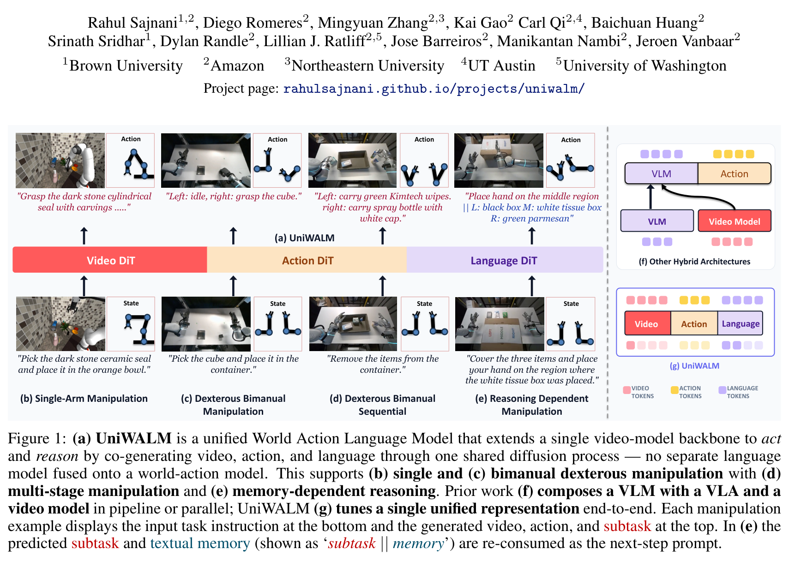

> <span style="color:#3B82F6"><strong>Figure 1: (a) UniWALM 架构概览与任务谱系。</strong></span> UniWALM 是一个统一的世界-动作-语言模型（WALM），通过单视频模型骨干扩展，利用统一自注意力（Unified Attention）同步共生成视频、动作与语言。(b) 单臂复杂物体抓放；(c) 灵巧双臂协作抓放；(d) 灵巧双臂长序顺序清空容器；(e) 强推理依赖型记忆寻物任务。(f) 传统混合解耦架构（VLM 异步规划 + 独立视频模型 + 底层策略），存在严重的异步通信与表征割裂；(g) UniWALM 实现统一单一表征、同频去噪与语言记忆自循环。

---

## 原文摘要翻译

人类能够以“任意到任意（any-to-any）”的方式将语言、感知与动作融为一体。现有的机器人基础模型通常将高层推理与底层物理控制割裂开来：要么作为级联流水线中的离散组件（由视觉-语言模型向底层动作策略提供异步文本指导），要么是无语言能力的纯世界-动作模型，这些系统无法在无外部规划器的情况下自主执行强记忆依赖型任务。

在本文中，我们提出了 **UniWALM（Unified World Action Language Model）**，这是一个统一的世界-动作-语言模型，它将单个视频生成骨干网络扩展为能够在单一共享表征中同时行动与推理的具身智能体。UniWALM 通过混合 Transformer（Mixture of Transformers, MoT）架构与统一自注意力机制，同步共去噪（co-denoise）视频、动作与紧凑语言。该语言流同时生成下一个子任务规划与文本记忆字符串；在记忆依赖型任务中，该文本记忆会在下一个控制步中作为自身 Prompt 重新输入（re-consumed），从而构建出一个完全自闭环的“语言即记忆循环（Language-as-Memory Loop）”，彻底摆脱了外部检索缓冲或高层规划器的束缚。

此外，为了克服流匹配策略生成轨迹易发生漂移的问题，我们提出了**带校正的流匹配（Flow Matching with Correction, FMC）**：在训练期间向动作轨迹注入扰动，并显式监督模型生成一步回归干净轨迹的校正速度场，从而在零额外推理采样步数和零新增模型容量的条件下实现轨迹自愈。

在多项高难度基准评测中，UniWALM 均表现出优异性能：在包含 5 项长程组合抓放任务的 MolmoSpaces 仿真基准上，UniWALM 较相同骨干的 FastWAM 基线平均成功率高出 **+14.8%**；在严苛的记忆依赖型基准 RMBench 的 $M(n)$ 任务子集上，UniWALM 在完全不加载预训练语言或推理模型底座的前提下达到 **34.5%** 的成功率，比同底座 FastWAM（13.3%）高出 **+21.2%**，并显著超越了依赖特权关键帧的 Mem-0（28.5%）；在真实世界双臂协作与灵巧操作评测中，UniWALM 实现了 95.0% 的立方体抓放成功率，并在遮挡寻物记忆任务中取得 **61.1%** 的成功率，远超业界主流 VLA（$\le 33.3\%$）与 FastWAM（11.1%）。

---

## 创新点

1. **统一世界-动作-语言模型架构 (Unified WALM via Shared MoT)**：打破了以往具身系统将高层 VLM 语义规划器、中间视频世界模型与底层动作策略割裂组合的旧范式，提出了首个单骨干、全模态统一去噪模型。利用 Wan2.2 视频生成骨干共享注意力权重，挂载 1B Action DiT 与 0.5B Language DiT，在同一表征空间中以对齐的时序因果掩码同步去噪视频、动作与语言，实现了任务级宏观语义与像素级微观动力学对物理动作的双重正则化。
2. **带校正的流匹配 (Flow Matching with Correction, FMC)**：针对连续流匹配（Flow Matching）在机器人长时间轨迹生成中累积漂移、缺乏自愈修正能力的固有缺陷，提出 FMC 目标。训练阶段以一定概率向动作空间注入高斯扰动，构建单步逆向恢复目标速度场 $v_{\text{corr}}$，强制网络学会主动从偏离轨迹回归标称轨道。**其最大突破在于在推理期完全无额外计算开销、不增加采样步数，即可实现显著更强的鲁棒性与轮廓贴合度**。
3. **“语言即记忆”自循环与 $\beta$ 门控机制 (Language-as-Memory Loop & $\beta$-Gating)**：提出将扩散生成的紧凑语言字符串（当前子任务意图 + 历史进度文本摘要）在下一步控制中作为自身 Prompt 重新吸收，实现无外部检索记忆库、无参数膨胀的具身工作记忆。进一步在动作向量末尾扩展 1-D 任务完成信号 $\beta$，通过动作损失联合监督，仅在子任务完成瞬间门控提交记忆更新，有效防止了中间动作步骤破坏状态记忆。
4. **无需预训练大语言模型底座的极简高效表征 (Zero-LLM Backbone Dependency)**：不同于依赖 7B/70B 级超大规模开源 LLM/VLM（如 Qwen、Llama、PaliGemma）的传统 VLA，UniWALM 的 Language DiT 与 Action DiT **完全从零随机初始化训练**。实验证明，具身交互所需的任务级状态表征与子任务因果推理，无需庞大的通用语言世界知识，仅凭 0.5B 的轻量扩散语言头即可大幅激活世界模型的物理操控性能。

---

## 一句话总结

UniWALM 通过在单一共享 MoT 骨干中将视频、动作与轻量扩散语言头同步共去噪，开创性地利用自闭环生成的“语言即记忆”与零推理代价的“带校正流匹配 (FMC)”，实现了无需外部 VLM 与记忆库即可高精度解决长程组合与记忆依赖型双臂灵巧操作的一体化具身世界模型。

---

## 研究问题

### 1. 高层 VLM 规划器与底层动作模型的结构性割裂

当前具身智能系统的主流设计思路呈现明显的“分层割裂（Decoupled Hierarchy）”特征：
- **上层**：通常采用参数量巨大的预训练视觉语言大模型（VLM，如 GPT-4o、Gemini、PaLM-E、OpenVLA），负责宏观语义理解与高层任务规划，输出离散的文本子目标（Sub-goals）；
- **下层**：采用小规模的基于扩散或流匹配的动作生成策略（如 Diffusion Policy、$\pi_0$、ACT），负责将当前观测与高层子目标映射为连续的多自由度机械臂关节轨迹；
- **桥接层（可选）**：部分近期工作引入独立的视频世界模型（如 Cosmos、DynamiCrafter、DriveVLM），用于想象动作执行后的未来视觉状态（Subgoal Images），以此条件化底层执行器。

这种分层级联架构存在三大致命缺陷：
1. **异步通信与解码延迟瓶颈**：自回归大语言模型（AR-LLM）逐 token 生成耗时巨大（数十至数百毫秒），而底层机械臂闭环控制通常要求 20Hz~50Hz（20~50ms 周期）的高频响应。为了妥协，系统不得不采取低频规划、高频控制的异步通信模式，一旦机器人遭遇物理碰撞或动态干扰，高层规划无法即时介入重规划，极易导致任务失败。
2. **表征空间的语义-物理断层**：高层 VLM 经过万亿级网络图文预训练，具备深厚的语义常识，但严重匮乏 3D 几何、物理接触力与动力学连续性先验；底层动作策略在小规模机器人示教数据上过拟合，缺乏宏观语义理解。二者仅通过离散的文本指令或特征跨注意力连接，无法形成对物理世界连续演化规律的统一多模态隐式表征。
3. **多模型级联的误差级联累积**：高层 VLM 的微小语义幻觉（如将“右侧抽屉”识别为“左侧抽屉”）会直接传递至底层策略，底层策略执行偏航后无法向高层形成确定性反向梯度修正，系统整体脆弱。

### 2. 纯世界-动作模型（WAM）的“语言盲区”与高层规划匮乏

为了消除 VLM 与动作策略的表征鸿沟，以 DreamZero、FastWAM 为代表的世界-动作模型（World-Action Models, WAMs）将视频生成扩散模型（如 Wan2.2）与动作生成直接结合，利用视频预测作为底座监督信号。然而，这类模型走向了另一个极端：**完全放弃了语言的生成与推理**，仅仅将静态文本指令作为最外层的上下文条件。

纯 WAM 模型的根本瓶颈在于：**逐帧像素级 RGB 预测（Frame-level predictive structure）虽然能提供优异的短时动力学先验，但信息密度极低，难以紧凑表达跨越数十秒的长程任务级结构（Task-level predictive structure）**。当面对多阶段复合操作任务（如“先打开盒子，取出发卡，再将其放入右侧托盘”）时，纯 WAM 往往由于缺乏显式阶段状态追踪而在子任务边界处发生停滞、迷失或动作死循环。

### 3. 记忆依赖型具身任务（RMBench $M(n)$）的结构性崩溃

在真实世界的许多复杂操作中，当前单帧或短时视觉观测往往**不具备马尔可夫性（Non-Markovian）**。例如在 RMBench 评测集所定义的 $M(n)$ 记忆子集及遮挡寻物任务中：
- 目标物体可能在初始时刻可见，但在操作中途被盖子或箱子完全遮挡；
- 机器人需要尝试多种电池安装朝向或方块摆放顺序，必须记住历史上哪些尝试已经失败，避免重复试错；
- 机器人需要根据初始面板上显示的数字指示，连续按动指定按键对应次数。

现有的无状态策略（包括 $\pi_{0.5}$、FastWAM、DP）在面对这类任务时全线崩溃（成功率普遍低于 5%~13%）。以往解决该问题的方案是外挂检索式向量数据库（Retrieval Memory Buffer）或引入人工特权标注的关键帧（Privileged Keyframes，如 Mem-0），不仅工程复杂度高，且难以向未知开放场景泛化。

**UniWALM 提出的核心科学问题正是**：能否在单一共享 Transformer 表征中，同时实现帧级视频动力学、物理动作控制与任务级语言推理的同步共去噪？能否让模型自生成的语言自身成为工作记忆，彻底摆脱外部规划器与记忆库？

---

## 数据与任务定义

UniWALM 的评测体系全面覆盖了大规模高保真物理仿真（包含复杂长程组合、域外泛化、记忆追踪）以及真实世界的高灵巧双臂操作。

### 1. MolmoSpaces MolmoB0t v2 组合操作基准

MolmoSpaces 是基于 Filament 物理级渲染引擎构建的大规模具身基准，包含 5 项极具挑战性的抓取与长程放置任务：
- **Pick**：单臂短程目标抓取（受限于 303 步时间预算）；
- **Pick-RandCam**：相机外参随机扰动下的鲁棒抓取；
- **Pick&Place**：标准长程抓取与放置到指定容器；
- **Pick&Place-Color**：视觉与语言强绑定的颜色条件化抓放（如“将红色积木放入黄色托盘”）；
- **Pick&Place-NextTo**：具备相对空间几何约束的复合抓放（如“抓取圆柱体并放置在茶壶左侧”）。
- **评测规模**：每项任务进行 **1000 次独立 rollout**，严格汇报 95% 置信区间。预训练与微调采用 221K 条轨迹的混合数据（消融实验采用 38K 轨迹的单一 Pick&Place 子集）。

### 2. RMBench $M(n)$ 记忆依赖型基准

RMBench 是专为检验具身智能体长程工作记忆而设计的严苛基准。$M(n)$ 子集要求智能体的决策必须显式依赖历史上 $n$ 步的非当前观测状态：
- **Press Button**：桌面上呈现两个数字（如 4 和 1），机器人必须先准确按压左侧按钮 4 次，再按压中间按钮 1 次，最后按压 Confirm 确认按键。由于按键动作瞬时完成且表面无持久状态变化，智能体必须在内部精确维持计数状态；
- **Battery Try**：桌面上有一对随机位姿的电池和一个双槽底座，机器人需通过试错找到正确的（电池、插槽、极性朝向）组合，必须记住已经失败的组合避免死循环；
- **Blocks Ranking Try**：通过反复交换方块并按键确认，探索正确的方块排列次序，要求保留历史排除的排列假说；
- **Cover Blocks**：桌面上有三块带色积木和三个盖子。机器人需从左到右依次盖上积木，随后必须严格按照“红 $\to$ 绿 $\to$ 蓝”的指定顺序揭开盖子。盖上后积木颜色完全被视觉遮挡，必须依赖初始记忆完成第二阶段。

### 3. 真实世界双臂与灵巧操作任务

实验在真实的双臂机器人平台上部署，配备灵巧手/平行夹爪与多视角 RGB 相机（3 视角，分辨率 $224 \times 672$）：
- **Cube Pick&Place (Simple Dexterous)**：双臂协调抓取小立方体并稳定放置于容器内（20 次评测）；
- **Empty Container (Complex Dexterous)**：双臂长序顺序清空容器内的异形杂物（绿瓶、抹布盒、喷雾罐等），涉及多物体接触、双臂防碰与动态姿态重抓（20 次评测）；
- **Find the Item (Memory Task)**：三个完全相同的纸盒覆盖三种不同物体（黑色盒子、白色纸巾盒、绿色芝士包）。机器人操作过程中纸盒被完全盖住，甚至中途人为调整位置。机器人必须根据语言指令：“将手放置在最初放置白色纸巾盒的区域”，依靠跨越遮挡的记忆准确定位（18 次评测）。

### 4. 2D 机械臂末端轨迹抗扰基准

专门构建的 2D 连续轨迹基准，用于对 FMC 算法进行解耦式微观消融。包含 7 种机械臂末端典型几何运动图案：Circle（圆）、Star（五角星）、Spiral（螺旋线）、Line（辐射线）、Arc（弧线）、Figure-8（8字形）、Square（正方形）。每种图案包含带噪示教轨迹，评测基于 500 条非条件生成轨迹与 1000 条真实轨迹之间的对称双向 Chamfer 距离（Chamfer Distance）。

---

## 方法主线

### 机制流程

UniWALM 的核心架构思想是构建一个具备单共享表征的混合 Transformer（Mixture of Transformers, MoT）去噪骨干网络。系统接收当前多视角观测图像 $O \in \mathbb{R}^{k \times H \times W \times 3}$（仿真 $k=2$，实物与 RMBench $k=3$）、机械臂本体感知状态 $S$、可选的单帧初始视觉锚点记忆 $F$、以及当前任务指令与上一时刻自生成的文本记忆拼接而成的提示词 $T$。

模型在一次同步前向去噪传播中，联合输出未来视频预测 $V_{1:H}$、动作执行块 $(A, \beta)_{1:N}$ 以及更新后的语言标记序列 $L$：
$$V_{1:H}, (A, \beta)_{1:N}, L := \text{UniWALM}(O, S, F, T)$$

其中：
- $V_{1:H}$：未来 $H=5$ 帧密集 RGB 像素预测（仅在训练期开启作为物理动力学正则化损失，推理期完全关闭以保证毫秒级控制延迟）；
- $(A, \beta)_{1:N}$：连续 $N=32$ 步动作块，末位扩展一维连续标量 $\beta \in [0, 1]$ 作为子任务完成判定信号；
- $L$：长为 64 tokens 的紧凑离散语言序列，由 `[Next Subtask]` 与 `[Textual Memory]` 两部分拼接构成，用于下一步控制自循环。

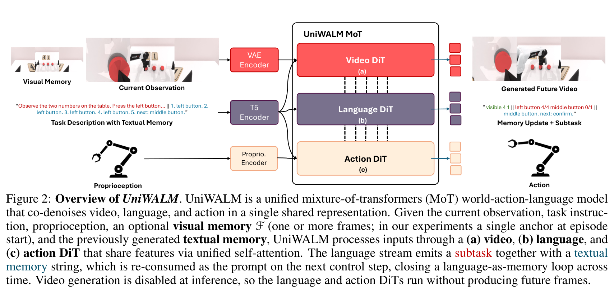

> <span style="color:#3B82F6"><strong>Figure 2: UniWALM 系统架构与端到端数据流。</strong></span> 图像观测通过预训练 VAE 编码；任务描述与文本记忆通过 T5 编码；本体感知通过专属 MLP 编码。编码后的 tokens 送入统一 MoT 骨干，由 Video DiT、Language DiT 与 Action DiT 通过统一自注意力（Unified Self-Attention）实现全模态特征交互。输出端同步解耦出未来视频、动作块与新文本记忆。新生成的文本记忆在下一步作为输入 Prompt 闭环回灌，实现“语言即记忆”。

---

### 视频-动作-语言统一表征与去噪扩散头

为了在保证强大学习容量的同时兼顾控制效率，UniWALM 巧妙采用了“非对称维度、对称深度”的 MoT 结构：
1. **Video DiT**：直接复用预训练的 Wan2.2 视频生成网络（30 层 Transformer）。为了保护其在海量互联网视频中习得的通用连续动力学先验，并降低多卡训练显存开销，UniWALM 在视频骨干上应用 **LoRA（Rank=256）** 进行参数高效微调；
2. **Action DiT**：全新随机初始化构建的 30 层 Transformer，隐藏层维度设为 $d_a = 1024$，总参数量约为 1.0B。层数与视频骨干完全对齐，确保每一层都能与对应的视频特征进行同级融合；
3. **Language DiT**：全新随机初始化的 30 层 Transformer，隐藏层维度压缩为 $d_l = 512$，总参数量仅为 0.5B。

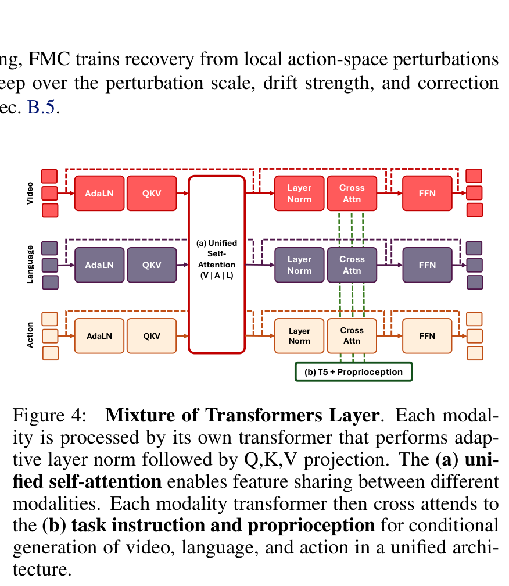

> <span style="color:#3B82F6"><strong>Figure 4: Mixture of Transformers (MoT) 层微观结构。</strong></span> 每一个 MoT 层内部，各模态 tokens 先经过独立的自适应层归一化（AdaLN，条件化去噪时间步 $t$），分别投影为 $Q, K, V$。随后，视频、动作与语言的 tokens 在 token 维度拼接，执行**统一自注意力（Unified Self-Attention）**，通过 RoPE 坐标编码实现模态间无缝特征交互。随后各模态进入独立的交叉注意力层（Cross-Attention），查询键值对由 T5 编码的指令及本体感知特征提供，最后经前馈网络（FFN）输出。

#### 统一自注意力的注意力掩码机制
在统一自注意力机制中，为了确保推理阶段的因果一致性与稳定性，设计了模态专属的信息流向约束：
- **Language Tokens**：允许对视频观测 tokens 和全局任务 Prompt 进行双向注意，但**屏蔽（Mask out）对动作 tokens 的注意力**。确保高层语义推理基于视觉感知与任务目标独立抽象，不受底层随机运动噪声的污染；
- **Action Tokens**：被赋予对视频 tokens、指令 tokens 以及**语言推理 tokens 的全向注意力**。这使得动作生成不仅能够感知视觉几何与物理接触，还能被实时的子任务意图显式引导；
- **Video Tokens**：训练期双向关注自身上下文，形成稳健的物理演化表征。

#### 多模态协同训练目标 (Multi-Modal Co-Training Objective)
UniWALM 将三种模态的监督信号融为一体，采用端到端多任务联合损失：
$$\mathcal{L} = \mathcal{L}_{\text{video}} + \mathcal{L}_{\text{action}} + \alpha \mathcal{L}_{\text{lang}}$$

其中各项具体定义为：
1. **视频与动作连续流匹配损失**：
   $$\mathcal{L}_{\text{video}} := \| v_t^v - v_{\text{GT}}^v \|_1, \quad \mathcal{L}_{\text{action}} := \| v_t^a - v_{\text{GT}}^a \|_1$$
   作者指出，在机械臂动作空间中，**$\ell_1$ 范数损失比传统的 $\ell_2$（MSE）更加稳定**，对示教轨迹中的高频微颤或多模态次优样本具备更强的鲁棒性；
2. **离散语言扩散损失 (Discrete Language Diffusion Loss)**：
   针对离散文本 token 空间，采用离散掩码扩散建模。在训练步 $t \in [0, 1]$ 下，对真实文本标签序列 $L_{\text{GT}}$ 按扩散步长随机替换/掩码：
   $$L_t := \text{RandomReplace}(L_{\text{GT}}, t)$$
   $$\hat{L} := \text{DiffusionStep}(L_t, t)$$
   $$\mathcal{L}_{\text{lang}} := \text{CrossEntropy}(\hat{L}, L_{\text{GT}})$$
   通过分类交叉熵损失，训练网络逐步固定正确的语义 token 并纠正被扰动的 token。损失加权系数 $\alpha$ 平衡了高层离散损失与底层连续流匹配损失的梯度尺度。

---

### 带校正的流匹配 (Flow Matching with Correction, FMC)

标准的流匹配（Flow Matching）在连续归一化流框架下，通过定义概率路径将简单高斯先验 $p_0 \sim \mathcal{N}(0, I)$ 变换至目标数据分布 $x_1 \sim p_{\text{data}}(x)$。在线性插值路径下，中间加噪样本表示为：
$$x_t = (1-t)x_0 + t\epsilon, \quad t \in [0, 1], \quad \epsilon \sim \mathcal{N}(0, I)$$
真实速度场常数向量为 $v_t = \frac{d}{dt}x_t = \epsilon - x_0$。标准流匹配通过最小化 $\| v_\theta(x_t, t) - (\epsilon - x_0) \|_1$ 训练网络。

然而，在实际机器人控制中，测试阶段的数值积分离散化误差或物理接触扰动会导致生成轨迹脱离真实流形。由于标准流匹配仅在“由纯噪声直达干净样本”的无扰动直线上训练，**模型一旦偏航，便无法得知如何自发回归标称轨道，导致累积偏航乃至任务完全失败**。

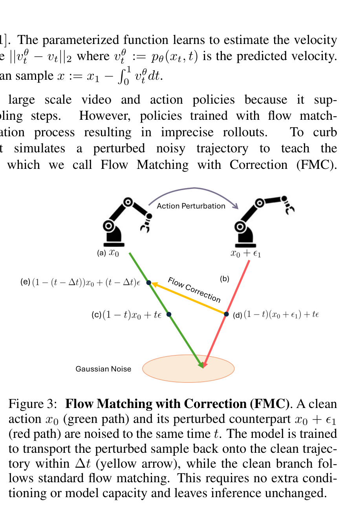

> <span style="color:#3B82F6"><strong>Figure 3: 带校正的流匹配 (FMC) 几何原理。</strong></span> 绿色路径为标准无偏流匹配轨迹，由干净动作 $x_0$ 加噪到 $x_t$。红色路径为注入高斯扰动后的轨迹 $x_0^p = x_0 + \epsilon_1$。FMC 强制网络在被扰动状态 $x_t^p$ 下，学习一个在 $\Delta t$ 逆向步长内拉回绿色真实轨道的校正速度场 $v_{\text{corr}}$（黄色箭头），在训练阶段内生构建轨迹自愈场。

#### FMC 数学推导与修正目标设计
为解决上述瓶颈，UniWALM 提出 FMC。首先构建被扰动的动作样本：
$$x_0^p := x_0 + \epsilon_1, \quad \epsilon_1 \sim \mathcal{N}(0, sI)$$
其中 $s = 0.2$ 为扰动噪声尺度。使用相同的标准高斯噪声 $\epsilon$，在时间步 $t$ 下的带偏航点为：
$$x_t^p := (1-t)x_0^p + t\epsilon = (1-t)(x_0 + \epsilon_1) + t\epsilon$$
若沿用标准流匹配，模型将继续向被污染的 $x_0^p$ 去噪。FMC 的目标是寻找一个修正速度场 $v_{\text{corr}}$，使得从 $x_t^p$ 执行反向一步（步长为 $\Delta t$）后，能够准确降落在标称干净轨迹的对应时间点 $x_{t-\Delta t}$ 上：
$$x_{t-\Delta t} = x_t^p - \Delta t \cdot v_{\text{corr}}$$
其中标称干净点为：
$$x_{t-\Delta t} = (1 - (t - \Delta t))x_0 + (t - \Delta t)\epsilon$$
将两式相减并求解 $v_{\text{corr}}$：
$$v_{\text{corr}} = \frac{x_t^p - x_{t-\Delta t}}{\Delta t} = \frac{\left[(1-t)x_0 + (1-t)\epsilon_1 + t\epsilon\right] - \left[(1-t+\Delta t)x_0 + (t-\Delta t)\epsilon\right]}{\Delta t}$$
整理项后得到极其优雅的解析解：
$$v_{\text{corr}} = (\epsilon - x_0) + \frac{1-t}{\Delta t}\epsilon_1$$

该解析展开式具有极佳的物理与数学意义：
1. **基准流对齐**：前半部分 $(\epsilon - x_0)$ 完全等同于标准流匹配的标称速度场；
2. **误差消除项**：后半部分 $\frac{1-t}{\Delta t}\epsilon_1$ 是一个正比于扰动向量的反向校正力矩，直接对准消除扰动 $\epsilon_1$；当扰动为零（$\epsilon_1 = 0$）时，式子精确退化为标准流匹配。

#### 边界截断与训练算法
注意到修正项包含因子 $\frac{1-t}{\Delta t}$。当 $t \to 0$ 时，样本已经高度接近动作空间，注入的噪声幅度过大，强制单步回归会导致极端的数值梯度爆炸；而在 $t \ge 0.5$ 处，加噪样本主要处于高维扩散流形附近，校正幅度平滑且有界。因此，算法设定仅在 $t \ge 0.5$ 且以概率 $p=0.5$ 触发校正分支。完整训练算法如 Algorithm 1 所示：

```python
# FMC 核心算法实现伪代码
def compute_fmc_loss(x0, v_model, s=0.2, p=0.5, dt=0.05):
    t = torch.rand(x0.shape[0], 1)
    eps = torch.randn_like(x0)
    
    # 判定是否激活 FMC 校正分支
    do_correction = (torch.rand(x0.shape[0], 1) < p) & (t >= 0.5)
    
    # 分支构建
    eps1 = torch.randn_like(x0) * s
    x0_p = torch.where(do_correction, x0 + eps1, x0)
    
    # 当前带噪点
    x_in = (1 - t) * x0_p + t * eps
    
    # 标称速度与校正速度解析计算
    v_nominal = eps - x0
    v_corr = v_nominal + ((1 - t) / dt) * eps1
    
    v_target = torch.where(do_correction, v_corr, v_nominal)
    
    # 计算预测速度并回归
    v_pred = v_model(x_in, t)
    return F.l1_loss(v_pred, v_target)
```

**关键推论**：在测试推理期，速度场评估函数 $v_\theta(x_t, t)$ 在标称无扰动路径上的输出与标准流匹配完全相容。因此，**FMC 在推理端不改变任何采样器结构、不需要额外的提示输入、也不需要增加任何去噪步数，实现了真正的“零推理成本提升”**。

---

### 语言即记忆自循环 (Language-as-Memory Loop)

长期以来，具身智能体在处理跨时间依赖任务时，通常陷入“两难困境”：要么维护一个庞大的原始视觉帧历史队列（导致显存与计算量随时间线性爆炸，且难以抗击视角晃动），要么构建外置的向量数据库进行 RAG 式检索（引入复杂的检索错误与超参敏感性）。

UniWALM 独辟蹊径地提出了**语言即记忆（Language-as-Memory）**自循环范式：
- **符号化工作记忆的紧凑性**：语言天然是高阶语义状态的高度压缩表达。例如在“按压按钮”任务中，数千帧高维图像所承载的核心决策信息，等价于一个极简的符号字符串：`"visible 4 1 || left button 2/4 middle button 0/1 || left button. next: middle button."`；
- **自消费闭环机制**：在时间步 $k$，Language DiT 与 Action DiT 同步去噪输出该字符串 $L_k$。在下一步 $k+1$ 时，$L_k$ 直接作为外部 Prompt 的一部分重灌（Re-consumed）到 T5 文本编码器中，直接影响下一时刻的全局表征。


> <span style="color:#3B82F6"><strong>Figure 7: Press Button 任务上的“语言即记忆”状态转移闭环。</strong></span> UniWALM 自主生成的文本记忆如实记录了物理计数的演化轨迹：左侧按钮按压次数平稳推进（`left 0/3 -> 1/3 -> 2/3 -> 3/3`），随后无缝切换至中间按钮（`mid 1/4 -> 3/4 -> 4/4`），最后生成 `confirm. next: done.`。整个工作记忆由智能体自生自灭、自循环维护，无需任何人工规则状态机干预。

#### $\beta$ 信号：动作维度的任务完成门控
若在每个控制步（例如每隔 50ms）都允许更新文本记忆，由于去噪过程中的高频随机抖动，模型极易发生“记忆覆写（Memory Overwrite）”，破坏计数与长程状态的完整性。

UniWALM 的解决方案是将任务完成信号 $\beta \in [0, 1]$ 作为一个额外的连续自由度，直接拼接在机械臂动作向量末尾：
$$A^{\text{aug}} = [a_1, a_2, \dots, a_D, \beta]$$
- $\beta$ 与连续动作向量一同由 Action DiT 输出，并在同一度量空间中接受 $\mathcal{L}_{\text{action}}$ 的联合连续监督；
- 只有当连续预测的 $\beta$ 超过设定阈值（激活判定为当前原子动作/子任务物理完成）时，系统才允许将新生成的文本记忆写入工作缓冲区；在子任务执行期间，记忆保持冻结。这种设计以极简的形式实现了**事件驱动的记忆步进控制**。

#### 单帧视觉锚点 (Visual Memory $F$) 与 RoPE 偏移
对于部分高度依赖初始空间几何位置但中途遭遇严重遮挡的任务（如 Cover Blocks 或 Find the Item），纯文本记忆难以精确描绘三维物体的毫米级抓取点。

为此，UniWALM 引入了轻量级视觉锚点 $F$（通常仅为 Episode 开始时的单帧画面 $O_0$）：
- 锚点帧通过相同的 VAE 编码后，直接在 token 维度拼接进入视频序列；
- 为了避免初始帧的绝对位置编码与当前观察帧发生混淆，模型将锚点帧的 2D RoPE 坐标在宽度维度平移一个图像宽度 $W$（RoPE Coordinate Shift），并在时间维度分配独立的位置索引；
- 这一机制使得策略在面临物体完全被遮挡时，依然可以通过跨模态注意力检索到初始高精度几何位姿。

---

### 推理与控制流水线

在实际部署中，UniWALM 采用高吞吐同步流水线：
1. **视频生成截断**：推理时完全切断 Video DiT 的生成头，模型仅前向运行 Action DiT 与 Language DiT。这使得庞大的视频生成计算量被完全省去，仅保留其在注意力交互层中对动作与语言的特征注入；
2. **同频去噪**：Action DiT 与 Language DiT 采用完全相同的去噪时间步长调度（通常 10~20 步）。在 10 步去噪下，生成包含 32 步连续动作块与 64 个语言标记的耗时为 **123 ms**；若关闭语言生成（纯动作控制），耗时仅为 **76 ms**；
3. **交织语言缓存机制 (Interleaved Language Caching)**：系统支持动态调整语言生成频率。若任务处于长段连续平滑运动中，系统可缓存上一阶段的语言 tokens 特征，仅运行 76ms 的 Action DiT，从而将闭环控制频率提升至 13Hz 以上。

---

## 关键结果

### 组合抓取放置主结果 (MolmoB0t v2)

在 MolmoSpaces 基准的 1000 次评测中，UniWALM 展现出了压倒性的长程组合操作优势：

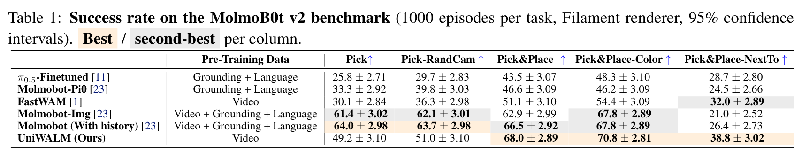

> **Table 1: MolmoB0t v2 基准上的抓取与放置任务成功率（%）。** 汇报 1000 次 episode 评测结果与 95% 置信区间。

| 模型 | 预训练模态 | Pick $\uparrow$ | Pick-RandCam $\uparrow$ | Pick&Place $\uparrow$ | Pick&Place-Color $\uparrow$ | Pick&Place-NextTo $\uparrow$ |
| :--- | :--- | :---: | :---: | :---: | :---: | :---: |
| $\pi_{0.5}$-Finetuned | Grounding + Language | $25.8 \pm 2.71$ | $29.7 \pm 2.83$ | $43.5 \pm 3.07$ | $48.3 \pm 3.10$ | $28.7 \pm 2.80$ |
| Molmobot-$\pi_0$ | Grounding + Language | $33.3 \pm 2.92$ | $39.8 \pm 3.03$ | $46.6 \pm 3.09$ | $46.2 \pm 3.09$ | $24.5 \pm 2.66$ |
| FastWAM | Video | $30.1 \pm 2.84$ | $36.3 \pm 2.98$ | $51.1 \pm 3.10$ | $54.4 \pm 3.09$ | $32.0 \pm 2.89$ |
| Molmobot-Img | Video + Grounding + Lang | $61.4 \pm 3.02$ | $62.1 \pm 3.01$ | $62.9 \pm 2.99$ | $67.8 \pm 2.89$ | $21.0 \pm 2.52$ |
| Molmobot (With history) | Video + Grounding + Lang | $\mathbf{64.0 \pm 2.98}$ | $\mathbf{63.7 \pm 2.98}$ | $66.5 \pm 2.92$ | $67.8 \pm 2.89$ | $26.4 \pm 2.73$ |
| **UniWALM (Ours)** | **Video** | $49.2 \pm 3.10$ | $51.0 \pm 3.10$ | $\mathbf{68.0 \pm 2.89}$ | $\mathbf{70.8 \pm 2.81}$ | $\mathbf{38.8 \pm 3.02}$ |

#### 结果深度解析：
1. **同底座对比大幅领先**：FastWAM 与 UniWALM 共享完全相同的 Wan2.2 视频底座与 Action DiT 参数量。在纯三维物理与组合语义结合的任务上，UniWALM 带来了质的飞跃：Pick&Place 从 51.1% 跃升至 **68.0% (+16.9%)**，Pick&Place-Color 达 **70.8% (+16.4%)**，Pick&Place-NextTo 达 **38.8% (+6.8%)**。三项组合任务平均提升高达 **+14.8%**，直接确证了加入任务级语言共去噪对底层动作物理精度的显著反哺效应；
2. **逆袭预训练 VLM 基线**：MolmoBot 系列模型在大规模图文匹配、检测定位（Grounding）及海量语言数据上进行了预训练，且使用了完整的时序动作历史。UniWALM 仅依赖从零训练的 0.5B 语言扩散头和单帧输入，在全部三项复合抓放任务中全面反超 MolmoBot（例如 NextTo 任务高出 12.4 个百分点），证明**共享表征同步去噪的模态融合效率远高于割裂的预训练特征拼接**；
3. **短程抓取任务的“反常”现象**：在单步 Pick 与 Pick-RandCam 上，UniWALM 成功率（49.2%, 51.0%）低于 MolmoBot（64.0%）。作者明确指出，这是由于仿真环境设定了 **303 步的硬性时间限制**。UniWALM 倾向于生成更加审慎、平滑的长轨迹以确保抓取稳定度，在短程时间预算受限下因超时被判定为失败。


> <span style="color:#3B82F6"><strong>Figure 5: UniWALM 在四大典型任务上的质性执行序列。</strong></span> (a) MolmoBot 长程抓放；(b) 真实遮挡寻物；(c) 简单双臂灵巧抓放；(d) 复杂双臂容器清理。图中顶部均展示了各步同步生成的子任务规划与记忆字符串。

---

### 真实世界多机器人评测

真实世界评测（Table 2）包含 58 次高难度真机实验，涵盖简单灵巧、复杂长程双臂以及强遮挡记忆任务：


> **Table 2: 真实世界双臂灵巧与记忆操作任务成功率（%）。** 汇报成功率及 95% 置信区间。

| 模型 | Cube Pick&Place (灵巧-简单) | Empty Container (灵巧-复杂) | Find the Item (强记忆) | 平均成功率 $\uparrow$ |
| :--- | :---: | :---: | :---: | :---: |
| $\pi_{0.5}$ | $40.0 \ [20, 60]$ | $20.0 \ [0, 40]$ | $5.6 \ [0, 15.6]$ | $21.9 \ [11.2, 32.5]$ |
| Groot-N1.7 | $80.0 \ [60, 100]$ | $10.0 \ [0, 15]$ | $11.1 \ [0, 25.6]$ | $33.7 \ [21.5, 45.9]$ |
| FastWAM | $70.0 \ [50, 90]$ | $\mathbf{50.0 \ [30, 70]}$ | $11.1 \ [0, 25.6]$ | $43.7 \ [30.9, 56.5]$ |
| MolmoB0t | $80.0 \ [60, 100]$ | $20.0 \ [0, 40]$ | $33.3 \ [11.6, 55]$ | $44.4 \ [31.7, 57.2]$ |
| **UniWALM (Ours)** | $\mathbf{95.0 \ [85, 100]}$ | $\mathbf{50.0 \ [30, 70]}$ | $\mathbf{61.1 \ [39.6, 82.6]}$ | $\mathbf{68.7 \ [56.8, 80.6]}$ |

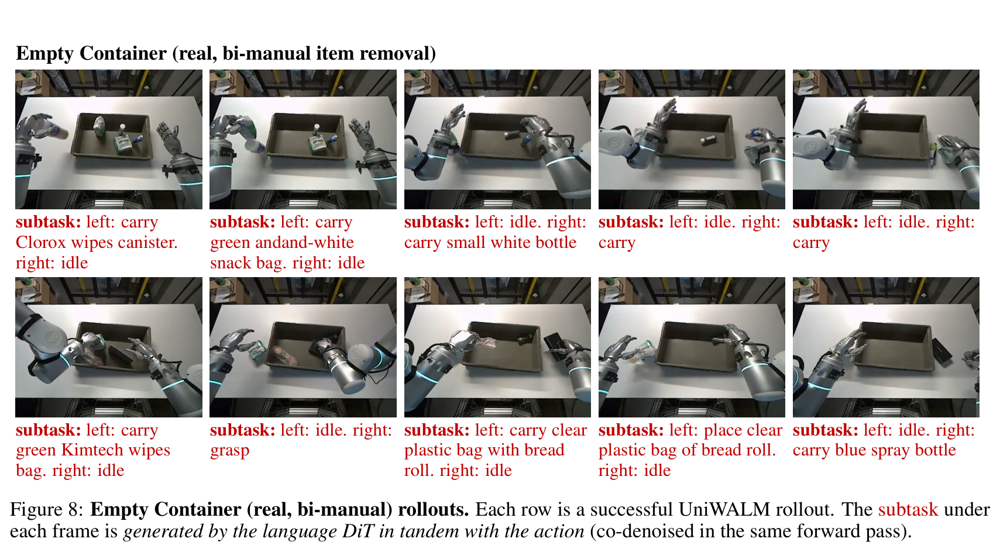

> <span style="color:#3B82F6"><strong>Figure 8: 真实世界 Empty Container 双臂连续清空操作。</strong></span> 机器人灵巧手自主辨识瓶罐、纸盒与软质包装，通过双臂协同交替抓取并移出容器。

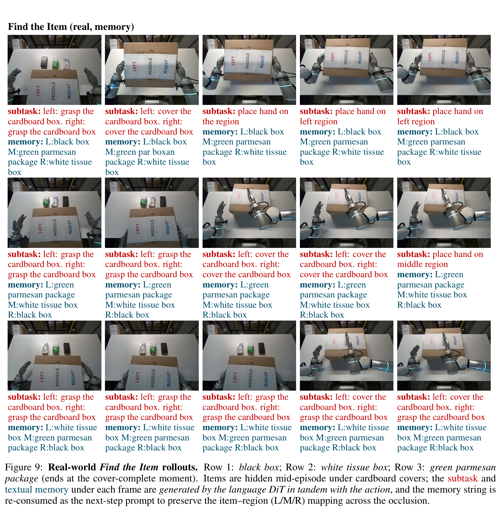

> <span style="color:#3B82F6"><strong>Figure 9: 真实世界 Find the Item 遮挡寻物执行序列。</strong></span> 物体在中途被纸盒完全遮蔽并发生位移，智能体借助自生成文本记忆（如 `L: black box M: white tissue box R: green parmesan`）在动作生成中保持空间对应关系，准确触碰目标所在区域。

#### 核心发现：
1. **灵巧操作上限突破**：在 Cube Pick&Place 上，UniWALM 达到 **95.0%** 成功率，逼近完美执行；
2. **任务复杂度的收益边界**：在 Empty Container 任务中，UniWALM 与 FastWAM 持平（均为 50.0%）。该任务本质上是纯粹的低层物理避碰与抓取几何重试，不包含任何长程分支推理或状态依赖。**这一实验极其诚实地揭示了 UniWALM 的收益边界：语言生成只在需要高层推理和记忆调度的场景下发挥决定性作用，对纯反应式底层控制并无溢出效应**；
3. **真实记忆碾压主流 VLA**：在 Find the Item 任务中，所有基线策略几近失效（$\pi_{0.5}$ 仅 5.6%，FastWAM 11.1%，MolmoB0t 33.3% 处于随机猜测边缘），而 UniWALM 凭借语言即记忆自循环取得了 **61.1%** 的卓越表现。

---

### 记忆依赖型基准突破 (RMBench $M(n)$)

RMBench $M(n)$ 是当前具身领域对工作记忆要求最为苛刻的基准。在无特权关键帧的严谨设定下，UniWALM 实现了革命性突破：

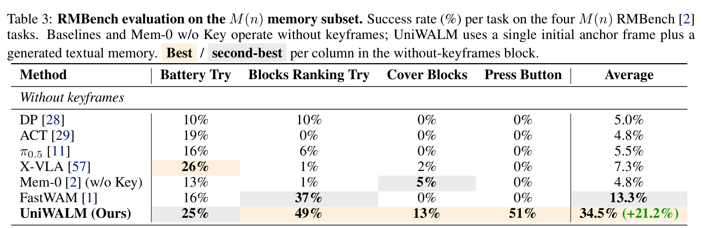

> **Table 3: RMBench $M(n)$ 记忆子集任务成功率（%）。** 对比无关键帧与带关键帧设定下的各主流策略。

| 评估设定与方法 | Battery Try | Blocks Ranking Try | Cover Blocks | Press Button | 平均成功率 $\uparrow$ |
| :--- | :---: | :---: | :---: | :---: | :---: |
| **无特权关键帧组** | | | | | |
| DP (Diffusion Policy) | $10\%$ | $10\%$ | $0\%$ | $0\%$ | $5.0\%$ |
| ACT | $19\%$ | $0\%$ | $0\%$ | $0\%$ | $4.8\%$ |
| $\pi_{0.5}$ | $16\%$ | $6\%$ | $0\%$ | $0\%$ | $5.5\%$ |
| X-VLA | $26\%$ | $1\%$ | $2\%$ | $0\%$ | $7.3\%$ |
| Mem-0 (w/o Key) | $13\%$ | $1\%$ | $5\%$ | $0\%$ | $4.8\%$ |
| FastWAM | $16\%$ | $37\%$ | $0\%$ | $0\%$ | $13.3\%$ |
| **UniWALM (Ours)** | $\mathbf{25\%}$ | $\mathbf{49\%}$ | $\mathbf{13\%}$ | $\mathbf{51\%}$ | $\mathbf{34.5\% \ (+21.2\%)}$ |
| **带特权关键帧组（信息特权参考）** | | | | | |
| Mem-0 (带特权关键帧) | $28\%$ | $18\%$ | $68\%$ | $0\%$ | $28.5\%$ |
| WLA-0 (级联 VLM+生图管线) | $45\%$ | $23\%$ | $84\%$ | $74\%$ | $56.5\%$ |

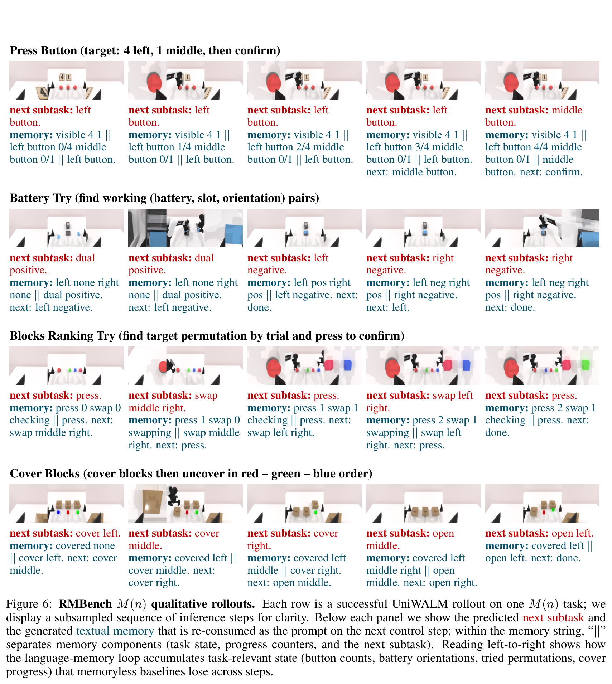

> <span style="color:#3B82F6"><strong>Figure 6: RMBench $M(n)$ 四大任务成功 Rollout 序列。</strong></span> 从上至下依次为 Press Button、Battery Try、Blocks Ranking Try 与 Cover Blocks。智能体在完全闭环中自生成子任务意图与文本记忆演进串。

#### 结果剖析：
- **无状态策略全线崩溃**：在 Press Button 和 Cover Blocks 上，所有标准策略（DP, ACT, $\pi_{0.5}$, FastWAM）成功率全部归零（0%）。因为无法保留记忆，机械臂只能陷入无休止的随机抽搐或重复按压；
- **单锚点超越特权系统**：Mem-0 依赖人工定义的任务特权关键帧（需显式记录每次盖上前的图像快照并存储），平均仅达到 28.5%；一旦剥离这些特权关键帧，Mem-0 暴跌至 4.8%。**UniWALM 仅凭初始单锚点帧结合内生生成的文本记忆，在完全无特权信息的前提下达到 34.5%，超越了带特权关键帧的 Mem-0**；
- **与 WLA-0 的客观差距**：WLA-0 达到了 56.5%，但其架构本质上是一个外挂式重型系统：串联了预训练商用级超大 VLM 与预训练文生图模型，参数量与算力消耗远超 UniWALM，且并未形成单一表征闭环。

---

### FMC 轨迹抗扰校正评测 (2D Robot Trajectories)

为了严密隔离 FMC 对连续流匹配的几何校正效果，作者在 7 类标准 2D 机器人运动图案上进行了 200k 步的充分消融：

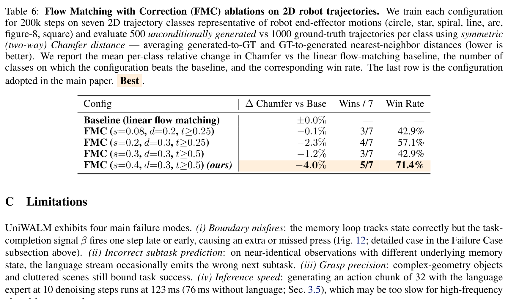

> **Table 6: 2D 机械臂轨迹上的 FMC 算法超参数与性能消融。** 汇报相对标准线性流匹配基线的对称 Chamfer 距离变化率（%）、获胜类别数与胜率。

| 配置方案 | 参数设定 $(s, d, t)$ | $\Delta$ Chamfer 相对基线 $\downarrow$ | 获胜类别数 (Wins / 7) | 胜率 $\uparrow$ |
| :--- | :--- | :---: | :---: | :---: |
| 线性流匹配基线 | — | $\pm 0.0\%$ | — | — |
| FMC (极弱扰动) | $s=0.08, d=0.2, t \ge 0.25$ | $-0.1\%$ | $3/7$ | $42.9\%$ |
| FMC (中等扰动，早截断) | $s=0.2, d=0.3, t \ge 0.25$ | $-2.3\%$ | $4/7$ | $57.1\%$ |
| FMC (强扰动，保守截断) | $s=0.3, d=0.3, t \ge 0.5$ | $-1.2\%$ | $3/7$ | $42.9\%$ |
| **FMC (Ours 采用配置)** | $\mathbf{s=0.4, d=0.3, t \ge 0.5}$ | $\mathbf{-4.0\%}$ | $\mathbf{5/7}$ | $\mathbf{71.4\%}$ |

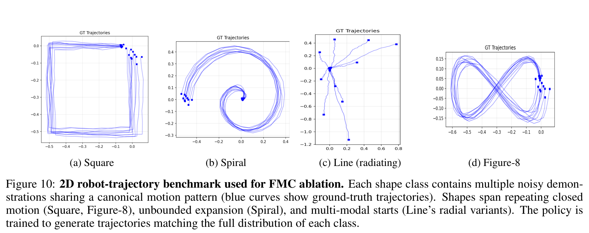

> <span style="color:#3B82F6"><strong>Figure 10: 2D 机械臂轨迹消融基准形态示例。</strong></span> 包含正方形、螺旋线、辐射线与 8 字形等复杂机械臂端部连续动力学路径。


> <span style="color:#3B82F6"><strong>Figure 11: FMC 与标准流匹配生成轨迹覆盖对比 (Overlay View)。</strong></span> 蓝色曲线为 Ground-Truth 真实示教分布，红色为模型生成分布。上排标准流匹配频繁出现轨迹向外散逸漂移、末端截断与局部模式崩塌；下排 FMC 紧密贴合真实流形边界，曲率转折处保持了极高的保真度。

---

### 消融分析

#### 1. 复杂抓放任务上的模块逐项剥离消融 (Table 4)
在 38K 轨迹的单一 Pick&Place 切分上，评测各模块对域外（OOD）泛化的贡献：


> **Table 4: Pick&Place 任务上的架构设计逐项消融。** 逐步叠加语言推理 (R)、FMC 校正与 LoRA 微调。

| 实验配置 | 成功率 (%) $\uparrow$ | 相对基础 WAM 增益 |
| :--- | :---: | :---: |
| UniWALM (w/o R, w/o FMC, w/o LoRA) $\simeq$ FastWAM | $31.00 \pm 2.87$ | 基线 |
| + Reasoning (加入 0.5B Language DiT 同步去噪) | $35.90 \pm 2.97$ | $+4.90\%$ (相对 $+15.8\%$) |
| + FMC (加入流匹配校正损失) | $38.90 \pm 3.02$ | $+3.00\%$ (相对 $+9.7\%$) |
| **+ LoRA (完整 UniWALM，锁定视频底座低秩微调)** | $\mathbf{41.00 \pm 3.04}$ | $\mathbf{+10.00\% \ (相对 +32.3\%)}$ |

- **语言生成的独立贡献**：仅增加 0.5B 的从零初始化语言头，成功率直接拔高 4.9 个百分点，确立了任务级预测信号对表征空间的塑造作用；
- **FMC 的物理抗扰收益**：FMC 带来 3.0% 的绝对提升，证明在真实连续控制中抵抗微小流匹配偏航的有效性；
- **LoRA 的正则化价值**：全量微调在小规模示教数据上极易破坏 Wan2.2 的原有动力学表征，采用 Rank=256 的 LoRA 既稳固了视频先验，又抑制了过拟合。

#### 2. RMBench 记忆机制与训练时序消融 (Table 5)
在 Press Button 任务上剥离视觉记忆与语言记忆：

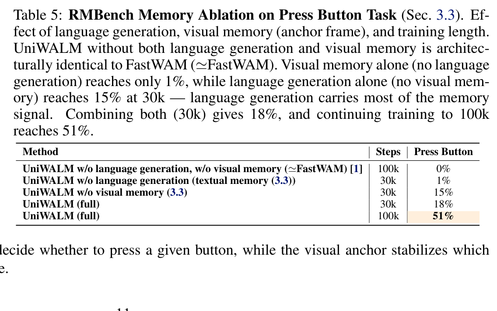

> **Table 5: Press Button 任务上的记忆通道消融实验。**

| 实验配置 | 训练步数 | 成功率 (%) $\uparrow$ |
| :--- | :---: | :---: |
| 纯基线：w/o 语言生成, w/o 视觉记忆 ($\simeq$ FastWAM) | 100k | $0\%$ |
| 仅视觉记忆：w/o 语言生成 (仅保留单帧锚点 $F$) | 30k | $1\%$ |
| 仅语言记忆：w/o 视觉记忆 (仅保留自生成文本闭环) | 30k | $15\%$ |
| 完整多模态记忆 (视觉锚点 + 语言自循环) | 30k | $18\%$ |
| **完整多模态记忆 (充分收敛)** | **100k** | $\mathbf{51\%}$ |

- **语言承载核心记忆**：纯视觉记忆在 30k 步时仅有 1% 成功率，而纯语言记忆即可达到 15%。这表明**符号化计数状态的传递主要由语言流承担**；
- **双模态协同互补**：视觉锚点提供了按键三维物理坐标的持久参考，两者结合后在 100k 步下暴增至 51%。

---

## 深度分析

### 真正贡献是什么

在当前充满各种拼装型具身大模型的学术界，清晰界定 UniWALM 的“真正理论贡献”与“工程集成”至关重要：

| 维度 | 传统混合体系 / 纯 WAM | UniWALM 的真正贡献 |
| :--- | :--- | :--- |
| **表征哲学** | 空间割裂：VLM 掌握语义但无物理常识，动作策略掌握接触但无长程抽象。 | **同构共生**：证明了任务级离散语言与像素级视频扩散能够在单一 MoT 中深度共存，且双向正向收益。 |
| **记忆范式** | 外置化：依靠向量检索库（RAG）或人工特权关键帧，系统笨重脆弱。 | **内生自循环**：将生成的语言重新定义为“可执行的瞬时工作记忆（Working Memory）”，实现极简闭环。 |
| **流匹配控制** | 开环直行：假设去噪轨迹始终位于标称数据流形内，抗扰能力弱。 | **闭环向心力**：FMC 在隐空间内生诱导单步向心修正速度场，零推理代价增强鲁棒性。 |

**工程装配部分**：复用 Wan2.2 视频底座、LoRA 低秩微调、8-bit AdamW 等技术均属标准的工程加速手段，不应被过度神化为理论创新。

### 为什么结果成立

1. **双尺度预测监督的正则化假说**：
   纯物理动作预测极易受到机械臂微颤、接触摩擦等局部高频噪声的干扰；而纯视频预测关注全图每一个像素的光影变化，信息过于发散。
   引入 Language DiT 本质上是在损失函数中注入了**低秩语义流形投影（Semantic Manifold Projection）**。由于语言标记必须预测下一个宏观子任务（如 `grasp the mug`），它强制 MoT 骨干网络的主干特征必须剥离不重要的背景高频纹理，提炼出对物体功能可触性（Affordance）与空间意图的高阶表征，从而大幅提升了底层动作生成的泛化度。
2. **FMC 的流形吸引子效应**：
   FMC 在训练阶段构造的校正目标 $v_{\text{corr}} = (\epsilon - x_0) + \frac{1-t}{\Delta t}\epsilon_1$，在几何上相当于在标称流匹配轨迹周围人为雕刻出了一个**负反馈吸引子势阱（Attractor Well）**。一旦测试阶段由于积分步长过大或物理接触反弹产生偏差，速度场向量会自动施加垂直于偏航方向的反向恢复分量，彻底杜绝了偏航累积效应。

### 容易误读的地方

> [!WARNING]
> **误读澄清一：UniWALM 是否包含一个强大的预训练大语言模型（如 Qwen 或 Llama）？**
> **完全没有！** 这是最容易产生误解的地方。很多人误以为 UniWALM 是类似 $\pi_{0.7}$ 或 PaLM-E 那样挂载了成熟的大语言模型。事实上，UniWALM 的 **Language DiT 是从零随机初始化（From Scratch）的 0.5B 小网络**。它之所以能输出结构化的子任务文本与计数记忆，完全是在具身示教数据中学习到的任务状态转移语法，而不是通用的世界常识。

> [!NOTE]
> **误读澄清二：语言扩散（Language Diffusion）与传统自回归语言生成（AR Generation）的本质区别是什么？**
> 自回归模型采用从左至右逐 token 贪婪生成，时间复杂度为 $O(L)$，且生成期间动作策略只能处于阻塞挂起状态；UniWALM 采用非自回归的离散掩码扩散，其 64 个 token 是与动作块在相同的 10~20 步去噪中**全并行迭代提炼**出来的。这保证了推理延迟对文本长度不敏感，实现了真正意义上的动作-语言同频共振。

> [!TIP]
> **误读澄清三：“语言即记忆”等同于直接输入过去的历史对话（History Context）吗？**
> 不等同。传统的 History Context 是被动堆叠过去的观测或指令，导致输入窗口随时间线性膨胀；UniWALM 的语言记忆是由模型在当前步**主动综合提炼**出的高阶压缩态（如直接更新按键计数 `left 2/4`），其长度始终恒定为短文本，杜绝了长上下文窗口引发的显存激增与注意力分散。

### 复现注意点

1. **连续流匹配的 $\ell_1$ 范数至关重要**：在动作速度场回归中，若将损失函数替换为常规的 $\ell_2$ 均方误差，由于示教数据中不同操作员的速度波动，模型极易产生模糊动作或平均化动作，导致抓取闭合时机漂移；
2. **FMC 的时间步截断阈值必须设定为 $t \ge 0.5$**：若在 $t < 0.5$（特别是 $t \to 0$ 区域）强行注入扰动并按 $\frac{1-t}{\Delta t}$ 计算校正速度，由于分子接近 1 且步长 $\Delta t$ 较小，校正项将瞬间产生高达数万的数值极值，直接导致 FP16/BF16 溢出；
3. **MoT 注意力因果掩码的严格单向性**：在 Unified Self-Attention 中，务必严密阻止 Language Tokens 注意 Action Tokens。实验发现，若允许双向互通，底层的动作去噪高频波动会直接污染高层子任务分类，导致语言输出发生严重的语法错乱与死循环；
4. **LoRA Rank 设置**：视频底座微调时，Rank 推荐设为 256；若低于 64，底座无法充分吸收机器人多视角相机的特定畸变参数；若高于 512，则容易丧失通用生成先验。

---

## 局限

尽管 UniWALM 展现出了卓越的综合性能，但在深入分析其失败案例（如 Appendix B.6）与物理机制后，仍存在以下关键局限：


> <span style="color:#3B82F6"><strong>Figure 12: Press Button 任务上的典型时序滞后故障 (Timing-Lag Failure)。</strong></span> 目标指令要求按压左键 5 次、中键 2 次、确认键 1 次（5-2-1）。语言记忆流准确追踪了全部计数状态（`visible 5 2 || left 5/5 middle 2/2 || confirm. next: done.`）；然而由于物理动作维度的 $\beta$ 门控信号由于时序延迟滞后了 1 步释放，底层 Action 执行器在中间按钮上多执行了一次下压，最终实际按压次数变为 5-3-1，导致整个 Episode 失败。

1. **子任务完成门控 $\beta$ 的时序抖动（Timing-Lag Misfire）**：
   如图 12 所示，UniWALM 内部的高层语言工作记忆完全正确，但由于底层连续动作动力学的平滑滤波效应，$\beta$ 信号的跳变往往比理想离散边界迟滞 1 个控制步。在强计数依赖型任务中，这会导致多按一次或少按一次；
2. **近同态视觉下的子任务辨识混淆**：
   当环境中多个物体的视觉表观高度相似（例如外观完全相同的三个纸盒）且工作记忆字符串由于偶发噪声发生单个字符变异时，模型无法通过当前观测自愈，会导致子任务跳转到错误目标；
3. **复杂几何接触抓取的物理精度上限**：
   在面对无规则透明物体、反光金属或极端杂乱堆叠场景时，由于底层相机分辨率限制（$224 \times 448$）与无触觉反馈，夹爪微距接触时的滑移率仍然较高；
4. **123ms 控制延迟对超高频伺服的挑战**：
   尽管 123ms 在长程任务中完全可用，但对于桌面乒乓球击打、高速飞行物拦截等需要 100Hz（10ms）级硬实时响应的极端动态任务，非自回归扩散去噪的耗时依然是不可忽视的物理瓶颈。

---

## 我的笔记：具身世界模型宏观生态位对比与演化图谱

为了建立对 UniWALM 在整个具身世界模型技术脉络中精准的学术定位，我们梳理了近两年代表性具身世界模型与通用策略的演化图谱：

### 1. 宏观技术演化图谱

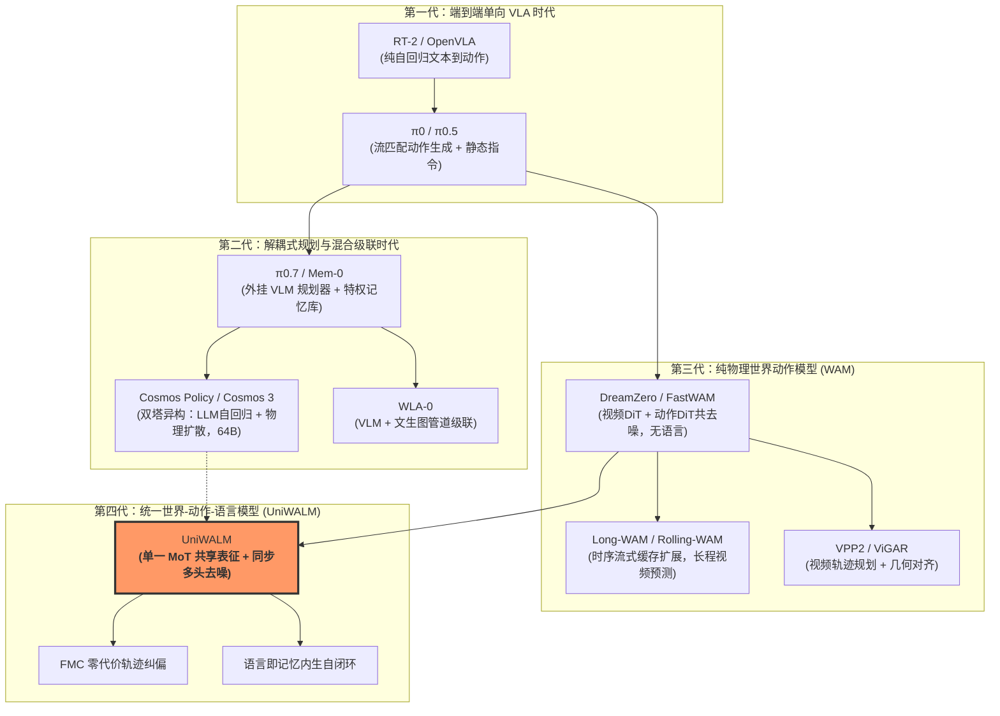

### 2. 核心竞争方案多维对比矩阵

| 对比维度 | FastWAM (2025) | $\pi_{0.7}$ / Mem-0 (2025/2026) | Cosmos 3 (2026) | WLA-0 (2026) | **UniWALM (Ours, 2026)** |
| :--- | :--- | :--- | :--- | :--- | :--- |
| **骨干网络形态** | 视频 + 动作并行 DiT (Wan2.2) | 预训练 VLA + 外部规划器 | 双塔解耦 (AR-LLM + Diffusion) | 级联系统 (VLM + Image Gen) | **单一共享 MoT (Wan2.2 扩展)** |
| **语言在系统中的角色** | 仅作为静态条件输入 | 外部高层异步指令输入 | 自回归生成宏观意图 | 外部提示与生成条件 | **一等去噪公民 + 连续内生工作记忆** |
| **推理协同机制** | 动作独立生成 | 异步调用（1-2Hz 规划，20Hz 控制） | 分步生成（先语言后动作） | 跨管道调用（VLM 生成目标图再控动作） | **完全同步同频共去噪 (123ms/chunk)** |
| **工作记忆实现途径** | **无记忆** (马尔可夫策略) | 外部向量数据库 / 人工特权关键帧 | 依赖超长大模型上下文 KV-Cache | 外部图像生成器状态传递 | **语言自重灌 (Language-as-Memory) + 单锚点** |
| **轨迹自愈抗扰能力** | 无 (标准开环流匹配) | 依赖高频重规划 | 隐空间常规流匹配 | 依赖视觉重对齐 | **带校正的流匹配 (FMC) 几何吸引子** |
| **大语言模型依赖度** | 无 | 强依赖 7B~70B 开源或商用 LLM | 强依赖 64B 双塔超大模型 | 强依赖商用级 VLM API | **零预训练 LLM 依赖 (0.5B 从零初始化)** |
| **典型记忆基准性能** | RMBench: 13.3% | RMBench: 28.5% (带特权帧) | 未在 RMBench 评测 | RMBench: 56.5% (超重型管道) | **RMBench: 34.5% (单锚点，超越同级)** |

### 3. WJ 个人学术思考与未来切入点

1. **从“世界模型指导动作”到“语言锚定世界模型”的技术跃迁**：
   在过去的具身世界模型研究中（如 OpenWAM、FastWAM、Rolling-WAM），学术界的普遍直觉是“只要把未来视频像素预测准确，物理动作自然会变好”。然而，视频像素中充斥着光照、阴影、背景抖动等海量无效信息熵，模型往往迷失在细节的拟合中，缺乏对任务因果逻辑的把握。
   UniWALM 证明了一个极其深刻的命题：**具身智能体的大脑不需要一个百亿级的通用 LLM，但在物理世界模型中嵌入一个轻量级（仅 0.5B）的任务意图语言去噪头，是约束和引导世界模型表征收敛到正确因果流形上的最佳正则化工具**。
2. **FMC 的终极形态：从合成高斯噪声到真机 Rollout 失败缓存对**：
   当前 FMC 的扰动项 $\epsilon_1$ 来自于人为合成的高斯随机扰动，这属于“无偏空间均匀扰动”。然而在真实物理世界中，机械臂的偏航往往是高度结构化的（如抓取细长物体时的接触打滑、双臂运动学奇异点带来的关节死锁）。未来若能构建一个小型 Rollout Failure Buffer，直接将真机在线试错产生的结构化残差向量作为 $\epsilon_1$ 进行 FMC 训练，将真正把 DAgger 的在线对抗自愈能力无损注入到流匹配模型中。
3. **单锚点视觉记忆向“信息熵门控多关键帧流”的演进**：
   UniWALM 目前仅使用初始单帧锚点 $F$，通过 RoPE 坐标平移防重叠。但在长达数十分钟的超长任务中，单帧锚点无法覆盖动态环境的变化（如环境道具被移走）。未来可结合子任务完成信号 $\beta$，在每次 $\beta > 0.9$ 的高置信子任务切换点，自适应存入一个新的带时序索引的视觉关键帧，从而构建出兼具高维几何细节与低维符号摘要的“多尺度动态工作记忆栈”。

---

## 引用

```bibtex
@article{sajnani2026uniwalm,
  title={UniWALM: Unified World Action Language Model for Embodied Robot Control},
  author={Sajnani, Rahul and Romeres, Diego and Zhang, Mingyuan and Gao, Kai and Qi, Carl and Huang, Baichuan and Sridhar, Srinath and Randle, Dylan and Ratliff, Lillian J. and Barreiros, Jose and Nambi, Manikantan and Vanbaar, Jeroen},
  journal={arXiv preprint arXiv:2610.28626},
  year={2026},
  url={https://rahulsajnani.github.io/projects/uniwalm/}
}
```
