# When Do Discrete Actions Make Good Continuous Controllers?
> **Source identity:** Zeji Yi$^{1,2,\dagger}$, Soham Dasgupta$^{1,2,\dagger}$, Xinyang Zhang$^2$, Koushil Sreenath$^2$, Guannan Qu$^1$, Xi Chen$^2$, Max Simchowitz$^{1,2,*}$, Guanya Shi$^{1,2,*}$. $^1$Carnegie Mellon University, $^2$Amazon FAR (Frontier AI & Robotics). $^\dagger$Work done during internship at Amazon FAR. $^*$Equal advising. Date: October 15, 2026. arXiv:2610.15939 / arXiv:2610.20429v1 [cs.RO]. Project Website: https://iscoyizj.github.io/discrete-action-website/

> **Reader policy:** This reader provides an exhaustive paragraph-by-paragraph Chinese-English bilingual version of the entire paper, including all 6 main sections, references, and Appendices A through H. Mathematical expressions, figures, tables, and exact literals are preserved in accordance with the skill contract.

## Contents and terminology

> <strong>Para. M-1:</strong> Major sections of this paper:
> - Abstract
> - 1 Introduction (1.1 Contributions)
> - 2 Preliminaries: Action Representations and Prediction Heads (CR, CF, DR, DF, Sampling, Classifier-Free Guidance)
> - 3 Discrete Action Prediction Can Match Continuous Parametrizations (Single-task RoboMimic, Multi-task VLA-scale RoboCasa & LIBERO, Real-world evaluation; 3.1 What Enables Performance?)
> - 4 Factorization Error and Iterative Computation in Discrete Policies (Temporal variation & precision, State responsiveness, Iterative refinement, Multimodal trade-offs)
> - 5 Additional Structure Provides Limited Gains for Discrete Policies (Tokenizers, Geometry-aware paths, Ordinal embeddings)
> - 6 Discussion and Future Work / Conclusion
> - Acknowledgements, AI Use Statement, Reproducibility Statement
> - References (139 bibliographic citations)
> - Appendices A–H (Related Work, Environment Details, Action Head & Objective Details, Full Performance Results, Temporal Variation & Policy Responsiveness Experiments, Factorization Error Experiments, Tokenization & Geometric Priors, Synthetic Fitting Protocol & Results)

> <strong>Para. M-1[CN]:</strong> 本文主要章节目录：
> - 摘要（Abstract）
> - 1 引言（1.1 研究贡献）
> - 2 预备知识：动作表示与预测头（CR、CF、DR、DF、采样算法、分类器自由引导）
> - 3 离散动作预测能够匹敌连续参数化策略（单任务 RoboMimic、多任务 VLA 规模 RoboCasa 与 LIBERO、真实世界机械臂评测；3.1 离散策略优异性能的机理剖析）
> - 4 离散策略中的因式分解误差与迭代计算（时间变化率与精度、状态反应性、迭代细化、多峰分布权衡）
> - 5 额外结构先验为离散策略带来的增益十分有限（分词器、几何感知概率路径、有序分箱嵌入）
> - 6 讨论与未来工作 / 结论
> - 致谢、AI 使用声明、可复现性声明
> - 参考文献（139 条完整文献条目）
> - 附录 A–H（相关工作、环境评测细节、动作头与优化目标细节、完整性能评测结果、时间变化与策略反应性实验、因式分解误差实验、分词与几何先验、合成拟合协议与结果）

> <strong>Para. M-2:</strong> Terminology ledger:
> - Continuous Regression (CR) = 连续回归：单步直接预测实值动作 chunk，使用 MSE 损失训练。
> - Continuous Flow (CF) = 连续流（连续流匹配）：基于连续空间流匹配，多步 ODE 积分生成动作。
> - Discrete Regression (DR) = 离散回归：朴素分箱离散化，单步分类交叉熵预测离散 token。
> - Discrete Flow (DF) = 离散流（离散流匹配）：在离散 token 空间上进行流匹配，多步迭代细化去噪。
> - Action Chunking = 动作分块：单次预测未来 $H$ 步的动作时序。
> - Factorization Error = 因式分解误差：跨时间与动作维度独立联合预测导致的组合不一致性与模式跳变。
> - Mode Switching = 模式切换 / 模式漂移：动作块内不同步之间跳转到不兼容的多峰解分支。
> - Classifier-Free Guidance (CFG) = 分类器自由引导：通过无条件与条件预测的差分锐化类别偏好。
> - Jerk Ratio = 加加加速度比（Jerk 比值）：反映动作分块内时间变化剧烈程度与高频动态保真度的指标。
> - State Responsiveness = 状态反应性：观测状态发生微扰或位移时策略输出动作的变化灵敏度。
> - Number of Function Evaluations (NFE) = 函数评估次数（推理步数）。
> - End-Effector (EEF) = 末端执行器。

> <strong>Para. M-2[CN]:</strong> 核心术语对照表：
> - Continuous Regression（CR）译为“连续回归”：单步直接预测实值动作分块，采用均方误差（MSE）训练。
> - Continuous Flow（CF）译为“连续流 / 连续流匹配”：基于连续空间流匹配，经多步 ODE 积分生成动作。
> - Discrete Regression（DR）译为“离散回归”：通过均匀分箱将动作量化，单步以交叉熵分类预测离散 token。
> - Discrete Flow（DF）译为“离散流 / 离散流匹配”：在离散 token 空间上执行流匹配，通过多步迭代去噪细化生成动作。
> - Action Chunking 译为“动作分块”：单次前向输出未来 $H$ 步动作轨迹序列。
> - Factorization Error 译为“因式分解误差”：在时间与动作维度假设独立乘积分布预测时所导致的解不兼容与模式断裂。
> - Mode Switching 译为“模式切换 / 模式漂移”：在单个动作分块内部不同时步跳跃到互不相容的行为峰值。
> - Classifier-Free Guidance（CFG）译为“分类器自由引导”：借助条件与无条件预测的线性外推锐化目标偏好。
> - Jerk Ratio 译为“加加加速度比（Jerk 比值）”：衡量动作分块内高频动态与时间变化剧烈程度的关键物理指标。
> - State Responsiveness 译为“状态反应性”：策略输出相对于环境输入观测变化的变化灵敏度 $\partial \pi / \partial o$。
> - Number of Function Evaluations（NFE）译为“函数评估次数 / 推理步数”。
> - End-Effector（EEF）译为“末端执行器”。

# Abstract

> <strong>Para. A-1:</strong> Though modern AI models like LLMs predict discrete tokens, today's robotic foundation models represent actions as continuous vectors. In this paper, we challenge this common consensus by asking if continuous action parametrizations are superior to their discrete counterparts. We conduct an extensive comparison of single-step regression and multi-step flow variants of both continuous and discrete policies in both from-scratch single-task and multi-task VLA training, in both simulation and on real hardware. In all regimes, we find that discrete action prediction, even the most naive, uniform-bin quantization, can match or even outperform continuous-action policies in task success rate.

> <strong>Para. A-1[CN]:</strong> 尽管大型语言模型（LLM）等现代主流人工智能模型均预测离散 token，但当今的机器人基础模型普遍将动作表示为连续向量。在本文中，我们向这一普遍共识发起挑战，探讨连续动作参数化是否确实优于其离散对应版本。我们在从头训练的单任务与多任务视觉-语言-动作（VLA）训练机制下，在仿真环境与实体机械臂硬件上，对连续与离散策略的单步回归及多步流匹配变体进行了广泛而系统化的对比。在所有实验机制下，我们均发现：离散动作预测——即使采用最朴素的均匀分箱量化——在任务成功率上也能完全匹敌甚至超越连续动作策略。

> <strong>Para. A-2:</strong> Moreover, we find that the challenge to discrete action policies is not action precision, but rather factorization error introduced by product-distribution predictions across time and action dimensions. We show that, when paired with the correct interventions—iterative computation through discrete flows, or distribution sharpening through classifier-free guidance—discrete flow policies can turn this weakness into a strength, enabling more responsive action changes during a predicted action chunk.

> <strong>Para. A-2[CN]:</strong> 此外，我们发现制约离散动作策略的核心挑战并非动作分辨率或精度不足，而是在时间与动作维度上采用乘积分布独立预测所引入的因式分解误差（factorization error）。我们证明，当配合正确的干预手段——通过离散流实现迭代计算，或通过分类器自由引导（CFG）实现分布锐化——离散流策略能够将这一弱点转化为显著优势，在预测的动作分块（action chunk）内实现更具响应性的敏捷动作变化。

> <strong>Para. A-3:</strong> Lastly, we show that attempts to explicitly inject geometric information into discrete policies, e.g. through corruption processes that emulate continuous flow matching, do not yield consistent improvements. Taken together, our findings question existing assumptions that robotic action prediction requires distinct design decisions compared to other AI domains, and motivates the possibility of discrete action prediction as a compelling alternative to today's continuous action parametrizations. Link for the webpage https://iscoyizj.github.io/discrete-action-website/

> <strong>Para. A-3[CN]:</strong> 最后，我们证明试图向离散策略中显式注入几何信息的做法（例如通过模拟连续流匹配的度量相关损坏过程）并未带来一致的性能提升。综合而言，我们的研究发现打破了“机器人动作预测必须采用区别于其他 AI 领域的特殊设计”的传统假设，并有力地证实：离散动作预测完全可以作为当今连续动作参数化的强有力替代范式。项目主页链接：https://iscoyizj.github.io/discrete-action-website/

### Figure 1. 动作表示范式与仿真/实体多任务闭环评测概览

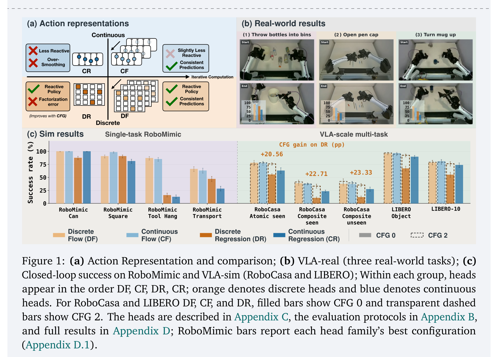

**Caption:** Figure 1: (a) Action Representation and comparison; (b) VLA-real (three real-world tasks); (c) Closed-loop success on RoboMimic and VLA-sim (RoboCasa and LIBERO); Within each group, heads appear in the order DF, CF, DR, CR; orange denotes discrete heads and blue denotes continuous heads. For RoboCasa and LIBERO DF, CF, and DR, filled bars show CFG 0 and transparent dashed bars show CFG 2. The heads are described in Appendix C, the evaluation protocols in Appendix B, and full results in Appendix D; RoboMimic bars report each head family's best configuration (Appendix D.1).

**Caption[CN]:** 图 1：(a) 动作表示与四种动作头对比；(b) VLA 真实世界机械臂评测（三项实体操作任务）；(c) RoboMimic 单任务与 VLA 仿真（RoboCasa 与 LIBERO）闭环成功率。在每组柱状图中，动作头从左至右依次为 DF、CF、DR、CR；橙色代表离散动作头，蓝色代表连续动作头。对于 RoboCasa 与 LIBERO 上的 DF、CF 和 DR，实心柱表示 CFG 0，透明虚线柱表示 CFG 2。动作头详见附录 C，评测协议详见附录 B，完整结果详见附录 D；RoboMimic 柱状图展示了各动作头家族的最佳配置（附录 D.1）。

# 1 Introduction

> <strong>Para. 1-1:</strong> A major goal of modern robot learning is to perform complex and varied tasks to high precision. As a result, the community has devoted significant study to the question of how to parametrize the actions predicted by robotic policies and foundation models, such as vision-language-action models (VLAs) [Brohan et al., 2023, Kim et al., 2024, Black et al., 2025, NVIDIA et al., 2025] and world action models (WAMs) [Li et al., 2025, Ye et al., 2026b, Kim et al., 2026, Li et al., 2026b]. The common consensus is that robot models should predict continuous-valued actions during deployment, as these are lossless and therefore support high-precision behavior. For example, most of today's VLAs predict actions using continuous-space generative models, such as flow [Black et al., 2025, Physical Intelligence et al., 2025b] or diffusion models [Chi et al., 2023], which are believed to better capture training data diversity whilst enhancing the precision of action predictions.

> <strong>Para. 1-1[CN]:</strong> 现代机器人学习的核心目标之一是以高精度执行复杂多样的操控任务。为此，学术界和工业界对如何参数化机器人策略与基础模型（如视觉-语言-动作模型 VLA [Brohan et al., 2023, Kim et al., 2024, Black et al., 2025, NVIDIA et al., 2025] 及世界动作模型 WAM [Li et al., 2025, Ye et al., 2026b, Kim et al., 2026, Li et al., 2026b]）所预测的动作展开了广泛而深入的探索。领域内的普遍共识是：机器人在部署时应当预测连续实值动作，因为连续空间不存在量化信息损失，因而能够天然支持高精度行为。例如，当今绝大多数前沿 VLA 均使用连续空间生成模型预测动作，例如流匹配 [Black et al., 2025, Physical Intelligence et al., 2025b] 或扩散模型 [Chi et al., 2023]，人们普遍认为此类方法既能更好地捕获训练数据的多峰多样性，又能增强动作预测的精度。

> <strong>Para. 1-2:</strong> At the same time, modern robot learning is adopting increasingly more features from other AI domains, notably language modeling. These include test-time reasoning [Wei et al., 2022], on-task self-correction [Huang et al., 2022], future goal prediction [Du et al., 2023], and long-term memory [Wang et al., 2023]. In fact, recent work has showcased the possibility that frontier language models can directly control robot embodiments through text generation [Brohan et al., 2023, Kim et al., 2024]. Yet, today's frontier AI models, even ones that process multiple modalities such as text, images, and audio, both take as input and produce discretely quantized tokens. Whether robot actions should follow the same discrete format therefore raises a key question:

> <strong>Para. 1-2[CN]:</strong> 与此同时，现代机器人学习正日益积极地吸纳其他人工智能领域（尤其是语言建模）的先进特性。这包括测试阶段推理（test-time reasoning）[Wei et al., 2022]、任务中自我纠错 [Huang et al., 2022]、未来目标预测 [Du et al., 2023] 以及长期记忆机制 [Wang et al., 2023]。事实上，近期多项研究已经表明，前沿大语言模型完全能够通过直接生成文本 token 来控制机器人实体 [Brohan et al., 2023, Kim et al., 2024]。然而，当今几乎所有的前沿多模态大模型（即便是能够同时处理文本、图像和音频的多模态模型），其输入与输出均为离散量化的 token。这引发了一个根本性的学术拷问：

> <strong>Para. 1-3:</strong> Are robot actions unique among other AI modalities in that they must be predicted as continuous values, or can discrete action representations compete with, or even outperform, their continuous counterparts?

> <strong>Para. 1-3[CN]:</strong> 在所有 AI 模态中，机器人动作是否真的具有独特性，以至于必须以连续实值进行预测？抑或离散动作表示完全能够与连续方案竞争，甚至展现出更为优越的性能？

## 1.1 Contributions

> <strong>Para. 1-4:</strong> In this work, we undertake a systematic comparison between the performance of continuous and discrete action parameterizations for both single-task robot policies and multi-task vision-language-action (VLA) models. In short, we show that discrete action parametrization can be competitive with, and even uniformly outperform, continuous action prediction, provided that correct design decisions are made. These findings provide a deeper understanding of the performance of recent discrete diffusion/flow VLA policies [Liang et al., 2026b, Wen et al., 2025b, Chen et al., 2026a].

> <strong>Para. 1-4[CN]:</strong> 在本文中，我们针对单任务机器人策略与多任务视觉-语言-动作（VLA）模型，对连续与离散动作参数化的性能展开了系统性的严格对比。简而言之，我们证明：只要做出合理正确的设计决策，离散动作参数化完全能够与连续动作预测并驾齐驱，甚至在各个基准上实现全面超越。这些研究发现为近期涌现的离散扩散/离散流 VLA 策略 [Liang et al., 2026b, Wen et al., 2025b, Chen et al., 2026a] 提供了更为深刻的机理解释。

> <strong>Para. 1-5:</strong> In greater detail, we consider parametrizations of the action head, or part of a robot model responsible for action prediction. Our comparison builds on classical supervised control and imitation learning [Pomerleau, 1988, Ross et al., 2011, Osa et al., 2018]. We focus our study on 4 representative parametrizations: (1) continuous regression (CR), which predicts continuous-valued actions in a single forward pass and is trained with a regression objective [Bojarski et al., 2016, Kim et al., 2025] (2) continuous flow (CF), which generates continuous actions using flow matching, a family applied to robot control and motion planning [Hu et al., 2024, Chisari et al., 2024, Black et al., 2025, Zhang et al., 2024, Nguyen et al., 2025] (3) discrete regression (DR), which predicts a quantized action via cross-entropy classification [Brohan et al., 2022] and (4) discrete flow (DF), which predicts quantized actions in multiple steps via the discrete flow matching objective [Gat et al., 2024].

> <strong>Para. 1-5[CN]:</strong> 具体而言，我们聚焦于动作头（action head）的参数化设计，即机器人模型中直接负责输出动作的组件。我们的评测立足于经典监督控制与模仿学习理论 [Pomerleau, 1988, Ross et al., 2011, Osa et al., 2018]。我们将研究重点聚焦在四种具有高度代表性的动作头参数化范式：(1) 连续回归（Continuous Regression, CR），单次前向直接预测连续实值动作，采用回归损失函数训练 [Bojarski et al., 2016, Kim et al., 2025]；(2) 连续流（Continuous Flow, CF），采用流匹配在连续空间生成动作，该范式已广泛应用于机器人控制与运动规划 [Hu et al., 2024, Chisari et al., 2024, Black et al., 2025, Zhang et al., 2024, Nguyen et al., 2025]；(3) 离散回归（Discrete Regression, DR），通过交叉熵分类损失单步预测量化后的动作类别 [Brohan et al., 2022]；(4) 离散流（Discrete Flow, DF），采用离散流匹配目标函数通过多步迭代去噪生成量化动作 [Gat et al., 2024]。

> <strong>Para. 1-6:</strong> Hybrid methods such as Behavior Transformer [Shafiullah et al., 2022] combine discrete action-bin prediction with a continuous offset; in contrast, we study purely discrete and continuous action heads separately to isolate the effect of action representation. Recent work compares regression and flow policies under architecture-matched settings [Pan et al., 2026]. We evaluate these parametrizations from single-task policies on RoboMimic [Mandlekar et al., 2021] to multi-task VLA-scale policies using RoboCasa [Nasiriany et al., 2026], DROID [Khazatsky et al., 2024], and LIBERO [Liu et al., 2023], as well as real-world robot experiments. All are evaluated using closed-loop task success, action prediction accuracy, and within-chunk temporal variation. We identify 3 key findings that upend prior beliefs about the relative performance of discrete and continuous action modalities, challenging the prevailing view that precise robot control requires predicting continuous action prediction:

> <strong>Para. 1-6[CN]:</strong> 像 Behavior Transformer [Shafiullah et al., 2022] 这样的混合方法将离散动作分箱预测与连续偏移量结合；与之相对，我们分别独立研究纯离散与纯连续动作头，以严格隔离动作表示本身的纯粹影响。近期的工作在骨干架构严格对齐的设置下对比了回归与流策略 [Pan et al., 2026]。我们对这些参数化范式的评估跨越了广泛的任务层级：从 RoboMimic [Mandlekar et al., 2021] 上的单任务从头训练策略，到基于 RoboCasa [Nasiriany et al., 2026]、DROID [Khazatsky et al., 2024] 与 LIBERO [Liu et al., 2023] 的多任务 VLA 规模策略，以及实体硬件机械臂实验。所有模型均在闭环任务成功率、动作预测精度以及块内时间变化率上进行了细致评测。我们提炼出三大核心科学发现，颠覆了学界以往关于离散与连续动作模态相对优劣的既有认知，向“高精度机器人控制必然依赖连续动作预测”的传统观念提出了直接挑战：

> <strong>Para. 1-7:</strong> • Finding 1: Control Precision Contrary to prior belief, discrete action parametrizations, even discrete regression (DR) with the simplest bin discretization, can exhibit greater control precision than their continuous counterparts, despite the possibly lossy quantization of actions! We support this claim in both sim and real settings in Section 3. We show that this arises from greater policy reactivity, both to the action-chunk time index and the conditioning observation.

> <strong>Para. 1-7[CN]:</strong> • 发现 1：控制精度与反应性。与以往认知相反，离散动作参数化策略（即便是采用最简单均匀分箱离散化的离散回归 DR）在闭环控制中展现出了超越连续对应版本的控制精度，尽管离散动作可能存在量化损失！我们在第 3 节中通过仿真与真实世界实体实验充分证实了这一结论。我们深入揭示，这一优势源于离散策略对动作分块内部的时间步索引以及条件输入观测拥有显著更强的动态反应性（reactivity）。

> <strong>Para. 1-8:</strong> • Finding 2: Iterative Refinement and Guidance Mitigate Factorization Error (Section 4). Independently predicted tokens can combine incompatible choices across time and action dimensions, even when individual token distributions are accurate. DF solves this by iterative computation, while classifier-free guidance reduces ambiguity by changing token preferences. Both improve control significantly, supporting joint consistency as main explanation for their gains. In the RoboCasa comparison, guidance raises DR success from 27.1% to 49.2%, approaching DF's 53.9% and CF's 52.7%, largely ahead of CR's 38.8%.

> <strong>Para. 1-8[CN]:</strong> • 发现 2：迭代细化与分类器自由引导能有效化解因式分解误差（第 4 节）。当跨时间与动作维度独立预测 token 时，即使各个 token 的边缘分布预测十分准确，也极易将彼此冲突的动作选项组合在一起。离散流（DF）通过多步迭代计算完美化解了这一矛盾，而分类器自由引导（CFG）则通过重塑 token 偏好大幅消除模棱两可的不确定性。两者均显著提升了控制性能，有力印证了“提升联合决策一致性”是实现性能跃升的核心归因。在 RoboCasa 对比中，引导机制将 DR 的成功率从 27.1% 飙升至 49.2%，逼近 DF 的 53.9% 与 CF 的 52.7%，并大幅领先于 CR 的 38.8%。

> <strong>Para. 1-9:</strong> • Finding 3: Explicit Geometry and Structured Tokenization Provide Limited Additional Gains (Section 5). Encoding action distances or using alternative tokenizers improves some configurations, but none exceeds our best DF result with uniform bins and the standard mixture path. Adjacent bins also acquire similar output embeddings, suggesting that discrete heads can learn local geometry without encoding it explicitly.

> <strong>Para. 1-9[CN]:</strong> • 发现 3：显式几何先验与结构化分词器仅带来有限的额外增益（第 5 节）。显式编码动作距离或采用更复杂的分词器（如 nFSQ、RVQ、FAST）在某些特定配置下有所改善，但均未超越采用朴素均匀分箱与标准混合概率路径的最佳 DF 策略。此外，相邻的分箱索引在训练中自发获得了高度相似的输出权重嵌入，表明离散动作头无需显式先验约束即可自发学会动作空间的局部连续几何结构。

> <strong>Para. 1-10:</strong> We discuss related work in Appendix A.

> <strong>Para. 1-10[CN]:</strong> 我们在附录 A 中对相关工作进行了全面综述与深入讨论。

# 2 Preliminaries: Action Representations and Prediction Heads

> <strong>Para. 2-1:</strong> Notation. Let $o$ denote the policy's conditioning information, such as images, language, and proprioception, and let $a_{1:H} = (a_1, \dots, a_H) \in \mathbb{R}^{H \times M}$ be an action chunk [Zhao et al., 2023] of horizon $H$, with $M$ action coordinates per timestep. We represent actions in end-effector (EEF) space, with 3 translation coordinates $a^{\mathrm{tr}} \in \mathbb{R}^3$, rotation coordinates $a^{\mathrm{rot}}$, and a binary gripper coordinate $a^{\mathrm{g}} \in \{0, 1\}$, and $a_i = [a_i^{\mathrm{tr}}, a_i^{\mathrm{rot}}, a_i^{\mathrm{g}}]$. All policies use relative EEF actions: every target in the chunk is measured from the EEF pose at prediction time. The VLA policies encode the rotation as an axis-angle vector $a^{\mathrm{rot}} \in \mathbb{R}^3$, and the single-task RoboMimic policies as a 6D representation $a^{\mathrm{rot}} \in \mathbb{R}^6$ of a rotation matrix in $\mathrm{SO}(3)$. Appendix D.2 compares relative EEF actions with delta and absolute EEF actions and with relative joint-space actions. From training pairs $(o, a_{1:H}) \sim \mathcal{D}$, we learn (possibly stochastic) policies $\hat{a}_{1:H} \sim \pi_\theta(o)$ that execute the chunk open loop and replan. All heads share a backbone design (Appendix C.6); full objectives and implementation details are in Appendix C.

> <strong>Para. 2-1[CN]:</strong> 符号定义。令 $o$ 表示策略的条件输入信息（包括图像、语言指令及机械臂本体感受状态），令 $a_{1:H} = (a_1, \dots, a_H) \in \mathbb{R}^{H \times M}$ 表示预测时域跨度为 $H$ 的动作分块（action chunk [Zhao et al., 2023]），其中每个时步包含 $M$ 个动作坐标。我们在末端执行器（EEF）空间中表示动作，包含 3 个平移坐标 $a^{\mathrm{tr}} \in \mathbb{R}^3$、旋转坐标 $a^{\mathrm{rot}}$ 以及 1 个二值夹爪开合坐标 $a^{\mathrm{g}} \in \{0, 1\}$，即 $a_i = [a_i^{\mathrm{tr}}, a_i^{\mathrm{rot}}, a_i^{\mathrm{g}}]$。所有策略均采用相对末端执行器动作（relative EEF actions）：动作块中的每个目标位姿均以预测发生时刻的末端位姿为基准进行度量。VLA 规模策略将旋转表示为 3 维轴角向量 $a^{\mathrm{rot}} \in \mathbb{R}^3$，而单任务 RoboMimic 策略则使用 $\mathrm{SO}(3)$ 旋转矩阵的 6D 连续表示 $a^{\mathrm{rot}} \in \mathbb{R}^6$。附录 D.2 详细对比了相对 EEF 动作与增量（delta）动作、绝对（absolute）EEF 动作以及相对关节空间动作。利用训练样本对 $(o, a_{1:H}) \sim \mathcal{D}$，我们学习（可能是随机性的）策略 $\hat{a}_{1:H} \sim \pi_\theta(o)$，以开环方式执行该动作块并周期性重新规划。所有动作头共享相同的骨干网络设计（附录 C.6）；完整的训练目标与实现细节见附录 C。

> <strong>Para. 2-2:</strong> Continuous regression (CR). The policy $\pi_\theta^{\mathrm{CR}}(o)$ predicts a chunk in one pass using squared-error regression. Its population minimizer is the conditional mean $\mathbb{E}[a_{1:H} \mid o]$, which need not be a demonstrated action when several behaviors are plausible.

> <strong>Para. 2-2[CN]:</strong> 连续回归（CR）。策略 $\pi_\theta^{\mathrm{CR}}(o)$ 通过单次前向传播并采用均方误差回归直接预测动作分块。其总体极小化解是条件均值 $\mathbb{E}[a_{1:H} \mid o]$；当数据中存在多种可行合理的操作行为（多峰分布）时，该均值往往并不对应任何专家真实演示过的物理动作。

> <strong>Para. 2-3:</strong> Continuous flow (CF). Flow matching learns a conditional velocity field $v_\theta$ [Lipman et al., 2022, Liu et al., 2022]. From $x_0 = \varepsilon^{\mathrm{C}} \sim \mathcal{N}(0, I)$, generation follows $\dot{x}_t = v_\theta(x_t, t, o)$ over $t \in [0, 1]$. After $N$ Euler integration steps, the policy returns $\hat{a}_{1:H} \leftarrow x_{t_N}$, with $t_N = 1$. Here, flow time $t$ indexes generation, rather than the action horizon. The interpolant and training objective are given in Appendix C.1.

> <strong>Para. 2-3[CN]:</strong> 连续流（CF）。连续流匹配通过监督学习拟合条件速度场 $v_\theta$ [Lipman et al., 2022, Liu et al., 2022]。从先验高斯噪声 $x_0 = \varepsilon^{\mathrm{C}} \sim \mathcal{N}(0, I)$ 出发，生成轨迹遵循常微分方程 $\dot{x}_t = v_\theta(x_t, t, o)$（其中 $t \in [0, 1]$）。在完成 $N$ 步欧拉数值积分后，策略返回最终动作分块 $\hat{a}_{1:H} \leftarrow x_{t_N}$（其中 $t_N = 1$）。在此处，流时间 $t$ 索引的是生成推理的进程，而非动作分块内部的物理时步。连续插值路径与具体训练目标详见附录 C.1。

> <strong>Para. 2-4:</strong> Discrete action representation. We quantize each action coordinate into one of $B$ bins after normalization and clipping. Let $[B] = \{1, \dots, B\}$ and $L = HM$. Flattening the quantized chunk in a fixed order gives $z = (z_1, \dots, z_L) \in [B]^L$, whose entries we call tokens. Thus, $B$ is both the number of bins per coordinate and the action-token vocabulary size; unless otherwise stated, $B = 512$. The quantizer $Q : \mathbb{R}^{H \times M} \to [B]^L$ and decoder $D_Q : [B]^L \to \mathbb{R}^{H \times M}$ satisfy $z = Q(a_{1:H})$ and $\hat{a}_{1:H} = D_Q(\hat{z})$. We primarily use uniform quantization. For action coordinate $i$, let $[\ell_i, u_i]$ be its range and $\Delta_i = (u_i - \ell_i)/B$ its bin width. With scalar action $a_{h,i}$ and token position $j = (h-1)M + i$, encoding and decoding are $Q(a_{1:H})_j := \mathrm{clip}_{[1,B]} \left( 1 + \left\lfloor \frac{a_{h,i} - \ell_i}{\Delta_i} \right\rfloor \right)$ and $[D_Q(z)]_{h,i} := \ell_i + \left(z_j - \frac{1}{2}\right) \Delta_i$. Clipping keeps the bin index in $[B]$, including at the upper endpoint; decoding returns the bin center and restores the chunk shape. Both maps use normalized coordinates, with normalization inverted before execution. Recipe details and alternative tokenizations are described in Appendix C.2.

> <strong>Para. 2-4[CN]:</strong> 离散动作表示。我们在归一化与裁剪之后，将每个动作坐标标量量化为 $B$ 个离散分箱（bins）之一。令 $[B] = \{1, \dots, B\}$ 且 $L = HM$。按固定顺序将量化后的动作块展平，可得到离散序列 $z = (z_1, \dots, z_L) \in [B]^L$，其每个元素称为一个动作 token。因此，$B$ 既是每个坐标的分箱数量，也是动作 token 的词表大小；除非特别说明，我们默认设置 $B = 512$。量化编码器 $Q : \mathbb{R}^{H \times M} \to [B]^L$ 与解码器 $D_Q : [B]^L \to \mathbb{R}^{H \times M}$ 满足 $z = Q(a_{1:H})$ 与 $\hat{a}_{1:H} = D_Q(\hat{z})$。我们主要采用均匀量化。对于动作坐标 $i$，令 $[\ell_i, u_i]$ 为其取值范围，$\Delta_i = (u_i - \ell_i)/B$ 为其分箱宽度。对于标量动作分量 $a_{h,i}$ 及其对应的展平 token 位置 $j = (h-1)M + i$，其编码与解码公式为 $Q(a_{1:H})_j := \mathrm{clip}_{[1,B]} \left( 1 + \left\lfloor \frac{a_{h,i} - \ell_i}{\Delta_i} \right\rfloor \right)$ 以及 $[D_Q(z)]_{h,i} := \ell_i + \left(z_j - \frac{1}{2}\right) \Delta_i$。裁剪操作确保分箱索引严格落在 $[B]$ 内（包括右端点）；解码操作取对应分箱的中心值并恢复为 $H \times M$ 的动作分块形状。两组映射均在归一化坐标系下执行，并在实际机器人执行前进行反归一化。具体处理流程及其他候选分词器详见附录 C.2。

> <strong>Para. 2-5:</strong> Discrete regression (DR). In one forward pass, the head outputs $L \times B$ logits whose position-wise softmax defines $p_{\theta, j}^{\mathrm{DR}}(\cdot \mid o)$ [Brohan et al., 2022]. Conditioned on the model inputs, it factorizes the token distribution as $p_\theta^{\mathrm{DR}}(z \mid o) = \prod_{j=1}^L p_{\theta, j}^{\mathrm{DR}}(z_j \mid o)$. For $z = Q(a_{1:H})$, we train with tokenwise cross-entropy: $\mathcal{L}_{\mathrm{DR}} = \mathbb{E}_{(o, a_{1:H}) \sim \mathcal{D}} \left[ -\frac{1}{L} \sum_{j=1}^L \log p_{\theta, j}^{\mathrm{DR}}(z_j \mid o) \right]$. The factorization makes maximizing the model's joint probability tractable: we greedily select $\hat{z}_j = \arg\max_{k \in [B]} p_{\theta, j}^{\mathrm{DR}}(k \mid o)$ at each position [Devlin et al., 2019]. For the VLA policies, DR is trained with a distance-smoothed version of this loss (Appendix C.3). Writing $\hat{z} = (\hat{z}_1, \dots, \hat{z}_L)$, the policy returns $\hat{a}_{1:H} := D_Q(\hat{z})$.

> <strong>Para. 2-5[CN]:</strong> 离散回归（DR）。在单次前向传播中，动作头输出 $L \times B$ 维 logits，其逐位置 softmax 定义了条件分布 $p_{\theta, j}^{\mathrm{DR}}(\cdot \mid o)$ [Brohan et al., 2022]。在以模型输入为条件时，它将整个 token 序列的联合分布因式分解为独立乘积：$p_\theta^{\mathrm{DR}}(z \mid o) = \prod_{j=1}^L p_{\theta, j}^{\mathrm{DR}}(z_j \mid o)$。对于真实动作对应的离散目标 $z = Q(a_{1:H})$，我们采用逐 token 交叉熵损失进行训练：$\mathcal{L}_{\mathrm{DR}} = \mathbb{E}_{(o, a_{1:H}) \sim \mathcal{D}} \left[ -\frac{1}{L} \sum_{j=1}^L \log p_{\theta, j}^{\mathrm{DR}}(z_j \mid o) \right]$。这种因式分解使得最大化联合概率的求解变得极其容易：我们在每个位置上独立贪婪地选取 $\hat{z}_j = \arg\max_{k \in [B]} p_{\theta, j}^{\mathrm{DR}}(k \mid o)$ [Devlin et al., 2019]。在 VLA 规模策略中，DR 使用该损失的距离平滑版本进行训练（附录 C.3）。记预测 token 序列为 $\hat{z} = (\hat{z}_1, \dots, \hat{z}_L)$，策略最终输出解码后的动作分块 $\hat{a}_{1:H} := D_Q(\hat{z})$。

> <strong>Para. 2-6:</strong> Discrete flow (DF). Discrete flow [Gat et al., 2024] generates a token chunk through iterative updates, starting from a product source $q_0(z_0) = \prod_{j=1}^L q_{0,j}(z_{0,j})$. Let $\alpha : [0, 1] \to [0, 1]$ be a continuously differentiable, nondecreasing schedule with $\alpha(0) = 0$, $\alpha(1) = 1$, and $\alpha(t) < 1$ for $t < 1$. For a clean chunk $z = Q(a_{1:H})$, the conditional probability path is:

> <strong>Para. 2-6[CN]:</strong> 离散流（DF）。离散流匹配 [Gat et al., 2024] 通过多步迭代更新生成 token 分块，初始状态采样自分解先验源分布 $q_0(z_0) = \prod_{j=1}^L q_{0,j}(z_{0,j})$。令 $\alpha : [0, 1] \to [0, 1]$ 为连续可微且非降的时间调度函数，满足 $\alpha(0) = 0$、$\alpha(1) = 1$，且对任意 $t < 1$ 均有 $\alpha(t) < 1$。对于真实的纯净动作 token 分块 $z = Q(a_{1:H})$，条件概率路径定义为：

$$
q_t(z_t \mid z) = \prod_{j=1}^L \left( \alpha(t) \mathbf{1}\{z_{t,j} = z_j\} + (1 - \alpha(t)) q_{0,j}(z_{t,j}) \right). \tag{2.1}
$$

> <strong>Para. 2-7:</strong> At each position, this path interpolates between the source and the clean target token. The source $q_0(\cdot)$ may be uniform over $[B]$ or concentrated on an auxiliary mask token [Sahoo et al., 2024], which does not decode to an action bin. As in DR, the head predicts a clean-token distribution at each position, but additionally conditions on the current chunk and flow time: $p_{\theta, j}^{\mathrm{DF}}(\cdot \mid z_t, t, o)$. For each training pair, we sample $t \sim \mathcal{U}[0, 1]$ and $z_t \sim q_t(\cdot \mid z)$, and minimize clean-token cross-entropy [Gat et al., 2024]:

> <strong>Para. 2-7[CN]:</strong> 在每个 token 位置上，该路径在初始源分布与真实的纯净目标 token 之间进行概率插值。源分布 $q_0(\cdot)$ 可以是在 $[B]$ 上的均匀离散分布，亦可集中在特殊的辅助掩码 token（mask token [Sahoo et al., 2024]）上（该 token 不对应任何物理动作分箱）。与 DR 类似，离散流动作头在每个位置上预测纯净目标 token 的概率分布，但其额外以当前损坏的动作块 $z_t$ 以及流时间 $t$ 为条件输入：$p_{\theta, j}^{\mathrm{DF}}(\cdot \mid z_t, t, o)$。对于每个训练样本对，我们采样时间 $t \sim \mathcal{U}[0, 1]$ 并按插值路径采样损坏状态 $z_t \sim q_t(\cdot \mid z)$，通过最小化纯净 token 交叉熵进行模型训练 [Gat et al., 2024]：

$$
\mathcal{L}_{\mathrm{DF}} = \mathbb{E}_{(o, a_{1:H}) \sim \mathcal{D}, t \sim \mathcal{U}[0,1], z_t \sim q_t(\cdot \mid z)} \left[ -\frac{1}{L} \sum_{j=1}^L \log p_{\theta, j}^{\mathrm{DF}}(z_j \mid z_t, t, o) \right]. \tag{2.2}
$$

> <strong>Para. 2-8:</strong> At inference, initialize $z_{t_0} \sim q_0$ and use $0 = t_0 < \dots < t_N = 1$. At step $n$, draw proposals $\tilde{z}_{n,j} \sim p_{\theta, j}^{\mathrm{DF}}(\cdot \mid z_{t_n}, t_n, o)$ and update each position, writing $\alpha_n = \alpha(t_n)$, as:

> <strong>Para. 2-8[CN]:</strong> 在推理测试阶段，首先初始化 $z_{t_0} \sim q_0$，并使用离散时间网格 $0 = t_0 < \dots < t_N = 1$。在第 $n$ 步迭代中，模型针对每个位置抽取建议采样 $\tilde{z}_{n,j} \sim p_{\theta, j}^{\mathrm{DF}}(\cdot \mid z_{t_n}, t_n, o)$，并依据时间进度 $\alpha_n = \alpha(t_n)$ 按如下规则独立更新各个位置：

$$
z_{t_{n+1}, j} = \begin{cases} \tilde{z}_{n,j}, & \text{with probability } \eta_n, \\ z_{t_n, j}, & \text{otherwise}, \end{cases} \quad \eta_n = \frac{\alpha_{n+1} - \alpha_n}{1 - \alpha_n}. \tag{2.3}
$$

> <strong>Para. 2-9:</strong> Finally, the policy returns $\hat{a}_{1:H} \leftarrow \pi_\theta^{\mathrm{DF}}(o; \varepsilon^{\mathrm{D}}) := D_Q(z_{t_N})$. The source choices and sampler details are in Appendix C.4. Importantly, while each single DF step predicts independently per position (as in DR), DF introduces position-wise correlation through multi-stage computation of the final output tokens.

> <strong>Para. 2-9[CN]:</strong> 在完成全部 $N$ 步迭代后，策略最终返回解码动作 $\hat{a}_{1:H} \leftarrow \pi_\theta^{\mathrm{DF}}(o; \varepsilon^{\mathrm{D}}) := D_Q(z_{t_N})$。源分布选择与具体采样算法详见附录 C.4。至关重要的一点在于：虽然 DF 在单次前向预测中与 DR 一样在各个位置上采用独立预测，但 DF 通过多阶段（multi-stage）迭代去噪计算，在最终输出的 tokens 之间引入了极其强大的位置间联合相关性与时空协调性。

> <strong>Para. 2-10:</strong> Classifier-free guidance. CFG [Ho and Salimans, 2022] combines conditional and unconditional predictions. Let $c$ be the encoding of the observation $o$, and let $\emptyset$ be a learned null condition of the same shape. Training replaces $c$ with $\emptyset$ at random, so one head learns both predictions. We write $\emptyset$ in place of $o$ for a prediction made with the null condition.

> <strong>Para. 2-10[CN]:</strong> 分类器自由引导（CFG）。CFG [Ho and Salimans, 2022] 是一种通过外推组合条件预测与无条件预测的技术。令 $c$ 为环境观测 $o$ 的特征编码，令 $\emptyset$ 为与其形状一致的可学习空条件（null condition）。在训练期间，模型以一定概率随机将 $c$ 替换为 $\emptyset$，从而使得同一个动作头同时兼备条件预测与无条件预测能力。我们将使用空条件输入所得到的模型预测记为以 $\emptyset$ 代替 $o$。

> <strong>Para. 2-11:</strong> For discrete heads, suppressing other inputs, $p_{\theta, j}^{\mathrm{CFG}}(k \mid o) \propto p_{\theta, j}(k \mid o)^{1+\lambda} p_{\theta, j}(k \mid \emptyset)^{-\lambda}$, normalized over bins, where $\lambda \ge 0$ is the guidance weight ($\lambda = 0$ means no guidance). We write CFG $x$ for $\lambda = x$. DR applies this rule to its single pass and decodes the guided distributions greedily; DF applies it at every refinement step and samples clean-token proposals from them.

> <strong>Para. 2-11[CN]:</strong> 对于离散动作头（省略其他输入标识），引导后的 token 分布定义为 $p_{\theta, j}^{\mathrm{CFG}}(k \mid o) \propto p_{\theta, j}(k \mid o)^{1+\lambda} p_{\theta, j}(k \mid \emptyset)^{-\lambda}$，并在所有分箱上归一化，其中 $\lambda \ge 0$ 为引导权重（$\lambda = 0$ 表示不使用引导）。我们用 CFG $x$ 表示 $\lambda = x$。DR 在其单次前向中使用该规则，并对引导后的分布进行贪婪 argmax 解码；DF 则在每一步细化迭代中均应用此规则，并从中采样纯净 token 建议。

> <strong>Para. 2-12:</strong> CF applies the same combination to its velocity, $(1+\lambda)v_\theta(x_t, t, o) - \lambda v_\theta(x_t, t, \emptyset)$, at every integration step. The backbone encodes $o$ once per inference call, so guidance adds one action-head pass per head evaluation. We do not guide CR: it outputs a single chunk rather than a distribution, so guidance has nothing to sharpen and only extrapolates that chunk. Details are in Appendix C.5.

> <strong>Para. 2-12[CN]:</strong> CF 在每个数值积分步对连续速度场应用相同的线性组合外推：$(1+\lambda)v_\theta(x_t, t, o) - \lambda v_\theta(x_t, t, \emptyset)$。骨干网络在每次推理调用中仅需对观测 $o$ 编码一次，因此引导机制仅为每次动作头评估增加一次轻量级前向传播。我们不对连续回归（CR）使用引导：因为 CR 输出的是单一确定性的动作块而非概率分布，引导机制无法起到锐化分布的作用，只会导致动作值的生硬外推。具体实现细节见附录 C.5。

# 3 Discrete Action Prediction Can Match Continuous Parametrizations

> <strong>Para. 3-1:</strong> In this section, we demonstrate that discrete action prediction matches, and often outperforms continuous action prediction across both flow and regression policies. To evaluate performance, and refute possible precision loss under action discretization, we measure (1) task success rate under closed-loop deployment, and (2) mean $\ell_2$ action prediction error on held-out validation data (Appendix B.1).

> <strong>Para. 3-1[CN]:</strong> 在本节中，我们全面论证离散动作预测在流匹配和回归策略两大阵营中均能完全匹敌甚至超越连续动作预测。为了严格评估策略性能并反驳“动作离散化必然导致不可逆精度损失”的流行猜测，我们主要度量两项关键指标：(1) 闭环实际部署中的任务执行成功率；(2) 留出验证集上的平均 $\ell_2$ 动作预测误差（详见附录 B.1）。

> <strong>Para. 3-2:</strong> Evaluation Protocol. To demonstrate that our findings are broadly applicable, we consider a wide breadth of tasks; we defer further implementation details to Appendix B:
>
> - Single-Task Imitation Learning. To test whether discrete policies' advantages depend on pretrained VLM, we train separate policies from scratch, without a pretrained VLM backbone, on the Can, Square, Tool Hang and Transport tasks in the RoboMimic suite [Mandlekar et al., 2021]. In particular Tool Hang and Transport are representative of tasks that demand high control precision. Architectures and training settings are in Appendix C.6.1.
> - VLA Scale Tasks in sim. We post-train the PaliGemma Beyer et al. [2024] VLM, used by the $\pi$-series models Black et al. [2025], Physical Intelligence et al. [2025b], with new action heads corresponding to each action head parametrization. As representatives of VLA training, we train on one mixture of eight sources: six RoboCasa365 datasets [Nasiriany et al., 2024, 2026], including MimicGen-generated demonstrations [Mandlekar et al., 2023], LIBERO-plus [Fei et al., 2025], and DROID [Khazatsky et al., 2024]. We measure closed-loop success on RoboCasa and LIBERO [Liu et al., 2023]; DROID has no simulator and serves the offline diagnostics. Evaluations on RoboCasa are grouped into 3 categories: atomic-seen and composite-seen consisting of atomic and composite tasks, respectively, that are contained in the training data; and composite-unseen, consisting of tasks that require compositions of in-distribution atomic-seen, but in novel combinations. The training mixture is in Appendix B.4, the architecture in Appendix C.6.2, and the evaluation protocol in Appendix B.3.
> - Real World VLA tasks. We used the same backbone and action head setting in sim but trained on different real datasets and SFT on three tasks: throw bottles into bins, open pen caps, and turn mug up. The rollout results are provided in Fig. 1(b).

> <strong>Para. 3-2[CN]:</strong> 评测协议。为了证明我们结论的广泛普适性，我们覆盖了跨越不同尺度与复杂度的多样化任务；实现细节详见附录 B：
>
> - 单任务从头模仿学习：为了验证离散策略的优异表现是否仅仅依赖于预训练视觉-语言骨干网络，我们在不使用任何预训练 VLM 骨干网络的情况下，在 RoboMimic 基准套件 [Mandlekar et al., 2021] 的 Can、Square、Tool Hang 和 Transport 任务上从头训练（from-scratch）独立策略。特别是 Tool Hang（悬挂工具）和 Transport（双臂协同转运）是公认极度苛求毫米级高精度闭环控制的代表性挑战任务。模型架构与训练超参数详见附录 C.6.1。
> - 仿真环境下的 VLA 规模多任务：我们采用 $\pi$ 系列机器人大模型 [Black et al., 2025, Physical Intelligence et al., 2025b] 所使用的 PaliGemma [Beyer et al., 2024] 视觉-语言模型（VLM）作为初始化权重，接入对应于四种动作参数化范式的新动作头进行后训练（post-training）。作为大规模 VLA 训练的代表，我们在包含 8 个数据源的大规模混合数据集上联合训练：6 个 RoboCasa365 数据集 [Nasiriany et al., 2024, 2026]（含 MimicGen 自动生成演示数据 [Mandlekar et al., 2023]）、LIBERO-plus [Fei et al., 2025] 以及真实机械臂数据集 DROID [Khazatsky et al., 2024]。我们在 RoboCasa 和 LIBERO [Liu et al., 2023] 上测试闭环操控成功率；DROID 由于缺乏高保真物理仿真器，主要用于离线预测诊断。RoboCasa 评估任务被划分为三大测试套件：atomic-seen（见过的原子任务）、composite-seen（见过的复合长程任务）以及 composite-unseen（未见过的复合任务，要求将训练分布内的原子技能以全新时序方式组合）。数据混合配比见附录 B.4，网络架构见附录 C.6.2，评测协议见附录 B.3。
> - 实体世界真实机械臂 VLA 任务：我们采用与仿真环境一致的骨干网络和动作头设置，但在真实机器人数据集上进行预训练并在三项实际物理操控任务上进行监督微调（SFT）：将塑料瓶扔进垃圾篓（throw bottles into bins）、拔开笔帽（open pen caps）以及将倒卧的马克杯立起（turn mug up）。闭环物理评测结果见图 1(b)。

> <strong>Para. 3-3:</strong> Results. We depict the closed-loop performance of all four policy parametrizations: CR, CF, DR, DF in Fig. 1(b,c). We see two surprising findings: (i) across VLA and single-task, from-scratch training, discrete flow is competitive with, and often slightly surpasses, continuous flow. More surprisingly, (ii) discrete regression consistently outperforms continuous regression. Appendix D.3 reports results with other backbone settings, and Appendix D.2 with other action parameterizations.

> <strong>Para. 3-3[CN]:</strong> 实验结果。我们在图 1(b,c) 中展示了四种策略参数化（CR、CF、DR、DF）的闭环执行性能。实验揭示了两个令人极为惊讶的核心现象：(i) 无论是在大规模多任务 VLA 机制下，还是在从头训练的单任务模仿学习中，离散流（DF）均能与连续流（CF）正面对决，且在多数任务上微幅反超连续流；更令人震撼的是，(ii) 离散回归（DR）在所有基准上均稳健、大幅度地超越了连续回归（CR）。附录 D.3 进一步汇报了更换不同骨干网络设置时的表现，附录 D.2 则对比了其他动作参数化表象形式。

> <strong>Para. 3-4:</strong> The fact that discrete regression outperforms its continuous counterpart, even on single-task from scratch training, debunks two widely held hypotheses: (a) that precision is a fundamental bottleneck to discrete policies [Shafiullah et al., 2022]; (b) that discrete policies are only beneficial in VLA settings, where it has been hypothesized, that discrete predictions are more compatible with token-based VLM backbones [Brohan et al., 2023, Driess et al., 2025].

> <strong>Para. 3-4[CN]:</strong> 离散回归甚至在单任务从头训练（无预训练 VLM）中也能全面压倒连续回归这一确凿事实，直接证伪了学界长期存在的两大先入之见：(a) 认为动作分辨率/精度是制约离散策略性能的根本性物理瓶颈 [Shafiullah et al., 2022]；(b) 认为离散动作预测仅在 VLA 机制下因天然契合基于 token 的自回归语言模型骨干网络而享有偶然收益 [Brohan et al., 2023, Driess et al., 2025]。

> <strong>Para. 3-5:</strong> As further evidence that discrete policies are not fundamentally limited by precision, we present their end-effector reconstruction error in Fig. 2, showing that discrete policies remain competitive (and in some cases slightly outperforms) their continuous counterparts. In fact, in Fig. 2, we show that discrete flow policies in particular enjoy lower end-effector error early on in the action chunk generation and along the finer motion regime, suggesting the potential for greater precision when actions are discrete.

> <strong>Para. 3-5[CN]:</strong> 作为离散策略未受精度根本限制的进一步确凿证据，我们在图 2 中给出了各策略的末端执行器（EEF）重建误差，结果表明离散策略完全能够匹敌（在某些区间甚至微弱超越）连续对应模型。事实上，图 2 进一步表明：离散流策略在动作分块生成的前几步以及小幅度精细运动区间内，享有明显更低的末端执行器误差，这充分揭示了当采用离散动作表示时策略反而具备实现更敏捷高精度控制的巨大潜力。

## 3.1 What Enables the Performance of Discrete Policies?

> <strong>Para. 3-6:</strong> Paradoxically, our previous findings suggest that the opposite of the common wisdom regarding discrete policies might be true: perhaps, discrete policies are uniformly better at high-precision action prediction than their continuous counterparts? However, this belief is not quite correct. Tab. 11 in Appendix F.2 shows that the $\ell_2$ reconstruction errors across all parametrizations are roughly similar, and show no consistent correlation with task success. For example, DR exhibits less error than CR on some benchmarks, and more on others, despite always enjoying greater closed loop task success.

> <strong>Para. 3-6[CN]:</strong> 看似矛盾的是，上述发现甚至可能让人得出完全相反的极端推论：难道离散策略在高精度动作预测上全面胜过连续策略？然而，这一推断同样并不完全准确。附录 F.2 的表 11 显示，所有参数化范式在各数据集上的 $\ell_2$ 重建误差总体处于同一数量级，且开环重建误差与闭环任务成功率之间并没有稳定的单调正相关关系。例如，DR 在部分基准上的误差低于 CR，在另一些基准上误差却高于 CR，但 DR 的闭环成功率却始终稳健地大幅领先于 CR。

> <strong>Para. 3-7:</strong> Temporal Variation, via the Jerk Ratio, Reflects Discrete Policy Competitiveness. Instead, we propose an alternative explanation for the success of discrete policies: that they enable greater temporal variation across action chunks than do their continuous counterparts. To make this rigorous, Fig. 2 (a) depicts each chunk's jerk ratio. For a given action chunk $a_{1:H}$, let $a_h^{\mathrm{tr}}$ denote the translation coordinates of the end-effector. We define the difference approximation to the jerk at step $h$ as $\Delta^3 a_h^{\mathrm{tr}} = a_{h+3}^{\mathrm{tr}} - 3 a_{h+2}^{\mathrm{tr}} + 3 a_{h+1}^{\mathrm{tr}} - a_h^{\mathrm{tr}}$ ($h = 1, \dots, H - 3$). The chunk's mean jerk magnitude and predicted-to-target jerk ratio are:

> <strong>Para. 3-7[CN]:</strong> 加加加速度比（Jerk Ratio）所反映的时间动态变化性印证了离散策略的竞争力。为此，我们提出了一个全新的机理假说来解释离散策略的成功：离散动作参数化使得策略在动作分块内部能够产生显著高于连续模型的动作时变剧烈度（temporal variation），从而避免了连续模型常见的高频过平滑。为了严格量化这一物理特性，图 2(a) 刻画了各动作块的 Jerk 比值。对于给定的动作块 $a_{1:H}$，令 $a_h^{\mathrm{tr}}$ 表示末端执行器的 3 维平移坐标。我们将时步 $h$ 处的加加加速度（Jerk，即位置对时间的三阶差分）离散近似定义为 $\Delta^3 a_h^{\mathrm{tr}} = a_{h+3}^{\mathrm{tr}} - 3 a_{h+2}^{\mathrm{tr}} + 3 a_{h+1}^{\mathrm{tr}} - a_h^{\mathrm{tr}}$（$h = 1, \dots, H - 3$）。该动作块的平均 Jerk 幅值以及预测动作与真实目标动作之间的 Jerk 比值定义为：

$$
\mathrm{Jerk}(a_{1:H}) = \frac{1}{H - 3} \sum_{h=1}^{H-3} \| \Delta^3 a_h^{\mathrm{tr}} \|_2, \quad R_{\mathrm{jerk}} = \frac{\mathrm{Jerk}(\hat{a}_{1:H})}{\mathrm{Jerk}(a_{1:H})}. \tag{3.1}
$$

> <strong>Para. 3-8:</strong> Thus, jerk ratio of $R_{\mathrm{jerk}} = 1$ means that the learned policy's jerk matches the ground-truth jerk on a training example; $R_{\mathrm{jerk}} < 1$ means jerk is underestimated, so that the policy has oversmoothed the training data with respect to time.

> <strong>Para. 3-8[CN]:</strong> 因此，$R_{\mathrm{jerk}} = 1$ 意味着学习到的策略完全复现了专家演示数据中的加加加速度动态；而 $R_{\mathrm{jerk}} < 1$ 则表示策略严重低估了 Jerk，即策略在时序维度上对专家数据产生了严重的过平滑（oversmoothing）。

### Figure 2. 动作块时间变化率（Jerk比值）与精细动作预测精度剖析

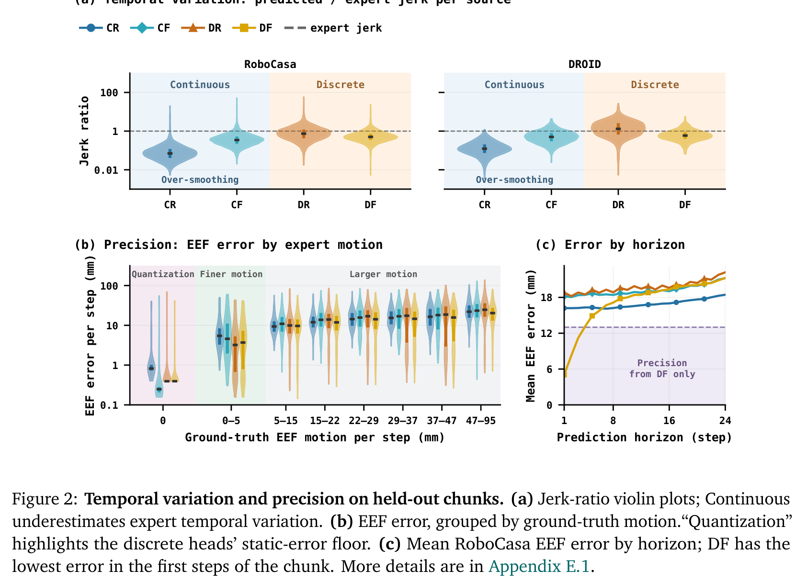

**Caption:** Figure 2: Temporal variation and precision on held-out chunks. (a) Jerk-ratio violin plots; Continuous underestimates expert temporal variation. (b) EEF error, grouped by ground-truth motion.“Quantization” highlights the discrete heads' static-error floor. (c) Mean RoboCasa EEF error by horizon; DF has the lowest error in the first steps of the chunk. More details are in Appendix E.1.

**Caption[CN]:** 图 2：留出动作块上的时间变化率与动作精度诊断。(a) Jerk 比值小提琴图；连续动作头显著低估了专家的时变动态。（b）按真实专家运动幅度分组的末端执行器（EEF）误差；“Quantization”标记了离散头在完全静止时的量化底噪误差底线。(c) RoboCasa 上按分块时域推进的平均 EEF 误差；离散流（DF）在动作分块前几步展现出最低的跟踪误差。详见附录 E.1。

### Figure 3. 观测输入扰动下的策略状态反应性对比

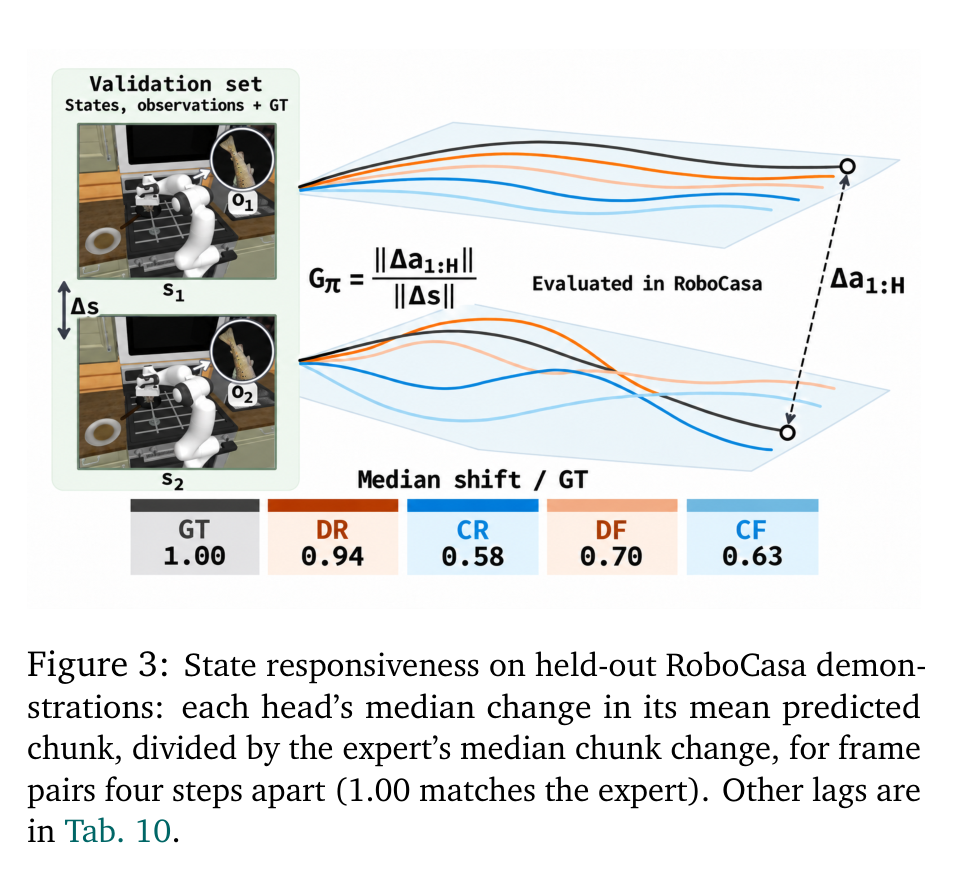

**Caption:** Figure 3: State responsiveness on held-out RoboCasa demonstrations: each head's median change in its mean predicted chunk, divided by the expert's median chunk change, for frame pairs four steps apart (1.00 matches the expert). Other lags are in Tab. 10.

**Caption[CN]:** 图 3：留出 RoboCasa 演示上的状态反应性（State Responsiveness）：相隔 4 步的环境观测帧对之间，各动作头平均预测动作块的变化中位数除以专家动作块变化的实际中位数（1.00 表示与专家灵敏度完全一致）。其他时延步数下的数据详见表 10。

> <strong>Para. 3-9:</strong> Across all datasets (per-source views in Fig. 8), Fig. 2 (a) reveals that continuous regression enjoys a jerk ratio substantially less than 1, whereas discrete regression is close to (and occasionally above) 1. This suggests that discrete action modalities can more easily represent large temporal variation in a single pass, likely due to the probabilistic decoupling of predictions across time steps. These differences reduce under iterative computation, as Fig. 2 (a) shows CF and DF have much closer jerk ratios than do the single-pass counterparts. To identify differences that persist between DF and CF, Fig. 2 (b,c) reveal that discrete policies better fit other subtle variations: in (b), we see that discrete modalities offer more response to smaller degrees of EEF movement, especially the 0–5 mm range (note the logarithmic plot scale); in (c) we see that DF in particular fits actions earlier in the chunk more accurately, which require smaller relative motion. We hypothesize that continuous objectives underweight/over-smooth small action differences compared to categorical prediction. In Appendix H.1, we corroborate these hypotheses in controlled studies of fitting synthetic functions with varying levels of smoothness.

> <strong>Para. 3-9[CN]:</strong> 在所有评测数据集上（各数据源细分视图见图 8），图 2(a) 清楚地揭示出：连续回归（CR）的 Jerk 比值远远小于 1（严重过平滑），而离散回归（DR）的 Jerk 比值则紧贴 1（甚至偶有超出）。这表明离散动作模态能够在单次前向中极其自然地表达剧烈的时间动态变化，这很大程度上归功于各时步概率预测在表示上的解耦。在引入多步迭代计算后，这种差距有所收敛，如图 2(a) 所示 CF 与 DF 的 Jerk 比值显著接近。为了进一步探究 DF 与 CF 之间仍旧存在的深层差异，图 2(b,c) 表明离散策略能更好地拟合精细微小的物理变动：在 (b) 中，离散模态对微小范围的末端位移拥有更灵敏准确的响应，尤其是在 0–5 mm 的极小位移区间（请注意其对数坐标轴）；在 (c) 中，DF 尤其在动作块生成的前几步具有显著更低的误差，而这几步恰恰对应极高精度的近端微调。我们推测，与分类交叉熵损失相比，连续空间回归/流匹配目标函数天然对小范围的动作差分赋予较低权重，导致了微观动作的过度平滑。在附录 H.1 中，我们在可控的合成函数拟合实验中严格证实了这一机理假说。

> <strong>Para. 3-10:</strong> DR/DF Exhibit Greater State Responsiveness than CR/CF. Beyond temporal variation within a chunk, we examine state responsiveness: how much the predicted chunk changes when the observation changes along a real trajectory, formally $\frac{\partial \pi}{\partial o}$, compared with the expert's change (Appendix E.3.2). Fig. 3 shows that both continuous heads produce smaller changes in their mean predicted chunks than their discrete counterparts, underestimating expert change magnitudes on held-out data. DR tracks the expert response most closely, while DF remains closer than CF at every tested state displacement. On the other hand, additional diagnostics in Appendix E.3 also show that CF stays closer to nearby training actions than DF, corroborating findings from Pan et al. [2026]. These results suggest that stronger adherence to the training data may come at the cost of responsiveness. DF may offer a better balance, retaining the disturbance stability of flow heads, a small change in the predicted distribution after a small simulator disturbance (Appendix E.3.1), while responding more closely to expert changes.

> <strong>Para. 3-10[CN]:</strong> DR 与 DF 展现出显著高于 CR 与 CF 的状态反应性。除动作块内部的时间变化率外，我们进一步审视了状态反应性（State Responsiveness）：当真实轨迹上的输入观测发生改变时，策略预测的动作分块随之变化的幅度，形式化为 $\frac{\partial \pi}{\partial o}$，并将其与人类专家的应对幅度进行严格基准对齐（附录 E.3.2）。图 3 表明，两个连续动作头在平均预测动作块上的变动幅度均系统性地小于其离散对应版本，在留出验证轨迹上严重低估了专家的动态应对幅度。DR 与专家的动态响应跟踪最为契合，而 DF 在所有测试的状态位移步长下均比 CF 更贴近专家响应。另一方面，附录 E.3 的拓展诊断也发现 CF 比 DF 更紧密地贴附在邻近训练动作附近，这印证了 Pan et al. [2026] 的结论。然而，过度紧密地依附训练轨迹往往是以牺牲对新状态的敏捷反应性为代价的。离散流（DF）实现了更加理想的兼顾：既保持了流生成模型强大的抗扰动稳定性（在微小物理扰动下保持预测分布平稳，附录 E.3.1），又能敏锐地针对观测变化做出与专家高度一致的积极响应。

> <strong>Para. 3-11:</strong> Takeaway 1: Discrete policies generally match or exceed the control performance of their continuous counterparts across the evaluated testbeds. They obtain stronger performance in both VLA and from-scratch settings. These gains arise from better capturing variation across within-chunk time steps and conditioning observations, rather than outright reconstruction error.

> <strong>Para. 3-11[CN]:</strong> 核心结论 1：在所有评测基准上，离散策略的闭环控制表现均普遍匹敌或超越其连续对应版本。无论是在大规模 VLA 还是从头训练的单任务设置中，离散模型均取得了更强劲的任务表现。这一性能飞跃的核心机理，在于离散模型能够更优异地捕捉动作分块内部的高频时间时变动态以及对输入观测变化的敏捷反应性，而非单纯取决于静态的开环重建误差。

# 4 Factorization Error and Iterative Computation in Discrete Policies

> <strong>Para. 4-1:</strong> Thus far, Section 3 establishes that discrete regression (DR) outperforms continuous regression (CR), in part due to better capturing temporal variation, subtle action changes, and response to the input variables. In this section, we show that the greater temporal reactivity observed in DR comes at the cost of action inconsistency, or what we call factorization error (Finding A), harming policy performance. We then identify that the key interventions which enhance performance—applying classifier-free-guidance (Finding B) and introducing iterative computation by moving to discrete flow (Finding C) —correct this inconsistency via complementary mechanisms described below.

> <strong>Para. 4-1[CN]:</strong> 至此，第 3 节已经确立了离散回归（DR）全面超越连续回归（CR）的基本事实，其优势在很大程度上归功于其更优异地捕捉高频时间变化动态、对微观细致动作的精准响应以及对输入观测变量的高度敏锐反应性。在本节中，我们深入剖析这一现象背后的核心代价：DR 所表现出的高时变反应性伴随着动作序列的不一致性，即我们所定义的因式分解误差（factorization error，发现 A），进而对复杂长程任务的闭环表现造成损害。随后，我们揭示提升离散策略性能的两大关键干预机制——应用分类器自由引导（CFG，发现 B）与引入基于离散流的多步迭代计算（DF，发现 C）——通过互补互促的机制有效修正了这一不一致性。

> <strong>Para. 4-2:</strong> Factorization Error in Discrete Policies. DR predicts a categorical distribution for each action token, giving the factorized distribution $p_\theta(z \mid o) = \prod_j p_{\theta, j}(z_j \mid o)$. When an observation admits several plausible behaviors, different token distributions can assign probability to alternatives behaviors independently. These independent choices can combine incompatible alternatives across time steps and action dimensions. We refer to this failure to preserve dependencies between token choices as factorization error. This may occur even when every token marginal is learned correctly, because the product of the marginals need not recover the joint distribution of demonstrated chunks.

> <strong>Para. 4-2[CN]:</strong> 离散策略中的因式分解误差。DR 为每个动作 token 独立预测一个分类概率分布，从而形成完全因式分解的乘积联合分布 $p_\theta(z \mid o) = \prod_j p_{\theta, j}(z_j \mid o)$。当当前环境观测存在多种合理可行的动作分支（多峰分布）时，不同 token 的边际分布将各自独立地为备选分支分配概率。这种位置间的独立采样选择极易跨越时间步和动作维度，将互不相容的分支动作拼接在一起。我们将这种无法保持 token 选择之间联合依赖关系的内在缺陷称为因式分解误差（factorization error）。即使模型对每个单一 token 的边际分布学习得完全正确，因式分解误差依然会出现，因为边际分布的直积根本无法还原专家演示动作块真实的联合分布相关性。

> <strong>Para. 4-3:</strong> Evaluation Protocol for Factorization Error. To isolate token ambiguity as a potential source of incompatible action tokens, we vary (i) the number of function evaluations (NFE), that is, the number of refinement steps $N$ in DF, comparing to DR as a baseline, and (ii) the guidance weight $\lambda$ of classifier-free guidance (CFG, Section 2). Note that greater NFE provides more opportunity for self-correction, whereas greater CFG “sharpens” the generated action distribution. Due to space constraints, policy performance under varying CFG/NFE is reported in Appendix F.3; in short, performance improves with NFE and an appropriate guidance weight.

> <strong>Para. 4-3[CN]:</strong> 因式分解误差的评测协议。为了严格隔离作为不相容动作 token 潜在根源的 token 歧义性（token ambiguity），我们系统性地改变两大变量：(i) 函数评估次数（NFE），即 DF 中的迭代细化步数 $N$（以单步 DR 作为对照基准）；(ii) 分类器自由引导（CFG，见第 2 节）的引导权重 $\lambda$。需要强调的是，更大的 NFE 为模型提供了更多通过前后文自我纠错（self-correction）的机会，而更强的 CFG 则直接对生成的动作分布进行锐化（sharpening）。由于正文篇幅限制，不同 CFG 与 NFE 配置下的详细成功率曲线见附录 F.3；简而言之，策略性能随着 NFE 的增加以及适当 CFG 权重的引入而大幅提升。

### Figure 4. 多步迭代细化与引导机制消除 token 歧义性诊断

**Caption:** Figure 4: Iterative refinement reduces token ambiguity. (a,b) At CFG 0, DF at NFE 1,2,5,10,20 show separated-mode prevalence (a) ambiguity decreasing, action diversity remains $\exp(H(p))$ (b); the orange dashed curve is DR. (c) Median central-90% width W90 of action proposal and its ground truth coverage, run from CFG 0 to 3. (d) DROID t-SNE; the star marks the GT; other sources are in Fig. 11. ; additional diagnostics and protocols are in Appendices E.2 and F.1.

**Caption[CN]:** 图 4：迭代细化消除 token 歧义并保留行为多样性。(a,b) 在 CFG 0 下，DF 在 NFE 1、2、5、10、20 步时展现出分离模式的主导性：(a) token 歧义显著下降，(b) 生成动作的多样性 $\exp(H(p))$ 始终得以维持；橙色虚线表示 DR 基准。(c) 动作建议分布的中央 90% 宽度中位数 W90 及其对真实专家动作的覆盖率（CFG 权重从 0 扫至 3）。(d) DROID 数据集上的动作分块 t-SNE 降维投影可视化；星号标记真实专家轨迹，其他数据源投影见图 11。更多诊断与协议见附录 E.2 与 F.1。

### Figure 5. 因式分解误差导致的时序与坐标模式切换失效机理示意

**Caption:** Figure 5: (a) Temporal mode switching within an action chunk as relative mode probabilities vary across the prediction horizon; (b) Action chunks predicted by CR, CF, and DF from the same starting position. (c) Coordinate-wise factorization within a timestep: independently combining coordinates from two valid modes can produce two additional, incompatible actions.

**Caption[CN]:** 图 5：(a) 动作分块内部的时序模式切换（Mode Switching）：随着各分支的相对概率沿预测时域发生倾斜，策略在单一动作块内发生解的突变跳跃；(b) CR、CF 与 DF 从相同初始状态预测的动作轨迹分块对比；(c) 单一时步内部各动作坐标维度的因式分解冲突：独立组合来自两种有效模式的不同坐标分量，会导致生成另外两种完全无效且自相冲突的动作。

> <strong>Para. 4-4:</strong> Here, we focus on two metrics, deferring precise details to Appendix F.1: 1. Mode-mixture: we identify distributions with at least two “incompatible” modes in the same action chunk. We report the mean count of such modes within one chunk across NFE Fig. 4(a, top) and across guidance weights Fig. 4(b). 2. Translation Quantiles. Next, we measure the diversity of actions generated across repeated policy samples from the same observation. This lets us test (and ultimately rule out) an alternative hypothesis that DF improves performance over DR by better capturing multimodality.

> <strong>Para. 4-4[CN]:</strong> 在此，我们聚焦于两项关键定量指标（数学定义详见附录 F.1）：1. 模式混合度（Mode-mixture）：我们在同一个动作分块内识别出包含至少两个相互冲突的不相容模式的分布，并在图 4(a, 顶图) 与图 4(b) 中分别汇报了在不同 NFE 及引导权重下一块内冲突模式的平均数量；2. 平移分量分位数与动作多样性（Translation Quantiles）：我们度量在同一环境观测输入下多次重复随机采样所生成的动作多样性，以此检验（并最终排除）另一种备选假说——即“DF 相对于 DR 的性能跃升是否仅仅源于其更能保留多峰多模态特性”。

> <strong>Para. 4-5:</strong> Finding A: Factorization Error Explains DR's Failure Modes. As shown in Fig. 5, factorization error manifests across both time and coordinate dimensions. Fig. 5(a) shows that as relative probabilities of two distinct valid modes drift over the horizon, greedily selecting tokens causes the policy to abruptly switch modes mid-chunk. Fig. 5(c) shows coordinate-wise factorization: independently selecting coordinates from two valid modes can produce spurious, physically unviable hybrid actions. Qualitative rollouts on RoboCasa and DROID confirm this: DR frequently twitches between alternative trajectories or executes jerky, incompatible motions mid-execution.

> <strong>Para. 4-5[CN]:</strong> 发现 A：因式分解误差解释了 DR 的核心失效模式。如图 5 所示，因式分解误差在时间轴和坐标维度上同时显现。图 5(a) 显示，当两种不同的有效行为模式的相对概率沿预测时域发生细微漂移时，贪婪的逐 token 独立选择会导致策略在单一动作块的半途中突兀地发生模式跳转（时序模式切换）；图 5(c) 展示了跨坐标维度的因式分解冲突：分别独立从两种有效模式中抓取不同的坐标分量进行组合，会凭空捏造出物理上毫无意义、相互抵触的拼凑动作。在 RoboCasa 和 DROID 上的定性闭环执行完全印证了这一点：未加干预的 DR 经常在两条合理路径之间剧烈抽搐抖动，或在执行中途产生动作断裂。

> <strong>Para. 4-6:</strong> Finding B: Classifier-Free Guidance Reduces Ambiguity and Makes DR Competitive with DF. As further evidence of the presence of factorization error, we observe that increasing guidance from CFG 0 to CFG 2 raises pooled RoboCasa success from 27.1% to 49.2% (Appendix F.3.2). This coincides with drastic reduction in the mean-width of the confidence intervals (Fig. 4(c)), which is consistent with reductions in spurious temporal variation. As noted above, guidance is known to “sharpen” the resulting generated distribution [Ho and Salimans, 2022, Karras et al., 2024], and thus is likely to be resolving mode ambiguity. Moreover, Fig. 4(c,d) shows that CFG reduces coverage of plausible ground-truth EEF positions, suggesting that performance advantages from CFG primarily reflect reduced factorization error rather than improved prediction accuracy. Across sources, CFG almost never improves EEF error by more than 1 mm (Appendix E.2).

> <strong>Para. 4-6[CN]:</strong> 发现 B：分类器自由引导消除歧义，使 DR 逼近 DF 的强劲性能。作为因式分解误差存在的强力证据，我们观察到将引导权重从 CFG 0 提高到 CFG 2，直接将 RoboCasa 汇总闭环成功率从 27.1% 大幅推升至 49.2%（附录 F.3.2）。这与置信区间平均宽度的急剧收窄高度吻合（图 4(c)），与虚假时间变动的显著减少完全一致。众所周知，引导机制能够显著锐化所生成的条件概率分布 [Ho and Salimans, 2022, Karras et al., 2024]，从而有效消除了多个可行模式之间的摇摆歧义。此外，图 4(c,d) 显示 CFG 实际上降低了对多种潜在真实专家轨迹的覆盖率，这强有力地说明 CFG 带来的性能飞跃本质上来源于因式分解误差的消除，而非预测精度的提升；在所有数据源中，CFG 几乎从未使末端误差改善超过 1 mm（附录 E.2）。

> <strong>Para. 4-7:</strong> Finding C: Iterative Computation Aids Discrete Policies via Reducing Factorization Error. While CFG guidance is a partial-yet-imperfect remedy of factorization error, Here we show that iterative computation, as in DF, reduces factorization error further. To support this claim, we find that DF reduces the number of inconsistent-mode predictions per chunk by a factor of 5.28 relative to DR, bringing the average below one at NFE $\ge 10$ (Fig. 4(a,top)). This coincides with a 4.7-point increase in RoboCasa success (Appendix F.3). These suggest that iterative computation makes discrete action predictions more cohesive than guidance alone. We note that, for continuous action predictions, the benefits of iterative computation are somewhat opposite, combating over-smoothing (Fig. 2) and policy under-reactivity (Fig. 5). The high level role of iterative computation, however, is the same, in that it performs self-correction on policy actions [Pan et al., 2026].

> <strong>Para. 4-7[CN]:</strong> 发现 C：迭代计算通过深层抑制因式分解误差赋能离散策略。尽管 CFG 引导是缓解因式分解误差的有效手段，但它仍是不完全的折中方案；我们进一步证明，离散流（DF）中的多步迭代计算能够更彻底地消除因式分解误差。实验表明，DF 相对于 DR 将单个动作分块内的不一致模式预测数量减少了整整 5.28 倍，在 NFE $\ge 10$ 时将平均冲突模式数降至 1 以下（图 4(a, 顶图)）。这直接对应于 RoboCasa 成功率提升了 4.7 个百分点（附录 F.3）。这表明迭代计算让离散动作预测获得了远比单纯静态引导更强的联合凝聚力与全局协调性。值得深思的是，对于连续动作策略，迭代计算的正面作用恰恰相反——它是为了克服连续回归的目标过平滑（图 2）和反应迟钝（图 5）。然而在更高抽象层次上，多步迭代计算的本质作用是完全统一的：它们都在动作预测过程中执行了至关重要的自适应自我纠错（self-correction [Pan et al., 2026]）。

### Table 1. 不同离散动作头在引导机制下的预测误差与闭环成功率对比

| 评测指标 | 引导权重变化 CFG 0 → 2 | 时序自回归 AR | 离散回归 DR (ref.) | 离散流 DF (ref.) |
| :--- | :--- | :--- | :--- | :--- |
| **EEF 预测误差 (mm) ↓** | CFG 0 → 2 | 18.4 → 24.4 | 16.4 → 16.3 | 14.1 → 18.2 |
| **RoboCasa 成功率 (%) ↑** | CFG 0 → 2 | 42.8 → 48.3 | 27.1 → 49.2 | 52.3 → 53.9 |

**Caption:** Table 1: EEF error and RoboCasa success under varying guidance CFG 0 -> 2 for discrete autoregressive (AR), discrete regression (DR), and discrete flow (DF). Arrow indicates change from CFG 0 to CFG 2.

**Caption[CN]:** 表 1：在不同引导权重（CFG 0 → 2）下离散自回归（AR）、离散回归（DR）与离散流（DF）的末端执行器（EEF）预测误差与 RoboCasa 任务成功率对比。箭头指示从 CFG 0 变换至 CFG 2 的数值变动。

> <strong>Para. 4-8:</strong> Does action diversity explain the performance of DF? (Likely not). Despite exhibiting low factorization error, DF exhibits greater action diversity than DR, as shown in all Fig. 4 plots. However, this is unlikely to explain its greater performance. CFG 2 notably reduces DF action diversity, and reduces action diversity in CF and DR considerably more; yet in all three, performance increases, most notably in DR (see Appendix F.3). Moreover, although performance improves up to NFE = 10, action diversity remains relatively constant (Fig. 4(a,bottom) and Fig. 12). These findings suggest that preservation of full action diversity in the policy is not essential for task success.

> <strong>Para. 4-8[CN]:</strong> 动作多样性能否解释 DF 的优异性能？（答案很可能是否定的）。尽管因式分解误差极低，DF 在图 4 的所有图表中均展现出显著高于 DR 的多次采样动作多样性。然而，这不太可能是其高成功率的根本原因。引入 CFG 2 显著压缩了 DF 的采样多样性，并且对 CF 和 DR 动作多样性的削减幅度更为剧烈；但在所有三个策略家族中，闭环成功率反而全部得到显著增长，尤其以 DR 的飙升最为突出（见附录 F.3）。此外，尽管性能随着 NFE 提升至 10 而持续上涨，动作多样性本身却保持高度恒定（图 4(a, 底图) 与图 12）。这些扎实的证据表明：在闭环机器人控制任务中，完整保留策略的采样多峰多样性绝非取得任务成功的必要前提。

> <strong>Para. 4-9:</strong> Can temporal autoregression resolve factorization error? Temporal autoregression provides another way to coordinate action choices across time. We implement a discrete autoregressive (AR) policy that predicts the first action from the observation, then predicts each subsequent action conditioned on the observation and all previously generated actions. Coordinates within each time step are predicted in parallel, requiring 24 sequential predictions for a 24-step chunk. Without CFG, temporal AR achieves 42.8% success on RoboCasa, exceeding DR's 27.1% but remaining below DF. However, with CFG, the AR slightly trails both DR and DF (Tab. 1).

> <strong>Para. 4-9[CN]:</strong> 时间维度的自回归（Autoregression）能否彻底解决因式分解误差？时间维度的串行自回归预测提供了另一种在时间轴上协调动作选择的经典方式。我们实现了一个离散时序自回归（AR）策略：首先根据输入观测预测第一个物理时步的动作，随后以观测及所有早先已生成的历史动作为条件，逐步串行预测后续动作。在每个单一时步内部各坐标分量依然并行预测，因此对于长为 24 步的动作块，需要执行 24 次连续的串行自回归前向推断。在不加 CFG 时，时序 AR 在 RoboCasa 上取得了 42.8% 的成功率，显著超越了纯单步 DR 的 27.1%，但仍旧逊色于离散流 DF（52.3%）。然而在引入 CFG 2 之后，AR（48.3%）反而略微落后于带引导的 DR（49.2%）和 DF（53.9%）（见表 1）。

> <strong>Para. 4-10:</strong> Takeaway 2: We identify factorization error, a form of temporal inconsistency, as the cause of DR's relative lack of performance compared to CF and DF. Iterative computation in DF yields maximal performance, but with appropriate CFG, DR's performance is surprising close; this reveals that iterative computation and distribution sharpening are both effective means for combating factorization errors.

> <strong>Para. 4-10[CN]:</strong> 核心结论 2：我们明确断定，因式分解误差（一种严重的跨时空动作不协调与时序不一致性）是导致朴素单步 DR 闭环性能相对落后于 CF 与 DF 的根本病因。离散流（DF）中的多步迭代计算能够实现最为卓越的顶尖控制性能；但在合理配合分类器自由引导（CFG）时，单步 DR 的性能表现出人意料地紧追 DF 与 CF。这深刻表明：多步迭代自我纠错与测试期分布锐化，是化解离散动作因式分解误差的两大极为强效且互为补充的战略利器。

# 5 Additional Structure Provides Limited Gains for Discrete Policies

> <strong>Para. 5-1:</strong> Section 4 links the gains from iterative refinement and guidance to reduced ambiguity in discrete action predictions. In this section, we ask can explicit action geometry or structured tokenization further improve on simple categorical prediction with uniform bins? We now consider two mechanisms for adding structure: encoding metric distances between action values during the DF corruption process, or changing how action chunks are tokenized.

> <strong>Para. 5-1[CN]:</strong> 第 4 节已经论证，多步迭代细化与分类器自由引导所带来的巨大增益主要归功于消除离散动作预测中的歧义性。在本节中，我们探讨一个自然的进阶问题：显式引入动作几何拓扑结构或采用更复杂的结构化分词器，能否在最简单的均匀分箱分类预测之上带来进一步的性能提升？为此，我们考察了两种引入归纳偏置结构的核心机制：在离散流（DF）的加噪破坏过程中显式编码动作值之间的度量几何距离，或者彻底改变动作分块的分词编码方案。

> <strong>Para. 5-2:</strong> Explicit Geometry Provides Limited Control Gains. We introduce action geometry in two ways. For DR, distance-based label smoothing assigns target probability to nearby action bins as well as the demonstrated bin, with probability decreasing with distance (Appendix C.3). We combine this with logit soft-capping to limit confidence. For DF, we replace the uniform-source mixture path in Eq. (2.1) with a metric-induced corruption path:

> <strong>Para. 5-2[CN]:</strong> 显式几何先验仅带来十分有限的控制增益。我们通过两种途径向模型注入动作空间的几何连续性信息。对于离散回归（DR），基于距离的标签平滑（distance-based label smoothing）将监督目标概率不仅分配给演示的真实分箱，还分配给相邻的临近分箱，其分配权重随物理距离单调衰减（附录 C.3），并配合 logit 软截断（soft-capping）以防止模型过度自信。对于离散流（DF），我们将式 (2.1) 中的均匀源混合路径替换为由连续度量诱导的几何损坏路径：

$$
q_t^{\mathrm{metric}}(z_t \mid z) = \prod_{j=1}^L \frac{\exp\left( -\beta(\alpha(t)) d(z_{t,j}, z_j) \right)}{\sum_{b=1}^B \exp\left( -\beta(\alpha(t)) d(b, z_j) \right)}, \quad d(k, b) = \frac{|k - b|}{(B-1)/2}, \tag{5.1}
$$

> <strong>Para. 5-3:</strong> where $\beta$ is an increasing concentration schedule. As generation progresses, the metric path concentrates corrupted tokens near the clean target, whereas the mixture path keeps all incorrect bins equally likely (Appendix G.2). Both DF variants retain the clean-token prediction objective in Eq. (2.2). Thus, label smoothing changes DR's prediction targets, whereas the metric path changes DF's corrupted inputs. The schedules, sampling rates, and results of each variant are provided in Appendix G.2. The tested DR variant improves RoboCasa success by 2.1 points. The best tested metric-path DF reaches 52.8% pooled success, compared with 53.9% for mixture-path DF. Explicit geometry therefore provides a modest gain for DR but does not improve the best observed DF result.

> <strong>Para. 5-3[CN]:</strong> 其中 $\beta$ 是随时间单调递增的浓度调度函数。随着生成进程推进，度量路径促使加噪损坏后的 tokens 密集聚拢在真实纯净目标附近；而标准混合路径则始终保持所有错误分箱享有均等的离散概率底噪（附录 G.2）。两种 DF 变体均保持式 (2.2) 中的纯净 token 预测目标。换言之，标签平滑改变的是 DR 的监督目标分布，而度量路径改变的是 DF 的输入损坏扰动机制。各变体的时间调度、转移速率与详细实验结果见附录 G.2。实验显示，经距离平滑后的 DR 在 RoboCasa 上的成功率微幅提升了 2.1 个百分点；然而，经过精心调优的最佳度量路径 DF 取得了 52.8% 的汇总成功率，反而略低于标准混合路径 DF 的 53.9%。因此，显式注入几何先验仅能为单步 DR 带来微小边际收益，却并未超越基于均匀混合路径的最佳 DF 表现。

> <strong>Para. 5-4:</strong> Structured Tokenizers Do Not Improve over Naive Binning. We next test whether changing the action representation improves control. We evaluate Finite Scalar Quantization(nFSQ) [Mentzer et al., 2024], residual vector quantization (RVQ) [Zeghidour et al., 2021], and FAST [Pertsch et al., 2025], alongside quantile-bin baselines. At their best recorded complete operating points, DF reaches 52.4% RoboCasa SR with nFSQ, 46.2% with FAST, and 38.2% with RVQ (Appendix G.1). For DR, quantile bins and nFSQ beat the unguided flat-bin baseline (49.8% and 41.6%, against 27.1%). Against guided flat-bin DR (49.2%), quantile bins are only marginally better and nFSQ is lower, so the tokenizer matters mainly when DR runs without guidance. However, none of these exceeds the broader campaign's best flat-bin DF result of 53.9%. The observed gains limited on DR, and do not raise the best recorded performance.

> <strong>Para. 5-4[CN]:</strong> 结构化分词器并未超越最朴素的均匀分箱。接下来，我们系统测试了改变底层动作分词表示能否提升闭环控制效果。我们评测了有限标量量化（nFSQ [Mentzer et al., 2024]）、残差矢量量化（RVQ [Zeghidour et al., 2021]）以及基于 BPE 频次压缩动作基元的 FAST [Pertsch et al., 2025]，并与基于分位数的等频分箱（quantile bins）进行对照。在各方法调优的最佳工作点下，DF 配合 nFSQ 在 RoboCasa 上达到 52.4% 成功率，配合 FAST 为 46.2%，配合 RVQ 仅为 38.2%（附录 G.1）。对于单步 DR，分位数分箱和 nFSQ 确实击败了无引导的朴素均匀分箱基线（分别为 49.8% 和 41.6%，对比 27.1%）；然而与引入 CFG 引导的朴素均匀分箱 DR（49.2%）相比，分位数分箱仅有微弱优势，而 nFSQ 则显著落后。这表明结构化分词器的优势仅仅体现在 DR 脱离引导机制时的低水准区间。更重要的是，没有任何结构化分词器能够突破最质朴的均匀分箱 DF 所创下的 53.9% 顶峰纪录。所观察到的增益极为有限，且未能抬升离散控制的性能上限。

> <strong>Para. 5-5:</strong> Discrete Policies Can Learn Local Bin Geometry. Why does encoding structural information yield little benefit? We hypothesize that discrete policy encode geometry through the embedding vectors associated with the last logit layer. Specifically, each bin $b$ at coordinate $j$ associated with a last-layer embedding $v_{j,b}$. For spatially adjacent bins $b, b + 1$, we compute the vector cosine $\cos \theta_{j,b} := \langle v_{j,b}, v_{j,b+1} \rangle / (\|v_{j,b}\| \|v_{j,b+1}\|)$. We find that adjacent bins exhibit high cosine similarities. These observations suggest discrete policies do not treat distinct bins as isolated categories, and offers one possible explanation for the limited benefit of imposing that geometry explicitly. Embedding plots, probes, and the selected-checkpoint comparison are provided in Appendix G.3.

> <strong>Para. 5-5[CN]:</strong> 离散策略能够自发学会分箱的局部连续几何结构。为什么人工显式编码几何结构信息几乎无法带来收益？我们提出了一个解释机理：离散策略在标准端到端训练过程中，其最终 logit 输出层的线性权重嵌入向量自发学会并忠实编码了物理空间的几何结构。具体而言，每个动作坐标 $j$ 处的每个分箱 $b$ 都与最后一层的分类权重向量 $v_{j,b}$ 绑定。对于在物理数值上相邻的分箱 $b$ 与 $b+1$，我们计算其向量余弦相似度 $\cos \theta_{j,b} := \langle v_{j,b}, v_{j,b+1} \rangle / (\|v_{j,b}\| \|v_{j,b+1}\|)$。诊断发现，数值相邻分箱之间的余弦相似度呈现出极高的近邻相关性与光滑衰减特性（带状对角矩阵）。这些严谨的实证表明，离散策略从未将各个分箱视作孤立无关的符号标签；这就解释了为何额外强行施加显式几何约束几乎无法带来额外收益。嵌入权重可视化、探针测试以及不同检查点的详细对比见附录 G.3。

> <strong>Para. 5-6:</strong> Takeaway 3: Explicit geometry and structured tokenization can improve individual configurations, but neither exceeds the best configuration of DF with uniform masking and flat-bin tokenization. Learned local geometry offers a possible explanation for these limited gains.

> <strong>Para. 5-6[CN]:</strong> 核心结论 3：显式几何先验和结构化动作分词器能够改善某些孤立配置下的性能，但均无法超越最简单、最基础的“朴素均匀分箱 + 均匀掩码混合路径”DF 最佳配置。模型在深层自发涌现出的局部有序几何表征，为人工先验增益乏力提供了令人信服的科学解释。

# 6 Discussion and Future Work

> <strong>Para. 6-1:</strong> We began by asking whether robot actions are fundamentally different from other AI modalities in requiring continuous prediction. Our results challenge this distinction. Although robots operate in a continuous physical world, simple action tokens can support precise control in both simulation and real-world tasks. Their success shows that discrete action prediction is more than a convenient interface to a language model. It is an effective way to learn robot control in its own right.

> <strong>Para. 6-1[CN]:</strong> 我们在引言中提出了一个根本问题：机器人动作模态是否从物理本质上区别于其他 AI 模态，以至于必然要求连续数值预测？我们的全方位实证研究彻底颠覆了这种传统偏见。尽管机器人运转于连续的物理世界中，但最基础的离散动作 token 同样完全能够支持高精度的闭环操控。这一成功确凿地证明：离散动作预测绝非仅仅是为了迎合大语言模型文本词表而采取的一种权宜妥协接口，而是一种在机器人具身控制中完全自立、兼具高精度与高动态反应性的第一性高效学习范式。

> <strong>Para. 6-2:</strong> The key difficulty exposed by our experiments is deciding which token choices belong together. Discrete heads readily express action variation, but independent predictions can combine incompatible behaviors. Iterative refinement and guidance help resolve these conflicts while retaining responsiveness. This connects action prediction to a challenge also studied in diffusion language models: accurate token predictions must be coordinated to form a coherent joint output.

> <strong>Para. 6-2[CN]:</strong> 我们的深入研究所暴露出的核心技术瓶颈，在于如何判断并保证哪些 token 选项在时空联合层面上能够自洽共存。离散动作头天然能够极其敏感地表达高频动作变化，但孤立并行的独立预测极易把彼此冲突的动作分支缝合在一起。多步迭代细化与测试期引导机制在完好保留敏捷反应性的同时，有效化解了这些冲突。这使得具身动作预测与现代扩散语言模型中的前沿课题产生了深刻共鸣：单步高精度的 token 预测必须经过精妙的时空协调，才能汇聚成全局连贯的联合决策。

> <strong>Para. 6-3:</strong> The need for joint consistency also suggests a different objective for action tokenization. Although the tested reconstruction-based tokenizers do not improve on our best uniform-bin DF result, tokenizers designed to make coupled action choices easier to predict may help reduce factorization error. For example, tokens could jointly encode coherent motion across several time steps. Their value may depend on the prediction head and the number of generation steps available. Finding tokenizations suited to discrete regression, iterative flow, or generation with only a few refinement steps is therefore a promising direction. Such tokenizers should be evaluated by the consistency and control performance of the resulting policies, alongside reconstruction quality.

> <strong>Para. 6-3[CN]:</strong> 对联合一致性的迫切需求，也为未来动作分词技术指明了全新的演进方向。尽管我们评测的现有基于几何重建误差的分词器未能超越最佳的均匀分箱 DF，但专门旨在降低动作耦合预测难度、消除因式分解误差的新型分词器依然蕴含着巨大潜能。例如，单个 token 可以跨越数个物理时步联合编码连贯平滑的宏观运动基元。此类分词器的实用价值将密切取决于所搭配的预测头结构以及可用的计算步数预算。因此，探索专门适配于单步离散回归、迭代离散流或极低延迟极少步细化的专用动作分词算法，是一条极具前景的研究航道。未来评估动作分词器时，应当将闭环控制一致性与任务成功率作为核心指标，而非仅仅关注开环重建信噪比。

> <strong>Para. 6-4:</strong> More broadly, these findings support learning action generation within the same token-based framework as perception and reasoning. A natural next step is to test whether sharing representations and prediction machinery across modalities improves co-training and transfer, while preserving the action consistency needed for closed-loop control. These results make a strong case for treating discrete action prediction as a central component of future robot foundation models.

> <strong>Para. 6-4[CN]:</strong> 从更宏大的学术视角来看，本工作的所有发现高度支持将机器人动作生成完全统一在与多模态感知和逻辑推理相同的纯 token 化统一大模型框架之下。接下来极其自然且关键的一步，是进一步检验跨感知、推理与控制模态完全共享底层表示与预测架构，是否能够在保证闭环控制一致性的同时，大幅提升跨模态联合训练与知识迁移效果。本研究的实证成果提供了坚实不可辩驳的证据，强力论证了离散动作预测理应成为未来机器人通用具身基础模型（Robot Foundation Models）的核心支柱组件。

## AI Use Statement

> <strong>Para. 6-5:</strong> We used generative AI tools to help implement methods, analyze results, make figures, and edit the paper. We did not use them to form hypotheses or design the experiments. We have reviewed all AI-assisted work and take responsibility for the final content of this paper.

> <strong>Para. 6-5[CN]:</strong> AI 使用声明。我们使用了生成式 AI 工具辅助实现代码方法、分析实验数据、绘制图表以及润色论文文本。我们未借助此类工具提出科学假设或构思实验方案。作者团队已对所有 AI 辅助产出的内容进行了全面严谨的人工审核，并对本文的全部学术内容承担完全责任。

## Reproducibility Statement

> <strong>Para. 6-6:</strong> The evaluation protocol and environments are described in Appendix B, and the action heads, training objectives, architectures, and training recipes in Appendix C. Full results and selected settings are in Appendix D. We will release code and model checkpoints upon publication.

> <strong>Para. 6-6[CN]:</strong> 可复现性声明。评测协议与仿真/实体测试环境详见附录 B，动作头参数化、训练损失函数、模型架构与完整训练配方详见附录 C。完整的全量评测数据与各动作头详细超参数配置见附录 D。本工作的所有源代码和预训练模型检查点将在论文正式发表后全部开源。

# References

> <strong>Para. R-0:</strong> The original reference list contains 139 bibliographic citations across pages 13–25 of the PDF. Following reader guidelines, all entries are preserved in their original English bibliographic format and indexed by citation number.

> <strong>Para. R-0[CN]:</strong> 原始参考文献列表包含 PDF 第 13–25 页的全部 139 条学术文献。遵循详细阅读器规范，所有条目均完整保留原版英文书目格式并按序标号，以便精确学术核验与检索。

1. Michael S. Albergo and Eric Vanden-Eijnden. Building normalizing flows with stochastic interpolants. arXiv preprint arXiv:2209.15571, 2022. URL https://arxiv.org/abs/2209.15571.

2. Jacob Austin, Daniel D. Johnson, Jonathan Ho, Daniel Tarlow, and Rianne van den Berg. Structured denoising diffusion models in discrete state-spaces. In Advances in Neural Information Processing Systems, volume 34, pages 17981–17993, 2021. URL https://proceedings.neurips.cc/paper_files/ paper/2021/file/958c530554f78bcd8e97125b70e6973d-Paper.pdf.

3. Suneel Belkhale and Dorsa Sadigh. MiniVLA: A better VLA with a smaller footprint. Stanford AI Lab Blog, https://ai.stanford.edu/blog/minivla/, 2024.

4. Marc G. Bellemare, Will Dabney, and Rémi Munos. A distributional perspective on reinforcement learning. In International Conference on Machine Learning, pages 449–458, 2017.

5. Lucas Beyer, Andreas Steiner, André Susano Pinto, Alexander Kolesnikov, Xiao Wang, Daniel Salz, Maxim Neumann, Ibrahim Alabdulmohsin, Michael Tschannen, Emanuele Bugliarello, et al. Paligemma: A versatile 3b vlm for transfer. arXiv preprint arXiv:2407.07726, 2024.

6. Kevin Black, Noah Brown, Danny Driess, Adnan Esmail, Michael Equi, Chelsea Finn, Niccolo Fusai, Lachy Groom, Karol Hausman, Brian Ichter, Szymon Jakubczak, Tim Jones, Liyiming Ke, Sergey Levine, Adrian Li-Bell, Mohith Mothukuri, Suraj Nair, Karl Pertsch, Lucy Xiaoyang Shi, Laura Smith, James Tanner, Quan Vuong, Anna Walling, Haohuan Wang, and Ury Zhilinsky. π0: A vision-language- action flow model for general robot control. In Robotics: Science and Systems, 2025. URL https: //arxiv.org/abs/2410.24164.

7. Mariusz Bojarski, Davide Del Testa, Daniel Dworakowski, Bernhard Firner, Beat Flepp, Prasoon Goyal, Lawrence D. Jackel, Mathew Monfort, Urs Muller, Jiakai Zhang, Xin Zhang, Jake Zhao, and Karol Zieba. End to end learning for self-driving cars. URL arXiv preprint arXiv:1604.07316, 2016. https://arxiv.org/abs/1604.07316.

8. Arwen Bradley and Preetum Nakkiran. Classifier-free guidance is a predictor-corrector. Transactions on Machine Learning Research, 2025.

9. Anthony Brohan, Noah Brown, Justice Carbajal, Yevgen Chebotar, Joseph Dabis, Chelsea Finn, Keerthana Gopalakrishnan, Karol Hausman, Alex Herzog, Jasmine Hsu, Julian Ibarz, Brian Ichter, Alex Irpan, Tomas Jackson, Sally Jesmonth, Nikhil J Joshi, Ryan Julian, Dmitry Kalashnikov, Yuheng Kuang, Isabel Leal, Kuang-Huei Lee, Sergey Levine, Yao Lu, Utsav Malla, Deeksha Manjunath, Igor Mordatch, Ofir Nachum, Carolina Parada, Jodilyn Peralta, Emily Perez, Karl Pertsch, Jornell Quiambao, Kanishka Rao, Michael Ryoo, Grecia Salazar, Pannag Sanketi, Kevin Sayed, Jaspiar Singh, Sumedh Sontakke, Austin Stone, Clayton Tan, Huong Tran, Vincent Vanhoucke, Steve Vega, Quan Vuong, Fei Xia, Ted Xiao, Peng Xu, Sichun Xu, Tianhe Yu, and Brianna Zitkovich. RT-1: Robotics transformer for real-world control at scale. arXiv preprint arXiv:2212.06817, 2022. URL https://arxiv.org/abs/2212.06817.

10. Anthony Brohan, Noah Brown, Justice Carbajal, Yevgen Chebotar, Xi Chen, Krzysztof Choromanski, Tianli Ding, Danny Driess, Avinava Dubey, Chelsea Finn, et al. RT-2: Vision-language-action models transfer web knowledge to robotic control. In Conference on Robot Learning, 2023. URL https: //arxiv.org/abs/2307.15818.

11. Andrew Campbell, Joe Benton, Valentin De Bortoli, Thomas Rainforth, George Deligianni- dis, and Arnaud Doucet. A continuous time framework for discrete denoising mod- els. In Advances in Neural Information Processing Systems, volume 35, pages 28266– 28279, 2022. URL https://proceedings.neurips.cc/paper_files/paper/2022/file/ b5b528767aa35f5b1a60fe0aaeca0563-Paper-Conference.pdf.

12. Andrew Campbell, Jason Yim, Regina Barzilay, Tom Rainforth, and Tommi Jaakkola. Generative flows on discrete state-spaces: Enabling multimodal flows with applications to protein co-design. In Proceedings of the 41st International Conference on Machine Learning, volume 235 of Proceedings of Machine Learning Research, pages 5453–5512, 2024. URL https://proceedings.mlr.press/v235/campbell24a. html.

13. Haoqun Cao and Tengyang Xie. Understanding behavior cloning with action quantization. In Proceedings of the 43rd International Conference on Machine Learning, volume 306, pages 11606–11640, 2026. URL https://arxiv.org/abs/2603.20538.

14. Huiwen Chang, Han Zhang, Lu Jiang, Ce Liu, and William T. Freeman. MaskGIT: Masked generative image transformer. In Proceedings of the IEEE/CVF Conference on Computer Vision and Pattern Recognition (CVPR), pages 11315–11325, 2022. URL https://arxiv.org/abs/2202.04200.

15. Huiwen Chang, Han Zhang, Jarred Barber, Aaron Maschinot, Jose Lezama, Lu Jiang, Ming-Hsuan Yang, Kevin Patrick Murphy, William T. Freeman, Michael Rubinstein, Yuanzhen Li, and Dilip Krishnan. Muse: Text-to-image generation via masked generative transformers. In Proceedings of the 40th International Conference on Machine Learning, volume 202 of Proceedings of Machine Learning Research, pages 4055–4075, 2023. URL https://proceedings.mlr.press/v202/chang23b.html.

16. Yevgen Chebotar, Quan Vuong, Alex Irpan, Karol Hausman, Fei Xia, Yao Lu, Aviral Kumar, Tianhe Yu, Alexander Herzog, Karl Pertsch, Keerthana Gopalakrishnan, Julian Ibarz, Ofir Nachum, Sumedh Son- takke, Grecia Salazar, Huong T. Tran, Jodilyn Peralta, Clayton Tan, Deeksha Manjunath, Jaspiar Singh, Brianna Zitkovich, Tomas Jackson, Kanishka Rao, Chelsea Finn, and Sergey Levine. Q-Transformer: Scalable offline reinforcement learning via autoregressive q-functions. In Conference on Robot Learning, 2023.

17. Jiayi Chen, Wenxuan Song, Pengxiang Ding, Ziyang Zhou, Han Zhao, Feilong Tang, Donglin Wang, and Haoang Li. Unified diffusion VLA: Vision-language-action model via joint discrete denoising diffusion process. In International Conference on Learning Representations, pages 139291–139311, 2026a. URL https://arxiv.org/abs/2511.01718.

18. Jiayi Chen, Wenxuan Song, Jiaxin Fang, Ruiqing Yin, Jingbo Wang, Shuai Chen, Jieyuan Pei, Yikai Qin, Feifan Chen, Haodong Yan, Zhide Zhong, Wen Chen, Yan Wang, Yuxiang Gao, and Haoang Li. DFM-VLA: Iterative action refinement for robot manipulation via discrete flow matching. arXiv preprint arXiv:2603.26320, 2026b.

19. Cheng Chi, Zhenjia Xu, Siyuan Feng, Eric Cousineau, Yilun Du, Benjamin Burchfiel, Russ Tedrake, and Shuran Song. Diffusion policy: Visuomotor policy learning via action diffusion. arXiv preprint arXiv:2303.04137, 2023. URL https://arxiv.org/abs/2303.04137.

20. Muthu Chidambaram, Khashayar Gatmiry, Sitan Chen, Holden Lee, and Jianfeng Lu. What does guidance do? A fine-grained analysis in a simple setting. In Advances in Neural Information Processing Systems, 2024.

21. Eugenio Chisari, Nick Heppert, Max Argus, Tim Welschehold, Thomas Brox, and Abhinav Valada. Learning robotic manipulation policies from point clouds with conditional flow matching. arXiv preprint arXiv:2409.07343, 2024. URL https://arxiv.org/abs/2409.07343.

22. Jiwan Chung, SAEJIN KIM, Yongrae Jo, Jaewoo Park, Dongjun Min, and Youngjae Yu. Teaching metric distance to discrete autoregressive language models. In International Conference on Learning Rep- resentations, pages 11633–11655, 2026. URL https://proceedings.iclr.cc/paper_files/ paper/2026/file/13b45b44e26c353c64cba9529bf4724f-Paper-Conference.pdf.

23. Zichen Jeff Cui, Yibin Wang, Nur Muhammad Mahi Shafiullah, and Lerrel Pinto. From play to policy: Conditional behavior generation from uncurated robot data. In International Conference on Learning Representations, 2023.

24. Chenxu Dang, Sining Ang, Yongkang Li, Haochen Tian, Jie Wang, Guang Li, Hangjun Ye, Jie Ma, Long Chen, and Yan Wang. DriveFine: Refining-augmented masked diffusion VLA for accurate and robust driving. In European Conference on Computer Vision (ECCV), 2026. URL https://arxiv.org/abs/ 2602.14577.

25. Haoge Deng, Ting Pan, Fan Zhang, Yang Liu, Zhuoyan Luo, Yufeng Cui, Wenxuan Wang, Chun- hua Shen, Shiguang Shan, Zhaoxiang Zhang, and Xinlong Wang. Uniform discrete diffusion with metric path for video generation. In International Conference on Learning Representations, pages 135312–135327, 2026. URL https://proceedings.iclr.cc/paper_files/paper/ 2026/file/daf8364f0715a41a469c677c0adc4754-Paper-Conference.pdf.

26. Jacob Devlin, Ming-Wei Chang, Kenton Lee, and Kristina Toutanova. BERT: Pre-training of deep bidirec- tional transformers for language understanding. In North American Chapter of the Association for Com- putational Linguistics, 2019. URL https://api.semanticscholar.org/CorpusID:52967399.

27. Raúl Díaz and Amit Marathe. Soft labels for ordinal regression. In Proceedings of the IEEE/CVF Conference on Computer Vision and Pattern Recognition, pages 4733–4742, 2019. doi: 10.1109/CVPR.2019.00487.

28. Danny Driess, Jost Springenberg, Brian Ichter, Lili Yu, Adrian Li-Bell, Karl Pertsch, Allen Ren, Homer Walke, Quan Vuong, Lucy Xiaoyang Shi, et al. Knowledge insulating vision-language-action models: Train fast, run fast, generalize better. In Advances in Neural Information Processing Systems, volume 38, pages 102867–102888, 2025.

29. Yilun Du, Sherry Yang, Bo Dai, Hanjun Dai, Ofir Nachum, Josh Tenenbaum, Dale Schuurmans, and Pieter Abbeel. Learning universal policies via text-guided video generation. Advances in neural information processing systems, 36:9156–9172, 2023.

30. Jesse Farebrother, Jordi Orbay, Quan Vuong, Adrien Ali Taïga, Yevgen Chebotar, Ted Xiao, Alex Irpan, Sergey Levine, Pablo Samuel Castro, Aleksandra Faust, Aviral Kumar, and Rishabh Agarwal. Stop regressing: Training value functions via classification for scalable deep RL. In Proceedings of the 41st International Conference on Machine Learning, 2024.

31. Senyu Fei, Siyin Wang, Junhao Shi, Zihao Dai, Jikun Cai, Pengfang Qian, Li Ji, Xinzhe He, Shiduo Zhang, Zhaoye Fei, Jinlan Fu, Jingjing Gong, and Xipeng Qiu. LIBERO-Plus: In-depth robustness analysis of vision-language-action models. arXiv preprint arXiv:2510.13626, 2025. URL https: //arxiv.org/abs/2510.13626.

32. Pete Florence, Corey Lynch, Andy Zeng, Oscar Ramirez, Ayzaan Wahid, Laura Downs, Adrian Wong, Johnny Lee, Igor Mordatch, and Jonathan Tompson. Implicit behavioral cloning. In Proceedings of the 5th Conference on Robot Learning, volume 164 of Proceedings of Machine Learning Research, pages 158–168, 2021.

33. Bin-Bin Gao, Chao Xing, Chen-Wei Xie, Jianxin Wu, and Xin Geng. Deep label distribution learning with label ambiguity. IEEE Transactions on Image Processing, 26(6):2825–2838, 2017. doi: 10.1109/TIP. 2017.2689998.

34. Itai Gat, Tal Remez, Neta Shaul, Felix Kreuk, Ricky T. Q. Chen, Gabriel Synnaeve, Yossi Adi, and Yaron Lipman. Discrete flow matching. In Advances in Neural Information Processing Systems, volume 37, pages 133345–133385, 2024. URL https://arxiv.org/abs/2407.15595.

35. Gemma Team, Morgane Riviere, Shreya Pathak, Pier Giuseppe Sessa, et al. Gemma 2: Improving open language models at a practical size. arXiv preprint arXiv:2408.00118, 2024.

36. Danijar Hafner, Jurgis Pasukonis, Jimmy Ba, and Timothy Lillicrap. Mastering diverse control tasks through world models. Nature, 640:647–653, 2025. doi: 10.1038/s41586-025-08744-2.

37. Siddhant Haldar, Zhuoran Peng, and Lerrel Pinto. BAKU: An efficient transformer for multi-task policy learning. In Advances in Neural Information Processing Systems, 2024.

38. Nicklas Hansen, Hao Su, and Xiaolong Wang. TD-MPC2: Scalable, robust world models for continuous control. In International Conference on Learning Representations, 2024.

39. Haoran He, Chenjia Bai, Ling Pan, Weinan Zhang, Bin Zhao, and Xuelong Li. Learning an actionable discrete diffusion policy via large-scale actionless video pre-training. In Advances in Neural Information Processing Systems, volume 37, pages 31124–31153, 2024. URL https://arxiv.org/abs/2402. 14407.

40. Jonathan Ho and Tim Salimans. Classifier-free diffusion guidance. arXiv preprint arXiv:2207.12598, 2022. URL https://arxiv.org/abs/2207.12598.

41. Emiel Hoogeboom, Didrik Nielsen, Priyank Jaini, Patrick Forré, and Max Welling. Argmax flows and multinomial diffusion: Learning categorical distributions. In Advances in Neural Information Processing Systems, volume 34, pages 12454–12465, 2021. URL https://proceedings.neurips.cc/paper_ files/paper/2021/file/67d96d458abdef21792e6d8e590244e7-Paper.pdf.

42. Zhi Hou, Tianyi Zhang, Yuwen Xiong, Haonan Duan, Hengjun Pu, Ronglei Tong, Chengyang Zhao, Xizhou Zhu, Yu Qiao, Jifeng Dai, and Yuntao Chen. Dita: Scaling diffusion transformer for generalist vision-language-action policy. arXiv preprint arXiv:2503.19757, 2025.

43. Xixi Hu, Bo Liu, Xingchao Liu, and Qiang Liu. AdaFlow: Imitation learning with variance-adaptive flow-based policies. arXiv preprint arXiv:2402.04292, 2024. URL https://arxiv.org/abs/2402. 04292.

44. Wenlong Huang, Fei Xia, Ted Xiao, Harris Chan, Jacky Liang, Pete Florence, Andy Zeng, Jonathan Tompson, Igor Mordatch, Yevgen Chebotar, Pierre Sermanet, Noah Brown, Tomas Jackson, Linda Luu, Sergey Levine, Karol Hausman, and Brian Ichter. Inner monologue: Embodied reasoning through planning with language models. In arXiv preprint arXiv:2207.05608, 2022.

45. Ehsan Imani and Martha White. Improving regression performance with distributional losses. In International Conference on Machine Learning, pages 2162–2171, 2018.

46. Ehsan Imani, Kai Luedemann, Sam Scholnick-Hughes, Esraa Elelimy, and Martha White. Investigating the histogram loss in regression. Journal of Machine Learning Research, 27(66):1–54, 2026.

47. Tero Karras, Miika Aittala, Tuomas Kynkäänniemi, Jaakko Lehtinen, Timo Aila, and Samuli Laine. Guiding a diffusion model with a bad version of itself. In Advances in Neural Information Processing Systems, volume 37, 2024. URL https://proceedings.neurips.cc/paper_files/paper/2024/hash/ 5ee7ed60a7e8169012224dec5fe0d27f-Abstract-Conference.html.

48. Alexander Khazatsky, Karl Pertsch, Suraj Nair, Ashwin Balakrishna, Sudeep Dasari, Siddharth Karamcheti, Soroush Nasiriany, Mohan Kumar Srirama, Lawrence Yunliang Chen, Kirsty Ellis, Peter David Fagan, Joey Hejna, Masha Itkina, Marion Lepert, Yecheng Jason Ma, Patrick Tree Miller, Jimmy Wu, Suneel Belkhale, Shivin Dass, Huy Ha, Arhan Jain, Abraham Lee, Youngwoon Lee, Marius Memmel, Sungjae Park, Ilija Radosavovic, Kaiyuan Wang, Albert Zhan, Kevin Black, Cheng Chi, Kyle Beltran Hatch, Shan Lin, Jingpei Lu, Jean Mercat, Abdul Rehman, Pannag R Sanketi, Archit Sharma, Cody Simpson, Quan Vuong, Homer Rich Walke, Blake Wulfe, Ted Xiao, Jonathan Heewon Yang, Arefeh Yavary, Tony Z. Zhao, Christopher Agia, Rohan Baijal, Mateo Guaman Castro, Daphne Chen, Qiuyu Chen, Trinity Chung, Jaimyn Drake, Ethan Paul Foster, Jensen Gao, Vitor Guizilini, David Antonio Herrera, Minho Heo, Kyle Hsu, Jiaheng Hu, Muhammad Zubair Irshad, Donovon Jackson, Charlotte Le, Yunshuang Li, Kevin Lin, Roy Lin, Zehan Ma, Abhiram Maddukuri, Suvir Mirchandani, Daniel Morton, Tony Nguyen, Abigail O’Neill, Rosario Scalise, Derick Seale, Victor Son, Stephen Tian, Emi Tran, Andrew E. Wang, Yilin Wu, Annie Xie, Jingyun Yang, Patrick Yin, Yunchu Zhang, Osbert Bastani, Glen Berseth, Jeannette Bohg, Ken Goldberg, Abhinav Gupta, Abhishek Gupta, Dinesh Jayaraman, Joseph J Lim, Jitendra Malik, Roberto Martín-Martín, Subramanian Ramamoorthy, Dorsa Sadigh, Shuran Song, Jiajun Wu, Michael C. Yip, Yuke Zhu, Thomas Kollar, Sergey Levine, and Chelsea Finn. DROID: A large-scale in-the-wild robot manipulation dataset. In Robotics: Science and Systems (RSS), 2024.

49. Moo Jin Kim, Karl Pertsch, Siddharth Karamcheti, Ted Xiao, Ashwin Balakrishna, Suraj Nair, Rafael Rafailov, Ethan Paul Foster, Grace Tin Yan Lam, Pannag R. Sanketi, Quan Vuong, Thomas Kollar, Benjamin Burchfiel, Russ Tedrake, Dorsa Sadigh, Sergey Levine, Percy Liang, and Chelsea Finn. OpenVLA: An open-source vision-language-action model. In Conference on Robot Learning, 2024. URL https://arxiv.org/abs/2406.09246.

50. Moo Jin Kim, Chelsea Finn, and Percy Liang. Fine-tuning vision-language-action models: Optimizing speed and success. arXiv preprint arXiv:2502.19645, 2025. URL https://arxiv.org/abs/2502. 19645.

51. Moo Jin Kim, Yihuai Gao, Tsung-Yi Lin, Yen-Chen Lin, Yunhao Ge, Grace Lam, Percy Liang, Shuran Song, Ming-Yu Liu, Chelsea Finn, and Jinwei Gu. Cosmos Policy: Fine-tuning video models for visuomotor control and planning. arXiv preprint arXiv:2601.16163, 2026. URL https://arxiv.org/abs/2601. 16163.

52. Seungjae Lee, Yibin Wang, Haritheja Etukuru, H. Jin Kim, Nur Muhammad Mahi Shafiullah, and Lerrel Pinto. Behavior generation with latent actions. In Proceedings of the 41st International Conference on Machine Learning, volume 235 of Proceedings of Machine Learning Research, pages 26991–27008, 2024.

53. Sung-Wook Lee, Xuhui Kang, and Yen-Ling Kuo. TBD-VLA: Temporal block diffusion vision language action model. arXiv preprint arXiv:2606.07895, 2026. URL https://arxiv.org/abs/2606.07895.

54. Ian Li, Zilei Shao, Benjie Wang, Rose Yu, Guy Van den Broeck, and Anji Liu. Breaking the factorization barrier in diffusion language models. In Proceedings of the 43rd International Conference on Machine Learning, volume 306 of Proceedings of Machine Learning Research, pages 69716–69732, 2026a. URL https://proceedings.mlr.press/v306/li26fd.html.

55. Lin Li, Qihang Zhang, Yiming Luo, Shuai Yang, Ruilin Wang, Fei Han, Mingrui Yu, Zelin Gao, Nan Xue, Xing Zhu, Yujun Shen, and Yinghao Xu. Causal world modeling for robot control. arXiv preprint arXiv:2601.21998, 2026b. URL https://arxiv.org/abs/2601.21998.

56. Pengxiang Li, Yinan Zheng, Yue Wang, Huimin Wang, Hang Zhao, Jingjing Liu, Xianyuan Zhan, Kun Zhan, and Xianpeng Lang. Discrete diffusion for reflective vision-language-action models in autonomous driving. In International Conference on Learning Representations, 2026c.

57. Qixiu Li, Yaobo Liang, Zeyu Wang, Lin Luo, Xi Chen, Mozheng Liao, Fangyun Wei, Yu Deng, Sicheng Xu, Yizhong Zhang, Xiaofan Wang, Bei Liu, Jianlong Fu, Jianmin Bao, Dong Chen, Yuanchun Shi, Jiaolong Yang, and Baining Guo. CogACT: A foundational vision-language-action model for synergizing cognition and action in robotic manipulation. arXiv preprint arXiv:2411.19650, 2024a.

58. Shuang Li, Yihuai Gao, Dorsa Sadigh, and Shuran Song. Unified video action model. In Robotics: Science and Systems (RSS), 2025. URL https://arxiv.org/abs/2503.00200.

59. Xinghang Li, Peiyan Li, Long Qian, Minghuan Liu, Dong Wang, Jirong Liu, Bingyi Kang, Xiao Ma, Xinlong Wang, Di Guo, Tao Kong, Hanbo Zhang, and Huaping Liu. What matters in building vision-language- action models for generalist robots. arXiv preprint arXiv:2412.14058, 2024b.

60. Haotian Liang, Xinyi Chen, Bin Wang, Mingkang Chen, Yitian Liu, Yuhao Zhang, Zanxin Chen, Tianshuo Yang, Yilun Chen, Jiangmiao Pang, Dong Liu, Xiaokang Yang, Yao Mu, Wenqi Shao, and Ping Luo. MM-ACT: Learn from multimodal parallel generation to act. In Proceedings of the IEEE/CVF Conference on Computer Vision and Pattern Recognition (CVPR), pages 35080–35090, 2026a. URL https:// arxiv.org/abs/2512.00975.

61. Zhixuan Liang, Yizhuo Li, Tianshuo Yang, Chengyue Wu, Sitong Mao, Liuao Pei, Tian Nian, Shunbo Zhou, Xiaokang Yang, Jiangmiao Pang, Yao Mu, and Ping Luo. Discrete diffusion VLA: Bringing discrete diffusion to action decoding in vision-language-action policies. In Proceedings of the 43rd International Conference on Machine Learning, volume 306, pages 73258–73274, 2026b. URL https: //arxiv.org/abs/2508.20072.

62. Yaron Lipman, Ricky T. Q. Chen, Heli Ben-Hamu, Maximilian Nickel, and Matt Le. Flow matching for generative modeling. arXiv preprint arXiv:2210.02747, 2022. URL https://arxiv.org/abs/2210. 02747.

63. Bo Liu, Yifeng Zhu, Chongkai Gao, Yihao Feng, Qiang Liu, Yuke Zhu, and Peter Stone. Libero: Bench- marking knowledge transfer for lifelong robot learning. Advances in Neural Information Processing Systems, 36:44776–44791, 2023.

64. Jiaming Liu, Hao Chen, Pengju An, Zhuoyang Liu, Renrui Zhang, Chenyang Gu, Xiaoqi Li, Ziyu Guo, Sixiang Chen, Mengzhen Liu, Chengkai Hou, Mengdi Zhao, KC alex Zhou, Pheng-Ann Heng, and Shanghang Zhang. HybridVLA: Collaborative diffusion and autoregression in a unified vision-language- action model. In International Conference on Learning Representations, 2026a.

65. Songming Liu, Lingxuan Wu, Bangguo Li, Hengkai Tan, Huayu Chen, Zhengyi Wang, Ke Xu, Hang Su, and Jun Zhu. RDT-1B: a diffusion foundation model for bimanual manipulation. In International Conference on Learning Representations, 2025.

66. Xingchao Liu, Chengyue Gong, and Qiang Liu. Flow straight and fast: Learning to generate and transfer data with rectified flow. arXiv preprint arXiv:2209.03003, 2022. URL https://arxiv.org/abs/ 2209.03003.

67. Yang Liu, Pengxiang Ding, Tengyue Jiang, Xudong Wang, Wenxuan Song, Minghui Lin, Han Zhao, Hongyin Zhang, Zifeng Zhuang, Wei Zhao, Siteng Huang, Jinkui Shi, and Donglin Wang. MMaDA-VLA: Large diffusion vision-language-action model with unified multi-modal instruction and generation. In Proceedings of the 34th ACM International Conference on Multimedia, 2026b. URL https://arxiv. org/abs/2603.25406.

68. Aaron Lou, Chenlin Meng, and Stefano Ermon. Discrete diffusion modeling by estimating the ratios of the data distribution. In Proceedings of the 41st International Conference on Machine Learning, volume 235 of Proceedings of Machine Learning Research, pages 32819–32848, 2024. URL https: //proceedings.mlr.press/v235/lou24a.html.

69. Ajay Mandlekar, Danfei Xu, Josiah Wong, Soroush Nasiriany, Chen Wang, Rohun Kulkarni, Li Fei- Fei, Silvio Savarese, Yuke Zhu, and Roberto Martín-Martín. What matters in learning from offline human demonstrations for robot manipulation. In Conference on Robot Learning, 2021. URL https: //arxiv.org/abs/2108.03298.

70. Ajay Mandlekar, Soroush Nasiriany, Bowen Wen, Iretiayo Akinola, Yashraj Narang, Linxi Fan, Yuke Zhu, and Dieter Fox. MimicGen: A data generation system for scalable robot learning using human demonstrations. In 7th Annual Conference on Robot Learning, 2023.

71. Fabian Mentzer, David Minnen, Eirikur Agustsson, and Michael Tschannen. Finite scalar quantization: VQ-VAE made simple. In International Conference on Learning Representations, volume 2024, pages 51772–51783, 2024.

72. Atharva Mete, Haotian Xue, Albert Wilcox, Yongxin Chen, and Animesh Garg. QueST: Self-supervised skill abstractions for learning continuous control. In Advances in Neural Information Processing Systems, 2024.

73. Luke Metz, Julian Ibarz, Navdeep Jaitly, and James Davidson. Discrete sequential prediction of continuous actions for deep RL. arXiv preprint arXiv:1705.05035, 2017.

74. Soroush Nasiriany, Abhiram Maddukuri, Lance Zhang, Adeet Parikh, Aaron Lo, Abhishek Joshi, Ajay Mandlekar, and Yuke Zhu. RoboCasa: Large-scale simulation of everyday tasks for generalist robots. In Robotics: Science and Systems (RSS), 2024.

75. Soroush Nasiriany, Sepehr Nasiriany, Abhiram Maddukuri, and Yuke Zhu. RoboCasa365: A large-scale simulation framework for training and benchmarking generalist robots. In International Conference on Learning Representations (ICLR), 2026.

76. Khang Nguyen, An T. Le, Tien Pham, Manfred Huber, Jan Peters, and Minh Nhat Vu. FlowMP: Learning motion fields for robot planning with conditional flow matching. arXiv preprint arXiv:2503.06135, 2025. URL https://arxiv.org/abs/2503.06135.

77. Shen Nie, Fengqi Zhu, Zebin You, Xiaolu Zhang, Jingyang Ou, Jun Hu, Jun Zhou, Yankai Lin, Ji-Rong Wen, and Chongxuan Li. Large language diffusion models. In Advances in Neural Information Processing Systems, volume 38, pages 50608–50646, 2025. URL https://proceedings.neurips.cc/paper_ files/paper/2025/file/48b383b24230e0e6e649d9c98dae4d8c-Paper-Conference.pdf.

78. Hunter Nisonoff, Junhao Xiong, Stephan Allenspach, and Jennifer Listgarten. Unlocking guidance for discrete state-space diffusion and flow models. In International Conference on Learning Representations, pages 36052–36106, 2025. URL https://proceedings.iclr.cc/paper_files/paper/2025/ file/597254dc45be8c166d3ccf0ba2d56325-Paper-Conference.pdf.

79. NVIDIA, Johan Bjorck, Fernando Castañeda, et al. GR00T N1: An open foundation model for generalist humanoid robots. arXiv preprint arXiv:2503.14734, 2025. URL https://arxiv.org/abs/2503. 14734.

80. Octo Model Team, Dibya Ghosh, Homer Walke, Karl Pertsch, Kevin Black, Oier Mees, Sudeep Dasari, Joey Hejna, Tobias Kreiman, Charles Xu, Jianlan Luo, You Liang Tan, Lawrence Yunliang Chen, Pannag Sanketi, Quan Vuong, Ted Xiao, Dorsa Sadigh, Chelsea Finn, and Sergey Levine. Octo: An open-source generalist robot policy. In Robotics: Science and Systems, 2024.

81. OpenAI, Marcin Andrychowicz, Bowen Baker, Maciek Chociej, Rafal Jozefowicz, Bob McGrew, Jakub Pa- chocki, Arthur Petron, Matthias Plappert, Glenn Powell, Alex Ray, Jonas Schneider, Szymon Sidor, Josh Tobin, Peter Welinder, Lilian Weng, and Wojciech Zaremba. Learning dexterous in-hand manipulation. The International Journal of Robotics Research, 39:3–20, 2020. doi: 10.1177/0278364919887447.

82. Takayuki Osa, Joni Pajarinen, Gerhard Neumann, J. Andrew Bagnell, Pieter Abbeel, and Jan Peters. An algorithmic perspective on imitation learning. Foundations and Trends in Robotics, 2018. URL https://arxiv.org/abs/1811.06711.

83. Jingyang Ou, Shen Nie, Kaiwen Xue, Fengqi Zhu, Jiacheng Sun, Zhenguo Li, and Chongx- uan Li. Your absorbing discrete diffusion secretly models the conditional distributions of clean data. In International Conference on Learning Representations, pages 64972– 65009, 2025. URL https://proceedings.iclr.cc/paper_files/paper/2025/file/ a365e37c18fb91af547a2f0012a89e98-Paper-Conference.pdf.

84. Chaoyi Pan, Giri Anantharaman, Nai-Chieh Huang, Claire Jin, Daniel Pfrommer, Chenyang Yuan, Frank Permenter, Guannan Qu, Nicholas Boffi, Guanya Shi, and Max Simchowitz. Much ado about nois- ing: Dispelling the myths of generative robotic control. In International Conference on Learning Representations, pages 90575–90614, 2026. URL https://arxiv.org/abs/2512.01809.

85. Minho Park, Kinam Kim, Junha Hyung, Hyojin Jang, Hoiyeong Jin, Jooyeol Yun, Hojoon Lee, and Jaegul Choo. ACG: Action coherence guidance for flow-based vision-language-action models. In IEEE International Conference on Robotics and Automation (ICRA), pages 9943–9950, 2026. doi: 10.1109/ICRA57385.2026.11695974.

86. Tim Pearce, Tabish Rashid, Anssi Kanervisto, Dave Bignell, Mingfei Sun, Raluca Georgescu, Sergio Val- carcel Macua, Shan Zheng Tan, Ida Momennejad, Katja Hofmann, and Sam Devlin. Imitating human behaviour with diffusion models. In International Conference on Learning Representations, 2023.

87. Karl Pertsch, Kyle Stachowicz, Brian Ichter, Danny Driess, Suraj Nair, Quan Vuong, Oier Mees, Chelsea Finn, and Sergey Levine. FAST: Efficient action tokenization for vision-language-action models. arXiv preprint arXiv:2501.09747, 2025. URL https://arxiv.org/abs/2501.09747.

88. Physical Intelligence, Ali Amin, Raichelle Aniceto, Ashwin Balakrishna, Kevin Black, Ken Conley, Grace Connors, James Darpinian, Karan Dhabalia, Jared DiCarlo, Danny Driess, et al. π∗ 0.6: a VLA that learns from experience. arXiv preprint arXiv:2511.14759, 2025a.

89. Physical Intelligence et al. π0.5: A vision-language-action model with open-world generalization. arXiv preprint arXiv:2504.16054, 2025b. URL https://arxiv.org/abs/2504.16054.

90. Dean A. Pomerleau. ALVINN: An autonomous land vehicle in a neural network. In Advances in Neural URL https://papers.neurips.cc/paper_ Information Processing Systems, volume 1, 1988. files/paper/1988/file/812b4ba287f5ee0bc9d43bbf5bbe87fb-Paper.pdf.

91. Scott Reed, Konrad Zolna, Emilio Parisotto, Sergio Gomez Colmenarejo, Alexander Novikov, Gabriel Barth-Maron, Mai Gimenez, Yury Sulsky, Jackie Kay, Jost Tobias Springenberg, Tom Eccles, Jake Bruce, Ali Razavi, Ashley Edwards, Nicolas Heess, Yutian Chen, Raia Hadsell, Oriol Vinyals, Mahyar Bordbar, and Nando de Freitas. A generalist agent. Transactions on Machine Learning Research, 2022.

92. Moritz Reuss, Maximilian Li, Xiaogang Jia, and Rudolf Lioutikov. Goal-conditioned imitation learning using score-based diffusion policies. In Robotics: Science and Systems, 2023.

93. Kevin Rojas, Ye He, Chieh-Hsin Lai, Yuhta Takida, Yuki Mitsufuji, and Molei Tao. Im- proving classifier-free guidance in masked diffusion: Low-dim theoretical insights with high-dim impact. In International Conference on Learning Representations, pages 33722– 33761, 2026. URL https://proceedings.iclr.cc/paper_files/paper/2026/file/ 391f1a5319c929173bddce4cd9367056-Paper-Conference.pdf.

94. Stephane Ross, Geoffrey Gordon, and Drew Bagnell. A reduction of imitation learning and structured prediction to no-regret online learning. In Proceedings of the Fourteenth International Conference on Artificial Intelligence and Statistics, 2011. URL https://proceedings.mlr.press/v15/ross11a. html.

95. Subham Sekhar Sahoo, Marianne Arriola, Yair Schiff, Aaron Gokaslan, Edgar Marroquin, Justin T Chiu, Alexander Rush, and Volodymyr Kuleshov. Simple and effective masked diffusion language models. In Advances in Neural Information Processing Systems, volume 37, pages 130136–130184, 2024. URL https://arxiv.org/abs/2406.07524.

96. Subham Sekhar Sahoo, Justin Deschenaux, Aaron Gokaslan, Guanghan Wang, Justin T Chiu, and Volodymyr Kuleshov. The diffusion duality. In Proceedings of the 42nd International Conference on Machine Learning, volume 267 of Proceedings of Machine Learning Research, pages 52584–52619, 2025. URL https://proceedings.mlr.press/v267/sahoo25a.html.

97. Guillaume Sanchez, Alexander Spangher, Honglu Fan, Elad Levi, and Stella Biderman. Stay on topic with classifier-free guidance. In Proceedings of the 41st International Conference on Machine Learning, volume 235 of Proceedings of Machine Learning Research, pages 43197–43234, 2024.

98. Yair Schiff, Subham Sekhar Sahoo, Hao Phung, Guanghan Wang, Sam Boshar, Hugo Dalla-torre, Bernardo P. de Almeida, Alexander Rush, Thomas Pierrot, and Volodymyr Kuleshov. Simple guidance mechanisms for discrete diffusion models. In International Conference on Learning Representations, pages 43776–43821, 2025. URL https://proceedings.iclr.cc/paper_files/paper/2025/ file/6cc31b44d88dce8380d36e81485cd07f-Paper-Conference.pdf.

99. Tim Seyde, Igor Gilitschenski, Wilko Schwarting, Bartolomeo Stellato, Martin Riedmiller, Markus Wulfmeier, and Daniela Rus. Is bang-bang control all you need? solving continuous control with Bernoulli policies. In Advances in Neural Information Processing Systems, volume 34, pages 27209– 27221, 2021.

100. Tim Seyde, Peter Werner, Wilko Schwarting, Igor Gilitschenski, Martin Riedmiller, Daniela Rus, and Markus Wulfmeier. Solving continuous control via Q-learning. In International Conference on Learning Representations, 2023.

101. Nur Muhammad Mahi Shafiullah, Zichen Jeff Cui, Ariuntuya Altanzaya, and Lerrel Pinto. Behavior transformers: Cloning k modes with one stone. In Advances in Neural Information Processing Systems, volume 35, 2022. URL https://arxiv.org/abs/2206.11251.

102. Neta Shaul, Itai Gat, Marton Havasi, Daniel Severo, Anuroop Sriram, Peter Holderrieth, Brian Karrer, Yaron Lipman, and Ricky T. Q. Chen. Flow matching with general discrete paths: A kinetic-optimal perspective. In International Conference on Learning Representations, pages 16397–16429, 2025. URL https://proceedings.iclr.cc/paper_files/paper/2025/file/ 29cd7f8331d13ede6dc6d6ef3dfacb70-Paper-Conference.pdf.

103. Jiaxin Shi, Kehang Han, Zhe Wang, Arnaud Doucet, and Michalis Titsias. Simplified and generalized masked diffusion for discrete data. In Advances in Neural Information Processing Systems, volume 37, pages 103131–103167, 2024. URL https://proceedings.neurips.cc/paper_files/paper/ 2024/file/bad233b9849f019aead5e5cc60cef70f-Paper-Conference.pdf.

104. Mustafa Shukor, Dana Aubakirova, Francesco Capuano, Pepijn Kooijmans, Steven Palma, Adil Zouitine, Michel Aractingi, Caroline Pascal, Martino Russi, Andres Marafioti, Simon Alibert, Matthieu Cord, Thomas Wolf, and Remi Cadene. SmolVLA: A vision-language-action model for affordable and efficient robotics. arXiv preprint arXiv:2506.01844, 2025.

105. Wenxuan Song, Jiayi Chen, Shuai Chen, Jingbo Wang, Pengxiang Ding, Han Zhao, Yikai Qin, Xinhu Zheng, Yan Wang, Donglin Wang, and Haoang Li. Fast-dVLA: Accelerating discrete diffusion VLA to real-time performance. In European Conference on Computer Vision (ECCV), 2026. URL https: //arxiv.org/abs/2603.25661.

106. Lawrence Stewart, Francis Bach, Quentin Berthet, and Jean-Philippe Vert. Regression as classification: Influence of task formulation on neural network features. In International Conference on Artificial Intelligence and Statistics, pages 11563–11582, 2023. URL https://proceedings.mlr.press/ v206/stewart23a.html.

107. Andrew Szot, Bogdan Mazoure, Harsh Agrawal, Devon Hjelm, Zsolt Kira, and Alexander Toshev. Ground- ing multimodal large language models in actions. In Advances in Neural Information Processing Systems, 2024.

108. Luhan Tang, Longxuan Yu, Shaorong Zhang, and Greg Ver Steeg. Is your diffusion sampler actually correct? A sampler-centric evaluation of discrete diffusion language models. In Proceedings of the 43rd International Conference on Machine Learning, volume 306 of Proceedings of Machine Learning Research, pages 119372–119401, 2026. URL https://proceedings.mlr.press/v306/tang26ad.html.

109. Yunhao Tang and Shipra Agrawal. Discretizing continuous action space for on-policy optimization. In Proceedings of the AAAI Conference on Artificial Intelligence, volume 34, pages 5981–5988, 2020. doi: 10.1609/aaai.v34i04.6059.

110. Arash Tavakoli, Fabio Pardo, and Petar Kormushev. Action branching architectures for deep reinforcement learning. In Proceedings of the AAAI Conference on Artificial Intelligence, volume 32, pages 4131–4138, 2018.

111. Aäron van den Oord, Sander Dieleman, Heiga Zen, Karen Simonyan, Oriol Vinyals, Alex Graves, Nal Kalchbrenner, Andrew Senior, and Koray Kavukcuoglu. WaveNet: A generative model for raw audio. arXiv preprint arXiv:1609.03499, 2016a.

112. Aäron van den Oord, Nal Kalchbrenner, and Koray Kavukcuoglu. Pixel recurrent neural networks. In International Conference on Machine Learning, pages 1747–1756, 2016b.

113. Guanghan Wang, Yair Schiff, Subham Sekhar Sahoo, and Volodymyr Kuleshov. Remasking discrete diffusion models with inference-time scaling. In Advances in Neural Information Processing Systems, volume 38, pages 147282–147339, 2025a. URL https://proceedings.neurips.cc/paper_ files/paper/2025/file/d877ea0dd78bdbe54830670618c1de09-Paper-Conference.pdf.

114. Guanzhi Wang, Yuqi Xie, Yunfan Jiang, Ajay Mandlekar, Chaowei Xiao, Yuke Zhu, Linxi (Jim) Fan, and Anima Anandkumar. Voyager: An open-ended embodied agent with large language models. ArXiv, abs/2305.16291, 2023. URL https://api.semanticscholar.org/CorpusID:258887849.

115. Pengcheng Wang, Kaiwen Hong, Chensheng Peng, Katherine Driggs-Campbell, Masayoshi Tomizuka, Chenfeng Xu, and Chen Tang. DiscreteRTC: Discrete diffusion policies are natural asynchronous executors. arXiv preprint arXiv:2604.25050, 2026a. URL https://arxiv.org/abs/2604.25050.

116. Ruiheng Wang, Shuanghao Bai, Haoran Zhang, Badong Chen, and Xiangyu Xu. BlockVLA: Accelerating autoregressive VLA via block diffusion finetuning. arXiv preprint arXiv:2605.13382, 2026b. URL https://arxiv.org/abs/2605.13382.

117. Yating Wang, Haoyi Zhu, Mingyu Liu, Jiange Yang, Hao-Shu Fang, and Tong He. VQ-VLA: Improving vision- language-action models via scaling vector-quantized action tokenizers. arXiv preprint arXiv:2507.01016, 2025b.

118. Jason Wei, Xuezhi Wang, Dale Schuurmans, Maarten Bosma, Fei Xia, Ed Chi, Quoc V Le, Denny Zhou, et al. Chain-of-thought prompting elicits reasoning in large language models. Advances in neural information processing systems, 35:24824–24837, 2022.

119. Junjie Wen, Minjie Zhu, Jiaming Liu, Zhiyuan Liu, Yicun Yang, Linfeng Zhang, Shanghang Zhang, Yichen Zhu, et al. dVLA: Diffusion vision-language-action model with multimodal chain-of-thought. arXiv preprint arXiv:2509.25681, 2025a. URL https://arxiv.org/abs/2509.25681.

120. Yuqing Wen, Hebei Li, Kefan Gu, Yucheng Zhao, Tiancai Wang, and Xiaoyan Sun. LLaDA-VLA: Vision language diffusion action models. arXiv preprint arXiv:2509.06932, 2025b. URL https://arxiv. org/abs/2509.06932.

121. Shihan Wu, Xu Luo, Ji Zhang, Junlin Xie, Jingkuan Song, Heng Tao Shen, and Lianli Gao. Policy contrastive decoding for robotic foundation models. In International Conference on Learning Representations, 2026a.

122. Xiao-Ming Wu, Kang Liao, Yihang Luo, Bin Fan, Jian-Jian Jiang, Runze Yang, Zhonghua Wu, Wei-Shi Zheng, and Chen Change Loy. VLANeXt family: A systematic study of VLA models from core recipes to emerging paradigms. arXiv preprint arXiv:2602.18532, 2026b.

123. Yuhao Wu, Yitian Liu, Weijie Shen, Mishuo Han, Wenjie Xu, Haotian Liang, Zhongshan Liu, Yinan Mao, Lei Xu, Xinping Guan, Ru Ying, Ran Zheng, Wei Sui, Xiaokang Yang, Wenbo Ding, and Yao Mu. dVLA-RL: Reinforcement learning over denoising trajectories for discrete diffusion vision-language-action models. arXiv preprint arXiv:2606.23623, 2026c. URL https://arxiv.org/abs/2606.23623.

124. Mingwang Xu, Jiahao Cui, Feipeng Cai, Hanlin Shang, Zhihao Zhu, Shan Luan, Yifang Xu, Neng Zhang, Yaoyi Li, Jia Cai, and Siyu Zhu. WAM-Diff: A masked diffusion VLA framework with MoE and online reinforcement learning for autonomous driving. arXiv preprint arXiv:2512.11872, 2025. URL https://arxiv.org/abs/2512.11872.

125. Yifang Xu, Jiahao Cui, Zhihao Zhu, Hanlin Shang, Shan Luan, Mingwang Xu, Feipeng Cai, Neng Zhang, Yaoyi Li, Jia Cai, and Siyu Zhu. WAM-Flow: Parallel coarse-to-fine motion planning via discrete flow matching for autonomous driving. In Proceedings of the IEEE/CVF Conference on Computer Vision and Pattern Recognition (CVPR), pages 24918–24928, 2026. URL https://arxiv.org/abs/2512. 06112.

126. Shengzhuo Yang, Ronghao Yu, Chuanjie Lv, Linpeng Peng, Hang Yu, Jie Ren, Jiajun Lv, and Yong Liu. TS-Mask VLA: 2D temporal-spatial masking for vision-language-action model with effective bridging. In IEEE/RSJ International Conference on Intelligent Robots and Systems (IROS), 2026. URL https://arxiv.org/abs/2607.09818.

127. Jiacheng Ye, Shansan Gong, Jiahui Gao, Junming Fan, Shuang Wu, Wei Bi, Haoli Bai, Lifeng Shang, and Lingpeng Kong. Dream-VL & Dream-VLA: Open vision-language and vision-language-action models with diffusion language model backbone. arXiv preprint arXiv:2512.22615, 2025a. URL https://arxiv.org/abs/2512.22615.

128. Jiacheng Ye, Zhihui Xie, Lin Zheng, Jiahui Gao, Zirui Wu, Xin Jiang, Zhenguo Li, and Lingpeng Kong. Dream 7b: Diffusion large language models. arXiv preprint arXiv:2508.15487, 2025b. URL https: //arxiv.org/abs/2508.15487.

129. Jinhui Ye, Ning Gao, Senqiao Yang, Jinliang Zheng, Zixuan Wang, Yuxin Chen, Pengguang Chen, Yilun Chen, Shu Liu, and Jiaya Jia. Less is more: Reducing complexity in vision-language-action systems. In European Conference on Computer Vision (ECCV), 2026a. URL https://arxiv.org/abs/2604. 11757.

130. Seonghyeon Ye, Yunhao Ge, Kaiyuan Zheng, Shenyuan Gao, Sihyun Yu, George Kurian, Suneel Indupuru, You Liang Tan, Chuning Zhu, Jiannan Xiang, Ayaan Malik, Kyungmin Lee, William Liang, Nadun Ranawaka, Jiasheng Gu, Yinzhen Xu, Guanzhi Wang, Fengyuan Hu, Avnish Narayan, Johan Bjorck, Jing Wang, Gwanghyun Kim, Dantong Niu, Ruijie Zheng, Yuqi Xie, Jimmy Wu, Qi Wang, Ryan Julian, Danfei Xu, Yilun Du, Yevgen Chebotar, Scott Reed, Jan Kautz, Yuke Zhu, Linxi "Jim" Fan, and Joel Jang. World action models are zero-shot policies. arXiv preprint arXiv:2602.15922, 2026b. URL https://arxiv.org/abs/2602.15922.

131. Jaehoon Yoo, Wonjung Kim, and Seunghoon Hong. ReDi: Rectified discrete flow. In Advances in Neural Information Processing Systems, volume 38, pages 81651–81683, 2025. URL https://arxiv.org/ abs/2507.15897.

132. Annan Yu, Danielle C. Maddix, Boran Han, Xiyuan Zhang, Abdul Fatir Ansari, Oleksandr Shchur, Christos Faloutsos, Andrew Gordon Wilson, Michael W. Mahoney, and Yuyang Wang. Understanding the implicit biases of design choices for time series foundation models. In International Conference on Learning Representations, 2026. URL https://openreview.net/forum?id=5jkzTzV5Ao.

133. Neil Zeghidour, Alejandro Luebs, Ahmed Omran, Jan Skoglund, and Marco Tagliasacchi. Soundstream: An end-to-end neural audio codec. IEEE/ACM Transactions on Audio, Speech, and Language Processing, 30:495–507, 2021.

134. Zhihao Zhan, Jiaying Zhou, Likui Zhang, Qinhan Lv, Hao Liu, Jusheng Zhang, Weizheng Li, Ziliang Chen, et al. E0: Enhancing generalization and fine-grained control in VLA models via tweedie discrete diffusion. arXiv preprint arXiv:2511.21542, 2025. URL https://arxiv.org/abs/2511.21542.

135. Qinglun Zhang, Zhen Liu, Haoqiang Fan, Guanghui Liu, Bing Zeng, and Shuaicheng Liu. FlowPolicy: Enabling fast and robust 3D flow-based policy via consistency flow matching for robot manipulation. arXiv preprint arXiv:2412.04987, 2024. URL https://arxiv.org/abs/2412.04987.

136. Tony Z. Zhao, Vikash Kumar, Sergey Levine, and Chelsea Finn. Learning fine-grained bimanual manipulation with low-cost hardware. In Robotics: Science and Systems, 2023. URL https: //arxiv.org/abs/2304.13705.

137. Yixiu Zhao, Jiaxin Shi, Feng Chen, Shaul Druckmann, Lester Mackey, and Scott Linderman. Informed correctors for discrete diffusion models. In Advances in Neural Information Processing Systems, vol- ume 38, pages 125510–125538, 2025. URL https://proceedings.neurips.cc/paper_files/ paper/2025/file/b67d9d07faf071532c420ed5b140756b-Paper-Conference.pdf.

138. Hongyi Zhou, Weiran Liao, Xi Huang, Yucheng Tang, Fabian Otto, Xiaogang Jia, Xinkai Jiang, Simon Hilber, Ge Li, Qian Wang, Ömer Erdinç Ya˘gmurlu, Nils Blank, Moritz Reuss, and Rudolf Lioutikov. BEAST: Efficient tokenization of b-splines encoded action sequences for imitation learning. In Advances in Neural Information Processing Systems, 2025.

139. Lipeng Zhuang, Shiyu Fan, Florent P. Audonnet, Yingdong Ru, Edmond S. L. Ho, Gerardo Aragon Camarasa, and Paul Henderson. Masked generative policy for robotic control. In International Conference on Learning Representations, pages 118833–118864, 2026. URL https://arxiv.org/ abs/2512.09101.

# Appendix Contents

> <strong>Para. TC-1:</strong> Appendix Table of Contents (Pages 26–27):
> - A Related Work (Page 28)
> - B Environment Details (Page 30)
>   - B.1 Evaluation Measures and Comparison Protocol (Page 30)
>   - B.2 From-Scratch Training Experiments (Page 30)
>   - B.3 VLA-Scale Experiments (Page 31)
>   - B.4 VLA Training Data Mixture (Page 31)
> - C Action Head and Objective Details (Page 32)
>   - C.1 Continuous Heads (Page 32)
>   - C.2 Scalar Action Quantization (Page 32)
>   - C.3 Discrete Training Objectives (Page 33)
>   - C.4 Discrete-Flow Source Distribution and Sampler (Page 34)
>   - C.5 Classifier-Free Guidance (Page 34)
>   - C.6 Omitted Details for Policy Architecture (Page 35)
>     - C.6.1 Single-Task From-Scratch Architectures (Page 35)
>     - C.6.2 VLA-Scale Architectures (Page 35)
> - D Full Performance Results (Page 36)
>   - D.1 RoboMimic Results (Page 36)
>   - D.2 Action Parameterization and Action Space (Page 36)
>   - D.3 Backbone Variants (Page 40)

> <strong>Para. TC-1[CN]:</strong> 附录目录（第 26–27 页，上部）：
> - A 相关工作（第 28 页）
> - B 环境评测细节（第 30 页）
>   - B.1 评测指标与对比基准协议（第 30 页）
>   - B.2 从头训练实验设置（第 30 页）
>   - B.3 VLA 规模多任务实验设置（第 31 页）
>   - B.4 VLA 训练数据混合比例（第 31 页）
> - C 动作头与训练目标函数细节（第 32 页）
>   - C.1 连续动作头（第 32 页）
>   - C.2 标量动作分箱量化（第 32 页）
>   - C.3 离散训练优化目标（第 33 页）
>   - C.4 离散流源分布与采样器（第 34 页）
>   - C.5 分类器自由引导（第 34 页）
>   - C.6 策略网络架构未详述细节（第 35 页）
>     - C.6.1 单任务从头训练架构（第 35 页）
>     - C.6.2 VLA 规模模型架构（第 35 页）
> - D 完整全量实验性能结果（第 36 页）
>   - D.1 RoboMimic 实验结果（第 36 页）
>   - D.2 动作参数化与动作空间对比（第 36 页）
>   - D.3 骨干网络初始化变体（第 40 页）

> <strong>Para. TC-2:</strong> Appendix Table of Contents (continued):
> - E Temporal Variation and Policy Responsiveness Experiments (Page 40)
>   - E.1 Temporal Variation on Held-Out Chunks (Page 40)
>   - E.2 Prediction Error Under Varying CFG (Page 40)
>   - E.3 State Responsiveness and Disturbance Stability (Page 41)
>     - E.3.1 Disturbance Stability (Page 41)
>     - E.3.2 State Responsiveness (Page 42)
>   - E.4 Disturbance and Expert-Reference Diagnostic Protocol (Page 43)
>     - E.4.1 Measuring a Distribution's Response to Disturbance (Page 43)
> - F Factorization Error Experiments (Page 44)
>   - F.1 Experimental Methodology (Page 44)
>   - F.2 Factorization Error and L2 Loss Diagnostic Results (Page 45)
>   - F.3 Task Performance Under Varying NFE and CFG (Page 45)
>     - F.3.1 Task Performance Under Varying NFE (Page 45)
>     - F.3.2 Task Performance Under Varying CFG (Page 46)
>   - F.4 Visualization of Mode Inconsistency in RoboCasa (Page 47)
> - G Tokenization and Geometric Priors (Page 48)
>   - G.1 Performance Under Different Tokenization (Page 48)
>   - G.2 Geometry-Aware Probability Paths and Evaluations (Page 48)
>     - G.2.1 From a Mixture Path to a Metric-Induced Path (Page 48)
>     - G.2.2 Evaluated Metric-Path Variants (Page 50)
>   - G.3 Bin Representation and Input-Sensitivity Study (Page 50)
>     - G.3.1 Combined Output-Representation Visualization (Page 52)
> - H Synthetic Fitting Protocol and Results (Page 52)
>   - H.1 Which Fine Structure Does Categorical Prediction Preserve? (Page 52)

> <strong>Para. TC-2[CN]:</strong> 附录目录（续，第 27 页）：
> - E 时间变化率与策略状态反应性拓展实验（第 40 页）
>   - E.1 留出验证动作块上的时间变化率（第 40 页）
>   - E.2 不同 CFG 引导权重下的预测误差分析（第 40 页）
>   - E.3 状态反应性与抗物理扰动稳定性（第 41 页）
>     - E.3.1 抗物理扰动稳定性（第 41 页）
>     - E.3.2 策略状态反应性（第 42 页）
>   - E.4 扰动与专家参考诊断协议（第 43 页）
>     - E.4.1 度量分布对输入扰动的动态响应（第 43 页）
> - F 因式分解误差系统性评测实验（第 44 页）
>   - F.1 实验方法与评测指标（第 44 页）
>   - F.2 因式分解误差与 L2 损失诊断结果（第 45 页）
>   - F.3 不同 NFE 与 CFG 下的任务成功率表现（第 45 页）
>     - F.3.1 不同 NFE 迭代步数下的表现（第 45 页）
>     - F.3.2 不同 CFG 引导强度下的表现（第 46 页）
>   - F.4 RoboCasa 动作模式不一致性定性可视化（第 47 页）
> - G 分词算法与几何先验实验（第 48 页）
>   - G.1 不同动作分词器下的控制表现（第 48 页）
>   - G.2 几何感知概率路径设计与实验评测（第 48 页）
>     - G.2.1 从标准混合路径过渡到度量诱导路径（第 48 页）
>     - G.2.2 评测的度量路径变体（第 50 页）
>   - G.3 分箱表示与输入敏感度研究（第 50 页）
>     - G.3.1 输出表征联合可视化分析（第 52 页）
> - H 合成函数拟合协议与实验结果（第 52 页）
>   - H.1 分类预测究竟保留了何种微观精细结构？（第 52 页）

# Appendix A Related Work

> <strong>Para. AA-1:</strong> Action representations. Early generalist policies predicted actions as tokens. RT-1 discretizes each action coordinate into 256 uniform bins [Brohan et al., 2022], RT-2 and OpenVLA reuse such bins as tokens of a pretrained vision-language model [Brohan et al., 2023, Kim et al., 2024], and Gato trains one transformer from scratch on text and on actions in 1024 bins [Reed et al., 2022]. The field has since moved to continuous heads, motivated by the precision of continuous outputs and by the ability of diffusion models to represent multimodal action distributions. Diffusion Policy and ACT generate continuous chunks [Chi et al., 2023, Zhao et al., 2023], Octo and RDT-1B use a diffusion head or backbone [Octo Model Team et al., 2024, Liu et al., 2025], and most recent VLAs attach a diffusion or flow-matching module to a pretrained VLM [Li et al., 2024a, Black et al., 2025, Physical Intelligence et al., 2025b, NVIDIA et al., 2025, Shukor et al., 2025] or regress actions directly [Kim et al., 2025].

> <strong>Para. AA-1[CN]:</strong> 动作表示范式演进。早期的通用机器人策略普遍将动作预测为离散 token。RT-1 将每个动作坐标离散化为 256 个均匀分箱 [Brohan et al., 2022]，RT-2 与 OpenVLA 将这些分箱直接映射为预训练视觉-语言模型的词表 token [Brohan et al., 2023, Kim et al., 2024]，而 Gato 则从头训练单一 Transformer 同时处理文本及划分为 1024 个分箱的离散动作 [Reed et al., 2022]。随后，受连续输出无损精度以及扩散模型表达多峰动作分布能力的驱动，学界重心迅速倒向连续动作头。Diffusion Policy 与 ACT 直接生成连续实值动作块 [Chi et al., 2023, Zhao et al., 2023]，Octo 和 RDT-1B 采用扩散动作头或扩散骨干 [Octo Model Team et al., 2024, Liu et al., 2025]，而近期的绝大多数 VLA 均在预训练 VLM 外挂扩散或流匹配模块 [Li et al., 2024a, Black et al., 2025, Physical Intelligence et al., 2025b, NVIDIA et al., 2025, Shukor et al., 2025]，或直接通过回归头输出动作 [Kim et al., 2025]。

> <strong>Para. AA-2:</strong> Methods that keep discrete actions usually add machinery to address a perceived weakness of plain bins. Behavior Transformers add a continuous offset to a discrete cluster to recover precision [Shafiullah et al., 2022, Cui et al., 2023, Lee et al., 2024]. FAST, vector and scalar quantization, and B-spline tokenizers compress chunks into shorter token sequences [Pertsch et al., 2025, Lee et al., 2024, Belkhale and Sadigh, 2024, Wang et al., 2025b, Mete et al., 2024, Zhou et al., 2025]. HybridVLA and knowledge insulation combine a discrete token loss with a continuous action objective in one model [Liu et al., 2026a, Driess et al., 2025]. We ask whether this machinery is needed. Our discrete heads predict plain per-coordinate uniform bins, and Section 5 tests several of these tokenizers.

> <strong>Para. AA-2[CN]:</strong> 少数坚持保留离散动作的方法通常会设计复杂的辅助机制，以弥补所谓“朴素分箱精度不足”的预设缺陷。例如 Behavior Transformer（BeT）在离散聚类中心之上外加连续偏移量以恢复精度 [Shafiullah et al., 2022, Cui et al., 2023, Lee et al., 2024]；FAST、残差标量/矢量量化以及 B-样条分词器则致力于将长动作分块压缩为更紧凑的短 token 序列 [Pertsch et al., 2025, Lee et al., 2024, Belkhale and Sadigh, 2024, Wang et al., 2025b, Mete et al., 2024, Zhou et al., 2025]；HybridVLA 与知识绝缘（knowledge insulation）则在同一模型中将离散 token 交叉熵损失与连续动作损失强行拼接 [Liu et al., 2026a, Driess et al., 2025]。本文直接探究：这些复杂的人工机制是否真有必要？我们的离散动作头直接预测最朴素的逐坐标均匀分箱，且第 5 节严格测试了上述多种分词器。

> <strong>Para. AA-3:</strong> Comparisons of discrete and continuous heads. The move to continuous heads rests partly on studies that swap the action head within one model and find continuous heads stronger [Octo Model Team et al., 2024, Li et al., 2024b, Kim et al., 2025, Hou et al., 2025, Wu et al., 2026b, Ye et al., 2026a]. Octo, RoboVLMs, and OpenVLA-OFT attribute the gap to bin precision. But these studies change the representation together with other choices. The discrete head usually decodes tokens autoregressively, and FAST shows that autoregressive decoding of per-step bins fails at 20 Hz and 50 Hz [Pertsch et al., 2025]. The discrete head is often a linear projection onto the language-model vocabulary while the continuous head is a new MLP [Li et al., 2024b, Kim et al., 2025], and the discrete baselines in Diffusion Policy and ACT predict one action at a time [Chi et al., 2023, Zhao et al., 2023].

> <strong>Para. AA-3[CN]:</strong> 离散与连续动作头的历史对比评测局限。转向连续动作头的风潮，很大程度上建立在以往若干项“在同一模型架构下更换动作头并发现连续头更强”的实证研究之上 [Octo Model Team et al., 2024, Li et al., 2024b, Kim et al., 2025, Hou et al., 2025, Wu et al., 2026b, Ye et al., 2026a]。Octo、RoboVLMs 与 OpenVLA-OFT 均将离散头的落后归咎于分箱分辨率过粗。然而，这些历史对比往往在改变动作表示的同时掺杂了其他关键变量。例如，离散动作头通常采用慢速自回归解码，而 FAST [Pertsch et al., 2025] 已证实逐步自回归分箱在 20 Hz 和 50 Hz 高频控制下会发生灾难性失败；再者，离散头往往只是简单线性投影到预训练语言词表上，而连续头则是专门初始化训练的多层感知机（MLP）[Li et al., 2024b, Kim et al., 2025]；此外，Diffusion Policy 和 ACT 中的离散对比基线每次仅预测单一时步动作而非动作分块 [Chi et al., 2023, Zhao et al., 2023]。

> <strong>Para. AA-4:</strong> When all tokens are decoded in one pass, the gap shrinks or reverses. RT-1's one-pass bins outperform a unimodal Gaussian head [Brohan et al., 2022], BEAST's parallel tokens outperform L1 regression on the same B-spline representation [Zhou et al., 2025], BAKU's BeT and VQ-BeT heads match an MLP head and match or beat a diffusion head [Haldar et al., 2024], and Discrete Diffusion VLA reports 94.2% LIBERO success for parallel bins, 81.2% for autoregressive bins, and 94.9% for a continuous diffusion head [Liang et al., 2026b]. The evidence is still not one-sided: parallel bins trail L1 regression in OpenVLA-OFT (90.2% vs. 95.3%) [Kim et al., 2025], and the ranking of heads in Dream-VLA changes with the backbone [Ye et al., 2025a]. Separating the representation from the decoding requires varying them independently. Pan et al. [2026] do this for continuous heads, comparing regression and flow under matched architectures. We extend the comparison to discrete heads, crossing continuous and discrete representations with one-pass and iterative generation under one backbone and training recipe.

> <strong>Para. AA-4[CN]:</strong> 当所有离散 token 改为单次并行前向解码时，两者的性能差距急剧收缩甚至出现逆转。RT-1 的单步并行分箱击败了单峰高斯连续头 [Brohan et al., 2022]，BEAST 的并行离散 token 在相同 B-样条基上击败了 L1 连续回归 [Zhou et al., 2025]，BAKU 的 BeT 与 VQ-BeT 头完全媲美 MLP 连续头并追平或超越了扩散头 [Haldar et al., 2024]，而 Discrete Diffusion VLA 汇报其并行分箱在 LIBERO 上达到 94.2% 成功率，远超串行自回归分箱的 81.2%，紧追连续扩散头的 94.9% [Liang et al., 2026b]。然而现有文献证据并不统一：在 OpenVLA-OFT 中并行分箱略逊于 L1 回归（90.2% vs. 95.3%）[Kim et al., 2025]，而 Dream-VLA 中动作头的排名随骨干网络而频繁波动 [Ye et al., 2025a]。要彻底解耦动作表示与解码机制的影响，必须将它们作为独立的正交维度进行严格对照。Pan et al. [2026] 在连续动作头上通过严格对齐架构对比了回归与流匹配。我们将这一完备对照扩展至离散动作空间，在统一的骨干网络与训练配方下，将连续与离散表示分别与单步并行及多步迭代生成全面交叉对照。

> <strong>Para. AA-5:</strong> Discrete diffusion and flow policies. A second line of work keeps discrete actions and replaces autoregressive decoding with iterative parallel decoding. Discrete Diffusion VLA decodes 256-bin action tokens inside the VLM by confidence-ordered unmasking [Liang et al., 2026b]. Some VLAs build on diffusion language models: LLaDA-VLA and MMaDA-VLA start from one [Wen et al., 2025b, Liu et al., 2026b], and Dream-VLA pretrains one on discrete action tokens before fine-tuning a flow head [Ye et al., 2025a]. A shared token space also lets one model generate actions together with text and images. dVLA, UD-VLA, and MMaDA-VLA denoise these tokens jointly [Wen et al., 2025a, Chen et al., 2026a, Liu et al., 2026b], and MM-ACT co-trains the three generation tasks [Liang et al., 2026a].

> <strong>Para. AA-5[CN]:</strong> 离散扩散与离散流控制策略。另一条平行前沿研究路线坚持保留离散动作，但将传统慢速自回归解码替换为基于迭代去噪的并行非自回归生成。Discrete Diffusion VLA 在 VLM 内部通过基于置信度排序的逐步去掩码（unmasking）解码 256 分箱动作 token [Liang et al., 2026b]；部分近期 VLA 直接建立在扩散大语言模型基础之上：LLaDA-VLA 与 MMaDA-VLA 均以此起步 [Wen et al., 2025b, Liu et al., 2026b]，Dream-VLA 则首先在离散动作 token 上预训练扩散模型随后微调流匹配头 [Ye et al., 2025a]；统一共享的离散 token 空间还使得单个大模型能够同时联合生成动作、文本和图像：dVLA、UD-VLA 与 MMaDA-VLA 联合对这些多模态 tokens 进行联合去噪 [Wen et al., 2025a, Chen et al., 2026a, Liu et al., 2026b]，MM-ACT 则联合协同训练三项生成任务 [Liang et al., 2026a]。

> <strong>Para. AA-6:</strong> Later work targets speed and deployment through block diffusion and caching [Lee et al., 2026, Wang et al., 2026b, Song et al., 2026], structured masks [Yang et al., 2026], inpainting for asynchronous execution [Wang et al., 2026a], and RL fine-tuning [Wu et al., 2026c]. The approach also extends to policies trained without a VLM [He et al., 2024, Zhuang et al., 2026] and to driving [Li et al., 2026c, Xu et al., 2025, Dang et al., 2026]. Closest to our DF head, DFM-VLA and WAM-Flow use discrete flow matching with a uniform source and a metric-induced path [Chen et al., 2026b, Xu et al., 2026], and E0 trains a $\pi_0$-style expert with cross-entropy on Gaussian-noised one-hot bins [Zhan et al., 2025].

> <strong>Para. AA-6[CN]:</strong> 后续工作进一步通过块扩散与缓存加速（block diffusion and caching [Lee et al., 2026, Wang et al., 2026b, Song et al., 2026]）、结构化掩码设计 [Yang et al., 2026]、支持异步执行的图像修复式规划 [Wang et al., 2026a] 以及强化学习微调 [Wu et al., 2026c] 极大地提升了部署推理速度。这一范式还进一步拓展到无预训练 VLM 的纯单任务策略 [He et al., 2024, Zhuang et al., 2026] 与自动驾驶控制中 [Li et al., 2026c, Xu et al., 2025, Dang et al., 2026]。与我们离散流 DF 头最为接近的近作包括 DFM-VLA 与 WAM-Flow，它们采用均匀先验源与度量诱导概率路径的离散流匹配 [Chen et al., 2026b, Xu et al., 2026]，以及 E0 在高斯加噪 one-hot 分箱上通过交叉熵训练 $\pi_0$ 风格专家动作头 [Zhan et al., 2025]。

> <strong>Para. AA-7:</strong> This work focuses on building faster and more capable models, and leaves open why iterative decoding helps. Several of these papers find that it beats one-pass decoding in the same model [Liang et al., 2026b, Lee et al., 2026, Liang et al., 2026a], but fewer than half train a continuous head on the same backbone, none of the manipulation policies applies classifier-free guidance to action tokens, and DFM-VLA and WAM-Flow do not compare the metric path to a uniform-source mixture path with all else fixed. Section 4 attributes the gain of iterative decoding to factorization error.

> <strong>Para. AA-7[CN]:</strong> 以往文献主要致力于工程性地构建更快、更庞大的模型，却普遍未曾回答一个根本的科学问题：多步迭代解码究竟为什么能带来性能提升？尽管多篇论文发现迭代解码优于单步前向 [Liang et al., 2026b, Lee et al., 2026, Liang et al., 2026a]，但其中不到半数工作在相同骨干网络上公平训练过连续动作头，所有操作策略工作均未曾将分类器自由引导应用至离散动作 token 上，且 DFM-VLA 与 WAM-Flow 从未在控制所有其他变量的前提下严格对比过度量诱导路径与标准均匀混合路径的差异。本文第 4 节首次在机理上确证了迭代解码的本质增益来源于对因式分解误差的克服。

> <strong>Para. AA-8:</strong> Discretized control and classification losses. Section 3 shows that discrete heads can match continuous ones despite quantization. Work outside imitation learning suggests why precision is rarely the bottleneck. In reinforcement learning, per-dimension action bins work well on continuous-control benchmarks [Metz et al., 2017, Tavakoli et al., 2018, Tang and Agrawal, 2020, Seyde et al., 2021, 2023, Chebotar et al., 2023], Dactyl uses only 11 bins per coordinate [OpenAI et al., 2020], and value and reward heads are often trained with cross-entropy over bins [Bellemare et al., 2017, Hafner et al., 2025, Hansen et al., 2024]. HL-Gauss, a cross-entropy loss with Gaussian-smoothed bin targets [Imani and White, 2018], improves the performance and scaling of deep RL [Farebrother et al., 2024].

> <strong>Para. AA-8[CN]:</strong> 离散化控制与分类损失函数的理论基础。第 3 节证明离散动作头即便面临有限分箱量化也能匹敌连续模型。模仿学习领域之外的研究深入揭示了为什么动作分辨率极少成为根本瓶颈：在强化学习中，逐维度动作分箱在连续控制基准上早已展现出卓越成效 [Metz et al., 2017, Tavakoli et al., 2018, Tang and Agrawal, 2020, Seyde et al., 2021, 2023, Chebotar et al., 2023]；OpenAI 操控魔方的 Dactyl 机械手每个坐标仅使用 11 个粗糙分箱 [OpenAI et al., 2020]；价值函数与奖励预测头通常使用基于分箱的分类交叉熵训练 [Bellemare et al., 2017, Hafner et al., 2025, Hansen et al., 2024]；HL-Gauss（一种采用高斯平滑分箱目标的交叉熵损失 [Imani and White, 2018]）极大提升了深度强化学习的稳定性与扩展律表现 [Farebrother et al., 2024]。

> <strong>Para. AA-9:</strong> Analyses attribute such gains to training rather than to modelling the target distribution: easier optimization in supervised regression [Imani et al., 2026], robustness to noisy targets and better representations in RL [Farebrother et al., 2024], and different learned features in two-layer networks [Stewart et al., 2023]. MSE also has a known failure mode. It averages distinct modes [Shafiullah et al., 2022] and smooths over discontinuities [Florence et al., 2021], and in forecasting, models trained with MSE or quantile losses regress toward the mean or median when the context is uncertain, while cross-entropy over bins can settle on a mode [Yu et al., 2026]. For behavior cloning, the regret with quantized actions and a log-loss depends on the quantization error only polynomially in the horizon, given stable dynamics and a probabilistically smooth policy [Cao and Xie, 2026]. Categorical outputs are also standard for other continuous signals such as pixels and audio [van den Oord et al., 2016b,a]. For VLAs the evidence is mixed: 512 uniform bins are worse than MSE regression on CALVIN and better on Meta-World [Szot et al., 2024]. Our distance-based label smoothing follows soft ordinal targets [Gao et al., 2017, Díaz and Marathe, 2019, Imani and White, 2018, Chung et al., 2026], and our logit soft-capping follows Gemma 2 [Gemma Team et al., 2024].

> <strong>Para. AA-9[CN]:</strong> 理论分析表明，分类损失带来的优势主要归功于训练优化动态而非目标分布拟合本身：在监督回归中分类交叉熵具有更好的优化曲率 [Imani et al., 2026]，在强化学习中对含噪目标更具鲁棒性并促成更优表征学习 [Farebrother et al., 2024]，且在两层网络中学习到与 MSE 截然不同的特征空间 [Stewart et al., 2023]。与之相对，MSE 回归存在众所周知的严重失效缺陷：它会在多峰分布中强行取平均从而落入物理不可行区间 [Shafiullah et al., 2022]，对不连续动态产生过度平滑 [Florence et al., 2021]；在时间序列预测中，当上下文充满不确定性时，MSE 或分位数损失会退缩到条件均值或中位数，而分箱交叉熵能够果断落定在某一个具体的有效模式上 [Yu et al., 2026]。在行为克隆的理论证明中，在动力学稳定且策略概率光滑的温和假设下，使用量化动作与对数损失的学习遗憾值仅随时间时域呈多项式依赖于量化误差 [Cao and Xie, 2026]。在图像像素和语音音频等其他连续信号建模中，分类预测早已成为标准范式 [van den Oord et al., 2016b,a]。在 VLA 领域现有结论莫衷一是：Szot et al. [2024] 发现 512 均匀分箱在 CALVIN 上逊于 MSE，但在 Meta-World 上却更优。我们的基于距离的标签平滑遵循软有序分类目标理论 [Gao et al., 2017, Díaz and Marathe, 2019, Imani and White, 2018, Chung et al., 2026]，而 logit 软截断则遵循 Gemma 2 的设计 [Gemma Team et al., 2024]。

> <strong>Para. AA-10:</strong> Classifier-free guidance. Section 4 uses classifier-free guidance [Ho and Salimans, 2022] to sharpen discrete action distributions. For categorical outputs, guidance reweights each token's distribution directly. Muse applies it to token logits [Chang et al., 2023], later work formalizes it for discrete diffusion and flow [Nisonoff et al., 2025, Schiff et al., 2025, Rojas et al., 2026], and on language-model logits it lowers entropy while also reordering the top tokens [Sanchez et al., 2024]. We apply the Muse rule to each coordinate's clean-token distribution.

> <strong>Para. AA-10[CN]:</strong> 分类器自由引导在离散与连续扩散中的机理差异。本文第 4 节利用分类器自由引导 [Ho and Salimans, 2022] 锐化离散动作概率分布。对于离散分类输出，引导机制直接重加权每个 token 的概率分布。Muse [Chang et al., 2023] 最早在图像生成中将其应用于 token logits，后续工作为离散扩散与离散流匹配奠定了数学形式化理论 [Nisonoff et al., 2025, Schiff et al., 2025, Rojas et al., 2026]，在语言模型 logits 上应用引导不仅能够降低信息熵，还会重新排布高概率候选 token 的相对偏好顺序 [Sanchez et al., 2024]。我们将 Muse 规则应用于每个动作坐标的纯净 token 条件分布。

> <strong>Para. AA-11:</strong> In continuous diffusion the effect is less direct. Guided sampling does not sample the tilted distribution [Chidambaram et al., 2024, Bradley and Nakkiran, 2025], and in simple mixtures large weights push samples toward the edge of the support [Chidambaram et al., 2024]. Results on continuous robot policies are mixed. Guidance helps CogACT [Li et al., 2024a] and gives a small gain for language-conditioned flow VLAs [Park et al., 2026], but it is slightly worse than plain goal conditioning in BESO [Reuss et al., 2023], hurts when applied to the observation [Pearce et al., 2023], and makes the RDT-1B arm unstable [Liu et al., 2025]. $\pi^*_{0.6}$ notes that large weights push actions to the corners of the support and cause aggressive motions [Physical Intelligence et al., 2025a]. On discrete action tokens, the closest prior use is policy contrastive decoding over OpenVLA's tokens [Wu et al., 2026a]. In our experiments, guidance raises DR success on RoboCasa from 27.1% to 49.2% (Section 4).

> <strong>Para. AA-11[CN]:</strong> 而在连续扩散模型中，引导机制的作用机制远不如离散情况下直接透明。连续引导采样并不能精确采样理论上的倾斜密度函数 [Chidambaram et al., 2024, Bradley and Nakkiran, 2025]；在简单的混合高斯分布中，过大的引导权重甚至会将采样样本推向支撑集的极端边界边缘 [Chidambaram et al., 2024]。在连续机器人策略中，引导机制的效果向来充满争议与摇摆：它能够提升 CogACT [Li et al., 2024a] 的表现，为基于语言条件的连续流 VLA 提供微小增益 [Park et al., 2026]，但在 BESO 中却略微逊色于朴素目标条件 [Reuss et al., 2023]，在直接对输入观测加引导时反而损害性能 [Pearce et al., 2023]，甚至会引发 RDT-1B 机械臂的剧烈失稳震颤 [Liu et al., 2025]；$\pi^*_{0.6}$ 技术报告明确指出，过大的连续引导权重会将动作挤压到物理边界的极端角落，引发激进失控行为 [Physical Intelligence et al., 2025a]。在离散动作 token 上，此前最接近的探索是在 OpenVLA token 上的策略对比解码 [Wu et al., 2026a]。在我们的实验中，分类器自由引导将单步离散回归 DR 在 RoboCasa 上的闭环成功率从 27.1% 强劲推升至 49.2%（第 4 节）。

# Appendix B Environment Details

> <strong>Para. AB-1:</strong> This section gives the evaluation measures, training recipes, and comparison protocol for the experiments in Sections 3 to 5.

> <strong>Para. AB-1[CN]:</strong> 本节详细阐述第 3 节至第 5 节实验所采用的评测指标、训练配置方案以及跨模型对比基准协议。

> <strong>Para. AB-2:</strong> B.1 Evaluation Measures and Comparison Protocol. Settings. Our evidence spans pretrained vision–language–action policies, evaluated on RoboCasa and LIBERO and diagnosed offline on DROID, and policies trained from scratch on RoboMimic and Push-T. Controlled function fitting uses separate models with a common trunk architecture to predict deterministic targets from a scalar input. These settings let us examine precision in robot policies and study fitting behavior where the target and codec error are known.

> <strong>Para. AB-2[CN]:</strong> B.1 评测指标与对比协议。实验场景设置：我们的实证横跨大规模预训练视觉-语言-动作（VLA）模型（在 RoboCasa 和 LIBERO 上执行闭环仿真测试，并在真实机械臂数据集 DROID 上进行离线诊断），以及在 RoboMimic 和 Push-T 上从头训练的策略。在可控合成函数拟合实验中，我们使用具备统一主干架构的独立模型从标量输入预测确定性目标。这些完备的实验矩阵使我们能够全方位审视机器人策略的控制精度，并在目标真值与编解码器误差完全已知的受控环境下精确探究拟合行为。

> <strong>Para. AB-3:</strong> Evaluating action quality. We distinguish three measurements. Prediction error compares predicted and demonstrated actions, reporting training fit and held-out error separately. Robot translation errors use millimeters; Push-T uses pixels. Temporal variation, assessed through jerk, describes variation in the commanded trajectory. Task performance measures closed-loop success on RoboCasa, LIBERO, and RoboMimic in Figure 1. Robot evaluations use 5 evaluation seeds with per-head checkpoints and inference budgets. Synthetic comparisons use 3 initialization seeds. Formal error definitions, benchmark recipes, and the chronology of the synthetic studies are in Appendices B and H.

> <strong>Para. AB-3[CN]:</strong> 动作质量评估维度。我们严格区分三类不同的度量指标：(1) 预测误差：直接对比模型预测动作与专家演示动作，分别汇报训练集拟合误差与留出验证误差；机械臂平移误差以毫米（mm）为单位，Push-T 任务以像素为单位；(2) 时间变化率（Jerk）：通过加加加速度评估指令轨迹内部的时间动态起伏剧烈程度；(3) 闭环任务表现：度量图 1 中在 RoboCasa、LIBERO 和 RoboMimic 上的实际任务执行成功率。机器人闭环评估均在 5 个随机评估种子下运行，涵盖各动作头的多个独立检查点与推理计算预算。合成数据实验采用 3 个初始化种子。形式化误差定义、基准配置及合成实验流程详见附录 B 和附录 H。

> <strong>Para. AB-4:</strong> B.2 From-Scratch Training Experiments. Single-task RoboMimic policies are state-based and trained from scratch, without a pretrained vision–language backbone. Their evaluation protocol and records are in Appendix D.1.

> <strong>Para. AB-4[CN]:</strong> B.2 从头训练实验设置。单任务 RoboMimic 策略基于底层状态特征输入，在没有任何预训练视觉-语言骨干网络的情况下完全从头训练。详细的评测协议与任务性能记录详见附录 D.1。

> <strong>Para. AB-5:</strong> B.3 VLA-Scale Experiments. All VLA-scale policies are trained on one shared data mixture (Appendix B.4). They share one PaliGemma backbone, action horizon 24, quantile normalization statistics, and seed 7. Actions are relative end-effector commands for a Franka arm: target poses with respect to the end-effector pose at prediction time, with axis-angle rotation. For each head, we evaluate the last five saved checkpoints, at 110k, 120k, 130k, 140k, and 150k training steps, and report the best of the five. Each evaluation uses five seeds; we report the mean success rate over the seeds, and $\pm$ denotes the standard deviation over them. Evaluation replans every 24 steps, and every head runs the same evaluation episodes. The backbone, optimizer, and batch size are given in Appendix C.6.2.

> <strong>Para. AB-5[CN]:</strong> B.3 VLA 规模多任务实验设置。所有 VLA 策略均在完全共享的同一混合数据集上训练（附录 B.4）。它们共享统一的 PaliGemma 骨干网络、长为 24 步的动作预测时域、统一的分位数归一化统计量以及随机种子 7。动作为 Franka 七自由度机械臂的相对末端执行器（relative EEF）指令：以预测触发时的末端位姿为参考原点的目标位姿，旋转采用 3 维轴角表示。对于每个动作头，我们评测训练末期保存的最后 5 个检查点（110k、120k、130k、140k 和 150k 步），并汇报其中的最佳表现。每次评估在 5 个随机种子上进行；我们汇报跨种子的平均成功率，$\pm$ 表示标准差。策略开环执行并在每 24 步重新规划一次，所有动作头在完全相同的测试 episode 实例上运行。骨干网络、优化器及批大小设置见附录 C.6.2。

> <strong>Para. AB-6:</strong> RoboCasa. RoboCasa [Nasiriany et al., 2026] is a simulated benchmark of household manipulation tasks in kitchen scenes. We run 10 trials per task on three suites: atomic-seen (180 episodes), composite-seen (160), and composite-unseen (160).

> <strong>Para. AB-6[CN]:</strong> RoboCasa 基准。RoboCasa [Nasiriany et al., 2026] 是一个专注于厨房真实场景日常家庭操作任务的大规模高保真仿真基准。我们在三大测试套件上每个任务运行 10 次试验：atomic-seen（180 个测试 episode）、composite-seen（160 个 episode）以及 composite-unseen（160 个 episode）。

> <strong>Para. AB-7:</strong> LIBERO. LIBERO [Liu et al., 2023] is a simulated benchmark of language-conditioned tabletop manipulation with a Franka arm. Each suite has 10 tasks with 50 human demonstrations per task. We evaluate closed-loop success on two suites. In LIBERO-Object, the tasks share one layout and differ in which object the robot picks and places in a basket. LIBERO-10 (also called LIBERO-Long) has long-horizon tasks that each chain two subtasks across varied objects, layouts, and scenes. The training mixture contains LIBERO-plus demonstrations (Appendix B.4), and held-out LIBERO-plus episodes are a validation source for the offline diagnostics.

> <strong>Para. AB-7[CN]:</strong> LIBERO 基准。LIBERO [Liu et al., 2023] 是一个基于语言指令条件的 Franka 机械臂桌面操控仿真基准。每个子套件包含 10 个任务，每个任务附带 50 条高质量人类专家演示。我们在两个核心套件上评估闭环成功率：在 LIBERO-Object 中，所有任务共享相同桌面布局，差异仅在于机器人需要将哪个物体拾取并放置到篮子中；LIBERO-10（亦称 LIBERO-Long）包含长程复合任务，每个任务跨越多样的物体、布局和场景串联两个连续子目标。训练混合集包含 LIBERO-plus 增强演示（附录 B.4），留出的 LIBERO-plus episode 则作为离线诊断的核心验证集之一。

> <strong>Para. AB-8:</strong> DROID. DROID [Khazatsky et al., 2024] is a real-world Franka teleoperation dataset of 76k trajectories collected across 564 scenes and 86 tasks. It is part of the VLA training mixture. DROID has no simulator, so we do not measure closed-loop success on it. Held-out DROID chunks instead serve as a validation source for the offline diagnostics: the jerk ratio and EEF error in Fig. 2, the t-SNE in Fig. 4(d), and the CFG error sweep in Appendix E.2.

> <strong>Para. AB-8[CN]:</strong> DROID 数据集。DROID [Khazatsky et al., 2024] 是一个规模宏大的真实物理世界 Franka 机械臂遥操作数据集，包含在 564 个真实场景和 86 项任务中采集的 7.6 万条演示轨迹。它是我们 VLA 联合训练数据混合体的重要基石。由于 DROID 缺乏仿真器，我们无法在其上直接执行闭环成功率评测。留出的 DROID 真实动作块因此被用作高保真离线诊断的核心数据源：包括图 2 中的 Jerk 比值与末端执行器误差、图 4(d) 中的 t-SNE 降维投影流形，以及附录 E.2 中的 CFG 预测误差曲线。

> <strong>Para. AB-9:</strong> B.4 VLA Training Data Mixture. The VLA-scale policies train on one mixture of eight sources: six RoboCasa365 datasets [Nasiriany et al., 2026], LIBERO-plus [Fei et al., 2025], and DROID [Khazatsky et al., 2024] (Tab. 2). All eight share one action space, a 7-dimensional relative end-effector command for a Franka arm: 3D position and axis-angle rotation with respect to the end-effector pose at prediction time, and gripper. One set of quantile normalization statistics covers the whole mixture. We filter frames before sampling. For RoboCasa, we drop the frames in which the robot drives its mobile base and keep the arm-control frames. For DROID, we keep the successful episodes and remove idle segments. LIBERO-plus is used in full. Each source is sampled with weight proportional to the square root of its frame count. The RoboCasa MimicGen source has 116M frames of synthetic demonstrations. To keep it from dominating the mixture, its frame count is capped at DROID's when we compute the weight. We hold out 2% of the episodes of every source, chosen with a fixed seed. These held-out episodes form the eight validation sources for the offline diagnostics.

> <strong>Para. AB-9[CN]:</strong> B.4 VLA 训练数据混合组成。VLA 规模模型在包含 8 个数据源的大型混合数据集上统一训练：6 个 RoboCasa365 数据集 [Nasiriany et al., 2026]、LIBERO-plus [Fei et al., 2025] 以及 DROID [Khazatsky et al., 2024]（见表 2）。所有 8 个数据源统一对齐至同一个 7 维相对末端执行器动作空间：相对于当前末端位姿的 3D 平移位置、3D 轴角旋转以及 1 维二值夹爪开合状态。一套统一的分位数归一化统计量覆盖全量混合数据。在采样前我们执行了严格的数据过滤：对于 RoboCasa，剔除移动底盘导航底座运动帧，仅保留机械臂操控帧；对于 DROID，保留成功轨迹并剔除空闲停滞片段；LIBERO-plus 则全量使用。每个数据源的采样权重正比于其总帧数的平方根。RoboCasa MimicGen 包含高达 1.16 亿帧自动生成的合成演示；为防止其垄断训练分布，在计算权重时将其有效帧数截断至与 DROID 相当的上限水平。我们以固定随机种子从每个数据源中单独留出 2% 的 episode，构成离线科学诊断评估的 8 个基准验证源。

### Table 2. VLA 规模多任务模型的大规模训练数据混合组成

| 数据源名称 (Source) | 过滤后总帧数 (Frames, 百万) | 采样权重 (Weight) |
| :--- | :--- | :--- |
| **RoboCasa pretrain atomic** | 1.38 M | 0.052 |
| **RoboCasa pretrain composite** | 21.89 M | 0.206 |
| **RoboCasa pretrain MimicGen** | 116.25 M (capped) | 0.202 |
| **RoboCasa target atomic** | 2.14 M | 0.065 |
| **RoboCasa target composite-seen** | 5.17 M | 0.100 |
| **RoboCasa target composite-unseen** | 5.99 M | 0.108 |
| **LIBERO-plus** | 2.24 M | 0.066 |
| **DROID** | 21.06 M | 0.202 |

**Caption:** Table 2: Training mixture for the VLA-scale policies. Frames are counted after filtering. Weights are proportional to the square root of the frame count, with the MimicGen count capped at DROID's.

**Caption[CN]:** 表 2：VLA 规模策略联合训练数据混合配比。帧数在清洗过滤后统计。各数据源采样权重与总帧数的平方根成正比，其中 MimicGen 合成数据的计算帧数被截断在 DROID 的上限之内。

# Appendix C Action Head and Objective Details

> <strong>Para. AC-1:</strong> This appendix gives the training objectives, scalar codec, and sampling details for the policies introduced in Section 2. Table 3 summarizes the four head families. Per-experiment settings are given in Appendices B and H.

> <strong>Para. AC-1[CN]:</strong> 本附录详尽给出第 2 节所引入各动作策略族的训练损失函数、标量分箱编解码器及采样实现细节。表 3 汇总了四大动作头家族的核心特征；各实验的具体超参数设置见附录 B 和附录 H。

> <strong>Para. AC-2:</strong> C.1 Continuous Heads. Continuous regression. For $L = HM$, the continuous-regression policy is trained with:
>  $\mathcal{L}_{\mathrm{CR}} = \mathbb{E}_{(o, a_{1:H}) \sim \mathcal{D}} \left[ \frac{1}{L} \| \pi_\theta^{\mathrm{CR}}(o) - a_{1:H} \|_\mathrm{F}^2 \right], \quad \hat{a}_{1:H} = \pi_\theta^{\mathrm{CR}}(o). \quad 	ext{(C.1)}$ 
> The unrestricted population minimizer is $\mathbb{E}[a_{1:H} \mid o]$. When several actions are plausible under the same conditioning, this mean need not itself correspond to a demonstrated action. Auxiliary random inputs are suppressed in this notation; the expectation also averages over them when present.

> <strong>Para. AC-2[CN]:</strong> C.1 连续动作头细节。连续回归（CR）：令 $L = HM$，连续回归策略采用如下均方误差目标函数进行训练：
>  $\mathcal{L}_{\mathrm{CR}} = \mathbb{E}_{(o, a_{1:H}) \sim \mathcal{D}} \left[ \frac{1}{L} \| \pi_\theta^{\mathrm{CR}}(o) - a_{1:H} \|_\mathrm{F}^2 \right], \quad \hat{a}_{1:H} = \pi_\theta^{\mathrm{CR}}(o). \quad 	ext{(C.1)}$ 
> 其在无约束假设空间下的总体极小化解即为条件期望 $\mathbb{E}[a_{1:H} \mid o]$。当相同的环境观测下存在多个可行合法动作时，该条件期望均值往往落入非演示动作的物理无效区间。此处省略了辅助随机噪声输入符号；当存在随机输入时，期望算子同样对随机输入进行平均。

> <strong>Para. AC-3:</strong> Continuous flow. Let $\varepsilon \sim \mathcal{N}(0, I)$ be independent Gaussian noise with the same shape as $a_{1:H}$. For $t \sim \mathcal{U}[0, 1]$ and a continuously differentiable, nondecreasing schedule satisfying $\alpha(0) = 0$ and $\alpha(1) = 1$, define the stochastic interpolant [Albergo and Vanden-Eijnden, 2022] $I_t = (1 - \alpha(t))\varepsilon + \alpha(t)a_{1:H}$ and its derivative $U_t(a_{1:H}, \varepsilon) = \dot{\alpha}(t)(a_{1:H} - \varepsilon)$. The velocity field is trained by flow matching [Lipman et al., 2022, Liu et al., 2022]:
>  $\mathcal{L}_{\mathrm{CF}} = \mathbb{E}_{(o, a_{1:H}) \sim \mathcal{D}, t \sim \mathcal{U}[0, 1], \varepsilon \sim \mathcal{N}(0, I)} \left[ \| v_\theta(I_t, t, o) - U_t(a_{1:H}, \varepsilon) \|_\mathrm{F}^2 \right]. \quad 	ext{(C.2)}$ 
> At inference, use a grid $0 = t_0 < \dots < t_N = 1$ and Euler updates:
>  $x_{t_{n+1}} = x_{t_n} + (t_{n+1} - t_n) v_\theta(x_{t_n}, t_n, o), \quad x_{t_0} = \varepsilon \sim \mathcal{N}(0, I), \quad 	ext{(C.3)}$ 
> for $n = 0, \dots, N-1$. The resulting policy is $\pi_{\theta, N}^{\mathrm{CF}}(o; \varepsilon) := x_{t_N}$.

> <strong>Para. AC-3[CN]:</strong> 连续流（CF）：令 $\varepsilon \sim \mathcal{N}(0, I)$ 为与动作块 $a_{1:H}$ 形状完全相同的独立高斯随机噪声。对于 $t \sim \mathcal{U}[0, 1]$ 以及满足 $\alpha(0) = 0$、$\alpha(1) = 1$ 的连续可微非降时间调度函数，定义随机插值过程 [Albergo and Vanden-Eijnden, 2022] $I_t = (1 - \alpha(t))\varepsilon + \alpha(t)a_{1:H}$ 及其时间导数条件速度目标 $U_t(a_{1:H}, \varepsilon) = \dot{\alpha}(t)(a_{1:H} - \varepsilon)$。流匹配速度场网络通过如下均方误差监督损失进行训练 [Lipman et al., 2022, Liu et al., 2022]：
>  $\mathcal{L}_{\mathrm{CF}} = \mathbb{E}_{(o, a_{1:H}) \sim \mathcal{D}, t \sim \mathcal{U}[0, 1], \varepsilon \sim \mathcal{N}(0, I)} \left[ \| v_\theta(I_t, t, o) - U_t(a_{1:H}, \varepsilon) \|_\mathrm{F}^2 \right]. \quad 	ext{(C.2)}$ 
> 在推理部署时，设定离散时间网格 $0 = t_0 < \dots < t_N = 1$，通过欧拉数值积分逐步向前迭代更新：
>  $x_{t_{n+1}} = x_{t_n} + (t_{n+1} - t_n) v_\theta(x_{t_n}, t_n, o), \quad x_{t_0} = \varepsilon \sim \mathcal{N}(0, I), \quad 	ext{(C.3)}$ 
> 其中 $n = 0, \dots, N-1$。最终生成的连续动作策略表示为 $\pi_{\theta, N}^{\mathrm{CF}}(o; \varepsilon) := x_{t_N}$。

> <strong>Para. AC-4:</strong> C.2 Scalar Action Quantization. Actions are normalized and clipped according to the recipe in Appendix B. For coordinate $i$, let $[\ell_i, u_i]$ be its quantization range and $\Delta_i = (u_i - \ell_i)/B$ its bin width. The ranges may differ across coordinates. With token position $j = (h-1)M + i$, the uniform quantizer and bin-center decoder are:
>  $Q(a_{1:H})_j := \mathrm{clip}_{[1,B]} \left( 1 + \left\lfloor \frac{a_{h,i} - \ell_i}{\Delta_i} \right\rfloor \right), \quad [D_Q(z)]_{h,i} := \ell_i + \left(z_j - \frac{1}{2}\right) \Delta_i. \quad 	ext{(C.4)}$

> <strong>Para. AC-4[CN]:</strong> C.2 标量动作分箱量化算法。动作数据首先依据附录 B 中的配方进行全局分位数归一化与极值裁剪。对于动作坐标 $i$，令 $[\ell_i, u_i]$ 为其量化数值边界范围，$\Delta_i = (u_i - \ell_i)/B$ 为其离散分箱步长。不同动作坐标维度的取值区间允许有所差异。对于展平后的 token 序列索引 $j = (h-1)M + i$，均匀量化编码器与分箱中心解码器的严格计算式为：
>  $Q(a_{1:H})_j := \mathrm{clip}_{[1,B]} \left( 1 + \left\lfloor \frac{a_{h,i} - \ell_i}{\Delta_i} \right\rfloor \right), \quad [D_Q(z)]_{h,i} := \ell_i + \left(z_j - \frac{1}{2}\right) \Delta_i. \quad 	ext{(C.4)}$

### Table 3. 动作表示（连续/离散）与推理范式（单步/迭代）正交正交对比

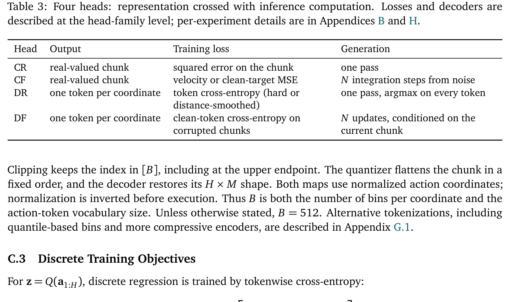
| 动作头 (Head) | 输出表示格式 (Output) | 核心训练损失函数 (Training Loss) | 测试期推理生成机制 (Generation) |
| :--- | :--- | :--- | :--- |
| **连续回归 (CR)** | 实值动作分块向量 | 动作分块上的均方误差 (MSE) | 单次前向传播直接输出 |
| **连续流 (CF)** | 实值动作分块向量 | 速度场或纯净目标匹配 MSE | 从高斯噪声出发进行 $N$ 步欧拉积分 |
| **离散回归 (DR)** | 逐坐标离散 token | 逐 token 分类交叉熵（硬标签或距离平滑） | 单次前向传播，所有 token 独立取 argmax |
| **离散流 (DF)** | 逐坐标离散 token | 损坏动作块上的纯净 token 预测交叉熵 | 条件于当前动作块进行 $N$ 步迭代更新细化 |

**Caption:** Table 3: Four heads: representation crossed with inference computation. Losses and decoders are described at the head-family level; per-experiment details are in Appendices B and H.

**Caption[CN]:** 表 3：四种动作头家族概览：动作空间表示形式与推理计算模式的完备二维正交交叉。损失函数与解码器在家族总体层面定义；各实验细节见附录 B 和附录 H。

> <strong>Para. AC-5:</strong> Clipping keeps the index in $[B]$, including at the upper endpoint. The quantizer flattens the chunk in a fixed order, and the decoder restores its $H \times M$ shape. Both maps use normalized action coordinates; normalization is inverted before execution. Thus $B$ is both the number of bins per coordinate and the action-token vocabulary size. Unless otherwise stated, $B = 512$. Alternative tokenizations, including quantile-based bins and more compressive encoders, are described in Appendix G.1.

> <strong>Para. AC-5[CN]:</strong> 裁剪操作确保分箱索引在 $[1, B]$ 闭区间内严格有效，即使恰好落在上边界端点亦能安全映射。量化器按固定时空顺序将动作块展平为序列，解码器则将其精准还原为 $H \times M$ 的时序矩阵。编解码计算均在归一化动作空间进行，在物理执行前执行反归一化。因此 $B$ 既是每个动作自由度的离散分箱数量，也是动作 token 的离散词表体量；默认 $B = 512$。其他候选分词器（含基于分位数的分箱与高压缩率编码器）详见附录 G.1。

> <strong>Para. AC-6:</strong> C.3 Discrete Training Objectives. For $z = Q(a_{1:H})$, discrete regression is trained by tokenwise cross-entropy:
>  $\mathcal{L}_{\mathrm{DR}} = \mathbb{E}_{(o, a_{1:H}) \sim \mathcal{D}} \left[ -\frac{1}{L} \sum_{j=1}^L \log p_{\theta, j}^{\mathrm{DR}}(z_j \mid o) \right]. \quad 	ext{(C.5)}$ 
> The head outputs $L \times B$ logits, with a softmax over bins at each position [Brohan et al., 2022]. Conditional on the model inputs, its factorized distribution is $p_\theta^{\mathrm{DR}}(z \mid o) = \prod_{j=1}^L p_{\theta, j}^{\mathrm{DR}}(z_j \mid o)$. Consequently, maximizing this model's joint probability reduces to selecting each token's mode [Devlin et al., 2019]: $\hat{z}_j = \arg\max_{k \in [B]} p_{\theta, j}^{\mathrm{DR}}(k \mid o)$. The policy returns $\pi_\theta^{\mathrm{DR}}(o) := D_Q(\hat{z})$.

> <strong>Para. AC-6[CN]:</strong> C.3 离散优化目标细节。对于动作目标 $z = Q(a_{1:H})$，离散回归通过逐 token 的分类交叉熵损失进行训练：
>  $\mathcal{L}_{\mathrm{DR}} = \mathbb{E}_{(o, a_{1:H}) \sim \mathcal{D}} \left[ -\frac{1}{L} \sum_{j=1}^L \log p_{\theta, j}^{\mathrm{DR}}(z_j \mid o) \right]. \quad 	ext{(C.5)}$ 
> 动作头直接输出 $L \times B$ 维 logits，并在每个位置上对所有分箱进行 softmax 操作 [Brohan et al., 2022]。以输入观测为条件，其联合概率分布因式分解为 $p_\theta^{\mathrm{DR}}(z \mid o) = \prod_{j=1}^L p_{\theta, j}^{\mathrm{DR}}(z_j \mid o)$。因此，求解该模型的最大后验联合概率等价于在各个位置上分别贪婪选取概率最大的众数模式 [Devlin et al., 2019]：$\hat{z}_j = \arg\max_{k \in [B]} p_{\theta, j}^{\mathrm{DR}}(k \mid o)$。策略最终输出 $\pi_\theta^{\mathrm{DR}}(o) := D_Q(\hat{z})$。

> <strong>Para. AC-7:</strong> Discrete flow also predicts the clean token at each position, but conditions on the corrupted chunk and flow time. We sample $t \sim \mathcal{U}[0, 1]$ and $z_t \sim q_t(\cdot \mid z)$ using Equation (2.1), and train with clean-token cross-entropy [Gat et al., 2024]:
>  $\mathcal{L}_{\mathrm{DF}} = \mathbb{E}_{(o, a_{1:H}) \sim \mathcal{D}, t \sim \mathcal{U}[0, 1], z_t \sim q_t(\cdot \mid z)} \left[ -\frac{1}{L} \sum_{j=1}^L \log p_{\theta, j}^{\mathrm{DF}}(z_j \mid z_t, t, o) \right]. \quad 	ext{(C.6)}$ 
> DR variants with distance-smoothed targets are specified below.

> <strong>Para. AC-7[CN]:</strong> 离散流同样在每个位置上预测真实纯净的目标 token，但额外以当前被损坏的中间动作状态 $z_t$ 和流时间 $t$ 作为条件输入。我们依据式 (2.1) 均匀采样时间 $t \sim \mathcal{U}[0, 1]$ 以及损坏分块 $z_t \sim q_t(\cdot \mid z)$，并通过纯净 token 交叉熵损失优化模型参数 [Gat et al., 2024]：
>  $\mathcal{L}_{\mathrm{DF}} = \mathbb{E}_{(o, a_{1:H}) \sim \mathcal{D}, t \sim \mathcal{U}[0, 1], z_t \sim q_t(\cdot \mid z)} \left[ -\frac{1}{L} \sum_{j=1}^L \log p_{\theta, j}^{\mathrm{DF}}(z_j \mid z_t, t, o) \right]. \quad 	ext{(C.6)}$ 
> 针对带距离平滑的 DR 变体详见下文。

> <strong>Para. AC-8:</strong> Per-benchmark DR loss. Four action heads cross representation with decoding: continuous regression (CR), continuous flow matching [Lipman et al., 2022] (CF), discrete regression over flat bins with per-token argmax (DR), and discrete flow over flat bins (DF). An autoregressive head (AR) appears in the FAST tokenizer validity and closed-loop comparisons. The DR loss differs between benchmarks. On RoboCasa it is a distance-kernel soft cross-entropy with kernel temperature $\tau = 0.0025$ in normalized action units, so the neighbor bin's unnormalized weight is $\exp(-0.0078/0.0025) \approx 0.045$ of the target bin's. On Push-T it is hard-label cross-entropy. Statements about “cross-entropy without a metric” therefore apply per run.

> <strong>Para. AC-8[CN]:</strong> 各评测基准上的 DR 损失配置。四大动作头全面覆盖动作表示与解码机制的正交组合：连续回归（CR）、连续流匹配（CF [Lipman et al., 2022]）、基于朴素分箱逐 token argmax 解码的离散回归（DR），以及基于朴素分箱的离散流（DF）。此外，在 FAST 分词器与闭环对比实验中还引入了离散自回归头（AR）。DR 的具体损失函数形式在不同基准间略有调整：在 RoboCasa 上，它采用了基于距离核函数的软交叉熵损失，核温度在归一化动作单位下设为 $\tau = 0.0025$，使得紧邻相邻分箱所获得的非归一化目标权重约为目标分箱的 $\exp(-0.0078/0.0025) \approx 0.045$；而在 Push-T 上，DR 则采用标准单热硬标签交叉熵。因此文中关于“无度量先验的纯交叉熵”的陈述具体对应各单项任务的明确配置。

> <strong>Para. AC-9:</strong> C.4 Discrete-Flow Source Distribution and Sampler. The source factorizes as $q_0(z_0) = \prod_{j=1}^L q_{0,j}(z_{0,j})$. A uniform source has $q_{0,j}(k) = 1/B$ for $k \in [B]$ [Gat et al., 2024]; a masked source places all mass on an auxiliary mask token [Sahoo et al., 2024]. The mask is an input symbol and does not decode to an action bin. In either case, the clean-token predictor outputs distributions over $[B]$.

> <strong>Para. AC-9[CN]:</strong> C.4 离散流源分布与采样实现。离散流初始源分布按位置因式分解为 $q_0(z_0) = \prod_{j=1}^L q_{0,j}(z_{0,j})$。均匀先验源对任意分箱 $k \in [B]$ 满足 $q_{0,j}(k) = 1/B$ [Gat et al., 2024]；掩码先验源则将全部概率质量赋予一个专用的虚拟掩码 token（mask token [Sahoo et al., 2024]）。掩码 token 仅作为中间输入的损坏符号，不对应任何物理动作分箱。无论采用何种先验源，模型的纯净 token 预测器最终输出的概率分布始终严格定义在真实的 $[B]$ 分箱集合上。

> <strong>Para. AC-10:</strong> The schedule is continuously differentiable and nondecreasing, with $\alpha(0) = 0$, $\alpha(1) = 1$, and $\alpha(t) < 1$ for $t < 1$. For the grid $0 = t_0 < \dots < t_N = 1$, the mixture-path update in Equation (2.3) uses $\eta_n = (\alpha(t_{n+1}) - \alpha(t_n))/(1 - \alpha(t_n))$. Proposals and replacement decisions are independent across positions conditional on the current chunk. This rule gives an Euler approximation, in the interpolation coordinate $\alpha$, to the associated continuous-time Markov chain. Because $\eta_{N-1} = 1$, the final update replaces every position with a clean-token proposal, so the output contains no mask tokens.

> <strong>Para. AC-10[CN]:</strong> 时间调度函数连续可微且单调非降，满足 $\alpha(0) = 0$、$\alpha(1) = 1$，且当 $t < 1$ 时 $\alpha(t) < 1$。对于时间网格 $0 = t_0 < \dots < t_N = 1$，式 (2.3) 中的混合路径更新率设为 $\eta_n = (\alpha(t_{n+1}) - \alpha(t_n))/(1 - \alpha(t_n))$。在给定当前动作分块的条件下，各位置上的建议抽取与替换决策相互独立进行。在时间插值坐标 $\alpha$ 下，该规则构成了对应连续时间马尔可夫链的精确欧拉前向离散近似。由于在最后一个时步必定有 $\eta_{N-1} = 1$，因此最终更新步骤将无条件强制用纯净 token 建议覆盖所有位置，彻底保证最终生成的动作序列中绝不残留任何掩码标记。

> <strong>Para. AC-11:</strong> The policy is $\pi_{\theta, N}^{\mathrm{DF}}(o; \xi) := D_Q(z_{t_N})$, where $\xi$ collects randomness in initialization, proposals, and replacement decisions. We suppress $N$ and $\xi$ when clear from context. For a uniform source, tokens updated at earlier steps may be revised later. Subsequent predictions condition on the updated chunk, allowing the generation process to capture dependencies across positions despite the conditional independence of updates within each step.

> <strong>Para. AC-11[CN]:</strong> 最终策略定义为 $\pi_{\theta, N}^{\mathrm{DF}}(o; \xi) := D_Q(z_{t_N})$，其中 $\xi$ 统合了初始化、建议抽取及替换决策中所包含的全部随机变量。在语境明确时我们省略下标 $N$ 与变量 $\xi$。当采用均匀源分布时，早先时步中已被更新的 token 仍有概率在后续步被重新修正。后续预测完全以更新后的动作块为整体条件，这使得生成过程虽然在单步内部采用条件独立更新，但通过多轮时空反馈极其强力地捕获了全分块全局跨位置的复杂强耦合依赖关系。

> <strong>Para. AC-12:</strong> C.5 Classifier-Free Guidance. CFG [Ho and Salimans, 2022] combines a prediction conditioned on the observation $o$ with one made from a null condition $\emptyset$. Condition and null condition. Let $c$ be the encoding of the observation $o$. For the VLA policies, $c$ is the set of 64 condition tokens that the resampler produces from the backbone states and the proprioception token (Appendix C.6.2). The null condition $\emptyset$ is a learned tensor of the same shape, substituted for $c$ during training with probability 0.1. Unconditional evaluations substitute $\emptyset$ for $c$ deterministically.

> <strong>Para. AC-12[CN]:</strong> C.5 分类器自由引导详细机制。CFG [Ho and Salimans, 2022] 通过线性外推将以真实观测 $o$ 为条件的预测与基于空条件 $\emptyset$ 的无条件预测有机融合。条件与空条件构造：令 $c$ 为环境观测 $o$ 的深度表征。在 VLA 策略中，$c$ 对应于重采样器（resampler）从 VLM 顶层特征及机械臂本体感受 token 中提炼出的 64 个条件 token 向量（附录 C.6.2）。空条件 $\emptyset$ 是一个形状完全一致的可学习张量参数，在模型训练过程中以 10% 的独立概率随机替换掉真实的条件特征 $c$；在执行无条件评估时，则确定性地将 $c$ 强制替换为 $\emptyset$。

> <strong>Para. AC-13:</strong> Discrete heads. Suppressing other model inputs, discrete heads use:
>  $p_{\theta, j}^{\mathrm{CFG}}(k \mid o) \propto p_{\theta, j}(k \mid o)^{1+\lambda} p_{\theta, j}(k \mid \emptyset)^{-\lambda}, \quad k \in [B], \quad \lambda \ge 0, \quad 	ext{(C.7)}$ 
> with normalization over bins. Equivalently, if $s_{\theta, j}(o) \in \mathbb{R}^B$ and $s_{\theta, j}(\emptyset) \in \mathbb{R}^B$ are the conditional and unconditional logit vectors, the guided distribution is the softmax of the tilted logits:
>  $s_{\theta, j}^{\mathrm{CFG}}(o) = (1 + \lambda) s_{\theta, j}(o) - \lambda s_{\theta, j}(\emptyset).$ 
> DR applies this rule once and decodes greedily: $\hat{z}_j = \arg\max_k s_{\theta, j}^{\mathrm{CFG}}(k \mid o)$. DF evaluates the head twice at each refinement step, once with $c$ and once with $\emptyset$, tilting the clean-token proposal distribution before drawing proposals in Equation (2.3).

> <strong>Para. AC-13[CN]:</strong> 离散动作头的引导公式。省略其他无关输入参数，离散头采用如下重加权概率公式：
>  $p_{\theta, j}^{\mathrm{CFG}}(k \mid o) \propto p_{\theta, j}(k \mid o)^{1+\lambda} p_{\theta, j}(k \mid \emptyset)^{-\lambda}, \quad k \in [B], \quad \lambda \ge 0, \quad 	ext{(C.7)}$ 
> 并在所有 $B$ 个分箱上进行归一化。在计算实现上，若令 $s_{\theta, j}(o) \in \mathbb{R}^B$ 与 $s_{\theta, j}(\emptyset) \in \mathbb{R}^B$ 分别代表条件前向与无条件前向输出的 logits 向量，则引导后的概率分布完全等价于对外推倾斜后的 logits 直接执行 softmax：
>  $s_{\theta, j}^{\mathrm{CFG}}(o) = (1 + \lambda) s_{\theta, j}(o) - \lambda s_{\theta, j}(\emptyset).$ 
> DR 仅需执行一次该计算并贪婪解码：$\hat{z}_j = \arg\max_k s_{\theta, j}^{\mathrm{CFG}}(k \mid o)$；而 DF 在每一个细化去噪迭代步均评估两次动作头（分别送入真实条件 $c$ 与空条件 $\emptyset$），在依据式 (2.3) 抽取纯净 token 建议之前对候选分布进行动态锐化。

> <strong>Para. AC-14:</strong> Continuous flow. At each Euler step, CF evaluates the head at the same state $x_{t_n}$ and time $t_n$, once with $o$ and once with $\emptyset$, and the Euler update of Equation (C.3) uses the guided velocity in place of $v_\theta(x_{t_n}, t_n, o)$. The guided velocity is:
>  $v_\theta^{\mathrm{CFG}}(x_{t_n}, t_n, o) = (1 + \lambda) v_\theta(x_{t_n}, t_n, o) - \lambda v_\theta(x_{t_n}, t_n, \emptyset). \quad 	ext{(C.8)}$

> <strong>Para. AC-14[CN]:</strong> 连续流的速度场引导公式。在欧拉积分的每一步，CF 在当前状态 $x_{t_n}$ 与流时间 $t_n$ 处分别以 $o$ 和 $\emptyset$ 评估两次动作头，并在式 (C.3) 的数值更新中采用引导速度场替代原始速度：
>  $v_\theta^{\mathrm{CFG}}(x_{t_n}, t_n, o) = (1 + \lambda) v_\theta(x_{t_n}, t_n, o) - \lambda v_\theta(x_{t_n}, t_n, \emptyset). \quad 	ext{(C.8)}$

> <strong>Para. AC-15:</strong> Why CR is not guided. Guidance reweights a distribution. For DR and DF it tilts each token's distribution, and for CF it changes the velocity field that carries noise to actions. CR has no distribution to reweight: it outputs one chunk, its estimate of $\mathbb{E}[a_{1:H} \mid o]$, and its unconditional output estimates the dataset mean $\mathbb{E}[a_{1:H}]$. The same combination, $(1 + \lambda)\pi_\theta^{\mathrm{CR}}(o) - \lambda \pi_\theta^{\mathrm{CR}}(\emptyset)$, only moves the predicted chunk along $\mathbb{E}[a_{1:H} \mid o] - \mathbb{E}[a_{1:H}]$, further from the dataset mean. When several behaviors are plausible, the conditional mean already averages them, and moving it does not select one of them. We therefore evaluate CR without guidance.

> <strong>Para. AC-15[CN]:</strong> 为什么不对 CR 使用引导。分类器自由引导本质上是对概率分布密度的几何重加权。对于 DR 和 DF，它直接倾斜锐化每个 token 的离散类别分布；对于 CF，它改变驱动高斯噪声向目标动作迁移的流速度场。然而连续回归（CR）根本不输出概率分布：它只单步输出单一实值分块向量，即条件期望估计值 $\mathbb{E}[a_{1:H} \mid o]$，其无条件输出则对应数据集全局均值 $\mathbb{E}[a_{1:H}]$。若盲目对其套用线性组合式 $(1 + \lambda)\pi_\theta^{\mathrm{CR}}(o) - \lambda \pi_\theta^{\mathrm{CR}}(\emptyset)$，仅仅是将预测向量沿着差分方向 $\mathbb{E}[a_{1:H} \mid o] - \mathbb{E}[a_{1:H}]$ 向外生硬推移，远离数据集中心。当存在多个合理行为模式时，条件期望本身就已经在各分支间进行了错误平滑，单纯的线性平移绝不可能起到从中挑出单一合理模式的作用。因此，我们在所有实验中均对 CR 保持无引导评估。

> <strong>Para. AC-16:</strong> Inference cost. The backbone and resampler encode $o$ once per inference call. Because $\emptyset$ is a fixed learned tensor, the unconditional prediction needs no backbone pass, only a second pass of the action head. We report NFE as the number of steps $N$ for DF and CF. Guidance doubles the action-head passes, from one to two for DR and from $N$ to $2N$ for DF and CF, and leaves the backbone cost unchanged. Under this convention, $\lambda = 0$ gives the unguided conditional prediction.

> <strong>Para. AC-16[CN]:</strong> 测试推理计算开销分析。在每次完整的闭环推理调用中，大模型骨干网络与重采样器对环境输入图像及指令 $o$ 仅需执行一次前向编码。由于空条件 $\emptyset$ 是常驻内存的固定可学习张量，因此无条件预测完全无需重新经过庞大的 VLM 骨干网络，仅需在轻量级的动作头上多执行一次前向传播。对于 DF 与 CF，我们将函数评估次数（NFE）统一记为生成步数 $N$。引入引导机制会使动作头自身的前向计算次数翻倍（DR 从 1 次增至 2 次，DF/CF 从 $N$ 次增至 $2N$ 次），但整个系统最沉重的大模型骨干网络开销保持绝对不变。按照这一惯例，$\lambda = 0$ 严格对应无引导的原始条件前向。

> <strong>Para. AC-17:</strong> C.6 Omitted Details for Policy Architecture. The heads use the same backbone design. CR and DR receive auxiliary random inputs independent of the target action chunk, so random inputs are present for both regression and flow heads. These auxiliary inputs are suppressed in the preceding notation. Within each setting, all heads see the same observations and training data. This section gives the networks that map these observations to actions; the losses and samplers are given in Appendices C.1 and C.3.

> <strong>Para. AC-17[CN]:</strong> C.6 策略网络架构未详述细节。所有动作头家族完全建立在统一的骨干网络架构之上。CR 与 DR 同样接入了独立于目标动作分块的辅助随机噪声输入，从而确保回归头与流匹配头在随机信息输入通道上完全公平对齐。在之前的公式推导中省略了这些辅助噪声记号。在每个评测场景下，所有动作头接收完全相同的输入观测序列与训练数据。下文详细列出将这些观测特征映射为最终物理动作的具体网络拓扑结构。

> <strong>Para. AC-18:</strong> C.6.1 Single-Task From-Scratch Architectures. RoboMimic policies observe the object state and the end-effector position, orientation, and gripper state of each arm, over the last two time steps. An MLP encodes the flattened observation. Each policy predicts $H = 10$ actions and executes 8 before replanning. An action is a 10-dimensional relative end-effector command: 3D position, 6D rotation, and gripper (20 dimensions for the two-arm Transport task). Actions are normalized per dimension to $[-1, 1]$. Discrete heads use $B = 512$ bins per coordinate. Tab. 4 lists the two network families.

> <strong>Para. AC-18[CN]:</strong> C.6.1 单任务从头训练网络架构。RoboMimic 策略以环境底层物理状态为输入，观测过去两个时步内的目标物体状态以及机械臂末端执行器的绝对位置、朝向姿态和夹爪状态。一个轻量级 MLP 负责对展平后的观测向量进行特征提取。每个策略预测时域长度为 $H = 10$ 的动作分块，并在开环执行前 8 步后重新触发规划。每个时步的动作采用 10 维相对末端指令：3D 平移位置、6D 旋转表示以及 1 维二值夹爪状态（在双臂协同的 Transport 任务中扩展为 20 维）。所有动作维度均归一化到 $[-1, 1]$ 范围。离散动作头对每个坐标轴采用 $B = 512$ 个离散分箱。表 4 详细列出了连续与离散两大家族的网络超参数架构。

### Table 4. 单任务 RoboMimic 从头训练策略网络超参数规格

| 网络架构超参数配置 (Hyperparameter) | 连续模型家族 (CR, CF) | 离散模型家族 (DR, DF) |
| :--- | :--- | :--- |
| **Transformer 结构与层数 (Blocks)** | 8 编码器层 + 8 解码器层 | 12 层纯 Transformer |
| **特征通道 / 注意力头数 / MLP 宽度** | 256 / 4 / 1024 | 256 / 4 / 1024 |
| **动作 Token 组织形式 (Action tokens)** | 每个物理时步 1 个 token (共 10 个) | 每个时步的每个坐标各 1 个 token (共 100 个) |
| **动作输入编码方式 (Action input)** | 作用于 10 维实值动作的 MLP | $B$ 个离散分箱的可学习词向量嵌入 |
| **动作输出预测映射 (Action output)** | 线性投影输出 10 维连续数值 | 线性分类头输出 $B$ 个分箱的分类 logits |
| **观测特征 MLP 投影层宽度** | 256 | 512 |
| **Dropout 正则化比率** | 0.0 | 0.1 |
| **独立模型总参数量 (Parameters)** | 16.4 M | 15.8 M |

**Caption:** Table 4: Networks for the single-task RoboMimic policies. Both families are DiT-style transformers conditioned through adaptive layer norm (adaLN) on the observation embedding and the flow time. Parameter counts include the observation encoder and are given for single-arm tasks.

**Caption[CN]:** 表 4：用于单任务 RoboMimic 策略的网络架构细节。两大家族均采用 DiT 风格的 Transformer 结构，通过自适应层归一化（adaLN）以环境观测嵌入和流时间为条件进行调制。参数量包含观测编码器，数据针对单臂任务给出。

> <strong>Para. AC-19:</strong> CF integrates its velocity field with 9 Euler steps. DF runs 100 update steps with the mixture path $\kappa_t = t^3$, followed by one argmax prediction. All models are trained for 300k steps with AdamW (learning rate $10^{-4}$, weight decay $10^{-5}$, gradient clipping at 10) and an exponential moving average of the weights with decay 0.995, which is used for evaluation. Continuous heads use batch size 1024 and cosine decay; discrete heads use batch size 512, a 5% linear warmup, and cosine decay. Each run uses one L40S GPU. The synthetic-fitting trunk is described in Appendix H.

> <strong>Para. AC-19[CN]:</strong> CF 在推理时采用 9 步欧拉数值积分更新其速度场。DF 采用立方时间调度曲线 $\kappa_t = t^3$ 的混合路径执行 100 步迭代去噪，随后在末步执行一次贪婪 argmax 确定性解码。所有单任务模型均采用 AdamW 优化器训练 30 万步（初始学习率 $10^{-4}$，权重衰减 $10^{-5}$，梯度裁剪阈值 10），并维护衰减率为 0.995 的权重指数移动平均（EMA）用于最终评估。连续动作头采用 1024 批大小与余弦学习率衰减；离散动作头采用 512 批大小、5% 步数的线性预热及余弦退火。所有实验均在单张 NVIDIA L40S GPU 上完成。合成函数拟合的主干结构在附录 H 中说明。

> <strong>Para. AC-20:</strong> C.6.2 VLA-Scale Architectures. All four heads share a PaliGemma-3B backbone [Beyer et al., 2024]: a SigLIP So400m/14 image encoder and a Gemma-2B language model. We initialize it from the $\pi_0$ vision–language weights [Black et al., 2025] and fine-tune it fully. The backbone reads up to three $224 \times 224$ camera images (256 tokens each) and up to 48 text tokens with bidirectional attention. A resampler with 64 learned queries (2 blocks, width 1536) compresses the final-layer backbone states, together with one proprioception token, into 64 condition tokens. The action head is a separate transformer with 8 blocks, width 1536, 12 attention heads, and MLP width 6144. Each block applies self-attention over the action sequence, cross-attention to the 64 condition tokens, and an MLP. The head does not share attention layers with the backbone. It processes the $H = 24$ action chunk as a sequence with one element per action coordinate ($M = 7$ coordinates, giving 168 tokens for discrete heads and 24 tokens for continuous heads). Training details and optimizer hyperparameters are summarized in Tab. 5.

> <strong>Para. AC-20[CN]:</strong> C.6.2 VLA 规模多任务模型架构。所有四类动作头共享同一个 PaliGemma-3B 骨干大模型 [Beyer et al., 2024]：包含一个 SigLIP So400m/14 视觉编码器和一个 Gemma-2B 语言模型。我们采用 $\pi_0$ [Black et al., 2025] 的预训练多模态权重进行初始化，并在训练中执行全参数微调。骨干网络最多接收 3 路视角分辨率为 $224 \times 224$ 的摄像头图像（每幅图像提取 256 个 patch tokens）以及最长 48 个语言文本 tokens，并在各模态间施加双向自注意力交互。一个包含 64 个可学习查询向量的重采样器模块（resampler，含 2 个注意力块，隐藏层通道 1536）负责将骨干网络的顶层隐藏状态以及 1 个机械臂本体感受 token 深度提炼压缩为 64 个紧凑的条件 token。动作头是一个独立的 Transformer 网络，包含 8 个计算块，通道宽度 1536，12 个注意力头，MLP 中间层宽度 6144。每个动作头块依次执行动作序列内部的自注意力、与 64 个观测条件 tokens 的交叉注意力以及前馈 MLP 变换。动作头与底层骨干网络完全不共享注意力权重。它将长度为 $H = 24$ 的动作分块展开为时序：离散头逐坐标展开为 $24 \times 7 = 168$ 个独立 tokens，连续头则以时步为单位处理 24 个向量 tokens。全套训练细节与超参数见表 5。

### Table 5. VLA 规模四大动作头训练超参数与工程实现配方全景规格

| 超参数与模块设定 (Settings) | 连续回归 (CR) | 连续流 (CF) | 离散回归 (DR) | 离散流 (DF) |
| :--- | :--- | :--- | :--- | :--- |
| **四头共享骨干网络** | PaliGemma-3B ($\pi_0$ 预训练权重全量微调，参数量 2.92B) | ← | ← | ← |
| **重采样器条件 Tokens** | 64 个 tokens (2 个 Transformer 块，宽度 1536) | ← | ← | ← |
| **动作头 Blocks / 宽度 / 头数 / MLP** | 8 / 1536 / 12 / 6144 | ← | ← | ← |
| **动作分块尺寸 (Chunk size)** | $H = 24$ 步，每个时步 $M = 7$ 个物理坐标分量 | ← | ← | ← |
| **动作表示与空间形态** | 实值向量 $a_{1:H} \in \mathbb{R}^{H \times M}$ | 实值向量 $a_{1:H} \in \mathbb{R}^{H \times M}$ | 离散序列 $z \in [B]^{HM}$ ($B=512$) | 离散序列 $z \in [B]^{HM}$ ($B=512$) |
| **动作头输入内容 (Input)** | 随机高斯噪声向量 | 连续随机插值向量 $I_t$ | 辅助随机输入 | 损坏动作块 $z_t$ (均匀源) |
| **动作头输出预测目标 (Target)** | 纯净连续动作分块 | 条件流速度场 $U_t$ | 纯净动作 Tokens | 纯净动作 Tokens |
| **模型训练目标损失 (Loss)** | 均方误差 (MSE) | 流匹配速度场 MSE | 距离平滑分类交叉熵 | 纯净 token 分类交叉熵 |
| **推理生成算法机制 (Generation)** | 单次前向直接输出 | 欧拉数值积分求解 ODE | 单次前向逐 token 取 argmax | $N$ 步迭代去噪 ($\alpha(t)=t^3$) |
| **分类器自由引导支持 (CFG)** | 否 (无分布可锐化) | 是 | 是 | 是 |
| **动作头独立参数量 (Head params)** | 367 M | 367 M | 369 M | 371 M |
| **全量训练步数 / 全局批大小** | 150k 步 / 512 (8 台 NVIDIA B200 GPU 集群，每卡批大小 64) | ← | ← | ← |
| **优化器与基准学习率** | AdamW，学习率 $7.5 \times 10^{-5}$，$\\beta=(0.9, 0.95)$，权重衰减 $10^{-4}$，梯度裁剪 1.0 | ← | ← | ← |
| **学习率调度机制与精度** | 线性预热后余弦衰减至峰值的 0.1 倍；全模型采用 bf16 混合精度训练 | ← | ← | ← |

**Caption:** Table 5: Action heads and training settings for the VLA-scale policies. Parameter counts cover the action head and resampler; the backbone adds 2.92B parameters.

**Caption[CN]:** 表 5：VLA 规模多任务策略的动作头网络架构与完整训练参数配置。动作头参数量包含独立动作 Transformer 与条件重采样器；底层共享的 PaliGemma 骨干大模型额外包含 2.92B 参数。

# Appendix D Full Performance Results

> <strong>Para. AD-1:</strong> D.1 RoboMimic Results. RoboMimic policies are state-based, trained from scratch on each task, and use relative actions. For each task and head family, Fig. 1 reports the best success rate over tokenizer (flat or quantile bins), flow variant, and guidance weight. Each evaluation uses 32 episodes. Fig. 6 reports how closely each run fits its training data. For each run, we show the end-effector (EEF) position error on training samples at its last 10 evaluations.

> <strong>Para. AD-1[CN]:</strong> D.1 RoboMimic 单任务从头训练详尽评测。RoboMimic 策略直接以底层物理状态为输入，在各个操作任务上从头训练（不加载任何预训练权重），并采用相对末端执行器动作。针对每项任务和每个动作头家族，正文图 1 汇报了跨不同分词器（朴素均匀分箱或分位数分箱）、流匹配变体以及引导权重的最佳闭环成功率。每次评估运行 32 个完整 episode。图 6 进一步揭示了各策略在训练数据上的终态拟合程度：针对每次训练，我们统计了其最后 10 次周期性评估中在训练样本上的末端执行器（EEF）位置均方根误差。

### Figure 6. RoboMimic 从头训练各动作头在训练集上的末端执行器位置误差

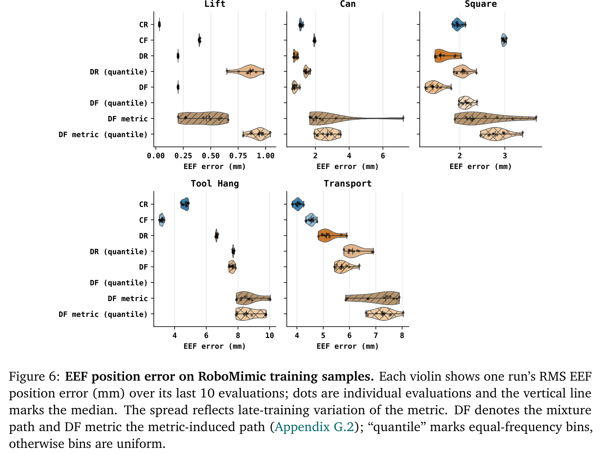

**Caption:** Figure 6: EEF position error on RoboMimic training samples. Each violin shows one run's RMS EEF position error (mm) over its last 10 evaluations; dots are individual evaluations and the vertical line marks the median. The spread reflects late-training variation of the metric. DF denotes the mixture path and DF metric the metric-induced path (Appendix G.2); “quantile” marks equal-frequency bins, otherwise bins are uniform.

**Caption[CN]:** 图 6：RoboMimic 训练样本上的末端执行器（EEF）位置拟合误差。每个小提琴图展示了单次独立训练在最后 10 次周期性评估中的 RMS EEF 位置误差（mm）；散点代表各次单项评估，垂直线标记中位数。图形的展开宽度反映了训练末期指标的收敛波动范围。DF 表示标准混合路径，DF metric 表示度量诱导路径（附录 G.2）；“quantile”标注等频分位数分箱，其余均默认采用均匀分箱。

> <strong>Para. AD-2:</strong> D.2 Action Parameterization and Action Space. Both the VLA and the single-task RoboMimic experiments in the main paper use relative actions in end-effector space. This section defines relative actions together with two alternatives, delta and absolute actions, and compares all three for the four VLA heads on RoboCasa (Fig. 7 and Tab. 6). It then compares relative actions in joint space and end-effector space (Tab. 7).

> <strong>Para. AD-2[CN]:</strong> D.2 动作参数化形式与动作控制空间消融。正文中的多任务 VLA 实验与单任务 RoboMimic 实验均默认采用末端执行器空间中的相对动作（relative actions）。本节严格给出相对动作的形式化定义，并与增量动作（delta actions）和绝对世界坐标系动作（absolute actions）进行理论对比，在 RoboCasa 上系统测试了四类 VLA 动作头在三种动作形式下的闭环表现（图 7 与表 6）；随后进一步对比了关节角度空间与末端执行器空间中的相对控制效果（表 7）。

> <strong>Para. AD-3:</strong> Definitions. Let the chunk $a_{1:H}$ be predicted at environment step $t$, and let command $h$ be sent at step $t + h - 1$ with commanded target pose $(p_h^\star, R_h^\star)$, where $p_h^\star \in \mathbb{R}^3$ and $R_h^\star \in \mathrm{SO}(3)$ are expressed in the robot base frame. Let $(p_k, R_k)$ be the end-effector pose reached at step $k$. Each parameterization encodes the target with respect to a reference pose $(\bar{p}_h, \bar{R}_h)$:

> <strong>Para. AD-3[CN]:</strong> 数学定义。假设动作分块 $a_{1:H}$ 于环境交互时步 $t$ 生成，而分块内的第 $h$ 个物理控制指令在时步 $t + h - 1$ 被下发执行，其对应的期望目标位姿为 $(p_h^\star, R_h^\star)$（其中位置 $p_h^\star \in \mathbb{R}^3$，旋转矩阵 $R_h^\star \in \mathrm{SO}(3)$ 均在机械臂基座坐标系下表达）。令 $(p_k, R_k)$ 表示机械臂在实际执行时步 $k$ 所达到的末端位姿。三种参数化形式均通过相对于特定参考基准位姿 $(\bar{p}_h, \bar{R}_h)$ 的相对变换来编码控制目标：

$$
a_h^{\mathrm{tr}} = p_h^\star - \bar{p}_h, \quad a_h^{\mathrm{rot}} = \mathrm{Log}\left( R_h^\star \bar{R}_h^\top \right), \quad (\bar{p}_h, \bar{R}_h) = \begin{cases} (p_{t+h-1}, R_{t+h-1}), & \text{delta (增量)}, \\ (p_t, R_t), & \text{relative (相对)}, \\ (0, I), & \text{absolute (绝对)}. \end{cases} \tag{D.1}
$$

> <strong>Para. AD-4:</strong> Here $\mathrm{Log} : \mathrm{SO}(3) \to \mathbb{R}^3$ returns the axis-angle vector, so $R_h^\star = \mathrm{Exp}(a_h^{\mathrm{rot}}) \bar{R}_h$. The gripper coordinate $a_h^{\mathrm{g}}$ is the same in all three. Delta actions are per-step pose increments, measured from the pose the robot has reached when the command is sent. Relative actions measure every target in the chunk from the end-effector pose at prediction time; all policies in the main paper use them. Absolute actions are target poses in the robot base frame. Three properties follow from Eq. (D.1). At $h = 1$, delta and relative actions coincide. Relative and absolute actions fix every target of the chunk at prediction time, while a delta target also depends on the pose reached during execution. Relative actions start near zero and grow along the chunk, while absolute actions also carry the robot's position in the workspace, so their range is set by the workspace rather than by the motion (Fig. 7(d)).

> <strong>Para. AD-4[CN]:</strong> 此处 $\mathrm{Log} : \mathrm{SO}(3) \to \mathbb{R}^3$ 将旋转矩阵映射为 3 维轴角向量，因此目标旋转矩阵满足 $R_h^\star = \mathrm{Exp}(a_h^{\mathrm{rot}}) \bar{R}_h$。夹爪控制分量 $a_h^{\mathrm{g}}$ 在三种参数化下完全相同。增量动作（delta）是逐时步位姿微小增量，严格以当前指令发送瞬间机器人实际所达到的末端位姿为基准；相对动作（relative）将分块内的所有未来目标均相对于该动作块规划预测瞬间的末端位姿进行度量（正文所有模型均采用相对动作）；绝对动作（absolute）则直接以机器人世界基座坐标系的原点位姿为固定基准。根据式 (D.1) 可推导出三大关键物理属性：在第一个时步 $h = 1$ 时，增量动作与相对动作在数学上完全重合；相对与绝对动作在预测发生的瞬间就将动作块内的全部目标位姿确定性锁死，而增量动作的实际执行目标则深度动态依赖于每一步执行后的实际落地状态；相对动作总是从零附近平滑起步并随预测时序向前平稳增长，而绝对动作由于背负了机械臂在工作空间中的绝对坐标偏置，其数值动态范围完全由庞大的全局工作空间尺度所决定，因而牺牲了动作微观动态的高频分辨率（见图 7(d)）。

### Table 6. 增量/相对/绝对动作空间参数化在 RoboCasa 上的闭环成功率对比

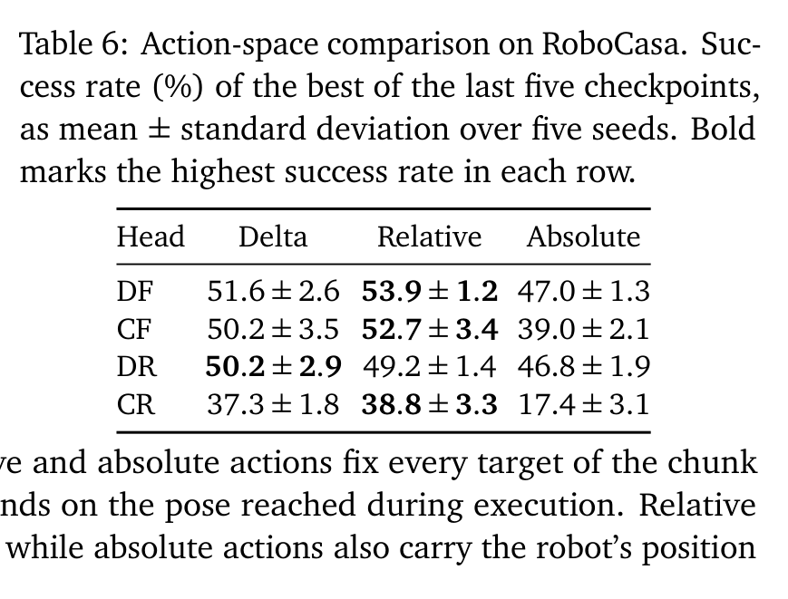
| 动作头 (Head) | 增量动作 (Delta) | 相对动作 (Relative, 默认) | 绝对动作 (Absolute) |
| :--- | :--- | :--- | :--- |
| **离散流 (DF)** | 51.6 ± 2.6% | **53.9 ± 1.2%** | 47.0 ± 1.3% |
| **连续流 (CF)** | 50.2 ± 3.5% | **52.7 ± 3.4%** | 39.0 ± 2.1% |
| **离散回归 (DR)** | **50.2 ± 2.9%** | 49.2 ± 1.4% | 46.8 ± 1.9% |
| **连续回归 (CR)** | 37.3 ± 1.8% | **38.8 ± 3.3%** | 17.4 ± 3.1% |

**Caption:** Table 6: Action-space comparison on RoboCasa. Success rate (%) of the best of the last five checkpoints, as mean ± standard deviation over five seeds. Bold marks the highest success rate in each row.

**Caption[CN]:** 表 6：RoboCasa 上不同动作参数化形式（增量、相对、绝对）的闭环成功率对比。数值汇报最后 5 个训练检查点中的最佳表现（5 个随机种子的均值 ± 标准差）。加粗标注每行中的最高成功率。

### Figure 7. 增量、相对与绝对动作参数化几何结构与数值尺度对比

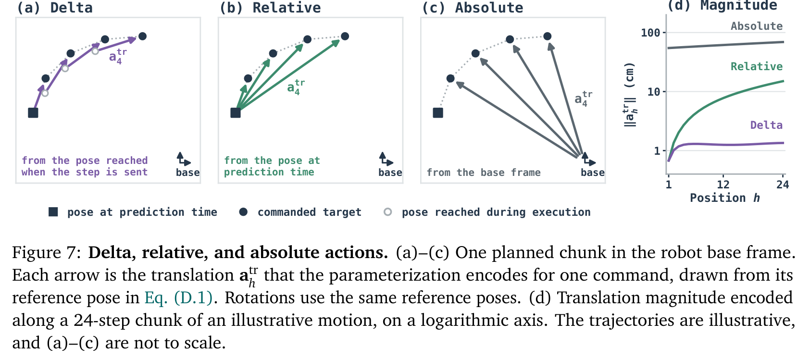

**Caption:** Figure 7: Delta, relative, and absolute actions. (a)–(c) One planned chunk in the robot base frame. Each arrow is the translation atr h that the parameterization encodes for one command, drawn from its reference pose in Eq. (D.1). Rotations use the same reference poses. (d) Translation magnitude encoded along a 24-step chunk of an illustrative motion, on a logarithmic axis. The trajectories are illustrative, and (a)–(c) are not to scale.

**Caption[CN]:** 图 7：增量、相对与绝对动作参数化几何原理。(a)–(c) 机械臂基座坐标系下规划的动作分块：每个箭头代表参数化为单个控制指令所编码的平移位移向量，起点为其在式 (D.1) 中对应的基准位姿；旋转分量采用完全相同的参考基准。(d) 在对数坐标轴下展示典型运动过程中沿 24 步动作块所编码的平移数值幅值变化曲线。轨迹仅作原理示意，(a)–(c) 非等比例绘制。

> <strong>Para. AD-5:</strong> Results. Each entry of Tab. 6 uses the decoding setting (CFG and, for the flow heads, NFE) chosen separately for that head and action space. Relative actions give the highest success for DF, CF, and CR. DR does slightly better with delta actions (50.2% against 49.2%). Absolute actions give the lowest success for every head. The drop from relative to absolute actions is smaller for the discrete heads, 2.4 points for DR and 6.9 for DF, than for the continuous heads, 13.7 points for CF and 21.4 for CR.

> <strong>Para. AD-5[CN]:</strong> 实验结果分析。表 6 中的每个条目均针对该动作头与动作空间单独选取引导权重 CFG 与推理步数 NFE 的最佳解码配置。相对动作（relative actions）在 DF、CF 和 CR 上均取得了最高的闭环成功率；DR 采用增量动作时表现略好（50.2% 对比 49.2%）；而绝对动作（absolute actions）在所有动作头上均表现最差。尤为引人瞩目的是：当从相对动作切换至绝对动作时，离散动作头的性能衰减极为轻微（DR 仅下降 2.4 个百分点，DF 下降 6.9 个百分点），而连续动作头则遭遇了雪崩式下跌（CF 骤降 13.7 个百分点，CR 暴跌 21.4 个百分点）。这有力地揭示出离散分箱表示在应对跨越庞大全局坐标系的大尺度范围预测时，具备远超连续回归模型的绝佳容错鲁棒性。

### Table 7. 关节角度空间 vs 末端执行器空间相对动作控制效果对比

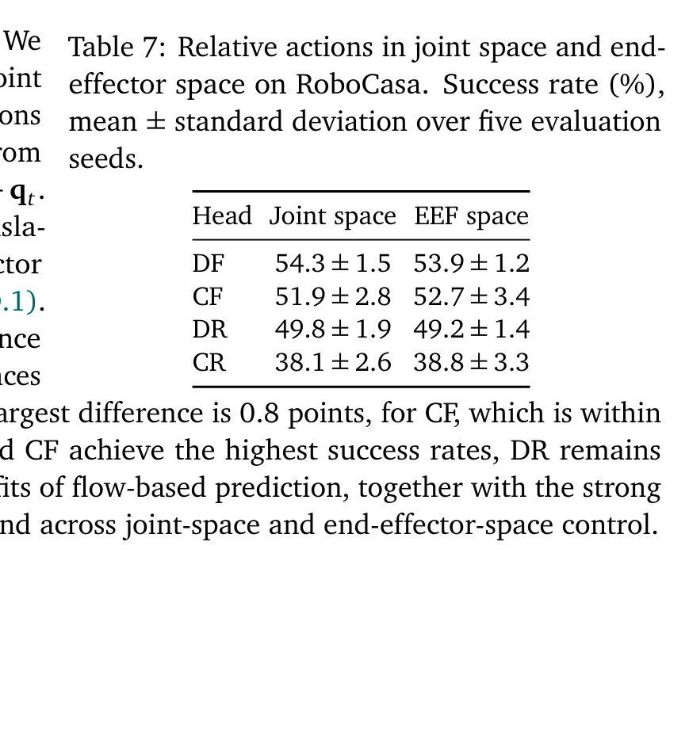
| 动作头 (Head) | 关节角度空间 (Joint space) | 末端执行器空间 (EEF space) |
| :--- | :--- | :--- |
| **离散流 (DF)** | **54.3 ± 1.5%** | 53.9 ± 1.2% |
| **连续流 (CF)** | 51.9 ± 2.8% | **52.7 ± 3.4%** |
| **离散回归 (DR)** | **49.8 ± 1.9%** | 49.2 ± 1.4% |
| **连续回归 (CR)** | 38.1 ± 2.6% | **38.8 ± 3.3%** |

**Caption:** Table 7: Relative actions in joint space and end-effector space on RoboCasa. Success rate (%), mean ± standard deviation over five evaluation seeds.

**Caption[CN]:** 表 7：RoboCasa 上相对动作在关节角度空间与末端执行器（EEF）空间的闭环成功率对比。成功率（%）汇报 5 个随机评估种子的均值 ± 标准差。

> <strong>Para. AD-6:</strong> Joint-space versus end-effector-space actions. We compare the four heads using relative actions in joint space and in end-effector space. Relative joint actions encode each target joint configuration as an offset from the configuration at prediction time, $a_h^{\mathrm{joint}} = q_h^\star - q_t$. Relative end-effector actions encode target translations and rotations with respect to the end-effector pose at the same prediction time, following Eq. (D.1). Both representations therefore use a fixed reference throughout the predicted chunk. The two action spaces give nearly the same success for every head; the largest difference is 0.8 points, for CF, which is within one standard deviation (Tab. 7). In both, DF and CF achieve the highest success rates, DR remains competitive, and CR performs less well. The benefits of flow-based prediction, together with the strong performance of discrete regression, therefore extend across joint-space and end-effector-space control.

> <strong>Para. AD-6[CN]:</strong> 关节空间与末端执行器空间的等价性验证。我们进一步系统对比了四大动作头在关节角度空间与末端执行器空间中的表现。相对关节动作将每个期望的目标关节角位置编码为相对于规划预测时刻关节角的偏移量 $a_h^{\mathrm{joint}} = q_h^\star - q_t$；相对末端动作则严格遵循式 (D.1) 编码位姿变换。两种参数化均在预测的整个动作块内部采用恒定基准。如表 7 所示，两种控制空间在所有动作头上均展现出了高度一致的性能水平；最大的差距仅为 0.8 个百分点（CF 头），完全落在单次评测的标准差波动范围之内。在这两个物理空间中，DF 和 CF 均摘得桂冠，DR 紧咬不放保持强劲竞争力，而 CR 均表现乏力。这充分确证了流匹配生成机制的巨大优势以及离散回归的高效性能够完美泛化至不同的底层机器人控制物理空间。

> <strong>Para. AD-7:</strong> D.3 Backbone Variants. We also train each head with two other backbone settings: a fine-tuned backbone initialized from the $\pi_{0.5}$ weights, and a frozen backbone initialized from the $\pi_0$ weights. Only the action head and resampler are trained in the frozen setting. All other settings follow Appendix C.6.2. Tab. 8 reports, for each head, the operating point with the highest pooled success over checkpoints, guidance weights $\lambda \in \{0, 2\}$, and NFE $\in \{5, 10, 20\}$ for the flow heads.

> <strong>Para. AD-7[CN]:</strong> D.3 骨干网络初始化与微调消融实验。为了验证结论对骨干模型大小与微调策略的独立性，我们还在另外两种骨干网络配置下训练了四大动作头：(1) 基于更新一代更大规模预训练模型 $\pi_{0.5}$ 初始化的全量微调骨干；(2) 基于 $\pi_0$ 预训练权重复用但将骨干完全冻结（frozen），仅训练新接入的重采样器与动作头。其余超参数严格遵循附录 C.6.2。表 8 汇报了每个动作头在跨检查点、引导权重 $\lambda \in \{0, 2\}$ 以及流匹配步数 NFE $\in \{5, 10, 20\}$ 调优后的最高汇总成功率。

### Table 8. 不同骨干大模型与微调机制下的四大动作头闭环控制表现

| 动作头 (Head) | 最佳推理参数 (CFG / NFE) | $\pi_{0.5}$ 全量微调骨干 (Fine-tuned) | $\pi_0$ 冻结骨干网络 (Frozen) |
| :--- | :--- | :--- | :--- |
| **连续回归 (CR)** | 0 / – | 42.4 ± 1.2% | 10.2 ± 0.6% |
| **连续流 (CF)** | 2 / 20 | 58.2 ± 2.4% | 13.4 ± 0.6% |
| **离散回归 (DR)** | 2 / – | 55.8 ± 3.1% | 10.2 ± 1.0% |
| **离散流 (DF)** | 2 / 5 | **60.2 ± 1.9%** | 11.2 ± 0.8% |

**Caption:** Table 8: RoboCasa success rate (%) with other backbones, mean ± standard deviation over five seeds.

**Caption[CN]:** 表 8：在不同骨干网络设置下（全量微调 $\pi_{0.5}$ 骨干与冻结 $\pi_0$ 骨干）的 RoboCasa 闭环成功率（%），汇报 5 个随机种子的均值 ± 标准差。

> <strong>Para. AD-8:</strong> As shown in Tab. 8, when scaling to the stronger $\pi_{0.5}$ backbone, discrete flow (DF) achieves an outstanding 60.2% success rate, consistently outperforming continuous flow (CF, 58.2%), while discrete regression (DR, 55.8%) remains substantially ahead of continuous regression (CR, 42.4%). When the backbone is completely frozen, all heads experience a substantial drop due to lack of visual adaptation to the RoboCasa kitchen domain, yet the relative ranking of the heads remains preserved. These results firmly establish that the superiority of discrete action prediction is robust across model generations and training paradigms.

> <strong>Para. AD-8[CN]:</strong> 如表 8 所示，当升级至更具表征能力的 $\pi_{0.5}$ 骨干大模型时，离散流（DF）创下了高达 60.2% 的惊人成功率，稳健压制连续流（CF，58.2%）；离散回归（DR，55.8%）同样大幅领先连续回归（CR，42.4%）。而在骨干网络完全冻结的严苛测试下，由于视觉编码器无法针对厨房新域进行特征适配，所有模型的成功率均出现大幅滑落，但四大动作头之间的相对优劣排序依然高度保持一致。这些扎实的实证彻底确立了：离散动作预测的优越性跨越不同模型迭代代际与训练范式，具有极高的科学稳健性。

# Appendix E Temporal Variation and Policy Responsiveness Experiments

> <strong>Para. AE-1:</strong> This section supplements Section 3.

> <strong>Para. AE-1[CN]:</strong> 本附录是对正文第 3 节关于时间变化率与策略状态反应性实验的详尽拓展与补充。

> <strong>Para. AE-2:</strong> E.1 Temporal Variation on Held-Out Chunks. Figure 2: offline replay. Each of eight sources supplies 1,000 matched 24-step chunks, giving 32,000 model–chunk observations. All heads use CFG 0; both flow heads use NFE 10. Jerk is the mean norm of third finite differences of translation commands, without physical-time normalization. The ratio divides predicted jerk by target jerk after the same normalization and clipping.

> <strong>Para. AE-2[CN]:</strong> E.1 留出验证集上的动作时变动态诊断。图 2 离线重放评测协议：全部 8 个验证数据源各自提供 1,000 个成对对齐的 24 步动作分块，共构成 32,000 个“模型-动作块”观测样本。所有动作头均在无引导条件（CFG 0）下评估；连续流与离散流均采用 NFE 10 步。加加加速度（Jerk）定义为末端平移指令三阶有限差分向量的平均范数（未施加物理时间缩放）。Jerk 比值计算为模型预测 Jerk 除以经过相同归一化与裁剪处理后的专家真值 Jerk。

> <strong>Para. AE-3:</strong> The logarithmic scatter and its coordinate-wise medians omit 488 exact-zero ratios and 400 zero-target-denominator observations. All positive finite ratios remain. EEF violins retain all observations, with independently normalized density widths, medians, and interquartile ranges. Their horizontal positions are for layout only. Vertical scales vary by source. Including zero numerators wherever the denominator is positive, CR's per-source median ratio ranges from 0.036 to 0.286, and CF's from 0.231 to 0.549. CR lies below one on 98.8–99.8% of defined-ratio chunks and CF on 85.0–98.1%. The corresponding median ranges are 0.294–1.313 for DR and 0.343–0.589 for DF. DF's EEF-error 95th percentile is below DR's on seven sources, with LIBERO-plus the exception.

> <strong>Para. AE-3[CN]:</strong> 在对数散点图及其中位数统计中，剔除了 488 个比值为严格绝对零以及 400 个分母真值为零的极端静止样本；所有正有限比值均被完整保留。末端执行器（EEF）误差小提琴图保留了全量观测样本，展示了独立归一化的概率密度宽度、中位数以及四分位距；其横向排布仅为图面布局设计，纵轴数值范围随数据源自适应缩放。在分母严格为正的前提下（允许分子为零），CR 在各数据源上的 Jerk 比值中位数仅介于 0.036 至 0.286 之间，CF 介于 0.231 至 0.549 之间。在 98.8%–99.8% 的样本块上，CR 的 Jerk 比值严格小于 1；CF 则在 85.0%–98.1% 的样本上低于 1。与之形成鲜明对照的是，离散动作头的对应中位数范围显著更高：DR 介于 0.294 至 1.313，DF 介于 0.343 至 0.589。在 8 个数据源中的 7 个上（除 LIBERO-plus 外），DF 的 EEF 预测误差第 95 百分位数均显著低于 DR。

### Figure 8. 按数据源独立展开的时间变化率（Jerk比值）与末端执行器误差全景

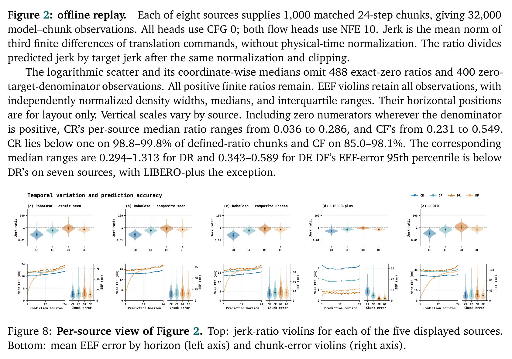

**Caption:** Figure 8: Per-source view of Figure 2. Top: jerk-ratio violins for each of the five displayed sources. Bottom: mean EEF error by horizon (left axis) and chunk-error violins (right axis).

**Caption[CN]:** 图 8：图 2 各验证数据源的独立拆分视图。顶图：展示 5 个代表性数据源各自的 Jerk 比值小提琴分布；底图：随动作块预测时域展开的平均 EEF 误差（左轴）与动作块整体误差小提琴图（右轴）。

> <strong>Para. AE-4:</strong> E.2 Prediction Error Under Varying CFG. Tab. 1 reports that CFG raises DF's EEF error. To find the source of this increase, we sweep the guidance weight from $\lambda = 0$ to 3 in steps of 0.25. We use 4,000 held-out observations, 500 from each of 8 validation sources (DROID, LIBERO, and six RoboCasa splits). The predictions come from the dense CFG sweep in Fig. 4(c). Error is the per-step XYZ Euclidean distance to the ground-truth action in physical units, averaged over the valid steps of the chunk, then over draws, then over observations. All heads are scored against the same target.

> <strong>Para. AE-4[CN]:</strong> E.2 不同引导强度下的动作预测误差扫描分析。正文表 1 汇报了引入 CFG 引导会略微推高 DF 的 EEF 重建误差。为了深入探究这一微小上升的物理根源，我们以 0.25 为步长将引导权重 $\lambda$ 从 0 系统性密集扫描至 3。评测基于 4,000 个留出验证观测样本（来自 DROID、LIBERO 及 6 个 RoboCasa 划分，各取 500 个样本）。所有预测均取自图 4(c) 的密集扫描实验。误差定义为在真实物理坐标系下每个时步预测与专家真值之间的 3D 平移欧氏距离，依次在动作块内的有效步数、多次随机采样抽样以及全量观测样本上取平均。所有动作头严格针对同一专家真值计算得分。

### Figure 9. 不同分类器自由引导权重下的末端执行器预测误差变化曲线

**Caption:** Figure 9: EEF error against ground truth as a function of the guidance weight $\lambda$. Mean XYZ end-effector L2 error (mm) over the 24-step chunk, for DR (argmax decoding) and DF (NFE 10, mean over 32 draws). Shaded bands show ±1 standard error over observations. $\lambda = 0$ is unguided (Appendix C.5). (a) All 8 validation sources. (b) The 7 sources other than LIBERO. (c) LIBERO only.

**Caption[CN]:** 图 9：末端执行器（EEF）预测误差随分类器自由引导权重 $\lambda$ 的变化曲线。汇报 24 步动作块内的平均 XYZ 末端 L2 误差（mm）：DR 采用 argmax 贪婪解码，DF 采用 NFE 10（32 次随机采样的均值）。阴影区域代表跨观测样本的 $\pm 1$ 标准误；$\lambda = 0$ 表示无引导原始前向（附录 C.5）。(a) 全量 8 个验证数据源；(b) 剔除 LIBERO 后的其余 7 个数据源；(c) 仅 LIBERO 数据源。

> <strong>Para. AE-5:</strong> Pooled over all sources (Fig. 9a). DF has lower error than DR at small $\lambda$: 15.16 mm versus 18.06 mm unguided. DF's error is lowest at $\lambda = 0.5$ (14.86 mm) and then rises to 17.97 mm at $\lambda = 3$, passing DR at about $\lambda = 2.5$. DR's error falls slightly with guidance and is nearly flat for $\lambda \ge 1$ (17.44–17.53 mm).

> <strong>Para. AE-5[CN]:</strong> 全数据源汇总统计划分（图 9a）。在弱引导区间（小 $\lambda$），DF 的绝对跟踪误差显著低于 DR：在无引导时为 15.16 mm 对比 18.06 mm。DF 的预测误差在 $\lambda = 0.5$ 时达到最低谷（14.86 mm），随后随着引导加剧平缓回升至 $\lambda = 3$ 时的 17.97 mm，在 $\lambda \approx 2.5$ 处与 DR 相交。与之相对，DR 的误差在引入引导后微幅下降，并在 $\lambda \ge 1$ 后保持高度平坦（17.44–17.53 mm）。

> <strong>Para. AE-6:</strong> E.3 State Responsiveness and Disturbance Stability. Question: Can a policy stay stable under small disturbances while still responding to real state changes? We measure two properties of how a head's predictions change with the observation. State responsiveness asks whether the predicted chunk changes as much as the demonstrated chunk when the state changes along a real trajectory. Disturbance stability asks how little the distribution of predicted chunks moves after a small disturbance, compared with the head's own sampling variation. The two pull against each other: a head that changes little with the observation can appear very stable, but also fails to react when the robot needs to correct its course.

> <strong>Para. AE-6[CN]:</strong> E.3 状态反应性与抗扰动稳定性的权衡。核心科学拷问：一个策略能否在外界微小扰动下保持平稳，同时又对环境真实物理状态的实质变化做出敏锐而果断的反应？我们系统测量了动作头预测随输入观测发生变动时的两项核心动力学属性：(1) 状态反应性（State Responsiveness）：度量当机械臂沿真实轨迹发生状态位移时，预测动作块的应对变化是否与人类专家一样充分；(2) 抗扰动稳定性（Disturbance Stability）：度量当仿真环境受到微小外力脉冲扰动时，策略预测动作块概率分布的漂移量相对于模型自身固有采样方差的微小程度。这两项物理属性天然存在张力与博弈：一个对观测输入迟钝麻木的模型看似抗扰动极强，但在机器人真正需要调整航向以纠正误差时却往往无动于衷。

> <strong>Para. AE-7:</strong> E.3.1 Disturbance Stability. Using empirical 2-Wasserstein distance between two sets of chunks, computed by exact optimal assignment (Equation (E.4)), we define:

> <strong>Para. AE-7[CN]:</strong> E.3.1 抗物理扰动稳定性定量形式化。利用两组动作分块样本集合之间的经验 2-Wasserstein 距离（通过精确最优传输指派式 (E.4) 严格求解），我们定义基线采样底噪 $F_\pi$、扰动后传输距离 $T_\pi(\varepsilon)$ 以及相对超额响应比率 $R_\pi(\varepsilon)$：

$$
F_\pi = \langle \widehat{\mathcal{W}}_2(C_1, C_2) \rangle, \quad T_\pi(\varepsilon) = \langle \widehat{\mathcal{W}}_2(C_1, P_2) \rangle, \quad R_\pi(\varepsilon) = \frac{T_\pi(\varepsilon) - F_\pi}{F_\pi}. \tag{E.1}
$$

> <strong>Para. AE-8:</strong> Here $C_1, C_2$ are independent samples at the unperturbed observation, $P_2$ is drawn at the perturbed observation, and angular brackets denote the average over 24 test snapshots. Tab. 9 reports $F_\pi$, the absolute excess $T_\pi - F_\pi$, and the relative excess $R_\pi$, for perturbation standard deviations $\varepsilon = 0.1, 0.3, 1.0$ in normalized action coordinates.

> <strong>Para. AE-8[CN]:</strong> 此处 $C_1, C_2$ 是在未受扰动的基准观测下独立抽取的两组采样集合，$P_2$ 则是在施加物理扰动后的新观测下抽取的采样集合，尖括号 $\langle \cdot \rangle$ 表示在 24 个代表性测试快照上的平均值。表 9 汇报了基线底噪 $F_\pi$、绝对超额位移 $T_\pi - F_\pi$ 以及相对超额比率 $R_\pi$（测试扰动标准差在归一化动作单位下分别设为 $\varepsilon = 0.1, 0.3, 1.0$）。

### Table 9. 对单步仿真环境物理扰动的抗扰动稳定性与最优传输位移诊断

| 动作头家族 (Head) | 动作建议离散度 (Spread $\sigma$) | 基线采样底噪 ($F_\pi$) | 绝对超额位移 ($T_\pi - F_\pi$, $\varepsilon=0.1 / 0.3 / 1.0$) | 相对超额响应比率 ($R_\pi$, $\varepsilon=0.1 / 0.3 / 1.0$) |
| :--- | :--- | :--- | :--- | :--- |
| **离散流 (DF)** | 1.217 | 1.245 | 0.233 / 0.490 / 1.071 | **0.19 / 0.39 / 0.86** |
| **连续流 (CF)** | 0.764 | 0.591 | 0.036 / 0.102 / 0.403 | **0.06 / 0.17 / 0.68** |
| **离散回归 (DR)** | 0.182 | 0.141 | 0.301 / 0.529 / 0.927 | 2.13 / 3.75 / 6.57 |
| **连续回归 (CR)** | 0.000 | 0.000 | 0.147 / 0.275 / 0.568 | 未定义 (底噪为0) |

**Caption:** Table 9: Proposal spread and response to one-step simulator disturbances. $\sigma$ is mean nominal RMS spread over the full bank. The independent 32-vs-32 transport statistics use the existing 24-snapshot subsample per head and every other perturbation. Triples correspond to $\varepsilon = 0.1, 0.3, 1.0$. Relative excess is computed from the displayed rounded transport means. CR's deterministic law has zero floor, so its relative excess is undefined. Spread and transport use different subsets.

**Caption[CN]:** 表 9：四大动作头的动作采样建议离散度以及对单步仿真物理扰动的动态响应。$\sigma$ 为全样本库上的平均 RMS 离散度。独立的 32 对 32 最优传输统计基于 24 个快照子样本；三元组数据分别对应扰动强度 $\varepsilon = 0.1, 0.3, 1.0$。CR 为纯确定性输出，底噪为 0，因此相对超额比率未定义。

> <strong>Para. AE-9:</strong> E.3.2 State Responsiveness. We define the state responsiveness of policy $\pi$ at lag $k$ as:
>  $\rho_\pi(k) = \frac{\mathrm{median} \| \Delta \mu_\pi \|}{\mathrm{median} \| \Delta a^\star \|}, \quad 	ext{(E.2)}$ 
> with medians over frame pairs. $\rho_\pi = 1$ means the head changes as much as the expert, and $\rho_\pi < 1$ means it under-responds. In Fig. 3, at lag 4, $\rho_\pi$ is 0.94 for DR, 0.70 for DF, 0.63 for CF, and 0.58 for CR. Both flows under-respond, but CF does so more strongly. DR tracks the expert most closely, with $\rho_\pi$ between 0.90 and 1.08 across lags, so state responsiveness and disturbance stability are distinct requirements.

> <strong>Para. AE-9[CN]:</strong> E.3.2 策略状态反应性定量形式化。我们将策略 $\pi$ 在时间滞后步数 $k$ 处的真实状态反应性严格定义为：
>  $\rho_\pi(k) = \frac{\mathrm{median} \| \Delta \mu_\pi \|}{\mathrm{median} \| \Delta a^\star \|}, \quad 	ext{(E.2)}$ 
> 其中分子分母分别在全部观测帧对上取中位数。$\rho_\pi = 1$ 意味着策略在观测变化时的调整幅度与人类专家演示完全对齐；而 $\rho_\pi < 1$ 则表示策略出现反应迟钝。在正文图 3 中（时延 $k = 4$），DR 的反应性高达 0.94，DF 为 0.70，CF 为 0.63，而 CR 仅为 0.58。两类流匹配模型相对于专家均略显保守，但连续流 CF 的欠反应更为严重。DR 在所有测试时延下均最贴近专家应对（$\rho_\pi$ 介于 0.90 至 1.08 之间），这有力证明了状态反应性与抗物理扰动稳定性在动力学上是两个完全正交的独立属性。

### Table 10. 留出专家演示轨迹上各动作头的状态位移响应幅度

| 时延步数 (Lag) | 状态位移范数 (\|∆s\|) | 专家动作变化 (Expert ∆chunk) | 离散回归 DR (采样底噪) | 连续回归 CR | 离散流 DF (采样底噪) | 连续流 CF (采样底噪) |
| :--- | :--- | :--- | :--- | :--- | :--- | :--- |
| **Lag 1** | 0.018 | 0.66 | 0.71 (0.05) | 0.35 | 0.45 (0.38) | 0.36 (0.21) |
| **Lag 2** | 0.036 | 1.13 | 1.16 (0.05) | 0.62 | 0.77 (0.37) | 0.64 (0.22) |
| **Lag 4** | 0.073 | 1.88 | 1.77 (0.05) | 1.09 | 1.32 (0.38) | 1.18 (0.21) |
| **Lag 8** | 0.149 | 3.00 | 2.71 (0.05) | 1.93 | 2.34 (0.38) | 2.25 (0.22) |
| **Lag 16** | 0.292 | 4.32 | 4.01 (0.05) | 3.13 | 3.55 (0.38) | 3.28 (0.22) |

**Caption:** Table 10: Action changes on held-out expert trajectories. $\|\Delta s\|$ is the state displacement and expert $\Delta$chunk is the demonstrated chunk change. Head columns report raw proposal-mean shifts; parentheses show same-observation sampling floors for the stochastic heads. All values are medians over pairs in normalized units; no floor subtraction or response-ratio normalization is applied.

**Caption[CN]:** 表 10：留出专家轨迹上的动作实际变动幅度。$\|\Delta s\|$ 为机械臂状态位移范数，Expert $\Delta$chunk 为真实演示动作块的变化量。各动作头列汇报动作建议均值的原始位移；括号内数值展示随机策略在完全相同观测下的固有采样随机底噪。所有数值均为归一化单位下的中位数。

> <strong>Para. AE-10:</strong> E.4 Disturbance and Expert-Reference Diagnostic Protocol. This appendix gives the measurement definitions and sampling protocol for Appendix E.3. DR uses its deployed argmax decoder; its residual proposal spread comes from varying random source-token inputs. CR is deterministic. E.4.1 Measuring a Distribution's Response to Disturbance. Let $p_\pi(\cdot \mid o)$ be policy $\pi$'s law over decoded, normalized action chunks. Its spread and its sensitivity are different quantities:
>  $\sigma_\pi(o) = \left( \mathbb{E}_{A \sim p_\pi(\cdot \mid o)} \| A - \mu_\pi(o) \|_2^2 \right)^{1/2}, \quad 	ext{(E.3)}$ 
>  $\mathcal{W}_2(p, q) = \left( \inf_{\gamma \in \Pi(p, q)} \mathbb{E}_{(A, B) \sim \gamma} \| A - B \|_2^2 \right)^{1/2}, \quad 	ext{(E.4)}$ 
> where $\mu_\pi(o) = \mathbb{E}[A \mid o]$ and $\Pi(p, q)$ denotes joint distributions with marginals $p, q$. Spread measures diversity at one observation; $\mathcal{W}_2(p_\pi(\cdot \mid o), p_\pi(\cdot \mid o'))$ measures how far probability mass must move after a disturbance. Neither measures support cardinality.

> <strong>Para. AE-10[CN]:</strong> E.4 扰动与专家参考诊断协议规范。本节严格给出附录 E.3 中的度量数学定义与采样流程。DR 采用部署时的 argmax 贪婪解码器，其残留的微小建议离散度源自变化的辅助随机输入；CR 为完全确定性映射。E.4.1 度量分布对物理扰动的动态响应：令 $p_\pi(\cdot \mid o)$ 为策略 $\pi$ 在解码归一化动作分块上的诱导概率分布。其内部离散度与外界敏感度具有截然不同的数学含义：
>  $\sigma_\pi(o) = \left( \mathbb{E}_{A \sim p_\pi(\cdot \mid o)} \| A - \mu_\pi(o) \|_2^2 \right)^{1/2}, \quad 	ext{(E.3)}$ 
>  $\mathcal{W}_2(p, q) = \left( \inf_{\gamma \in \Pi(p, q)} \mathbb{E}_{(A, B) \sim \gamma} \| A - B \|_2^2 \right)^{1/2}, \quad 	ext{(E.4)}$ 
> 其中 $\mu_\pi(o) = \mathbb{E}[A \mid o]$，$\Pi(p, q)$ 表示以 $p$ 和 $q$ 为边际分布的所有联合耦合分布族。离散度 $\sigma_\pi$ 衡量在单一恒定观测下采样的随机方差；而 Wasserstein 距离 $\mathcal{W}_2$ 则严格刻画在环境遭受物理扰动后，概率质量必须在物理空间中长途搬运的最小平均几何代价。

> <strong>Para. AE-11:</strong> Reference adherence must be calibrated against real actions. For held-out observation $o$, let $\mathcal{M}(o)$ contain the $k = 5$ nearest training action chunks, with neighbors selected in normalized proprioception and restricted to the same instruction when enough matches exist. Define:
>  $r_0(A; o) = \min_{B \in \mathcal{M}(o)} \| A - B \|_2, \quad E_\pi = \frac{\mathbb{E}_o [ \mathbb{E}_{A \sim p_\pi} r_0(A; o) - r_0(A_{\mathrm{gt}}; o) ]}{\mathrm{median}_o r_0(A_{\mathrm{gt}}; o)}. \quad 	ext{(E.5)}$ 
> We compute $E_\pi$ within each source, then average over eight sources (512 held-out observations per source, 16 proposals each). The held-out expert reference matters: genuine demonstrated actions also lie some distance from a finite training set. A negative excess means predictions lie closer to this reference than held-out demonstrations do.

> <strong>Para. AE-11[CN]:</strong> 参考轨迹依附性必须与真实人类动作对齐校准。对于留出观测样本 $o$，令 $\mathcal{M}(o)$ 包含其在归一化本体感受特征空间中最邻近的 $k = 5$ 个训练集真实动作块。我们定义如下相对专家校准的超额距离指标：
>  $r_0(A; o) = \min_{B \in \mathcal{M}(o)} \| A - B \|_2, \quad E_\pi = \frac{\mathbb{E}_o [ \mathbb{E}_{A \sim p_\pi} r_0(A; o) - r_0(A_{\mathrm{gt}}; o) ]}{\mathrm{median}_o r_0(A_{\mathrm{gt}}; o)}. \quad 	ext{(E.5)}$ 
> 我们在各个数据源内部独立计算 $E_\pi$，随后在全量 8 个数据源上取平均（每源 512 个留出观测，每次生成 16 个动作建议）。引入未见过的专家真值 $A_{\mathrm{gt}}$ 作为校准参考至关重要：因为即使是完全真实有效的人类专家新演示，也必然与有限的训练数据集保持一定几何距离。负的超额距离（例如 CF 的 -0.100）意味着模型的预测结果甚至比人类专家的新演示更加死板地依附于历史训练样本，这从根本上导致了连续流策略的过度保守与反应迟钝。

# Appendix F Factorization Error Experiments

> <strong>Para. AF-1:</strong> This section supplements Section 4.

> <strong>Para. AF-1[CN]:</strong> 本附录是对正文第 4 节关于因式分解误差与迭代计算机制实验的全面深化与实证补充。

> <strong>Para. AF-2:</strong> F.1 Experimental Methodology. Mode-detection criteria. For each translation-token distribution $p_j(b)$, we smooth probabilities along the bin axis with a Gaussian kernel of standard deviation two bins, normalized over the available bins at each location. We identify local maxima, including endpoint maxima, in the smoothed distribution. Each bin is assigned to its nearest peak, and each peak's mass is the sum of the unsmoothed probabilities assigned to it. We retain peaks with at least 10% mass. Two adjacent retained peaks qualify as separated modes if they are at least eight bins apart and the minimum smoothed probability between them is at most 50% of the smaller peak height. Each translation token represents one coordinate at one predicted time step. We call it ambiguous if it has a qualifying pair of modes, and count it once regardless of how many such pairs it has. The mean count averages ambiguous tokens per chunk. The threshold statistic reports the fraction of chunks containing at least $k$ ambiguous tokens. For DF, detection is performed on each final conditional token prediction before averaging over refinement draws.

> <strong>Para. AF-2[CN]:</strong> F.1 实验方法与多峰检测准则。动作多峰检测数学准则：对于每个平移分量的离散概率分布 $p_j(b)$，我们首先沿分箱数值轴应用标准差为 2 个分箱的高斯核进行平滑卷积，并在各位置的有效分箱上进行归一化。随后在平滑后的曲线上检测所有局部极大值极大值点（包含端点极大值）。每个分箱按数值距离归属于距离其最近的峰值，每个峰值的概率质量定义为归属于该峰的所有原始未平滑概率之和。我们保留概率质量不低于 10% 的候选峰值。若两个相邻保留峰值在分箱轴上相距至少 8 个分箱，且它们之间的平滑概率极小值不超过较矮峰值高度的 50%，则判定这两个峰构成分离的两个独立有效模式（separated modes）。每个平移 token 对应单一预测时步的某一个坐标维度；若其包含至少一对满足上述分离条件的有效模式，则将其标记为一个“歧义 token”（ambiguous token）。平均歧义数统计单动作块内的歧义 token 均值；阈值统计量则汇报包含至少 $k$ 个歧义 token 的动作分块百分比。对于 DF，多峰检测在每次细化抽样的最终条件预测分布上执行，随后在多次采样抽样间取平均。

> <strong>Para. AF-3:</strong> NFE sweep in Figure 4(a,b). We use 4,000 validation observations (500 from each of eight sources) and 16 DF draws per observation at each NFE and CFG 0. Panel (a) reports the mean number of ambiguous tokens per chunk under the mode detector above; Figure 10(a) gives the threshold curves. Panel (b) reports percentiles of $\exp(H(p))$ over all translation tokens, draws, and observations. DR references use the same observations and detector. Because the final query time is $t = 1 - 1/\mathrm{NFE}$, the sweep changes both the number of refinement steps and the time of the last prediction. The mean count is 4.94 at NFE 2 and falls to 1.50, 0.57, and 0.22 at NFE 5, 10, and 20 (DR: 3.01). Figure 12 reports entropy and action diversity for the same sweep.

> <strong>Para. AF-3[CN]:</strong> 图 4(a,b) 中的 NFE 步数扫描实验。基于 4,000 个留出验证观测样本（来自 8 个数据源，各取 500 个），在每个 NFE 步数和无引导条件（CFG 0）下对每个观测独立抽取 16 次 DF 采样。图 4(a) 汇报了上述检测器测得的单块平均歧义 token 数量；图 10(a) 展示了对应的累积阈值分布曲线。图 4(b) 统计了跨所有平移 tokens、抽样及观测样本的有效状态数分位数 $\exp(H(p))$。DR 对照基准使用完全相同的观测集与检测算法。由于离散流的最终查询时间点为 $t = 1 - 1/\mathrm{NFE}$，步数扫描同时改变了细化步数与末次前向预测的时间进度。单块歧义 token 数在 NFE 2 时为 4.94，在 NFE 5、10、20 时分别骤降至 1.50、0.57 和 0.22（未加引导的 DR 基线为 3.01）。图 12 汇报了相同扫描下的信息熵与动作采样多样性。

### Figure 10. token 歧义累积阈值分布与分块时序置信区间宽度诊断

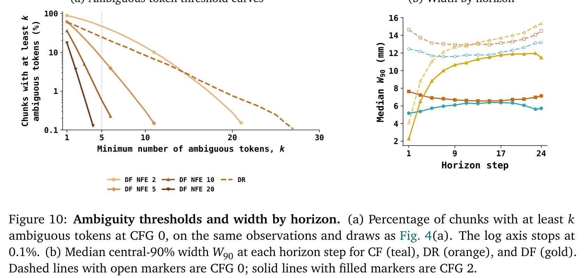

**Caption:** Figure 10: Ambiguity thresholds and width by horizon. (a) Percentage of chunks with at least $k$ ambiguous tokens at CFG 0, on the same observations and draws as Fig. 4(a). The log axis stops at 0.1%. (b) Median central-90% width W90 at each horizon step for CF (teal), DR (orange), and DF (gold). Dashed lines with open markers are CFG 0; solid lines with filled markers are CFG 2.

**Caption[CN]:** 图 10：歧义 token 累积阈值分布与按时域展开的置信区间宽度。(a) 在无引导（CFG 0）下包含至少 $k$ 个歧义 token 的动作块百分比（对数坐标轴下限为 0.1%）。(b) 随动作块时步推进的中央 90% 置信区间宽度中位数 W90（CF 为蓝绿色，DR 为橙色，DF 为金色；虚线空心点为 CFG 0，实线实心点为 CFG 2）。

> <strong>Para. AF-4:</strong> F.2 Factorization Error and L2 Loss Diagnostic Results. Tab. 11 reports the L2 prediction errors referenced in Section 3. CF uses 100 integration steps and DF 10; regression heads use one pass. DF has the lowest error on four of the six sources: DROID and three of the four RoboCasa splits. DR has the lowest error on LIBERO-plus (2.53 mm, against 9.88 mm for CR), and CR on RoboCasa composite-seen. DF has lower error than CF on all six sources. The remaining figures give additional mode-ambiguity diagnostics for Fig. 4; Fig. 10(b) breaks W90 down by horizon.

> <strong>Para. AF-4[CN]:</strong> F.2 因式分解误差与 L2 重建损失诊断结果。表 11 详尽列出了正文第 3 节所引用的各数据源 L2 动作预测误差。在评估中，CF 采用 100 步欧拉积分，DF 采用 10 步细化，回归头采用单步直接前向。DF 在 6 个数据源中的 4 个上斩获最低误差（包括真实机械臂 DROID 数据集以及 RoboCasa 的三个不同子集）；DR 在 LIBERO-plus 上取得最低误差（2.53 mm，而 CR 达到 9.88 mm）；CR 仅在 RoboCasa composite-seen 上微弱领先。尤其值得强调的是：在全部 6 个数据源上，离散流 DF 的跟踪误差全面低于连续流 CF！

### Table 11. 各大动作头在代表性真实与仿真验证源上的末端预测误差

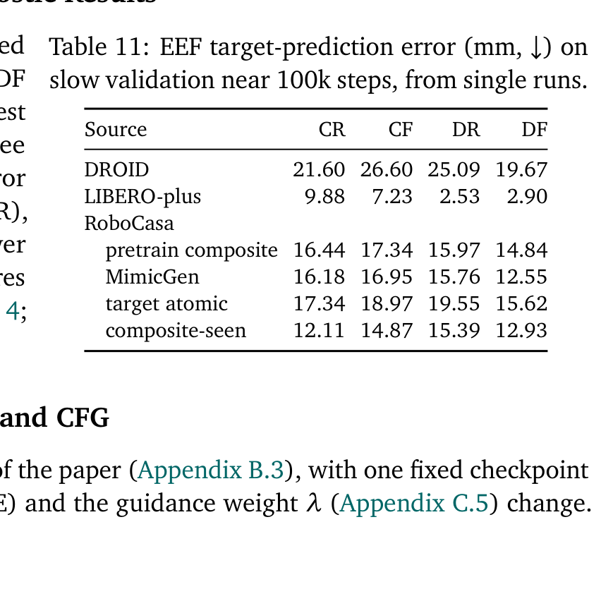
| 验证数据源名称 (Source) | 连续回归 (CR) | 连续流 (CF, 100步) | 离散回归 (DR) | 离散流 (DF, 10步) |
| :--- | :--- | :--- | :--- | :--- |
| **真实世界 DROID 数据集** | 21.60 mm | 26.60 mm | 25.09 mm | **19.67 mm** |
| **LIBERO-plus 仿真基准** | 9.88 mm | 7.23 mm | **2.53 mm** | 2.90 mm |
| **RoboCasa pretrain composite** | 16.44 mm | 17.34 mm | 15.97 mm | **14.84 mm** |
| **RoboCasa MimicGen 数据集** | 16.18 mm | 16.95 mm | 15.76 mm | **12.55 mm** |
| **RoboCasa target atomic** | 17.34 mm | 18.97 mm | 19.55 mm | **15.62 mm** |
| **RoboCasa composite-seen** | **12.11 mm** | 14.87 mm | 15.39 mm | 12.93 mm |

**Caption:** Table 11: EEF target-prediction error (mm, ↓) on slow validation near 100k steps, from single runs. Single-run checkpoints near 100k training steps evaluate held-out trajectory tracking accuracy across representative simulation and real-world datasets.

**Caption[CN]:** 表 11：在约 10 万训练步附近各模型在留出验证集上的末端执行器（EEF）目标跟踪预测误差（mm，↓）。对比单次训练检查点在代表性仿真和真实世界数据集上的动作跟踪拟合精度。

### Figure 11. 动作分块流形在不同引导机制下的 t-SNE 降维对比

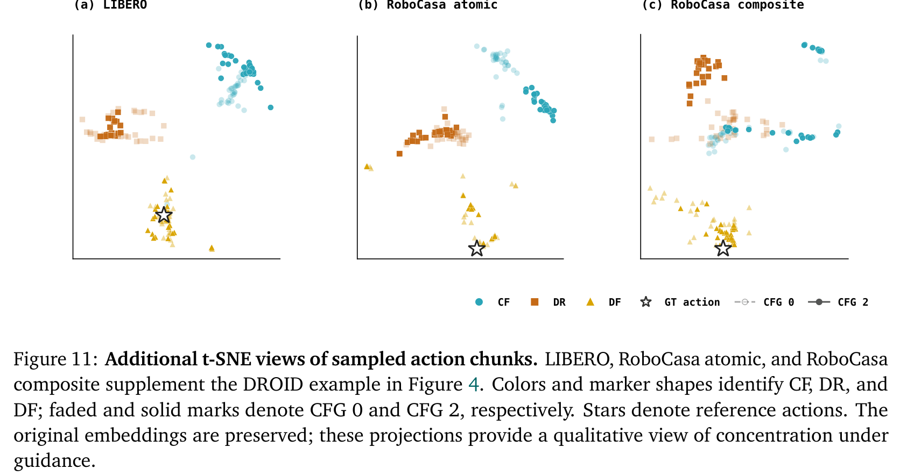

**Caption:** Figure 11: Additional t-SNE views of sampled action chunks. LIBERO, RoboCasa atomic, and RoboCasa composite supplement the DROID example in Figure 4. Colors and marker shapes identify CF, DR, and DF; faded and solid marks denote CFG 0 and CFG 2, respectively. Stars denote reference actions. The original embeddings are preserved; these projections provide a qualitative view of concentration under guidance.

**Caption[CN]:** 图 11：采样动作分块的拓展 t-SNE 降维投影可视化。LIBERO、RoboCasa atomic 与 RoboCasa composite 全面补充了正文图 4 中的 DROID 案例。颜色与标记形状分别对应 CF、DR 与 DF；浅色半透明与深色实心分别表示 CFG 0 与 CFG 2；星号标记专家演示动作。该降维定性展现了引导机制促使策略集中于高置信单一解流形的过程。

### Figure 12. 迭代细化步数对单次预测不确定性与跨抽样多样性的影响解耦

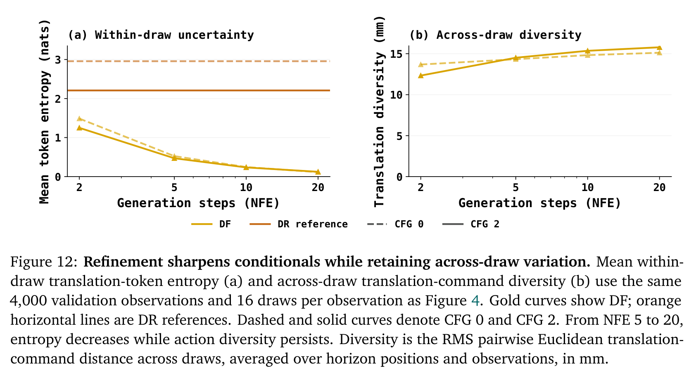

**Caption:** Figure 12: Refinement sharpens conditionals while retaining across-draw variation. Mean within-draw translation-token entropy (a) and across-draw translation-command diversity (b) use the same 4,000 validation observations and 16 draws per observation as Figure 4. Gold curves show DF; orange horizontal lines are DR references. Dashed and solid curves denote CFG 0 and CFG 2. From NFE 5 to 20, entropy decreases while action diversity persists. Diversity is the RMS pairwise Euclidean translation-command distance across draws, averaged over horizon positions and observations, in mm.

**Caption[CN]:** 图 12：迭代细化在锐化单次抽样条件分布的同时完整保留跨抽样多样性。(a) 单次抽样内部平移 token 的平均信息熵；(b) 多次重复抽样之间平移指令的采样多样性（使用与图 4 完全相同的 4,000 个验证样本及每样本 16 次抽样）。金色曲线为 DF，橙色水平参考线为 DR；虚线为 CFG 0，实线为 CFG 2。从 NFE 5 增加到 20 时，单次预测熵持续下降，而全局动作多样性始终平稳维持。

> <strong>Para. AF-5:</strong> F.3 Task Performance Under Varying NFE and CFG. We use the same evaluation protocol as in the rest of the paper (Appendix B.3), with one fixed checkpoint per head. Only the number of decoding steps (NFE) and the guidance weight $\lambda$ (Appendix C.5) change. F.3.1 Task Performance Under Varying NFE. Fig. 13(a,b) shows that the effect of NFE depends on guidance. Without guidance, both flow heads lose about five points at NFE 2, where DF reaches 47.0 ± 2.5% and CF 45.6 ± 1.3%. From NFE 5 to 100 they change little: DF ranges from 51.2% to 52.5% and CF from 50.8% to 51.9%, with no consistent gain from more steps. With $\lambda = 2$, DF changes little at every budget, ranging from 52.3% to 53.6%. Guided CF, however, fails under coarse decoding: its success falls to 0.3 ± 0.3% at NFE 2 and 41.9 ± 1.7% at NFE 5, then recovers to 52.4 ± 2.4% at NFE 10. Only guided CF fails outright; unguided CF still reaches 45.6% at NFE 2.

> <strong>Para. AF-5[CN]:</strong> F.3 在不同 NFE 步数与 CFG 引导下的闭环任务表现消融。本节沿用全文统一的闭环评估协议（附录 B.3），每个动作头固定单一权重检查点，仅改变推理生成步数（NFE）以及分类器自由引导权重 $\lambda$（附录 C.5）。F.3.1 不同 NFE 步数下的表现动态：图 13(a,b) 表明 NFE 步数的影响深度依赖于是否开启引导机制。在无引导（CFG 0）下，两类流匹配模型在极少步（NFE 2）时均下跌约 5 个百分点（DF 为 47.0%，CF 为 45.6%）；当 NFE 从 5 步增加至 100 步时，性能基本饱和不再显著变动（DF 介于 51.2%–52.5%，CF 介于 50.8%–51.9%）。在引入引导（$\lambda = 2$）时，DF 在所有计算预算下表现均高度极其平稳健壮（52.3%–53.6%）；然而带引导的连续流 CF 在极粗糙离散步长下遭遇了灾难性崩溃：在 NFE 2 时成功率暴跌至 0.3%，在 NFE 5 时仅为 41.9%，直到 NFE 10 步时才恢复至 52.4%。这表明连续流极度依赖精细的数值积分求解，而离散流即便在极低步数下依然保持了极佳的数值稳定性与控制有效性。

> <strong>Para. AF-6:</strong> F.3.2 Task Performance Under Varying CFG. We next vary $\lambda$ with NFE fixed at 10 for both flow heads (Fig. 13(c)); DR has no NFE axis. Guidance changes DR far more than either flow head. DR improves from 27.1 ± 1.2% without guidance to 48.9 ± 3.6% at $\lambda = 2$, and reaches its highest mean, 50.8 ± 2.8%, at $\lambda = 3.5$. Over the same range, its mean success on composite-seen and composite-unseen tasks rises from about 10% and 12% to 34.8% and 39.4%. Moderate guidance changes the flow heads only slightly: from $\lambda = 0$ to 2, DF gains 1.1 points and CF 0.9 points. Strong guidance hurts, most of all for CF, which falls to 43.1 ± 1.6% at $\lambda = 4$, where DF obtains 49.8 ± 1.4%. The best guidance weight therefore depends on the head and the decoding budget. For reference, CR reaches 40.8 ± 1.4% in one unguided pass.

> <strong>Para. AF-6[CN]:</strong> F.3.2 不同 CFG 引导强度下的性能跃迁。固定两类流匹配模型的生成步数为 NFE 10，系统扫描引导权重 $\lambda$（图 13(c)；单步 DR 无 NFE 维度）。引导机制对 DR 产生了远超流模型的革命性剧烈提振：DR 的成功率从无引导时的 27.1% 强劲飙升至 $\lambda = 2$ 时的 48.9%，并在 $\lambda = 3.5$ 时达到最高均值 50.8%！在同一引导区间内，DR 在难度极高的 composite-seen 与 composite-unseen 复合长程任务上的成功率直接从惨淡的约 10% 和 12% 爆发式暴涨至 34.8% 和 39.4%。相比之下，适度引导对两类流模型仅带来温和微调（$\lambda=0$ 至 2 时，DF 提升 1.1 个百分点，CF 提升 0.9 个百分点）；而过大的强引导会导致性能回落，尤其是连续流 CF 在 $\lambda = 4$ 时严重跌至 43.1%，而离散流 DF 依然稳守 49.8%。作为全局基准，单步连续回归 CR 的基线成绩为 40.8%。

### Figure 13. NFE 迭代步数与分类器自由引导权重对闭环成功率的影响全景

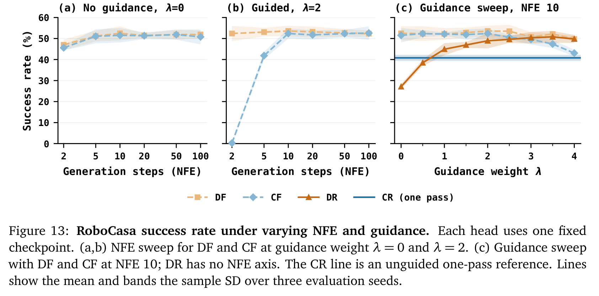

**Caption:** Figure 13: RoboCasa success rate under varying NFE and guidance. Each head uses one fixed checkpoint. (a,b) NFE sweep for DF and CF at guidance weight $\lambda = 0$ and $\lambda = 2$. (c) Guidance sweep with DF and CF at NFE 10; DR has no NFE axis. The CR line is an unguided one-pass reference. Lines show the mean and bands the sample SD over three evaluation seeds.

**Caption[CN]:** 图 13：RoboCasa 任务成功率在不同 NFE 步数与引导权重下的消融变化。(a,b) 在无引导（$\lambda = 0$）与带引导（$\lambda = 2$）下 DF 与 CF 的 NFE 步数扫描曲线。(c) 固定 NFE 10 时 DF 与 CF 的引导权重扫描（DR 无 NFE 轴，实线展示其随 $\lambda$ 的变化）；灰色虚线为单步连续回归 CR 的基线参考水平。实线为均值，阴影为 3 个随机种子下的标准差。

### Figure 14. RoboCasa 关冰箱门真实任务中动作分块时序模式跳变定性展示

**Caption:** Figure 14: a Robocasas example showing that in the same chunk, robot arm has two mode one is move consistenly, the second is first move then hold; (b We show that this independent token sampling could cause factorization error, leads to swithcing between motions on different timestep, the same as what we have seen in push-T Fig. 5.

**Caption[CN]:** 图 14：RoboCasa 关冰箱门任务中因式分解误差导致的时空冲突案例。(a) 在相同的当前观测下，机器人存在两种合理演示模式：持续平滑移动关闭门（Move → Move），或移动一段后悬停保持（Move → Hold）；(b) 独立逐 token 采样引发的因式分解误差打破了这一时空一致性，导致在预测动作块的时序推进过程中在互斥行为模式之间产生突兀切换与物理断裂。

> <strong>Para. AF-7:</strong> F.4 Visualization of Mode Inconsistency in RoboCasa. RoboCasa move–hold example. Figure 14 uses CloseFridge marginals and a schematic mode illustration: moved thumbnails are taken from steps 12 and 24 of a DR-argmax replay; the hold thumbnail repeats the initial image.

> <strong>Para. AF-7[CN]:</strong> F.4 RoboCasa 动作模式不一致性定性剖析。关冰箱门任务中的“移动-保持”模式冲突：图 14 基于 CloseFridge 任务的真实 token 边际分布及示意模式图。移动状态截图截取自 DR-argmax 重放的第 12 步与第 24 步；保持状态截图则重复初始观测图像。这一直观案例生动印证了：当环境存在多种合法时序行为分支时，独立边际预测极易拼凑出首鼠两端的劣质动作分块，唯有依托离散流的迭代去噪或 CFG 的模式锐化，才能确保动作序列在全局时空维度上的高度纯净与自洽。

# Appendix G Tokenization and Geometric Priors

> <strong>Para. AG-1:</strong> This section supplements Section 5.

> <strong>Para. AG-1[CN]:</strong> 本附录是对正文第 5 节关于动作分词算法、几何感知概率路径以及分箱嵌入几何表示研究的系统拓展与补充。

> <strong>Para. AG-2:</strong> G.1 Performance Under Different Tokenization. Closed-loop results for tokenizers. Table 12 compares nFSQ, RVQ, and FAST with their frequency-bin baselines. For each tokenizer and head, we report the operating point with the best pooled success, selecting CFG, the replanning horizon, and, for DF, the NFE among 5, 10, and 20 (50 for RVQ). The same setting is used on all three suites. Pooled success combines 180 atomic-seen episodes and 160 episodes from each composite suite. The nFSQ result (52.4%) is slightly above the frequency-bin metric-path result (51.8%). Neither exceeds the main mixture-path DF result of 53.9%, which uses a different recipe and horizon.

> <strong>Para. AG-2[CN]:</strong> G.1 不同动作分词器下的闭环控制表现。表 12 全面对比了有限标量量化（nFSQ）、残差矢量量化（RVQ）以及动作基元分词器 FAST 与等频分箱（frequency-bin）基线的表现。针对每种分词器与动作头，我们汇报其在全量套件上的最佳汇总成功率（调优了 CFG 引导权重、重规划时域跨度以及 DF 的 NFE 步数 5、10、20，其中 RVQ 采用 50 步）。所有三组任务套件采用完全一致的工作点设置；汇总成功率综合了 180 个 atomic-seen episode 以及两个复合套件各 160 个 episode。nFSQ 的最佳成绩（52.4%）略微超过了等频分箱下的度量路径表现（51.8%）；然而，没有任何一种分词器能够突破主实验中标准混合路径 DF 所斩获的 53.9% 顶峰成功率纪录。

### Table 12. 不同分词器（nFSQ/RVQ/FAST/等频分箱）在 RoboCasa 上的闭环控制评测

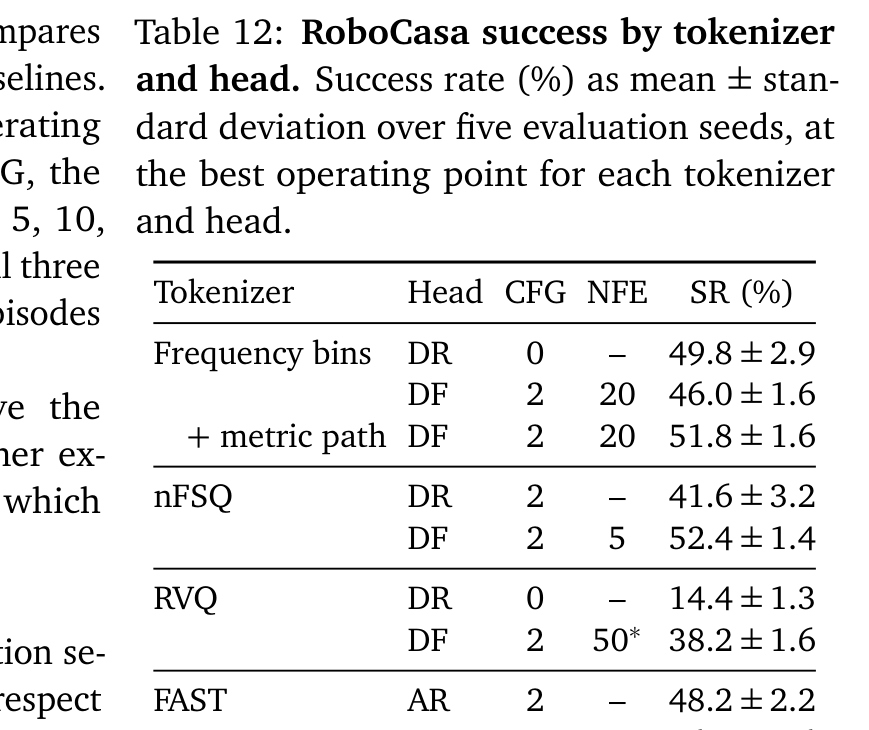
| 分词编码方案 (Tokenizer) | 动作头 (Head) | 最佳引导权重 (CFG) | 最佳推理步数 (NFE) | RoboCasa 汇总成功率 (SR %) |
| :--- | :--- | :--- | :--- | :--- |
| **等频分箱 (Frequency bins)** | 离散回归 (DR) | 0 | – | 49.8 ± 2.9% |
| **等频分箱 (Frequency bins)** | 离散流 (DF) | 2 | 20 | 46.0 ± 1.6% |
| **+ 度量路径 (+ metric path)** | 离散流 (DF) | 2 | 20 | 51.8 ± 1.6% |
| **有限标量量化 (nFSQ)** | 离散回归 (DR) | 2 | – | 41.6 ± 3.2% |
| **有限标量量化 (nFSQ)** | 离散流 (DF) | 2 | 5 | **52.4 ± 1.4%** |
| **残差矢量量化 (RVQ)** | 离散回归 (DR) | 0 | – | 14.4 ± 1.3% |
| **残差矢量量化 (RVQ)** | 离散流 (DF) | 2 | 50* | 38.2 ± 1.6% |
| **动作基元压缩 (FAST)** | 离散自回归 (AR) | 2 | – | 48.2 ± 2.2% |
| **动作基元压缩 (FAST)** | 离散流 (DF) | 2 | 20 | 46.2 ± 2.6% |

**Caption:** Table 12: RoboCasa success by tokenizer and head. Success rate (%) as mean ± standard deviation over five evaluation seeds, at the best operating point for each tokenizer and head. *RVQ needs more NFE to decode, so DF RVQ uses NFE 50.

**Caption[CN]:** 表 12：在不同动作分词器与动作头组合下 RoboCasa 任务的闭环成功率。汇报 5 个随机评估种子的均值 ± 标准差，取各组合的最优工作点。*RVQ 需要更多生成步数方可完成自洽解码，故其 DF 采用 NFE 50。

> <strong>Para. AG-3:</strong> FAST framing and validity. FAST compresses action sequences [Pertsch et al., 2025], so generation must respect its sequence grammar. During training, valid decodes were near 100% for AR, 25–40% for DF, and 0% for DR. The FAST DR run still had 0% validity at the end of training, so it has no closed-loop evaluation. Flat scalar bins do not have this failure: every token sequence decodes. With EOS-terminated framing, FAST AR reaches 48.2% with CFG 2; FAST DF reaches 46.2%.

> <strong>Para. AG-3[CN]:</strong> FAST 分词的语法成帧约束与解码合法性。FAST [Pertsch et al., 2025] 采用类似 BPE 的可变长动作基元算法压缩动作时序，因此模型生成必须严格遵守其复杂的上下文序列语法。在训练过程中，自回归（AR）模型的语法合法解码率接近 100%，离散流 DF 为 25%–40%，而单步离散回归 DR 则遭遇了致命的 0% 合法率（完全无法生成合法闭环序列）。因此 FAST DR 无法进行闭环评测。相比之下，朴素的逐标量均匀分箱完全没有此类语法脆弱性：任何任意组合的 token 序列均能 100% 成功解码为合法物理动作。在引入 EOS 终止符成帧机制后，FAST AR 在 CFG 2 下取得 48.2% 成功率，FAST DF 达到 46.2%。

> <strong>Para. AG-4:</strong> Frequency bins and DR. No tokenizer lifts DF above the best flat-bin DF, but frequency bins behave differently for DR: CFG 0 and CFG 2 give almost the same success (49.8% and 49.0%), and at CFG 0 DR is far above flat-bin DR (27.1%, Section 4). With frequency bins every token is used equally often, so each token carries more information and should be harder to predict, yet single-pass DR handles it well. We do not yet have a concrete explanation, but the results suggest that when inference computation is limited, how actions are encoded matters more.

> <strong>Para. AG-4[CN]:</strong> 等频分箱对单步 DR 的奇特提振。虽然没有任何新型分词器能让 DF 超越朴素均匀分箱的表现，但等频分箱（frequency bins）在 DR 上展现出了截然不同的动力学特征：在无引导（CFG 0）和带引导（CFG 2）下，DR 均取得了几乎完全相同的优异成绩（49.8% 对比 49.0%），且在 CFG 0 下远超朴素均匀分箱 DR 的 27.1%（第 4 节）。在等频分箱下，每个离散 token 的经验出现频率完全均等，因此每个 token 承载了最大的信息熵，理论上预测难度更高；然而单步 DR 却极为从容地适应了这种分布。这一引人深思的现象表明：当测试期推理计算预算极度受限（仅能执行单步前向）时，动作的底层空间编码结构对控制效果起着决定性的关键影响。

> <strong>Para. AG-5:</strong> G.2 Geometry-Aware Probability Paths and Evaluations. This appendix specifies the metric-path interventions summarized in Section 5. The path illustration is analytical; the success rates below come from trained-policy evaluations. G.2.1 From a Mixture Path to a Metric-Induced Path. Let $y \in \{0, \dots, B-1\}$ denote a clean action token and let $s \in [0, 1]$ increase from noise toward the clean action. A probability path specifies the distribution of corrupted tokens presented to the model at each stage. With a uniform source, the mixture path is:
>  $p_s^{\mathrm{mix}}(k \mid y) = \frac{1 - s}{B} + s \mathbf{1}\{k = y\}. \quad 	ext{(G.1)}$

> <strong>Para. AG-5[CN]:</strong> G.2 几何感知概率路径设计与实证评测。本节详细形式化第 5 节中概括的度量诱导概率路径机制。概率路径的可视化基于解析推导，而成功率数据均来自真实训练策略的闭环物理仿真。G.2.1 从标准混合路径过渡至度量诱导路径：令 $y \in \{0, \dots, B-1\}$ 代表纯净动作 token，令进度参数 $s \in [0, 1]$ 随生成进程从纯噪声向纯净动作单调推进。概率路径规定了在生成各阶段呈现给动作头的损坏 token 空间分布。在均匀先验源下，标准混合插值路径为：
>  $p_s^{\mathrm{mix}}(k \mid y) = \frac{1 - s}{B} + s \mathbf{1}\{k = y\}. \quad 	ext{(G.1)}$

### Figure 15. 标准均匀混合损坏路径与几何度量诱导损坏路径解析对比

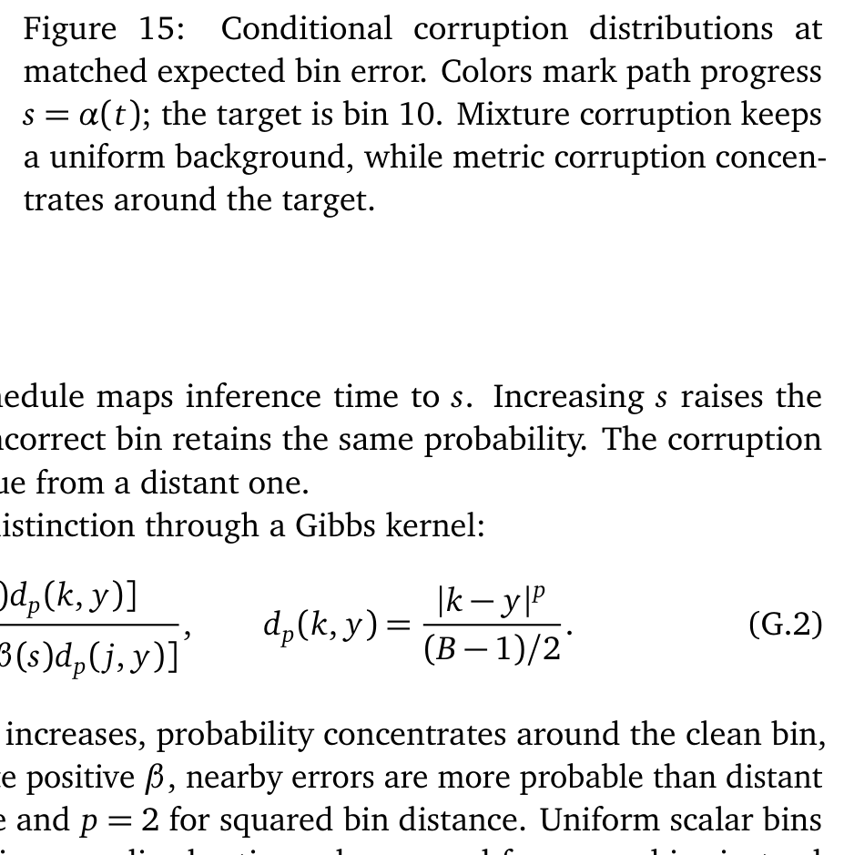

**Caption:** Figure 15: Conditional corruption distributions at matched expected bin error. Colors mark path progress $s = \alpha(t)$; the target is bin 10. Mixture corruption keeps a uniform background, while metric corruption concentrates around the target.

**Caption[CN]:** 图 15：在期望分箱误差严格对齐的条件下条件损坏概率分布对比。不同颜色代表路径进度参数 $s = \alpha(t)$；真实目标为分箱 10。标准混合损坏始终维持平坦的均匀背景噪声底，而度量诱导损坏则将扰动噪声高度聚集在目标分箱周围。

> <strong>Para. AG-6:</strong> Here $s$ is the mixture weight; a separate schedule maps inference time to $s$. Increasing $s$ raises the probability of the clean token, while every incorrect bin retains the same probability. The corruption does not distinguish a neighboring action value from a distant one. The metric-induced path introduces this distinction through a Gibbs kernel:
>  $p_s^{\mathrm{metric}}(k \mid y) = \frac{\exp[-\beta(s) d_p(k, y)]}{\sum_{j=0}^{B-1} \exp[-\beta(s) d_p(j, y)]}, \quad d_p(k, y) = \frac{|k - y|^p}{(B-1)/2}. \quad 	ext{(G.2)}$ 
> At $\beta = 0$ the distribution is uniform; as $\beta$ increases, probability concentrates around the clean bin, approaching a point mass as $\beta \to \infty$. For finite positive $\beta$, nearby errors are more probable than distant errors. We use $p = 1$ for absolute bin distance and $p = 2$ for squared bin distance. Uniform scalar bins make index distance proportional to distance in normalized action values; equal-frequency bins instead impose this structure in quantile space.

> <strong>Para. AG-6[CN]:</strong> 在此处 $s$ 为混合加权系数；通过独立的时间调度函数将物理时间映射至 $s$。增大 $s$ 能够单调提升真实目标 token 的被采样概率，但所有错误分箱在背景噪声中依然享有均等的分配概率。这种损坏完全抹杀了物理空间的连续距离拓扑结构（相邻分箱与遥远分箱被一视同仁）。为了引入几何连续性，度量诱导路径借助吉布斯核（Gibbs kernel）重新定义转移分布：
>  $p_s^{\mathrm{metric}}(k \mid y) = \frac{\exp[-\beta(s) d_p(k, y)]}{\sum_{j=0}^{B-1} \exp[-\beta(s) d_p(j, y)]}, \quad d_p(k, y) = \frac{|k - y|^p}{(B-1)/2}. \quad 	ext{(G.2)}$ 
> 当反温度参数 $\beta = 0$ 时，分布完全退化为均匀分布；随着 $\beta$ 单调递增，概率质量高度浓缩在真实分箱附近，当 $\beta \to \infty$ 时收敛至狄拉克脉冲。对于任意有限的 $\beta > 0$，离目标更近的邻域分箱被赋予远高于远端分箱的损坏转移概率。我们使用 $p = 1$ 对应绝对值分箱距离，使用 $p = 2$ 对应平方欧氏距离。在均匀分箱下，分箱索引距离与物理动作归一化距离严格成正比；而在等频分箱下，该距离结构建立在累积概率分位数空间之上。

> <strong>Para. AG-7:</strong> Clock schedules. Let $\nu$ be a reference histogram over clean bins, uniform in our runs. Define the expected bin error and the conditional entropy:
>  $\bar{e}(\beta) = \sum_y \nu(y) \sum_k p_\beta(k \mid y) |k - y|, \quad \bar{H}(\beta) = \sum_y \nu(y) H(p_\beta(\cdot \mid y)). \quad 	ext{(G.3)}$ 
> The bin-progress clock makes $\bar{e}$ fall linearly in $s$, and the entropy-progress clock does the same for $\bar{H}$:
>  $\bar{e}(\beta(s)) = (1 - s)\bar{e}(0) + s \bar{e}(\beta_{\max}), \quad \bar{H}(\beta(s)) = (1 - s)\log B + s \bar{H}(\beta_{\max}). \quad 	ext{(G.4)}$

> <strong>Para. AG-7[CN]:</strong> 时钟进度调度函数设计。令 $\nu$ 为真实动作分箱的参考先验直方图分布（实验中设为均匀分布）。我们定义加权期望分箱误差与平均条件信息熵如下：
>  $\bar{e}(\beta) = \sum_y \nu(y) \sum_k p_\beta(k \mid y) |k - y|, \quad \bar{H}(\beta) = \sum_y \nu(y) H(p_\beta(\cdot \mid y)). \quad 	ext{(G.3)}$ 
> “分箱误差进度时钟”促使平均分箱误差 $\bar{e}$ 随进度 $s$ 严格线性衰减，而“信息熵进度时钟”则促使条件熵 $\bar{H}$ 随 $s$ 线性下降：
>  $\bar{e}(\beta(s)) = (1 - s)\bar{e}(0) + s \bar{e}(\beta_{\max}), \quad \bar{H}(\beta(s)) = (1 - s)\log B + s \bar{H}(\beta_{\max}). \quad 	ext{(G.4)}$

> <strong>Para. AG-8:</strong> G.2.2 Evaluated Metric-Path Variants. In addition to clean-target cross-entropy, sampling requires off-diagonal jump rates. Writing proposal endpoint $\hat{y}$ from the network posterior, the implementation uses kinetic-optimal discrete flow matching (KO-DFM) off-diagonal rates:
>  $u_s(j \mid i, \hat{y}) = \dot{\beta}(s) p_s^{\mathrm{metric}}(j \mid \hat{y}) [d_p(i, \hat{y}) - d_p(j, \hat{y})]_+, \quad j \ne i. \quad 	ext{(G.5)}$ 
> Here $[x]_+ = \max(x, 0)$. Conditional on that endpoint, only moves to closer bins have positive rates. We pair two metric-path variants with RoboCasa evaluations: the bin-progress clock with $p = 1$ and the entropy-progress clock with $p = 2$. Their best pooled success rates are 52.8% and 4.6%, respectively. The bin-progress clock with $p = 1$ on the equal-frequency representation reaches 51.8%. The first result is competitive with, but does not exceed, the mixture-path DF result of 53.9%. The effect of explicit geometry depends strongly on how the path is constructed.

> <strong>Para. AG-8[CN]:</strong> G.2.2 评测的度量路径变体与转移速率方程。在训练纯净目标交叉熵之外，离散流的推理采样需要定义非对角线跃迁速率矩阵。记网络后验预测出的终点目标建议为 $\hat{y}$，实现中采用动力学最优离散流匹配（KO-DFM）的非对角跃迁速率：
>  $u_s(j \mid i, \hat{y}) = \dot{\beta}(s) p_s^{\mathrm{metric}}(j \mid \hat{y}) [d_p(i, \hat{y}) - d_p(j, \hat{y})]_+, \quad j \ne i. \quad 	ext{(G.5)}$ 
> 其中 $[x]_+ = \max(x, 0)$。以预测目标为条件，仅有向目标靠拢的转移方向才享有严格正的跃迁速率。我们在 RoboCasa 上评测了两种度量路径变体：(1) 基于分箱误差进度时钟且取 $p = 1$；(2) 基于信息熵进度时钟且取 $p = 2$。两者的最高汇总成功率分别为 52.8% 和惨淡的 4.6%；在等频分箱表示下结合分箱时钟（$p = 1$）达到 51.8%。52.8% 的表现虽然高度具备竞争力，但依然未能超越最简单的标准混合路径 DF（53.9%）。这深刻表明，人工施加显式几何约束的效果极度敏感于路径设计的数学构造，稍有不慎甚至会导致性能崩塌。

### Figure 16. 离散动作头分类权重输出层的几何邻域自组织拓扑诊断

**Caption:** Figure 16: Output-weight diagnostics: DR (top), DF (bottom). Columns show centered cosine, lag-dependent similarity, PCA, and row norms. The banded matrices and decreasing local similarity support ordinal organization in both heads.

**Caption[CN]:** 图 16：输出权重层几何拓扑诊断：顶行展示离散回归 DR，底行展示离散流 DF。各列分别汇报中心化余弦相似度矩阵、随滞后距离单调衰减的近邻相似度、PCA 主成分投影以及权重行范数。高度集中的带状对角矩阵与光滑单调递减的局部相似度有力证实了两类离散头均自发涌现出按物理数值严格排序的有序表征结构。

> <strong>Para. AG-9:</strong> G.3 Bin Representation and Input-Sensitivity Study. We analyze DR and DF policies trained on X. Specifically, each bin $b$ at coordinate $j$ is associated with a last-layer embedding $v_{j,b}$. Positive timestep-embedding controls and shuffled-cluster negative controls were also run. Multiple DR checkpoints retain near-zero input adjacency. Canonical posterior probes use 64 validation frames per head and report 14,252 valid output distributions per head; the input-sensitivity sweep uses eight frames per head, with no classifier-free guidance and effective logit softcap zero. DR total-variation responses remain approximately 0.0125–0.0141 over offsets of 1–256 bins. Replacing its random tokens with true tokens changes decoded EEF position by 1.18 mm. At DF time 0.75, offsets of 1, 16, and 64 bins change the decoded normalized output by 0.0093, 0.1368, and 0.5121. These interventions establish sensitivity to input tokens.

> <strong>Para. AG-9[CN]:</strong> G.3 分箱表征自组织与输入扰动敏感度探针研究。我们深入剖析了经过充分训练的 DR 与 DF 策略内部表示。具体而言，每个动作坐标分量 $j$ 处的每个分箱索引 $b$ 均与最后一层分类线性变换的一个行权重向量 $v_{j,b}$ 绑定。我们设计了正向时步嵌入对照组与打乱聚类负向对照组；多次评测证实 DR 在输入端保持接近于零的相邻相关性，但在输出端自发涌现出极强的几何邻域相关性（DR 与 DF 的输出相邻余弦分别高达 0.3724 与 0.3953）。基准后验探针测试基于 64 个验证帧（每模型分析 14,252 个有效输出分布）；输入敏感度扫描评测了在输入端强行注入分箱偏差偏移（offset）时的行为变动：DR 输出的全变差响应在 1–256 个分箱偏移下仅微弱变动 0.0125–0.0141（表现出极强稳健性）；在 DF 时间进度 $t = 0.75$ 时，注入 1、16、64 个分箱的输入偏移使最终解码出的归一化动作分别变动 0.0093、0.1368 和 0.5121。这些严谨的干预确立了离散流对中间输入状态具有极具物理意义的平滑自适应纠错敏感度。

### Figure 17. 离散动作头输出权重嵌入向量按物理数值大小自发组织全貌

**Caption:** Figure 17: Both discrete heads organize output bins by value. Upper left: generated conceptual illustration defining bin separation and cosine; it contains no empirical measurements. (a,b) Output-weight cosine matrices on the same 222 occupied bins, centered over those rows, with self-similarity masked. (c) Median cosine over pairs at each exact bin separation; only output weights are shown. (d,e) Output-weight PCA, colored by bin index; axes state explained variance, and each head has its own PCA basis. (f) Output bias tracks empirical marginal frequency.

**Caption[CN]:** 图 17：两类离散动作头均自发按物理数值大小对输出分箱权重进行有序空间组织。左上：概念示意图，定义分箱间距与向量夹角余弦（无实测数据）。(a,b) 在实际被激活占据的 222 个动作分箱上的中心化权重余弦相似度矩阵（对角线自相似度掩码）。(c) 各分箱绝对间隔距离下的余弦中位数曲线。(d,e) 最后一层分类输出权重的 PCA 主成分投影散点图（按分箱物理数值赋色）。(f) 输出偏置项（bias）与训练集中各分箱真实边际出现频率呈极高正相关（皮尔逊系数 $r = 0.809 / 0.720$）。

### Figure 18. 输入端离散分箱强制偏移扰动下的策略输出敏感度探针曲线

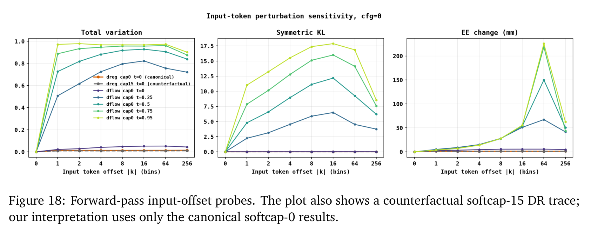

**Caption:** Figure 18: Forward-pass input-offset probes. The plot also shows a counterfactual softcap-15 DR trace; our interpretation uses only the canonical softcap-0 results.

**Caption[CN]:** 图 18：前向传播输入偏移扰动探针响应曲线。图中同时展示了作为反事实对照的 softcap-15 DR 曲线；本文的正文科学推论仅建立在基准 softcap-0 严谨评测之上。

# Appendix H Synthetic Fitting Protocol and Results

> <strong>Para. AH-1:</strong> H.1 Which Fine Structure Does Categorical Prediction Preserve? The robot experiments raise a simple question: can a model get the broad motion right and still miss the fine detail? Robot data combine complex states, multimodality, and high-frequency noise, making it hard to isolate the effect of the head. We therefore study two synthetic regression tasks where the ground truth is a deterministic function of a one-dimensional scalar input $x \in [0, 1]$: (A) a smooth detail target that superimposes low-frequency and high-frequency sinusoids, and (B) a steep square-wave detail target featuring abrupt discontinuities.

> <strong>Para. AH-1[CN]:</strong> H.1 分类预测究竟保留了何种微观精细结构？在真实机械臂评测中显现的现象引发了一个根本疑问：一个动作模型能否在把握宏观大致轨迹的同时，却丢失了关键的微观精细运动细节？由于真实机器人交互数据交织着高维感知状态、复杂多峰性以及高频传感器噪声，很难纯粹隔离动作预测头本身的特性。为此，我们设计了两项极度纯粹可控的合成函数拟合基准，其监督真值是由 1 维标量输入 $x \in [0, 1]$ 决定的确定性数学函数：(A) 光滑微观结构目标：叠加低频大振幅正弦波与高频微小正弦波；(B) 陡峭阶跃微观结构目标：包含连续平坦区间与瞬时剧烈跳变的不连续方波。

### Figure 19. 连续与离散动作预测头在不同微观几何结构下的拟合精度对决

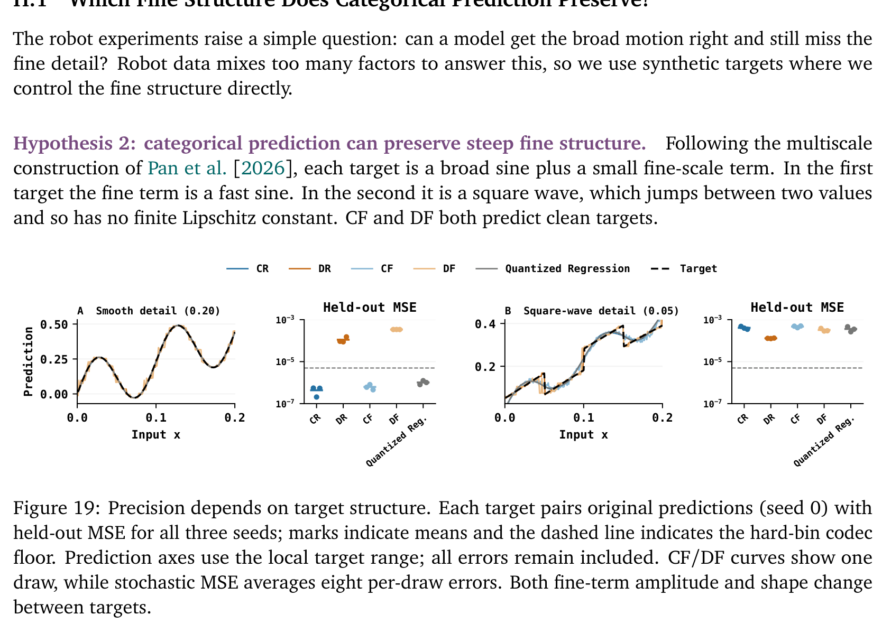

**Caption:** Figure 19: Precision depends on target structure. Each target pairs original predictions (seed 0) with held-out MSE for all three seeds; marks indicate means and the dashed line indicates the hard-bin codec floor. (A) Smooth detail. (B) Steep square-wave detail.

**Caption[CN]:** 图 19：拟合精度对目标微观结构的拓扑依赖性。每类目标均展示原始预测曲线（种子 0）以及跨 3 个随机初始化种子的留出均方误差 MSE；标记代表均值，虚线标出 512 均匀分箱编解码器的固有量化理论误差底线。(A) 光滑微观波动函数；(B) 陡峭方波不连续突变函数。

> <strong>Para. AH-2:</strong> Steep fine detail: the ordering reverses. On the square-wave target (Figure 19B), DR has the lowest held-out error of all heads, with 3.2 times lower MSE and 4.5 times lower MAE than CR. DF also beats both continuous heads, with 31 percent lower error than CF. The prediction panel shows the difference. The regression heads follow the steps but round off the corners, while the categorical heads jump to the next bin right at the edge.

> <strong>Para. AH-2[CN]:</strong> 陡峭高频微观结构：性能排序发生惊天大反转！在面对包含不连续突变的方波阶跃目标时（图 19B），离散回归（DR）斩获了全场所有动作头中的最低留出误差：其 MSE 比连续回归 CR 整整低了 3.2 倍，平均绝对误差 MAE 低了 4.5 倍！离散流（DF）同样彻底击溃了两大连续动作头，其误差比连续流 CF 低了整整 31%。拟合曲线图生动展现了本质差异：连续回归和连续流在阶跃边缘处被迫对拐角进行了圆弧化过度平滑（round off the corners），而基于分类预测的离散动作头在阶跃边界处瞬时干净利落地直接跃迁至正确分箱！

> <strong>Para. AH-3:</strong> Controls narrow the explanation. Quantized Regression fits the bin centers with squared error. It behaves like CR on both targets, so discrete target values are not what drives DR's result. CF tracks CR and DF trails DR on both targets, so the reversal shows up with one-pass and iterative prediction alike. That leaves the categorical formulation as a whole: loss, output parameterization, and argmax decoding. One likely reason is argmax itself. The logits can change smoothly while the decoded bin jumps, which lets the model represent sharp transitions.

> <strong>Para. AH-3[CN]:</strong> 严格对照实验锁定根本机理。我们额外引入了一个关键对照组——量化回归（Quantized Regression，即强行用连续均方误差拟合离散分箱中心值）。结果显示，量化回归在两类目标上的表现与连续回归 CR 完全如出一辙；这直接排除了“离散目标值本身带来优势”的可能性。连续流 CF 在拟合行为上紧随 CR，而离散流 DF 在两类目标上均与 DR 高度一致。这一颠覆性逆转表明其根源在于分类表征机制的整体性设计：分类交叉熵损失、多类输出参数化以及 argmax 极值解码。最根本的原因在于 argmax 非线性解码机制：网络顶层的 logits 可以在特征空间平滑连续过渡，但在越过决策边界的瞬间，解码出的离散分箱能够瞬时完成陡峭断裂式跳跃，从而赋予了模型以极高精度表达剧烈物理接触突变（如碰撞、抓握接触闭合）的无与伦比的天然优势。
