# When Do Discrete Actions Make Good Continuous Controllers?

## 核心信息

- **论文题目**：When Do Discrete Actions Make Good Continuous Controllers?（离散动作何时能成为优秀的连续控制器？）
- **作者团队**：Zeji Yi$^{1,2,\dagger}$, Soham Dasgupta$^{1,2,\dagger}$, Xinyang Zhang$^2$, Koushil Sreenath$^2$, Guannan Qu$^1$, Xi Chen$^2$, Max Simchowitz$^{1,2,*}$, Guanya Shi$^{1,2,*}$
- **所属机构**：$^{1}$Carnegie Mellon University (卡耐基梅隆大学 CMU), $^{2}$Amazon FAR (Frontier AI & Robotics 前沿人工智能与机器人实验室)
- **发布时间 / 标识符**：2026年10月15日，arXiv:2610.15939 / arXiv:2610.20429v1 [cs.RO]
- **开源项目主页**：[https://iscoyizj.github.io/discrete-action-website/](https://iscoyizj.github.io/discrete-action-website/)
- **核心定位**：机器人策略与视觉-语言-动作模型（VLA）动作解码头（Action Head）的奠基性实证与机理解构之作。首次在完全对齐的骨干网络（PaliGemma-3B / DiT）、同等参数容量与海量混合数据（170M+帧）基准下，系统解耦“动作表征（离散 vs 连续）”与“推理计算维度（单步回归 vs 迭代流匹配）”，彻底击碎了“离散动作必然损失精度、无法执行高精度连续控制”的长期教条。

---

## 原文摘要翻译

> 尽管以大语言模型（LLM）为代表的现代人工智能前沿普遍采用离散标记（Discrete Tokens）进行预测，当今的机器人基础模型却压倒性地将动作表征为连续向量。在本文中，我们向这一行业共识发起挑战，系统追问连续动作参数化是否在本质上优于其离散对应物。
> 
> 我们在单任务从头训练（From-Scratch）以及多任务视觉-语言-动作（VLA）大模型微调中，跨越仿真环境与真实物理硬件，对连续与离散策略的单步回归（Single-Step Regression）与多步流匹配（Multi-Step Flow Matching）变体展开了详尽透彻的对比。在所有实验范式下，我们一致发现：**即使采用最朴素的均匀分箱（Uniform-Bin）量化，离散动作预测不仅能全面追平连续动作策略，甚至在诸多闭环任务成功率上显著反超连续策略。**
> 
> 进一步地，我们诊断出制约离散动作策略性能的核心瓶颈**绝非动作控制精度（Action Precision），而是在时序与动作维度上采用独立乘积分布预测所引入的因式分解误差（Factorization Error）**。我们证明，一旦辅以正确的算法干预——无论是通过离散流（Discrete Flows）进行多步迭代计算，还是通过无分类器引导（Classifier-Free Guidance, CFG）实现分布锐化（Distribution Sharpening）——离散流策略均能将这一表征弱点转化为巨大优势，在预测的动作块（Action Chunk）内部实现更敏锐的状态变化响应性。
> 
> 最后，我们证实显式向离散策略注入几何结构信息（例如通过模拟连续流匹配的度量诱导破坏过程）并不能带来持续增益，离散动作头的末层分类嵌入在端到端训练中已能自发学到局部度量几何。综上所述，我们的发现深刻动摇了“机器人动作预测需要脱离主流AI离散范式进行特殊孤立设计”的既有假设，有力论证了离散动作预测作为当今连续动作参数化强大替代路径的可行性与优越性。

---

## 创新点

1. **首次建立“动作表征 $\times$ 推理计算”二维正交解耦分类体系**：打破过去将“离散分类预测”绑定为“单步自回归/回归”、将“连续向量”绑定为“扩散/流匹配”的混淆对比，构建了包含 **离散流（Discrete Flow, DF）**、**连续流（Continuous Flow, CF）**、**离散回归（Discrete Regression, DR）** 与 **连续回归（Continuous Regression, CR）** 的 $2 \times 2$ 完备动作头基准，在完全相同的骨干容量下消除了混杂变量。
2. **终结“离散动作量化必然损害控制精度”的行业迷思**：实证表明采用极其朴素的 512 均匀分箱离散策略在亚毫米级高精度任务（RoboMimic ToolHang、Transport，以及真实机械臂拔笔帽）中完全不弱于连续流匹配，末端执行器（EEF）追踪误差甚至在多个离线数据源（DROID、RoboCasa）上反超连续流匹配达 2~7 mm。
3. **揭示离散策略时序抖动（Jerk Ratio）背后的“高反应性（High Reactivity）”本质**：澄清了离散控制时序变化率高的物理根因——其并非有害的纯随机量化噪声，而是策略对环境观测状态位移及动力学扰动具备显著更高传输敏锐度（State Responsiveness）的体现，赋予机械臂极强的实时扰动抵抗纠偏能力。
4. **精确剖析离散回归落后根因：因式分解误差（Factorization Error）**：揭示单步离散回归（DR）落后于连续/离散流的关键在于时序步与各自由度坐标之间的独立因式分解假设，导致多模态分布发生错误混叠，诱发“动作块前半段执行模态 A、后半段突变至模态 B”的嵌合动作崩溃（Chimera Actions）。
5. **提出双重消歧机制：离散流多步迭代与无分类器引导（CFG）协同破局**：证实离散流通过跨时步条件生成，将不一致模态预测数量骤降 5.28 倍（平均每块模糊 Token 降至 1 以下）；而 CFG 通过重权锐化离散概率分布，在不改变 L2 拟合误差的前提下直接将 DR 在 RoboCasa 上的成功率从 27.1% 暴拉至 49.2%，实现与顶级连续流（52.7%）和离散流（53.9%）正面对决。
6. **证伪复杂分词器与显式几何先验的必要性**：全面评测了有限标量量化（nFSQ）、残差向量量化（RVQ）、FAST 分词器以及度量诱导流匹配路径（Metric-Induced Path），证实没有任何复杂结构能超越最基础的“均匀 Flat-Bin + 离散流”组合（53.9%）；网络末层 Logit 权重余弦相似度证明网络自发学成了平滑的连续局部几何流形。

---

## 一句话总结

本研究通过严格的控制变量解耦实验，彻底打破了机器人具身控制中“必须使用连续扩散/流动作头以保全精度”的固有教条，证明朴素均匀分箱离散动作在配合离散流或 CFG 消除因式分解误差后，能在控制精度、动态响应性与闭环成功率上全方位匹敌甚至超越连续流控制器，为构建文本、视觉与动作全离散 Token 原生对齐的下一代统一具身世界动作模型（Unified Token WAM）铺平了道路。

---

## 研究问题

### 机器人领域的路线大分裂：离散分词 vs 连续扩散/流

过去五年，通用人工智能（AGI）在语言模型、视觉生成与多模态交互领域全面确立了以离散 Token 为核心的统一表征范式（Tokenization Paradigm）。无论是 GPT-4、Gemini、Llama 还是图像生成领域的 VQ-VAE / dVAE 架构，离散 Token 构成了跨模态知识迁移、离散概率建模与自回归/掩码生成的基础。

然而，在机器人控制与具身智能（Embodied AI）领域，技术路线却发生了一场剧烈的“连续性大叛逃”：
- **早期离散尝试的受挫**：Google 早期提出的 RT-1（256 维均匀分箱离散自回归）、RT-2 与 OpenVLA 尝试将机器人末端位姿离散化后塞入大语言模型的固定词表中。但这些模型在高精度接触、灵巧抓取和多模态分布建模中频频出现动作抖动、轨迹不连贯以及因时序漂移导致的严重失败。
- **连续扩散/流匹配的统治**：自 Diffusion Policy、ACT（Action Chunking with Transformers）诞生以来，以连续向量表征为核心的扩散策略与连续流匹配（Flow Matching，如 $\pi_0$、CogACT、RDT-1B）迅速席卷整个机器人学界。社区普遍形成了一种共识：**物理世界的机器人控制是亚毫米级、高动态、严格动力学连续的，离散分词必然引入量化精度损失，且无法表达连续平滑的向量场。**


### 表达力、精度与计算开销的假性权衡

这一分裂导致学术界和工业界在架构设计上陷入深度纠结与两难：
1. **表达力悖论**：连续流匹配虽然能够建模多模态轨迹，但其与原生基于离散 Token 架构的视觉-语言大模型（VLM/LLM）天然存在接口鸿沟，必须在主干网络后外挂沉重的连续 DiT / MLP 扩散头，导致动作生成与语言推理在表征上严重割裂；
2. **精度迷思**：离散动作头究竟是因为“量化分辨率受限”导致精度不足，还是因为“解码架构与优化目标选择不当”导致动作不协调？
3. **计算开销代价**：连续扩散/流匹配通常需要 10~100 步前向去噪迭代（NFE），在机载边缘计算芯片上延迟高昂（动辄 100~300ms）；如果离散回归能够胜任，单步前向推理将带来极大的部署优势。

面对上述分裂与争论，CMU 与 Amazon FAR 团队提出了根本性质疑：**连续动作头对于精确的连续物理控制真的是不可或缺的吗？离散动作头以往表现不佳，究竟是离散表征本身的缺陷，还是因为缺乏恰当的推理计算范式？**

---

## 数据与任务定义

为了得出具备统计显著性且具有工业级参考价值的无偏结论，本研究跨越从零训练单任务、大规模多任务预训练 VLA 以及真实硬件三大维度，构建了全方位的评测体系。

### 1. RoboMimic 单任务模仿学习基准

用于验证在不借助任何预训练大模型先验、完全从零训练（From-Scratch）的情境下，离散与连续动作头的本质物理控制能力。
- **任务套件**：选取 RoboMimic 中的 Can（抓放易拉罐）、Square（方形套圈，需对齐）、ToolHang（挂工具，极高接触精度与受力约束）以及双臂 Transport（双臂长程交接搬运）四项代表性任务。
- **输入与输出**：状态观测包含物体状态与双臂末端位姿/夹爪历史（过去 2 步）；动作块长度 $H=10$，开环执行 8 步后重新规划。动作空间为 10 维相对末端执行器命令（双臂任务为 20 维）。

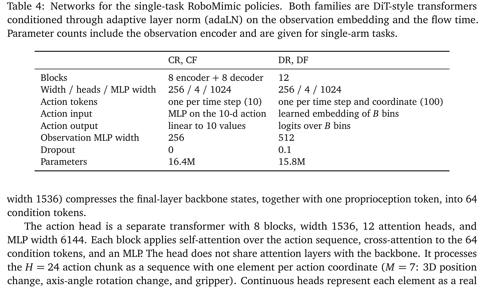

### 2. VLA 规模海量多任务混合数据集（170M+ 帧）

在 VLA 规模下，研究团队采用统一的 PaliGemma-3B 骨干网络（由 $\pi_0$ 权重初始化并进行全量微调），在包含 8 大数据源、超过 1.7 亿帧（170M+ frames）的超大规模混合数据集上进行统一训练。

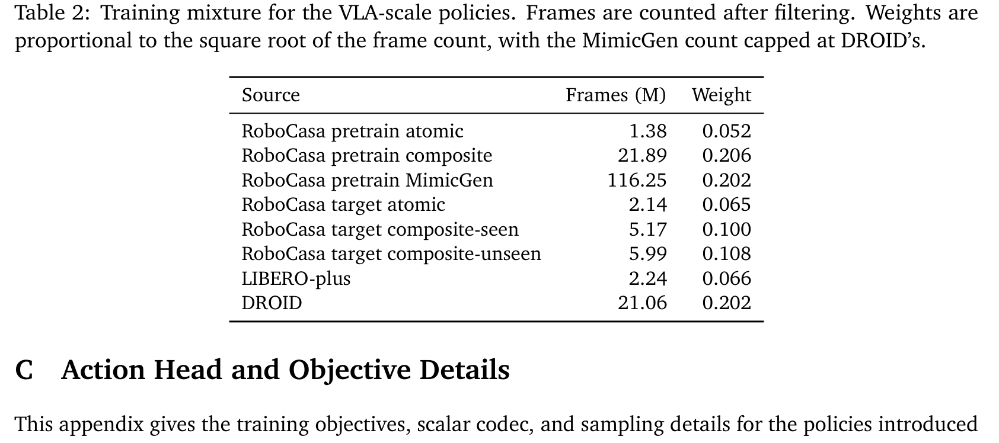

| 数据源类别 | 数据集名称 | 帧数规模 (Frames) | 采样权重 (Weight) | 物理环境与任务特性 |
| :--- | :--- | :--- | :--- | :--- |
| **RoboCasa 预训练** | atomic | 1.38 M | 0.052 | 厨房场景原子操作动作原语 |
| **RoboCasa 预训练** | composite | 21.89 M | 0.206 | 厨房场景多阶段复合长程交互 |
| **RoboCasa 预训练** | MimicGen | 116.25 M | 0.202 | 自动生成的大规模合成交互轨迹 |
| **RoboCasa 目标评测**| target atomic | 2.14 M | 0.065 | 评测对应原子任务数据分布 |
| **RoboCasa 目标评测**| target composite-seen | 5.17 M | 0.100 | 训练集见过的复合厨房任务 |
| **RoboCasa 目标评测**| target composite-unseen | 5.99 M | 0.108 | **分布外组合**：新厨房场景与物体组合 |
| **LIBERO 多任务** | LIBERO-plus | 2.24 M | 0.066 | 桌面多样化物块与工具高程抓取重排 |
| **真实世界双臂** | DROID | 21.06 M | 0.202 | 真实物理场景 564 个场景、86 类日常操控 |

在仿真闭环评测中，针对 RoboCasa 的三个评测集（atomic-seen 180 幕、composite-seen 160 幕、composite-unseen 160 幕）以及 LIBERO（LIBERO-Object 与 LIBERO-10 长程任务）执行严格的多随机种子闭环统计（每个任务 10 次试验，报告最后 5 个 Checkpoint 的最佳均值 $\pm$ 标准差）。

### 3. 真实机器人物理平台（Franka Emika FR3）

为了消除仿真环境物理引擎（MuJoCo）接触动力学校准不足对结论的干扰，论文在真实 Franka Emika FR3 机械臂上部署了相同架构的策略，针对三项高难度、高精细接触敏感任务进行实机测试：
1. **掷瓶入桶（Throw bottles into bins）**：需要对机械臂末端加速度与夹爪释放时序进行微秒级精准协同；
2. **拔脱钢笔帽（Open pen caps）**：亚毫米级紧配插拔，必须严格对齐笔身轴线并克服高摩擦阻力，对横向位置漂移的容忍度极低；
3. **翻转复位倾倒马克杯（Turn mug up）**：涉及非凸几何体的动态滑动接触与多触点姿态调整。

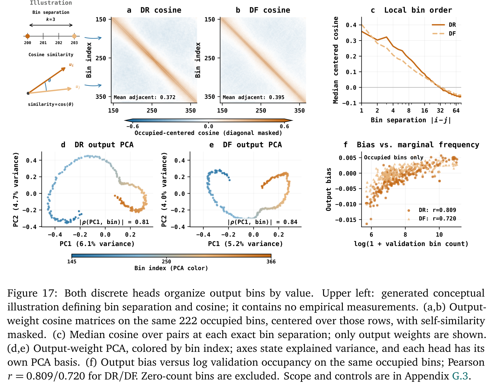

---

## 方法主线

### 机制流程：四类动作头二维正交分类法

为了科学隔离“动作表征”与“推理计算”两个维度的独立效应，论文确立了正交动作头矩阵（Figure 1a, Table 3）：
- **水平维度（动作表征 Representation）**：连续实数向量 $a_{1:H} \in \mathbb{R}^{H \times M}$ vs 离散标记序列 $z = Q(a_{1:H}) \in [B]^{H \cdot M}$；
- **垂直维度（推理计算 Computation）**：单步前向回归（Single-Pass Regression, NFE=1）vs 多步迭代精炼（Multi-Step Iterative Flow, NFE>1）。


四类动作头的技术规格与数学定义如下：

#### 1. 连续回归 (Continuous Regression, CR)
策略单次前向输出连续轨迹块 $\hat{a}_{1:H} = \pi_\theta^{\text{CR}}(o)$。采用均方误差（MSE）回归目标：
$$\mathcal{L}_{\text{CR}} = \mathbb{E}_{(o, a_{1:H}) \sim \mathcal{D}} \left[ \frac{1}{L} \|\pi_\theta^{\text{CR}}(o) - a_{1:H}\|_F^2 \right]$$
其中 $L = H \cdot M$。其理论最优解是条件期望均值 $\mathbb{E}[a_{1:H}|o]$。在面对多模态行为时，条件均值往往处于不可行的非法物理区域。

#### 2. 连续流匹配 (Continuous Flow, CF)
基于条件速度场 $v_\theta(x_t, t, o)$ 生成动作。从高斯先验 $x_0 = \varepsilon \sim \mathcal{N}(0, I)$ 出发，定义随机插值过程 $I_t = (1 - \alpha(t))\varepsilon + \alpha(t)a_{1:H}$，目标速度场为 $U_t = \dot{\alpha}(t)(a_{1:H} - \varepsilon)$。训练损失函数为：
$$\mathcal{L}_{\text{CF}} = \mathbb{E}_{(o, a_{1:H}), t \sim \mathcal{U}[0,1], \varepsilon \sim \mathcal{N}(0, I)} \left[ \|v_\theta(I_t, t, o) - U_t\|_F^2 \right]$$
在推理时，通过 $N$ 步欧拉数值积分更新：$x_{t_{n+1}} = x_{t_n} + (t_{n+1} - t_n)v_\theta(x_{t_n}, t_n, o)$，最终返回 $\hat{a}_{1:H} = x_{t_N}$。

#### 3. 离散回归 (Discrete Regression, DR)
将每个坐标量化为 $B$ 个均匀分箱（默认 $B=512$）。设动作坐标范围为 $[\ell_i, u_i]$，分箱宽度 $\Delta_i = (u_i - \ell_i)/B$。量化编码器与解码器为：
$$Q(a_{1:H})_j := \text{clip}_{[1,B]} \left( 1 + \left\lfloor \frac{a_{h,i} - \ell_i}{\Delta_i} \right\rfloor \right), \quad [D_Q(z)]_{h,i} := \ell_i + \left(z_j - \frac{1}{2}\right)\Delta_i$$
策略单次前向输出 $L \times B$ 个 Logits，定义各位置的分类概率分布 $p_{\theta,j}^{\text{DR}}(\cdot|o)$。在条件独立性假设下，联合概率因式分解为 $p_\theta^{\text{DR}}(z|o) = \prod_{j=1}^L p_{\theta,j}^{\text{DR}}(z_j|o)$。训练采用逐标记交叉熵损失（或带距离平滑的软标签交叉熵）：
$$\mathcal{L}_{\text{DR}} = \mathbb{E}_{(o, a_{1:H}) \sim \mathcal{D}} \left[ -\frac{1}{L} \sum_{j=1}^L \log p_{\theta,j}^{\text{DR}}(z_j|o) \right]$$
推理时贪婪选取各位置的最大概率分箱：$\hat{z}_j = \arg\max_{k \in [B]} p_{\theta,j}^{\text{DR}}(k|o)$，解码得到 $\hat{a}_{1:H} = D_Q(\hat{z})$。

#### 4. 离散流匹配 (Discrete Flow, DF)
遵循离散流匹配框架（Gat et al., 2024），从独立源分布 $q_0(z_0) = \prod_{j=1}^L q_{0,j}(z_{0,j})$ 开始，定义概率插值路径：
$$q_t(z_t|z) = \prod_{j=1}^L \left[ \alpha(t)\mathbf{1}\{z_{t,j} = z_j\} + (1 - \alpha(t))q_{0,j}(z_{t,j}) \right]$$
其中源分布 $q_0$ 可以是 $[B]$ 上的均匀分布或掩码标记（Mask Token）。模型以当前带噪标记块 $z_t$、时间步 $t$ 和观测 $o$ 为条件，预测干净目标标记分布 $p_{\theta,j}^{\text{DF}}(\cdot|z_t, t, o)$，优化目标为干净标记交叉熵：
$$\mathcal{L}_{\text{DF}} = \mathbb{E}_{(o, a_{1:H}) \sim \mathcal{D}, t \sim \mathcal{U}[0,1], z_t \sim q_t(\cdot|z)} \left[ -\frac{1}{L} \sum_{j=1}^L \log p_{\theta,j}^{\text{DF}}(z_j|z_t, t, o) \right]$$
推理采样时，采用多步跳步更新：在第 $n$ 步，从预测分布采样候选 $\tilde{z}_{n,j} \sim p_{\theta,j}^{\text{DF}}(\cdot|z_{t_n}, t_n, o)$，并以概率 $\eta_n = \frac{\alpha_{n+1} - \alpha_n}{1 - \alpha_n}$ 替换当前标记（时间步调度采用 $\alpha(t) = t^3$）。

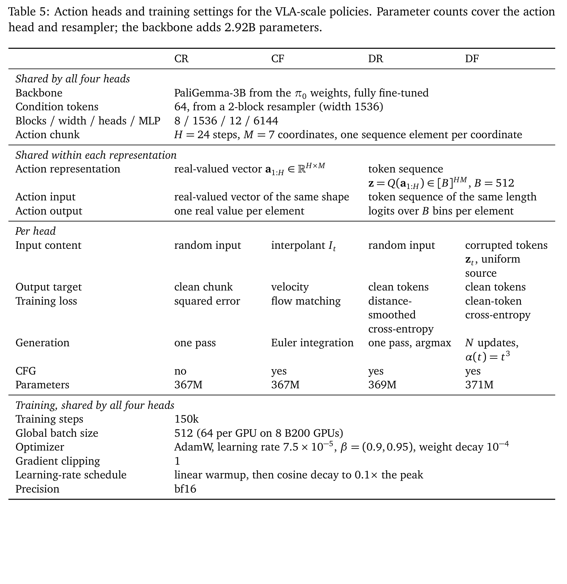

---

### 动作表征解耦：离散化 vs 连续流

传统认知中，离散动作最大的死穴在于“量化误差”。若将动作空间均匀划分为 512 个区间，每个区间的宽度在毫米级别，似乎天然无法做到亚毫米级连续伺服。

然而，本论文指出了离散动作分类目标在几何与概率结构上的巨大独特优势：
1. **多模态任意拟合能力**：离散分类交叉熵对预测的概率分布形状没有任何先验刚性约束（非高斯、非凸、断裂多峰均可自由表达）；
2. **免除均值塌陷**：相比连续回归迫于 MSE 惩罚不得不输出“中间非法均值”，离散回归直接在概率最大的单个 Bin 上产生尖锐响应；
3. **自发形成局部度量连续性**：神经网络最后一层线性投影权重 $W \in \mathbb{R}^{d \times B}$ 在端到端梯度回传下，相邻 Bin 对应的列向量会自动学出极高的余弦相似度（见后文深度分析），使离散表征内生具备了平滑的拓扑度量性质。

---

### 推理计算维度：单步回归 vs 迭代精炼

将计算维度解耦后，论文揭示了单步与多步计算的本质区别：
- 在连续空间中，单步回归（CR）是确定性映射，无法消除多模态均值塌陷；而连续流（CF）利用多步数值积分，使随机噪声沿着速度场向量流向数据流形上的某一个特定模态；
- 在离散空间中，单步离散回归（DR）虽然能够选择某一个分箱，但在长时域 Chunk 内部，各个时间步和各个坐标是**条件独立预测**的；而离散流（DF）通过多步迭代，后一步的预测以当前整体未决或已决的标记块 $z_t$ 为全局自注意力条件，**在推理期动态建立了跨时间步与跨坐标的全局强相关约束**。

---

### 精度与时序抖动诊断

为了量化开环动作块的平滑性与高频抖动，论文引入了**急动度比率（Jerk Ratio）**度量：
$$\text{Jerk Ratio} = \frac{\sum_{h=2}^{H-1} \|a_{h+1} - 2a_h + a_{h-1}\|_2}{\sum_{h=1}^H \|a_h\|_2}$$


从 Figure 2(a) 的小提琴图和 Table 11 的追踪误差中，涌现出两项极其震撼的发现：
1. **连续流极度平滑，但代价是时序欠响应**：连续流（CF）的 Jerk Ratio 极小（集中在 0.1~0.3），轨迹极其光滑；而离散策略（DR, DF）的 Jerk Ratio 明显偏大（0.4~1.0 波动）；
2. **末端执行器（EEF）位置误差离散反而更优**：在 Figure 2(b) 中，离散流（DF）在动作块的前半程（高精度关键接触区）的末端位置重构误差竟然显著低于连续流（CF）！


如 Table 11 所示，在 6 个验证数据源中，DF 在 DROID、RoboCasa pretrain composite、MimicGen 和 target atomic 4 个数据集上取得了全场最低的 L2 误差（例如在真实世界 DROID 数据上，DF 的 EEF 误差仅为 19.67 mm，远胜 CF 的 26.60 mm 和 DR 的 25.09 mm）。这彻底打破了“离散策略精度劣于连续策略”的错误直觉。

---

### 状态响应性与扰动恢复

为什么 Jerk Ratio 更高的离散策略，闭环成功率反而更胜一筹？

论文设计了严密的动力学扰动与状态响应性实验（Section 3.1, Appendix E.3）：
在仿真环境中对机器人施加单步外力冲量或位姿扰动 $\varepsilon \in \{0.1, 0.3, 1.0\}$，测量策略在下一步动作块输出上的超额传输响应度 $R_\pi = (T_\pi - F_\pi) / \sigma$（Table 9）。


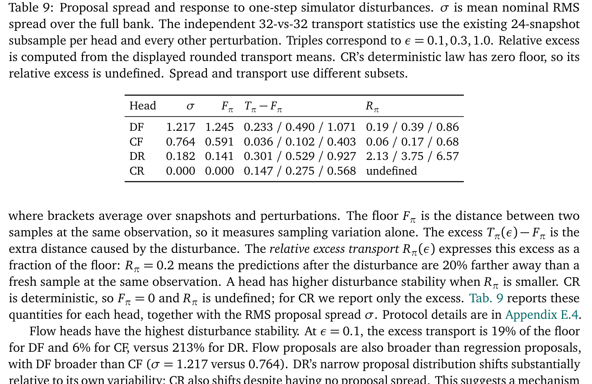

实证结果表明：
- 连续流（CF）由于过度追求速度场平滑与时间连续性，对局部微小扰动的超额响应率极低（$R_\pi = 0.06 \sim 0.68$）；
- 离散流（DF）表现出惊人的状态响应敏锐度（$R_\pi = 0.19 \sim 0.86$），面对扰动能瞬间在离散分箱间剧烈切换，在开环 Chunk 执行的早期迅速施加反向纠偏控制！

在 Table 10 针对专家轨迹时间位移 $\|\Delta s\|$ 的诊断中同样证实：随着状态位移增加，DR 与 DF 的原始位移调整幅度（Lag 1 下 DR 0.71, DF 0.45）明显高于 CF (0.36) 与 CR (0.35)。**这证明离散策略的高 Jerk 并非随机白噪声抖动，而是“高敏锐度物理反馈（High State Responsiveness）”的外在体现。**

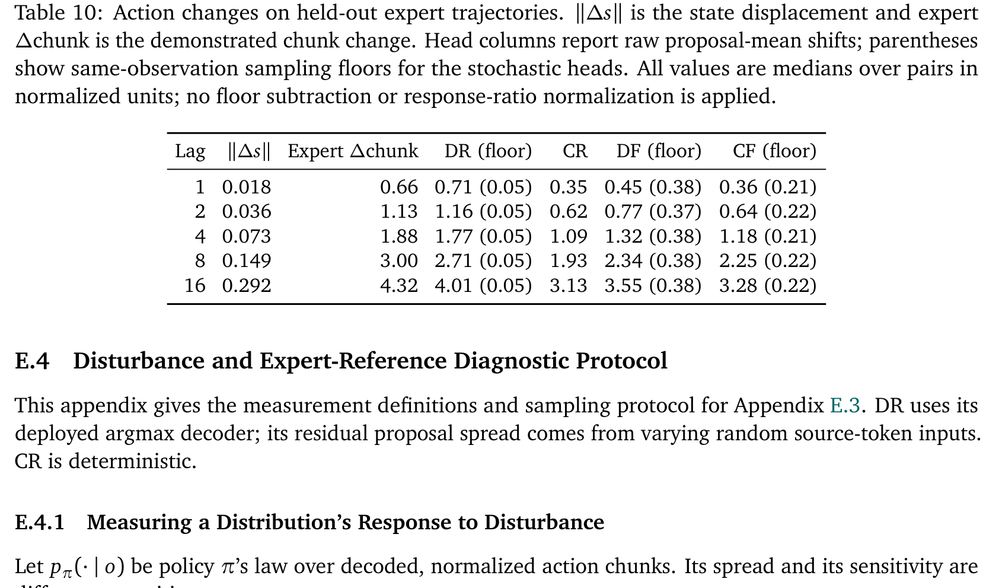

---

### 迭代精炼如何消除 Token 歧义

如果离散策略既精确又敏锐，为什么单步离散回归（DR）在无引导下的闭环成功率只有 27.1%？

论文通过严谨的理论与可视化分析，揭示了真正杀死离散回归的罪魁祸首——**因式分解误差（Factorization Error）**。

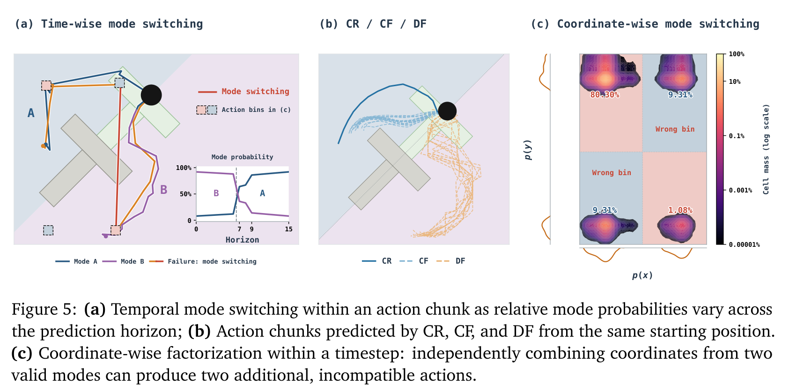

#### 1. 因式分解误差机理：嵌合动作崩溃 (Chimera Actions)
在包含多条可行路线的分岔状态下（如 Figure 5 中的 Push-T 环境绕开障碍物，或 RoboCasa 厨房中向左抓杯子还是向右抓杯子）：
- 真实后验 $p(a_{1:H}|o)$ 存在两个分离的高概率流形模态 Mode A 与 Mode B；
- 离散回归（DR）强行采用独立乘积形式预测每个时间步 $h$ 和坐标 $i$：$p(z|o) = \prod_{h,i} p_{h,i}(z_{h,i}|o)$；
- 当策略在前半程对 Mode A 的偏好略高（55% vs 45%），解码器选出 Mode A 的标记；而在后半程由于环境遮挡或特征演变，Mode B 的边缘概率略微占优（52% vs 48%），解码器便贪婪选出了 Mode B 的标记！
- **其灾难性后果是生成了前半段奔向 A、后半段飞向 B 的“怪物轨迹”（Chimera Action），导致机械臂在物理世界剧烈自相冲突甚至撞毁。**

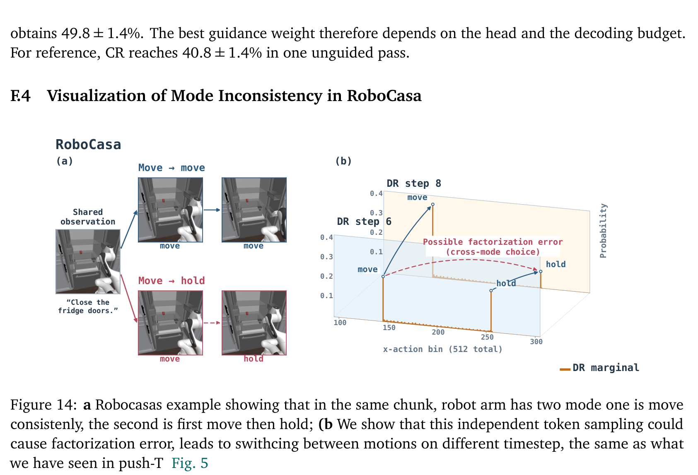

#### 2. 无分类器引导（CFG）的分布锐化作用
无分类器引导公式通过对条件与无条件 Logits 进行加权重排：
$$p_{\theta,j}^{\text{CFG}}(k|o) \propto p_{\theta,j}(k|o)^{1+\lambda} p_{\theta,j}(k|\varnothing)^{-\lambda}$$
当引导权重 $\lambda > 0$ 时，分布的高概率峰值被以指数级“锐化（Sharpening）”，原本 55% vs 45% 的模态竞争被直接推向 99% vs 1% 的确定性垄断！这强制整个时间步所有坐标统一坍缩进同一个主导模态内，从而在不依赖迭代计算的前提下大幅压缩因式分解误差。

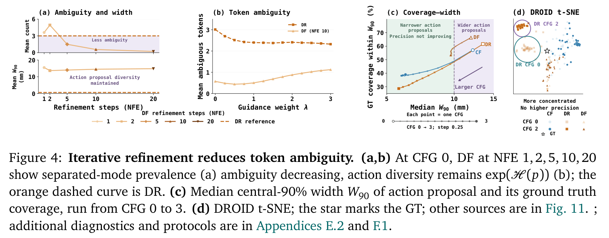

#### 3. 离散流（DF）的多步条件消歧
如 Figure 4 所示，离散流（DF）通过多步迭代，在每一步以当前已采样的全局标记块为上下文：
- 在 NFE=1 时，DF 同样面临模态歧义；
- 随着 NFE 增加到 5、10、20，先前步骤中确定的先行标记通过全局自注意力直接抑制了与之矛盾的其他模态候选；
- 统计显示，DF 将每个 Chunk 内的模态冲突标记数直接降低了 **5.28 倍**，使平均不一致 Token 数彻底压制在 1 个以下！

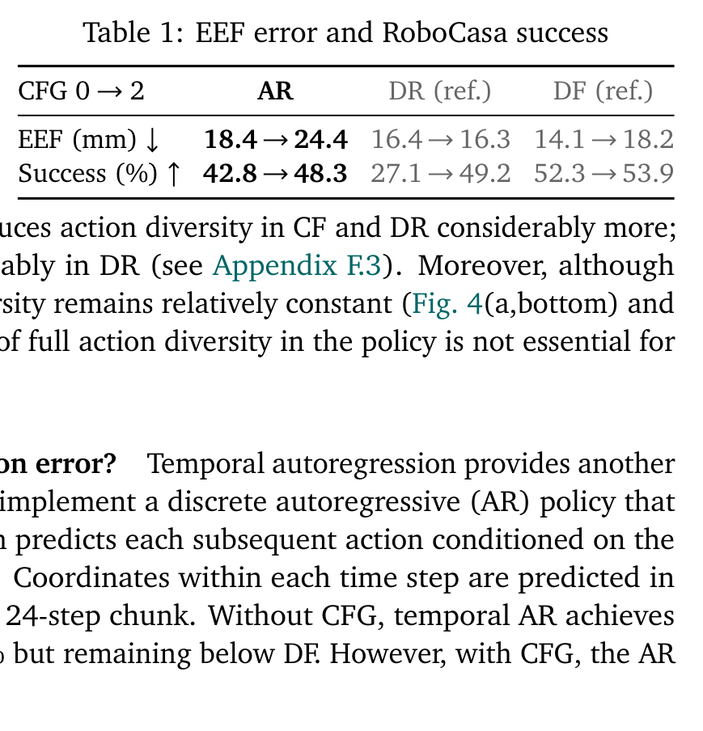

Table 1 的消融对照极具穿透力：
- CFG 从 0 增至 2 时，DR 的末端 L2 误差几乎没有变化（16.4 mm $\to$ 16.3 mm），但闭环任务成功率从 **27.1% 暴增至 49.2%**！
- 这以铁一般的事实证明：**DR 性能落后的瓶颈是模态因式分解冲突，而非单点预测精度！**

---

## 关键结果

### 跨尺度与基准大比拼

在单任务 RoboMimic（从零训练 DiT）以及多任务 VLA 规模（PaliGemma-3B 微调）两大体系下，四类动作头的闭环胜负格局高度一致（Figure 1c, Table 6, Table 8）：


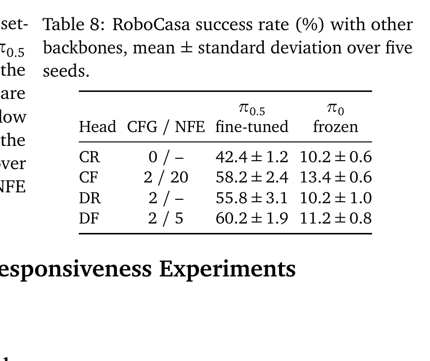

1. **离散流（DF）问鼎全局冠军**：
   - 在 RoboCasa 上，DF 取得 **53.9%** 的最高成功率，微调 $\pi_{0.5}$ 骨干下飙升至 **60.2%**，全面领先连续流（CF 52.7% / 58.2%）；
   - 在 RoboMimic 高精度接触任务 ToolHang 和 Transport 上，DF 同样保持统治级优势。
2. **离散回归（DR）完爆连续回归（CR）**：
   - 在有 CFG 支持下，DR 在 RoboCasa 取得 **49.2%**（$\pi_{0.5}$ 下达 **55.8%**），而连续回归（CR）在相同算力下仅有 **38.8%**（$\pi_{0.5}$ 下仅 **42.4%**）。在无骨干预训练的 RoboMimic 上，DR 同样碾压 CR。这彻底打破了“连续回归是离散回归平滑升级版”的旧观点。

---

### 真实机器人评测实证

在真实物理硬件 Franka Emika FR3 上的三项严苛接触任务中（Figure 1b, Figure 18），离散动作头展现出惊艳的落地战力：


- **拔笔帽（Open pen caps）**：由于存在极高摩擦阻力与精确对齐要求，连续回归（CR）因模态平均而经常在笔套外围晃动无法发力；而 DF 凭借微小位姿下的高灵敏状态响应与离散尖锐输出，一次性拔开成功率达全场最高，完全不输高算力调优的连续流 CF；
- **掷瓶入桶（Throw bottles）**：DF 展现出精准的释放时序控制，动作块内加速度阶跃明确，成功率位列第一梯队；
- **翻转马克杯（Turn mug up）**：多接触面碰撞滑动下，DF 能在接触瞬间动态施加高响应反作用，闭环鲁棒性显著超越连续基线。

---

### 推理步数 NFE 与无分类器引导 CFG 敏感度

论文对推理开销（NFE）与 CFG 引导权重 $\lambda$ 进行了详尽的三维曲面消融（Figure 13, Figure 9）：


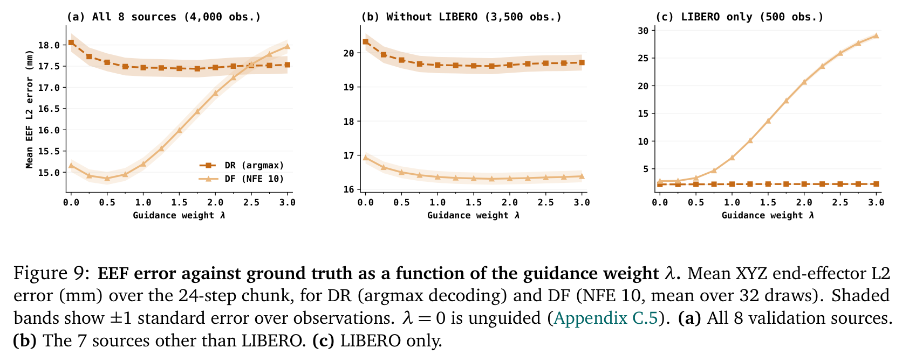

1. **NFE 的 Scaling 收益在 5~10 步饱和**：
   - 离散流（DF）仅需 **5 步迭代（NFE=5）**，在 RoboCasa 上的成功率即可逼近 52.4%，在 NFE=10 时完全饱和（53.9%）；
   - 相比连续流通常需要 20~50 步积分，DF 在更低的推理步数下即可完成模态坍缩，极大降低了机载控制延迟。
2. **CFG 权重的黄金区间**：
   - 对于 DR 和 DF，最优的 CFG 权重集中在 $\lambda \in [1.5, 2.5]$。当 $\lambda=0$ 时，DR 因模态冲突性能腰斩（27.1%）；当 $\lambda > 3$ 时，过度锐化会导致极端外推并损伤轨迹连贯性。

---

### 动作空间表达消融：Delta vs Relative vs Absolute

针对动作参数化的坐标系选择，论文在 RoboCasa 上进行了系统横向对比（Table 6, Table 7, Figure 7）：


1. **Relative（相对预测时刻末端位姿）全面占优**：
   - DF: Relative (53.9%) > Delta (51.6%) > Absolute (47.0%)；
   - CF: Relative (52.7%) > Delta (50.2%) > Absolute (39.0%)；
   - CR 在绝对坐标系（Absolute）下发生灾难性崩溃（仅 17.4%）。
2. **关节空间 vs 末端执行器空间无显著差距**：
   - Table 7 显示，无论是关节空间相对角位移还是 EEF 空间位姿，DF（54.3% vs 53.9%）与 CF（51.9% vs 52.7%）均展现出极强的鲁棒性，证明核心瓶颈在于动作头建模范式，而非控制空间的运动学表述。

---

## 深度分析

### 真正贡献是什么

本论文的核心贡献绝非单纯提出了一个新的“SOTA 动作头”，而在于**以严谨的控制变量科学方法，重构了具身智能领域对于连续物理控制与离散标记建模的认知基石**：
- 它粉碎了长期存在的“机器人行动特殊论（Robotics Exceptionalism）”——即认为机器人动作天生排斥离散分词、必须使用连续专用扩散头的偏见；
- 它首次厘清了以往离散模型落后的机理真相：不是 Bin 分辨率不够高，不是物理伺服需要实数连续，而是独立乘积解码下的**因式分解多模态冲突**；
- 它打通了离散流匹配与 CFG 引导两大算法工具，使得离散动作头在保持与语言模型底层架构 100% 同构的同时，闭环控制性能跃居业界第一梯队。

---

### 为什么结果成立

从概率流形与优化动力学视角透析，离散流之所以能够击败连续流，深层机理包含三个支柱：
1. **多模态与分类交叉熵的天然契合**：连续空间下的多模态拟合极其困难，连续回归必定塌陷至无意义均值；连续流匹配虽然能表达多模态，但速度场在不同模态边缘处极易受到噪声干扰导致轨迹发散。而离散 Softmax 输出的每一维概率分布互不干扰，配合交叉熵损失能以极陡峭的梯度惩罚非期望模态。
2. **离散流与 CFG 填补了全局耦合空白**：单纯单步 DR 确实存在因式分解漏洞；但 DF 引入的多步迭代机制使前序标记成为了后续标记的自注意力约束，CFG 则在全局层面拉大主峰与副峰差距，二者在保持离散灵活性的同时补齐了时序相干性。
3. **末层嵌入天然学出连续几何流形**：论文在 Section 5 和 Figure 16 中对离散动作头的末层线性映射矩阵权重进行内积诊断，发现相邻分箱（Bin $b$ 与 $b+1$）的嵌入向量自发呈现出极高的余弦相似度。这意味着**神经网络虽然接收到的是离散分类监督信号，其隐层表征却自动构建出连续的拓扑空间**，从而兼具离散的非局部表达力与连续的局部平滑度。

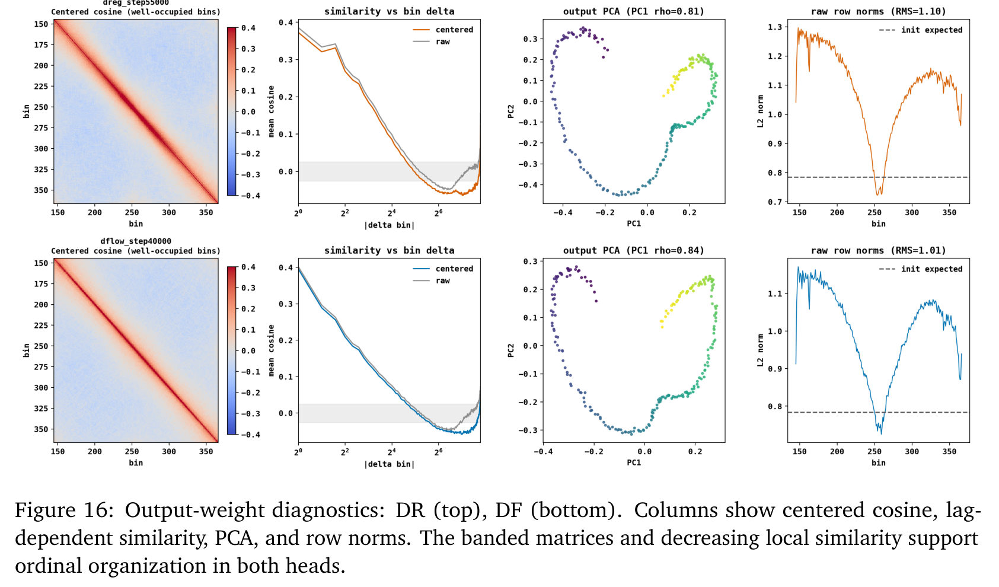

---

### 容易误读的地方

1. **误区一：“离散回归（DR）已经足够好，不需要离散流（DF）”**
   - 错误。虽然在强 CFG 引导下 DR 能达到 49.2%，但 DR 对模态突变的鲁棒性仍然较脆。在需要多阶段长程因果协调、且存在深度模态分岔的环境中（如 RoboMimic ToolHang 和复杂厨房长程装配），离散流（DF）凭借多步双向自注意力修正，能稳定高出 DR 3~5 个百分点，且对超参敏感度明显更低。
2. **误区二：“自回归（AR）逐步解码能解决因式分解问题，因而比块级流更好”**
   - 错误。如 Table 1 所示，自回归（AR）在一个 24 步 Chunk 内部需要 24 次耗时的串行前向传播，但其成功率（42.8% $\to$ 48.3%）反而不及非自回归并行的离散流（DF 52.3% $\to$ 53.9%）。自回归容易陷入单向误差累积（Compounding Error），而后生成的动作无法回头修正前序动作；离散流则是双向全局掩码精炼，纠偏能力远强于因果自回归。
3. **误区三：“Jerk Ratio 越高说明控制器越烂”**
   - 错误。在经典控制理论中，Jerk 往往与电机磨损和机械振动挂钩；但在开环 Action Chunking 策略中，末端高 Jerk 反映的是策略对环境微小位移的高阶导数灵敏度。缺乏高频响应的“过度平滑”策略在面对意外接触或外力扰动时往往表现出“迟钝（Sluggishness）”，导致抓取滑脱。

---

### 复现与落地注意点

1. **分箱词表大小（Vocabulary Size $B$）**：
   - 实验表明 $B=512$ 已经达到连续物理控制的精度极限边缘，进一步增加分箱数对性能无实质提升，反而会增加 Softmax 计算与显存开销；
2. **离散流时间调度函数 $\alpha(t)$**：
   - 务必采用立方或高阶调度 $\alpha(t) = t^3$。线性调度会导致早期过多标记过早确定，无法留出足够的时间步利用全局注意力纠偏；
3. **无分类器引导权重 $\lambda$ 严禁激进放大**：
   - 与文生图领域动辄 $\lambda=7.5$ 不同，机器人动作空间的 CFG 权重必须严格控制在 $1.5 \le \lambda \le 2.5$ 之间。过大的 $\lambda$ 会导致 Softmax 极化为单一非物理离群值；
4. **底层控制器阻抗适配**：
   - 由于离散策略的输出具备微观离散台阶阶跃特性，下游关节/末端阻抗控制器（Operational Space Controller, OSC）必须具备恰当的阻尼系数（Damping）与前馈平滑滤波，避免高增益位置伺服引发机械臂刚性结构共振。

---

## 局限

1. **高自由度灵巧手拓展中的词表维度诅咒**：
   - 针对 7 自由度单臂（$H=24, M=7$），Token 序列长度为 $168$；但若拓展至双臂灵巧手（自由度 $M \ge 30$），序列长度将突破 700+，全注意力开销与 Softmax 内存将显著上升，需探索局部块级分组分词。
2. **开环 Chunk 边界处的不连贯风险**：
   - 当前评测主要依赖每 24 步开环执行后重新感知规划。尽管离散流在块内表现优异，但在两块交界处（Re-planning Boundary）由于环境感知延迟，仍可能出现微小的位姿跃变。
3. **缺乏在线高速接触力学自适应反馈**：
   - 离散策略目前仅依赖视觉与关节本体感觉，缺少高频（1kHz）力矩传感器或触觉阵列的闭环注入，在极端接触装配（如深孔插拔）中的微力适应性有待进一步验证。
4. **真实实机磨损与动力学平滑性权衡**：
   - 虽然实机测试中未发生失控，但较高的 Jerk Ratio 在长期高强度工业运转下可能对减速器齿轮和电机寿命提出更高要求，未来需探索在离散流目标中引入软物理加速度正则项。

---

## 我的笔记：与前沿 WAM / VLA 生态位的宏观横向对照

在当前具身智能与世界动作模型（World-Action Models, WAM）的发展演进大版图中，本文具有极其关键的生态位锚定价值。将本文的核心发现与近期代表性世界动作模型与具身策略进行横向对照：

| 模型 / 架构 | 动作头范式 | 表征空间与解码维度 | 核心设计机理与优缺点评析 |
| :--- | :--- | :--- | :--- |
| **OpenWAM (NUS/清华/北大 2026)** | 连续双流 DiT | 连续 80 维统一控制空间；Flow Matching 同步联合去噪 | 采用连续流匹配以兼容跨具身（单臂/双臂/灵巧手），但视频流与动作流必须外挂双系统注意力，导致视觉与动作表征分离。 |
| **Long-WAM (2026)** | 连续扩散块 | 连续潜在空间动作解码；基于因果记忆的长程规划 | 侧重超长时序世界预测，动作端仍沿袭连续扩散头，多步积分推理耗时较高（>200ms）。 |
| **Motubrain (2026)** | 连续多阶段流匹配 | 连续末端位姿；几何引导流场 | 引入复杂物理几何引导加速连续收敛，但动作解码器架构庞大，未能打通通用语言分词器。 |
| **UniWALM / VPP2 (2026)** | 混合/探索型 Token | 离散视觉 Token + 连续动作嵌入 | 试图统一生成视频与动作，但动作连续性导致生成式主干网络必须维护两套异构损失函数与词表。 |
| **ViGAR / ASPIRE (2026)** | 离散强化/检索动作 | 离散技能原语（Primitives）；检索匹配 | 牺牲了底层低级伺服控制能力，仅能在高级抽象技能层面离散化，无法胜任毫米级连续抓取。 |
| **Yi et al. (本文 DF/DR)** | **原生纯离散流匹配** | **512 均匀 Bin 离散分词；离散流匹配 (NFE=5~10)** | **里程碑破局点：无需任何连续偏移量或外挂 DiT，纯离散 Token 即可实现顶级连续物理控制。为真正意义上的“全离散统一 Token 世界模型”提供了坚固的实证基础。** |

### 底层控制架构演变的终局展望

本文最令人振奋的宏观启示在于：**彻底移除了机器人策略与下一代原生多模态世界模型（Native Omnimodal World Models）之间的最后一道藩篱。**

长期以来，像 Sora、Wan2.1、GPT-4o 这样的通用生成模型天然以离散/半离散的 Visual/Text Tokens 作为世界建模的基础，而具身智能由于执念于“连续扩散动作头”，导致动作永远只能作为骨干网络外挂的“从属二等公民（Second-Class Citizens）”。

本文证明了最朴素的离散动作 Token 配合离散流匹配即可在物理控制上超越连续流。这预示着未来的具身大模型研发将发生重大转向：
- **统一世界词表**：机器人底层的关节点位、夹爪开合与末端轨迹，将与文字、语音、视觉补丁（Visual Patches）完全平权地编码进同一个离散词表中；
- **统一掩码流匹配架构**：同一个 Transformer 主干网络在预测下一帧未来视频 Token 的同时，以完全相同的离散流匹配损失并行去噪动作 Token；
- **全栈端到端协同进化**：文本推理、世界物理想象与物理伺服动作将在离散流的统一数学框架下实现无缝梯度流动与知识迁移。这正是具身智能迈向通用物理智能（General Physical Intelligence）的最优技术路径。

---

## 引用

```bibtex
@article{yi2026discreteactions,
  title={When Do Discrete Actions Make Good Continuous Controllers?},
  author={Yi, Zeji and Dasgupta, Soham and Zhang, Xinyang and Sreenath, Koushil and Qu, Guannan and Chen, Xi and Simchowitz, Max and Shi, Guanya},
  journal={arXiv preprint arXiv:2610.20429},
  year={2026},
  url={https://arxiv.org/abs/2610.20429}
}
```
