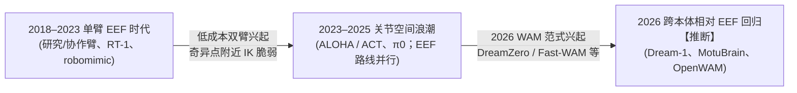

# Dream-1 调研与思考：末端位姿（EEF）vs 关节动作（Joint）全景指南

> 整理日期：2026-10-21（更新于 2026-10-22，核查截至当日；公开事实、推断和未验证项分列，见文末附录）
> 核心主线：从 CV / WAM 训练视角切入，透视机械臂物理控制与跨本体零样本泛化的底层机制。
> 标注约定：【推断】= 作者基于公开信息的推断，非原文结论；【未核实】= 未能在一手来源中确认。

---

### 背景与缘起

这两天，Dream Labs 发布的 **Dream-1** 凭借其在未见机器人、未见环境下的优异**零样本跨本体泛化能力（Zero-Shot Cross-Embodiment Generalization）**引起了广泛关注。

借着这个机会，仔细研读了 Dream-1 官方技术披露及相关工作（DreamZero、OpenWAM、Fast-WAM、LingBot-VA 等）。在剥离掉繁杂的视频生成模型架构讨论后发现，要真正理解为什么有些模型能跨本体零样本开箱即用、而有些模型必须与具体硬件强行绑定，一个重要的接口问题是**动作空间的选择——“关节（Joint / qpos）vs 末端位姿（EEF Pose）”**。但动作接口本身不足以解释泛化能力，还需考虑训练数据、视觉表示、相机布局与执行栈。

以**“关节 vs 末端位姿”**为唯一核心主线，从 CV/WAM 工程师的视角出发，系统梳理该领域的物理机制、历史演进、张量工程实操与落地指南。

---

## 目录

- [一、核心认知：末端位姿 vs 关节动作的物理与张量本质](#一核心认知末端位姿-vs-关节动作的物理与张量本质)
- [二、因果链与历史演进：为什么动作空间反复横跳？](#二因果链与历史演进为什么动作空间反复横跳)
- [三、主流模型动作空间横向对照（含 Fast-WAM / ImageWAM / OpenWAM 对比）](#三主流模型动作空间横向对照含-fast-wam--imagewam--openwam-对比)
  - [3.1 跨模型动作空间速查表](#31-跨模型动作空间速查表)
  - [3.2 深度对比：Fast-WAM / ImageWAM vs OpenWAM（Stanford）](#32-深度对比fast-wam--imagewam-vs-openwamstanford)
  - [3.3 末端位姿（EEF）路线的核心代表工作图谱](#33-末端位姿eef路线的核心代表工作图谱)
- [四、CV / WAM 开发者实操指南：如何构建零样本通用策略](#四cv--wam-开发者实操指南如何构建零样本通用策略)
  - [4.1 动作空间的推荐起点：Chunk-Relative + 6D 旋转](#41-动作空间的推荐起点chunk-relative--6d-旋转)
  - [4.2 何时考虑关节 Head（双模式接口）？](#42-何时考虑关节-head双模式接口)
  - [4.3 基于 Fast-WAM / ImageWAM 代码库的复现与改造指南（代码级落地）](#43-基于-fast-wam--imagewam-代码库的复现与改造指南代码级落地)
  - [4.4 把 IK / 控制层做成开源管线的一等公民](#44-把-ik--控制层做成开源管线的一等公民)
  - [4.5 评测规范：解耦策略错误与执行错误](#45-评测规范解耦策略错误与执行错误)
- [附录：高频核心疑惑解答（Q&A）](#附录高频核心疑惑解答qa)
- [附录：2026-10-22 核验记录](#附录2026-10-22-核验记录)

---

## 一、核心认知：末端位姿 vs 关节动作的物理与张量本质

### 1.1 一句话核心对比与生活类比

- **任务**：策略模型（VLA 或 WAM）每一步或每个 chunk 输出 action；**Action Space（动作空间）**定义这些通道所表示的物理量、取值与参考系，例如关节位置、关节速度或末端位姿及夹爪。
- **一句话定义**：
  - **Joint（关节）action / qpos**：直接规定“每个电机转到多少度”（构型空间）。无需每步做 IK，减少在线运动学解算开销；但机器人仍有奇异位形，具体延迟取决于控制栈。关节通道绑定本体的自由度、顺序与零位，换机型通常需要映射或适配。
  - **EEF（末端位姿）action**：规定“手爪 TCP 在 3D 空间的目标位置与朝向”（任务空间）。可提供较易跨机型对齐的任务空间接口，但须统一 TCP、单位、轴向、夹爪与参考系，并检查可达性。机器人侧可用 **IK + 关节伺服、差分 IK 或 OSC** 执行；OSC 通常直接计算关节力矩，不先求目标关节角。
- **直观类比（教人放水杯）**：
  - **生活类比**：教别人放杯子，如果说“把手移到杯子右上方 5 cm，手心朝下”，这对应 **EEF**；如果说“肩外展 30°、肘屈 70°、腕转 15°……”，这对应**关节**。第一种指令换任何一个人都能听懂，因为对方会自己算怎么抬胳膊；第二种只对身材、骨骼、关节长度完全一样的人才有效。
  - **映射回机器人**：“对方自己算怎么抬胳膊”类比机器人侧的**任务空间控制栈**（IK 与 OSC 是不同路线）；“换一个人”就是**换机器人本体**；“身材骨骼”就是 **URDF 与工作空间**。
  - **类比失效处（机械臂的物理局限）**：
    1. 人的运动也受可达性与关节活动范围约束；机械臂的求解失败、奇异位形与限位则需要显式检测和处理；
    2. 人会自动避开障碍，但纯数学 IK 默认不知道手肘会不会撞到桌子；
    3. “右上方 5 cm”要求双方对“手在哪里（TCP）”理解一致，但不同机器人的夹爪规格往往存在标定偏差。

### 1.2 必须掌握的 4 大机器人底层机制

1. **FK（正运动学）vs IK（逆运动学）**：
   - 关节角度 $\to$ 手部位置叫 **FK**（$x=f(q)$，几何正解；对串联机械臂计算极快且总有唯一解，并联机构的 FK 可能多解）；
   - 手部位置 $\to$ 关节角度叫 **IK**（$q=f^{-1}(x)$，非线性反解，可能**无解、多解或遇到奇异点**）。
2. **奇异位形（Singularity）**：
   - 奇异位形是雅可比矩阵降秩的构型，某些机械臂伸直或关节轴线对齐时可能出现。由 $\dot{x}=J(q)\dot{q}$，接近奇异位形时，沿某些方向跟踪有限末端速度可能要求很大的关节速度；在奇异点，某些瞬时末端速度不可实现。“移动 1 mm”本身不能推出速度需求，还需给定时间。阻尼、限速与允许跟踪误差可以避免数值爆炸，不能断言必然抖动或报错（[Modern Robotics §5.3](https://modernrobotics.northwestern.edu/nu-gm-book-resource/5-3-singularities/)；ACT 的遥操作语境见 2.2）。
3. **冗余多解（Redundancy）**：
   - 对完整 6D 末端任务，在非奇异、雅可比满行秩的构型附近，$n$ 个独立关节有 $n-6$ 维局部零空间；例如 7-DoF Franka 通常有 **1 维自运动**。关节限位与碰撞会限制可行范围，需结合约束和零空间偏好选姿态。
4. **TCP（工具中心点，Tool Center Point）**：
   - “末端位姿”具体指的是夹爪指尖、指掌中心还是法兰盘中心。不同夹爪的 TCP 偏移不同，直接影响跨机型对齐。

---

### 1.3 CV / WAM 工程师视角：张量维度与工程联动

> **核心结论**：核心区别**不在 flow matching 公式**，而在张量 `[B, T, D]` 的**第 3 维 $D$ 装的是什么**、以及**归一化和底层执行**。

#### 1. 训练管线几乎完全复用

Fast-WAM / ImageWAM 的速度场匹配公式与 `[B, T, D]` 张量约定可以沿用。需要改的是通道语义、窗口标签构造、统计归一化、相关输入/输出层与执行栈；相对动作不能只靠改维度完成。

#### 2. 当前 RoboTwin 的 `[B, T, 14]` 是绝对关节位置（qpos）

- **张量布局**：`[左 6 关节 + 左夹爪(1) + 右 6 关节 + 右夹爪(1)]`。
- **「左 6」含义**：左臂从底座到末端的 6 个电机旋转角（典型 6 自由度臂的命名：腰部回转、肩俯仰、肘屈伸、小臂自转、手腕俯仰、腕部滚转，单位为弧度；【未核实】aloha-agilex 各关节语义未按 URDF 核对，RoboTwin 公开配置只给出 `arm_dim: [6, 6]`）。它们是电机物理轴的绝对角度（qpos），和末端笛卡尔坐标 `(x, y, z)` 没有一维对一维的映射关系。

#### 3. 若改成末端位姿，第 3 维一般不再是 14

| 方案 | 大约维度 D | 说明 |
| --- | --- | --- |
| **双臂相对/绝对 EEF（xyz + 6D 旋转 + 夹爪）× 2** | **20** | **推荐**；MotuBrain（每末端 10 维）/ OpenWAM 真机 / UMI（每臂 10 维）设定；6D 编码避免最小旋转参数的全局不连续，不保证预测轨迹平滑 |
| **双臂 xyz + 欧拉/轴角(3) + 夹爪 × 2** | **14** | **碰巧同形但通道全变**；只是数字巧合；动作层不能未经适配直接部署，骨干可复用，stats 按新语义重算 |
| **单臂 7 维（xyz + 轴角 + 夹爪）** | **7** | LIBERO 上 Fast-WAM / ImageWAM 的末端增量（Delta EEF） |

#### 4. 训练与工程上的 5 处联动改变

1. **归一化（Stats）**：关节角（rad）与米制空间位置（m）尺度差异悬殊，必须按新动作空间重新统计 mean/std，绝不能沿用关节版 stats。
2. **旋转表示**：末端强烈推荐 6D 连续表示（Zhou et al.），避免欧拉角万向锁与 $\pm\pi$ 奇异性。
3. **相对基准**：可采用 relative-to-chunk-start（相对 chunk 起点），减小不同样本的绝对坐标偏移；固定窗口内减去同一位置不改变一阶差分，并不自动使轨迹更平滑。UMI 的标定鲁棒性结果有具体坐标约定与单任务边界，见 4.1。
4. **底层执行**：末端版由 **任务空间控制栈** 执行，例如 IK + 伺服、差分 IK、OSC 或约束规划。普通动作拟合 loss 不直接检查目标的可达性、限位与碰撞，需另行约束/评测（[robosuite Controllers](https://robosuite.ai/docs/modules/controllers.html)）。
5. **动作头（Head）**：与 $D$ 相关的是动作**输入层**与**输出层**两处（Fast-WAM 中为 `action_encoder: Linear(D, hidden)` 与 `head: Linear(hidden, D)`；若 state 也换成 EEF，还有 `proprio_encoder`），如 14 $\to$ 20 时需重新初始化并训练。

> **一句话总结**：Flow matching 公式可以复用；换成末端后，需要重新定义数据语义、窗口变换、stats、相关投影层与执行栈。动作 20 维不要求 state 也为 20 维。

---

### 1.4 动作表示的变体矩阵

#### EEF 的四种变体

以下执行方式是代表性配置，增量/绝对表示不唯一决定控制算法；参考系也须按具体环境确认。

| 变体 | 含义 | 执行方式 | 代表工作 |
| --- | --- | --- | --- |
| **delta（逐步增量）** | 相对当前控制状态的 $\Delta x$ | OSC（操作空间控制），无需显式 IK | LIBERO 7 维（Fast-WAM / ImageWAM / OpenWAM） |
| **absolute（绝对位姿）** | 约定参考系下的目标位姿 | 显式 IK / 差分 IK | Diffusion Policy（位置控制） |
| **relative-to-chunk-start（相对轨迹）** | 相对当前 chunk 首帧观测的相对位姿 | 还原绝对目标后交给任务空间控制栈 | UMI、TRI LBM（沿用 UMI 式相对轨迹，[arXiv:2507.05331](https://arxiv.org/abs/2507.05331) §IV-D1）、MotuBrain、OpenWAM 真机（推荐） |
| **keypose + planner（关键帧规划）** | 只预测下一个任务关键位姿 | 轨迹规划器（如 CuRobo、OMPL） | PerAct、RVT、Act3D |

#### 关节的三种变体

| 变体 | 含义 | 执行方式 | 代表工作 |
| --- | --- | --- | --- |
| **joint position / qpos（绝对角度）** | 每个电机轴的目标绝对角度 $q^*$（rad） | 交给电机伺服位置环或关节 PD，无 IK（RoboTwin 的 qpos 分支会先经 mplib TOPP 时间参数化再逐步跟踪） | RoboTwin 14 维（Fast-WAM/ImageWAM）、ALOHA/ACT |
| **joint delta / relative（相对增量）** | 相对当前时刻或 chunk 起点的角度增量 $\Delta q$ | 累加当前状态后送入关节 PD，无 IK | DreamZero 默认动作空间 |
| **joint velocity（关节速度）** | 每个电机的目标旋转速度 $\dot{q}^*$ | 交给伺服速度环（对通信延迟更敏感） | π0.5-DROID、π0-FAST-DROID（DROID 平台，[openpi](https://github.com/Physical-Intelligence/openpi) `examples/droid/README_train.md`） |

---

## 二、因果链与历史演进：为什么动作空间反复横跳？

在具身智能的发展史上，动作空间经历了一个“否定之否定”的周期（以下阶段划分为作者的叙事归纳【推断】，实际上各阶段 EEF 与关节路线大量并行）：



### 2.1 第一阶段（2018–2023）：单臂 EEF 时代

* **代表工作**：RT-1、robomimic、PerAct（2018–2022）；RT-2（2023-07）、BridgeData V2（2023-08）、Open X-Embodiment（2023-10）属于 2023 年工作，与第二阶段重叠，说明 2023 年后 EEF 路线并未中断。
* **驱动力**：当时学术界以研究/协作机械臂（Franka、UR5、KUKA；RT-1 用的是 Everyday Robots 移动操作臂）为主，出厂自带笛卡尔 / 逆运动学控制器；且数据采集多通过 VR 手柄或 3D 鼠标完成，遥操作本身就在笛卡尔末端空间中进行。因此模型普遍输出末端增量或关键位姿。

### 2.2 第二阶段（2023–2025）：ALOHA / ACT 掀起的“关节浪潮”（与 EEF 路线并行）

* **代表工作**：ALOHA / ACT、Mobile ALOHA、HumanPlus、π0（自有机队）。同期 EEF 路线（OpenVLA、Octo、Diffusion Policy、UMI、TRI LBM 等）并行发展。
* **为什么转向关节？**
  1. **低成本 6-DoF 机械臂在奇异位形附近 IK 脆弱**：ACT 原文指出：“Fine manipulation often requires operating near singularities of the robot, which in our case has 6 degrees of freedom and no redundancy. Off-the-shelf inverse kinematics (IK) fails frequently in this setting.”（语境为遥操作映射的设计选择，[arXiv:2304.13705](https://arxiv.org/abs/2304.13705) §III）；
  2. **高带宽与低延迟**：直接输出关节角度走 PD 控制，免去了运动学解算计算，控制回路延迟更低；
  3. **遥操作采集的天然产物**：ALOHA 采用主从臂（leader-follower）遥操作，**主动臂（leader）**的关节角直接作为动作标签，从动臂的关节角作为观测（ACT §IV：“It is important to use the leader joint positions instead of the follower's”）。

### 2.3 第三阶段（2026 年 WAM 范式爆发与跨本体 EEF 大回归）

#### 1. 2026 年初：DreamZero 与 Fast-WAM 推动 WAM 潮流

2026 年初，两篇代表工作推广了 **世界动作模型（World Action Model, WAM）** 这一命名与范式：

* **DreamZero（2026-02）**：提出并推广了 WAM 这一命名与“WAM 即零样本策略”的论点（基于 Wan2.1-I2V-14B，视频与动作联合预测），默认动作空间为自有平台上的**相对关节位置**（[arXiv:2602.15922](https://arxiv.org/abs/2602.15922)）。注：联合视频-动作建模此前已有 UVA（[2503.00200](https://arxiv.org/abs/2503.00200)）、UWM（[2504.02792](https://arxiv.org/abs/2504.02792)）、PAD（NeurIPS 2024）、Motus（2025-12）、LingBot-VA（[2601.21998](https://arxiv.org/abs/2601.21998)，2026-01-29，早于 DreamZero）等；
* **Fast-WAM（2026-03）**：核心论点是**测试时不做未来视频想象**（视频观测编码只需一次前向，动作专家仍迭代去噪，论文默认 10 步；训练时仍联合训练视频），降低推理延迟（论文指定 RTX 5090D V2 配置下真机约 190 ms）；代码与预处理数据开源，常被用作 LIBERO（7 维末端增量）与 RoboTwin（14 维绝对关节 `qpos`）上的 WAM 基线（[arXiv:2603.16666](https://arxiv.org/abs/2603.16666)）。

#### 2. WAM 的破局痛点：关节空间抬高了跨本体迁移成本

DreamZero 展示了视频—动作联合建模的泛化潜力，Fast-WAM 提供了高效推理的实验结果；这些证据不能外推为所有 WAM 都优于所有 VLA，也不能替 Dream-1 完成归因。DreamZero（自有平台相对关节）与 Fast-WAM（RoboTwin 14 维 qpos）在动作空间上对**关节**的沿用，使跨本体面临额外成本：

* **关节动作空间使“零样本”跨本体需要额外适配**——DreamZero 自己报告用约 30 分钟 play 数据即可少样本适配新本体，并可从其他机器人/人类的纯视频示范中在未见任务上获得 42% 以上相对提升（不是百分点）（[arXiv:2602.15922](https://arxiv.org/abs/2602.15922) 摘要）；即可迁移，但不是零样本开箱即用。

#### 3. 跨本体驱动的 EEF 最终回归（Dream-1、MotuBrain、OpenWAM）

【推断】2026 年追求跨本体的 WAM 普遍采用（相对）EEF 统一接口；但同期仍有大量工作在单基准上使用关节（如 ImageWAM 2026-06 在 RoboTwin 仍用 qpos），而 LingBot-VA 早在 2026-01 已在 RoboTwin 用 EEF：

* **Dream-1（2026-10）**：Dream Labs 对未见本体使用**末端位姿 + 夹爪开合**接口，由机器人侧 IK/控制栈执行；对原生支持的本体也可输出关节角（[官方博客](https://dreamlabs.ai/research/dream-1/) §04.3）。公开客户端已披露每臂 `eef_xyz(3) + eef_rot6(6) + grip(1)`，双臂合计 **20 个 EEF 通道**；位置单位为米，旋转取矩阵前两列，夹爪为 0 闭合、1 张开。回复的工具位姿在各臂自己的 base frame 下为**绝对位姿**；未见本体的运动回复会以请求中当前工具位姿作锚定。这是公开接口约定，不等于网络完整输出宽度或训练标签构造已公开。截至核查日未见完整论文或开放权重，内部配方仍有未披露项（[`dreamlabs-client` 1.0.5](https://pypi.org/project/dreamlabs-client/1.0.5/)，1.0.0 包内已包含通道与旋转约定）；
* **MotuBrain 与 OpenWAM（2026）**：前驱工作 Motus 在 RoboTwin 上使用 14 维关节，MotuBrain（2026-04，[arXiv:2604.27792](https://arxiv.org/abs/2604.27792)）采用**每个末端 10 维的相对 EEF（6D 旋转）**（双臂按 20 维推算）；Stanford（作者含李飞飞、吴佳俊、Ehsan Adeli）的 OpenWAM 在双臂 FR3 真机上采用 **20 维 chunk-relative EEF**（[arXiv:2610.07922](https://arxiv.org/abs/2610.07922) 附录 A.5）。

**回归末端位姿的三大动因【推断】**：

1. **跨本体解耦**：7 维的 Franka 关节向量对 6 维的 ALOHA 无法解释，而末端位姿提供较易对齐的任务空间接口；仍需统一单位、TCP、参考系、轴向、左右臂与夹爪定义，并检查各本体可达性；
2. **人类数据兼容**：原始人类第一视角视频（Ego4D 等）本身没有动作标签，需先估计手/夹爪位姿（如 UMI 用 SLAM）才得到 EEF 轨迹；EEF 使**可估计手/夹爪位姿**的人类数据能直接作为动作监督。无动作视频则可经 WAM 的视频分支利用，与动作空间无关（DreamZero 关节动作空间同样从纯视频示范获益；MotuBrain 第一阶段只训视频）；
3. **视觉世界模型的天然对齐**：视频里物体和手臂的运动是 3D 刚体运动，末端位姿与画面的几何变化直接对齐，而关节角在不同机械臂上的画面投影完全异构。

---

## 三、主流模型动作空间横向对照（含 Fast-WAM / ImageWAM / OpenWAM 对比）

### 3.1 跨模型动作空间速查表

为了破除模型架构（VLA vs WAM）的干扰，下表纯粹从**输入动作空间定义、坐标系约定与底层执行栈**展开对照：

| 模型 | 基准 / 平台 | 动作类型 | 维度与布局 | 坐标系与旋转表示 | 底层执行方式 |
| --- | --- | --- | --- | --- | --- |
| **Fast-WAM** | LIBERO | 末端增量 (Delta EEF) | 7 维：`[Δxyz(3), Δ轴角(3), 夹爪(1)]` | 世界系 / 轴角缩放增量（按 OSC 约定） | robosuite OSC（力矩层转换） |
|  | RoboTwin 2.0 | **绝对关节 (qpos)** | 14 维：`[左6, 左夹爪, 右6, 右夹爪]` | 臂关节 rad，夹爪按开合定义 | 关节位置控制，**不经 IK** |
| **ImageWAM** | LIBERO | 末端增量 (Delta EEF) | 7 维（同 Fast-WAM 数据） | 世界系 / 轴角（按 OSC 约定） | robosuite OSC |
|  | RoboTwin 2.0 | **绝对关节 (qpos)** | 14 维（同 Fast-WAM 数据） | 臂关节 rad，夹爪按开合定义 | 关节位置控制，**不经 IK** |
| **LingBot-VA** | LIBERO | 末端增量 (Delta EEF) | 7 维（原生 LIBERO 通道） | 世界系 / 轴角（按 OSC 约定） | 直接环境步进 |
|  | RoboTwin 2.0 | **相对末端 (EEF)** | 16 维：`[左xyz+四元数(7), 左爪(1), 右7, 右爪(1)]` | 相对 episode 首帧位姿 | 还原绝对位姿 $\to$ `ee` 接口控制 |
| **MotuBrain** | 统一动作接口 | **相对末端轨迹** | 每末端 10 维：`[xyz(3), 6D旋转(6), 夹爪(1)]`（双臂按 ×2 = 20 推算） | 相对条件帧（$R_s^{-1}R_i$），夹爪为绝对值 | 【未核实】执行栈（IK/WBC）未披露 |
| **OpenWAM** | 真机 (双臂 FR3) | **相对末端轨迹** | 20 维：`[xyz(3), 6D旋转(6), 夹爪宽度(1)] × 2` | 相对 chunk 首帧；6D 定义未说明（“局部 6D”为【推断】），夹爪宽度为绝对值 | 【未核实】执行方式未披露 |
| **Dream-1** | 多本体零样本 | **混合动作策略** | 未见本体用 EEF；原生支持本体可输出 Joint | 每臂 xyz(3)+rot6(6)+grip(1)；rot6 取前两列；回复为各臂 base frame 下绝对位姿 | 机器人侧 IK/控制栈执行，官方客户端也提供 IK |
| **π0.5** | 多任务机队 | **双动作空间并存** | 关节或 EEF 由 `<control mode>` 触发 | 随配置而定 | 训练覆盖 joint / EEF 两类 mode，不指一次前向同时输出两套；EEF 执行方式论文未披露 |

> **关键认知**：在同一基准（如 RoboTwin 2.0）上，Fast-WAM 评测的是 14 维关节角度，而 LingBot-VA 评测的是 16 维末端位姿。**端到端系统成功率可以比较，但动作空间与执行栈也是变量；不能仅据成功率差异归因于网络架构优劣**。

### 3.2 深度对比：Fast-WAM / ImageWAM vs OpenWAM（Stanford）

作为当前具身 WAM 领域的三项代表性工作，它们在动作空间上的路线选择极具代表性（注：按 2026-10-22 GitHub star，lingbot-va 1948、Motus 1313 明显高于 OpenWAM 214、ImageWAM 184，故不称“关注度最高”）：

| 维度 | Fast-WAM（清华 IIIS / Galaxea） / ImageWAM（上交 / 东方理工 / 腾讯 Robotics X / 清华等） | OpenWAM（Stanford；作者含李飞飞、吴佳俊、Ehsan Adeli） |
| --- | --- | --- |
| **代码同源性** | ImageWAM 代码库由 Fast-WAM 演化而来，二者数据处理器、归一化与数据加载管线基本一致 | 斯坦福多实验室联合研发，自成一套独立的具身多模态执行框架 |
| **RoboTwin 动作空间** | **14 维绝对关节（qpos）**：向左右各 6 轴电机发角度指令（RoboTwin 内部先经 mplib TOPP 时间参数化再跟踪），`action_type="qpos"` | 适配器代码支持 `ee`（16 维 EEF，也接受 14 维欧拉 EEF）与 `qpos` 两种模式，可自由切换 |
| **真机动作空间** | Fast-WAM 在 Galaxea R1 Lite 叠毛巾；ImageWAM 在 Dobot XTrainer；**但代码库均未开源真机动作协议** | **双臂 Franka FR3 真机采用 20 维相对末端位姿（EEF）**：每臂 3 pos + 6D rot + 1 夹爪宽度（论文设定；仓库中未见 FR3 真机部署代码） |
| **研究重点** | 聚焦单本体/单基准的高效策略学习（依赖基准原生动作） | 聚焦 WAM 视频-动作交互结构（Joint / VTA / ATV / Decoupled）的可比、可组合研究；论文未做跨本体零样本实验 |
| **开源协议** | **MIT 协议**：极其宽松，商业化与二次魔改友好 | **AGPL-3.0 协议**：传染性强，修改后的版本通过网络向用户提供服务时须向这些用户提供对应源码 |

> **一句话差异**：Fast-WAM / ImageWAM 的核心优势在**轻量与推理速度**（Fast-WAM 测试时不做未来视频去噪，观测编码单次前向，动作专家仍迭代去噪），下游评测沿用了 RoboTwin 常用的 qpos 设定；而 OpenWAM 聚焦 WAM 交互结构的可组合研究，真机采用 20 维 chunk-relative 末端位姿。

### 3.3 末端位姿（EEF）路线的核心代表工作图谱

若你想在模型中落地末端位姿控制，以下 5 篇是必须参考的代表性标杆：

1. **UMI（Universal Manipulation Interface, Stanford / Columbia / TRI, Chi et al., RSS 2024）** —— **相对轨迹位姿的重要代表**
   - **核心贡献**：提出低成本手持夹爪采集人类操作，每臂输出 **10 维相对 EEF 轨迹**（3 pos + 6D rot + 1 夹爪宽度；相对变换为 `inv(T_0) @ T_t`，平移表达在 t0 时刻末端系下）。
   - **实证启示**：在杯子摆放任务上，相对轨迹 20/20、增量（delta）16/20、绝对位姿 5/20；作者将绝对位姿的失败归因于 SLAM 坐标与机器人基座之间的标定不准。即相对表示显著降低对基座标定的依赖（单任务证据，[arXiv:2402.10329](https://arxiv.org/abs/2402.10329) §V-A）。
2. **OpenWAM（Stanford, 2026）** —— **开源 WAM 的真机 EEF 设定参考**
   - **核心贡献**：论文在双臂 Franka FR3 真机上给出双臂 20 维 chunk-relative EEF 设定；[仓库](https://github.com/OpenWAM/OpenWAM)提供相对位姿目标构造（`action_target_builders.py`）与 RoboTwin 仿真适配，真机部署代码未见。
3. **MotuBrain（生数科技 / GensPi, 2026-04）** —— **商业级通用大模型的 EEF 升级**
   - **核心贡献**：前驱工作 Motus 在 RoboTwin 上采用 14 维绝对关节；而 MotuBrain 采用**每个末端 10 维的相对 EEF（6D 旋转）**（双臂按 20 维推算），作为双臂通用预训练底座；执行栈与代码未公开（[arXiv:2604.27792](https://arxiv.org/abs/2604.27792)）。
4. **LAP（Language Action Pretraining, 2026）** —— **零样本跨本体验证的代表工作**
   - **核心贡献**：预训练时将末端增量（Delta EEF）离散化为自然语言描述，部署使用连续 action expert，而非逐词生成控制动作。在 3 个从没见过的单臂本体（定制 Franka、YAM、Kinova；每本体 2 个任务）上达到了 **>50% 零样本平均成功率**；开源 VLA（不论关节还是 EEF 动作）在未见本体上基本为 0，而同数据、只换动作表示的复现基线约为 LAP 的一半（[arXiv:2602.10556](https://arxiv.org/abs/2602.10556) §4）。
5. **Diffusion Policy（Chi et al., 2023）** —— **扩散策略中 EEF 绝对位置控制的代表**
   - **实证启示**：发现扩散策略与位置控制配合更好、对延迟更鲁棒（基线 LSTM-GMM、IBC 反而在速度控制下更好），并在位置控制下采用 Zhou et al. 的 6D 旋转（[arXiv:2303.04137](https://arxiv.org/abs/2303.04137) §4.2、App. A.2）。

---

## 四、CV / WAM 开发者实操指南：如何构建零样本通用策略

若你的目标是构建一个能够像 Dream-1 一样具备跨本体泛化潜力的策略模型，以下是多篇工作（UMI / TRI LBM / MotuBrain / OpenWAM）采用的工程准则（部分为作者建议，已标注）：

### 4.1 动作空间的推荐起点：Chunk-Relative + 6D 旋转

* **平移（Translation）**：两种常见约定需分开，设位姿 $T=(R,p)$：
  * **UMI 式（初始末端系）**：完整 $T_0^{-1}T_t$，平移为 $R_0^\top(p_t-p_0)$；
  * **LingBot-VA / OpenWAM 代码 / MotuBrain 式**：$\Delta p_t=p_t-p_0$，保留原位置坐标系下的位移，配合局部相对旋转。原数据在世界系还是基座系必须先确认，不能只换名称。
  * 已知 $R_0$ 时，两种平移可相互转换，但数值通常不同；腕部相机不改变这个数学关系。完整 $T_0^{-1}T_t$ 对共同左乘的固定坐标变换不变；直接位置差在坐标轴旋转时仍会旋转。
  * 例：$R_0$ 绕 z 轴转 90°，原坐标系位移 $[1,0,0]$ 在初始末端系为 $[0,-1,0]$。相机影响策略的观测与泛化条件，不决定二者是否相等。
  * UMI 杯子任务的相对轨迹 20/20、delta 16/20、absolute 5/20 支持其具体设定对标定误差更鲁棒，不是所有相对表示普遍免标定的定理；减去固定起点也不自动使轨迹更平滑。
* **旋转（Rotation）**：可用 $\Delta R_t=R_0^{-1}R_t$ 的 **6D 连续编码**。前两列/前两行约定须与解码一致；解码通过 Gram–Schmidt 还原旋转矩阵。推荐使用 6D 是工程起点，不是必须：LingBot-VA 使用四元数，DP 也指出小增量下轴角的不连续通常不造成问题。合法旋转编码分量在 $[-1,1]$，网络原始输出、加噪值和标准化值不受此范围保证。
* **夹爪（Gripper）**：保持绝对宽度或明确的 $[0,1]$ 开合标量，不做相对化。
* **维度约定**：在每臂一个标量夹爪的设定下，单臂 $3+6+1=10$ 维，双臂 20 维；这不是多指手、移动底盘等所有本体的统一规范。

### 4.2 何时考虑关节 Head（双模式接口）？

* **EEF 的边界**：只指定末端位姿通常不能唯一指定冗余臂的手肘姿态；需要由控制栈处理限位、碰撞与姿态偏好。可用碰撞感知 IK、约束规划或零空间控制，并非必须增加关节 head。
* **双模设计（可选建议【推断】）**：
  * 已公开做法：π0.5 训练覆盖目标关节与 EEF 两类 `<control mode>`，不指一次前向必须同时输出两套动作（[论文 §IV-C](https://arxiv.org/abs/2504.16054)）；Dream-1 对未见本体用 EEF、支持的本体可用关节输出，不能由此反推其完整训练流程。
  * **预训练建议**：统一多本体的 EEF 语义，利用机器人数据及可靠估计了位姿的人类数据；双臂标量夹爪场景可从 20 维相对表示起步。是否改善泛化需要实验验证。
  * **特定硬件微调建议**：若需要显式学习臂姿态或适配既有关节控制，可增加独立关节 head（如 ALOHA 双臂 14 维、双臂 Franka 16 维），比较它与受约束 EEF 执行栈的收益和代价。

### 4.3 基于 Fast-WAM / ImageWAM 代码库的复现与改造指南（代码级落地）

以 [FastWAM @7faa711](https://github.com/yuantianyuan01/FastWAM/tree/7faa71108368fbb3b6885649f112af607427a2d4) 为准，从 RoboTwin 14 维 qpos 改为 20 维 EEF 涉及以下四层。**这些是待实现和验证的改造要点，不是改完 YAML 即可运行的完整补丁；改动作空间也不自动获得跨本体泛化。**下面以“action 20 维、state 仍保留 14 维关节观测”为最小示例，EEF state 是另一个可选设计。


#### 步骤一：离线重导出 + 采样窗口后的相对化

* **现状**：训练 `RobotVideoDataset` 读取预处理好的 LeRobot v2.1 数据（HF [`yuanty/robotwin2.0-fastwam`](https://huggingface.co/datasets/yuanty/robotwin2.0-fastwam)，`action` / `state` 的 `default` 键为 14 维 qpos）；仓库未提供 RoboTwin → LeRobot 转换脚本。`joint_action.vector` 在 `deploy_policy.py` L238 作为推理 state。HF 分卷包是否含 endpose 列仍【未核实】，不能直接假设存在。
* **离线保存绝对数据**：从原始 `endpose` 字典读取 `left_endpose` / `right_endpose`，格式为 `[x,y,z,qw,qx,qy,qz]`（**wxyz、世界系**），及夹爪值（[配置文档](https://robotwin-platform.github.io/doc/usage/configurations.html)）。scipy 默认四元数输入需转成 xyzw。统一 TCP 和坐标系后，分别保存观测位姿与动作目标位姿；若用未来观测轨迹作动作监督，必须明确帧偏移、时间对齐和控制延迟，不能把观测与命令视为同一量。
* **在采样窗口后构造动作标签**：每次采样，以当前窗口首帧的**观测** $(p_0,R_0)$ 为锚，对全部目标计算 $p_t-p_0$、$R_0^{-1}R_t$（或一致采用 UMI 式），旋转转 6D，再拼成 `[H,20]`。单个未来时间行会出现在多个窗口，不能把相对某个起点的结果作为所有窗口共用的固定行；若离线预生成窗口，须保存窗口锚点并改变采样方式。
* **state 独立处理**：本示例保留 14 维关节 state 作为模型条件；相对化所需的当前 EEF 观测须另外保存并由 loader 读取，或由当前关节观测通过已标定 FK 计算，不能从未来目标取锚点。若另选 20 维 EEF state，须定义其参考系、绝对/相对形式和部署可见信息，并同步改 proprio 投影；不要把未来动作目标当成当前观测输入。
* **检查内置 transform 的锚点**：该版本 `RelativePoseTransform` 使用 `state[..., -1:, :]`，而当前 loader 会读取一段状态序列。不能直接把“最后状态”当成“窗口首帧观测”；包含未来状态时会取错锚点。应实现并验证明确使用首帧观测的窗口变换（[loader](https://github.com/yuantianyuan01/FastWAM/blob/7faa71108368fbb3b6885649f112af607427a2d4/src/fastwam/datasets/lerobot/base_lerobot_dataset.py)、[transform](https://github.com/yuantianyuan01/FastWAM/blob/7faa71108368fbb3b6885649f112af607427a2d4/src/fastwam/datasets/lerobot/transforms/relative_action.py)）。

#### 步骤二：配置维度与窗口变换后的统计量

下面仅展示维度和 stats 路径的差异，**前提是已经实现步骤一的窗口变换，并用同一采样与变换路径算出统计量**。`shape_meta` 和 `action_output_dim` 本身不会执行坐标相对化，也不能继续依赖原配置的 `action_state_transforms: null` 自动完成这项工作。这里不填写仓库中不存在的自定义 transform 类名。

```diff
 train:
   dataset_dirs:
-    - ./data/robotwin2.0/robotwin2.0
+    - ./data/robotwin2.0_eef20
   shape_meta:
     action:
       - key: default
-        raw_shape: 14
-        shape: 14
+        raw_shape: 20             # 本示例离线存绝对 xyz+rot6+grip
+        shape: 20                 # 窗口相对化后的动作维度
     state:
       - key: default
         raw_shape: 14             # 保留关节观测，不要求随 action 改维度
         shape: 14
-  pretrained_norm_stats: ./data/robotwin2.0/dataset_stats.json
+  pretrained_norm_stats: ./data/robotwin2.0_eef20/dataset_stats.json
   processor:
-    action_output_dim: 14
+    action_output_dim: 20
     proprio_output_dim: 14
```

* `val` 同步 action 的维度和数据路径，使用**训练集窗口变换后**得到的同一份 stats；该版本 val 不接受空的 `pretrained_norm_stats`。
* 模型 `action_dim` / `proprio_dim` 由 processor 维度插值，不必再写死。若选择 EEF state，再单独改 state 的 `shape_meta` 与 `proprio_output_dim`。
* stats 必须在**窗口相对化与 6D 编码后、归一化前**计算；若使用仓库的自动统计流程，须确认该流程调用了新增窗口变换，不能直接对离线绝对行统计后拿来归一化相对动作。不要沿用关节 action 的统计量；state 未变化时可沿用其正确统计，但整份文件需匹配新数据 schema。
* 米制位置的实际范围应从数据统计，不能假设总在 ±0.3 m；合法 6D 旋转编码在 $[-1,1]$，不代表模型预测已限幅。MotuBrain 不归一化位置/旋转、只归一化夹爪，是另一种训练选择，不能与本示例的 z-score 流程混用。

#### 步骤三：动作输入/输出层修改与权重加载（`src/fastwam/models/wan22/action_dit.py` / `fastwam.py`）

* **与动作维度相关的层**（不止“最后一层”）：
  * 输入端 `ActionDiT.action_encoder = nn.Linear(action_dim, hidden_dim)`（`action_dit.py` L73）；
  * 输出端 `ActionDiT.head = nn.Linear(hidden_dim, action_dim)`（`action_dit.py` L97）；配置改为 20 后权重形状分别变为 `[hidden_dim, 20]` 与 `[20, hidden_dim]`；
  * 若 state 也换成 EEF：`fastwam.py` L60 的 `proprio_encoder = nn.Linear(proprio_dim, text_dim)`；
  * 仓库中**没有** `action_proj` / `out_layer` 这两个名字。ImageWAM 的 Wan 版同名（`src/imagewam/models/backbones/action_dit.py` L74/L98）；FLUX.2 版为 `action_dit_flux2.py` 中的 `action_encoder` 与输出 `linear`。
* **复用旧权重技巧**：
  * **从 Wan 视频骨干初始化**：FastWAM 本身已通过 `ActionDiT.ACTION_BACKBONE_SKIP_PREFIXES = ("action_encoder.", "head.")`（`action_dit.py` L32）跳过这两层，随机初始化即可；
  * **从已训练好的 14 维 checkpoint 继承**：`load_state_dict(strict=False)` **只忽略缺失/多余的 key，遇到形状不一致仍会抛 RuntimeError**；而 `FastWAM.load_checkpoint` 对 `mot` 用 `strict=False`、对 `proprio_encoder` 用 `strict=True`（`fastwam.py` L1214–1222）。因此需先从 checkpoint 中**删除**维度相关的 key 再加载：

    ```python
    import torch

    ckpt = torch.load("fastwam_robotwin_qpos14.pt", map_location="cpu")

    # MoT 的专家注册在 nn.ModuleDict `mixtures` 下，动作专家键前缀为 "mixtures.action."
    DROP = ("mixtures.action.action_encoder.", "mixtures.action.head.")
    ckpt["mot"] = {k: v for k, v in ckpt["mot"].items() if not k.startswith(DROP)}

    # 仅在另行选择 EEF state、proprio 投影需要适配时删除；本示例 state14 保留
    change_proprio = False
    if change_proprio:
        ckpt.pop("proprio_encoder", None)
    ckpt.pop("optimizer", None)  # 更换参数后不直接恢复旧优化器状态

    torch.save(ckpt, "fastwam_robotwin_qpos14_noactio.pt")
    # 之后 model.load_checkpoint("fastwam_robotwin_qpos14_noactio.pt")：
    # mot 以 strict=False 加载，缺失的 action_encoder / head 保持随机初始化
    ```
    ImageWAM（尤其 FLUX.2 版）键名不同：先按当前模型确认动作输入/输出层的语义，再显式移除这些 key。形状过滤可作为额外防线，但不能识别“同形不同语义”的动作层：

    ```python
    model_sd = model.mot.state_dict()
    ckpt["mot"] = {k: v for k, v in ckpt["mot"].items()
                   if k in model_sd and v.shape == model_sd[k].shape}
    ```
  * 这样可以复用共享骨干的参数初始化，后续是否冻结或继续训练另行决定；新语义的动作层需要适配。同形权重也可作为待验证的初始化方案，但不能不经训练就把关节输出解释成 EEF。

#### 步骤四：部署评测脚本的执行栈对接（`deploy_policy.py`）

* **现状**：脚本直接执行 `task_env.take_action(action, action_type="qpos")`（FastWAM `deploy_policy.py` L292）。
* **改造对接**：
  1. 模型去噪输出 `[H, 20]` $\to$ 根据新的 EEF stats 反归一化为物理尺度；
  2. **缓存生成该 chunk 时的首帧观测** $(p_0,R_0)$，整段共用该锚点还原绝对位姿，不要执行每一步时都改用新的实时位姿：$p_t = p_0 + \Delta p_t$，$R_t = R_0 \cdot \text{rot6d\_to\_R}(r_t)$（若训练用 UMI 式，则 $T_t = T_0 \cdot \Delta T_t$）；
  3. **选择执行路线**：
     * **方案 A（快速验证）**：直接调用仿真器内置接口 `task_env.take_action(ee_action, action_type="ee")`，`ee_action` 为每臂 `[x, y, z, qw, qx, qy, qz]`（**wxyz、世界系**）+ 夹爪，共 16 维。RoboTwin 内部由规划器对**每个动作步做一次路径规划**（CuRobo 或 mplib，依本体配置而定，代码默认 `mplib_RRT`；见 `envs/_base_task.py` `take_action`、`envs/robot/robot.py`），不只是 IK；【未核实】aloha-agilex 实际使用哪种规划器（资产包需单独下载，未取得）；
     * **方案 B（自建真机执行栈）**：用 Pinocchio 等提供 FK、雅可比与动力学计算，再实现 DLS/QP 等求解与伺服。需显式处理限位、速度/加速度、碰撞与残差；简单裁剪关节角不保证目标可达或轨迹连续，也不会自动检测所有奇异/超限问题。按硬件接口选择 qpos、速度或力矩输出；这是一个待验证的控制模块，不是导入 Pinocchio 即完成（[官方 IK 示例](https://raw.githubusercontent.com/stack-of-tasks/pinocchio/devel/examples/inverse-kinematics.py)）。

### 4.4 把 IK / 控制层做成开源管线的一等公民

* 零样本迁移的成功率，在相当程度上取决于模型外部的 **IK 求解器**（Dream-1 官方也提示 “Performance depends on the quality of each robot's IK solver”，[博客](https://dreamlabs.ai/research/dream-1/) §04.3）。
* 推荐开源部署栈配套：基于二次规划（QP）或阻尼最小二乘法（DLS）的差分 IK 求解器，显式集成：
  1. **关节限位避免**；
  2. **阻尼因子（$\lambda$）**：抑制奇异位形附近的电机速度爆炸；
  3. **零空间偏好（Null-space projection）**：让手肘姿态偏向舒适位置（远离桌面与关节极限、尽量靠近关节中立位）。

### 4.5 评测规范：解耦策略错误与执行错误

报告零样本结果时，应分别记录目标生成与执行表现，但**失败症状不等于原因已经归属**：

* **策略相关证据**：物体识别、目标选择、抓取位置与时序是否正确；
* **执行相关证据**：请求目标、实际轨迹、IK 残差、限位/碰撞、初始化与重试结果；
* **允许耦合或未判定**：IK 失败可能因为模型提出不可达目标，也可能因为标定、初始化或求解器能力不足。不能看到“IK 无解”就排除策略责任，应在明确干预/对照后再归因。

---

## 附录：高频核心疑惑解答（Q&A）

#### Q1：Dream-1 的 0-shot 泛化主要来自末端位姿，还是视频世界模型？

**答：【推断】末端位姿是重要的接口条件，但泛化智能主要来自视频世界模型。**
官方事实：Dream-1 把零样本能力归功于 WAM（视频是所有本体共享的表示）以及头部 + 双腕的三相机布局（借鉴 UMI 的腕部视角），训练只用了 YAM 本体；但公开材料**未提供“只用 EEF、不用视频”的消融**，因此上述判断仍属推断。LAP 中 OpenVLA、π0.5-Base、X-VLA、MolmoAct 等开源 VLA（多为 EEF 动作）与 π0.5-DROID（关节速度）在未见本体上都基本为 0（[arXiv:2602.10556](https://arxiv.org/abs/2602.10556) §4；LAP 未测 Octo），说明仅有末端位姿不够，但该结果同时覆盖关节与 EEF 动作的 VLA，**不构成 EEF 作用的直接证据**。末端接口将部分关节参数化与执行适配交给控制栈，仍依赖 TCP、参考系、标定与工作空间的一致约定。**【推断】视频预训练可能提供可迁移的空间和运动知识，但现有公开证据不足以量化它、相机布局与 EEF 接口各自的贡献**，不能由演示直接认定模型已经学到特定物理机制。

#### Q2：为什么说 RoboTwin 的 14 维和末端的 14 维是“数字巧合”？

**答：通道物理含义与量纲完全不同。**

* 关节 14 维：`[左臂 6 电机角度, 左夹爪, 右臂 6 电机角度, 右夹爪]`，臂关节角单位为弧度，夹爪另按开合定义；
* 末端 14 维：`[左 xyz(3), 左欧拉角(3), 左夹爪, 右 xyz(3), 右欧拉角(3), 右夹爪]`，前 3 维是米制位移，中间 3 维是角度，描述三维位置与三维旋转组成的末端位姿，另含夹爪。
相同形状不代表通道语义兼容，不能未经适配把关节动作层直接当成 EEF 部署。共享骨干可以复用，动作层要处理语义变化；新动作 stats 按新数据重新计算。

#### Q3：训练 WAM 预测动作时，用 Flow Matching 损失会有区别吗？

**答：损失函数公式完全相同，变的是数据构造与输入/输出层。**
Flow Matching 同样是在动作张量上拟合速度场，骨干结构通常可以复用，但窗口标签、条件信息和归一化仍需按新表示实现。但如果动作空间从关节换成末端，张量一般建议从 `[B, T, 14]` 升级为 `[B, T, 20]`（采用 6D 连续旋转），动作输入层（`action_encoder`）与输出层（`head`）需重新初始化（见 4.3 步骤三）。

---

## 附录：2026-10-22 核验记录

本轮依据官方博客、论文、公开 SDK 与指定版本代码修订；核查截至 2026-10-22。原始实验数字的含义是“与来源报告一致”，未在本次重新训练或真机复现。

- **Dream-1 接口**：公开 SDK 已给出每臂 10 个 EEF 通道、6D 取列、米制、各臂 base frame 与绝对位姿回复；不能继续写“维度等全部未披露”。接口字段不等于完整网络结构，内部训练配方仍有未知项。
- **Dream-1 评测边界**：官方报告 27 个仿真本体与 4 个真机对比；真机采用从未在相应本体上训练过的早期 checkpoints，并与各自同 checkpoint 的 YAM 结果比较，不能理解为统一单 checkpoint 的全部本体评测。基础模型的训练本体为 YAM。
- **控制与奇异性**：区分 IK、差分 IK、OSC；关节命令不消除几何奇异位形；速度需求由雅可比、方向与时间共同决定。
- **坐标与数据**：区分完整 SE(3) 相对变换与原坐标系位置作差；RoboTwin endpose 为世界系 wxyz。窗口相对标签须依赖样本锚点；观测、命令与未来监督不能混同。
- **配置与权重**：action 和 proprio 维度独立决定；`strict=False` 不自动跳过形状不匹配；形状过滤也不能识别通道语义变化。维度 diff 不是完整可运行的窗口变换实现。
- **证据边界**：泛化来源与双模式接口收益须消融验证；“统一 EEF 语义”有 TCP、单位、轴向与工作空间前提。相对化不自动使轨迹平滑，20 维不是所有机器人的通用规范。
- **执行与评测**：Pinocchio 是计算工具，约束求解与故障检查需另行实现；IK 失败不自动等于与策略无关。不同动作空间的端到端结果可比较，但不能直接归因于网络架构。
- **仍未核实**：HF 分卷数据是否含 endpose、aloha-agilex 的逐关节语义与实际规划器配置、Dream-1 服务端完整训练配方；本文没有把它们补成确定结论。
