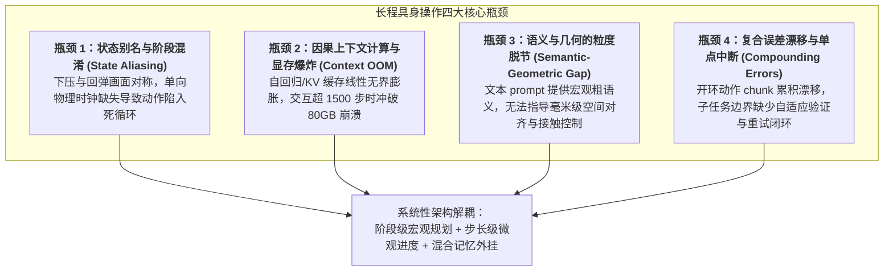
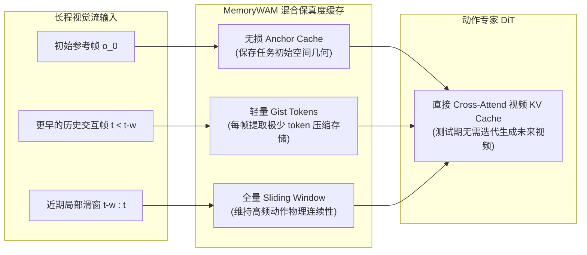
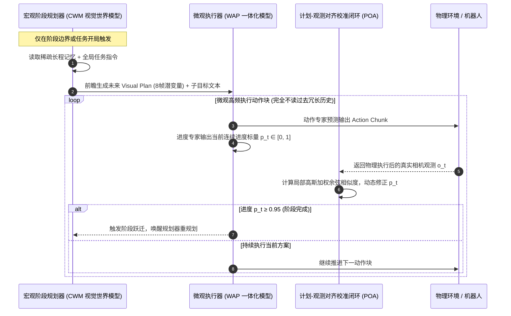
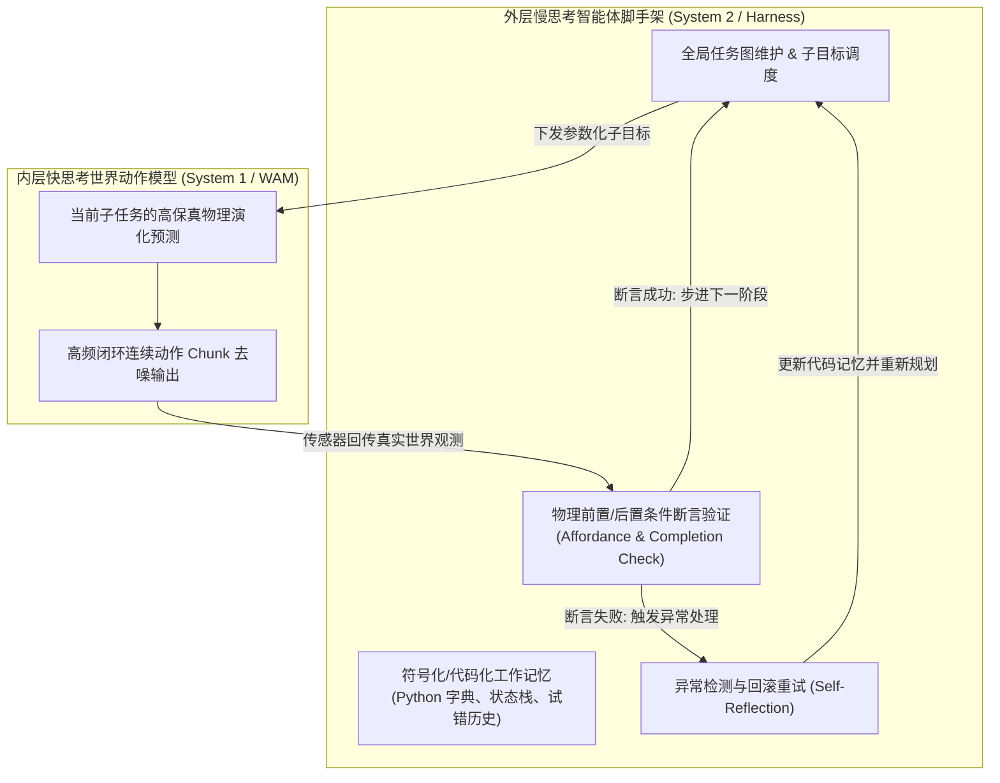
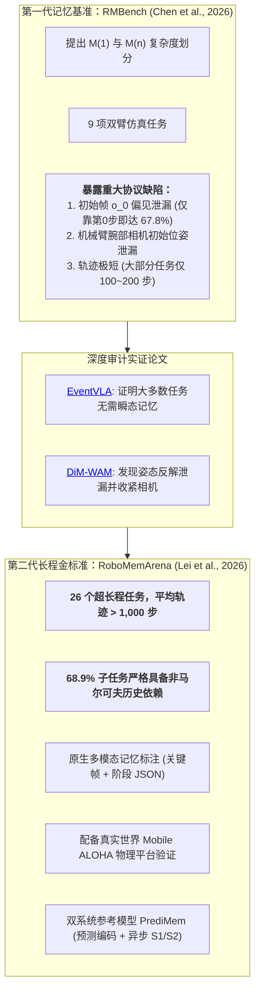

---
tags:
  - papers/WorldModel
  - long-horizon
  - memory
  - agentic-robotics
  - planning
  - benchmark
  - synthesis
aliases:
  - 长程任务世界动作模型全景综述与前沿研究
date: 2026-10-26
status: synthesis
---

# 长程具身任务中的世界动作模型（WAM）体系全景综述：机制、范式演进与落地指南

> [!abstract] 核心命题与演进结论先行
> 传统的具身反应式策略（Reactive Policies，如 Diffusion Policy、$\pi_0$、OpenVLA）均建立在**强马尔可夫假设**之上——即认为单步控制动作仅依赖当前单帧视觉观测 $o_t$ 与全局语言指令 $l$。然而，真实物理世界的长程复合操作在本质上是**部分可观测马尔可夫决策过程（POMDP）**：任务的关键线索往往出现在遥远的初始时刻（如提示牌、积木初始朝向），中途经历频繁的视野遮挡、手部盲区、多阶段试错及动作接触面的反复变换。
>
> 随着世界动作模型（World Action Models, WAMs）的发展，研究重心已从“短程单动作块的高清视频生成”迅速转向**“如何在超长时程中有效保持时间一致性、避免上下文崩溃，并在长程规划中实现微观几何精度与宏观任务推理的兼得”**。
>
> 深入梳理本代码库中 73+ 篇论文（覆盖记忆增强型 WAM、分层规划系统、智能体脚手架与长程记忆基准），长程具身控制的技术演进经历了四次关键范式跃迁：
> 1. **从“无界堆叠历史上下文”到“分层/多保真度记忆压缩”**（代表作：[MemoryWAM](<../MemoryWAM Efficient World Action Modeling with Persistent Memory/paper_DeepPaperNote.md>)、[DiM-WAM](<../DIM-WAM World-Action Modeling with Diverse Historical Event Memory/paper_DeepPaperNote.md>)、[EventVLA](<../EventVLA Event-Driven Visual Evidence Memory for Long-Horizon Vision-Language-Action Policies/paper_DeepPaperNote.md>)）；
> 2. **从“纯文本提示注入”到“语言化进度状态与‘记忆即计划’解耦”**（代表作：[WLA](<../World-Language-Action Model for Unified World Modeling, Language Reasoning, and Action Synthesis/paper_DeepPaperNote.md>)、[MaP-WAM](<../Memory as Plans World-Action Modeling with Memory-Grounded Planning/paper_DeepPaperNote.md>)）；
> 3. **从“端到端黑盒单模型”到“分层智能体外挂系统（M-D-E-H）与代码化记忆”**（代表作：[Towards Agentic Robots](<../Towards Agentic Robots Model, Data, Environment, and Harness/paper_DeepPaperNote.md>)、[HarnessWAM](<../HarnessWAM Bridging Prediction and Deliberation in World Action Models/paper_DeepPaperNote.md>)、[VoLo](<../VoLo A Physical Orchestrator for Open-Vocabulary Long-Horizon Manipulation/paper_DeepPaperNote.md>)、[HyMeS](<../Skills in Weights, Memory in Code Hybrid Learning for Memory-Dependent Robot Manipulation/paper_DeepPaperNote.md>)）；
> 4. **从“存在严重初始帧偏见泄漏的旧基准（RMBench）”向“长时序、强非马尔可夫的新一代全真基准（RoboMemArena）”的跨越**。

---

## 目录
- [一、长程具身操作的核心物理与计算瓶颈](#一长程具身操作的核心物理与计算瓶颈)
- [二、四大主流技术范式全景深度剖析](#二四大主流技术范式全景深度剖析)
  - [范式 1：原生时序与多保真度视觉记忆 WAM](#范式-1原生时序与多保真度视觉记忆-wam)
  - [范式 2：语言化进度与“记忆即计划”解耦范式](#范式-2语言化进度与记忆即计划解耦范式)
  - [范式 3：分层智能体编排与混合代码记忆系统](#范式-3分层智能体编排与混合代码记忆系统)
  - [范式 4：流式因果扩展与滚动前瞻想象](#范式-4流式因果扩展与滚动前瞻想象)
- [三、长程与记忆评测基准演进：从 RMBench 到 RoboMemArena 的审计与重构](#三长程与记忆评测基准演进从-rmbench-到-robomemarena-的审计与重构)
- [四、全景横向对比矩阵与多维选型决策树](#四全景横向对比矩阵与多维选型决策树)
- [五、对基于 Fast-WAM / ImageWAM 开发长程任务的落地改造建议](#五对基于-fast-wam--imagewam-开发长程任务的落地改造建议)

---

# 一、长程具身操作的核心物理与计算瓶颈

在分析具体论文架构之前，必须先厘清长程控制与短程抓取在数学形式和工程部署上的本质鸿沟：



1. **状态别名与动作死循环（State Aliasing & Limit Cycles）**：
   在长程操作（例如连续按按钮、拼装、开关抽屉）中，机械臂“正在接近目标”、“已经接触下压”与“完成下压后回弹撤离”这三个物理阶段在局部相机视野中的画面特征高度重合。若策略仅接收静态任务指令或单帧视觉，策略就会发生相空间中的极限环震荡（死循环），在物体表面反复抬起放下而无法推进任务。
2. **因果上下文无界膨胀与 80GB 显存 OOM 崩溃**：
   传统因果世界模型（如 LingBot-VA、WLA-0）试图通过 Transformer 因果自注意力消化过去的所有交互视频帧。当任务步数达到 1,500~2,000 步时，即便保留 KV 缓存，显存占用也会冲破 **80GB 硬件极限导致 OOM 崩溃**，推理时延呈二次方或线性暴涨，使得高频实时闭环控制彻底瘫痪。
3. **语义与几何的粒度脱节（Semantic-Geometric Disconnect）**：
   许多尝试将 LLM/VLM 规划出的文本子任务直接拼入动作 DiT 的 Cross-Attention prompt 中，结果发现“不仅没有增益，偶尔还会掉点”。其根源在于：**自然语言是高度压缩的高层语义符号，天生缺乏连续欧氏空间中的精确位姿、旋转朝向与接触点法向信息**。底层动作专家在执行精细抓取时，强行条件化于粗糙的文本反而破坏了其基于视觉光流的精确伺服能力。
4. **复合动作漂移与不可逆错误级联（Compounding Errors）**：
   长时程任务由数十个甚至上百个动作块组成，任一动作块的毫米级微小执行漂移若不能及时被观测纠偏，就会在几十步后导致目标滑落或碰撞，引发不可挽回的系统性崩溃。

---

# 二、四大主流技术范式全景深度剖析

---

## 范式 1：原生时序与多保真度视觉记忆 WAM
> **核心代表作**：
> - [MemoryWAM: Efficient World Action Modeling with Persistent Memory](<../MemoryWAM Efficient World Action Modeling with Persistent Memory/paper_DeepPaperNote.md>)
> - [DiM-WAM: World-Action Modeling with Diverse Historical Event Memory](<../DIM-WAM World-Action Modeling with Diverse Historical Event Memory/paper_DeepPaperNote.md>)
> - [EventVLA: Event-Driven Visual Evidence Memory for Long-Horizon Vision-Language-Action Policies](<../EventVLA Event-Driven Visual Evidence Memory for Long-Horizon Vision-Language-Action Policies/paper_DeepPaperNote.md>)
> - [SimpleMemVLA: A Simple but Effective Native-Video Memory for Vision-Language-Action Models](<../SimpleMemVLA A Simple but Effective Native-Video Memory for Vision-Language-Action Models/paper_DeepPaperNote.md>)
> - [BridgeVLA++: A Data-Efficient, Generalizable, and Memory-Augmented Vision-Language-Action Framework](<../BridgeVLA++ A Data-Efficient, Generalizable, and Memory-Augmented Vision-Language-Action Framework/paper_DeepPaperNote.md>)

### 1. 机制演进与设计哲学
该范式的出发点是：**既然长程任务依赖历史视觉，就必须在视频骨干网络中设计高效、有界的记忆缓存结构，让动作专家能够直接读取跨时间步的物理演化表征，同时避免全注意力二次方计算开销**。



- **[MemoryWAM](<../MemoryWAM Efficient World Action Modeling with Persistent Memory/paper_DeepPaperNote.md>)（清华 & 智源）**：
  - **核心洞察**：历史信息在不同时序位置上的“保真度需求”截然不同。任务初始的物体空间拓扑需要**无损保留（Anchor Cache）**；近期局部几步控制需要**连续动力学（Sliding Window Cache）**；而更早的大量过渡交互帧只需要**语义与阶段概括（Gist Tokens）**。
  - **技术实现**：针对早期历史帧，每帧仅提取极少量的 Gist Tokens 追加进持久 KV 缓存，动作专家在去噪动作时直接读取视频骨干网络的同一 KV 缓存。在 RMBench 评测中达到总体 **83.0%** 成功率，单层去噪延迟和显存显著降低。
- **[DiM-WAM](<../DIM-WAM World-Action Modeling with Diverse Historical Event Memory/paper_DeepPaperNote.md>)（清华团队）**：
  - **核心洞察**：无界追加 Gist Token 在几千步任务中依然会线性增长。真正需要保存的是**“发生物理交互质变的关键事件”**，而非均匀采样的时序帧。
  - **技术实现（DHEM）**：设计多库（Multi-Bank）固定容量事件记忆槽位。基于特征余弦相似度计算当前帧的新颖性，容量饱和时淘汰最旧冗余帧，并通过质量加权合并相邻相似事件；同时引入粗粒度任务进度头（Progress Head）监督事件表征。在 RMBench 审计协议下取得 **69.8%** 成功率（相对基线大幅提升 +35%）。
- **[EventVLA](<../EventVLA Event-Driven Visual Evidence Memory for Long-Horizon Vision-Language-Action Policies/paper_DeepPaperNote.md>)（清华 & 港大）**：
  - **核心机制**：提出关键帧事件记忆（Keyframe Event Memory, KEM），根据末端动作变化率与视觉接触突变动态触发关键帧写入，以极稀疏的证据缓存支撑超长程时序回溯。
- **[BridgeVLA++](<../BridgeVLA++ A Data-Efficient, Generalizable, and Memory-Augmented Vision-Language-Action Framework/paper_DeepPaperNote.md>)（中科院自动化所 & FiveAges）**：
  - **核心机制**：粗细分层时空解耦。在粗阶段（Coarse Stage）注入**时间进度记忆**，指导宏观操作流转；在细阶段（Fine Stage）注入**少遮挡几何空间记忆**，实现毫米级精密抓取对齐。在 RMBench 单任务训练评测中报告高达 96.0% 的成功率。

---

## 范式 2：语言化进度与“记忆即计划”解耦范式
> **核心代表作**：
> - [Memory as Plans: World-Action Modeling with Memory-Grounded Planning (MaP-WAM)](<../Memory as Plans World-Action Modeling with Memory-Grounded Planning/paper_DeepPaperNote.md>)
> - [World-Language-Action Model (WLA)](<../World-Language-Action Model for Unified World Modeling, Language Reasoning, and Action Synthesis/paper_DeepPaperNote.md>)
> - [UniWALM: Unified World Action Language Model for Embodied Robot Control](<../UniWALM Unified World Action Language Model for Embodied Robot Control/paper_DeepPaperNote.md>)

### 1. 突破性范式跃迁：为什么纯文本条件会失效，而“记忆即计划”能成？
该范式从根本上颠覆了“执行器必须每步都读长历史”的思维定势，提出了宏观长程规划与微观实时控制的深度解耦：



- **[MaP-WAM (Memory as Plans)](<../Memory as Plans World-Action Modeling with Memory-Grounded Planning/paper_DeepPaperNote.md>)（哈工大、NTU、吉林大学、鹏城实验室，2026.09）**：
  - **核心哲学**：**底层执行器在执行抓取时，根本不需要知道 500 步前发生了什么；它只需要知道“未来 8 步该如何演化，以及当前正处于这一阶段的百分之几”！**
  - **三位一体架构创新**：
    1. **记忆接地的因果世界模型（CWM 视觉规划器）**：基于 WAN-2.2-5B，仅在阶段切换时调用一次，前瞻生成包含未来连续物理变化的 **Visual Plan（8 帧未来潜在视觉流）**。
    2. **世界—动作—进度（WAP）一体化执行模型**：动作专家（1.02B）与进度专家（207M）联合去噪，以生成的 Visual Plan 为前缀条件，**直接预测动作 chunk 与连续进度标量 $p_t \in [0, 1]$**。底层模型执行时历史长度永远固定为 Visual Plan 的常数长度，**执行期显存完全恒定，单块时延牢牢钉死在 ~827ms，彻底规避 80GB OOM 崩溃！**
    3. **自适应对齐校准（Plan-Observation Alignment, POA）**：物理执行后的真实观测与 Visual Plan 进行时序滑窗余弦相似度对齐，以动量校正 $p_t$，消除长程自回归漂移。
  - **统治级战绩**：RMBench 仿真总体 **83.3%** SOTA（$M(n)$ 均值高达 **96.7%**，其中 *Press Button* 达 96%，*Cover Blocks* 达 100%）；Franka 实体机械臂真机多阶段按按钮达到 **68%**（基线策略全部为 0%）。
- **[WLA (World-Language-Action)](<../World-Language-Action Model for Unified World Modeling, Language Reasoning, and Action Synthesis/paper_DeepPaperNote.md>)（2026）**：
  - **核心机制**：在统一自回归序列中，交织子任务语言 Token、世界潜变量与连续动作 Token。在输出动作前，**强制模型显式自回归生成当前执行的文本子任务**。消融实验证实：去掉该语言自回归损失后，$M(n)$ 成功率从 56.5% 崩塌至 17.3%。语言在此处充当了**可解释、可读写的离散阶段工作记忆**。

---

## 范式 3：分层智能体编排与混合代码记忆系统
> **核心代表作**：
> - [Towards Agentic Robots: Model, Data, Environment, and Harness](<../Towards Agentic Robots Model, Data, Environment, and Harness/paper_DeepPaperNote.md>)
> - [HarnessWAM: Bridging Prediction and Deliberation in World Action Models](<../HarnessWAM Bridging Prediction and Deliberation in World Action Models/paper_DeepPaperNote.md>)
> - [Harness VLA: Steering Frozen VLAs into Reliable Manipulation Primitives via Memory-Guided Agents](<../Harness VLA Steering Frozen VLAs into Reliable Manipulation Primitives via Memory-Guided Agents/paper_DeepPaperNote.md>)
> - [VoLo: A Physical Orchestrator for Open-Vocabulary Long-Horizon Manipulation](<../VoLo A Physical Orchestrator for Open-Vocabulary Long-Horizon Manipulation/paper_DeepPaperNote.md>)
> - [Agentic World Action Models (AW-0)](<../Agentic World Action Models/paper_DeepPaperNote.md>)
> - [Skills in Weights, Memory in Code (HyMeS)](<../Skills in Weights, Memory in Code Hybrid Learning for Memory-Dependent Robot Manipulation/paper_DeepPaperNote.md>)
> - [ASPIRE: Agentic Skills Discovery for Robotics](<../ASPIRE Agentic Skills Discovery for Robotics/paper_DeepPaperNote.md>)
> - [CodeActionBench: Evaluating Agentic Code-as-Policy for Embodied Manipulation](<../CodeActionBench Evaluating Agentic Code-as-Policy for Embodied Manipulation/paper_DeepPaperNote.md>)

### 1. 架构哲学：双系统解耦与外挂脚手架（Harness System）
如果将单个 WAM 模型视为人类小脑（具备强大的物理直觉与高频肌肉运动反射），那么超长时程任务就必须引入大脑（负责任务图拆解、语义工作记忆与异常重试）：



- **[Towards Agentic Robots](<../Towards Agentic Robots Model, Data, Environment, and Harness/paper_DeepPaperNote.md>)（具身智能奠基性综述）**：
  - 首次确立了具身智能体的四大支柱：**Model（模型底座）、Data（数据飞轮）、Environment（物理/仿真环境）与 Harness（外挂脚手架系统）**。明确指出单靠增大单一多模态模型的参数量无法解决长程任务的组合爆炸，必须依靠 Harness 系统提供记忆外挂、工具调用与断言式阶段闭环。
- **[HarnessWAM](<../HarnessWAM Bridging Prediction and Deliberation in World Action Models/paper_DeepPaperNote.md>) & [Harness VLA](<../Harness VLA Steering Frozen VLAs into Reliable Manipulation Primitives via Memory-Guided Agents/paper_DeepPaperNote.md>)**：
  - **核心机制**：保持底层的 WAM 或 VLA 权重完全冻结（保持高频控制与强大的基础操作通用性），外挂一个由通用 VLM/LLM 驱动的慢思考 Agent。Agent 维护一个包含历史轨迹语义摘要、已尝试失败操作的记忆库，动态调节底层策略的上下文前缀，并在检测到抓取失败时强制调用回滚策略。
- **[Skills in Weights, Memory in Code (HyMeS)](<../Skills in Weights, Memory in Code Hybrid Learning for Memory-Dependent Robot Manipulation/paper_DeepPaperNote.md>)（2026）**：
  - **核心洞察**：**将“连续物理反射”固化在神经网络权重中，将“离散组合记忆”交由代码空间中的智能体管理！**
  - **优势**：在非马尔可夫记忆基准（RoboMemArena）中，彻底避免了为了学习不同时序排列组合而采集海量演示数据的困境；神经网络只学通用的原子动作基元，复杂的历史状态转移逻辑直接用 Python 数据结构（List, Dict, Graph）在运行时维护。
- **[VoLo](<../VoLo A Physical Orchestrator for Open-Vocabulary Long-Horizon Manipulation/paper_DeepPaperNote.md>)**：
  - 提出物理编排器（Physical Orchestrator），利用高层视觉语言模型进行开放词表长程任务分解，配合空间亲和度图（Affordance Map）将子任务精准分发至底层几何操作基元。
- **[Agentic World Action Models (AW-0)](<../Agentic World Action Models/paper_DeepPaperNote.md>)**：
  - 创新地在统一的 Mixture-of-Transformers (MoT) 架构中，实现了**离散代码规划、连续视频前瞻潜码与连续电机动作的三流联合流匹配去噪**，将程序逻辑深度内生于世界模型的动力学生成过程中。

---

## 范式 4：流式因果扩展与滚动前瞻想象
> **核心代表作**：
> - [Long-WAM: Scaling the Context of World-Action Models](<../Long-WAM Scaling the Context of World-Action Models/paper_DeepPaperNote.md>)
> - [Rolling-WAM: World Action Models with Rolling Imagination](<../Rolling-WAM World Action Models with Rolling Imagination/paper_DeepPaperNote.md>)
> - [Hierarchical Denoising For Multi-Step Visual Reasoning (HDR)](<../Hierarchical Denoising For Multi-Step Visual Reasoning/paper_DeepPaperNote.md>)

- **[Long-WAM](<../Long-WAM Scaling the Context of World-Action Models/paper_DeepPaperNote.md>)**：
  - 证明了扩展长视觉上下文的关键在于**视频基座必须具备原生的自回归因果视频建模能力**。通过设计因果掩码注意力优化与流式隐变量编码，在单张消费级 GPU（RTX 4090）上实现了超长视觉上下文下的 107.4ms 超实时闭环控制。
- **[Rolling-WAM](<../Rolling-WAM World Action Models with Rolling Imagination/paper_DeepPaperNote.md>)**：
  - 解决了超长程任务中未来想象的“失真与累积漂移”。提出**滑动窗口错峰去噪与暖启动进位机制**，让世界模型在推演几十步后不发生画面崩溃，以 215ms 的平直延迟持久维护高达 80 步的物理前瞻轨迹。

---

# 三、长程与记忆评测基准演进：从 RMBench 到 RoboMemArena 的审计与重构

随着长程技术研究的深入，学界对评测基准的审计揭露了既有基准的严重缺陷，并确立了新一代评测金标准：



### 1. RMBench 的历史功绩与致命缺陷
- **历史功绩**：[RMBench](<../RMBench Memory-Dependent Robotic Manipulation Benchmark with Insights into Policy Design/paper_DeepPaperNote.md>) 首次在具身操作中把长程依赖从单纯的“步数长”解构为结构化的记忆复杂度：$M(1)$（只需单次关键历史帧，但当前帧不可见）与 $M(n)$（需跨交互多步动态累积历史）。
- **[EventVLA](<../EventVLA Event-Driven Visual Evidence Memory for Long-Horizon Vision-Language-Action Policies/paper_DeepPaperNote.md>) 揭露的“初始帧作弊”**：
  在 *Rearrange Blocks*、*Put Back Block* 等任务中，目标方块和插槽在任务第 0 步就已经静态陈列在桌面上。策略**根本不需要记忆交互过程中的任何动态变化**，只需把第 0 步图像 $o_0$ 作为静态参考输入，就能凭借纯马尔可夫的滑窗策略刷出 **67.8%** 的虚高成绩！
- **[DiM-WAM](<../DIM-WAM World-Action Modeling with Diverse Historical Event Memory/paper_DeepPaperNote.md>) 揭露的“腕部姿态泄漏”**：
  在声称目标已不在视野的 $M(1)$ 任务中，仅开启机械臂腕部相机，基线成功率就从 41% 暴涨至 86%。其原因是机械臂初始位姿的细微差异直接泄漏了目标坐标。

### 2. 新一代权威基准：RoboMemArena（Lei et al., 2026）
为彻底终结伪长程与虚假记忆评测，多所顶尖高校联合推出了 **[RoboMemArena](<../RoboMemArena A Comprehensive and Challenging Robotic Memory Benchmark/paper_DeepPaperNote.md>)**：
- **超长步长**：26 个任务，平均轨迹步数突破 **1,000 步**（真正考验长程执行的耐久性与抗漂移能力）。
- **严格非马尔可夫构念**：68.9% 的子任务被严格证明若移除历史观测将产生严重决策歧义（涵盖动态转移映射、遮挡后位置追踪、动作重复计数与严格顺序依赖）。
- **原生多模态与阶段状态标注**：不仅提供终点奖励，还通过原子物理交互锚点提取原生关键帧与结构化 JSON 阶段指令。
- **参考架构 PrediMem**：提出双系统架构，高层 VLM 规划器（S2）通过预测编码（Predictive Coding）监督关键帧写入，底层 S1 异步高频执行动作。

---

# 四、全景横向对比矩阵与多维选型决策树

### 1. 本地仓库长程/记忆核心模型全景对比表

| 核心模型 / 框架 | 所属范式 | 记忆承载介质 | 底层执行器单步时延与显存特性 | RMBench 总体成功率 | RoboMemArena 表现 | 解决状态别名与死循环的核心手段 |
|---|---|---|---|---:|---:|---|
| **[Mem-0](<../RMBench Memory-Dependent Robotic Manipulation Benchmark with Insights into Policy Design/paper_DeepPaperNote.md>)** | 双系统记忆基线 | 关键图像帧 + 语言日记 | 检索引起波动；高层较慢 | 42.0% | — | 外部二值终止分类器（单点故障） |
| **[WLA-0](<../World-Language-Action Model for Unified World Modeling, Language Reasoning, and Action Synthesis/paper_DeepPaperNote.md>)** | 语言化离散状态 | 统一 Token 流中的子任务文本 | 显存随文本增长；中等延迟 | 56.5% ($M(n)$) | — | 自回归预测当前子任务文本强制状态同步 |
| **[MemoryWAM](<../MemoryWAM Efficient World Action Modeling with Persistent Memory/paper_DeepPaperNote.md>)** | 多保真度视觉缓存 | Anchor 帧 + 逐帧 Gist KV 缓存 | $O(N/d)$ 线性追加；显存持续增长 | 83.0% | — | 高保真视觉隐空间特征连续区分 |
| **[DiM-WAM](<../DIM-WAM World-Action Modeling with Diverse Historical Event Memory/paper_DeepPaperNote.md>)** | 有界事件流 | 多库事件 Token (固定 $K \times N$) | 固定常数 Token 预算；显存平直 | 69.8% (审计版) | — | 粗进度监督头辅助阶段识别 |
| **[MaP-WAM](<../Memory as Plans World-Action Modeling with Memory-Grounded Planning/paper_DeepPaperNote.md>)** | 记忆即计划 (解耦) | 未来 8 帧 Visual Plan + 连续标量 $p_t$ | **完全不读历史；恒定 ~827ms，彻底无 OOM** | **83.3% (SOTA)** | — | **连续进度模态 $p_t$ + 计划观测自适应校准** |
| **[HyMeS](<../Skills in Weights, Memory in Code Hybrid Learning for Memory-Dependent Robot Manipulation/paper_DeepPaperNote.md>)** | 混合神经代码智能体 | 神经网络权重 (技能) + Python 代码 (记忆) | 策略单步毫秒级；代码调用几乎无开销 | — | **强劲优势** | 代码显式维护已尝试字典与状态转移机 |
| **[PrediMem](<../RoboMemArena A Comprehensive and Challenging Robotic Memory Benchmark/paper_DeepPaperNote.md>)** | 双系统预测编码 | 异步双系统：近期 Buffer + 动态关键帧库 | S2 规划约 0.939s；S1 动作高频执行 | — | **基准 SOTA** | 预测编码迫使特征解释即将发生的变化 |
| **[HarnessWAM](<../HarnessWAM Bridging Prediction and Deliberation in World Action Models/paper_DeepPaperNote.md>)** | 外挂 Agent 编排 | 外部语义状态图 + 动作断言历史 | 冻结底层策略极快；慢思考按需触发 | — | 优异泛化 | 慢思考 Agent 异常检测与物理条件回滚 |

---

### 2. 长程具身系统选型决策树

```text
长程任务系统设计与选型：
│
├── 场景 A：需要单模型端到端训练，任务在 500 步以内，注重高保真视觉几何
│    ├── 追求极低部署延迟与执行期防爆显存 ──> 选择【MaP-WAM】架构 (Visual Plan + Progress Head)
│    └── 拥有连续视频骨干与充足显存 ──> 选择【MemoryWAM / DiM-WAM】(多保真度/有界事件 KV 缓存)
│
├── 场景 B：任务属于超长时程 (>1,000 步)、多阶段组合、存在频繁试错与非马尔可夫决策
│    ├── 拥有基础技能演示，不想收集海量排列组合数据 ──> 选择【HyMeS】(权重存物理技能，代码存长程记忆)
│    └── 底层动作策略已训练好且冻结，需提升宏观任务成功率 ──> 选择【HarnessWAM / Towards Agentic Robots】(外挂慢思考 Agent 脚手架)
│
└── 场景 C：轻量级改装现有 DiT 动作模型 (如 Fast-WAM / ImageWAM)
     └── 直接实施【MaP-WAM 轻量简化版方案】(见下节落地改造指南)
```

---

# 五、对基于 Fast-WAM / ImageWAM 开发长程任务的落地改造建议

针对你在基于 ImageWAM（FLUX.2 骨干）和 Fast-WAM 架构上解决 RMBench 等长程任务时的技术卡点，结合上述论文的机制验证，整理出**极具实操价值的三步工程改造方案**：

### 改造 1：破解死循环——在 DiT 中引入归一化连续进度标量（Progress Conditioning）
- **痛点对齐**：直接拼子任务文本无法解决“下压与回弹”对称画面引起的动作震荡。
- **具体做法**：
  1. 在数据处理阶段，根据 RMBench 数据标注中的 `subtask_text` 边界，计算当前帧在当前子任务内的**归一化进度标量**：
     $$p_t = \frac{t - t_{\text{start}}}{t_{\text{end}} - t_{\text{start}}} \in [0.0, 1.0]$$
  2. 在 ImageWAM / DiT 的网络结构中：
     - **训练期**：将标量 $p_t$ 经过正弦位置编码（Sinusoidal Positional Embedding）投影至与扩散时间步 $t_{\text{diff}}$ 相同的维度，直接相加后送入 DiT 的 AdaLN（自适应层归一化）中；
     - 同时，在动作预测头并行外挂一个极简的 2 层 MLP 进度预测头，计算回归损失 $\mathcal{L}_{\text{progress}} = \| \hat{p}_t - p_t \|_2$；
     - **推理期**：利用自回归预测出的 $\hat{p}_t$ 作为下一时间步的输入条件。当 $\hat{p}_t \ge 0.95$ 时，判定当前子任务已自然完成，优雅触发下一阶段！

### 改造 2：破解纯文本粗糙性——以“初始视觉锚点 + 目标图像”替代纯文本 prompt
- **痛点对齐**：根据 [EventVLA](<../EventVLA Event-Driven Visual Evidence Memory for Long-Horizon Vision-Language-Action Policies/paper_DeepPaperNote.md>) 的实证审计，RMBench 绝大多数空间线索都潜藏在第 0 步画面中；而单纯的文本 cross-attention 无法提供厘米级几何信息。
- **具体做法**：
  1. **Visual Anchor 必选常驻**：输入序列中除当前帧 $o_t$ 外，**必须永远拼接第 0 步图像 $o_0$（或当前子任务的初始帧 $o_{\text{sub\_start}}$）**；
  2. **将 ImageWAM 的图像编辑优势最大化**：FLUX.2 本身就是强大的图像生成与编辑底座。与其让它单纯作为文本条件的动作生成器，不如利用其生成能力，先以 $(o_0, o_t, \text{subtask})$ 为条件预测当前子任务完成时的**局部目标画面潜码（Goal Visual Latent）**，再由动作专家以该目标潜码为条件生成动作。这直接将文本与动作之间的语义鸿沟，转化为视觉到视觉的流匹配对齐。

### 改造 3：解耦宏观与微观——构建双频异步 Harness 调度回路
- **痛点对齐**：避免在每一个 10Hz/20Hz 的底层动作块去噪步中频繁调用高层大语言模型，规避推理延迟雪崩。
- **具体做法**：
  - **高层（0.2Hz~0.5Hz，慢思考）**：采用轻量 VLM（如 Qwen3-VL-4B），仅在检测到阶段完成（$p_t \ge 0.95$）或执行异常时唤醒一次，负责解析全局进度并下发当前子任务的目标描述与初始视觉参考；
  - **底层（10Hz~20Hz，快思考）**：ImageWAM 执行器仅以高层下发的目标与本地滑窗为条件，以恒定极短上下文高速流匹配去噪输出动作块，并在本地维持平滑的进度推断。
